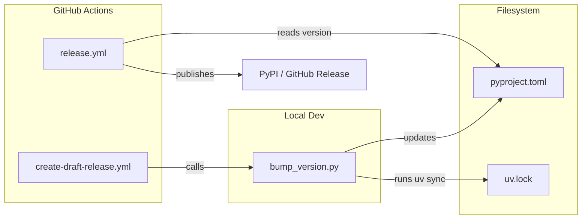

<!-- source: DeepWiki mcp.deepwiki.com · repo OpenPipe/ART · page 8.2 Project Structure · fetched 2026-10-29 -->

# Project Structure

<details>
<summary>Relevant source files</summary>

The following files were used as context for generating this wiki page:

- [.github/workflows/create-draft-release.yml](.github/workflows/create-draft-release.yml)
- [.github/workflows/package-install.yml](.github/workflows/package-install.yml)
- [.github/workflows/release.yml](.github/workflows/release.yml)
- [AGENT.md](AGENT.md)
- [CONTRIBUTING.md](CONTRIBUTING.md)
- [scripts/bump_version.py](scripts/bump_version.py)
- [src/art/__init__.py](src/art/__init__.py)
- [src/art/openai.py](src/art/openai.py)
- [src/art/transformers/patches.py](src/art/transformers/patches.py)
- [src/art/types.py](src/art/types.py)
- [vllm_runtime/src/art_vllm_runtime/patches.py](vllm_runtime/src/art_vllm_runtime/patches.py)

</details>


This page describes the physical layout of the ART repository — what directories exist, what each contains, and which source files implement which subsystems. It is intended as a navigation reference for contributors exploring the codebase.

For the conceptual model of how these components interact at runtime, see the [Core Framework](#2) overview. For setup instructions, see [Development Setup](#8.1).

---

## Repository Root

```
ART/
├── src/
│   ├── art/            # Main installable library (openpipe-art)
│   └── mp_actors/      # Multiprocess actor framework (also installed)
├── vllm_runtime/       # Sub-package for managed vLLM environment
├── examples/           # Training notebooks and scripts
├── docs/               # Mintlify documentation source
├── scripts/            # Release and CI helper scripts
├── tests/              # Unit and integration tests
├── .github/
│   └── workflows/      # CI/CD GitHub Actions workflows
├── .agents/
│   └── skills/         # Bundled agent skills (packaged as art/skills)
├── pyproject.toml      # Project metadata, dependencies, build config
├── uv.lock             # Locked dependency graph
├── CONTRIBUTING.md     # Contributor guide
└── AGENT.md            # AI agent instructions for this repo
```

The build system is `hatchling`. Both `src/art` and `src/mp_actors` are included in the wheel. The `.agents/skills` directory is bundled as `art/skills` inside the installed package.

Sources: [AGENT.md:3-7](), [CONTRIBUTING.md:1-14]()

---

## `src/art` — Core Library

This is the primary installable package. Its top-level modules define the public API; its subdirectories implement backends, training engines, and integrations.

**Diagram: `src/art` subdirectory layout mapped to code entities**

```mermaid
graph TD
    subgraph "src/art/"
        BE["backend.py
        Backend (protocol)"]
        MO["model.py
        Model
        TrainableModel"]
        TR["trajectories.py
        Trajectory
        TrajectoryGroup"]
        TY["types.py
        TrainConfig
        TrainSFTConfig
        LocalTrainResult"]
        GA["gather.py
        gather_trajectories()
        gather_trajectory_groups()"]

        subgraph "dev/"
            DV["InternalModelConfig
            OpenAIServerConfig
            validate.py"]
        end

        subgraph "local/"
            LO["backend.py: LocalBackend
            service.py: ModelService"]
        end

        subgraph "unsloth/"
            US["service.py: UnslothService
            train.py"]
        end

        subgraph "torchtune/"
            TT["service.py: TorchtuneService
            recipe.py"]
        end

        subgraph "vllm/"
            VL["openai_server_task()
            dedicated_server.py"]
        end

        subgraph "megatron/"
            ME["service.py: MegatronService
            runtime_config.py"]
        end

        subgraph "tinker/"
            TK["service.py: TinkerService
            server.py: OpenAICompatibleTinkerServer"]
        end

        subgraph "serverless/"
            SL["backend.py: ServerlessBackend"]
        end

        subgraph "skypilot/"
            SK["backend.py: SkyPilotBackend"]
        end

        subgraph "utils/"
            UT["s3.py
            trajectory_migration.py"]
        end
        
        subgraph "transformers/"
            TP["patches.py: patch_preprocess_mask_arguments()"]
        end
    end
```



Sources: [src/art/__init__.py:61-88](), [src/art/types.py:26-107]()

---

### Top-Level Modules

| File | Key Exports |
|---|---|
| `backend.py` | `Backend` (protocol) |
| `model.py` | `Model`, `TrainableModel` |
| `trajectories.py` | `Trajectory`, `TrajectoryGroup` |
| `types.py` | `TrainConfig`, `TrainSFTConfig`, `LocalTrainResult`, `Messages` |
| `gather.py` | `gather_trajectories`, `gather_trajectory_groups` |
| `openai.py` | `consume_chat_completion_stream`, `update_chat_completion` |

Sources: [src/art/__init__.py:61-88](), [src/art/openai.py:16-84]()

---

### `vllm_runtime/` — Managed Runtime Sub-package

This directory contains `art-vllm-runtime`, a specialized sub-package used to maintain a patched vLLM environment isolated from the main ART dependencies.

| File | Key Symbols |
|---|---|
| `src/art_vllm_runtime/patches.py` | `apply_vllm_runtime_patches`, `subclass_chat_completion_request`, `patch_nccl_unique_id_bootstrap` |

The runtime is verified during the release process via smoke tests that ensure `ensure_vllm_runtime()` can successfully provision and import the environment.

Sources: [vllm_runtime/src/art_vllm_runtime/patches.py:14-171](), [.github/workflows/release.yml:79-113]()

---

### `local/` — LocalBackend

| File | Key Symbols |
|---|---|
| `backend.py` | `LocalBackend` — implements `Backend` protocol |
| `service.py` | `ModelService` — protocol for training services |

`LocalBackend` manages the lifecycle of training services like `UnslothService` or `TorchtuneService`.

---

### `unsloth/` — Default Training Service

| File | Key Symbols |
|---|---|
| `service.py` | `UnslothService` |
| `train.py` | `train` |

`UnslothService` provides the primary implementation for LoRA-based training on single or shared GPUs.

---

### `megatron/` — MegatronBackend

| File | Key Symbols |
|---|---|
| `service.py` | `MegatronService` |
| `runtime_config.py` | `get_megatron_runtime_config`, `init_megatron_runtime_config` |

Handles distributed training across multiple GPUs using Megatron-LM. It uses `MegatronTopologyConfig` to define parallelism (TP, PP, CP, EP).

Sources: [src/art/types.py:33-48](), [src/art/__init__.py:67-70]()

---

### `transformers/` — Framework Patches

Contains critical monkey-patches for the `transformers` library to support ART's advanced features like attention masking for additional histories.

| File | Key Symbols |
|---|---|
| `patches.py` | `patch_preprocess_mask_arguments`, `disable_broken_torchvision_for_transformers` |

Sources: [src/art/transformers/patches.py:36-65]()

---

## `src/mp_actors` — Multiprocess Actor Framework

A standalone utility package included in the ART wheel. It provides the infrastructure for moving training services into isolated child processes to manage GPU memory and prevent library conflicts.

Sources: [src/art/__init__.py:90-118]()

---

## `examples/`

Contains subdirectories for each example application, each typically holding a Jupyter notebook and supporting Python files. Subdirectories include `2048/`, `tic-tac-toe/`, `codenames/`, `tau-bench/`, `art-e/`, `open-deep-research/`, `temporal-clue/`, `yes-no-maybe/`, and `hacker-news/`.

Sources: [CONTRIBUTING.md:136-140]()

---

## `scripts/` — Automation

**Diagram: Release and Versioning Data Flow**



Sources: [scripts/bump_version.py:1-60](), [.github/workflows/create-draft-release.yml:43-49]()

---

## `tests/`

The test suite is split into unit and integration tests. Code quality is enforced via `prek`, which runs `ruff`, `pyright`, and `pytest`.

| Command | Purpose |
|---|---|
| `uv run prek run --all-files` | Runs all formatting, linting, type checks, and unit tests |
| `uv run prek run pytest` | Runs the test suite |

Sources: [CONTRIBUTING.md:16-36](), [AGENT.md:9-12]()

---

## `.github/workflows/` — CI/CD

| Workflow file | Purpose |
|---|---|
| `create-draft-release.yml` | Automates version bumping, generates release notes from PRs, and creates a draft release. |
| `release.yml` | Triggered on merged release PRs. Builds the package, runs smoke tests on the `vllm_runtime`, tags the repo, and publishes to PyPI. |
| `package-install.yml` | Performs smoke tests on `uv add` and `uv sync` for the `[backend]` extra. |

Sources: [.github/workflows/release.yml:1-58](), [.github/workflows/package-install.yml:1-46]()

---

