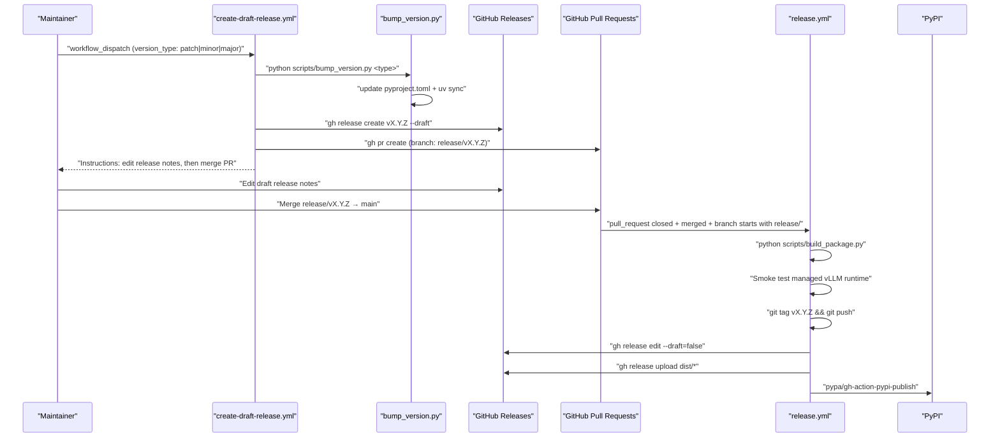
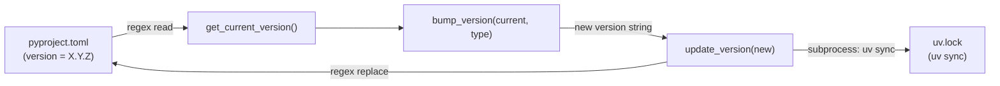
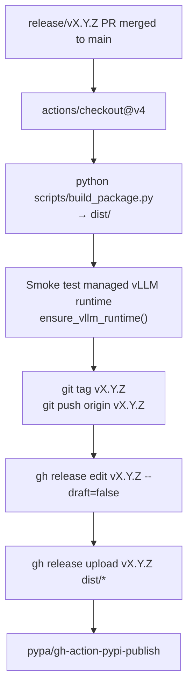

<!-- source: DeepWiki mcp.deepwiki.com · repo OpenPipe/ART · page 8.3 Release Process · fetched 2026-10-29 -->

# Release Process

Relevant source files

The following files were used as context for generating this wiki page:

- [.github/workflows/create-draft-release.yml](.github/workflows/create-draft-release.yml)
- [.github/workflows/package-install.yml](.github/workflows/package-install.yml)
- [.github/workflows/prek.yml](.github/workflows/prek.yml)
- [.github/workflows/release.yml](.github/workflows/release.yml)
- [AGENT.md](AGENT.md)
- [CONTRIBUTING.md](CONTRIBUTING.md)
- [scripts/bump_version.py](scripts/bump_version.py)
- [scripts/ci/build_and_push_uv_cache.sh](scripts/ci/build_and_push_uv_cache.sh)
- [scripts/ci/compute_uv_fingerprint.py](scripts/ci/compute_uv_fingerprint.py)

This page documents the end-to-end release process for the ART Python package: how versions are bumped, how GitHub releases are drafted and finalized, and how the package is published to PyPI. This covers the tooling in `scripts/bump_version.py` and the GitHub Actions workflows in `.github/workflows/`.

---

## Overview

The release process is split into two distinct phases, each backed by a GitHub Actions workflow:

1. **Draft creation** — triggered manually; bumps the version, opens a release PR, and creates a draft GitHub release.
2. **Publication** — triggered automatically when the release PR is merged to `main`; tags the commit, performs a smoke test on the managed vLLM runtime, publishes the release, and uploads the package to PyPI.

**Release workflow diagram**

Sources: [.github/workflows/create-draft-release.yml:1-116](), [.github/workflows/release.yml:1-114](), [scripts/bump_version.py:1-92]()

---

## Version Bumping

Version bumping is handled by `scripts/bump_version.py`. The script follows [Semantic Versioning](https://semver.org/) with three bump levels:

| Bump type | Example result | When to use |
|-----------|---------------|-------------|
| `patch`   | 0.3.13 → 0.3.14 | Bug fixes and minor changes |
| `minor`   | 0.3.13 → 0.4.0  | New features, non-breaking changes |
| `major`   | 0.3.13 → 1.0.0  | Breaking changes |

### Script internals

The script defines three functions:

| Function | Purpose |
|----------|---------|
| `get_current_version()` | Reads `version = "..."` from `pyproject.toml` using a regex `PROJECT_VERSION_RE` [scripts/bump_version.py:16-28]() |
| `bump_version(current_version, bump_type)` | Computes the new version string by incrementing major, minor, or patch components [scripts/bump_version.py:31-42]() |
| `update_version(new_version)` | Writes the new version back to `pyproject.toml` and runs `uv sync` to update `uv.lock` [scripts/bump_version.py:45-60]() |

The version field matched is `version = "X.Y.Z"` inside `pyproject.toml`. After updating the file, `uv sync` is run so `uv.lock` stays consistent.

Sources: [scripts/bump_version.py:16-60]()

**Version bump logic diagram**

Sources: [scripts/bump_version.py:16-60]()

---

## Phase 1: Creating a Draft Release

**Workflow file:** [.github/workflows/create-draft-release.yml]()

**Trigger:** Manual via GitHub Actions UI (`workflow_dispatch`) with a required `version_type` input [create-draft-release.yml:4-15]().

### What the workflow does

1. **Checks out the repository** with full history (`fetch-depth: 0`) so the previous tag can be found [create-draft-release.yml:24-26]().
2. **Runs `bump_version.py`** with the chosen bump type, writing a new version into `pyproject.toml` and `uv.lock` [create-draft-release.yml:43-48]().
3. **Generates release notes** by finding the date of the last git tag and querying merged PRs since that date using the GitHub CLI (`gh pr list`) [create-draft-release.yml:50-77]().
4. **Creates a draft GitHub release** for `vX.Y.Z` using the generated notes file [create-draft-release.yml:79-86]().
5. **Opens a release PR** on a branch named `release/vX.Y.Z` that commits the updated `pyproject.toml` and `uv.lock`. The PR body instructs maintainers to curate the draft release highlights before merging [create-draft-release.yml:88-108]().

Sources: [.github/workflows/create-draft-release.yml:24-108]()

---

## Phase 2: Publishing the Release

**Workflow file:** [.github/workflows/release.yml]()

**Trigger:** `pull_request` event of type `closed` targeting `main`, where the PR is merged and the branch name starts with `release/` [release.yml:3-6, 26]().

### What the workflow does

1. **Builds the package** using `python scripts/build_package.py`, producing artifacts in `dist/` [release.yml:44-45]().
2. **Runtime Smoke Test**: Installs the newly built wheel and verifies that the managed vLLM runtime can be successfully initialized and imported via `art.vllm_runtime.ensure_vllm_runtime()` [release.yml:59-114]().
3. **Creates a git tag** (`v<VERSION>`) and pushes it to the repository [release.yml:129-134]().
4. **Publishes the draft release** by calling `gh release edit vX.Y.Z --draft=false`. If no draft release is found, the workflow fails [release.yml:136-145]().
5. **Uploads build artifacts** (`dist/*`) to the GitHub release using `gh release upload` [release.yml:147-151]().
6. **Publishes to PyPI** using the `pypa/gh-action-pypi-publish@release/v1` action [release.yml:153-154]().

### Required permissions and secrets

| Resource | Required value |
|----------|---------------|
| `contents` permission | `write` (for tagging and release editing) [release.yml:20]() |
| `id-token` permission | `write` (for PyPI trusted publishing) [release.yml:21]() |
| `GH_TOKEN` | Automatically provided by GitHub Actions for CLI calls [release.yml:138, 149]() |

### Publish pipeline diagram

Sources: [.github/workflows/release.yml:24-154]()

---

## End-to-End Release Checklist

The steps below match the canonical checklist in `CONTRIBUTING.md`:

1. **Review merged PRs** since the last release to understand what changed and identify breaking changes [CONTRIBUTING.md:58-61]().
2. **Trigger the draft release workflow** via GitHub Actions UI:
   - Navigate to Actions → *Create Draft Release* → *Run workflow*
   - Select the correct `version_type` (`patch`, `minor`, or `major`) [CONTRIBUTING.md:63-69]().
3. **Edit the draft release notes** on the GitHub Releases page:
   - Add a curated *Release Highlights* section and curate the auto-generated PR list [CONTRIBUTING.md:71-75]().
4. **Merge the release PR** (`release/vX.Y.Z` → `main`). This automatically triggers the publication workflow which tags the commit, publishes the release notes, and uploads the package to PyPI [CONTRIBUTING.md:77-82]().

Sources: [CONTRIBUTING.md:58-82]()

---

## File Reference

| File | Role |
|------|------|
| `scripts/bump_version.py` | Version bump utility; updates `pyproject.toml` and runs `uv sync` [scripts/bump_version.py:1-92]() |
| `.github/workflows/create-draft-release.yml` | Manual workflow; bumps version, creates draft release, opens release PR [create-draft-release.yml:1-116]() |
| `.github/workflows/release.yml` | Triggered on release PR merge; builds, tags, publishes release and PyPI package [release.yml:1-114]() |
| `pyproject.toml` | Canonical version source; field `version = "X.Y.Z"` is read and written by `bump_version.py` [scripts/bump_version.py:23, 47]() |
| `uv.lock` | Updated automatically by `uv sync` during version bump [scripts/bump_version.py:59]() |

Sources: [scripts/bump_version.py:1-92](), [.github/workflows/create-draft-release.yml:1-116](), [.github/workflows/release.yml:1-114]()

---

