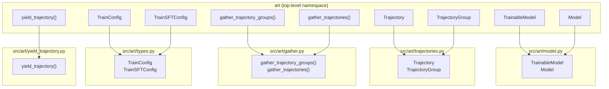
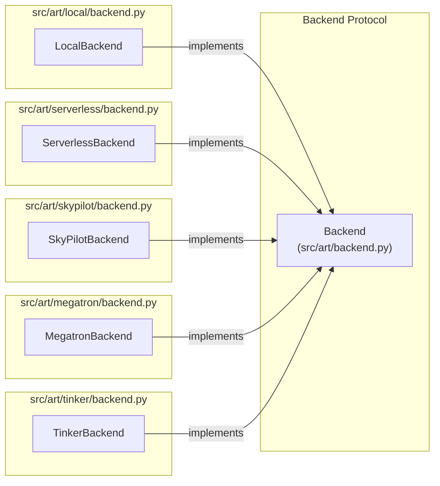
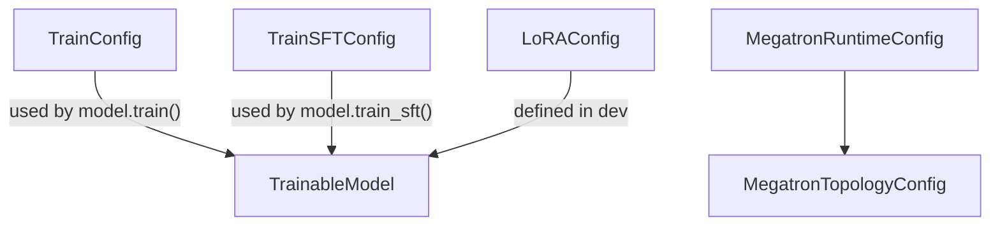
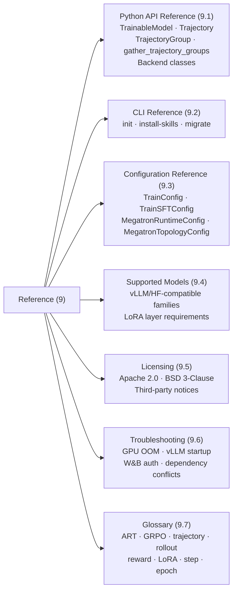

<!-- source: DeepWiki mcp.deepwiki.com · repo OpenPipe/ART · page 9 Reference · fetched 2026-10-29 -->

# Reference

<details>
<summary>Relevant source files</summary>

The following files were used as context for generating this wiki page:

- [.env.example](.env.example)
- [examples/tic_tac_toe/tic-tac-toe.py](examples/tic_tac_toe/tic-tac-toe.py)
- [examples/tic_tac_toe_self_play/deploy_step.py](examples/tic_tac_toe_self_play/deploy_step.py)
- [scripts/deploy-model.py](scripts/deploy-model.py)
- [src/art/__init__.py](src/art/__init__.py)
- [src/art/backend.py](src/art/backend.py)
- [src/art/cli.py](src/art/cli.py)
- [src/art/openai.py](src/art/openai.py)
- [src/art/transformers/patches.py](src/art/transformers/patches.py)
- [src/art/types.py](src/art/types.py)
- [src/art/utils/deploy_model.py](src/art/utils/deploy_model.py)
- [src/art/utils/output_dirs.py](src/art/utils/output_dirs.py)
- [src/art/utils/s3.py](src/art/utils/s3.py)

</details>


This section is the complete technical reference for the ART library. It covers the public Python API, the CLI, all configuration objects, supported model families, licensing, troubleshooting, and the glossary. The material here is prescriptive and exhaustive — for conceptual explanations, tutorials, or guides, see the [Overview](#1) and [Core Framework](#2) sections instead.

---

## What Is Covered Here

| Page | Content |
|---|---|
| [Python API Reference](#9.1) | All public classes and functions: `TrainableModel`, `Trajectory`, `TrajectoryGroup`, `gather_trajectory_groups`, backend classes |
| [CLI Reference](#9.2) | All `art` CLI subcommands with flags: `train-sft`, `train-rl`, `run`, `install-skills`, `migrate` |
| [Configuration Reference](#9.3) | All `TypedDict` and dataclass configs: `TrainConfig`, `TrainSFTConfig`, `MegatronRuntimeConfig`, `MegatronTopologyConfig` |
| [Supported Models](#9.4) | vLLM/HuggingFace-compatible model families, LoRA layer requirements, tool-calling notes |
| [Licensing](#9.5) | Apache 2.0 (main), BSD 3-Clause (torchtune recipe), third-party notices |
| [Troubleshooting](#9.6) | GPU OOM, vLLM startup failures, W&B auth, dependency conflicts |
| [Glossary](#9.7) | Definitions for ART, GRPO, trajectory, rollout, reward, step, epoch, LoRA |

---

## Public API Surface at a Glance

The diagram below maps the primary user-facing symbols to the modules in which they are defined.

**ART Public API: Symbols → Source Modules**



Sources: [src/art/__init__.py:61-88](), [src/art/model.py:1-50](), [src/art/trajectories.py:1-50](), [src/art/types.py:26-54]()

---

## Backend Classes

Each backend implements the `Backend` protocol. Choosing a backend determines where inference and training run.

**Backend Implementations: Class Names → Modules**



| Backend | When to Use | Infrastructure |
|---|---|---|
| `LocalBackend` | GPU available on the same machine | Unsloth or torchtune + vLLM subprocess |
| `ServerlessBackend` | No local GPU, or managed autoscaling needed | W&B Training (vLLM + training cluster) |
| `SkyPilotBackend` | Cloud provisioning via SkyPilot | SkyPilot + remote `LocalBackend` over HTTP |
| `MegatronBackend` | Large-scale multi-GPU / multi-node | Megatron-LM + vLLM AsyncLLM |
| `TinkerBackend` | Lightweight alternative to vLLM | Custom `OpenAICompatibleTinkerServer` with `LRUTrieCache` |

Sources: [src/art/backend.py:15-53](), [src/art/local/backend.py:26-30](), [src/art/serverless/backend.py:1-20]()

---

## Configuration Objects

Configuration is passed as typed objects. The hierarchy below shows how the config types nest and interact with the training process.

**Configuration Type Hierarchy**



For the full field-by-field breakdown, see [Configuration Reference](#9.3).

Sources: [src/art/types.py:26-54](), [src/art/types.py:33-48](), [src/art/__init__.py:65-85]()

---

## CLI Commands Overview

The `art` CLI is the entry point for interactive wizards, migration, and skill installation for AI coding assistants.

| Command | Description |
|---|---|
| `art init` | Initialize ART in a project and install AI skills |
| `art install-skills` | Copy bundled `SKILL.md` files for AI coding assistants |
| `art migrate` | Migrate trajectory files from JSONL to Parquet format |
| `art help` | Show getting started guide for AI coding assistants |

Sources: [src/art/cli.py:58-116](), [src/art/cli.py:119-147]()

---

## Installation Summary

```bash
pip install openpipe-art           # client only (no GPU required)
pip install openpipe-art[backend]  # includes training and inference deps
```

After installation, initialize your project to enable AI assistant features:
```bash
uv run art init
```

For full installation instructions including `uv` setup and environment configuration, see [Installation & Quick Start](#1.1).

Sources: [src/art/__init__.py:5-17](), [src/art/cli.py:84-98]()

---

## Reference Section Map



Sources: [src/art/types.py:1-107](), [src/art/cli.py:1-216]()

---

