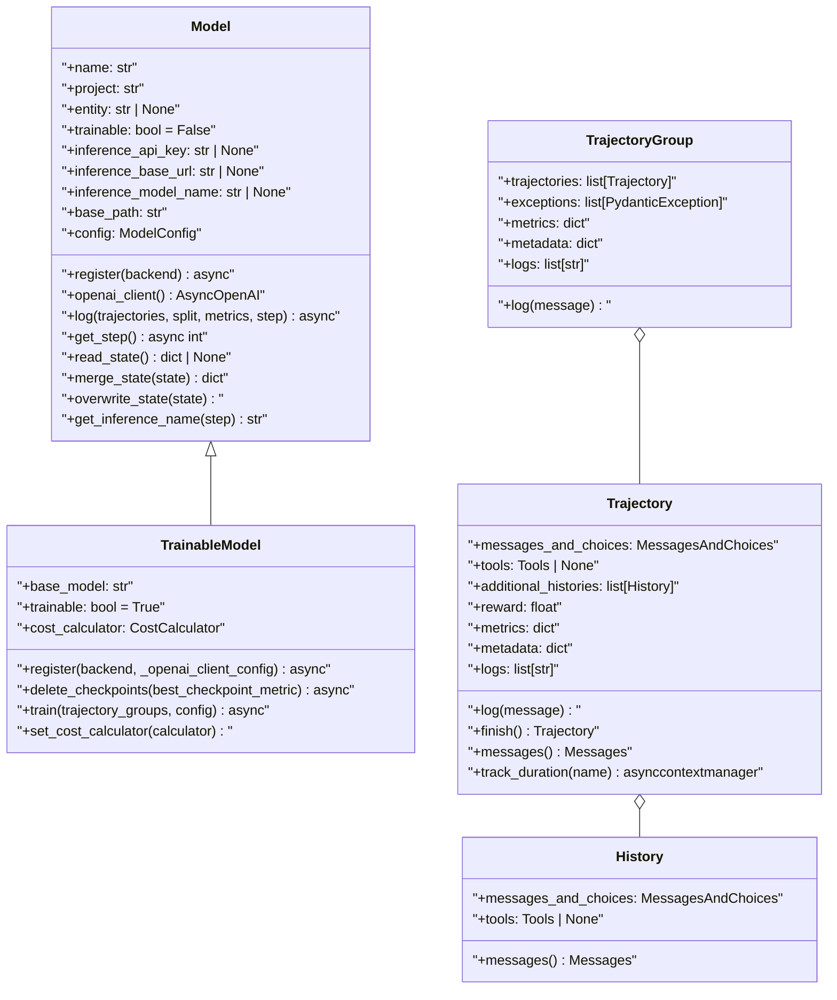
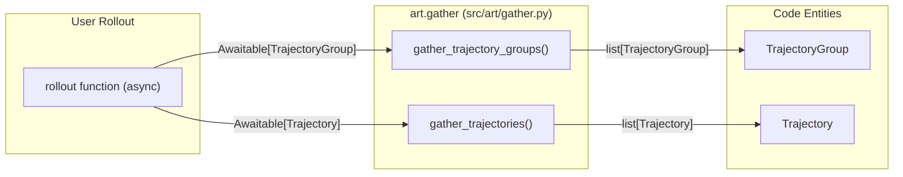
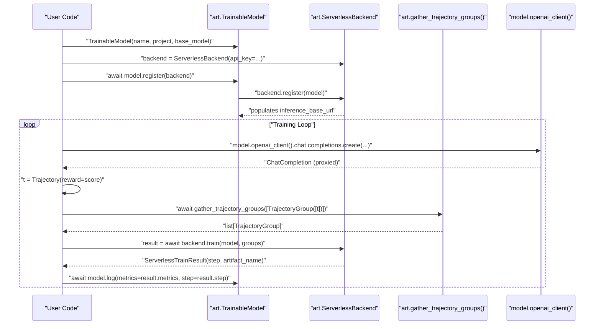

<!-- source: DeepWiki mcp.deepwiki.com · repo OpenPipe/ART · page 9.1 Python API Reference · fetched 2026-10-29 -->

# Python API Reference

<details>
<summary>Relevant source files</summary>

The following files were used as context for generating this wiki page:

- [src/art/__init__.py](src/art/__init__.py)
- [src/art/dev/train.py](src/art/dev/train.py)
- [src/art/local/backend.py](src/art/local/backend.py)
- [src/art/model.py](src/art/model.py)
- [src/art/openai.py](src/art/openai.py)
- [src/art/serverless/backend.py](src/art/serverless/backend.py)
- [src/art/serverless/client.py](src/art/serverless/client.py)
- [src/art/transformers/patches.py](src/art/transformers/patches.py)
- [src/art/types.py](src/art/types.py)
- [tests/unit/test_serverless_pipeline_trainer_compat.py](tests/unit/test_serverless_pipeline_trainer_compat.py)

</details>


This page documents the complete public Python API surface of the `art` library. It covers class constructors, fields, methods, function signatures, and return types for all symbols exported from the top-level `art` package. For configuration `TypedDict` types (e.g., `InternalModelConfig`, `TrainerArgs`), see [Configuration Reference](#9.3). For CLI commands, see [CLI Reference](#9.2). For conceptual background, see [Core Concepts](#1.2).

---

## Public API Surface

All symbols below are importable from `art` directly. The full export list is defined in [src/art/__init__.py:89-118]().

```python
import art

# Core classes
art.Model
art.TrainableModel

# Trajectory data structures
art.Trajectory
art.TrajectoryGroup

# Gather utilities
art.gather_trajectory_groups
art.gather_trajectories

# Backend protocol and implementations
art.Backend
art.LocalBackend
art.ServerlessBackend

# Configuration
art.TrainConfig
art.TrainSFTConfig

# Result types
art.TrainResult
art.LocalTrainResult
art.ServerlessTrainResult

# Type aliases
art.Messages
art.MessagesAndChoices
art.Tools

# Utilities
art.retry
art.trajectory_group_batches
art.auto_trajectory
art.capture_auto_trajectory
art.yield_trajectory
art.capture_yielded_trajectory
```

Sources: [src/art/__init__.py:89-118]()

---

## Class Hierarchy

**Public class hierarchy diagram**



Sources: [src/art/model.py:166-870](), [src/art/trajectories.py:30-319]()

---

## `art.Model`

**File:** [src/art/model.py:166-675]()

`Model` is a Pydantic `BaseModel` that represents a prompted (non-trainable) model. It provides an OpenAI-compatible client for inference and the `log()` method for trajectory logging. It is generic over `ModelConfig` (a Pydantic model or `None`) and `StateType` (a `dict` subtype).

### Constructor

```python
art.Model(
    *,
    name: str,
    project: str,
    entity: str | None = None,
    config: ModelConfig | None = None,
    inference_api_key: str | None = None,
    inference_base_url: str | None = None,
    inference_model_name: str | None = None,
    base_path: str = ".art",
    report_metrics: list[str] | None = None,
)
```

### Fields

| Field | Type | Default | Description |
|---|---|---|---|
| `name` | `str` | required | Model identifier used for logging and inference. |
| `project` | `str` | required | W&B / logging project name. |
| `entity` | `str \| None` | `None` | W&B entity (organization or user). |
| `config` | `ModelConfig` | required | User-defined Pydantic config attached to the model. |
| `trainable` | `bool` | `False` | Discriminator field; `True` on `TrainableModel`. |
| `inference_api_key` | `str \| None` | `None` | API key for the inference endpoint. Set manually for prompted models. |
| `inference_base_url` | `str \| None` | `None` | Base URL for the OpenAI-compatible inference endpoint. |
| `inference_model_name` | `str \| None` | `None` | Model name sent to the inference endpoint (defaults to `name`). |
| `base_path` | `str` | `".art"` | Root directory for all on-disk logging. |
| `report_metrics` | `list[str] \| None` | `None` | Sinks to report metrics to (`"wandb"`, etc.). `None` = auto-detect. |

Sources: [src/art/model.py:202-221]()

### Methods

#### `async register(backend: Backend) -> None`

Registers the model with a backend. For `Model` this stores the backend reference. For `TrainableModel`, this also starts the inference server and populates `inference_base_url` and `inference_api_key`.

[src/art/model.py:421-431]()

---

#### `openai_client() -> AsyncOpenAI`

Returns a cached `AsyncOpenAI` client pointed at `inference_base_url`. Requires `inference_api_key` and `inference_base_url` to be set (either manually or via `register()`). The client is wrapped in a proxy that automatically attaches metadata (vLLM tokens, MoE routing) to responses.

[src/art/model.py:433-462]()

---

#### `async log(trajectories=None, split="val", *, metrics=None, step=None) -> None`

Logs trajectories and/or raw metrics. Three usage patterns:

| Pattern | Call |
|---|---|
| Log trajectory groups | `await model.log(trajectory_groups, split="train")` |
| Log raw metrics | `await model.log(metrics={"loss": 0.5}, step=1)` |
| Both together | `await model.log(trajectory_groups, metrics=extra_metrics)` |

- Writes a Parquet file to `.art/{project}/models/{name}/trajectories/{split}/{step:04d}.parquet`.
- Computes averages of `reward`, `exception_rate`, and all `trajectory.metrics`.
- Appends to `history.jsonl` in the model directory.
- Logs to W&B if `WANDB_API_KEY` is set.
- Handles `costs_*` prefixed metrics specially: accumulates them cumulatively via `CostCalculator`.

**Parameters:**

| Parameter | Type | Description |
|---|---|---|
| `trajectories` | `Iterable[Trajectory \| BaseException] \| Iterable[TrajectoryGroup] \| None` | Trajectories or groups to log. |
| `split` | `str` | Split label (`"train"`, `"val"`, etc.). Defaults to `"val"`. |
| `metrics` | `dict[str, float] \| None` | Raw metric dict to merge into the logged metrics. |
| `step` | `int \| None` | Step override. Defaults to current backend step. |

[src/art/model.py:532-666]()

---

#### `async get_step() -> int`

Returns the current training step by querying the backend. Returns `0` for non-trainable models.

[src/art/model.py:668-674]()

---

#### `get_inference_name(step: int | None = None) -> str`

Returns the model name string to send to the inference endpoint. Delegates to `backend._model_inference_name()` if available (e.g., for vLLM LoRA naming conventions).

[src/art/model.py:486-509]()

---

#### `read_state() -> StateType | None`

Reads the `state.json` file from the model's output directory. Returns `None` if the file does not exist.

[src/art/model.py:337-354]()

---

#### `overwrite_state(state: StateType) -> None`

Writes `state` to `state.json`, replacing any existing contents.

[src/art/model.py:272-296]()

---

#### `merge_state(state: StateType) -> StateType`

Deep-merges `state` into the existing `state.json` and returns the resulting merged dict.

[src/art/model.py:307-319]()

---

Sources: [src/art/model.py:166-675]()

---

## `art.TrainableModel`

**File:** [src/art/model.py:682-870]()

`TrainableModel` extends `Model` with LoRA fine-tuning capabilities. It requires a `base_model` (the HuggingFace model ID or path) and is registered with a backend that handles the training and inference lifecycle.

### Constructor

```python
art.TrainableModel(
    *,
    name: str,
    project: str,
    entity: str | None = None,
    config: ModelConfig | None = None,
    base_model: str,
    base_path: str = ".art",
    report_metrics: list[str] | None = None,
    _internal_config: dev.InternalModelConfig | None = None,
)
```

### Additional Fields

| Field | Type | Default | Description |
|---|---|---|---|
| `base_model` | `str` | required | HuggingFace model ID (e.g., `"Qwen/Qwen2.5-7B-Instruct"`). |
| `trainable` | `bool` | `True` | Always `True` for `TrainableModel`. |
| `_internal_config` | `dev.InternalModelConfig \| None` | `None` | Unstable low-level configuration. See [Configuration Reference](#9.3). |

### Additional Methods

#### `async register(backend, _openai_client_config=None) -> None`

Extends `Model.register()`. After calling the backend's `register()`, it also calls `backend._prepare_backend_for_training()` to start the inference server and sets `inference_base_url`, `inference_api_key`, and `inference_model_name` on the model instance.

[src/art/model.py:791-809]()

---

#### `async delete_checkpoints(best_checkpoint_metric="val/reward") -> None`

Keeps only the latest checkpoint and the checkpoint at the step with the best value of `best_checkpoint_metric` (read from `history.jsonl`). Delegates file deletion to the backend.

[src/art/model.py:811-842]()

---

#### `async train(trajectory_groups, config=TrainConfig(), _config=None, verbose=False) -> None`

> **Deprecated.** Use `backend.train(model, trajectory_groups, ...)` instead.

Wraps the backend's training call. Logs trajectories before and after training if a W&B run is active.

[src/art/model.py:844-870]()

---

#### `set_cost_calculator(calculator: CostCalculator | None) -> None`

Sets a callable used to compute cost components from `(prompt_tokens, completion_tokens)`. The callable should return a `dict[str, float]` of named cost components. Set to `None` to disable cost tracking.

[src/art/model.py:727-732]()

---

Sources: [src/art/model.py:682-870]()

---

## `art.Trajectory`

**File:** [src/art/trajectories.py:38-127]()

A Pydantic model capturing a single agent rollout: the sequence of messages/completions, reward, metrics, and optional additional histories.

### Constructor

```python
art.Trajectory(
    messages_and_choices: MessagesAndChoices = [],
    tools: Tools | None = None,
    additional_histories: list[History] = [],
    reward: float = 0.0,
    metrics: dict[str, float | int | bool] = {},
    metadata: dict[str, MetadataValue] = {},
    logs: list[str] = [],
)
```

### Fields

| Field | Type | Default | Description |
|---|---|---|---|
| `messages_and_choices` | `MessagesAndChoices` | `[]` | Interleaved list of input messages (`dict`) and assistant completions (`Choice`). |
| `tools` | `Tools \| None` | `None` | Tool/function schema used during this rollout. |
| `additional_histories` | `list[History]` | `[]` | Extra conversation histories for attention masking tricks. |
| `reward` | `float` | `0.0` | Scalar reward for this trajectory. |
| `metrics` | `dict[str, float \| int \| bool]` | `{}` | Custom per-trajectory metrics logged to W&B. |
| `metadata` | `dict[str, MetadataValue]` | `{}` | Non-numeric metadata stored in Parquet but not logged as metrics. |
| `logs` | `list[str]` | `[]` | Free-form log strings for debugging. |

### Methods

| Method | Signature | Description |
|---|---|---|
| `log` | `log(message: str) -> None` | Appends a string to `self.logs`. [src/art/trajectories.py:84-85]() |
| `finish` | `finish() -> Trajectory` | Records `duration` into `metrics` and returns `self`. [src/art/trajectories.py:87-94]() |
| `messages` | `messages() -> Messages` | Extracts a flat `list[Message]` from `messages_and_choices`. [src/art/trajectories.py:96-103]() |
| `track_duration` | `async track_duration(metric_name: str)` | Async context manager. Accumulates elapsed time into `metrics`. [src/art/trajectories.py:105-112]() |

Sources: [src/art/trajectories.py:38-127]()

---

## `art.TrajectoryGroup`

**File:** [src/art/trajectories.py:130-319]()

A Pydantic model holding a group of `Trajectory` objects collected under the same prompt scenario. Groups are the unit of GRPO advantage computation.

### Constructor

`TrajectoryGroup` has an overloaded `__new__` that behaves differently based on the input:

```python
# Synchronous: wraps already-resolved Trajectory objects
group = art.TrajectoryGroup(
    trajectories: Iterable[Trajectory | BaseException],
    *,
    exceptions: list[BaseException] = [],
)

# Asynchronous: wraps awaitables and resolves them concurrently
group = await art.TrajectoryGroup(
    trajectories: Iterable[Awaitable[Trajectory]],
    ...
)
```

When given awaitables, `TrajectoryGroup.__new__` returns an `Awaitable[TrajectoryGroup]` that resolves all rollouts concurrently using `asyncio.as_completed`. Exceptions are captured in `self.exceptions`. [src/art/trajectories.py:146-231]()

Sources: [src/art/trajectories.py:130-319]()

---

## Gather Functions

**Relationship between gather functions and trajectory data flow**



Sources: [src/art/gather.py:14-137]()

---

### `art.gather_trajectory_groups`

Concurrently awaits a list of `Awaitable[TrajectoryGroup]`, collecting results with a progress bar. This is the primary function for running parallel rollouts in an RL training loop.

```python
async def gather_trajectory_groups(
    groups: Iterable[Awaitable[TrajectoryGroup]],
    *,
    pbar_desc: str | None = "gather",
    max_exceptions: int | float = 0,
    after_each: Callable[[TrajectoryGroup], Awaitable[TrajectoryGroup | None | list[TrajectoryGroup]]] | None = None,
) -> list[TrajectoryGroup]:
```

[src/art/gather.py:14-65]()

---

## Backend Implementations

### `art.ServerlessBackend`

**File:** [src/art/serverless/backend.py:89-401]()

Implements the `Backend` protocol using the OpenPipe/W&B hosted training API.

#### `async train(model, trajectory_groups, config, ...) -> ServerlessTrainResult`

The primary training entry point for serverless use. Creates a remote training job and returns a `ServerlessTrainResult` containing the W&B artifact name.

```python
await backend.train(
    model,
    trajectory_groups,
    learning_rate=5e-6,
    ppo=False,
    epsilon=0.1,
    ...
) -> ServerlessTrainResult
```

[src/art/serverless/backend.py:145-268]()

Sources: [src/art/serverless/backend.py:89-401]()

---

## Result Types

**File:** [src/art/types.py:68-107]()

| Class | Backend | Extra Field | Description |
|---|---|---|---|
| `TrainResult` | base | — | Step number and aggregated metrics. |
| `LocalTrainResult` | `LocalBackend` | `checkpoint_path: str \| None` | Path to the saved LoRA checkpoint directory. |
| `ServerlessTrainResult` | `ServerlessBackend` | `artifact_name: str \| None` | W&B artifact name (e.g. `entity/project/model:step5`). |

Sources: [src/art/types.py:68-107]()

---

## Training Loop: API Call Sequence

**RL training loop using public API entities**



Sources: [src/art/model.py:421-462](), [src/art/gather.py:14-65](), [src/art/serverless/backend.py:145-268]()

---

