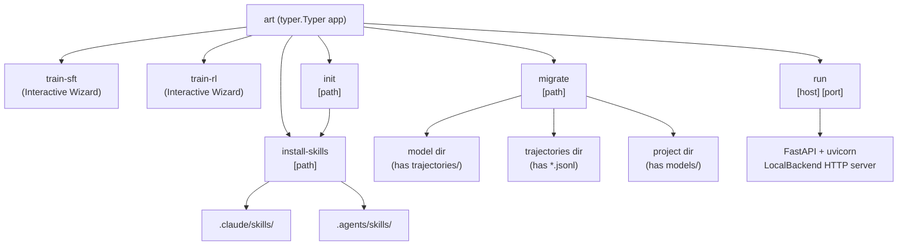
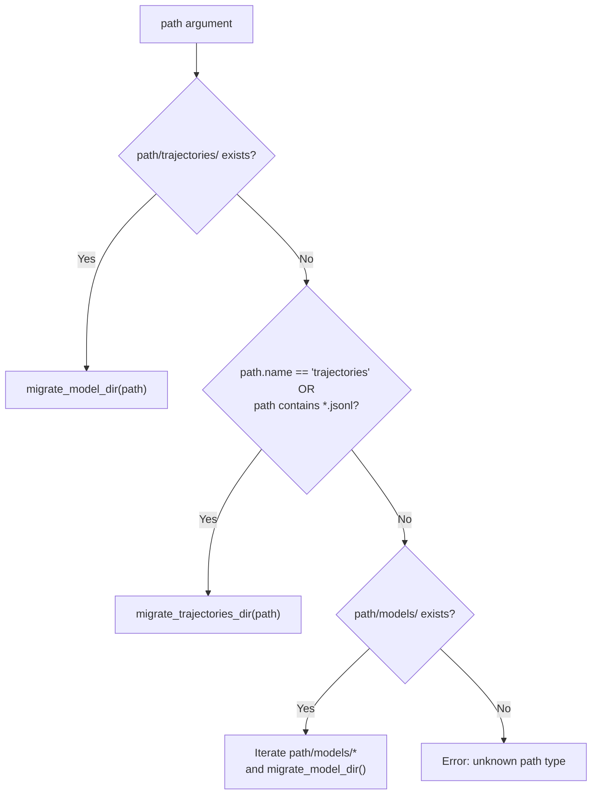
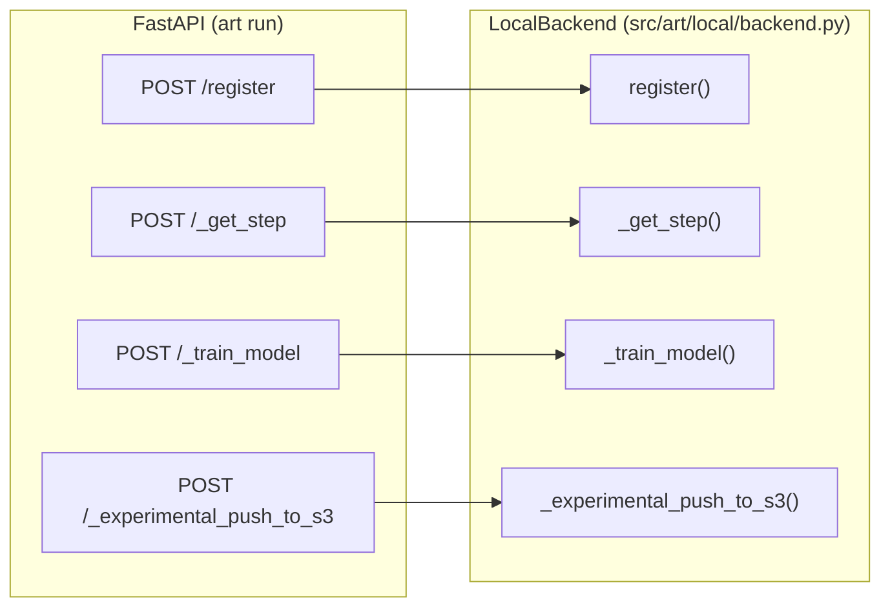

<!-- source: DeepWiki mcp.deepwiki.com · repo OpenPipe/ART · page 9.2 CLI Reference · fetched 2026-10-29 -->

# CLI Reference

<details>
<summary>Relevant source files</summary>

The following files were used as context for generating this wiki page:

- [.env.example](.env.example)
- [examples/tic_tac_toe/tic-tac-toe.py](examples/tic_tac_toe/tic-tac-toe.py)
- [examples/tic_tac_toe_self_play/deploy_step.py](examples/tic_tac_toe_self_play/deploy_step.py)
- [scripts/deploy-model.py](scripts/deploy-model.py)
- [src/art/backend.py](src/art/backend.py)
- [src/art/cli.py](src/art/cli.py)
- [src/art/utils/deploy_model.py](src/art/utils/deploy_model.py)
- [src/art/utils/output_dirs.py](src/art/utils/output_dirs.py)
- [src/art/utils/s3.py](src/art/utils/s3.py)

</details>


This page is the complete reference for the `art` command-line interface. It covers all available commands, their arguments, options, default values, and expected behavior.

The CLI is implemented in [src/art/cli.py]() using the [Typer](https://typer.tiangolo.com/) framework. The entry point is the `app` object defined at [src/art/cli.py:10]().

---

## Invocation

After installing the `art` package, all commands are available as subcommands of `art`:

```bash
art <command> [OPTIONS] [ARGS]
```

Running `art --help` lists all available commands. Running `art <command> --help` shows options for a specific command.

---

## Commands Overview

**Command structure diagram:**



Sources: [src/art/cli.py:10-13](), [src/art/cli.py:58-63](), [src/art/cli.py:84-89](), [src/art/cli.py:119-136]()

---

## `art train-sft` & `art train-rl`

**Purpose:** Launch an interactive LLM-powered wizard that guides you through writing training scripts. `train-sft` focuses on supervised fine-tuning, while `train-rl` focuses on reinforcement learning (GRPO).

**Usage:**
```bash
art train-sft
art train-rl
```

**Behavior:**
These commands use AI coding assistant skills to generate boilerplate for training loops. They rely on the bundled `SKILL.md` files located via `_get_skill_path` [src/art/cli.py:16-32]().

---

## `art install-skills`

**Purpose:** Copy the bundled skill documents (`SKILL.md` files) into a project directory so that AI coding assistants (Claude Code, OpenAI Codex) can use `/train-sft` and `/train-rl` as slash commands.

**Usage:**
```bash
art install-skills [PATH]
```

**Arguments:**

| Argument | Default | Description |
|---|---|---|
| `path` | `.` (current directory) | Project directory to install skills into |

**Behavior:**
For each skill name in `SKILL_NAMES` (`["train-sft", "train-rl"]`), the command:
1. Locates the source `SKILL.md` via `_get_skill_path` [src/art/cli.py:16-32]().
2. Copies it to both:
   - `<path>/.claude/skills/<skill-name>/SKILL.md`
   - `<path>/.agents/skills/<skill-name>/SKILL.md`
3. Prints a summary of installed files [src/art/cli.py:73-81]().

Sources: [src/art/cli.py:13-16](), [src/art/cli.py:35-55](), [src/art/cli.py:58-72]()

---

## `art init`

**Purpose:** Initialize ART in a project directory by installing agent skills. This is an alias for `install-skills`.

**Usage:**
```bash
art init [PATH]
```

Sources: [src/art/cli.py:84-97]()

---

## `art migrate`

**Purpose:** Convert legacy `.jsonl` trajectory files to `.parquet` format. Parquet provides approximately 25× compression and 20× faster reads compared to JSONL.

**Usage:**
```bash
art migrate [OPTIONS] PATH
```

**Arguments:**

| Argument | Required | Description |
|---|---|---|
| `path` | Yes | Path to a model directory, project directory, or trajectories directory |

**Options:**

| Flag | Short | Default | Description |
|---|---|---|---|
| `--dry-run` | `-n` | `False` | Preview what would be migrated without writing any files |
| `--keep-jsonl` | | `False` | Retain original `.jsonl` files after conversion |
| `--verbose` | `-v` | `False` | Print each file as it is processed |

**Path Type Detection Logic:**



**Implementation Details:**
- **Model Directory:** If `(path / "trajectories")` exists, it calls `migrate_model_dir` [src/art/cli.py:158-166]().
- **Trajectories Directory:** If the path name is "trajectories" or contains numbered JSONL files, it calls `migrate_trajectories_dir` [src/art/cli.py:167-175]().
- **Project Directory:** If `(path / "models")` exists, it iterates through all model subdirectories and migrates them [src/art/cli.py:176-195]().

Sources: [src/art/cli.py:119-201](), [src/art/utils/output_dirs.py:36-42]()

---

## `art run`

**Purpose:** Start a local HTTP server that exposes the `LocalBackend` over a FastAPI interface. This is used by `SkyPilotBackend` to proxy backend protocol calls to a remote GPU node.

**Usage:**
```bash
art run [HOST] [PORT]
```

**Arguments:**

| Parameter | Default | Description |
|---|---|---|
| `host` | `0.0.0.0` | Network interface to bind |
| `port` | `7999` | TCP port to listen on |

**Behavior:**
1. Checks if the port is in use via `socket` [src/art/cli.py:214-220]().
2. Patches `TrajectoryGroup` to allow direct Pydantic instantiation for serialization [src/art/cli.py:222-233]().
3. Initializes a `LocalBackend` [src/art/cli.py:235]().
4. Starts a FastAPI app with routes mapping to `Backend` protocol methods [src/art/cli.py:237-332]().

**Route Mapping to Code Entities:**



| Route | Backend Method | Description |
|---|---|---|
| `/register` | `backend.register` | Registers a model for inference/training |
| `/_get_step` | `backend._get_step` | Retrieves the current training step |
| `/_train_model` | `backend._train_model` | Streams training metrics as NDJSON |
| `/_experimental_push_to_s3` | `backend._experimental_push_to_s3` | Syncs local checkpoints to S3 |

Sources: [src/art/cli.py:204-332](), [src/art/backend.py:15-53]()

---

## Environment Variables

The CLI and associated utilities utilize several environment variables for cloud integration and authentication:

| Variable | Used By | Description |
|---|---|---|
| `WANDB_API_KEY` | `Model.log` | Authentication for Weights & Biases logging |
| `HF_TOKEN` | `vLLM` / `Unsloth` | Access to gated models on HuggingFace |
| `BACKUP_BUCKET` | `s3_sync` | Default S3 bucket for model backups [src/art/utils/s3.py:37]() |
| `AWS_REGION` | `s3_sync` | AWS region for S3 operations |

Sources: [.env.example:1-23](), [src/art/utils/s3.py:36-37]()

---

