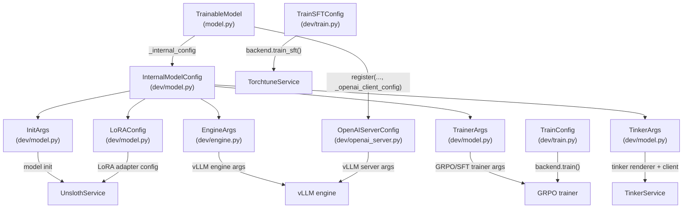
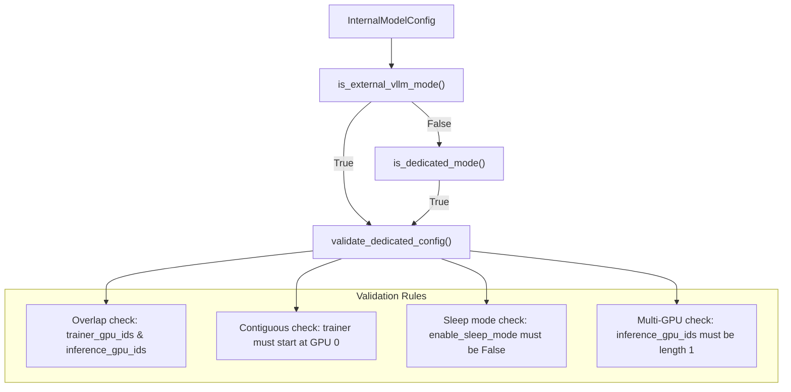

<!-- source: DeepWiki mcp.deepwiki.com · repo OpenPipe/ART · page 9.3 Configuration Reference · fetched 2026-10-29 -->

# Configuration Reference

Relevant source files

The following files were used as context for generating this wiki page:

- [pyproject.toml](pyproject.toml)
- [src/art/dev/__init__.py](src/art/dev/__init__.py)
- [src/art/dev/get_model_config.py](src/art/dev/get_model_config.py)
- [src/art/dev/model.py](src/art/dev/model.py)
- [src/art/dev/train.py](src/art/dev/train.py)
- [src/art/dev/validate.py](src/art/dev/validate.py)
- [src/art/serverless/backend.py](src/art/serverless/backend.py)
- [src/art/serverless/client.py](src/art/serverless/client.py)
- [tests/unit/test_dedicated_config.py](tests/unit/test_dedicated_config.py)
- [tests/unit/test_serverless_pipeline_trainer_compat.py](tests/unit/test_serverless_pipeline_trainer_compat.py)
- [uv.lock](uv.lock)

This page is a complete reference for all configuration types used in ART. It covers both the public API (`TrainConfig`, `TrainSFTConfig`) and the internal/advanced configuration objects (`InternalModelConfig` and its sub-TypedDicts) that are passed via `_internal_config` on `TrainableModel`.

For information about how these configurations are applied during a training loop, see [Training Loop & GRPO Algorithm](#3.1). For configuration of individual backends, see [Backend Implementations](#4). For the `TrainableModel` class itself, see [Model System](#2.1).

---

## Configuration Object Hierarchy

The following diagram shows how configuration objects relate to each other and to the systems that consume them.

**Configuration Object Relationships**

Sources: [src/art/dev/model.py:121-169](), [src/art/dev/__init__.py:1-42](), [src/art/dev/train.py:11-50](), [src/art/dev/get_model_config.py:22-113]()

---

## Public Configuration Types

These types are part of the stable public API and are imported directly from `art`.

### `TrainConfig`

Defined in [src/art/dev/train.py:11-44]().

Used as an argument to `backend.train()`. Controls the RL fine-tuning step.

| Field | Type | Description |
|---|---|---|
| `learning_rate` | `float` | Adam learning rate for the GRPO optimizer step |
| `advantage_balance` | `float` | Balance between negative and positive advantages [-1.0, 1.0]. Defaults to 0.0 |
| `epsilon` | `float` | Clip epsilon for PPO/GRPO |
| `kl_penalty_coef` | `float` | KL penalty coefficient |
| `importance_sampling_level` | `Literal` | Level for IS: `"token"`, `"sequence"`, `"average"`, `"geometric_average"` |
| `ppo` | `bool` | Whether to use PPO-style clipping |

### `TrainSFTConfig`

Defined in [src/art/dev/train.py:46-50]().

Used as an argument to `model.train_sft()`. Controls supervised fine-tuning behavior.

| Field | Type | Description |
|---|---|---|
| `metric_logging` | `SFTMetricLoggingConfig` | Configuration for logging SFT metrics |

---

## Internal Model Configuration

`InternalModelConfig` and its sub-TypedDicts are accessed via the `_internal_config` field on `TrainableModel`. These are considered **unstable API** — fields may change across releases.

### `InternalModelConfig`

Defined in [src/art/dev/model.py:121-169]().

The top-level container TypedDict. All fields are optional.

| Field | Type | Description |
|---|---|---|
| `init_args` | `InitArgs` | Arguments for model initialization (HuggingFace/Unsloth) |
| `engine_args` | `EngineArgs` | Arguments forwarded to the vLLM engine |
| `trainer_args` | `TrainerArgs` | Arguments forwarded to the GRPO/SFT trainer |
| `trainer_gpu_ids` | `list[int]` | GPU IDs for training (e.g., `[0]`). Enables dedicated mode |
| `inference_gpu_ids` | `list[int]` | GPU IDs for vLLM inference (e.g., `[1]`). Enables dedicated mode |
| `rollout_weights_mode` | `RolloutWeightsMode` | `"lora"` (direct load) or `"merged"` (push merged weights) |
| `vllm_runtime` | `VllmRuntimeArgs` | Config for managed vs external vLLM runtime |

**Dedicated vs. Shared GPU mode** is determined by whether `trainer_gpu_ids` and `inference_gpu_ids` are both set. Shared mode uses runtime sleep/wake cycles to share VRAM.

Sources: [src/art/dev/model.py:121-169](), [src/art/dev/validate.py:23-27]()

---

### `InitArgs`

Defined in [src/art/dev/model.py:194-221]().

Arguments for initializing the base language model. Defaults are applied by `get_model_config`.

| Field | Type | Default | Description |
|---|---|---|---|
| `model_name` | `str` | *(base_model)* | HF model ID or local path |
| `max_seq_length` | `int` | *(auto)* | Max sequence length for the model |
| `load_in_4bit` | `bool` | `True` | Enable 4-bit quantization (QLoRA) |
| `dtype` | `str \| None` | `None` | Torch dtype override |
| `trust_remote_code`| `bool` | `True` | Allow remote code execution |

Sources: [src/art/dev/model.py:194-221](), [src/art/dev/get_model_config.py:43-52]()

---

### `EngineArgs`

Defined in [src/art/dev/engine.py](). Consumed in [src/art/dev/get_model_config.py:53-59]().

Arguments forwarded directly to the vLLM `AsyncEngineArgs`.

| Field | Default | Description |
|---|---|---|
| `model` | *(base_model)* | Model name or path for vLLM |
| `allowed_local_media_path` | `"/tmp"` | Local filesystem paths vLLM may serve |
| `enable_sleep_mode` | `True` (shared) | vLLM sleep/wake cycle between inference and training |
| `lora_target_modules` | *(auto)* | Target modules for LoRA in vLLM |

In dedicated mode, `enable_sleep_mode` is forced to `False` as the inference server runs on a separate GPU.

Sources: [src/art/dev/get_model_config.py:38-41](), [src/art/dev/validate.py:114-118]()

---

### `LoRAConfig` (formerly `PeftArgs`)

Defined in [src/art/dev/model.py:223-239](). Note: `PeftArgs` is deprecated and will raise a migration error if used in `InternalModelConfig` [src/art/dev/get_model_config.py:32-33]().

| Field | Type | Default | Description |
|---|---|---|---|
| `rank` | `int` | `8` | LoRA rank (replaces `r` in PeftArgs) |
| `lora_alpha` | `int` | `16` | LoRA scaling factor |
| `target_modules` | `list[str]` | *(auto)* | Modules to apply LoRA to |
| `use_gradient_checkpointing` | `str` | `"unsloth"` | Gradient checkpointing strategy |

Sources: [src/art/dev/model.py:223-239](), [src/art/dev/get_model_config.py:63-67]()

---

### `TrainerArgs`

Defined in [src/art/dev/model.py:241-369]().

Arguments forwarded to the underlying trainer. Key defaults from `get_model_config`:

| Field | Default | Description |
|---|---|---|
| `learning_rate` | `5e-6` | Optimizer learning rate |
| `optim` | `"paged_adamw_8bit"` | Optimizer name |
| `gradient_accumulation_steps` | `1` | Accumulation steps |
| `per_device_train_batch_size` | `2` | Batch size per GPU |
| `num_generations` | `2` | Completions per prompt in GRPO |
| `max_grad_norm` | `0.1` | Gradient clipping threshold |

Sources: [src/art/dev/model.py:241-369](), [src/art/dev/get_model_config.py:78-96]()

---

## Dedicated Mode Validation

Validation is enforced by `validate_dedicated_config()` to ensure GPU isolation.

**Validation Logic Flow:**

**Key Validation Rules:**
1. **No Overlap**: Training and inference GPUs must be distinct [src/art/dev/validate.py:95-96]().
2. **GPU 0 Requirement**: Training must start at GPU 0 because it runs in-process [src/art/dev/validate.py:103-106]().
3. **Sleep Mode**: `enable_sleep_mode` is incompatible with dedicated mode [src/art/dev/validate.py:114-118]().
4. **Single GPU Inference**: Multi-GPU inference is not yet supported in dedicated mode [src/art/dev/validate.py:98-101]().

Sources: [src/art/dev/validate.py:37-118]()

---

## Enum Reference

These enums are vendored from `transformers` to provide type safety for `TrainerArgs`.

### `OptimizerNames`
Accepted by `TrainerArgs.optim`. Common values:
* `PAGED_ADAMW_8BIT` (Default)
* `ADAMW_TORCH`
* `ADAMW_8BIT`
* `LION_8BIT`

Sources: [src/art/dev/model.py:22-68]()

### `SchedulerType`
Accepted by `TrainerArgs.lr_scheduler_type`:
* `CONSTANT` (Default)
* `LINEAR`
* `COSINE`
* `COSINE_WITH_WARMUP`

Sources: [src/art/dev/model.py:96-108]()

### `VllmRuntimeMode`
Accepted by `VllmRuntimeArgs.mode`:
* `managed`: ART starts and stops the vLLM server.
* `external`: ART connects to an existing vLLM server via `server_url`.

Sources: [src/art/dev/model.py:9-18]()

---

