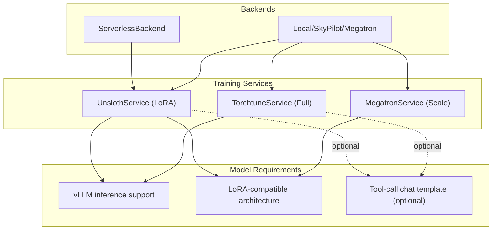
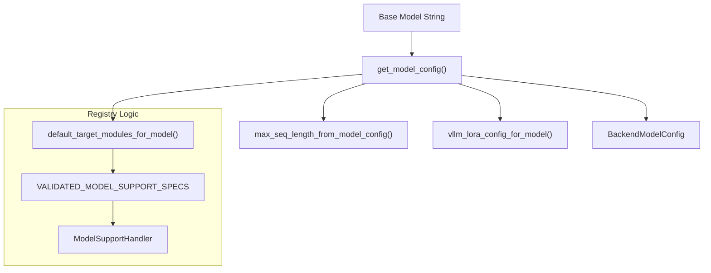

<!-- source: DeepWiki mcp.deepwiki.com · repo OpenPipe/ART · page 9.4 Supported Models · fetched 2026-10-29 -->

# Supported Models

Relevant source files

The following files were used as context for generating this wiki page:

- [docs/features/additional-histories.mdx](docs/features/additional-histories.mdx)
- [docs/features/checkpoint-forking.mdx](docs/features/checkpoint-forking.mdx)
- [docs/images/forked-run.webp](docs/images/forked-run.webp)
- [docs/resources/glossary.mdx](docs/resources/glossary.mdx)
- [docs/resources/models.mdx](docs/resources/models.mdx)
- [pyproject.toml](pyproject.toml)
- [src/art/dev/__init__.py](src/art/dev/__init__.py)
- [src/art/dev/get_model_config.py](src/art/dev/get_model_config.py)
- [src/art/dev/model.py](src/art/dev/model.py)
- [src/art/megatron/flex_attn/flash_dlse_patch.py](src/art/megatron/flex_attn/flash_dlse_patch.py)
- [src/art/megatron/model_support/__init__.py](src/art/megatron/model_support/__init__.py)
- [src/art/megatron/model_support/handlers/gpt_oss.py](src/art/megatron/model_support/handlers/gpt_oss.py)
- [src/art/megatron/model_support/handlers/qwen3_5.py](src/art/megatron/model_support/handlers/qwen3_5.py)
- [src/art/megatron/model_support/handlers/qwen3_moe.py](src/art/megatron/model_support/handlers/qwen3_moe.py)
- [src/art/megatron/model_support/registry.py](src/art/megatron/model_support/registry.py)
- [src/art/megatron/weights/adapter_export.py](src/art/megatron/weights/adapter_export.py)
- [tests/integration/megatron/lora/test_lora_disk_codecs.py](tests/integration/megatron/lora/test_lora_disk_codecs.py)
- [tests/integration/megatron/model_support/hf_parity_worker.py](tests/integration/megatron/model_support/hf_parity_worker.py)
- [tests/integration/megatron/runtime_isolation/test_service_runtime_boundary.py](tests/integration/megatron/runtime_isolation/test_service_runtime_boundary.py)
- [tests/unit/test_dedicated_config.py](tests/unit/test_dedicated_config.py)
- [uv.lock](uv.lock)

This page documents the language models supported by ART for training, their requirements, compatibility with different training backends, and model-specific considerations. For information about training configuration and hyperparameters, see [Configuration Reference](#9.3). For backend selection and deployment options, see [Backend Implementations](#4).

## Overview

ART supports training any model compatible with [vLLM](https://docs.vllm.ai/en/latest/models/supported_models.html), with additional requirements depending on your use case. Model support is divided into two categories: serverless models available through `ServerlessBackend`, and models that can be trained using `LocalBackend`, `SkyPilotBackend`, or `MegatronBackend`.

**Model compatibility requirements by feature**

Sources: [docs/resources/models.mdx:1-39](), [src/art/megatron/model_support/registry.py:214-223]()

## Serverless Backend Models

The `ServerlessBackend` provides managed training infrastructure through Weights & Biases. Currently, serverless training is limited to a curated set of models optimized for the managed environment.

### Currently Supported

| Model | HuggingFace ID | Parameters | Notes |
|-------|---------------|------------|-------|
| OpenPipe Qwen 3 14B Instruct | `OpenPipe/Qwen3-14B-Instruct` | 14B | Recommended starting point; supports tool calling |
| Qwen 3 30B A3B Instruct | `Qwen/Qwen3-30B-A3B` | 30B (3B active) | MoE model; stronger reasoning than 14B while remaining efficient |

The 14B model is the recommended choice for users new to RL training. The 30B A3B model is a mixture-of-experts model with only 3B active parameters per forward pass, making it more capable than 14B while remaining compute-efficient.

**Request Additional Models:** To request serverless support for additional models, contact `support@wandb.com`.

Sources: [docs/resources/models.mdx:8-16]()

## Local and Distributed Backend Models

When using `LocalBackend`, `SkyPilotBackend`, or `MegatronBackend`, you have access to a wider range of models. ART maintains a registry of validated architectures to ensure LoRA adapter compatibility between training and vLLM inference.

### Recommended Models

#### Qwen Family

| Model | HuggingFace ID | Parameters |
|-------|---------------|------------|
| Qwen2.5 7B Instruct | `Qwen/Qwen2.5-7B-Instruct` | 7B |
| OpenPipe Qwen 3 14B Instruct | `OpenPipe/Qwen3-14B-Instruct` | 14B |
| Qwen2.5 32B Instruct | `Qwen/Qwen2.5-32B-Instruct` | 32B |
| Qwen2.5 72B Instruct | `Qwen/Qwen2.5-72B-Instruct` | 72B |

**Qwen 3 Family Note:** Qwen 3 models work well for single-turn workflows. For multi-turn workflows, the Qwen 3 chat template strips `<think>` tokens from earlier turns. Use `additional_histories` as a workaround to preserve these tokens.

Sources: [docs/resources/models.mdx:36-38](), [src/art/megatron/model_support/registry.py:98-119]()

### Validated Architectures (Megatron/LoRA)

ART uses specific `ModelSupportHandler` implementations to manage weight transformations between training (e.g., Megatron-LM or Unsloth) and inference (vLLM).

| Handler Key | Supported Models / Families | LoRA Target Modules |
|-------------|----------------------------|---------------------|
| `qwen3_dense` | Qwen3 (0.6B to 32B) | `q_proj`, `k_proj`, `v_proj`, `o_proj`, `gate_proj`, `up_proj`, `down_proj` |
| `qwen3_moe` | Qwen3-30B-A3B, 235B-A22B | `experts`, `q_proj`, `k_proj`, `v_proj`, `o_proj`, `gate_proj`, `up_proj`, `down_proj` |
| `qwen3_5_moe` | Qwen3.5-35B-A3B, 397B-A17B | Adds `in_proj_qkv`, `in_proj_z`, `out_proj` to standard MoE modules |
| `gemma4_moe` | google/gemma-4-26B-A4B | Standard MoE targets |
| `dsv4` | DeepSeek-V4-Flash / Pro | `q_a_proj`, `q_b_proj`, `kv_proj`, `experts`, etc. |

Sources: [src/art/megatron/model_support/registry.py:77-223](), [src/art/megatron/model_support/handlers/qwen3_5.py:59-80]()

## LoRA and Tool Calling Requirements

### Target Module Selection
By default, ART attempts to target all relevant linear layers for LoRA training. The `default_target_modules` function in `src/art/dev/get_model_config.py` uses the registry to identify these modules [src/art/dev/get_model_config.py:18-19](). For most dense models, this includes attention projections and MLP layers [src/art/megatron/model_support/registry.py:23-31]().

### Tool Calling Support
Tool calling support depends on whether the model's chat template includes tool call formatting.

| Model Family | Tool Calling |
|--------------|-------------|
| Llama 3.1 / 3.3 | ✅ |
| Llama 3.2 (1B, 3B) | ❌ |
| Qwen 2.5 / 3 / 3.5 | ✅ |
| DeepSeek V4 | ✅ |

Sources: [docs/resources/models.mdx:29-38]()

## Model Selection Logic

The system resolves model configurations via `get_model_config`, which handles the mapping from a base model string to specific engine and trainer arguments.

**Model Configuration Resolution Flow**

Sources: [src/art/dev/get_model_config.py:22-113](), [src/art/megatron/model_support/registry.py:231-235]()

## Extending Model Support

### Using Untested Models
If you wish to use a model not in the validated list, you can set `allow_unvalidated_arch: True` in your `InternalModelConfig` [src/art/dev/model.py:150-152](). This will attempt to use the `DEFAULT_DENSE_SPEC` [src/art/megatron/model_support/registry.py:77-82]().

**Requirements for new models:**
1. **vLLM Compatibility**: The model must be loadable by vLLM for the rollout phase.
2. **LoRA Layers**: The architecture must use standard linear layer names (e.g., `q_proj`) unless a custom `ModelSupportHandler` is implemented to map them [src/art/megatron/model_support/handlers/qwen3_5.py:81-100]().
3. **Chat Template**: The tokenizer must include a valid `chat_template` in `tokenizer_config.json`.

**Community Support:** Ask about specific models in the Discord `#support` channel.

Sources: [docs/resources/models.mdx:27-40](), [src/art/dev/get_model_config.py:105-106]()

## Related Documentation

- [Configuration Reference](#9.3) - Hyperparameters and training options
- [Backend Implementations](#4) - Choosing LocalBackend vs SkyPilotBackend vs ServerlessBackend
- [Model Services](#3.2) - UnslothService vs TorchtuneService implementation details
- [Attention Masking & Additional Histories](#7.5) - Handling multi-turn conversations with special tokens
- [Distributed Training & Parallelism](#7.7) - Training large models across multiple GPUs using Megatron-LM

---

