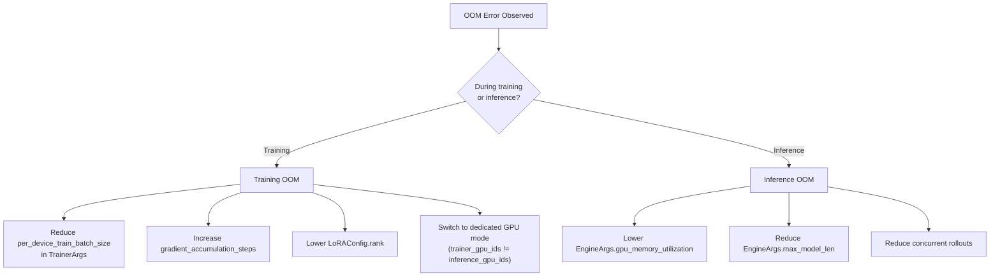
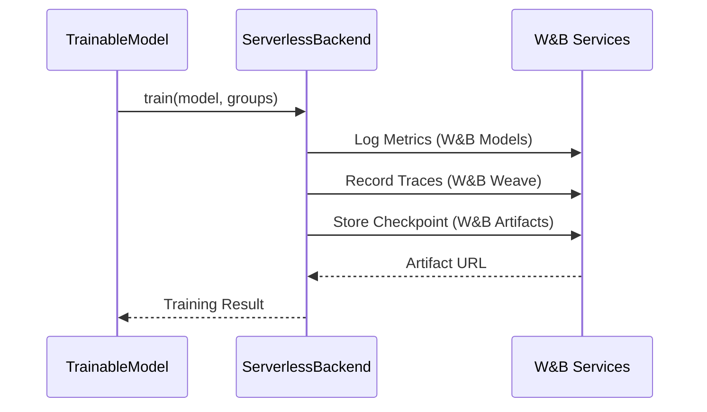
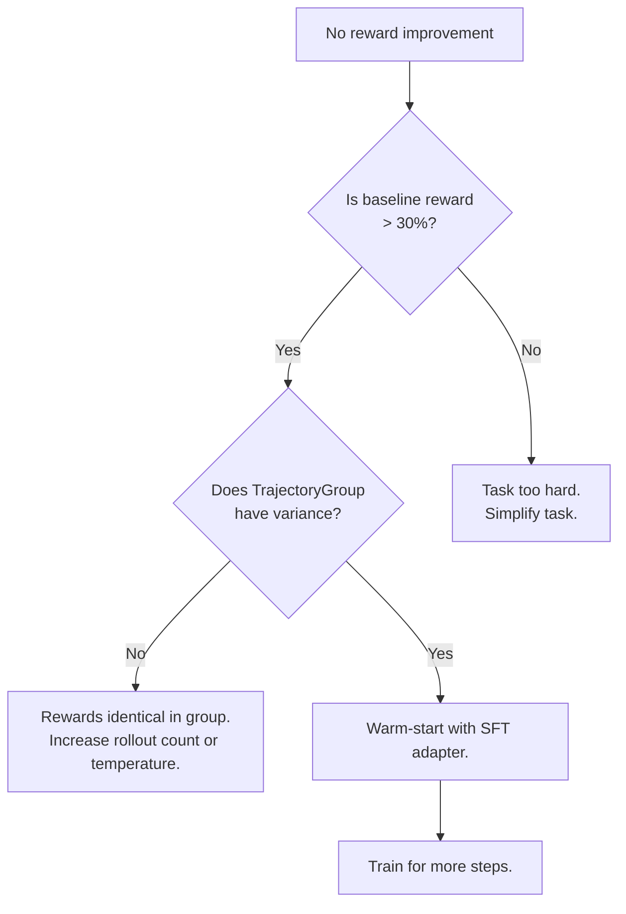

<!-- source: DeepWiki mcp.deepwiki.com · repo OpenPipe/ART · page 9.6 Troubleshooting · fetched 2026-10-29 -->

# Troubleshooting

Relevant source files

The following files were used as context for generating this wiki page:

- [docs/docs.json](docs/docs.json)
- [docs/fundamentals/art-client.mdx](docs/fundamentals/art-client.mdx)
- [docs/fundamentals/training-loop.mdx](docs/fundamentals/training-loop.mdx)
- [docs/getting-started/about.mdx](docs/getting-started/about.mdx)
- [docs/getting-started/faq.mdx](docs/getting-started/faq.mdx)
- [docs/getting-started/notebooks.mdx](docs/getting-started/notebooks.mdx)
- [docs/getting-started/quick-start.mdx](docs/getting-started/quick-start.mdx)
- [docs/style.css](docs/style.css)
- [pyproject.toml](pyproject.toml)
- [src/art/dev/__init__.py](src/art/dev/__init__.py)
- [src/art/dev/get_model_config.py](src/art/dev/get_model_config.py)
- [src/art/dev/model.py](src/art/dev/model.py)
- [tests/unit/test_dedicated_config.py](tests/unit/test_dedicated_config.py)
- [uv.lock](uv.lock)

This page covers common errors, failure modes, and their solutions when working with ART. It is organized by symptom category. For background on the systems mentioned here, see the relevant pages: GPU memory management ([7.2]()), backend implementations ([4]()), checkpoint management ([7.3]()), and training configuration ([3.4]()).

---

## GPU / Out-of-Memory Errors

ART runs inference (via vLLM) and training (via Unsloth or Torchtune) on the same GPU in shared mode, or on separate GPUs in dedicated mode. OOM errors can occur in either phase.

### Minimum Hardware Requirements

| Hardware | Supported | Notes |
|---|---|---|
| H100 80GB | ✅ Recommended | All model sizes |
| A100 80GB | ✅ Supported | Tested configuration |
| A100 40GB | ⚠️ Limited | Small models only, may OOM |
| Consumer GPUs (e.g. 3090, 4090) | ⚠️ Experimental | Reduced batch sizes required |

### OOM During Training

**Symptoms:** `CUDA out of memory` or `torch.cuda.OutOfMemoryError` in Unsloth or Torchtune logs.

**Remediation steps:**

1. **Reduce `per_device_train_batch_size`** in `TrainerArgs` [src/art/dev/get_model_config.py:91](). Lower values reduce peak memory at the cost of noisier gradient estimates.
2. **Increase `gradient_accumulation_steps`** [src/art/dev/get_model_config.py:82]() to compensate for a smaller batch size while preserving the effective batch size.
3. **Lower the LoRA rank** via `PeftArgs.r` (migrated to `rank` in `LoRAConfig`). Lower rank means fewer trainable parameters and less activation memory.
4. **Reduce sequence length** by capping `max_seq_length` in `InitArgs` [src/art/dev/get_model_config.py:46]().
5. **Switch to dedicated GPU mode**. In shared mode, vLLM and the training engine share GPU VRAM simultaneously. In dedicated mode, vLLM is unloaded or restricted to a separate device before training begins. See `trainer_gpu_ids` and `inference_gpu_ids` in `InternalModelConfig` [src/art/dev/model.py:159-160]().

### OOM During Inference (vLLM)

**Symptoms:** vLLM subprocess crashes with OOM, or `openai.APIConnectionError` after inference starts consuming too much memory.

**Remediation steps:**

1. **Lower `gpu_memory_utilization`** in `EngineArgs` [src/art/dev/engine.py:12](). The default is typically `0.90`; try `0.80` or lower.
2. **Reduce `max_model_len`** in `EngineArgs` [src/art/dev/engine.py:15]() to cap the KV cache size.
3. **Reduce the number of parallel rollouts**. Fewer concurrent requests means smaller KV cache pressure.

### OOM Diagnostic Flow

Sources: `src/art/dev/get_model_config.py`, `src/art/dev/model.py`, `src/art/dev/engine.py`

---

## vLLM Startup Failures

vLLM is launched as a managed runtime unless `vllm_runtime` is set to `external` mode [src/art/dev/model.py:148-149](). Failures here block all inference.

### Common Causes and Fixes

| Error / Symptom | Likely Cause | Fix |
|---|---|---|
| `Connection refused` | vLLM subprocess crashed | Check `art-vllm-runtime` logs |
| `LoRA adapter not found` | Checkpoint path missing | Verify `.art/` directory or `local_checkpoint_root` [src/art/dev/model.py:16]() |
| Port conflict | Port 8000 (default) in use | Update `OpenAIServerConfig` port |
| `PEFT_ARGS_MIGRATION` | Using old config format | Change `peft_args` to `lora_config` [src/art/dev/get_model_config.py:32-33]() |

### Startup Validation
The `validate_dedicated_config` function checks for common configuration errors that prevent startup, such as overlapping GPU IDs or invalid `enable_sleep_mode` settings [src/art/dev/validate.py:19-20]().

Sources: `src/art/dev/validate.py`, `src/art/dev/get_model_config.py`

---

## W&B / Serverless Backend Issues

`ServerlessBackend` depends on Weights & Biases for training orchestration and artifact storage.

### Authentication

**Symptom:** `wandb.errors.AuthenticationError` or `WANDB_API_KEY not found`.

**Fix:** Ensure your API key is provisioned and set in the environment [docs/getting-started/quick-start.mdx:19-32]().

### W&B Integration Flow

Sources: `docs/getting-started/quick-start.mdx`, `docs/fundamentals/art-client.mdx`

---

## Dependency & Installation Issues

ART uses `uv` as its package manager. Conflicts between extras (e.g., `backend` vs `megatron`) are explicitly defined in `pyproject.toml` [pyproject.toml:154-163]().

### Common Dependency Problems

| Symptom | Cause | Fix |
|---|---|---|
| `ImportError: tinker` | Missing `tinker` extra | `uv sync --extra tinker` [pyproject.toml:73]() |
| `ImportError: langgraph` | Missing `langgraph` extra | `uv sync --extra langgraph` [pyproject.toml:68]() |
| Torch version mismatch | `uv.lock` inconsistency | Run `uv sync` to align with `torch==2.11.0` [pyproject.toml:27]() |

Sources: `pyproject.toml`, `uv.lock`

---

## Training Dynamics Issues

### No Improvement in Reward

**Symptom:** `val/reward` does not increase after multiple training steps.

**Diagnostic checklist:**
1. **Baseline Performance:** Is the base model completing the task at least 30% of the time? [docs/getting-started/faq.mdx:57-58]().
2. **Reward Variance:** GRPO requires variance within a `TrajectoryGroup`. If every rollout in a group gets the same score, there is no advantage signal [docs/getting-started/faq.mdx:59]().
3. **SFT Warm-start:** If training is unstable, start from an existing SFT LoRA adapter by passing the path as `base_model` [docs/fundamentals/art-client.mdx:63-82]().

### Reward Normalization Diagnostic

Sources: `docs/getting-started/faq.mdx`, `docs/fundamentals/art-client.mdx`

---

## Environment Variable Reference

| Variable | Required By | Purpose |
|---|---|---|
| `WANDB_API_KEY` | `ServerlessBackend` | W&B auth [docs/getting-started/quick-start.mdx:32]() |
| `HF_TOKEN` | Model Loading | Access private Hugging Face repos [src/art/dev/get_model_config.py:49]() |

---

## Frequently Asked Questions

**Q: Can I start RL from an existing SFT LoRA adapter?**
Yes. Pass the local path to the adapter directory as the `base_model` [docs/getting-started/faq.mdx:17-31]().

**Q: Which models are supported?**
ART supports models like Qwen3 14B and Qwen2.5 7B [docs/getting-started/notebooks.mdx:10-19](). For unvalidated architectures, set `allow_unvalidated_arch: true` in `InternalModelConfig` [src/art/dev/model.py:168]().

**Q: How do I migrate from `peft_args`?**
ART now uses `lora_config` [src/art/dev/get_model_config.py:32-33](). `PeftArgs` is deprecated and will raise a migration error if used in `InternalModelConfig`.

Sources: `docs/getting-started/faq.mdx`, `src/art/dev/get_model_config.py`, `src/art/dev/model.py`

---

