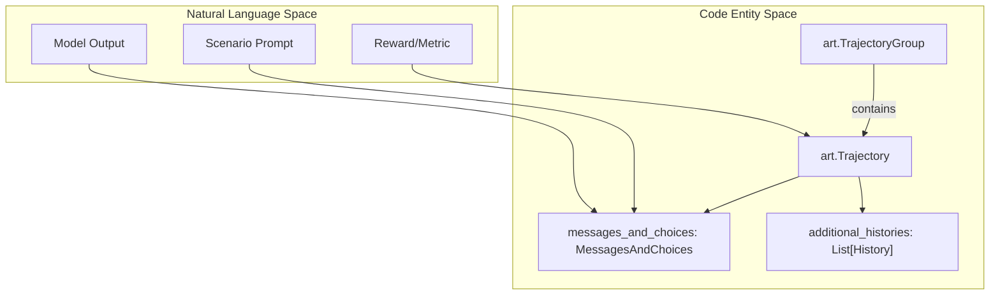
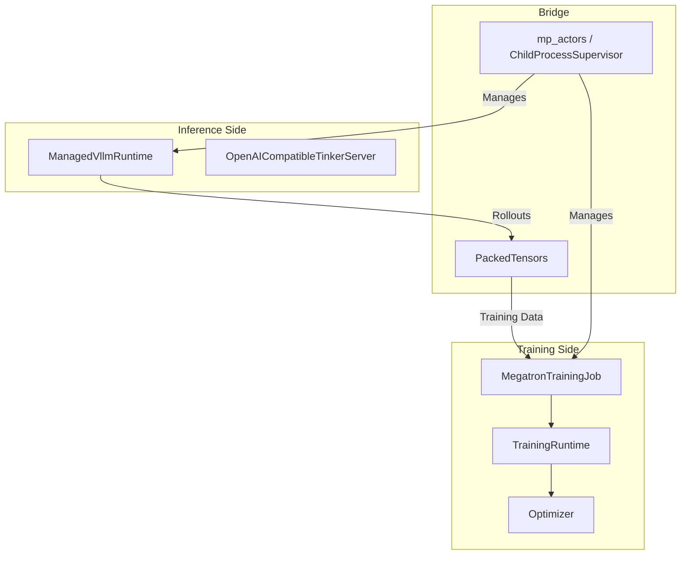

<!-- source: DeepWiki mcp.deepwiki.com · repo OpenPipe/ART · page 9.7 Glossary · fetched 2026-10-29 -->

# Glossary

Relevant source files

The following files were used as context for generating this wiki page:

- [docs/features/additional-histories.mdx](docs/features/additional-histories.mdx)
- [docs/features/checkpoint-forking.mdx](docs/features/checkpoint-forking.mdx)
- [docs/images/forked-run.webp](docs/images/forked-run.webp)
- [docs/resources/glossary.mdx](docs/resources/glossary.mdx)
- [docs/resources/models.mdx](docs/resources/models.mdx)
- [examples/prisoners-dilemma.ipynb](examples/prisoners-dilemma.ipynb)
- [src/art/__init__.py](src/art/__init__.py)
- [src/art/auto_trajectory.py](src/art/auto_trajectory.py)
- [src/art/megatron/lora.py](src/art/megatron/lora.py)
- [src/art/megatron/provider.py](src/art/megatron/provider.py)
- [src/art/megatron/service.py](src/art/megatron/service.py)
- [src/art/megatron/train.py](src/art/megatron/train.py)
- [src/art/openai.py](src/art/openai.py)
- [src/art/trajectories.py](src/art/trajectories.py)
- [src/art/transformers/patches.py](src/art/transformers/patches.py)
- [src/art/types.py](src/art/types.py)
- [src/art/utils/benchmarking/load_trajectories.py](src/art/utils/benchmarking/load_trajectories.py)
- [src/art/utils/benchmarking/pull_model_trajectories.py](src/art/utils/benchmarking/pull_model_trajectories.py)
- [src/art/utils/old_benchmarking/load_benchmarked_models.py](src/art/utils/old_benchmarking/load_benchmarked_models.py)
- [src/art/utils/trajectory_logging.py](src/art/utils/trajectory_logging.py)
- [src/art/utils/trajectory_migration.py](src/art/utils/trajectory_migration.py)
- [tests/unit/test_trajectory_parquet.py](tests/unit/test_trajectory_parquet.py)

This page defines technical terms used throughout the ART (Agent Reinforcement Trainer) framework. Entries are grouped by topic area.

## Core Framework Concepts

### ART (Agent Reinforcement Trainer)
The framework for training LLM agents using Reinforcement Learning (RL) and Supervised Fine-Tuning (SFT). It focuses on multi-step reasoning, tool use, and group-relative optimization.
Sources: [src/art/__init__.py:1-17]()

### Backend
The infrastructure component responsible for managing GPU resources, model inference, and training execution. All backends implement the `Backend` protocol.
Sources: [src/art/backend.py:1-50](), [src/art/__init__.py:63-63]()

### Rollout
A single execution of an agent attempting to complete a task. During a rollout, the agent generates a sequence of messages and actions captured in a `Trajectory`.
Sources: [src/art/trajectories.py:38-66](), [src/art/auto_trajectory.py:1-40]()

### Reward
A scalar value assigned to a `Trajectory` indicating performance quality. Used by GRPO to compute advantages.
Sources: [src/art/trajectories.py:42-42](), [src/art/types.py:69-80]()

### Training Step
A single iteration of the training loop involving rollout collection, reward assignment, gradient computation, and weight update.
Sources: [src/art/megatron/train.py:171-181](), [src/art/types.py:77-77]()

### Epoch
One complete pass over the training dataset. In RL, this often refers to how many times the model updates on a specific set of collected trajectories.
Sources: [src/art/megatron/train.py:284-284]()

### Dedicated Mode vs. Shared Mode
- **Dedicated Mode**: The training process has exclusive access to the GPU.
- **Shared Mode**: The GPU is shared between the inference server (vLLM) and the training process, requiring careful VRAM management (e.g., sleep/wake).
Sources: [src/art/megatron/service.py:19-19]()

## Data Structures

### Trajectory (art.Trajectory)
The primary data structure capturing an agent rollout. Stores messages, tools, rewards, metrics, and metadata.
Sources: [src/art/trajectories.py:38-66]()

### TrajectoryGroup (art.TrajectoryGroup)
A collection of `Trajectory` objects produced from the same starting scenario (same prompt). Essential for GRPO to compute group-relative advantages.
Sources: [src/art/trajectories.py:130-179]()

### History (art.History)
A data structure containing a sequence of messages and tools. Used in `additional_histories`.
Sources: [src/art/trajectories.py:30-36]()

### Additional Histories
An optional list of `History` objects in a `Trajectory`. Each history is tokenized independently and has its own attention mask. Used to preserve context like `<think>` tokens in multi-turn Qwen 3 workflows.
Sources: [src/art/trajectories.py:41-41](), [docs/features/additional-histories.mdx:1-50]()

### PackedTensors / DiskPackedTensors
A memory-efficient format for storing tokenized trajectories. Multiple sequences are "packed" into a single tensor to maximize GPU utilization by avoiding padding. `DiskPackedTensors` allows streaming these from disk.
Sources: [src/art/megatron/train.py:118-121](), [src/art/megatron/service.py:21-21]()

### SFTBatch
A data structure representing a batch of tokenized data for Supervised Fine-Tuning, containing input IDs, labels, and attention masks.
Sources: [src/art/megatron/service.py:22-22](), [src/art/megatron/training/sft_batches.py:1-30]()

**Trajectory to Code Entity Map**

Sources: [src/art/trajectories.py:38-179](), [src/art/types.py:11-15]()

## Training & Optimization

### GRPO (Group Relative Policy Optimization)
The core RL algorithm in ART. It computes advantages by normalizing rewards within a `TrajectoryGroup` rather than using a separate value-function critic.
Sources: [src/art/megatron/train.py:10-15](), [src/art/types.py:26-31]()

### LoRA (Low-Rank Adaptation)
A parameter-efficient fine-tuning method. ART typically trains LoRA adapters while keeping base model weights frozen.
Sources: [src/art/megatron/lora.py:38-42](), [src/art/megatron/service.py:76-80]()

### Adapter Lease
A mechanism in Tinker or vLLM backends where a LoRA adapter is "leased" or loaded into the inference engine for a specific duration or set of requests.
Sources: [src/art/megatron/service.py:40-46]()

### MoE Routing Replay
A feature for Mixture-of-Experts (MoE) models where the routing decisions (expert assignments) made during the rollout are "replayed" exactly during the training backward pass to ensure consistency.
Sources: [src/art/megatron/routing_replay.py:1-50](), [src/art/megatron/train.py:51-54]()

### Weight Transfer
The process of moving weights (often merged LoRA weights) between different processes or nodes, typically from a training rank to an inference server.
Sources: [src/art/megatron/train.py:63-64](), [src/art/megatron/weights/merged_weight_export.py:1-20]()

### PipelineTrainer
A training orchestrator that manages the multi-stage pipeline: collecting rollouts, processing data, and executing training steps asynchronously.
Sources: [src/art/megatron/train.py:137-170]()

### RULER (Relative Universal LLM-Elicited Rewards)
ART's system for using an LLM-as-a-judge to provide relative rewards for a group of trajectories based on a rubric.
Sources: [src/art/trajectories.py:1-20]()

## Infrastructure

### Tinker
A custom high-performance inference backend designed for ART that supports advanced features like prefix caching and multiprocess actor isolation.
Sources: [src/art/tinker/backend.py:1-30]()

### mp_actors (Multi-Process Actors)
A framework within ART for managing child processes. It allows moving heavy objects (like LLM engines) to separate processes to avoid Python's Global Interpreter Lock (GIL) and handle isolation.
Sources: [src/art/utils/lifecycle.py:25-30](), [src/art/megatron/service.py:25-30]()

### MegatronBackend
A backend implementation using Megatron-LM for large-scale distributed training, supporting Tensor Parallelism (TP), Pipeline Parallelism (PP), and Context Parallelism (CP).
Sources: [src/art/megatron/train.py:10-15](), [src/art/types.py:33-40]()

**System Architecture & Code Entities**

Sources: [src/art/megatron/service.py:188-214](), [src/art/megatron/train.py:137-170](), [src/art/utils/lifecycle.py:26-28]()

## Configuration Types

| Type | Source | Description |
| :--- | :--- | :--- |
| `TrainConfig` | `src/art/types.py:26-31` | RL hyperparameters (LR, KL penalty, Grad Accumulation). |
| `TrainSFTConfig` | `src/art/types.py:49-53` | SFT hyperparameters (LR, Batch Size, Assistant Turns). |
| `MegatronTopologyConfig` | `src/art/types.py:33-40` | Parallelism settings (TP, CP, EP, PP). |
| `InternalModelConfig` | `src/art/dev/get_model_config.py` | Internal union of engine, peft, and trainer args. |

Sources: [src/art/types.py:1-85](), [src/art/megatron/service.py:76-80]()