# Page: Overview

# Overview

<details>
<summary>Relevant source files</summary>

The following files were used as context for generating this wiki page:

- [README.md](README.md)
- [docs/docs.json](docs/docs.json)
- [docs/fundamentals/art-backend.mdx](docs/fundamentals/art-backend.mdx)
- [docs/fundamentals/art-client.mdx](docs/fundamentals/art-client.mdx)
- [docs/fundamentals/training-loop.mdx](docs/fundamentals/training-loop.mdx)
- [docs/getting-started/about.mdx](docs/getting-started/about.mdx)
- [docs/getting-started/faq.mdx](docs/getting-started/faq.mdx)
- [docs/getting-started/installation-setup.mdx](docs/getting-started/installation-setup.mdx)
- [docs/getting-started/notebooks.mdx](docs/getting-started/notebooks.mdx)
- [docs/getting-started/quick-start.mdx](docs/getting-started/quick-start.mdx)
- [docs/integrations/langgraph-integration.mdx](docs/integrations/langgraph-integration.mdx)
- [docs/style.css](docs/style.css)
- [docs/tutorials/summarizer.mdx](docs/tutorials/summarizer.mdx)
- [src/art/__init__.py](src/art/__init__.py)
- [src/art/openai.py](src/art/openai.py)
- [src/art/transformers/patches.py](src/art/transformers/patches.py)
- [src/art/types.py](src/art/types.py)

</details>


This page provides a high-level introduction to ART (Agent Reinforcement Trainer), an open-source framework for training LLM-based agents using reinforcement learning. It covers the core architecture, key abstractions, and deployment options. For installation instructions, see [Installation & Quick Start](#1.1). For detailed explanations of fundamental concepts like trajectories and the GRPO algorithm, see [Core Concepts](#1.2).

## Purpose

ART is a Python library that enables reinforcement learning training for LLM agents through a client-server architecture. It abstracts the complexity of RL training (inference engines, GPU memory management, training algorithms) into a backend service while providing an OpenAI-compatible client interface for agent code. It is specifically designed to improve agent reliability by allowing models to learn from experience via **GRPO** (Group Relative Policy Optimization).

**Sources:** [README.md:1-59](), [src/art/__init__.py:1-17](), [docs/getting-started/about.mdx:1-127]()

## System Architecture

ART divides functionality into two layers: the **Client**, which manages the environment and agent logic, and the **Backend**, which handles token generation and weight updates.

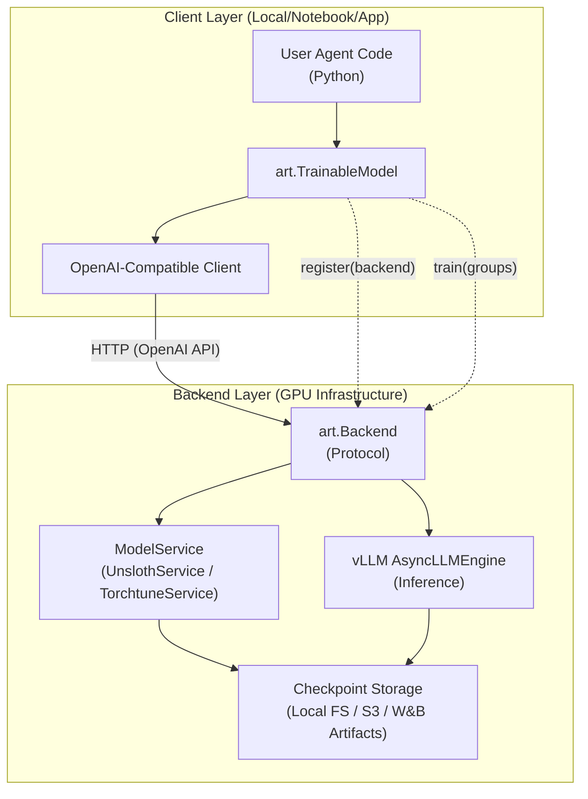

The client communicates with the backend through two pathways:
1. **Inference requests**: Standard OpenAI API calls routed to vLLM.
2. **Training requests**: `TrainableModel.train()` sends trajectory groups to the backend for weight updates.

**Sources:** [docs/fundamentals/art-client.mdx:7-30](), [docs/fundamentals/art-backend.mdx:7-32](), [src/art/model.py:34-100]()

## Core Components

### Model Classes

| Class | Location | Purpose |
|-------|----------|---------|
| `art.Model` | [src/art/model.py:34-100]() | Base class for inference-only models and cost tracking. |
| `art.TrainableModel` | [src/art/model.py:102-300]() | Extends `Model` with `train()`, `train_sft()`, and `register()` capabilities. |

These classes provide the primary API for registering backends, generating completions via `openai_client()`, and initiating training steps.

**Sources:** [src/art/model.py:34-300](), [docs/fundamentals/art-client.mdx:32-61]()

### Trajectory System

ART uses trajectories to capture agent interactions and their resulting rewards.

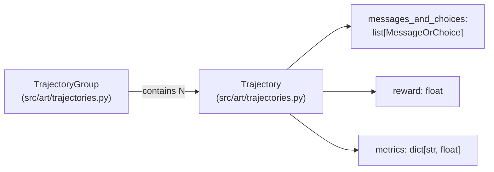

- **`Trajectory`**: Captures a single rollout, storing `messages_and_choices` (the sequence of `system`/`user`/`assistant` messages and model `Choice` objects) plus a scalar `reward` and optional `metrics`.
- **`TrajectoryGroup`**: Contains multiple `Trajectory` objects from the same scenario. GRPO computes per-group relative advantages across the group to determine which behavior was superior.
- **`messages_and_choices`**: Typed as `list[MessageOrChoice]` where `MessageOrChoice = Message | Choice` ([src/art/types.py:11-14]()).

**Sources:** [src/art/trajectories.py:1-100](), [src/art/types.py:11-14](), [docs/fundamentals/art-client.mdx:144-170]()

### Backend Implementations

All backends implement the `art.Backend` protocol.

| Backend | Module | Use Case |
|---------|--------|----------|
| `LocalBackend` | [src/art/local/backend.py:62]() | Single machine with GPU; runs Unsloth or Torchtune. |
| `ServerlessBackend` | [src/art/serverless/backend.py:1-50]() | W&B managed autoscaling infrastructure; zero-infra setup. |
| `SkyPilotBackend` | `src/art/skypilot/backend.py` | Cloud GPU clusters provisioned via SkyPilot. |
| `MegatronBackend` | `src/art/megatron/backend.py` | Large-scale multi-GPU distributed training. |
| `TinkerBackend` | `src/art/tinker/backend.py` | High-efficiency inference with worker-based prefix caching. |

**Sources:** [src/art/backend.py:1-50](), [docs/fundamentals/art-backend.mdx:34-74](), [README.md:24-53]()

## Training Loop

The ART training loop is strictly sequential, alternating between rollout and training phases.

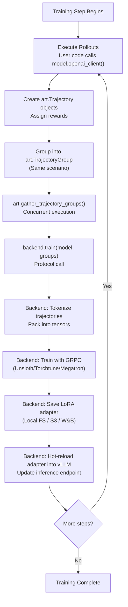

**Sources:** [docs/fundamentals/training-loop.mdx:1-100](), [docs/fundamentals/art-client.mdx:175-214](), [src/art/gather.py:1-50]()

## Key Python Abstractions

**Public API surface — class names to source files**

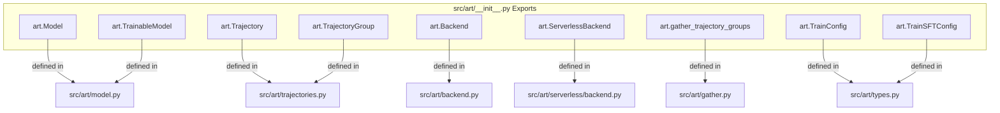

**Sources:** [src/art/__init__.py:61-118](), [src/art/types.py:26-53]()

## Installation Options

ART supports several installation extras depending on your hardware and integration needs:

| Extra | Purpose |
|--------------|----------|
| `backend` | Required for `LocalBackend` (installs vLLM, Unsloth, PyTorch). |
| `langgraph` | Integration for training LangGraph ReAct agents. |
| `megatron` | Distributed training support. |
| `tinker` | Prefix-caching inference engine support. |
| `plotting` | Visualization utilities for training data. |

**Sources:** [pyproject.toml:6-74](), [docs/getting-started/installation-setup.mdx:7-21]()

## Next Steps

- **Installation**: See [Installation & Quick Start](#1.1) for environment setup.
- **Core Concepts**: See [Core Concepts](#1.2) for detailed explanations of trajectories and GRPO.
- **Client Usage**: See [Model System](#2.1) for `TrainableModel` API details.
- **Backend Setup**: See [Backend Infrastructure](#2.3) for backend configuration options.
- **LangGraph**: See [LangGraph Integration](#5.1) to train multi-step agents.
- **Examples**: See [Example Applications](#6) for game-playing and tool-calling agents.

**Sources:** [docs/docs.json:42-101]()

---

# Page: Installation & Quick Start

# Installation & Quick Start

<details>
<summary>Relevant source files</summary>

The following files were used as context for generating this wiki page:

- [README.md](README.md)
- [docs/docs.json](docs/docs.json)
- [docs/fundamentals/art-backend.mdx](docs/fundamentals/art-backend.mdx)
- [docs/fundamentals/art-client.mdx](docs/fundamentals/art-client.mdx)
- [docs/fundamentals/training-loop.mdx](docs/fundamentals/training-loop.mdx)
- [docs/getting-started/about.mdx](docs/getting-started/about.mdx)
- [docs/getting-started/faq.mdx](docs/getting-started/faq.mdx)
- [docs/getting-started/installation-setup.mdx](docs/getting-started/installation-setup.mdx)
- [docs/getting-started/notebooks.mdx](docs/getting-started/notebooks.mdx)
- [docs/getting-started/quick-start.mdx](docs/getting-started/quick-start.mdx)
- [docs/integrations/langgraph-integration.mdx](docs/integrations/langgraph-integration.mdx)
- [docs/style.css](docs/style.css)
- [docs/tutorials/summarizer.mdx](docs/tutorials/summarizer.mdx)
- [pyproject.toml](pyproject.toml)
- [src/art/dev/__init__.py](src/art/dev/__init__.py)
- [src/art/dev/get_model_config.py](src/art/dev/get_model_config.py)
- [src/art/dev/model.py](src/art/dev/model.py)
- [tests/unit/test_dedicated_config.py](tests/unit/test_dedicated_config.py)
- [uv.lock](uv.lock)

</details>


This page guides you through installing ART (Agent Reinforcement Training), setting up environments, and running your first training example. ART is designed to be ergonomic, allowing you to run agent logic anywhere while offloading heavy compute (inference and training) to specialized backends.

For core concepts like trajectories and GRPO, see [1.2 Core Concepts](). For backend architecture details, see [2.3 Backend Infrastructure]().

---

## Installation

### Basic Client Installation

The ART client is lightweight and runs on any machine with **Python >=3.12** [pyproject.toml:6-6](). It handles trajectory orchestration and reward calculation.

```bash
pip install openpipe-art
```

This installs core dependencies:
* `openai`: Interface for model interaction [pyproject.toml:8-8]().
* `litellm`: Multi-provider support [pyproject.toml:10-10]().
* `weave`: Experiment tracking and logging [pyproject.toml:11-11]().
* `polars`: High-performance data handling for trajectories [pyproject.toml:12-12]().

**Sources:** [pyproject.toml:1-16](), [docs/getting-started/installation-setup.mdx:7-13]()

### Backend Installation Options

ART supports multiple backend modes. To run training or inference locally, you must install specific extras.

#### Local Backend (GPU Required)
For training on local hardware (e.g., H100, A100), install the `backend` extra:

```bash
pip install "openpipe-art[backend]"
```

This installs the heavy-lift infrastructure:
* `unsloth` & `unsloth-zoo`: Fast, memory-efficient LoRA training [pyproject.toml:25-26]().
* `torch` (v2.11.0) & `torchao`: The underlying tensor framework [pyproject.toml:27-28]().
* `vllm`: High-throughput inference engine (managed via `art-vllm-runtime`).
* `wandb`: Experiment tracking and artifact storage [pyproject.toml:32-32]().

**Sources:** [pyproject.toml:21-43](), [docs/getting-started/installation-setup.mdx:15-21]()

#### Megatron Backend (Distributed)
For large-scale distributed training across multiple GPUs or nodes:

```bash
pip install "openpipe-art[megatron]"
```

This includes `megatron-core`, `transformer-engine`, and specialized kernels like `flash-attn` [pyproject.toml:44-66]().

---

## Environment Setup

### Weights & Biases (W&B)
ART uses W&B for metric tracking, trajectory visualization, and (in serverless mode) GPU orchestration.

1. Create an account at [wandb.ai](https://wandb.ai).
2. Retrieve your API key from [wandb.ai/authorize](https://wandb.ai/authorize).
3. Set the environment variable:
   ```bash
   export WANDB_API_KEY="your_key_here"
   ```

**Sources:** [docs/getting-started/quick-start.mdx:19-33](), [README.md:48-50]()

---

## Minimal Working Example

This example demonstrates the standard workflow: registering a model, running rollouts to collect data, and initiating a training step.

### 1. Initialize the Model and Backend
The `TrainableModel` acts as your primary interface [docs/fundamentals/art-client.mdx:34-49]().

```python
import art
from art.local.backend import LocalBackend

# 1. Setup Backend (Local GPU)
backend = LocalBackend()

# 2. Define the Model
model = art.TrainableModel(
    name="my-first-agent",
    project="art-quickstart",
    base_model="Qwen/Qwen2.5-7B-Instruct"
)

# 3. Connect them
await model.register(backend)
```
**Sources:** [docs/fundamentals/art-client.mdx:34-61](), [docs/getting-started/installation-setup.mdx:25-37]()

### 2. Define the Rollout Function
A rollout executes the agent's logic for a single scenario and returns a `Trajectory` with a `reward` [docs/fundamentals/art-client.mdx:143-170]().

```python
async def rollout(model: art.Model, scenario: str) -> art.Trajectory:
    client = model.openai_client()
    
    # Start tracking the trajectory
    traj = art.Trajectory(
        messages_and_choices=[{"role": "user", "content": scenario}]
    )
    
    # Generate completion via the backend's vLLM instance
    response = await client.chat.completions.create(
        messages=traj.messages(),
        model=model.get_inference_name()
    )
    
    # Record the choice and assign a reward
    traj.messages_and_choices.append(response.choices[0])
    traj.reward = 1.0 if "correct" in response.choices[0].message.content else 0.0
    
    return traj
```
**Sources:** [docs/fundamentals/art-client.mdx:143-170]()

### 3. Run Training Loop
ART uses `gather_trajectory_groups` to manage concurrent rollouts before sending them to the backend for GRPO training [docs/fundamentals/art-client.mdx:175-194]().

```python
scenarios = ["Solve 2+2", "Solve 10/2"]

# Collect experience (8 attempts per scenario)
groups = await art.gather_trajectory_groups(
    (
        art.TrajectoryGroup(rollout(model, s) for _ in range(8))
        for s in scenarios
    ),
    pbar_desc="Gathering"
)

# Execute one GRPO training step
result = await backend.train(model, groups, learning_rate=1e-5)

# Log results to W&B
await model.log(groups, metrics=result.metrics, step=result.step)
```
**Sources:** [docs/fundamentals/art-client.mdx:175-194](), [src/art/dev/get_model_config.py:78-95]()

---

## Data Flow & Architecture

The following diagram bridges the high-level API to the internal code entities.

### Training Data Flow
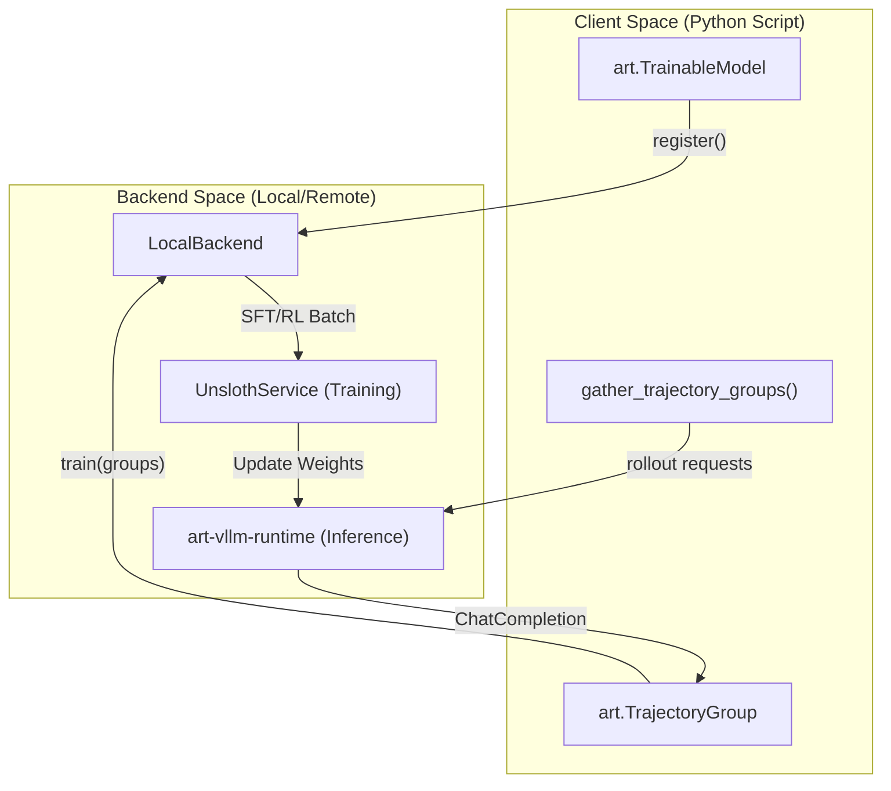
**Sources:** [docs/fundamentals/art-client.mdx:88-115](), [docs/fundamentals/art-backend.mdx:1-30](), [src/art/dev/get_model_config.py:22-113]()

### Model Configuration Mapping
The `get_model_config` function merges user-provided `InternalModelConfig` with system defaults to prepare the backend [src/art/dev/get_model_config.py:22-27]().

| Code Entity | Configuration Role |
| :--- | :--- |
| `InitArgs` | HuggingFace/Unsloth loading params (4-bit, seq length) [src/art/dev/model.py:194-207]() |
| `EngineArgs` | vLLM runtime settings (GPU utilization, sleep mode) [src/art/dev/engine.py:1-30]() |
| `LoRAConfig` | PEFT adapter settings (rank, alpha, target modules) [src/art/dev/model.py:209-218]() |
| `TrainerArgs` | GRPO/SFT hyperparameters (LR, batch size, optimizer) [src/art/dev/model.py:220-270]() |

**Sources:** [src/art/dev/get_model_config.py:22-113](), [src/art/dev/model.py:121-169]()

---

## Quick Start Notebooks
For a hands-on introduction without local setup, use the provided Google Colab notebooks which utilize the `ServerlessBackend`.

* **2048**: Train an agent to play the 2048 game [docs/getting-started/quick-start.mdx:7-17]().
* **LangGraph**: Train a multi-step ReAct agent [docs/integrations/langgraph-integration.mdx:86-116]().
* **Temporal Clue**: Logic puzzle solving [README.md:69-69]().

**Sources:** [README.md:61-75](), [docs/getting-started/quick-start.mdx:1-42]()

---

# Page: Core Concepts

# Core Concepts

<details>
<summary>Relevant source files</summary>

The following files were used as context for generating this wiki page:

- [README.md](README.md)
- [docs/fundamentals/art-backend.mdx](docs/fundamentals/art-backend.mdx)
- [docs/getting-started/installation-setup.mdx](docs/getting-started/installation-setup.mdx)
- [docs/integrations/langgraph-integration.mdx](docs/integrations/langgraph-integration.mdx)
- [docs/tutorials/summarizer.mdx](docs/tutorials/summarizer.mdx)
- [examples/prisoners-dilemma.ipynb](examples/prisoners-dilemma.ipynb)
- [src/art/__init__.py](src/art/__init__.py)
- [src/art/auto_trajectory.py](src/art/auto_trajectory.py)
- [src/art/openai.py](src/art/openai.py)
- [src/art/trajectories.py](src/art/trajectories.py)
- [src/art/transformers/patches.py](src/art/transformers/patches.py)
- [src/art/types.py](src/art/types.py)
- [src/art/utils/benchmarking/load_trajectories.py](src/art/utils/benchmarking/load_trajectories.py)
- [src/art/utils/benchmarking/pull_model_trajectories.py](src/art/utils/benchmarking/pull_model_trajectories.py)
- [src/art/utils/old_benchmarking/load_benchmarked_models.py](src/art/utils/old_benchmarking/load_benchmarked_models.py)
- [src/art/utils/trajectory_logging.py](src/art/utils/trajectory_logging.py)
- [src/art/utils/trajectory_migration.py](src/art/utils/trajectory_migration.py)
- [tests/unit/test_trajectory_parquet.py](tests/unit/test_trajectory_parquet.py)

</details>


ART (Agent Reinforcement Trainer) is designed to bridge the gap between multi-step agentic workflows and Reinforcement Learning (RL). It provides an ergonomic framework for training LLMs using the Group Relative Policy Optimization (GRPO) algorithm, specifically optimized for agents that interact with tools and environments.

## High-Level Architecture

The system is built on a clear separation between the **Client** (the environment where your agent lives) and the **Backend** (the infrastructure that handles inference and training).

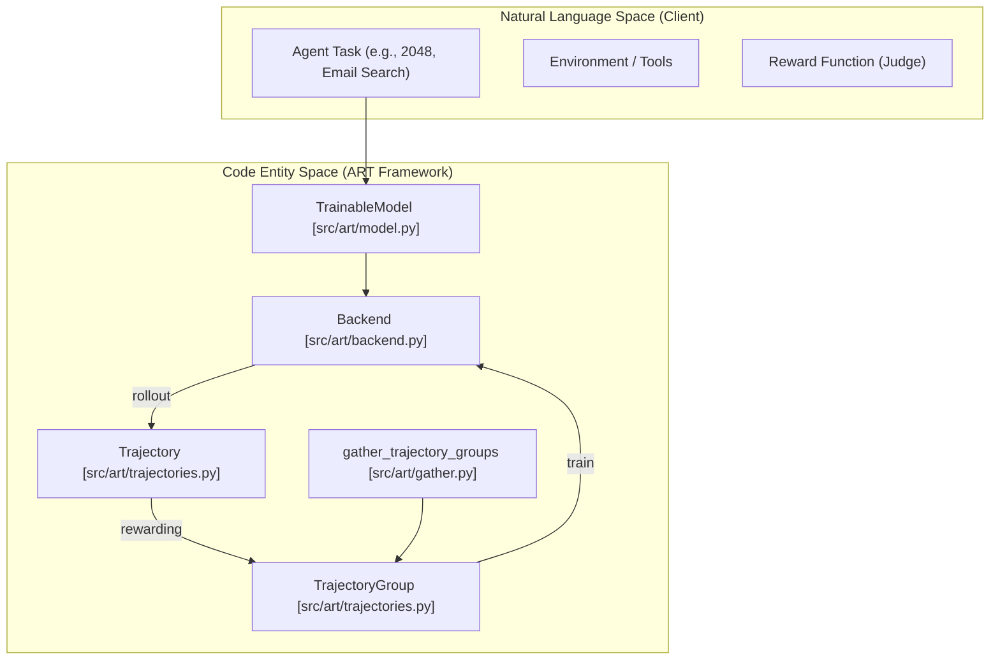
Sources: [src/art/model.py:71-71](), [src/art/backend.py:1-20](), [src/art/trajectories.py:38-130](), [src/art/gather.py:1-20]()

---

## Fundamental Entities

### TrainableModel
The `TrainableModel` is the central coordinator. It tracks the project name, the base model (e.g., "Qwen/Qwen2.5-7B"), and its current training state. It provides methods to `register` with a backend and `log` metrics to persistent storage.
* **Definition**: [src/art/model.py:71-71]()
* **Key Methods**: `register(backend)`, `train(trajectory_groups)`, `log(trajectory_groups, metrics, step)`.

### Backend
A `Backend` represents the compute resource. It manages the lifecycle of the model: switching between inference mode (serving tokens via vLLM) and training mode (updating weights via Unsloth or Torchtune).
* **LocalBackend**: Runs on your local GPU [src/art/local/backend.py]().
* **ServerlessBackend**: Offloads to a managed W&B Training cluster [src/art/serverless/backend.py]().
* **Interface**: [src/art/backend.py:1-20]()

### Trajectory & TrajectoryGroup
A **Trajectory** is a single "run" of an agent. It contains the sequence of messages, tool calls, and the final scalar reward.
* **Trajectory**: [src/art/trajectories.py:38-38]()
* **TrajectoryGroup**: [src/art/trajectories.py:130-130]() - A collection of trajectories generated from the same starting prompt. This is a requirement for GRPO, which computes advantages by comparing rewards within a group.

---

## The Training Loop

The ART training loop follows a strictly sequential **Inference -> Reward -> Train** pattern.

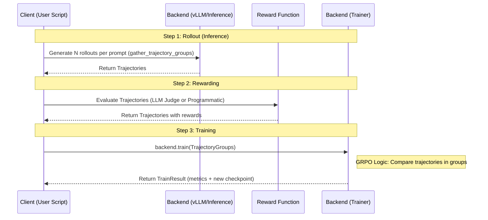
Sources: [src/art/gather.py:1-50](), [src/art/types.py:69-80](), [src/art/trajectories.py:130-145]()

### 1. Rollout
A "rollout" is the process of letting the model interact with the environment. ART provides `capture_auto_trajectory` to automatically record all OpenAI-compatible API calls made within a block of code, turning them into a `Trajectory` object.
* **Source**: [src/art/auto_trajectory.py:66-69]()

### 2. Reward
After rollouts are complete, you assign a `reward` (float) to each `Trajectory`. ART supports:
* **Programmatic Rewards**: e.g., "Did the agent win the game of 2048?"
* **LLM Judges**: Using a stronger model to grade the agent's reasoning.
* **RULER**: A general-purpose reward utility provided by ART for multi-step tasks.

### 3. GRPO Training
Unlike standard PPO which requires a separate Value Model, **GRPO (Group Relative Policy Optimization)** uses the mean reward of the `TrajectoryGroup` to normalize advantages.
* **Logic**: If a trajectory's reward is higher than the group average, the model is encouraged to repeat those actions.
* **Implementation**: Handled internally by the backend during `backend.train()`.

---

## Data Flow & Storage

ART uses efficient formats to handle the large volume of data generated during RL.

| Entity | Storage Format | Description |
| :--- | :--- | :--- |
| **Trajectories** | Parquet | Serialized with ZSTD compression for ~25x reduction vs JSONL. [src/art/utils/trajectory_logging.py:59-62]() |
| **Weights** | LoRA Adapters | Only the PEFT adapters are saved/transferred, keeping checkpoints small. [src/art/dev.py:65-65]() |
| **Metrics** | W&B / Local | Logged to Weights & Biases or local `.art` directories. [src/art/utils/output_dirs.py:7-42]() |

### Code-to-Disk Mapping
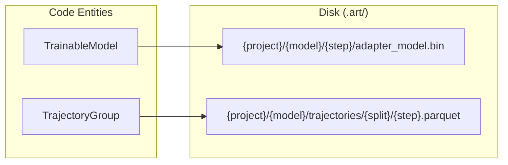
Sources: [src/art/utils/output_dirs.py:12-42](), [src/art/utils/trajectory_logging.py:59-72]()

---

# Page: Core Framework

# Core Framework

<details>
<summary>Relevant source files</summary>

The following files were used as context for generating this wiki page:

- [src/art/__init__.py](src/art/__init__.py)
- [src/art/local/backend.py](src/art/local/backend.py)
- [src/art/model.py](src/art/model.py)
- [src/art/openai.py](src/art/openai.py)
- [src/art/transformers/patches.py](src/art/transformers/patches.py)
- [src/art/types.py](src/art/types.py)

</details>


This section documents the internal architecture of the `art` library as it exists in `src/art/`. It covers the four subsystems that every ART training run depends on: the **Model system**, the **Trajectory system**, the **Backend infrastructure**, and the **Data Processing pipeline**.

This page orients you to how these subsystems fit together. For full API-level detail, see:
- [Model System](#2.1)
- [Trajectory System](#2.2)
- [Backend Infrastructure](#2.3)
- [Data Processing Pipeline](#2.4)

For higher-level concepts like what GRPO is or why trajectories are grouped, see [Core Concepts](#1.2). For backend-specific implementations (LocalBackend, ServerlessBackend, etc.), see [Backend Implementations](#4).

---

## What the Core Framework Does

The core framework is the glue between user-written rollout code and backend training engines. It defines:

1.  **What a model is** — how it is identified, how inference is accessed via an OpenAI-compatible proxy, and how training is triggered. [src/art/model.py:166-200]()
2.  **What training data looks like** — the `Trajectory` and `TrajectoryGroup` structures that carry messages, rewards, and metrics from rollout code to the backend. [src/art/trajectories.py:1-10]()
3.  **How backends are abstracted** — the `Backend` protocol that every training engine implements, enabling swappable infrastructure. [src/art/backend.py:1-50]()
4.  **How raw trajectories become tensors** — the tokenization and packing steps that transform `Trajectory` objects into training-ready data. [src/art/local/backend.py:65-75]()

---

## Subsystem Overview

**Core framework component map** — from user entrypoints to backend calls:

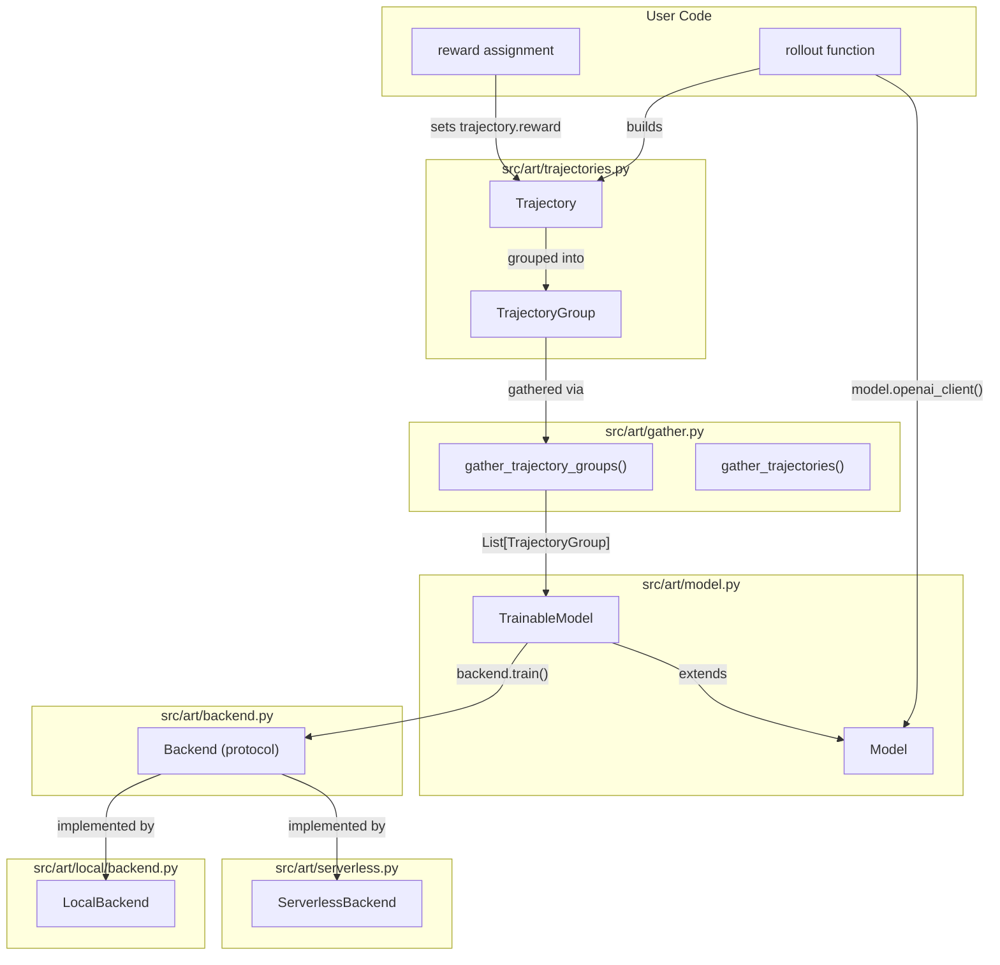

Sources: [src/art/__init__.py:60-118](), [src/art/model.py:166-224](), [src/art/trajectories.py:1-10]()

---

## The Model System

The entry point for all user-facing interactions is `art.TrainableModel`, defined in [src/art/model.py](). There are two primary classes:

| Class | Purpose | Key extra fields |
| :--- | :--- | :--- |
| `Model` | Prompted / comparison model. Wraps an OpenAI-compatible inference endpoint. | `inference_base_url`, `inference_api_key`, `inference_model_name` |
| `TrainableModel` | Extends `Model`. Adds RL training, SFT fine-tuning, and checkpoint management. | `base_model`, `_internal_config` |

Both are Pydantic `BaseModel` subclasses. `TrainableModel` carries a `trainable: bool = True` discriminator field used for FastAPI serialization at the backend layer. [src/art/model.py:682-700]()

**Key methods on `Model` / `TrainableModel`:**

| Method | Where defined | What it does |
| :--- | :--- | :--- |
| `register(backend)` | `Model` | Connects the model to a backend and populates inference connection info. [src/art/model.py:416-435]() |
| `openai_client()` | `Model` | Returns an `AsyncOpenAI` instance pointing at the backend inference server. [src/art/model.py:448-477]() |
| `get_step()` | `Model` | Queries the backend for the current training step number. [src/art/model.py:383-390]() |
| `log(trajectories, ...)` | `Model` | Writes trajectory Parquet files and metrics to disk/W&B. [src/art/model.py:479-540]() |
| `train(...)` | `TrainableModel` | Executes an RL (GRPO) training step via the backend. [src/art/model.py:844-906]() |
| `train_sft(...)` | `TrainableModel` | Executes an SFT fine-tuning step via the backend. [src/art/model.py:908-940]() |
| `delete_checkpoints(...)`| `TrainableModel` | Delegates checkpoint cleanup to the backend implementation. [src/art/model.py:794-802]() |

**Model class hierarchy:**

```mermaid
classDiagram
    class "pydantic.BaseModel" {
    }
    class "Model" {
        +name: str
        +project: str
        +inference_base_url: str
        +inference_api_key: str
        +trainable: bool = False
        +register(backend)
        +openai_client() AsyncOpenAI
        +log(trajectories, split)
        +get_step() int
        +read_state()
        +merge_state()
    }
    class "TrainableModel" {
        +base_model: str
        +trainable: bool = True
        +_internal_config: InternalModelConfig
        +train(trajectory_groups, config)
        +train_sft(trajectories, config)
        +delete_checkpoints(metric)
    }

    "pydantic.BaseModel" <|-- "Model"
    "Model" <|-- "TrainableModel"
```

Sources: [src/art/model.py:166-224](), [src/art/model.py:682-700]()

---

## The Trajectory System

Training data is captured as `Trajectory` and `TrajectoryGroup` objects.

A `Trajectory` holds the full message history for a single rollout, its assigned `reward`, and any custom `metrics`. Multiple trajectories from the same scenario are bundled into a `TrajectoryGroup`, which is what GRPO uses to compute group-relative advantages. [src/art/trajectories.py:1-10]()

**Data flow from rollout to training:**

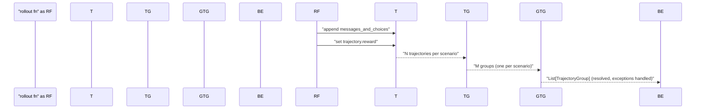

`gather_trajectory_groups()` in [src/art/gather.py]() runs all rollout coroutines concurrently, collects results into `TrajectoryGroup` objects, and surfaces exceptions without aborting the whole batch. [src/art/gather.py:1-50]()

Sources: [src/art/__init__.py:60-65](), [src/art/model.py:479-666]()

---

## The Backend Infrastructure

The `Backend` protocol in `src/art/backend.py` is the contract that every training engine must fulfill.

| Protocol method | Purpose |
| :--- | :--- |
| `register(model)` | Registers a model definition with the backend. |
| `_prepare_backend_for_training(...)` | Starts the inference server; returns `(base_url, api_key)`. |
| `_get_step(model)` | Returns the current training step. |
| `_train_model(...)` | Runs one GRPO training step; yields metrics. |
| `_train_sft(...)` | Runs one SFT training step; yields metrics. |

The `TrainResult` dataclass hierarchy in [src/art/types.py:69-107]() carries the outcome of each training call:

| Class | Extra field | Backend |
| :--- | :--- | :--- |
| `TrainResult` | — | Base for all. |
| `LocalTrainResult` | `checkpoint_path: str \| None` | `LocalBackend`. |
| `ServerlessTrainResult` | `artifact_name: str \| None` | `ServerlessBackend`. |

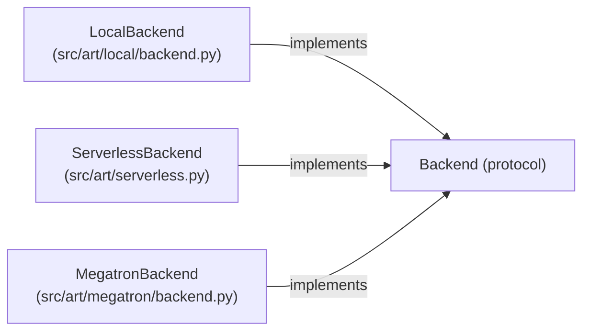

Sources: [src/art/types.py:69-107](), [src/art/local/backend.py:193-224]()

---

## The Data Processing Pipeline

Before trajectory data reaches the optimizer, it passes through a tokenization and packing pipeline:

1.  **Tokenize** — `tokenize_trajectory_groups()` converts `messages_and_choices` into token IDs and attention masks. [src/art/local/backend.py:71-75]()
2.  **Pack** — Sequences are packed into fixed-size chunks (`PackedTensors`) to maximize GPU utilization. [src/art/local/backend.py:65-70]()
3.  **Loss** — The packed tensors feed the GRPO or SFT loss function.

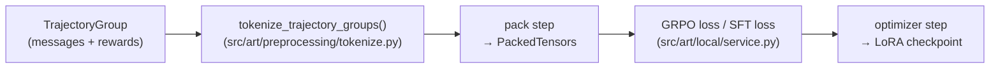

Sources: [src/art/local/backend.py:65-75](), [src/art/model.py:844-906]()

---

## Public API Surface

The key symbols re-exported from [src/art/__init__.py]() are:

```python
art.Model
art.TrainableModel
art.Trajectory
art.TrajectoryGroup
art.gather_trajectory_groups
art.gather_trajectories
art.TrainConfig
art.TrainSFTConfig
art.TrainResult
art.LocalTrainResult
art.ServerlessTrainResult
art.Backend
art.ServerlessBackend
```

Sources: [src/art/__init__.py:89-118]()

---

# Page: Model System

# Model System

<details>
<summary>Relevant source files</summary>

The following files were used as context for generating this wiki page:

- [src/art/__init__.py](src/art/__init__.py)
- [src/art/local/backend.py](src/art/local/backend.py)
- [src/art/model.py](src/art/model.py)
- [src/art/openai.py](src/art/openai.py)
- [src/art/transformers/patches.py](src/art/transformers/patches.py)
- [src/art/types.py](src/art/types.py)
- [tests/unit/test_model_openai_client_costs.py](tests/unit/test_model_openai_client_costs.py)

</details>


This page documents the `Model` and `TrainableModel` classes defined in [src/art/model.py](), which are the primary user-facing abstractions in ART. They handle inference client creation, trajectory logging, state persistence, cost tracking, and delegation of training to a registered backend.

For information about the data structures produced during rollouts, see the [Trajectory System](#2.2). For details on how backends implement training, see [Backend Infrastructure](#2.3). For training configuration objects, see [Training Configuration](#3.4).

---

## Class Hierarchy

**Class hierarchy: `Model` and `TrainableModel`**

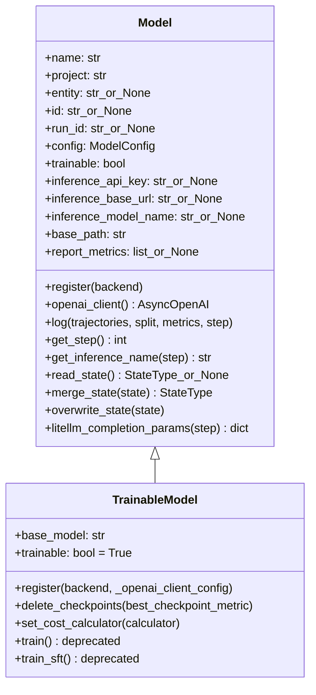

Sources: [src/art/model.py:166-231](), [src/art/model.py:720-758]()

Both classes extend `pydantic.BaseModel` and are generic over `ModelConfig` (a `BaseModel` subclass or `None`) and `StateType` (a dict type). `Model` is for non-trainable prompted models used as baselines. `TrainableModel` adds the `base_model` field and training-specific methods.

---

## `Model` — Fields

| Field | Type | Default | Description |
|---|---|---|---|
| `name` | `str` | required | Short identifier for the model |
| `project` | `str` | required | W&B project / directory namespace |
| `entity` | `str \| None` | `None` | W&B entity; populated by backend on register |
| `id` | `str \| None` | `None` | Backend-assigned model ID |
| `run_id` | `str \| None` | `None` | W&B run ID; used for resuming runs |
| `config` | `ModelConfig` | `None` | User-defined Pydantic config attached to the model |
| `trainable` | `bool` | `False` | Discriminator field for FastAPI serialization |
| `inference_api_key` | `str \| None` | `None` | API key for the inference endpoint |
| `inference_base_url` | `str \| None` | `None` | Base URL for the OpenAI-compatible inference server |
| `inference_model_name` | `str \| None` | `None` | Model name sent to the inference endpoint (overrides `name`) |
| `base_path` | `str` | `".art"` | Root directory for local file output |
| `report_metrics` | `list[str] \| None` | `None` | Reporting sinks; `None` means W&B if key is set |

Sources: [src/art/model.py:202-228]()

Private instance attributes (not Pydantic fields):

| Attribute | Type | Role |
|---|---|---|
| `_backend` | `Backend \| None` | Set by `register()`; required for training |
| `_openai_client` | `AsyncOpenAI \| None` | Cached client instance |
| `_wandb_run` | `Run \| None` | Lazy W&B run handle |
| `_costs_lock` | `asyncio.Lock` | Serializes cumulative cost writes |
| `_cost_calculator` | `CostCalculator` | Callable that maps token counts to cost dict |

---

## `TrainableModel` — Additional Fields

| Field | Type | Default | Description |
|---|---|---|---|
| `base_model` | `str` | required | HuggingFace model ID or path (e.g. `"unsloth/Qwen2.5-7B-Instruct"`) |
| `trainable` | `bool` | `True` | Overrides `Model.trainable` |
| `_internal_config` | `dev.InternalModelConfig \| None` | `None` | Unstable per-model config passed to the backend engine |

Sources: [src/art/model.py:720-759]()

---

## Core Methods

### `register(backend)`

**Lifecycle of `register()`**

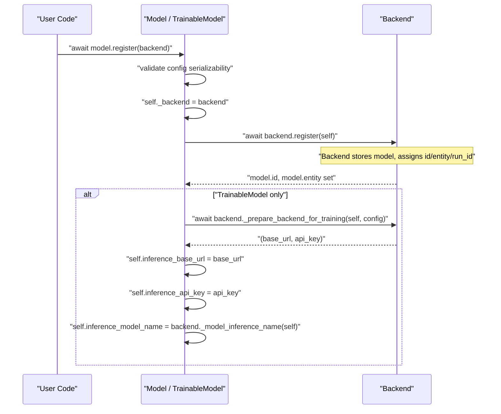

Sources: [src/art/model.py:314-325](), [src/art/model.py:829-848]()

After `register()`, a `TrainableModel` has its `inference_base_url`, `inference_api_key`, and `inference_model_name` populated automatically. Calling `register()` before `openai_client()` is required for trainable models.

---

### `openai_client()`

Returns a cached `AsyncOpenAI` instance wrapped in an `_OpenAIClientProxy` [src/art/model.py:128-149](). This proxy automatically handles:
- **Cost Recording**: Intercepts responses to update cost metrics via `_record_costs` [src/art/model.py:103]().
- **Metadata Attachment**: Attaches vLLM token and MoE routing metadata to completion choices [src/art/model.py:65-81]().
- **Default Extra Body**: Merges default parameters like `return_token_ids` into requests [src/art/model.py:96-100]().

The client is configured with a 1200-second timeout and a high-throughput `DefaultAsyncHttpxClient` [src/art/model.py:326-351]().

Sources: [src/art/model.py:326-351](), [src/art/model.py:84-149]()

---

### `get_inference_name(step)`

Returns the model name string to pass to the inference endpoint. Behavior depends on the registered backend:
- **`LocalBackend`**: uses `_model_inference_name()` on the backend, which produces `model.name@step` for vLLM's LoRA adapter naming [src/art/local/backend.py:488-490]().
- **`ServerlessBackend`**: returns `wandb-artifact:///{entity}/{project}/{name}:step{step}`.
- **No backend**: returns `inference_model_name or name`, optionally appended with `@{step}`.

Sources: [src/art/model.py:375-398]()

---

### `log(trajectories, split, metrics, step)`

**`log()` internal pipeline**

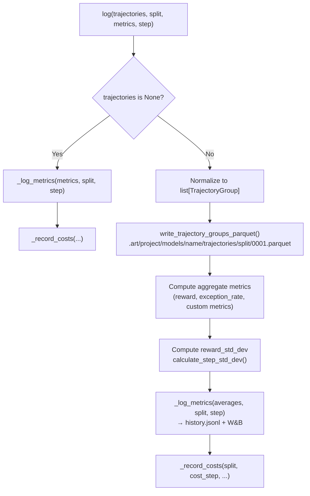

Sources: [src/art/model.py:511-698]()

Key behaviors:

- **Trajectory input normalization**: accepts `Iterable[Trajectory]`, `Iterable[BaseException]`, or `Iterable[TrajectoryGroup]`. Single trajectories/exceptions are wrapped into a single `TrajectoryGroup`.
- **Parquet output**: each call writes one Parquet file at `{base_path}/{project}/models/{name}/trajectories/{split}/{step:04d}.parquet` [src/art/utils/trajectory_logging.py:33]().
- **Metric aggregation**: averages `reward` and all `trajectory.metrics` fields across all trajectories; averages `group.metrics` fields per-group; appends `reward_std_dev`.
- **Costs**: `costs_*` metrics are treated additively and accumulated into `state.json` via `_record_costs()`.
- **W&B logging**: enabled when `WANDB_API_KEY` is in the environment and `report_metrics` is `None`, or when `"wandb"` is in `report_metrics`.

---

### State Persistence

State is stored as JSON at `{base_path}/{project}/models/{name}/state.json`.

| Method | Behavior |
|---|---|
| `overwrite_state(state)` | Replaces the entire `state.json` with `state` |
| `merge_state(state)` | Deep-merges `state` into existing state; returns merged dict |
| `read_state()` | Reads and returns `state.json`, or `None` if absent |

`merge_state()` performs recursive dict merging: nested dict values are merged rather than replaced. Scalar and non-dict values in `state` always overwrite existing values.

Sources: [src/art/model.py:404-486]()

---

### Cost Tracking

`TrainableModel` associates financial costs with training and inference steps via a `CostCalculator` [src/art/costs.py:17]().

**Type**: `CostCalculator = Callable[[int | None, int | None], dict[str, float]]`

Set it with `model.set_cost_calculator(calculator)`. Costs flow through the `log()` method when metrics contain keys with the `costs_` prefix. The `_record_costs()` method:

1. Accumulates cost components cumulatively in `state.json` under the `_costs` key.
2. Tracks per-split last-seen steps to avoid double-counting [src/art/model.py:653-689]().
3. Logs cumulative cost totals to `history.jsonl` and W&B under the `costs/` prefix.

Sources: [src/art/model.py:653-689](), [src/art/model.py:761-776]()

---

### `delete_checkpoints(best_checkpoint_metric)`

Retains only two checkpoints: the latest step and the step with the best value for `best_checkpoint_metric` (default: `"val/reward"`). Delegates actual file deletion to `backend._delete_checkpoint_files(model, steps_to_keep)`.

The best step is determined by reading `history.jsonl`, grouping by `step`, computing mean per step, and selecting the maximum.

Sources: [src/art/model.py:849-880]()

---

### `train()` and `train_sft()` — Deprecated

`TrainableModel.train()` and `train_sft()` are deprecated wrappers that delegate to `backend.train()` and `backend._train_sft()` respectively. New code should call these directly on the backend object.

```python
# Deprecated
await model.train(trajectory_groups, config=TrainConfig(learning_rate=5e-6))

# Preferred
result = await backend.train(model, trajectory_groups, config=TrainConfig(learning_rate=5e-6))
await model.log(metrics=result.metrics, step=result.step)
```

Sources: [src/art/model.py:882-950]()

---

## Training Result Types

**`TrainResult` class hierarchy**

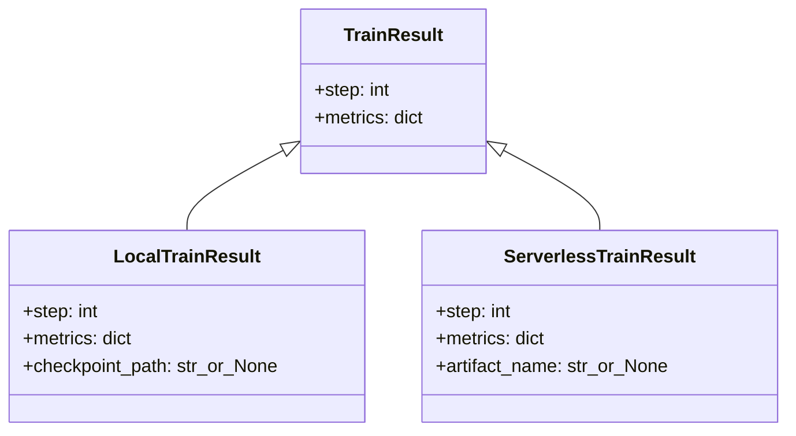

Sources: [src/art/types.py:69-107]()

| Class | Returned by | Extra field |
|---|---|---|
| `TrainResult` | Base type | — |
| `LocalTrainResult` | `LocalBackend.train()` | `checkpoint_path` — local filesystem path to the saved LoRA checkpoint |
| `ServerlessTrainResult` | `ServerlessBackend.train()` | `artifact_name` — W&B artifact reference |

---

## Output Directory Layout

All local output for a model is rooted at `_get_output_dir()`:

```
{base_path}/
└── {project}/
    └── models/
        └── {name}/
            ├── state.json           # Persistent key-value state
            ├── history.jsonl        # Per-step metric log
            └── trajectories/
                ├── train/
                │   └── 0001.parquet
                └── val/
                    └── 0001.parquet
```

Sources: [src/art/model.py:400-403](), [src/art/model.py:594-602]()

---

# Page: Trajectory System

# Trajectory System

<details>
<summary>Relevant source files</summary>

The following files were used as context for generating this wiki page:

- [examples/prisoners-dilemma.ipynb](examples/prisoners-dilemma.ipynb)
- [examples/tic_tac_toe_self_play/game_utils.py](examples/tic_tac_toe_self_play/game_utils.py)
- [examples/tic_tac_toe_self_play/gather_trajectory_groups_by_index.py](examples/tic_tac_toe_self_play/gather_trajectory_groups_by_index.py)
- [examples/tic_tac_toe_self_play/train_o4_mini.py](examples/tic_tac_toe_self_play/train_o4_mini.py)
- [src/art/auto_trajectory.py](src/art/auto_trajectory.py)
- [src/art/batches.py](src/art/batches.py)
- [src/art/gather.py](src/art/gather.py)
- [src/art/trajectories.py](src/art/trajectories.py)
- [src/art/utils/benchmarking/load_trajectories.py](src/art/utils/benchmarking/load_trajectories.py)
- [src/art/utils/benchmarking/pull_model_trajectories.py](src/art/utils/benchmarking/pull_model_trajectories.py)
- [src/art/utils/old_benchmarking/load_benchmarked_models.py](src/art/utils/old_benchmarking/load_benchmarked_models.py)
- [src/art/utils/trajectory_logging.py](src/art/utils/trajectory_logging.py)
- [src/art/utils/trajectory_migration.py](src/art/utils/trajectory_migration.py)
- [src/art/yield_trajectory.py](src/art/yield_trajectory.py)
- [tests/unit/test_auto_trajectory.py](tests/unit/test_auto_trajectory.py)
- [tests/unit/test_trajectory_parquet.py](tests/unit/test_trajectory_parquet.py)
- [tests/unit/test_yield_trajectory.py](tests/unit/test_yield_trajectory.py)

</details>


This page documents the `Trajectory` and `TrajectoryGroup` data structures, how they are built during rollouts, how rewards and metrics are attached, the `additional_histories` feature, and how trajectory data is persisted and queried as Parquet files.

For how trajectories flow into the training algorithm (tokenization, packing, GRPO loss), see [Data Processing Pipeline](#2.4) and [Training Loop & GRPO Algorithm](#3.1). For `gather_trajectory_groups` async patterns and concurrency, see [Async Training Patterns](#7.6).

---

## Core Data Structures

All trajectory types live in [src/art/trajectories.py]().

**Data model overview:**

```mermaid
classDiagram
    class "Trajectory" {
        +messages_and_choices: MessagesAndChoices
        +tools: Tools | None
        +additional_histories: list[History]
        +reward: float
        +initial_policy_version: int | None
        +final_policy_version: int | None
        +metrics: dict[str, float | int | bool]
        +metadata: dict[str, MetadataValue]
        +logs: list[str]
        +start_time: datetime
        +log(message: str)
        +finish() Trajectory
        +track_duration(metric_name: str)
        +messages() Messages
        +for_logging() dict
    }

    class "History" {
        +messages_and_choices: MessagesAndChoices
        +tools: Tools | None
        +messages() Messages
    }

    class "TrajectoryGroup" {
        +trajectories: list[Trajectory]
        +exceptions: list[PydanticException]
        +metadata: dict[str, MetadataValue]
        +metrics: dict[str, float | int | bool]
        +logs: list[str]
        +__init__(trajectories, exceptions, ...)
        +__copy__() TrajectoryGroup
    }

    class "PydanticException" {
        +type: str
        +message: str
        +traceback: str
    }

    "Trajectory" "1" --> "*" "History" : additional_histories
    "TrajectoryGroup" "1" --> "*" "Trajectory" : trajectories
    "TrajectoryGroup" "1" --> "*" "PydanticException" : exceptions
```

Sources: [src/art/trajectories.py:24-179]()

---

### `Trajectory`

`Trajectory` is a `pydantic.BaseModel` that holds the complete record of a single agent rollout.

[src/art/trajectories.py:38-94]()

| Field | Type | Purpose |
|---|---|---|
| `messages_and_choices` | `MessagesAndChoices` | Ordered list of messages (`dict`) and model responses (`openai.Choice`). `Choice` items mark tokens that are trainable. |
| `tools` | `Tools \| None` | Tool definitions available during the rollout. |
| `additional_histories` | `list[History]` | Extra conversation segments for advanced training patterns (see below). |
| `reward` | `float` | Scalar reward assigned after rollout completion. Default `0.0`. |
| `initial_policy_version` | `int \| None` | Step number of the policy that generated the first token. |
| `final_policy_version` | `int \| None` | Step number of the policy at rollout end. |
| `metrics` | `dict[str, float \| int \| bool]` | Arbitrary numeric/boolean metrics (e.g., `duration`, `accuracy`). |
| `metadata` | `dict[str, MetadataValue]` | Arbitrary string/numeric labels for filtering and analysis. |
| `logs` | `list[str]` | Free-form log messages captured during the rollout. |
| `start_time` | `datetime` | Automatically set at construction; used by `finish()` to compute duration. |

**Key methods:**

- `log(message)` — Appends a string to `self.logs` [src/art/trajectories.py:50-51]().
- `finish()` — Records `duration` into `self.metrics` and returns `self`. Should be called at the end of a rollout [src/art/trajectories.py:53-56]().
- `track_duration(metric_name)` — Async context manager; accumulates elapsed time into `self.metrics["{metric_name}_duration"]` [src/art/trajectories.py:59-66]().
- `messages()` — Returns a flat `Messages` list by extracting content from all `messages_and_choices` [src/art/trajectories.py:71-72]().
- `for_logging()` — Returns a JSON-serializable dict annotating each message with a `trainable` boolean [src/art/trajectories.py:75-94]().

Sources: [src/art/trajectories.py:38-94]()

---

### `History`

`History` wraps a self-contained conversation segment — its own `messages_and_choices` and optional `tools`. It is used as a unit for tokenization.

[src/art/trajectories.py:30-36]()

The primary history of a `Trajectory` is constructed from `trajectory.messages_and_choices` and `trajectory.tools`. `Trajectory.additional_histories` holds extra `History` objects for patterns like multi-agent or multi-turn preservation.

---

### `TrajectoryGroup`

`TrajectoryGroup` is a `pydantic.BaseModel` that bundles multiple `Trajectory` objects generated for the **same prompt or scenario**. GRPO computes advantages relative to the group's mean reward, so all trajectories in a group must share the same starting prompt.

[src/art/trajectories.py:130-179]()

| Field | Type | Purpose |
|---|---|---|
| `trajectories` | `list[Trajectory]` | Successfully completed rollouts. |
| `exceptions` | `list[PydanticException]` | Rollouts that raised exceptions (stored for observability). |
| `metadata` | `dict[str, MetadataValue]` | Group-level labels (e.g., scenario ID). |
| `metrics` | `dict[str, float \| int \| bool]` | Group-level aggregate metrics. |
| `logs` | `list[str]` | Group-level log messages. |

The constructor [src/art/trajectories.py:137-179]() allows passing an iterable of trajectories or exceptions. It filters them into the appropriate fields and converts standard `BaseException` objects into `PydanticException` for serialization.

Sources: [src/art/trajectories.py:130-179]()

---

## Trajectory Lifecycle

The diagram below maps the trajectory lifecycle to code entities.

**Trajectory lifecycle diagram:**

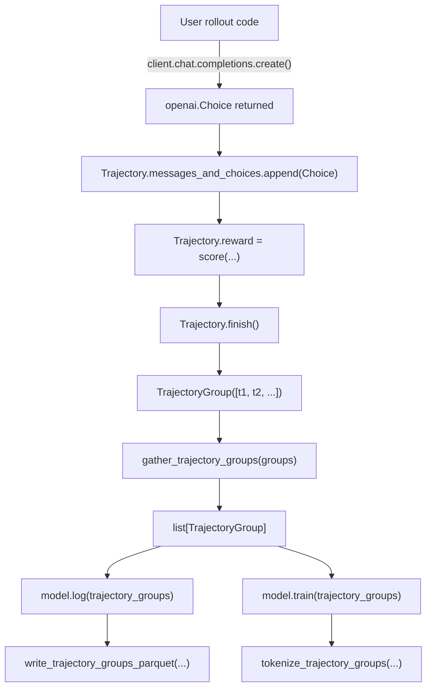

Sources: [src/art/trajectories.py:38-94](), [src/art/gather.py:14-65](), [src/art/utils/trajectory_logging.py:59-150]()

### Automated Trajectory Capture

ART provides utilities to capture trajectories automatically from OpenAI client calls using context variables and `httpx` patching.

- **`capture_auto_trajectory`**: An async context that intercepts `httpx` responses from the OpenAI client, reconstructs `Choice` objects (even from streams), and populates a `Trajectory` [src/art/auto_trajectory.py:66-70]().
- **`yield_trajectory`**: Allows a function to "yield" a manually constructed trajectory to a parent caller using `capture_yielded_trajectory` [src/art/yield_trajectory.py:7-17]().

Sources: [src/art/auto_trajectory.py:66-161](), [src/art/yield_trajectory.py:7-33]()

---

## Rewards and Metrics

### Reward

`trajectory.reward` is a scalar `float` set by user code. In GRPO, the reward is used to compute per-trajectory advantage relative to the group mean [src/art/preprocessing/tokenize.py:79-88]().

### Metrics

- **Trajectory-level**: Recorded into the progress bar by `gather_trajectory_groups` via `record_metrics` [src/art/gather.py:183-199](). `completion_tokens` is added automatically if `logprobs` are present.
- **Group-level**: `TrajectoryGroup.metrics` hold scenario-level data. These are written as repeated columns in Parquet so they can be joined with trajectory rows during analysis [src/art/utils/trajectory_logging.py:74-116]().

Sources: [src/art/trajectories.py:53-66](), [src/art/gather.py:183-199]()

---

## Storage: Parquet Files

Trajectory data is stored in Parquet format with ZSTD compression for ~25x space savings over JSONL.

### Schema

The Parquet schema uses nested structures for messages to maintain the `trainable` flag and tool call data.

**Parquet file schema diagram:**

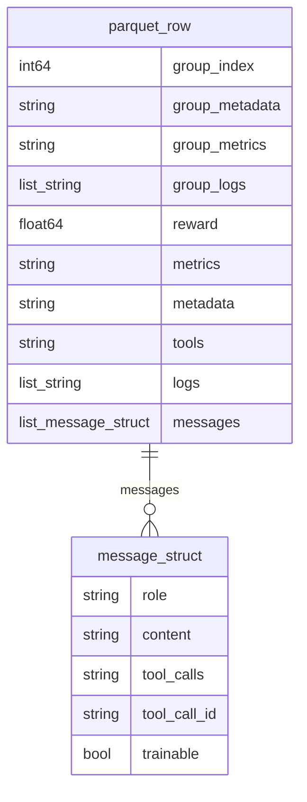

[src/art/utils/trajectory_logging.py:119-142]()

### Reading and Writing

- **`write_trajectory_groups_parquet`**: Serializes a list of `TrajectoryGroup` objects. It flattens `Choice` objects into the `message_struct` and encodes dictionary fields (metrics, metadata) as JSON strings [src/art/utils/trajectory_logging.py:59-150]().
- **`read_trajectory_groups_parquet`**: Reconstructs the objects using DuckDB for efficient columnar loading [src/art/utils/trajectory_logging.py:153-251]().
- **`load_trajectories`**: A high-level benchmarking utility that loads all Parquet files for a project into a unified Polars DataFrame, flattening all JSON metrics into individual columns [src/art/utils/benchmarking/load_trajectories.py:27-334]().

### Migration

Legacy JSONL trajectories can be migrated using `migrate_jsonl_to_parquet` [src/art/utils/trajectory_migration.py:177-248](). This utility provides a `MigrationResult` tracking compression ratios and space saved [src/art/utils/trajectory_migration.py:144-174]().

Sources: [src/art/utils/trajectory_logging.py:59-251](), [src/art/utils/benchmarking/load_trajectories.py:27-334](), [src/art/utils/trajectory_migration.py:144-248]()

---

# Page: Backend Infrastructure

# Backend Infrastructure

<details>
<summary>Relevant source files</summary>

The following files were used as context for generating this wiki page:

- [.env.example](.env.example)
- [examples/tic_tac_toe/tic-tac-toe.py](examples/tic_tac_toe/tic-tac-toe.py)
- [examples/tic_tac_toe_self_play/deploy_step.py](examples/tic_tac_toe_self_play/deploy_step.py)
- [scripts/deploy-model.py](scripts/deploy-model.py)
- [src/art/backend.py](src/art/backend.py)
- [src/art/cli.py](src/art/cli.py)
- [src/art/local/backend.py](src/art/local/backend.py)
- [src/art/model.py](src/art/model.py)
- [src/art/utils/deploy_model.py](src/art/utils/deploy_model.py)
- [src/art/utils/output_dirs.py](src/art/utils/output_dirs.py)
- [src/art/utils/s3.py](src/art/utils/s3.py)
- [tests/test_backend_train_api.py](tests/test_backend_train_api.py)

</details>


The Backend system in ART provides an abstract interface that coordinates model training, inference serving, logging, and checkpoint management. Backends handle all GPU infrastructure concerns, allowing client code to focus on defining agent behavior and training scenarios.

This page documents the `Backend` protocol, its core interface methods, and the coordination logic used across different infrastructure types.

## Backend Interface Overview

The `Backend` class is defined as a `Protocol` [src/art/backend.py:15-16](). It establishes the common contract that all implementations—whether local or remote—must fulfill to interface with the `TrainableModel` class.

| Backend | Infrastructure | Use Case |
|---------|---------------|----------|
| `LocalBackend` | Single machine (local or remote VM) | Development, single-GPU training |
| `SkyPilotBackend` | Multi-cloud orchestration (RunPod, AWS, GCP) | Production training with custom infrastructure |
| `ServerlessBackend` | W&B Training managed service | Autoscaling inference and training |

### Code Entity Association: Backend Protocol

The following diagram maps the logical backend operations to the specific methods defined in the `Backend` protocol and used by the `Model` system.

```mermaid
graph TB
    subgraph "art.model.TrainableModel"
        RegisterCall["register(backend)"]
        TrainCall["train(trajectory_groups)"]
        LogCall["log(trajectory_groups)"]
    end
    
    subgraph "art.backend.Backend (Protocol)"
        register["register(model)"]
        train["train(model, trajectory_groups)"]
        train_sft["_train_sft(model, trajectories)"]
        get_step["_get_step(model)"]
        prepare["_prepare_backend_for_training()"]
        delete_checkpoints["_delete_checkpoint_files()"]
    end
    
    RegisterCall --> register
    TrainCall --> train
    LogCall -.->|Internal| log_method["_log (Implementation specific)"]
```

Sources: [src/art/backend.py:15-53](), [src/art/model.py:166-224]()

## Core Protocol Interface

The `Backend` protocol defines the following essential methods for lifecycle management and training execution:

### Lifecycle & Inference Setup
- `register(model: AnyModel) -> None`: Registers a model with the backend, initializing required resources and saving configuration [src/art/backend.py:24-24]().
- `_prepare_backend_for_training(model: AnyTrainableModel, config: dev.OpenAIServerConfig | None) -> tuple[str, str]`: Starts the inference server (typically vLLM) and returns the `(base_url, api_key)` required for the model's `openai_client` [src/art/backend.py:32-36]().
- `_model_inference_name(model: AnyModel, step: int | None = None) -> str`: Returns the specific string identifier used to call the inference endpoint (e.g., adding step suffixes) [src/art/backend.py:18-20]().

### Training Execution
- `train(model: AnyTrainableModel, trajectory_groups: Iterable[TrajectoryGroup], **kwargs: Any) -> TrainResult`: The primary entry point for RL training. It processes groups, performs optimization, and returns a `TrainResult` [src/art/backend.py:38-43]().
- `_train_sft(model: AnyTrainableModel, trajectories: Iterable[Trajectory], config: TrainSFTConfig, dev_config: dev.TrainSFTConfig, verbose: bool = False) -> AsyncIterator[dict[str, float]]`: An asynchronous iterator that streams SFT training metrics (loss, accuracy) back to the caller [src/art/backend.py:45-52]().

### State & Checkpoint Management
- `_get_step(model: AnyTrainableModel) -> int`: Queries the backend for the current training step count [src/art/backend.py:26-26]().
- `_delete_checkpoint_files(model: AnyTrainableModel, steps_to_keep: list[int]) -> None`: Commands the backend to prune checkpoint files from disk or remote storage to save space [src/art/backend.py:28-30]().

Sources: [src/art/backend.py:15-53](), [src/art/model.py:329-348]()

## Backend Coordination Flows

### RL Training Flow (Local Implementation)
When `model.train()` is called, the backend orchestrates data processing before handing off to the underlying `ModelService`.

```mermaid
sequenceDiagram
    participant M as "TrainableModel.train()"
    participant B as "LocalBackend.train()"
    participant P as "Data Processing (Pack/Tokenize)"
    participant S as "ModelService (Unsloth/Torchtune)"
    
    M->>B: train(model, groups)
    B->>P: tokenize_trajectory_groups(groups)
    P-->>B: TokenizedResults
    B->>P: packed_tensors_to_dir(path)
    B->>S: _train_model(DiskPackedTensors)
    
    loop Gradient Steps
        S-->>B: yield metrics
        B-->>M: yield metrics
    end
    
    S->>S: Save LoRA Checkpoint
    B->>B: _increment_step()
    B-->>M: LocalTrainResult
```

Sources: [src/art/local/backend.py:404-523](), [src/art/backend.py:38-43]()

### Inference Setup Flow
The `register` call is critical for setting up the `openai_client` used in rollouts.

```mermaid
sequenceDiagram
    participant App as "Application Code"
    participant M as "TrainableModel"
    participant B as "LocalBackend"
    participant V as "vLLM / ModelService"
    
    App->>M: register(backend)
    M->>B: register(model)
    B->>B: _prepare_backend_for_training()
    B->>V: start_openai_server()
    V-->>B: base_url, api_key
    B-->>M: Success
    M->>M: Set inference_base_url
    App->>M: openai_client()
    M-->>App: AsyncOpenAI Instance
```

Sources: [src/art/model.py:329-348](), [src/art/local/backend.py:276-295](), [src/art/backend.py:32-36]()

## Storage & S3 Integration

Backends manage the physical location of model weights and trajectories. The `LocalBackend` defaults to a `.art` directory in the repository root [src/art/local/backend.py:219]().

### S3 Synchronization
Backends provide experimental methods for cloud persistence:
- `_experimental_push_to_s3(model)`: Uploads local checkpoints and logs to the configured `BACKUP_BUCKET` [src/art/local/backend.py:632-642]().
- `_experimental_pull_from_s3(model)`: Downloads model data from S3 to local disk [src/art/local/backend.py:612-623]().

The underlying implementation uses the `s3_sync` utility, which wraps the AWS CLI for efficient directory transfers [src/art/utils/s3.py:66-125]().

### Checkpoint Directory Structure
Checkpoints are organized by step number to allow for easy rollback and evaluation of specific training stages:
- Base path: `{art_path}/{project}/models/{model_name}/` [src/art/utils/output_dirs.py:18-21]()
- Checkpoints: `.../checkpoints/{step:04d}/` [src/art/utils/output_dirs.py:32-33]()
- Trajectories: `.../trajectories/{split}/` [src/art/utils/output_dirs.py:40-41]()

Sources: [src/art/utils/s3.py:27-63](), [src/art/utils/output_dirs.py:1-42](), [src/art/local/backend.py:612-660]()

## FastAPI Server Layer

For remote backends like `SkyPilotBackend`, ART provides a FastAPI-based server that exposes the `Backend` protocol over HTTP. This allows a local `SkyPilotBackend` instance to proxy calls to a `LocalBackend` running on a remote GPU cluster.

### Common Contract Mapping

| HTTP Route | Backend Method |
|------------|----------------|
| `POST /register` | `register()` |
| `POST /_get_step` | `_get_step()` |
| `POST /_train_model` | `train()` (Streaming) |
| `POST /_log` | Implementation-specific logging |

The server handles the serialization of `TrajectoryGroup` objects and `InternalModelConfig` dictionaries across the network, ensuring that training logic remains consistent regardless of where the compute is located.

Sources: [src/art/backend.py:15-53](), [src/art/cli.py:119-150]() (referencing server-side logic in `cli.py` and backend definitions).

---

# Page: Data Processing Pipeline

# Data Processing Pipeline

<details>
<summary>Relevant source files</summary>

The following files were used as context for generating this wiki page:

- [dev/run_yes_no_maybe_kl_advantage.py](dev/run_yes_no_maybe_kl_advantage.py)
- [src/art/megatron/weights/merged_weight_export.py](src/art/megatron/weights/merged_weight_export.py)
- [src/art/preprocessing/inputs.py](src/art/preprocessing/inputs.py)
- [src/art/preprocessing/pack.py](src/art/preprocessing/pack.py)
- [src/art/preprocessing/response_masking.py](src/art/preprocessing/response_masking.py)
- [src/art/preprocessing/tokenize.py](src/art/preprocessing/tokenize.py)
- [src/art/tinker/client.py](src/art/tinker/client.py)
- [src/art/tinker/renderers.py](src/art/tinker/renderers.py)
- [src/art/tinker/server.py](src/art/tinker/server.py)
- [src/art/utils/chat_template.py](src/art/utils/chat_template.py)
- [tests/unit/test_moe_routing_real_path.py](tests/unit/test_moe_routing_real_path.py)
- [tests/unit/test_preprocessing_tokenize.py](tests/unit/test_preprocessing_tokenize.py)

</details>


This page documents how trajectory data flows from raw message sequences through tokenization and tensor packing into the format consumed by the training step. It covers the `src/art/preprocessing/` module, specifically `tokenize.py` and `pack.py`, and the data structures they produce.

For context on how trajectories are created and stored, see [Trajectory System](#2.2). For how the resulting tensors are consumed by the optimizer, see [Training Loop & GRPO Algorithm](#3.1). For backend-specific invocations of this pipeline, see [Model Services](#3.2).

---

## Overview

Before a training step can run, `Trajectory` objects — containing raw conversation messages, sampled completions, and rewards — must be converted into dense, padded PyTorch tensors. This conversion happens in two sequential stages:

1.  **Tokenization** — Applies the model's chat template, extracts per-token logprobs from `Choice` objects, computes GRPO advantages, and identifies shared prompt prefixes across a group.
2.  **Packing** — Bins multiple tokenized results into fixed-length sequences using a prefix-tree approach to share prompt prefixes within a bin where possible.

A separate, simpler path handles **Supervised Fine-Tuning (SFT)** batches, where the objective is cross-entropy over assistant tokens rather than a policy gradient loss.

---

## End-to-End Data Flow

**Diagram: RL Data Processing Pipeline**

```mermaid
flowchart TD
    TG["TrajectoryGroup\n(list of Trajectory)"]
    TTG["tokenize_trajectory_groups()\nsrc/art/preprocessing/tokenize.py"]
    TR["TokenizedResult\n(per trajectory)"]
    PTF["packed_tensors_from_tokenized_results()\nsrc/art/preprocessing/pack.py"]
    PTP["prefix_tree_pack()\nsrc/art/preprocessing/pack.py"]
    PT["PackedTensors\n(batched 2D tensors)"]
    PTD["packed_tensors_to_dir()\nsrc/art/preprocessing/pack.py"]
    DPT["DiskPackedTensors\n(memory-mapped files)"]
    PTFD["packed_tensors_from_dir()\nsrc/art/preprocessing/pack.py"]
    LOSS["loss_fn()\nsrc/art/loss.py"]

    TG --> TTG
    TTG --> TR
    TR --> PTF
    PTF --> PTP
    PTP --> PT
    PT --> PTD
    PTD --> DPT
    DPT --> PTFD
    PTFD --> PT
    PT --> LOSS
```

Sources: [src/art/preprocessing/tokenize.py:149-168](), [src/art/preprocessing/pack.py:26-37](), [src/art/preprocessing/pack.py:76-108](), [src/art/preprocessing/pack.py:195-218]()

---

## Stage 1: Tokenization

### `tokenize_trajectory_groups`

[src/art/preprocessing/tokenize.py:214-358]()

This function is the entry point for RL tokenization. It consumes a `list[TrajectoryGroup]` and produces one `TokenizedResult` per trainable trajectory.

**Processing steps per group:**

| Step | Description |
|---|---|
| 1. Advantage computation | Compute per-group `reward_mean` and `reward_std`; derive `advantage = (reward - mean) / (std + 1e-6)`. |
| 2. History iteration | Iterate over the main `messages_and_choices` and any `additional_histories`. |
| 3. Per-history tokenization | Call `tokenize_trajectory` for each `History` object. |
| 4. Weight normalization | Set `weight = 1 / total_assistant_tokens` across all histories for a trajectory. |
| 5. Prompt prefix detection | Find the longest common token prefix across all results in the group; set `prompt_length`. |

The `prompt_id` is an integer assigned per group. It is used by the packing step to identify when two results share the same prompt so that tokens can be stored only once in a packed sequence.

### `tokenize_trajectory`

[src/art/preprocessing/tokenize.py:464-688]()

This function processes a single `History` object into a `TokenizedResult`.

**Key mechanics:**

1.  **Chat template application**: `tokenizer.apply_chat_template` is used to render the full conversation. Tools are normalized for the specific model family (e.g., `vllm_openai` format) [src/art/preprocessing/tokenize.py:71-93]().
2.  **logprob extraction**: For `Choice` objects, logprobs are extracted from the `logprobs.content` field [src/art/preprocessing/tokenize.py:644-651]().
3.  **`assistant_mask` construction**: Identifies positions where the model's output is being trained. ART supports custom `instruction_part` and `response_part` strings to find boundaries [src/art/preprocessing/tokenize.py:476-477]().
4.  **MoE Routing Alignment**: If the trajectory contains Mixture-of-Experts routing data (from vLLM), `align_choice_routes_to_tokenized_result` maps those routes to the final token sequence [src/art/preprocessing/tokenize.py:663-670]().

### `TokenizedResult` Data Structure

Defined in [src/art/preprocessing/tokenize.py:150-168]().

| Field | Type | Description |
|---|---|---|
| `advantage` | `float` | GRPO group-relative advantage. |
| `token_ids` | `list[int]` | Integer token IDs. |
| `input_pos` | `list[int]` | Position indices `[0, 1, 2, …]`. |
| `assistant_mask` | `list[int]` | `1` for tokens in loss, `0` elsewhere. |
| `logprobs` | `list[float]` | Log-probabilities from the inference pass. |
| `pixel_values` | `torch.Tensor \| None` | Pixel data for vision models. |
| `moe_routed_experts` | `list[TokenRoute \| None]` | Routing metadata for MoE models. |
| `weight` | `float` | Per-trajectory loss weight. |
| `prompt_id` | `int` | Group identifier for prompt sharing. |
| `prompt_length` | `int` | Length of the shared prompt prefix. |

Sources: [src/art/preprocessing/tokenize.py:150-168](), [src/art/preprocessing/tokenize.py:214-358](), [src/art/preprocessing/tokenize.py:464-688]()

---

## Stage 2: Packing

### `prefix_tree_pack`

[src/art/preprocessing/pack.py:98-146]()

This function bins `TokenizedResult` objects into fixed-length sequences of `seq_len`.

**Bin-filling algorithm:**

1.  Iterate through results. If a result fits in the current row's remaining `seq_len`, add it.
2.  If `pack_results=True`, the algorithm attempts to overlap shared prompts. If the `prompt_id` matches an existing item in the row, only the unique completion tokens are added.
3.  **Weight Normalization**: After assembly, the `weights` tensor is normalized so the mean weight among assistant positions equals `1.0` [src/art/preprocessing/pack.py:171-173]().
4.  **Advantage Normalization**: Advantages are normalized by their absolute mean among assistant positions to ensure stable gradients [src/art/preprocessing/pack.py:190-193]().

### `PackedTensors` Data Structure

Defined in [src/art/preprocessing/pack.py:26-37](). All tensors have shape `[num_sequences, seq_len]`.

| Tensor | dtype | Description |
|---|---|---|
| `tokens` | `torch.long` | Token IDs. |
| `group_ids` | `torch.long` | Per-token group identifier for attention masking. |
| `parent_ids` | `torch.long` | Points to shared prompt group for attention masking. |
| `input_pos` | `torch.long` | Position indices for RoPE. |
| `assistant_mask` | `torch.bool` | Mask for positions included in the loss. |
| `moe_routing_replay` | `PackedMoeRoutingReplay` | Data for replaying MoE routing decisions during training. |

**Diagram: Attention mask structure for packed sequences**

```mermaid
flowchart LR
    subgraph "calculate_mask Logic"
        CM["causal_mask\n(lower triangular)"]
        GM["group_mask\n(group_ids match)"]
        PM["parent_mask\n(parent_ids match group_ids)"]
        OR["| (OR)"]
        AND["& (AND)"]
        RESULT["attention_bias\n(0 or -inf)"]
        
        GM --> OR
        PM --> OR
        OR --> AND
        CM --> AND
        AND --> RESULT
    end
```

Sources: [src/art/preprocessing/pack.py:26-37](), [src/art/preprocessing/pack.py:98-206]()

---

## Stage 3: Disk-Backed Tensors

### `DiskPackedTensors`

Defined in [src/art/preprocessing/pack.py:40-46](). This structure represents tensors that have been memory-mapped to disk.

| Field | Type | Description |
|---|---|---|
| `dir` | `str` | Directory path where `.pt` files are stored. |
| `num_sequences` | `int` | Number of rows. |
| `sequence_length` | `int` | Number of columns. |

### `packed_tensors_to_dir`

[src/art/preprocessing/pack.py:304-338]()

Serializes `PackedTensors` to a directory using `torch.from_file` with `shared=True`. This allows multiple processes (like a training worker and a controller) to access the same tensor data without duplication in memory.

**Diagram: DiskPackedTensors file layout**

```mermaid
graph TD
    DIR["Directory (DiskPackedTensors.dir)"]
    DIR --> T["tokens.pt"]
    DIR --> G["group_ids.pt"]
    DIR --> P["parent_ids.pt"]
    DIR --> IP["input_pos.pt"]
    DIR --> AM["assistant_mask.pt"]
    DIR --> LP["logprobs.pt"]
    DIR --> ADV["advantages.pt"]
    DIR --> W["weights.pt"]
```

Sources: [src/art/preprocessing/pack.py:40-46](), [src/art/preprocessing/pack.py:304-338]()

---

## SFT Path

### `tokenize_sft_batch`

[src/art/preprocessing/tokenize.py:705-771]()

Accepts a `list[Trajectory]` and produces an `SFTBatch`.

1.  **Response Masking**: Uses `response_only_labels` to set labels to `-100` for all non-assistant tokens [src/art/preprocessing/response_masking.py:26-50]().
2.  **No Packing**: Unlike the RL path, sequences are not packed into fixed-length bins. Each trajectory remains an independent dictionary of tensors.

### `SFTBatch` Data Structure

Defined in [src/art/preprocessing/tokenize.py:183-197]().

| Field | Type | Description |
|---|---|---|
| `trajectory_tensors` | `list[dict[str, torch.Tensor]]` | List of dicts containing `input_ids`, `attention_mask`, and `labels`. |
| `num_trainable_tokens` | `int` | Total tokens where `labels != -100`. |

Sources: [src/art/preprocessing/tokenize.py:183-197](), [src/art/preprocessing/tokenize.py:705-771](), [src/art/preprocessing/response_masking.py:26-50]()

---

# Page: Training System

# Training System

<details>
<summary>Relevant source files</summary>

The following files were used as context for generating this wiki page:

- [dev/run_yes_no_maybe_kl_advantage_tinker.py](dev/run_yes_no_maybe_kl_advantage_tinker.py)
- [dev/yes-no-maybe-kl-advantage-tinker.py](dev/yes-no-maybe-kl-advantage-tinker.py)
- [dev/yes-no-maybe-kl-advantage.py](dev/yes-no-maybe-kl-advantage.py)
- [examples/temporal_clue/temporal-clue-7b-async.ipynb](examples/temporal_clue/temporal-clue-7b-async.ipynb)
- [examples/temporal_clue/temporal-clue-7b.ipynb](examples/temporal_clue/temporal-clue-7b.ipynb)
- [examples/temporal_clue/temporal-clue.py](examples/temporal_clue/temporal-clue.py)
- [src/art/_backend_training.py](src/art/_backend_training.py)
- [src/art/loss.py](src/art/loss.py)
- [src/art/test/test_kl_advantage.py](src/art/test/test_kl_advantage.py)
- [src/art/tinker_native/backend.py](src/art/tinker_native/backend.py)
- [src/art/unsloth/service.py](src/art/unsloth/service.py)
- [src/art/unsloth/train.py](src/art/unsloth/train.py)

</details>


This page is the overview for ART's training system. It covers the end-to-end flow from raw trajectories to optimizer steps, the reinforcement learning algorithm, the in-process services that manage GPU resources, and the configuration subsystems.

- For how trajectories are constructed during rollouts, see [Trajectory System](#2.2).
- For the data pipeline that converts trajectories to packed tensors, see [Data Processing Pipeline](#2.4).
- For the backend implementations that host training (LocalBackend, MegatronBackend, etc.), see [Backend Implementations](#4).

---

## Overview

The training system transforms a batch of completed `TrajectoryGroup` objects into a gradient update applied to a LoRA adapter. Every training step follows a fixed sequence:

1.  **Tokenize** — trajectories are tokenized and advantages are computed using GRPO.
2.  **Pack** — tokenized sequences are packed into fixed-length tensors.
3.  **Forward / backward pass** — the GRPO loss is computed and an optimizer step is taken.
4.  **Checkpoint** — a new LoRA adapter snapshot is written to disk.
5.  **Reload** — the vLLM inference engine loads the new adapter before the next step.

Inference is **paused** during training steps. This strict sequential structure allows a single GPU (or shared GPU set) to handle both inference and training by managing resource transitions.

Sources: [src/art/unsloth/train.py:1-44](), [src/art/unsloth/service.py:1-43](), [src/art/loss.py:1-111]()

---

## High-Level Training Flow

**Training step data flow (UnslothService)**

```mermaid
flowchart TD
    TG["TrajectoryGroup list"] --> TOK["tokenize_trajectory_groups()\nsrc/art/preprocessing/tokenize.py"]
    TOK --> PACK["packed_tensors_from_dir()\nsrc/art/preprocessing/pack.py"]
    PACK --> PT["DiskPackedTensors\n(tokens, logprobs, advantages, masks)"]
    PT --> LOOP["run_unsloth_rl_training()\nsrc/art/unsloth/train.py"]
    LOOP --> IQ["inputs_queue\nasyncio.Queue[TrainInputs]"]
    IQ --> LOSS["loss_fn()\nsrc/art/loss.py"]
    LOSS --> OPT["optimizer.step()\nvia GRPOTrainer"]
    OPT --> CKPT["save_checkpoint()\nsrc/art/unsloth/service.py"]
    CKPT --> RELOAD["vLLM update_weights()\nsrc/art/vllm_runtime/__init__.py"]
```

Sources: [src/art/unsloth/train.py:47-48](), [src/art/unsloth/service.py:66-108](), [src/art/loss.py:104-111](), [src/art/preprocessing/pack.py:31-35]()

---

## Subsystem Map

**Code entities in the training system**

```mermaid
graph TD
    subgraph "Entry Points"
        LBT["LocalBackend.train()\nsrc/art/local/backend.py"]
        TNB["TinkerNativeBackend.train()\nsrc/art/tinker_native/backend.py"]
    end

    subgraph "Preprocessing"
        TTG["tokenize_trajectory_groups()\nsrc/art/preprocessing/tokenize.py"]
        PTD["packed_tensors_from_dir()\nsrc/art/preprocessing/pack.py"]
        DPT["DiskPackedTensors\nsrc/art/preprocessing/pack.py"]
    end

    subgraph "Service Layer"
        US["UnslothService\nsrc/art/unsloth/service.py"]
        TNS["ModelState\nsrc/art/tinker_native/backend.py"]
    end

    subgraph "Training Core"
        URT["run_unsloth_rl_training()\nsrc/art/unsloth/train.py"]
        LOSSFN["loss_fn()\nsrc/art/loss.py"]
        ALOSS["AlignedLossInputs\nsrc/art/loss.py"]
    end

    subgraph "Inference"
        VLLM["ManagedVllmRuntime\nsrc/art/unsloth/service.py"]
        TSAMP["tinker.SamplingClient\nsrc/art/tinker_native/backend.py"]
    end

    LBT --> TTG
    LBT --> US
    TNB --> TNS
    TTG --> PTD
    PTD --> DPT
    US --> URT
    US --> VLLM
    URT --> LOSSFN
    LOSSFN --> ALOSS
    TNS --> TSAMP
```

Sources: [src/art/unsloth/service.py:131-158](), [src/art/unsloth/train.py:91-102](), [src/art/tinker_native/backend.py:155-173](), [src/art/loss.py:62-81]()

---

## GRPO Algorithm

ART implements **Group Relative Policy Optimization (GRPO)**. Advantages are computed at the `TrajectoryGroup` level by normalizing each trajectory's reward against the group mean and standard deviation.

The `loss_fn` in [src/art/loss.py:104-111]() accepts the packed tensors and applies policy gradient algorithms with several optional features:

| Mode | REINFORCE / CISPO (default) | PPO |
|---|---|---|
| Logic | Clipped IS-weight Policy Optimization | PPO clip |
| Default `epsilon` | `1.0` | `0.2` |
| Default `epsilon_high` | `4.0` | `None` (same as epsilon) |

### KL Regularization
The system supports KL-penalized advantage adjustment to prevent the policy from drifting too far from a reference model. This is controlled via `kl_penalty_coef` and `kl_penalty_source` (either `current_learner` or `sample`).

Sources: [src/art/loss.py:142-182](), [src/art/test/test_kl_advantage.py:143-182](), [src/art/_backend_training.py:15-40]()

---

## Model Services

The `ModelService` protocol defines how ART interacts with different training runtimes.

| Class | File | Use Case |
|---|---|---|
| `UnslothService` | `src/art/unsloth/service.py` | Primary GPU runtime; optimized LoRA + vLLM. |
| `TinkerNativeBackend` | `src/art/tinker_native/backend.py` | Native Tinker integration for efficient sampling and training. |

### GPU Management in UnslothService
`UnslothService` manages resource transitions between inference and training:
- **Offloading**: `UnslothTrainContext.offload_to_cpu()` pins parameters and optimizer state to CPU memory to free GPU space for vLLM [src/art/unsloth/train.py:105-153]().
- **Reloading**: `UnslothTrainContext.reload_to_gpu()` moves weights back to the accelerator for the next training batch [src/art/unsloth/train.py:155-182]().

For detailed documentation of model services, see [Model Services](#3.2).

---

## vLLM Integration

vLLM provides the high-performance inference endpoint used during rollouts. ART wraps this via `ManagedVllmRuntime` [src/art/unsloth/service.py:139-143]().

- **Weight Updates**: After training, weights are synchronized to the inference engine using `trainer_send_weights` or LoRA checkpoint loading [src/art/unsloth/service.py:31-36]().
- **Dedicated Mode**: Inference can be isolated to specific GPUs via `inference_gpu_ids` in the configuration [src/art/unsloth/service.py:201-206]().

For details on vLLM patches and runtime management, see [vLLM Integration](#3.3).

---

## Training Configuration

Training behavior is controlled by structured configuration objects defined in `src/art/types.py` and `src/art/dev/`.

### Key Parameters
- `learning_rate`: The step size for the AdamW optimizer [src/art/_backend_training.py:42]().
- `kl_penalty_coef`: Coefficient for the KL divergence penalty [src/art/_backend_training.py:43]().
- `importance_sampling_level`: Granularity of IS weights (`token`, `sequence`, `average`, `geometric_average`) [src/art/_backend_training.py:20-22]().
- `precalculate_logprobs`: Whether to compute logprobs on the trainer before starting the gradient step [src/art/_backend_training.py:25]().

For complete reference documentation of all configuration objects, see [Training Configuration](#3.4).

Sources: [src/art/_backend_training.py:15-88](), [src/art/unsloth/service.py:48-59]()

---

## Child Pages

| Page | Content |
|---|---|
| [Training Loop & GRPO Algorithm](#3.1) | `loss_fn`, advantage computation, optimizer step, sequential loop structure |
| [Model Services](#3.2) | `UnslothService`, `ModelState`, GPU offload/reload logic |
| [vLLM Integration](#3.3) | `ManagedVllmRuntime`, weight transfer, and inference server lifecycle |
| [Training Configuration](#3.4) | `TrainConfig`, `InternalModelConfig`, and RL parameter validation |

---

# Page: Training Loop & GRPO Algorithm

# Training Loop & GRPO Algorithm

<details>
<summary>Relevant source files</summary>

The following files were used as context for generating this wiki page:

- [dev/run_yes_no_maybe_kl_advantage_tinker.py](dev/run_yes_no_maybe_kl_advantage_tinker.py)
- [dev/yes-no-maybe-kl-advantage-tinker.py](dev/yes-no-maybe-kl-advantage-tinker.py)
- [dev/yes-no-maybe-kl-advantage.py](dev/yes-no-maybe-kl-advantage.py)
- [src/art/_backend_training.py](src/art/_backend_training.py)
- [src/art/dev/train.py](src/art/dev/train.py)
- [src/art/local/backend.py](src/art/local/backend.py)
- [src/art/loss.py](src/art/loss.py)
- [src/art/model.py](src/art/model.py)
- [src/art/serverless/backend.py](src/art/serverless/backend.py)
- [src/art/serverless/client.py](src/art/serverless/client.py)
- [src/art/test/test_kl_advantage.py](src/art/test/test_kl_advantage.py)
- [src/art/tinker_native/backend.py](src/art/tinker_native/backend.py)
- [tests/unit/test_serverless_pipeline_trainer_compat.py](tests/unit/test_serverless_pipeline_trainer_compat.py)

</details>


This page documents ART's training loop structure and the GRPO (Group Relative Policy Optimization) algorithm used to update model weights. It covers the strictly sequential inference-then-train loop, group-relative advantage computation, the policy loss function, and how the optimizer step is executed.

## The Sequential Training Loop

ART's training loop is **strictly sequential**: all rollouts for a step execute in parallel, then inference is paused while training runs, then the updated checkpoint is loaded before the next step begins. No inference occurs during training, and no training occurs during inference.

**Sequential Training Loop — Code-Level Entities**

```mermaid
sequenceDiagram
    participant UC as "User Code"
    participant TM as "art.TrainableModel"
    participant VL as "vLLM / Inference Engine"
    participant GTG as "art.gather_trajectory_groups()"
    participant BE as "Backend.train()"

    loop "Each Training Step"
        par "Parallel rollouts (e.g. 32x per scenario)"
            UC->>TM: "openai_client().chat.completions.create()"
            TM->>VL: "inference request (current LoRA weights)"
            VL-->>UC: "ChatCompletion / Choice"
            UC->>UC: "build Trajectory, assign reward"
        end

        UC->>GTG: "gather_trajectory_groups(TrajectoryGroup[])"
        GTG-->>UC: "List[TrajectoryGroup]"

        Note over VL: "Inference paused during training"
        UC->>TM: "model.train(trajectory_groups, config)"
        TM->>BE: "tokenize → pack → GRPO loss → optimizer step"
        BE->>BE: "save LoRA checkpoint"
        BE-->>TM: "TrainResult(step, metrics)"
        TM->>VL: "load updated LoRA weights"
    end
```

Sources: [src/art/model.py:166-200](), [src/art/local/backend.py:338-385](), [dev/yes-no-maybe-kl-advantage.py:86-110]()

## Overall Data Flow

The following diagram maps the high-level stages to the specific code entities involved.

**Training Data Flow — Key Code Entities**

```mermaid
graph TB
    subgraph "Data Collection"
        SCENARIOS["Training Scenarios"]
        ROLLOUTS["model.openai_client()"]
        TRAJS["art.Trajectory\n(messages_and_choices, reward)"]
    end

    subgraph "Trajectory Processing"
        GROUPS["art.TrajectoryGroup"]
        GATHER["gather_trajectory_groups()"]
    end

    subgraph "GRPO Training Pipeline"
        TOKEN["tokenize_trajectory_groups()\n(src/art/preprocessing/tokenize.py)"]
        PACK["packed_tensors_to_dir()\n(src/art/preprocessing/pack.py)"]
        TRAIN["Backend._train_model()"]
        LOSS["loss_fn()\n(src/art/loss.py)"]
        UPDATE["LoRA checkpoint saved"]
    end

    SCENARIOS --> ROLLOUTS
    ROLLOUTS --> TRAJS
    TRAJS --> GROUPS
    GROUPS --> GATHER
    GATHER --> TOKEN
    TOKEN --> PACK
    PACK --> TRAIN
    TRAIN --> LOSS
    LOSS --> UPDATE
    UPDATE --> ROLLOUTS
```

Sources: [src/art/local/backend.py:338-385](), [src/art/loss.py:104-111](), [src/art/preprocessing/tokenize.py:71-75]()

## Trajectory Collection and Grouping

A `TrajectoryGroup` is the fundamental unit of a GRPO training batch. Each group contains multiple `Trajectory` objects produced by running the same scenario multiple times with the same model weights. The group structure is what enables group-relative advantage computation.

| Concept | Code Entity | Location |
|---|---|---|
| Single agent run | `art.Trajectory` | [src/art/trajectories.py:38]() |
| Batch of same-scenario runs | `art.TrajectoryGroup` | [src/art/trajectories.py:102]() |
| Reward field on trajectory | `Trajectory.reward` | [src/art/trajectories.py:43]() |
| Message/completion history | `Trajectory.messages_and_choices` | [src/art/trajectories.py:39]() |

`art.gather_trajectory_groups()` runs all rollout coroutines concurrently, collects results into `TrajectoryGroup` objects, and returns them as a list ready for training.

Sources: [src/art/trajectories.py:38-133](), [dev/yes-no-maybe-kl-advantage.py:87-94]()

## GRPO Algorithm Overview

GRPO (Group Relative Policy Optimization) trains the model by comparing trajectories within a group and computing advantages relative to the group's mean reward. Trajectories that performed better than the group average receive a positive advantage; those that performed worse receive a negative advantage.

**Advantage Computation and Loss Pipeline — Code-Level Entities**

```mermaid
graph TB
    subgraph "tokenize_trajectory_groups() — src/art/preprocessing/tokenize.py"
        TG["TrajectoryGroup.trajectories"]
        RM["reward_mean = sum(rewards) / n"]
        RSTD["reward_std = sqrt(sum((r - mean)^2) / n)"]
        ADV["advantage = (reward - mean) / (std + 1e-6)"]
        TR["TokenizedResult.advantage"]
        TG --> RM
        TG --> RSTD
        RM --> ADV
        RSTD --> ADV
        ADV --> TR
    end

    subgraph "loss_fn() — src/art/loss.py"
        LOGDIFF["logprob_diff = new_logprobs - old_logprobs"]
        RATIO["prob_ratio = exp(logprob_diff)"]
        PLOSS["policy_loss (PPO or CISPO)"]
        KL["kl_penalty (if beta > 0)"]
        TOTAL["total = mean_policy_loss + kl_penalty"]
        LOGDIFF --> RATIO
        RATIO --> PLOSS
        PLOSS --> TOTAL
        KL --> TOTAL
    end

    TR --> LOGDIFF
```

### Advantage Computation

The advantages are computed per group during tokenization. If `scale_rewards` is enabled in the configuration, the advantages are normalized by the standard deviation of rewards within that group.

Sources: [src/art/preprocessing/tokenize.py:74-91](), [src/art/_backend_training.py:18-55]()

## Loss Computation Details

The `loss_fn()` function in `src/art/loss.py` is the core of the GRPO algorithm. It receives tensors from the packed training batch and returns a `Loss` object.

**loss_fn() Internal Flow — src/art/loss.py**

```mermaid
graph TB
    subgraph "Inputs"
        NLP["new_logprobs (current policy)"]
        OLP["old_logprobs (rollout)"]
        RLPS["ref_logprobs (reference model)"]
        ADV["advantages"]
        MASK["assistant_mask"]
    end

    subgraph "Importance Sampling"
        DIFF["logprob_diff = new_logprobs - old_logprobs"]
        RATIO["prob_ratio = exp(logprob_diff)"]
        NLP --> DIFF
        OLP --> DIFF
        DIFF --> RATIO
    end

    subgraph "Policy Loss (two modes)"
        PPO["PPO-clip: -min(ratio*adv, clip(ratio,1-e,1+e_h)*adv)"]
        CISPO["CISPO: -(clip(ratio.detach,1-e,1+e_h)*adv*new_logprobs)"]
        RATIO --> PPO
        RATIO --> CISPO
        ADV --> PPO
        ADV --> CISPO
    end

    subgraph "KL Penalty"
        KLP["kl_penalty = kl_coef * (avg_kl - kl_per_token)"]
        RLPS --> KLP
        NLP --> KLP
    end

    subgraph "Output — Loss object"
        FINAL["policy_loss + penalty"]
        PPO --> FINAL
        CISPO --> FINAL
        KLP --> FINAL
    end
```

### Policy Loss Modes

ART supports two policy loss modes, selected via `dev.TrainConfig["ppo"]`:

| Mode | `ppo=False` (default) | `ppo=True` |
|---|---|---|
| **Name** | CISPO (Clipped IS-weight Policy Optimization) | PPO-clip |
| **Formula** | `-(clip(prob_ratio.detach(), 1-ε, 1+ε_high) * adv * new_logprobs)` | `-min(prob_ratio * adv, clip(prob_ratio, 1-ε, 1+ε_high) * adv)` |
| **Default ε** | 1.0 | 0.2 |

Sources: [src/art/loss.py:142-192]()

### KL Penalty and Reference Models

When `kl_penalty_coef > 0`, the algorithm applies a penalty based on the divergence from a reference model. The source for the KL calculation can be either the `current_learner` or the `sample` (rollout logprobs).

*   **Reference Step:** `kl_penalty_reference_step` allows using a previous checkpoint as the reference.
*   **Reference Adapter:** `kl_ref_adapter_path` allows specifying an external LoRA adapter as the anchor.

Sources: [src/art/loss.py:168-181](), [src/art/test/test_kl_advantage.py:144-189](), [src/art/tinker_native/backend.py:85-152]()

### Importance Sampling Levels

The `importance_sampling_level` parameter controls the granularity of the importance weight:
*   `token`: Weight computed per individual token.
*   `sequence`: Weight averaged across the entire sequence.
*   `average` / `geometric_average`: Combinations of token and sequence levels.

Sources: [src/art/loss.py:125-141]()

## Training Configuration

Configuration is split between the high-level `TrainConfig` and the internal `dev.TrainConfig` used for algorithm tuning.

**Configuration Objects — Code Entities**

```mermaid
graph LR
    subgraph "art.TrainConfig — src/art/types.py"
        LR["learning_rate"]
        KL_C["kl_penalty_coef"]
        KL_S["kl_penalty_source"]
    end

    subgraph "art.dev.TrainConfig — src/art/dev/train.py"
        EPS["epsilon / epsilon_high"]
        IS["importance_sampling_level"]
        PPO["ppo (bool)"]
        SR["scale_rewards (bool)"]
        KIMI["kimi_k2_tau"]
        MAX_IS["max_negative_advantage_is_weight"]
    end

    subgraph "Algorithm Usage"
        LOSS["loss_fn()"]
        OP["Optimizer Step"]
    end

    LR --> OP
    KL_C --> LOSS
    EPS --> LOSS
    PPO --> LOSS
    KIMI --> LOSS
```

Sources: [src/art/dev/train.py:11-44](), [src/art/_backend_training.py:15-88](), [src/art/serverless/client.py:54-82]()

---

# Page: Model Services

# Model Services

<details>
<summary>Relevant source files</summary>

The following files were used as context for generating this wiki page:

- [examples/temporal_clue/temporal-clue-7b-async.ipynb](examples/temporal_clue/temporal-clue-7b-async.ipynb)
- [examples/temporal_clue/temporal-clue-7b.ipynb](examples/temporal_clue/temporal-clue-7b.ipynb)
- [examples/temporal_clue/temporal-clue.py](examples/temporal_clue/temporal-clue.py)
- [src/art/local/service.py](src/art/local/service.py)
- [src/art/unsloth/service.py](src/art/unsloth/service.py)
- [src/art/unsloth/train.py](src/art/unsloth/train.py)

</details>


## Purpose and Scope

This page documents the `ModelService` protocol and its primary concrete implementation, `UnslothService`, including its dedicated and shared GPU modes. It covers how a service starts the OpenAI-compatible inference endpoint, exposes an async training iterator, and manages GPU memory between inference and training phases.

- For the `LocalBackend` class that owns and manages service instances, see [LocalBackend](#4.1).
- For how vLLM is patched and configured to serve LoRA adapters, see [vLLM Integration](#3.3).
- For training configuration options that select between dedicated and shared mode, see [Training Configuration](#3.4).
- For the `TinkerService` implementation (selected when `tinker_args` is set in config), see [TinkerBackend](#4.6).

---

## The `ModelService` Protocol

`ModelService` is defined in [src/art/local/service.py:9-50]() as a `@runtime_checkable` `Protocol`. Every service class used by `LocalBackend` must satisfy this interface.

| Method | Return Type | Purpose |
|---|---|---|
| `__init__(model_name, base_model, config, output_dir)` | — | Initialize with model identity and paths |
| `start_openai_server(config)` | `tuple[str, int]` | Start the inference endpoint; return `(host, port)` |
| `vllm_engine_is_sleeping()` | `bool` | Whether inference engine is currently paused |
| `train(disk_packed_tensors, config, _config, verbose)` | `AsyncIterator[dict[str, float]]` | RL training; yields per-batch metrics |
| `train_sft(batches, config, verbose)` | `AsyncIterator[dict[str, float]]` | SFT training; yields per-batch metrics |

The `train` method receives a `DiskPackedTensors` — a `TypedDict` with a directory path and tensor shape metadata [src/art/preprocessing/pack.py:26-31]() — rather than in-memory tensors. This enables cross-process tensor sharing via memory-mapped files.

### Service Selection in LocalBackend

`LocalBackend._get_service` selects the concrete service class at first use. If `tinker_args` is present in the configuration, it initializes `TinkerService`; otherwise, it defaults to `UnslothService`. In non-dedicated, non-in-process mode, the selected service object is moved into a child process via `move_to_child_process` from `mp_actors`. This isolates GPU memory from the orchestrator process and allows the system to cleanly reclaim GPU memory between models.

**Diagram: ModelService Protocol and Implementations**

```mermaid
classDiagram
    class ModelService {
        <<Protocol, runtime_checkable>>
        +start_openai_server(config) tuple
        +vllm_engine_is_sleeping() bool
        +train(disk_packed_tensors, config, _config, verbose) AsyncIterator
        +train_sft(batches, config, verbose) AsyncIterator
    }

    class UnslothService {
        +model_name str
        +base_model str
        +config InternalModelConfig
        +output_dir str
        +_is_sleeping bool
        +_latest_step int
        +is_dedicated bool
        +start_openai_server(config) tuple
        +vllm_engine_is_sleeping() bool
        +train(disk_packed_tensors, config, _config, verbose) AsyncIterator
        +_train_dedicated() AsyncIterator
        +_train_shared() AsyncIterator
        +_start_vllm_subprocess(lora_path, port, config) tuple
        +_reload_adapter(checkpoint_path, step)
        +register_lora_for_step(step, checkpoint_dir)
        +close()
    }

    class TorchtuneService {
        +train_sft(batches, config, verbose) AsyncIterator
    }

    class TinkerService {
        +start_openai_server(config) tuple
        +train(disk_packed_tensors, config, _config, verbose) AsyncIterator
    }

    ModelService <|.. UnslothService : implements
    ModelService <|.. TorchtuneService : implements
    ModelService <|.. TinkerService : implements
```

Sources: [src/art/local/service.py:9-50](), [src/art/unsloth/service.py:132-156]()

---

## UnslothService

`UnslothService` [src/art/unsloth/service.py:132-156]() is a `@dataclass` that manages the training lifecycle using Unsloth and TRL's `GRPOTrainer`. It handles the coordination between the inference engine (vLLM) and the training context.

Key fields:

| Field | Type | Role |
|---|---|---|
| `model_name` | `str` | Name used in vLLM model registry (e.g. `model@step`) |
| `base_model` | `str` | HuggingFace model ID |
| `config` | `InternalModelConfig` | Full model configuration dict |
| `output_dir` | `str` | Directory for checkpoints and logs |
| `_vllm_runtime` | `ManagedVllmRuntime` | Orchestrates vLLM lifecycle [src/art/unsloth/service.py:139-143]() |
| `_lifecycle` | `ServiceLifecycle` | Manages service state transitions [src/art/unsloth/service.py:145-149]() |

---

## Dedicated vs Shared GPU Mode

`UnslothService.is_dedicated` [src/art/unsloth/service.py:168-169]() delegates to `is_dedicated_mode(self.config)` to determine if inference and training should run on separate GPU sets.

| Aspect | Shared Mode | Dedicated Mode |
|---|---|---|
| GPU allocation | Single shared GPU pool | Separate `inference_gpu_ids` and `trainer_gpu_ids` |
| vLLM process | Managed by `ManagedVllmRuntime` [src/art/unsloth/service.py:139]() | Subprocess launched via `_start_vllm_subprocess` [src/art/unsloth/service.py:296]() |
| During training | vLLM enters sleep mode; training model reloaded to GPU | vLLM runs uninterrupted on inference GPUs |
| LoRA reload mechanism | `llm.add_lora(...)` via runtime | HTTP `POST /v1/load_lora_adapter` to subprocess [src/art/unsloth/service.py:389]() |
| Memory management | `offload_to_cpu` / `reload_to_gpu` cycle | No offloading required between phases |

**Diagram: Dedicated vs Shared Mode Architecture**

```mermaid
graph TD
    subgraph "Shared Mode (default)"
        SM_SVC["UnslothService"]
        SM_CTX["UnslothTrainContext\n(GRPOTrainer, peft_model)"]
        SM_VLLM["ManagedVllmRuntime"]
        SM_GPU["Shared GPU Pool"]

        SM_SVC --> SM_CTX
        SM_SVC --> SM_VLLM
        SM_CTX -->|"offload_to_cpu\nduring inference"| SM_GPU
        SM_VLLM -->|"sleep() / wake()\nduring training"| SM_GPU
    end

    subgraph "Dedicated Mode"
        DM_SVC["UnslothService"]
        DM_CTX["UnslothTrainContext\n(GRPOTrainer, peft_model)"]
        DM_VLLM["vLLM Subprocess"]
        DM_TGPU["trainer_gpu_ids"]
        DM_IGPU["inference_gpu_ids"]

        DM_SVC --> DM_CTX
        DM_SVC -->|"HTTP POST\n/v1/load_lora_adapter"| DM_VLLM
        DM_CTX --> DM_TGPU
        DM_VLLM --> DM_IGPU
    end
```

Sources: [src/art/unsloth/service.py:168-175](), [src/art/unsloth/service.py:296-387](), [src/art/unsloth/train.py:105-183]()

---

## Starting the OpenAI Server

`start_openai_server` [src/art/unsloth/service.py:433-466]() initializes the inference endpoint.

1. **Checkpoint Resolution**: It identifies the latest LoRA checkpoint via `get_last_checkpoint_dir`. If none exists, it triggers an initial save via `save_checkpoint` [src/art/unsloth/service.py:66-108]().
2. **Inference Launch**:
   - In **Shared Mode**, it ensures the training model is offloaded to CPU [src/art/unsloth/train.py:105-153]() before starting the vLLM server task.
   - In **Dedicated Mode**, it invokes `_start_vllm_subprocess` [src/art/unsloth/service.py:296-387](), which executes `python -m art.vllm.dedicated_server`. It polls the `/v1/models` endpoint until the server is ready.
3. **Registration**: It returns the `(host, port)` for the OpenAI-compatible client to use.

---

## The Async Training Iterator

The training process uses `UnslothTrainContext` [src/art/unsloth/train.py:92-101]() to manage the bridge between the async service and the synchronous TRL trainer.

### Queue Architecture

| Queue | Purpose |
|---|---|
| `inputs_queue` | Holds `TrainInputs` sent from the service to the training task [src/art/unsloth/train.py:97](). |
| `results_queue` | Holds metric dictionaries sent from the training task back to the service [src/art/unsloth/train.py:98](). |

The `train_task` [src/art/unsloth/train.py:99]() runs the background training loop. It consumes inputs, performs backpropagation, and yields results.

**Diagram: Training Queue Flow**

```mermaid
sequenceDiagram
    participant SVC as "UnslothService.train"
    participant IQ as "inputs_queue (asyncio.Queue)"
    participant TT as "train_task (asyncio.Task)"
    participant RQ as "results_queue (asyncio.Queue)"

    SVC->>IQ: "put_nowait(TrainInputs)"
    IQ-->>TT: "Consume TrainInputs"
    Note over TT: Run GRPOTrainer step
    TT->>RQ: "put_nowait(metrics_dict)"
    RQ-->>SVC: "await results_queue.get()"
    SVC-->>SVC: "yield metrics"
```

Sources: [src/art/unsloth/train.py:92-101](), [src/art/unsloth/service.py:522-580]()

### Training Execution Modes

- **`_train_dedicated`**: Directly feeds batches into the `inputs_queue`. After the epoch, it saves a checkpoint and reloads the adapter in the inference subprocess [src/art/unsloth/service.py:541-580]().
- **`_train_shared`**: Performs a memory dance. It puts vLLM to sleep, reloads the model to GPU [src/art/unsloth/train.py:155-183](), runs training, saves the checkpoint, offloads the model back to CPU, and wakes vLLM with the new adapter [src/art/unsloth/service.py:582-628]().

---

## Memory Management: `UnslothTrainContext`

`UnslothTrainContext` provides explicit methods to move model weights and optimizer states between GPU and CPU.

### `offload_to_cpu`
[src/art/unsloth/train.py:105-153]()
- Iterates through `peft_model` parameters.
- Uses **pinned memory** (`pin_memory=True`) for CPU buffers to accelerate future transfers.
- Non-blocking copies are synchronized with `torch.cuda.synchronize()`.
- Optimizer states are also moved to the `_pinned_buffers` [src/art/unsloth/train.py:128-150]().

### `reload_to_gpu`
[src/art/unsloth/train.py:155-183]()
- Reverses the offload process.
- Re-allocates GPU tensors and copies data back from pinned CPU buffers.

---

## Checkpoint Saving and LoRA Registration

### `save_checkpoint`
[src/art/unsloth/service.py:66-108]()
- **Cleanup**: Deletes unused adapters from the PEFT model to release memory before saving.
- **Versioning**: Determines the next step number via `get_step_from_dir`.
- **Conversion**: Calls `convert_checkpoint_if_needed` [src/art/unsloth/service.py:105]() to ensure the LoRA is compatible with vLLM (especially for MoE models).

### `_reload_adapter`
[src/art/unsloth/service.py:389-412]()
- Used in dedicated mode.
- Sends a `POST` request to the dedicated vLLM server's `/v1/load_lora_adapter` endpoint.
- Uses `load_inplace: True` to minimize memory fragmentation in the inference process.

Sources: [src/art/unsloth/service.py:66-108](), [src/art/unsloth/service.py:389-412](), [src/art/unsloth/train.py:105-183]()

---

# Page: vLLM Integration

# vLLM Integration

<details>
<summary>Relevant source files</summary>

The following files were used as context for generating this wiki page:

- [dev/run_qwen3_5_localbackend_yes_no_maybe.py](dev/run_qwen3_5_localbackend_yes_no_maybe.py)
- [dev/yes-no-maybe-metrics.py](dev/yes-no-maybe-metrics.py)
- [examples/tic_tac_toe/rollout.py](examples/tic_tac_toe/rollout.py)
- [examples/tic_tac_toe_self_play/rollout.py](examples/tic_tac_toe_self_play/rollout.py)
- [examples/tic_tac_toe_self_play/train.py](examples/tic_tac_toe_self_play/train.py)
- [src/art/dev/engine.py](src/art/dev/engine.py)
- [src/art/dev/openai_server.py](src/art/dev/openai_server.py)
- [src/art/guided_completion.py](src/art/guided_completion.py)
- [vllm_runtime/src/art_vllm_runtime/lora_delta.py](vllm_runtime/src/art_vllm_runtime/lora_delta.py)
- [vllm_runtime/src/art_vllm_runtime/patches.py](vllm_runtime/src/art_vllm_runtime/patches.py)

</details>


## Purpose and Scope

This document describes how ART wraps vLLM to serve an OpenAI-compatible inference endpoint used for rollout data collection during RL training. The integration covers:

- The `art-vllm-runtime` sub-package providing specialized logic for LoRA delta updates and expert sharding.
- The `openai_server_task` entry point that starts a vLLM-backed OpenAI server around a pre-created engine [src/art/vllm/server.py:22-131]().
- Monkey-patches applied at startup to fix vLLM behaviors required for training, such as forced logprobs and tool call streaming [src/art/vllm/patches.py:1-31]().
- A `dedicated_server` subprocess mode that runs vLLM on a separate GPU from the trainer [src/art/vllm/dedicated_server.py:1-98]().
- Configuration logic for `EngineArgs` that selects between shared-GPU and dedicated-GPU inference modes [src/art/dev/engine.py:10-137]().

Sources: [src/art/vllm/server.py:1-211](), [src/art/vllm/patches.py:1-31](), [src/art/vllm/dedicated_server.py:1-98](), [vllm_runtime/src/art_vllm_runtime/patches.py:1-31]()

## Architecture Overview

ART supports two inference modes determined by whether `trainer_gpu_ids` and `inference_gpu_ids` are set in `InternalModelConfig`.

**"Shared GPU" mode (default):** The training service (e.g., `UnslothService`) owns the engine and starts an OpenAI-compatible server around it using `openai_server_task`. Training and inference share the same GPU, with the engine entering sleep mode to free memory during the training step.

**"Dedicated GPU" mode:** `UnslothService` launches `dedicated_server.py` as a subprocess bound to a separate GPU (`CUDA_VISIBLE_DEVICES`), allowing inference and training to run concurrently on different devices.

**Diagram: Inference Modes and Code Entities**

```mermaid
graph TB
    subgraph "Shared GPU Mode"
        US["UnslothService"]
        OST["openai_server_task (server.py)"]
        ENG["EngineClient (in-process)"]
        SM["enable_sleep_mode=True"]
        US -->|"creates engine, calls"| OST
        OST -->|"wraps"| ENG
        US -->|"configured with"| SM
    end

    subgraph "Dedicated GPU Mode"
        US2["UnslothService"]
        DS["dedicated_server.py subprocess"]
        CVDEV["CUDA_VISIBLE_DEVICES=inference_gpu_ids"]
        SM2["enable_sleep_mode=False"]
        US2 -->|"spawns"| DS
        DS -->|"sets"| CVDEV
        US2 -->|"configured with"| SM2
    end

    subgraph "Common Infrastructure"
        PATCHES["art_vllm_runtime/patches.py"]
        LORA["lora_delta.py (Delta Updates)"]
        OAIAPI["/v1/chat/completions"]
        PATCHES -->|"applied at startup"| OAIAPI
        LORA -->|"efficiently loads"| OAIAPI
    end

    OST --> OAIAPI
    DS --> OAIAPI
```

Sources: [src/art/vllm/server.py:22-131](), [src/art/vllm/dedicated_server.py:1-98](), [src/art/dev/engine.py:123-126](), [vllm_runtime/src/art_vllm_runtime/patches.py:1-31]()

## OpenAI-Compatible Server

### `openai_server_task`

The primary entry point for ART's vLLM server is `openai_server_task` in [src/art/vllm/server.py:22-131](). It accepts an existing `EngineClient` and an `OpenAIServerConfig` dict, applies patches, and starts the server as a background `asyncio.Task`.

**Diagram: `openai_server_task` startup sequence**

```mermaid
sequenceDiagram
    participant Caller as "ModelService"
    participant OST as "openai_server_task"
    participant Patches as "art_vllm_runtime/patches.py"
    participant ServingModels as "OpenAIServingModels"
    participant LoraEngine as "engine.add_lora"
    participant APIServer as "vllm api_server"

    Caller->>OST: "openai_server_task(engine, config)"
    OST->>Patches: "apply_vllm_runtime_patches()"
    OST->>OST: "set_vllm_log_file(config['log_file'])"
    OST->>ServingModels: "patch __init__ to capture instance"
    OST->>LoraEngine: "wrap engine.add_lora to normalize LoRARequest"
    OST->>APIServer: "replace build_async_engine_client to yield engine"
    OST->>APIServer: "_openai_server_coroutine(config)"
    OST->>OST: "poll /v1/models until ready (ART_SERVER_TIMEOUT)"
    OST-->>Caller: "asyncio.Task (running server)"
```

Sources: [src/art/vllm/server.py:22-131](), [vllm_runtime/src/art_vllm_runtime/patches.py:14-30]()

### Server Configuration

`OpenAIServerConfig` [src/art/dev/openai_server.py:50-65]() governs the server behavior:

| Key | Sub-key | Description |
|-----|---------|-------------|
| `log_file` | — | Path where vLLM and uvicorn logs are written [src/art/dev/openai_server.py:63](). |
| `engine_args` | `model`, `gpu_memory_utilization`, `max_model_len`, … | Forwarded to vLLM `EngineArgs` [src/art/dev/engine.py:10-137](). |
| `server_args` | `api_key`, `enable_auto_tool_choice`, `tool_call_parser`, … | Forwarded to vLLM OpenAI frontend [src/art/dev/openai_server.py:68-104](). |

The helper `get_openai_server_config` [src/art/dev/openai_server.py:8-47]() automatically registers LoRA modules if a `lora_path` is provided, using a specific naming convention: `{model_name}@{step}` [src/art/dev/openai_server.py:27]().

## LoRA Delta Updates

A unique feature of the `art-vllm-runtime` is the ability to compute and apply LoRA weight deltas directly within the inference engine. This is implemented in `lora_delta.py` [vllm_runtime/src/art_vllm_runtime/lora_delta.py:1-150]().

### Key Mechanisms:
- **Delta Computation:** Instead of reloading the entire model, ART computes the matrix product $B \times A$ and scales it by the LoRA alpha/rank [vllm_runtime/src/art_vllm_runtime/lora_delta.py:31-49]().
- **Expert Sharding:** For MoE models (like Gemma 2 9B), it handles the unpacking of expert-specific LoRA B tensors and applies deltas to the correct `gate_proj`, `up_proj`, or `down_proj` weights [vllm_runtime/src/art_vllm_runtime/lora_delta.py:61-135]().
- **Additive Loading:** It provides an `_additive_weight_loader` that can apply these deltas to the base model weights in-place [vllm_runtime/src/art_vllm_runtime/lora_delta.py:181-187]().

Sources: [vllm_runtime/src/art_vllm_runtime/lora_delta.py:31-135]()

## Custom Patches

The `art_vllm_runtime.patches` module applies critical fixes to vLLM at runtime.

| Function | Target | Purpose |
|----------|--------|---------|
| `subclass_chat_completion_request` | `protocol.ChatCompletionRequest` | Forces `logprobs=True` and `return_token_ids=True` for all requests [vllm_runtime/src/art_vllm_runtime/patches.py:76-92](). |
| `patch_listen_for_disconnect` | `api_utils.listen_for_disconnect` | Prevents server crashes on client disconnect by catching `UnboundLocalError` [vllm_runtime/src/art_vllm_runtime/patches.py:94-118](). |
| `patch_tool_parser_manager` | `ToolParserManager.get_tool_parser` | Ensures streaming tool calls return a `DeltaMessage()` instead of `None` [vllm_runtime/src/art_vllm_runtime/patches.py:120-146](). |
| `patch_nccl_unique_id_bootstrap` | `NCCLLibrary.ncclCommInitRank` | Fixes NCCL unique ID propagation in distributed environments [vllm_runtime/src/art_vllm_runtime/patches.py:171-205](). |

Sources: [vllm_runtime/src/art_vllm_runtime/patches.py:14-205]()

## Engine Configuration (`EngineArgs`)

The `EngineArgs` TypedDict [src/art/dev/engine.py:10-137]() mirrors vLLM's internal configuration but adds ART-specific controls:

- **`enable_sleep_mode`**: Boolean flag to enable/disable KV cache offloading [src/art/dev/engine.py:123]().
- **`enable_lora`**: Must be `True` to use the delta update system [src/art/dev/engine.py:66]().
- **`max_loras` / `max_lora_rank`**: Controls the capacity for dynamic adapter loading [src/art/dev/engine.py:68-69]().
- **`weight_transfer_config`**: Configuration for NCCL-based weight synchronization between training and inference [src/art/dev/engine.py:131]().

Sources: [src/art/dev/engine.py:6-137]()

## Guided Completion Integration

ART integrates vLLM's guided decoding (via Outlines or similar backends) to facilitate RL distillation. The `get_guided_completion_params` function [src/art/guided_completion.py:33-78]() takes a completion from a "teacher" model and extracts parameters to force a "student" model to follow the same structure (e.g., specific tool calls or JSON schemas).

**Data Flow: Guided Completion**

```mermaid
graph LR
    subgraph "Natural Language Space"
        TeacherOutput["Teacher ChatCompletion"]
    end

    subgraph "Code Entity Space"
        GCP["get_guided_completion_params()"]
        FTS["freeze_tool_schema()"]
        VLLM_Req["vLLM ChatCompletionRequest"]
        
        TeacherOutput --> GCP
        GCP --> FTS
        FTS -->|"guided_json / tool_choice"| VLLM_Req
    end
```

Sources: [src/art/guided_completion.py:16-78]()

---

# Page: Training Configuration

# Training Configuration

<details>
<summary>Relevant source files</summary>

The following files were used as context for generating this wiki page:

- [pyproject.toml](pyproject.toml)
- [src/art/dev/__init__.py](src/art/dev/__init__.py)
- [src/art/dev/get_model_config.py](src/art/dev/get_model_config.py)
- [src/art/dev/model.py](src/art/dev/model.py)
- [src/art/dev/validate.py](src/art/dev/validate.py)
- [tests/unit/test_dedicated_config.py](tests/unit/test_dedicated_config.py)
- [uv.lock](uv.lock)

</details>


This page documents all configuration objects used to control model initialization, LoRA adapters, the vLLM inference engine, and the GRPO/SFT trainers in ART. It covers both the public API (`TrainConfig`, `TrainSFTConfig`) and the internal developer API (`InternalModelConfig` and its sub-TypedDicts).

For how configuration flows into the training loop itself, see [Training Loop & GRPO Algorithm](#3.1). For how model services consume these configs at startup, see [Model Services](#3.2). For vLLM-specific behavior, see [vLLM Integration](#3.3).

---

## Configuration Hierarchy

The diagram below maps the configuration types to their source files and shows how they compose.

**Configuration Object Map**

```mermaid
graph TD
    subgraph "Public API (src/art/dev/train.py)"
        TC["TrainConfig"]
        TSFT["TrainSFTConfig"]
    end

    subgraph "Internal API (src/art/dev/model.py)"
        IMC["InternalModelConfig (TypedDict)"]
        IA["InitArgs"]
        EA["EngineArgs (engine.py)"]
        LC["LoRAConfig"]
        TA["TrainerArgs"]
        TKA["TinkerArgs"]
        TKNA["TinkerNativeArgs"]
        VR["VllmRuntimeArgs"]
    end

    subgraph "Server API (src/art/dev/openai_server.py)"
        OAI["OpenAIServerConfig"]
        SA["ServerArgs"]
    end

    IMC -->|"init_args"| IA
    IMC -->|"engine_args"| EA
    IMC -->|"lora_config"| LC
    IMC -->|"trainer_args"| TA
    IMC -->|"tinker_args"| TKA
    IMC -->|"tinker_native_args"| TKNA
    IMC -->|"vllm_runtime"| VR
    IMC -->|"trainer_gpu_ids / inference_gpu_ids"| DM["Dedicated Mode Logic"]

    OAI -->|"server_args"| SA
    OAI -->|"engine_args"| EA
```

Sources: [src/art/dev/model.py:121-172](), [src/art/dev/openai_server.py:50-66](), [src/art/dev/train.py:1-26](), [src/art/dev/engine.py:1-40]()

---

## Public API: `TrainConfig` and `TrainSFTConfig`

These are the stable, user-facing configuration classes passed to training calls. They live in `src/art/dev/train.py`.

### `TrainConfig`

Used with RL (GRPO) training via `backend.train()`.

| Field | Type | Default | Description |
|---|---|---|---|
| `learning_rate` | `float` | `5e-6` | Learning rate for the GRPO optimizer step. |
| `beta` | `float` | `0.0` | KL penalty coefficient (β in GRPO). |
| `kl_penalty_coef` | `float` | `0.0` | Additional KL penalty scaling coefficient. |

Sources: [src/art/dev/train.py:10-14]()

### `TrainSFTConfig`

Used with supervised fine-tuning via `model.train_sft()`.

| Field | Type | Default | Description |
|---|---|---|---|
| `learning_rate` | `float \| list[float]` | `5e-5` | Learning rate. Pass a list to set a different rate per batch. |
| `batch_size` | `int \| "auto"` | `"auto"` | Batch size for SFT. `"auto"` lets the backend decide. |

Sources: [src/art/dev/train.py:17-20]()

---

## Internal API: `InternalModelConfig`

`InternalModelConfig` is a `TypedDict` stored on `TrainableModel._internal_config`. It is passed at model construction time via the `_internal_config` parameter.

> **Migration Note:** `peft_args` has been replaced by `lora_config`. Attempting to use `peft_args` in `InternalModelConfig` will raise a `ValueError` [src/art/dev/get_model_config.py:32-33]().

### Top-level `InternalModelConfig` keys

| Key | Type | Description |
|---|---|---|
| `init_args` | `InitArgs` | Arguments for model initialization (Unsloth/Transformers). |
| `engine_args` | `EngineArgs` | Arguments for the vLLM engine. |
| `lora_config` | `LoRAConfig` | Configuration for LoRA adapters. |
| `trainer_args` | `TrainerArgs` | Arguments for the GRPO/HuggingFace trainer. |
| `tinker_args` | `TinkerArgs \| None` | Configuration for Tinker training client. |
| `trainer_gpu_ids` | `list[int]` | GPU IDs for training. Enables dedicated mode when set with `inference_gpu_ids`. |
| `inference_gpu_ids` | `list[int]` | GPU IDs for vLLM inference. Enables dedicated mode. |
| `rollout_weights_mode` | `RolloutWeightsMode` | `"lora"` (direct load) or `"merged"` (push merged weights). |
| `vllm_runtime` | `VllmRuntimeArgs` | Controls if vLLM is `managed` (local) or `external`. |

Sources: [src/art/dev/model.py:121-172]()

---

### `InitArgs`

Controls how the base model is loaded.

| Field | Default (from `get_model_config`) | Description |
|---|---|---|
| `model_name` | base model or last checkpoint | HuggingFace model ID or local path. |
| `max_seq_length` | auto-detected from model | Maximum sequence length for the model. |
| `load_in_4bit` | `True` | Load the model in 4-bit quantization. |
| `dtype` | — | Force a specific dtype (e.g., `"bfloat16"`). |
| `token` | — | HuggingFace API token for gated models. |

Sources: [src/art/dev/model.py:194-210](), [src/art/dev/get_model_config.py:44-52]()

---

### `EngineArgs`

Controls the vLLM engine.

| Field | Default (from `get_model_config`) | Description |
|---|---|---|
| `model` | base model | HuggingFace model name for vLLM. |
| `enable_sleep_mode` | `True` (shared), `False` (dedicated) | Allow vLLM to sleep during training to free VRAM. |
| `generation_config` | `"vllm"` | Generation config source. |
| `lora_target_modules` | auto-detected | Specific modules for LoRA in vLLM. |

Sources: [src/art/dev/engine.py:6-40](), [src/art/dev/get_model_config.py:53-60]()

---

### `LoRAConfig`

Replaces the legacy `PeftArgs`.

| Field | Default | Description |
|---|---|---|
| `rank` | `8` | LoRA rank (formerly `r`). |
| `lora_alpha` | `16` | LoRA scaling factor. |
| `target_modules` | auto-detected | Transformer modules to apply LoRA to. |
| `use_gradient_checkpointing` | `"unsloth"` | Mode for gradient checkpointing. |
| `random_state` | `3407` | Seed for weight initialization. |

Sources: [src/art/dev/model.py:213-231](), [src/art/dev/get_model_config.py:63-67]()

---

### `TrainerArgs`

Passed to the HuggingFace/GRPO trainer.

**Default values set by `get_model_config`:**

| Field | Default | Description |
|---|---|---|
| `learning_rate` | `5e-6` | Initial learning rate. |
| `optim` | `"paged_adamw_8bit"` | Optimizer choice. |
| `num_generations` | `2` | GRPO completions per prompt. |
| `max_grad_norm` | `0.1` | Gradient clipping threshold. |
| `save_strategy` | `"no"` | Checkpoint saving frequency. |

Sources: [src/art/dev/model.py:234-362](), [src/art/dev/get_model_config.py:78-96]()

---

## `OpenAIServerConfig`

Controls the standalone vLLM server.

| Field | Type | Description |
|---|---|---|
| `log_file` | `str` | Path to server logs. |
| `server_args` | `ServerArgs` | HTTP server parameters (port, host, API key). |
| `engine_args` | `EngineArgs` | vLLM engine parameters. |

Sources: [src/art/dev/openai_server.py:50-66]()

---

## Dedicated vs Shared GPU Mode

ART manages GPU allocation via `trainer_gpu_ids` and `inference_gpu_ids`.

### Validation Logic (`validate_dedicated_config`)

The system performs strict validation in `src/art/dev/validate.py`:

1.  **Atomicity**: `trainer_gpu_ids` and `inference_gpu_ids` must both be set or both unset [src/art/dev/validate.py:66-69]().
2.  **No Overlap**: Training and inference GPUs must be disjoint sets [src/art/dev/validate.py:95-96]().
3.  **Inference Limit**: Multi-GPU inference is currently not supported; `inference_gpu_ids` must have exactly one GPU [src/art/dev/validate.py:98-101]().
4.  **Contiguity**: `trainer_gpu_ids` must start at GPU 0 and be contiguous (e.g., `[0, 1]`) [src/art/dev/validate.py:103-112]().
5.  **Incompatibilities**: `enable_sleep_mode` is forbidden in dedicated mode [src/art/dev/validate.py:114-118]().

### Mode Comparison

```mermaid
graph LR
    subgraph "Shared Mode (is_dedicated_mode = False)"
        GPU0_S["GPU 0"]
        TRAINER_S["Trainer"]
        VLLM_S["vLLM (Sleeps during Train)"]
        GPU0_S --- TRAINER_S
        GPU0_S --- VLLM_S
    end

    subgraph "Dedicated Mode (is_dedicated_mode = True)"
        GPU0_D["GPU 0..N-1"]
        GPUN_D["GPU N"]
        TRAINER_D["Trainer (Active)"]
        VLLM_D["vLLM (Active)"]
        GPU0_D --- TRAINER_D
        GPUN_D --- VLLM_D
    end
```

Sources: [src/art/dev/validate.py:23-27](), [src/art/dev/get_model_config.py:38-41](), [tests/unit/test_dedicated_config.py:30-118]()

---

## Config Assembly: `get_model_config`

This function is the central entry point for resolving configuration before passing it to a backend.

**Assembly Logic:**
1.  **Check for Legacy Keys**: Raises error if `peft_args` is present [src/art/dev/get_model_config.py:32-33]().
2.  **Detect Mode**: Sets `enable_sleep_mode` to `False` if dedicated mode is active [src/art/dev/get_model_config.py:38-41]().
3.  **Model Loading**: Resolves `max_seq_length` and `model_name` (handling checkpoint resume) [src/art/dev/get_model_config.py:44-62]().
4.  **LoRA Mapping**: Maps `LoRAConfig` target modules to vLLM-compatible names if `rollout_weights_mode` is `"lora"` [src/art/dev/get_model_config.py:70-77]().

Sources: [src/art/dev/get_model_config.py:22-113]()

---

# Page: Backend Implementations

# Backend Implementations

<details>
<summary>Relevant source files</summary>

The following files were used as context for generating this wiki page:

- [src/art/dev/train.py](src/art/dev/train.py)
- [src/art/local/backend.py](src/art/local/backend.py)
- [src/art/model.py](src/art/model.py)
- [src/art/serverless/backend.py](src/art/serverless/backend.py)
- [src/art/serverless/client.py](src/art/serverless/client.py)
- [tests/unit/test_serverless_pipeline_trainer_compat.py](tests/unit/test_serverless_pipeline_trainer_compat.py)

</details>


ART provides several backend implementations, each targeting a different deployment model and hardware configuration. All backends implement the same `Backend` protocol defined in [src/art/backend.py:53-134](), allowing user code to switch between them by changing a single object.

For the abstract `Backend` protocol definition, see page [2.3](). For details on the model services that run inside backends, see page [3.2]().

---

## Backend Architecture Overview

| Backend | Module | Execution Location | Resource Management | Primary Use Case |
|---------|--------|--------------------|---------------------|-----------------|
| `LocalBackend` | `src/art/local/` | Single machine with GPU | Manual / static | Development, single-GPU training |
| `SkyPilotBackend` | `src/art/skypilot/` | Cloud GPU cluster | Auto-provisioned via SkyPilot | Cloud training with dedicated resources |
| `ServerlessBackend` | `src/art/serverless/` | W&B managed infrastructure | Fully managed, auto-scaling | Managed training without infra overhead |
| `MegatronBackend` | `src/art/megatron/` | Multi-GPU / multi-node cluster | Manual / Megatron-LM | Large models (70B+), distributed training |
| `TinkerBackend` | `src/art/tinker/` | CPU or single GPU | In-process workers | Lightweight inference without vLLM |

Sources: [src/art/local/backend.py:192-230](), [src/art/serverless/backend.py:89-95](), [src/art/backend.py:53-134]()

---

### Backend Protocol and Implementations

The `Backend` protocol in [src/art/backend.py:53-134]() defines the interface. All implementations fulfill this contract:

```mermaid
classDiagram
    class Backend {
        "src/art/backend.py"
        +register(model)
        +close()
        +_get_step(model)
        +_delete_checkpoint_files(model, steps_to_keep)
        +_prepare_backend_for_training(model, config)
        +train(model, trajectory_groups)
        +_train_model(model, trajectory_groups, config, dev_config)
        +_train_sft(model, trajectories, config, dev_config)
    }

    class LocalBackend {
        "src/art/local/backend.py"
        -_in_process: bool
        -_path: str
        -_services: dict
        +__init__(in_process, path)
    }

    class ServerlessBackend {
        "src/art/serverless/backend.py"
        -_client: Client
        +__init__(api_key, base_url)
    }

    Backend <|-- LocalBackend
    Backend <|-- ServerlessBackend
```

Sources: [src/art/backend.py:53-134](), [src/art/local/backend.py:192-230](), [src/art/serverless/backend.py:89-95]()

---

### Internal Engine Stack per Backend

Each backend pairs a training engine with an inference engine:

```mermaid
graph TD
    subgraph LocalStack["LocalBackend stack"]
        LS1["UnslothService or TorchtuneService"]
        LS2["vLLM (OpenAI-compatible server)"]
        LS3["LoRA checkpoints on local disk"]
        LS1 --> LS3
        LS3 --> LS2
    end

    subgraph ServerlessStack["ServerlessBackend stack"]
        SL1["W&B Training API"]
        SL2["W&B Artifacts (LoRA checkpoints)"]
        SL3["W&B Inference (vLLM deployment)"]
        SL1 --> SL2
        SL2 --> SL3
    end

    subgraph TinkerStack["TinkerBackend stack"]
        TB1["TinkerService (child process)"]
        TB2["OpenAICompatibleTinkerServer"]
        TB3["Renderer + Tokenizer workers"]
        TB1 --> TB2
        TB2 --> TB3
    end
```

Sources: [src/art/local/backend.py:92-93](), [src/art/serverless/backend.py:151-167](), [src/art/serverless/client.py:200-218]()

---

## Backend Communication Patterns

### LocalBackend: In-Process and Child Process Modes

`LocalBackend` can operate in two modes:

1. **In-Process Mode** (`in_process=True`): All operations execute in the same process.
2. **Proxy Mode** (default): Services run in separate processes, managed via the `mp_actors` proxy system [src/art/local/backend.py:218-230]().

```mermaid
graph TB
    subgraph "User Process"
        UserCode["User Code"]
        LocalBackend["LocalBackend"]
    end
    
    subgraph "Model Service Process"
        ModelService["ModelService (UnslothService/TorchtuneService)"]
        vLLM["vLLM Engine"]
    end
    
    subgraph "Storage"
        FileSystem["Local Filesystem (.art directory)"]
        WandB["Weights & Biases"]
    end
    
    UserCode -->|"instantiates"| LocalBackend
    LocalBackend -->|"move_to_child_process"| ModelService
    LocalBackend -->|"reads/writes"| FileSystem
    LocalBackend -->|"logs metrics"| WandB
    ModelService -->|"manages"| vLLM
    ModelService -->|"saves checkpoints"| FileSystem
```

Sources: [src/art/local/backend.py:218-230](), [src/art/local/backend.py:34-39](), [src/art/local/backend.py:50-50]()

### ServerlessBackend: Managed Infrastructure via W&B API

`ServerlessBackend` communicates with Weights & Biases' managed training infrastructure through the `Client` defined in [src/art/serverless/client.py:226-241]().

```mermaid
graph TB
    subgraph "Client Machine"
        UserCode["User Code"]
        ServerlessBackend["ServerlessBackend"]
        Client["art.serverless.client.Client"]
    end
    
    subgraph "W&B Infrastructure"
        API["W&B Training API"]
        Workers["Auto-scaling GPU Workers"]
        Artifacts["W&B Artifacts"]
    end
    
    UserCode -->|"instantiates"| ServerlessBackend
    ServerlessBackend -->|"uses"| Client
    Client -->|"HTTPS"| API
    API -->|"dispatches"| Workers
    Workers -->|"saves"| Artifacts
```

Sources: [src/art/serverless/backend.py:89-95](), [src/art/serverless/client.py:111-131]()

---

## Backend Implementation Details

### LocalBackend
For details, see [LocalBackend](#4.1).

The `LocalBackend` manages local model directories and selects between `UnslothService` or `TorchtuneService` based on hardware and model configuration [src/art/local/backend.py:192-230](). It handles the local checkpoint directory layout and manages the lifecycle of inference and training services.

### SkyPilotBackend
For details, see [SkyPilotBackend](#4.2).

`SkyPilotBackend` provisions cloud GPU clusters and proxies `Backend` protocol calls to a remote `LocalBackend` running on the cluster node. It utilizes S3 sync utilities for data persistence.

### ServerlessBackend
For details, see [ServerlessBackend](#4.3).

`ServerlessBackend` uses W&B for training job orchestration. It translates ART `TrainConfig` into `ExperimentalTrainingConfig` for the serverless API [src/art/serverless/client.py:54-82]().

### Model Deployment & S3 Storage
For details, see [Model Deployment & S3 Storage](#4.4).

This covers how trained LoRA checkpoints are deployed to external providers and how S3 utilities [src/art/utils/s3.py:41-45]() are used for checkpoint migration and provenance tracking.

### MegatronBackend
For details, see [MegatronBackend](#4.5).

Designed for large-scale distributed training, it uses the `MegatronService` child process architecture to handle LoRA adapter sharding across GPU ranks.

### TinkerBackend
For details, see [TinkerBackend](#4.6).

The `TinkerBackend` provides a multiprocess worker architecture using `move_to_child_process`. It is optimized for scenarios where vLLM is not required, using an `LRUTrieCache` for prefix caching.

---

## Training and Checkpoint Management

### Step Tracking
All backends implement `_get_step()` to retrieve the current training progress:
- `LocalBackend`: Reads the local filesystem for the highest step directory [src/art/local/backend.py:242-250]().
- `ServerlessBackend`: Queries the W&B API for the latest checkpoint step [src/art/serverless/backend.py:178-186]().

### Checkpoint Deletion
Backends implement `_delete_checkpoint_files` to manage storage:
- `LocalBackend`: Deletes local directories while preserving specific steps [src/art/local/backend.py:252-278]().
- `ServerlessBackend`: Calls the serverless API to delete remote checkpoints [src/art/serverless/backend.py:188-205]().

Sources: [src/art/local/backend.py:242-278](), [src/art/serverless/backend.py:178-205]()

---

# Page: LocalBackend

# LocalBackend

<details>
<summary>Relevant source files</summary>

The following files were used as context for generating this wiki page:

- [src/art/local/backend.py](src/art/local/backend.py)
- [src/art/local/checkpoints.py](src/art/local/checkpoints.py)
- [src/art/local/service.py](src/art/local/service.py)
- [src/art/model.py](src/art/model.py)
- [src/art/utils/get_model_step.py](src/art/utils/get_model_step.py)

</details>


`LocalBackend` is the standard backend for running ART training on a single machine with one or more local GPUs. It implements the `Backend` protocol and manages all aspects of local training: service lifecycle, checkpoint storage, tokenization, tensor packing, and vLLM server management. This page covers the `LocalBackend` class in full.

For the abstract `Backend` protocol all backends must satisfy, see [Backend Infrastructure](#2.3). For cloud-based training that provisions a remote machine and delegates to a `LocalBackend` over HTTP, see [SkyPilotBackend](#4.2). For the training algorithm itself (GRPO, loss computation), see [Training Loop & GRPO Algorithm](#3.1).

---

## Instantiation

`LocalBackend` is defined in [src/art/local/backend.py:192-213]() and accepts several configuration arguments:

| Parameter | Type | Default | Description |
|---|---|---|---|
| `in_process` | `bool` | `False` | Run the model service in the same process. When `False` (default), the service runs in a child process via `mp_actors`. |
| `path` | `str \| None` | `None` | Root directory for all ART artifacts. Defaults to `{repo_root}/.art` via `get_default_art_path()`. |
| `gpu_cost_per_hour_usd` | `float \| None` | `None` | Override for per-GPU hourly pricing. If unset, ART auto-detects supported types (e.g., H200). |
| `enable_expert_replay` | `bool` | `True` | For MoE training, capture vLLM routed experts and replay them in the trainer. |

**Typical usage:**

```python
from art.local import LocalBackend
backend = LocalBackend()
```

**As a context manager** (ensures subprocess cleanup on exit):

```python
with LocalBackend() as backend:
    await model.register(backend)
    ...
```

The `__aexit__` method calls `_close()`, which terminates any running service subprocesses and closes proxy objects [src/art/local/backend.py:236-258]().

Sources: [src/art/local/backend.py:192-258]()

---

## Checkpoint Directory Layout

When a model is registered, `LocalBackend` creates and manages a directory tree rooted at `self._path`:

```
.art/                              ← self._path (default: {repo_root}/.art)
└── {project}/
    └── models/
        └── {model_name}/
            ├── model.json             ← serialized Model config
            ├── logs/
            │   └── vllm.log          ← vLLM stdout (shared mode)
            │   └── vllm-dedicated.log ← vLLM stdout (dedicated mode)
            └── checkpoints/
                ├── 0000/            ← initial LoRA adapter (base weights)
                ├── 0001/
                ├── 0002/
                └── ...
```

Checkpoint directories are created by the underlying `ModelService` (e.g., `UnslothService`) using `get_step_checkpoint_dir(output_dir, next_step)` [src/art/local/backend.py:38-39](). The current step is computed from the highest-numbered directory in the `checkpoints` folder [src/art/utils/get_model_step.py:10-23]().

Sources: [src/art/local/backend.py:34-40](), [src/art/local/checkpoints.py:7-32](), [src/art/utils/get_model_step.py:10-23]()

---

## Service Selection

The `LocalBackend` delegates model loading, training, and inference to a `ModelService`. The `ModelService` protocol is defined in [src/art/local/service.py:8-50]() and requires `start_openai_server`, `vllm_engine_is_sleeping`, `train`, and `train_sft`.

The concrete implementation is selected in `_get_service()` [src/art/local/backend.py:321-381]():

**Service selection diagram:**

```mermaid
flowchart TD
    A["_get_service(model)"]
    B{"tinker_args\nin config?"}
    C["TinkerService\n(src/art/tinker/service.py)"]
    D{"base_model\narchitecture?"}
    E["UnslothService\n(src/art/unsloth/service.py)"]
    F["TorchtuneService\n(src/art/torchtune/service.py)"]
    G{"dedicated\nmode?"}
    H{"in_process\n= True?"}
    I["Run service\nin current process"]
    J["move_to_child_process(service)\n(mp_actors)"]
    K["Set CUDA_VISIBLE_DEVICES\nto trainer_gpu_ids"]

    A --> B
    B -- "Yes" --> C
    B -- "No" --> D
    D -- "Supported by Unsloth" --> E
    D -- "Fallback" --> F
    E --> G
    F --> G
    G -- "Yes" --> K
    K --> I
    G -- "No" --> H
    H -- "Yes" --> I
    H -- "No" --> J
```

Sources: [src/art/local/backend.py:321-381](), [src/art/local/service.py:8-50]()

---

## GPU Modes

`LocalBackend` supports two GPU allocation strategies, determined by the model's `_internal_config`:

### Shared Mode (default)

A single set of GPUs handles both inference and training. During training:
1. The training model is offloaded to CPU pinned memory (e.g., via `UnslothService`).
2. vLLM runs inference.
3. The training model reloads from pinned memory to the GPU.

The service runs as a **child process** via `move_to_child_process` (from `mp_actors`) to isolate GPU memory. Before starting, any existing `model-service` processes are killed with `pkill -9 model-service` [src/art/local/backend.py:375-380]().

### Dedicated Mode

Separate GPU sets handle inference and training simultaneously. Configured via `InternalModelConfig` with `inference_gpu_ids` and `trainer_gpu_ids`. In this mode, the service launches vLLM as a **subprocess** that keeps running through the training step. After training, the new LoRA adapter is hot-reloaded via an HTTP call to `/v1/load_lora_adapter` [src/art/local/backend.py:345-353]().

| Aspect | Shared Mode | Dedicated Mode |
|---|---|---|
| GPU allocation | Single pool | Split: `inference_gpu_ids` + `trainer_gpu_ids` |
| vLLM process | In child process (shared with trainer) | Separate subprocess |
| Inference during training | Not possible | Possible |
| Memory requirement | Lower | Higher |

Sources: [src/art/local/backend.py:321-381](), [src/art/local/service.py:19-31]()

---

## Lifecycle and Data Flow

The diagram below maps the training lifecycle to concrete code entities in `LocalBackend`:

```mermaid
sequenceDiagram
    participant UC as "User Code"
    participant LB as "LocalBackend\n(backend.py)"
    participant MS as "ModelService\n(Unsloth / Torchtune / Tinker)"
    participant VL as "vLLM Server\n(openai_server_task)"
    participant CP as "Checkpoints\n(.art/.../checkpoints/)"

    UC->>LB: "register(model)"
    LB->>LB: "create model.json, auto_migrate_on_register()"
    UC->>LB: "_prepare_backend_for_training(model)"
    LB->>MS: "start_openai_server(config)"
    MS->>VL: "launch vLLM (shared or subprocess)"
    VL-->>LB: "(host, port)"
    LB-->>UC: "base_url, api_key"
    UC->>VL: "inference requests (OpenAI API)"
    VL-->>UC: "completions"
    UC->>LB: "train(model, trajectory_groups, ...)"
    LB->>LB: "_get_packed_tensors() → tokenize + pack"
    LB->>MS: "service.train(disk_packed_tensors, config, _config)"
    MS->>MS: "GRPO loss + optimizer step"
    MS->>CP: "save_model(checkpoint_dir)"
    MS-->>LB: "metrics per batch"
    LB-->>UC: "LocalTrainResult(step, metrics, checkpoint_path)"
```

Sources: [src/art/local/backend.py:260-319](), [src/art/local/backend.py:596-777](), [src/art/local/backend.py:779-1073]()

---

## `register()` Method

[src/art/local/backend.py:260-305]()

When called with an `art.Model`:
1. Sets `model.base_path = self._path`.
2. Creates the model output directory using `get_model_dir`.
3. Writes `model.json` with the serialized model config.
4. Calls `auto_migrate_on_register(output_dir)` to upgrade any legacy JSONL trajectory files to Parquet.
5. If the model is trainable and `WANDB_API_KEY` is set, initializes the W&B run early.

Sources: [src/art/local/backend.py:260-305](), [src/art/utils/output_dirs.py:36-36]()

---

## `train()` Method

[src/art/local/backend.py:596-777]()

The primary training entry point. This method handles the high-level orchestration of a training step, including data preparation and metric aggregation.

### Key Parameters

| Parameter | Default | Description |
|---|---|---|
| `learning_rate` | `5e-6` | AdamW learning rate |
| `beta` | `0.0` | KL penalty coefficient added directly to the loss |
| `kl_penalty_coef` | `0.0` | Per-token KL penalty applied to advantages |
| `ppo` | `False` | Enable PPO clipping |
| `scale_rewards` | `True` | Normalize rewards by std dev across the group |
| `save_checkpoint` | `True` | Save LoRA adapter after training |
| `plot_tensors` | `False` | Save a visualization of packed tensors for debugging |

### Return Value

Returns a `LocalTrainResult` (defined in `src/art/types.py`) with:

| Field | Type | Description |
|---|---|---|
| `step` | `int` | The step number after training |
| `metrics` | `dict[str, float]` | Averaged metrics across gradient steps |
| `checkpoint_path` | `str \| None` | Filesystem path to saved LoRA checkpoint |

Sources: [src/art/local/backend.py:596-777](), [src/art/types.py:108-112]()

---

## Tensor Preparation: `_get_packed_tensors()`

[src/art/local/backend.py:383-452]()

Before calling the service's `train()` method, `LocalBackend` tokenizes and packs trajectory groups:

1. Loads `AutoTokenizer` and (optionally) `BaseImageProcessor` for the model's `base_model`.
2. Calls `tokenize_trajectory_groups()` to produce token sequences with logprobs, rewards, and attention masks.
3. Rounds the maximum sequence length up to the nearest multiple of 2048, capped by `max_seq_length_from_model_config`.
4. Calls `packed_tensors_from_tokenized_results()` to pack sequences into fixed-length batches.
5. If `plot_tensors=True`, saves a diagnostic plot of the tensor layout.

Sources: [src/art/local/backend.py:383-452](), [src/art/preprocessing/pack.py:65-70]()

---

## Internal Training Flow: `_train_model()`

[src/art/local/backend.py:779-1073]()

This async generator orchestrates the full training step:

1. **Service Retrieval**: Calls `_get_service(model)` to get the training service proxy.
2. **Data Packing**: Calls `_get_packed_tensors()` and writes results to a temporary directory using `packed_tensors_to_dir()`.
3. **Execution**: Calls `service.train()` and iterates over metrics yielded for each batch.
4. **Checkpointing**: If `save_checkpoint` is enabled, calculates the next step number and instructs the service to save the model.
5. **Hot Reload**: If in dedicated mode, notifies the running vLLM server to load the new LoRA adapter via `_reload_adapter()`.

Sources: [src/art/local/backend.py:779-1073](), [src/art/preprocessing/pack.py:68-68]()

---

## Server Monitoring

After `_prepare_backend_for_training()` starts the vLLM server, `LocalBackend` spawns an `asyncio.Task` that runs `_monitor_openai_server()` [src/art/local/backend.py:509-575](). Every 30 seconds it:

1. Checks whether the vLLM engine is sleeping (during a training step). If so, skips the check.
2. Polls the Prometheus `/metrics` endpoint for `vllm:num_requests_running` and `vllm:num_requests_waiting`.
3. If both are zero, sends a one-token health check completion.
4. Allows up to 3 consecutive failures before re-raising.

Sources: [src/art/local/backend.py:509-575]()

---

## Checkpoint Management

`LocalBackend` uses utility functions to manage the lifecycle of checkpoints on disk:

- `delete_checkpoints(output_dir, excluding)`: Removes checkpoint directories that are not in the exclusion list [src/art/local/checkpoints.py:7-20]().
- `get_last_checkpoint_dir(output_dir)`: Locates the directory for the most recent step [src/art/local/checkpoints.py:23-30]().
- `migrate_checkpoints_to_new_structure(output_dir)`: Moves legacy checkpoints from the model root to the `checkpoints/` subdirectory [src/art/local/checkpoints.py:33-65]().

Sources: [src/art/local/checkpoints.py:7-65]()

---

# Page: SkyPilotBackend

# SkyPilotBackend

<details>
<summary>Relevant source files</summary>

The following files were used as context for generating this wiki page:

- [.agents/skills/fix-art-issues/SKILL.md](.agents/skills/fix-art-issues/SKILL.md)
- [.env.example](.env.example)
- [.github/workflows/build-gpu-image.yml](.github/workflows/build-gpu-image.yml)
- [dev/yes-no-maybe-fork-pipeline.sky.yaml](dev/yes-no-maybe-fork-pipeline.sky.yaml)
- [dev/yes-no-maybe-fork.sky.yaml](dev/yes-no-maybe-fork.sky.yaml)
- [docker/art-gpu.Dockerfile](docker/art-gpu.Dockerfile)
- [examples/tic_tac_toe/tic-tac-toe.py](examples/tic_tac_toe/tic-tac-toe.py)
- [examples/tic_tac_toe_self_play/deploy_step.py](examples/tic_tac_toe_self_play/deploy_step.py)
- [scripts/build-gpu-image.sh](scripts/build-gpu-image.sh)
- [scripts/deploy-model.py](scripts/deploy-model.py)
- [scripts/setup.sh](scripts/setup.sh)
- [skypilot-config.yaml](skypilot-config.yaml)
- [src/art/backend.py](src/art/backend.py)
- [src/art/cli.py](src/art/cli.py)
- [src/art/megatron/backend.py](src/art/megatron/backend.py)
- [src/art/utils/deploy_model.py](src/art/utils/deploy_model.py)
- [src/art/utils/output_dirs.py](src/art/utils/output_dirs.py)
- [src/art/utils/s3.py](src/art/utils/s3.py)

</details>


`SkyPilotBackend` provisions remote GPU clusters across cloud providers (RunPod, AWS, GCP, etc.) and forwards requests to a `LocalBackend` instance running on the cluster via HTTP. It extends the base `Backend` protocol [src/art/backend.py:15-53]() and implements a client-side proxy that enables remote execution.

**Use Cases:**
- Access to specific GPU types (H100, H200, A100-80GB) unavailable locally.
- Automatic cluster provisioning and cost optimization across providers.
- Interactive SSH development on remote GPU machines.
- Training on cloud infrastructure without manual environment setup.

**Key Implementation:** [src/art/skypilot/backend.py:26-384]()

For local single-machine training, see [LocalBackend](#4.1).

Sources: [src/art/skypilot/backend.py:26-84](), [src/art/backend.py:15-53]()

## Architecture

`SkyPilotBackend` acts as an HTTP client that forwards protocol calls to a remote FastAPI server running `LocalBackend`. The cluster is provisioned and managed via SkyPilot's cloud abstraction.

### Request Flow with Code Entities

```mermaid
graph TB
    subgraph "Client Machine"
        UserCode["User Code"]
        SPBackend["SkyPilotBackend<br/>src/art/skypilot/backend.py"]
        HTTPClient["httpx.AsyncClient<br/>base_url:7999"]
    end
    
    subgraph "Remote Cluster (Cloud)"
        FastAPI["FastAPI Server<br/>src/art/cli.py:314"]
        Routes["/_train_model<br/>/_register<br/>/_prepare_backend_for_training<br/>/_experimental_push_to_s3"]
        LBackend["LocalBackend()<br/>src/art/local/backend.py:68"]
        Services["ModelService<br/>UnslothService/TorchtuneService"]
        vLLMServer["vLLM OpenAI Server<br/>port 8000"]
    end
    
    subgraph "Cloud Providers"
        RunPod["RunPod"]
        AWS["AWS"]
        GCP["GCP"]
    end
    
    UserCode -->|"await model.register(backend)"| SPBackend
    UserCode -->|"await model.train(...)"| SPBackend
    SPBackend -->|"self._client.post('/register')"| HTTPClient
    SPBackend -->|"self._client.stream('/_train_model')"| HTTPClient
    
    SPBackend -->|"sky.launch()<br/>sky.exec()"| RunPod
    SPBackend -->|"sky.launch()<br/>sky.exec()"| AWS
    SPBackend -->|"sky.launch()<br/>sky.exec()"| GCP
    
    HTTPClient -->|"POST http://{cluster_ip}:7999"| FastAPI
    FastAPI --> Routes
    Routes --> LBackend
    LBackend --> Services
    Services --> vLLMServer
    
    UserCode -->|"client.chat.completions.create()"| vLLMServer
```

**Key Methods:**
| Method | Location | Purpose |
|--------|----------|---------|
| `initialize_cluster()` | [src/art/skypilot/backend.py:32-161]() | Provisions cluster via `sky.launch()` and starts the proxy server. |
| `register()` | [src/art/skypilot/backend.py:239-252]() | Overrides to log SSH and log-viewing instructions. |
| `_prepare_backend_for_training()` | [src/art/skypilot/backend.py:254-269]() | Overrides to return the cluster's vLLM URL via `get_vllm_base_url()`. |
| `_experimental_pull_model_checkpoint()` | [src/art/skypilot/backend.py:271-378]() | Pulls checkpoints from S3 to the client machine. |
| `down()` | [src/art/skypilot/backend.py:380-383]() | Calls `sky.down()` to terminate the cloud cluster. |

**Ports:**
- **Port 7999**: FastAPI server started via `art run` [src/art/cli.py:314]() for the Backend protocol API.
- **Port 8000**: vLLM server started by `LocalBackend._prepare_backend_for_training()` [src/art/local/backend.py:279-298]().

Sources: [src/art/skypilot/backend.py:26-149](), [src/art/cli.py:314-401](), [src/art/local/backend.py:68-298](), [src/art/skypilot/utils.py:96-121]()

## Cluster Initialization

The `SkyPilotBackend.initialize_cluster()` class method [src/art/skypilot/backend.py:32-161]() handles the lifecycle of provisioning a cluster and ensuring the ART proxy server is running.

### Initialization Flow

```mermaid
graph TD
    Init["SkyPilotBackend.initialize_cluster()"]
    CheckStatus["sky.status(cluster_name)"]
    ClusterUp{"Cluster UP?"}
    LaunchCluster["self._launch_cluster()"]
    CheckTask["is_task_created('art_server')"]
    TaskRunning{"Task running?"}
    ForceRestart{"force_restart?"}
    Cancel["sky.cancel(cluster_name, all=True)"]
    CreateTask["sky.Task(name='art_server', run='uv run art run')"]
    SetResources["task.set_resources(resources)"]
    ExecTask["sky.exec(task, cluster_name)"]
    WaitReady["wait_for_art_server_to_start()"]
    GetURL["get_art_server_base_url()"]
    Return["Return SkyPilotBackend instance"]
    
    Init --> CheckStatus
    CheckStatus --> ClusterUp
    ClusterUp -->|No| LaunchCluster
    ClusterUp -->|Yes| CheckTask
    LaunchCluster --> CheckTask
    CheckTask --> TaskRunning
    TaskRunning -->|Yes| ForceRestart
    TaskRunning -->|No| CreateTask
    ForceRestart -->|Yes| Cancel
    ForceRestart -->|No| GetURL
    Cancel --> CreateTask
    CreateTask --> SetResources
    SetResources --> ExecTask
    ExecTask --> WaitReady
    WaitReady --> GetURL
    GetURL --> Return
```

Sources: [src/art/skypilot/backend.py:32-161](), [src/art/skypilot/utils.py:14-46](), [src/art/skypilot/utils.py:69-93]()

### Parameters

| Parameter | Type | Description | Default |
|-----------|------|-------------|---------|
| `cluster_name` | `str` | Name of the SkyPilot cluster. | `"art"` |
| `gpu` | `str \| None` | GPU shorthand (e.g., `"H100"`, `"A100-80GB"`). | `None` |
| `resources` | `sky.Resources \| None` | Full SkyPilot resource specification. | `sky.Resources(accelerators={"H100": 1})` |
| `art_version` | `str \| None` | Version to install (semver or local path). | Current package version |
| `env_path` | `str \| None` | Path to `.env` file to propagate to cluster. | `None` |
| `force_restart` | `bool` | If True, kills existing `art_server` before starting. | `False` |

**Validation:**
- Either `gpu` or `resources` must be provided [src/art/skypilot/backend.py:55-56]().
- Ports 7999 and 8000 are automatically added to `resources.ports` [src/art/skypilot/backend.py:68-73]().

Sources: [src/art/skypilot/backend.py:32-73]()

## Remote Cluster Setup

### Initial Cluster Launch

The `_launch_cluster()` method [src/art/skypilot/backend.py:163-237]() provisions the hardware and runs a setup script:

**Setup Script Generation:**
The script ensures `uv` is installed, configures `git`, and installs ART based on the `art_version` parameter [src/art/skypilot/backend.py:177-214]():
- **Semver (e.g., "0.5.4")**: Runs `uv pip install --system openpipe-art[backend]==0.5.4`.
- **Local Path (e.g., ".")**: Sets `task.workdir` and runs `uv sync --extra backend`.

### Proxy Server (FastAPI)

The remote task runs `uv run art run`, which invokes the CLI command defined in [src/art/cli.py:286-401](). This server instantiates a `LocalBackend` and exposes its methods via HTTP.

**Exposed Routes:**
| Route | Method | Description |
|-------|--------|-------------|
| `/_train_model` | POST | Proxies `LocalBackend._train_model` (streaming). |
| `/_prepare_backend_for_training` | POST | Proxies `LocalBackend._prepare_backend_for_training`. |
| `/_experimental_push_to_s3` | POST | Proxies `LocalBackend._experimental_push_to_s3`. |

Sources: [src/art/cli.py:286-401](), [src/art/skypilot/backend.py:163-237]()

## S3 Sync Utilities

`SkyPilotBackend` relies heavily on S3 for checkpoint persistence, as cloud clusters are ephemeral. The `src/art/utils/s3.py` module provides the underlying implementation.

### Key S3 Functions

| Function | Location | Purpose |
|----------|----------|---------|
| `s3_sync()` | [src/art/utils/s3.py:66-126]() | Asynchronous wrapper around `aws s3 sync`. |
| `push_model_to_s3()` | [src/art/utils/s3.py:223-264]() | Uploads model directory/checkpoints to S3. |
| `pull_model_from_s3()` | [src/art/utils/s3.py:161-220]() | Downloads model from S3 to local disk. |
| `build_s3_path()` | [src/art/utils/s3.py:27-44]() | Generates URI: `s3://{bucket}/{project}/models/{name}`. |

**Usage in SkyPilotBackend:**
The `_experimental_pull_model_checkpoint` method [src/art/skypilot/backend.py:271-378]() uses these utilities to fetch checkpoints from S3 to the user's local machine for evaluation or deployment.

Sources: [src/art/utils/s3.py:1-264](), [src/art/skypilot/backend.py:271-378]()

## Task YAML Configuration

SkyPilot tasks can also be launched using YAML files. ART provides several example configurations:

### Example: `skypilot-config.yaml` Reference
While `SkyPilotBackend` generates tasks programmatically, the `skypilot-config.yaml` documentation [skypilot-config.yaml:1-126]() describes the structure used:
- `workdir`: Synced to `~/sky_workdir` on the cluster.
- `resources.accelerators`: Specifies GPU requirements (e.g., `H100:8`).
- `resources.ports`: Exposes ports to the public internet.

### Example: `yes-no-maybe-fork-pipeline.sky.yaml`
[dev/yes-no-maybe-fork-pipeline.sky.yaml:1-39]()
```yaml
resources:
  accelerators: ["H200:2", "H100-SXM:2", "H100:2", "A100-80GB:2"]
  image_id: docker:docker.io/bradhiltonnw/art-gpu:latest
  ports:
    - 7999 # main ART server
    - 8000 # vLLM server
```

Sources: [skypilot-config.yaml:1-126](), [dev/yes-no-maybe-fork-pipeline.sky.yaml:1-39]()

## GPU Image and Prewarming

To minimize startup time, ART provides a custom GPU image and a build script [scripts/build-gpu-image.sh:1-203]().

- **Dockerfile**: [docker/art-gpu.Dockerfile:1-170]() installs `uv`, `pytorch`, `skypilot-runtime`, and pre-caches dependencies.
- **Prewarming**: The build script [scripts/build-gpu-image.sh:37-55]() includes logic to pre-pull the image on GPU nodes in Kubernetes clusters (`PREWARM_NODES`) to avoid long download times during `sky launch`.

Sources: [scripts/build-gpu-image.sh:1-203](), [docker/art-gpu.Dockerfile:1-170]()

## Usage Example

```python
from art.skypilot.backend import SkyPilotBackend
import art

# 1. Initialize cluster (provisions cloud VM)
backend = await SkyPilotBackend.initialize_cluster(
    cluster_name="my-h100-cluster",
    gpu="H100",
    env_path=".env"
)

model = art.TrainableModel(
    name="llama-8b-rl",
    project="research",
    base_model="meta-llama/Meta-Llama-3.1-8B-Instruct"
)

# 2. Register (sets up remote service)
await model.register(backend)

# 3. Train (proxies calls to remote LocalBackend)
# Trajectories are gathered locally, then sent to remote cluster
await model.train(trajectory_groups)

# 4. Cleanup
await backend.down()
```

Sources: [examples/tic_tac_toe/tic-tac-toe.py:26-59](), [src/art/skypilot/backend.py:32-161]()

---

# Page: ServerlessBackend

# ServerlessBackend

<details>
<summary>Relevant source files</summary>

The following files were used as context for generating this wiki page:

- [src/art/adapter_leases.py](src/art/adapter_leases.py)
- [src/art/dev/train.py](src/art/dev/train.py)
- [src/art/local/adapter_leases.py](src/art/local/adapter_leases.py)
- [src/art/serverless/backend.py](src/art/serverless/backend.py)
- [src/art/serverless/client.py](src/art/serverless/client.py)
- [tests/unit/test_serverless_adapter_lease.py](tests/unit/test_serverless_adapter_lease.py)
- [tests/unit/test_serverless_pipeline_trainer_compat.py](tests/unit/test_serverless_pipeline_trainer_compat.py)

</details>


The `ServerlessBackend` is a managed training backend that delegates all infrastructure management to the Weights & Biases (W&B) Training API. This backend eliminates the need for provisioning or managing GPU infrastructure by using W&B's autoscaling serverless training service.

**Scope**: This document covers the `ServerlessBackend` implementation, the W&B Training API client, training job lifecycle, and limitations. For local development training, see [LocalBackend](#4.1). For provisioning remote GPU clusters, see [SkyPilotBackend](#4.2). For the abstract backend interface, see [Backend Infrastructure](#2.3).

---

## Purpose and Architecture

The `ServerlessBackend` provides a fully managed training experience where:
- No infrastructure provisioning is required
- Training resources autoscale based on demand
- W&B handles model checkpointing and artifact storage
- Training is billed on a pay-per-use basis

Unlike `LocalBackend` and `SkyPilotBackend`, which manage their own training infrastructure, `ServerlessBackend` acts as a thin client that communicates with W&B's hosted training service.

### System Architecture

```mermaid
graph TB
    subgraph "User Code"
        TM["TrainableModel"]
        TC["TrainConfig"]
    end
    
    subgraph "ServerlessBackend"
        SB["ServerlessBackend"]
        Client["Client<br/>(W&B API Client)"]
    end
    
    subgraph "W&B Training API<br/>api.training.wandb.ai"
        ModelsEP["/preview/models<br/>(Models endpoint)"]
        TrainEP["/preview/training-jobs<br/>(Training jobs endpoint)"]
        EventsEP["/preview/training-jobs/{id}/events<br/>(Events endpoint)"]
        CheckEP["/preview/models/{id}/checkpoints<br/>(Checkpoints endpoint)"]
    end
    
    subgraph "W&B Infrastructure"
        GPU["Autoscaling GPUs"]
        Artifacts["W&B Artifacts<br/>(Model Storage)"]
        Weave["W&B Weave<br/>(Observability)"]
    end
    
    TM -->|"train()"| SB
    TC -->|"config"| SB
    SB -->|"uses"| Client
    
    Client -->|"POST /models"| ModelsEP
    Client -->|"POST /training-jobs"| TrainEP
    Client -->|"GET /events (poll)"| EventsEP
    Client -->|"GET/DELETE /checkpoints"| CheckEP
    
    ModelsEP --> Artifacts
    TrainEP --> GPU
    EventsEP --> Weave
    CheckEP --> Artifacts
```

**Sources**: [src/art/serverless/backend.py:89-96](), [src/art/serverless/client.py:1-254]()

---

## W&B Training API Client

The `ServerlessBackend` uses a custom `Client` class that extends OpenAI's `AsyncAPIClient` to communicate with the W&B Training API.

### Client Initialization

The `Client` constructor in `src/art/serverless/client.py` checks the `api_key` argument first, then falls back to the `WANDB_API_KEY` environment variable. If neither is set, it raises a `ValueError`. The default base URL is `https://api.training.wandb.ai/v1`.

```mermaid
graph LR
    SB["ServerlessBackend.__init__"]
    Client["Client (AsyncAPIClient)"]
    EnvVar["WANDB_API_KEY env var"]
    BaseURL["base_url (default: api.training.wandb.ai/v1)"]

    SB -->|"api_key, base_url"| Client
    EnvVar -->|"fallback"| Client
    BaseURL --> Client
    Client -->|"Bearer token auth"| AuthHeader["auth_headers"]
```

**Sources**: [src/art/serverless/client.py:256-274](), [src/art/serverless/backend.py:90-95]()

### API Resources and Endpoints

| Resource class | Endpoint | Method | Purpose |
|----------------|----------|--------|---------|
| `Models` | `/preview/models` | POST | Register model or return existing [src/art/serverless/client.py:112-131]() |
| `Models` | `/preview/models/{model_id}` | DELETE | Delete a model [src/art/serverless/client.py:153-157]() |
| `Models` | `/preview/models/{model_id}/log` | POST | Log trajectory groups [src/art/serverless/client.py:133-151]() |
| `Checkpoints` | `/preview/models/{model_id}/checkpoints` | GET | List checkpoints (paginated) [src/art/serverless/client.py:165-187]() |
| `Checkpoints` | `/preview/models/{model_id}/checkpoints` | DELETE | Delete specific checkpoint steps [src/art/serverless/client.py:189-196]() |
| `TrainingJobs` | `/preview/training-jobs` | POST | Create a GRPO training job [src/art/serverless/client.py:199-218]() |
| `TrainingJobEvents` | `/preview/training-jobs/{id}/events` | GET | Poll for training events [src/art/serverless/client.py:225-243]() |

**Sources**: [src/art/serverless/client.py:111-254]()

### Key Data Structures

All data models are Pydantic `BaseModel` or `TypedDict` classes in `src/art/serverless/client.py`.

```mermaid
classDiagram
    class Model {
        +str id
        +str entity
        +str project
        +str name
        +str base_model
        +str run_id
    }

    class Checkpoint {
        +str id
        +int step
        +dict metrics
    }

    class TrainingJob {
        +str id
    }

    class TrainingJobEvent {
        +str id
        +str type
        +dict data
    }

    class ExperimentalTrainingConfig {
        +float learning_rate
        +float advantage_balance
        +float epsilon
        +float epsilon_high
        +str importance_sampling_level
        +float kimi_k2_tau
        +bool mask_prob_ratio
        +float max_negative_advantage_importance_sampling_weight
        +bool ppo
        +bool precalculate_logprobs
        +bool scale_rewards
    }

    TrainingJob --> Model : "model_id"
    TrainingJobEvent --> TrainingJob : "training_job_id"
    Checkpoint --> Model : "model_id"
```

**Sources**: [src/art/serverless/client.py:28-109]()

---

## Registration and Configuration

### Model Registration

Before training, models must be registered with the W&B Training API. The registration process creates a model entity in W&B's system.

```mermaid
sequenceDiagram
    participant UserCode as "User Code"
    participant SB as "ServerlessBackend.register"
    participant Client as "Client"
    participant API as "W&B Training API"

    UserCode->>SB: "register(model)"
    SB->>Client: "models.create(entity, project, name, base_model, return_existing=True)"
    Client->>API: "POST /preview/models"
    API-->>Client: "Model(id, entity, project, name, base_model, run_id)"
    Client-->>SB: "Model object"
    SB->>SB: "model.id = client_model.id"
    SB->>SB: "model.entity = client_model.entity"
    SB->>SB: "model.run_id = client_model.run_id"
    SB-->>UserCode: "Registration complete"
```

The `register()` method:
- Only supports `TrainableModel` instances; non-trainable models are rejected with a warning [src/art/serverless/backend.py:115-119]()
- Sets `return_existing=True` to reuse existing models with the same name [src/art/serverless/backend.py:125]()
- Updates the model's `id`, `entity`, and `run_id` fields from the API response [src/art/serverless/backend.py:127-129]()

**Sources**: [src/art/serverless/backend.py:103-130]()

---

## Training Flow

### GRPO Training Job Lifecycle

The public `train()` method on `ServerlessBackend` delegates to `_train_model()`, which creates a training job and polls for events until completion.

#### Training Job Sequence

```mermaid
sequenceDiagram
    participant TM as "TrainableModel.train"
    participant SB as "ServerlessBackend.train"
    participant TM2 as "ServerlessBackend._train_model"
    participant Client as "Client"
    participant API as "W&B Training API"

    TM->>SB: "train(model, trajectory_groups, ...kwargs)"
    SB->>SB: "build TrainConfig + dev_config from kwargs"
    SB->>TM2: "_train_model(model, groups, config, dev_config)"
    TM2->>Client: "training_jobs.create(model_id, trajectory_groups, experimental_config)"
    Client->>API: "POST /preview/training-jobs"
    API-->>Client: "TrainingJob(id)"

    loop "Poll every 1 second"
        TM2->>Client: "training_jobs.events.list(id, after=cursor)"
        Client->>API: "GET /preview/training-jobs/{id}/events"
        API-->>TM2: "AsyncCursorPage[TrainingJobEvent]"

        alt "type == training_started"
            TM2->>TM2: "init tqdm progress bar"
        else "type == gradient_step"
            TM2-->>SB: "yield metrics dict"
        else "type == training_ended"
            TM2-->>SB: "return"
        else "type == training_failed"
            TM2-->>SB: "raise RuntimeError"
        end
    end

    SB->>SB: "average collected metrics"
    SB-->>TM: "ServerlessTrainResult(step, metrics, artifact_name)"
```

**Sources**: [src/art/serverless/backend.py:207-334](), [src/art/serverless/client.py:199-243]()

### `ExperimentalTrainingConfig` Payload

These fields are extracted from the ART `TrainConfig` and passed to the W&B API:

| Field | Description |
|-------|-------------|
| `learning_rate` | Optimizer learning rate [src/art/serverless/backend.py:276]() |
| `advantage_balance` | Balance between negative/positive advantages [src/art/serverless/backend.py:277]() |
| `epsilon` | Clip epsilon for IS weights [src/art/serverless/backend.py:279]() |
| `importance_sampling_level` | Level at which IS weights are computed [src/art/serverless/backend.py:281]() |
| `ppo` | Use PPO clipping [src/art/serverless/backend.py:292]() |
| `precalculate_logprobs` | Precalculate log probabilities [src/art/serverless/backend.py:293]() |

**Sources**: [src/art/serverless/backend.py:275-296](), [src/art/serverless/client.py:54-82]()

---

## Checkpoint Management

### Listing Checkpoints

`_get_step()` fetches the most recent checkpoint step by listing with `limit=1, order="desc"`:

```python
async for checkpoint in self._client.models.checkpoints.list(
    limit=1, order="desc", model_id=model.id
):
    return checkpoint.step
```

**Sources**: [src/art/serverless/backend.py:178-186](), [src/art/serverless/client.py:165-187]()

### Deleting Checkpoints

`_delete_checkpoint_files()` accepts a `steps_to_keep` list and deletes all other checkpoint steps:

1. Fetch all checkpoint steps via `checkpoints.list(model_id=model.id)` [src/art/serverless/backend.py:197]()
2. Compute `steps_to_delete = [step for step in all_steps if step not in steps_to_keep]` [src/art/serverless/backend.py:200]()
3. Call `checkpoints.delete(model_id=model.id, steps=steps_to_delete)` [src/art/serverless/backend.py:201-204]()

**Sources**: [src/art/serverless/backend.py:188-205](), [src/art/serverless/client.py:189-196]()

---

## Inference and Adapter Leases

### Inference Name Generation

`_model_inference_name()` returns a W&B Artifact URI for inference. It checks for a pinned step from an active `adapter_lease` before defaulting to the latest checkpoint.

```python
def _model_inference_name(self, model: "Model", step: int | None = None) -> str:
    if step is None:
        step = pinned_inference_step(model.name)
    base_name = f"wandb-artifact:///{model.entity}/{model.project}/{model.name}"
    if step is not None:
        return f"{base_name}:step{step}"
    return base_name
```

**Sources**: [src/art/serverless/backend.py:151-167](), [src/art/adapter_leases.py:11-12]()

### Adapter Leases

`adapter_lease()` uses `pin_inference_step` to set a model-specific checkpoint step in a `ContextVar`. This ensures that any inference calls made within the context block use the specified checkpoint version.

```python
@asynccontextmanager
async def adapter_lease(self, model: AnyTrainableModel, step: int) -> AsyncIterator[None]:
    async with pin_inference_step(model.name, step):
        yield
```

**Sources**: [src/art/serverless/backend.py:169-176](), [src/art/adapter_leases.py:15-26]()

---

## Metric Canonicalization

Metrics returned from the W&B Training API are canonicalized to match ART's internal metric taxonomy using `_canonicalize_upstream_metrics`.

| API Metric Key | ART Metric Key |
|----------------|----------------|
| `loss/train` | `loss` |
| `loss/entropy` | `entropy` |
| `loss/kl_div` | `kl_div` |
| `loss/grad_norm` | `grad_norm` |
| `data/step_num_trajectories` | `num_trajectories` |
| `group_metric_*` | `group_*` |

**Sources**: [src/art/serverless/backend.py:51-86]()

---

# Page: Model Deployment & S3 Storage

# Model Deployment & S3 Storage

<details>
<summary>Relevant source files</summary>

The following files were used as context for generating this wiki page:

- [.env.example](.env.example)
- [.skyignore](.skyignore)
- [CLAUDE.md](CLAUDE.md)
- [examples/tic_tac_toe/tic-tac-toe.py](examples/tic_tac_toe/tic-tac-toe.py)
- [examples/tic_tac_toe_self_play/deploy_step.py](examples/tic_tac_toe_self_play/deploy_step.py)
- [scripts/deploy-model.py](scripts/deploy-model.py)
- [scripts/migrate-s3-checkpoints.py](scripts/migrate-s3-checkpoints.py)
- [src/art/backend.py](src/art/backend.py)
- [src/art/cli.py](src/art/cli.py)
- [src/art/utils/deploy_model.py](src/art/utils/deploy_model.py)
- [src/art/utils/deployment/common.py](src/art/utils/deployment/common.py)
- [src/art/utils/deployment/wandb.py](src/art/utils/deployment/wandb.py)
- [src/art/utils/output_dirs.py](src/art/utils/output_dirs.py)
- [src/art/utils/record_provenance.py](src/art/utils/record_provenance.py)
- [src/art/utils/s3.py](src/art/utils/s3.py)
- [src/art/utils/s3_checkpoint_utils.py](src/art/utils/s3_checkpoint_utils.py)
- [tests/integration/test_provenance.py](tests/integration/test_provenance.py)

</details>


This page documents the mechanisms for persisting trained LoRA checkpoints to S3 and deploying them to external inference providers. It covers:

- **S3 storage utilities**: syncing local checkpoint directories to and from S3 [src/art/utils/s3.py:1-18]().
- **Model deployment**: uploading a checkpoint to a hosted inference endpoint like W&B or Together AI [src/art/utils/deployment/common.py:28-118]().
- **Provenance tracking**: recording training history on W&B artifacts to track model lineage [src/art/utils/record_provenance.py:1-28]().
- **S3 checkpoint migration**: moving checkpoints from the old path format to the new structure [src/art/utils/s3_checkpoint_utils.py:107-245]().

For details on how checkpoints are saved locally during training, see [Checkpoint Management](#7.3). For the `ServerlessBackend` which uses W&B as its training orchestrator, see [ServerlessBackend](#4.3). For the `SkyPilotBackend` which uses S3 for syncing state to cloud VMs, see [SkyPilotBackend](#4.2).

---

## S3 Storage

### Path Structure

The S3 path layout mirrors the local `.art/` directory layout. The `build_s3_path` function [src/art/utils/s3.py:27-44]() constructs the canonical S3 URI for any model:

| Object | Local path | S3 path |
|---|---|---|
| Model root | `.art/{project}/models/{name}/` | `s3://{bucket}/{prefix}/{project}/models/{name}/` |
| Single checkpoint | `.art/{project}/models/{name}/checkpoints/{step:04d}/` | `s3://{bucket}/{prefix}/{project}/models/{name}/checkpoints/{step:04d}/` |
| Zipped checkpoint | _(temporary)_ | `s3://{bucket}/{prefix}/{project}/models/{name}/zipped-steps/{step:04d}.zip` |

The S3 bucket defaults to the `BACKUP_BUCKET` environment variable if not supplied explicitly [src/art/utils/s3.py:36-37](). The optional `prefix` parameter allows namespacing multiple projects within one bucket.

**S3 URI construction diagram:**

```mermaid
flowchart LR
    A["model_name\nproject\ns3_bucket\nprefix\nstep"] --> B["build_s3_path()\ns3.py:27-44"]
    A --> C["build_s3_zipped_step_path()\ns3.py:47-62"]
    B --> D["s3://bucket/prefix/project/models/name/\nor .../checkpoints/0005/"]
    C --> E["s3://bucket/prefix/project/models/name/\nzipped-steps/0005.zip"]
```

Sources: [src/art/utils/s3.py:27-62](), [src/art/utils/output_dirs.py:32-33]()

---

### Core Sync Function

`s3_sync` [src/art/utils/s3.py:65-124]() is the low-level async wrapper around the AWS CLI. All higher-level S3 operations go through it.

| Parameter | Type | Description |
|---|---|---|
| `source` | `str` | Local path or `s3://` URI |
| `destination` | `str` | Local path or `s3://` URI |
| `profile` | `str \| None` | Optional AWS CLI profile name |
| `verbose` | `bool` | Stream AWS CLI output to stdout |
| `delete` | `bool` | Pass `--delete` to remove files absent in the source |
| `exclude` | `list[ExcludableOption] \| None` | Skip `checkpoints`, `logs`, or `trajectories` subdirectories |

`s3_sync` is decorated with `@limit_concurrency(1)` [src/art/utils/s3.py:65](), meaning at most one AWS sync subprocess runs at a time, even if called concurrently from async code. For file sources it uses `aws s3 cp`; for directory sources it uses `aws s3 sync` [src/art/utils/s3.py:101-104]().

Sources: [src/art/utils/s3.py:65-124]()

---

### High-Level Push & Pull

**`push_model_to_s3`** [src/art/utils/s3.py:223-263]() uploads the entire local model directory for a given `(model_name, project)` pair. It resolves the local path using `get_output_dir_from_model_properties`, verifies it exists, then calls `s3_sync`.

**`pull_model_from_s3`** [src/art/utils/s3.py:161-220]() downloads from S3. If a specific `step` is given, it downloads only `checkpoints/{step:04d}/` into the corresponding local directory [src/art/utils/s3.py:196-200](). Without `step`, it syncs the entire model directory.

Both functions call `ensure_bucket_exists` [src/art/utils/s3.py:127-158]() before syncing, which checks for the bucket with `aws s3api head-bucket` and creates it if missing using `aws s3api create-bucket`.

**Flow diagram:**

```mermaid
sequenceDiagram
    participant UC as "User / Backend"
    participant PS as "push_model_to_s3 / pull_model_from_s3"
    participant EBE as "ensure_bucket_exists"
    participant SS as "s3_sync"
    participant AWS as "aws CLI subprocess"

    UC->>PS: "model_name, project, s3_bucket, step"
    PS->>EBE: "s3_bucket"
    EBE->>AWS: "aws s3api head-bucket"
    alt "bucket missing"
        EBE->>AWS: "aws s3api create-bucket"
    end
    PS->>SS: "source, destination, delete, exclude"
    SS->>AWS: "aws s3 sync / cp"
    AWS-->>SS: "return code"
    SS-->>PS: "or raise S3SyncError"
    PS-->>UC: "local_model_dir (pull only)"
```

Sources: [src/art/utils/s3.py:127-263]()

---

### Presigned URL Generation

`archive_and_presign_step_url` [src/art/utils/s3.py:266-342]() packages a single checkpoint directory into a `.zip` file, uploads it to the `zipped-steps/` prefix in S3, and returns a presigned URL with a 1-hour expiry. This is used when a checkpoint needs to be handed to an external service (e.g., Together AI) that fetches the LoRA adapter from an HTTP URL.

Steps:
1. Locate the checkpoint directory via `get_step_checkpoint_dir` [src/art/utils/s3.py:284]().
2. Zip all files under that directory into a temporary file [src/art/utils/s3.py:293-305]().
3. Upload the zip with `s3_sync` to the `zipped-steps/{step:04d}.zip` key [src/art/utils/s3.py:314]().
4. Run `aws s3 presign` on the resulting key and return the URL [src/art/utils/s3.py:328-335]().

Sources: [src/art/utils/s3.py:266-342]()

---

## Model Deployment

Once a checkpoint has been trained and optionally pushed to S3, it can be deployed to a hosted inference endpoint using `deploy_model`.

### The `deploy_model` Dispatcher

`deploy_model` [src/art/utils/deployment/common.py:28-118]() is the single entry point for all deployment operations. It accepts a `provider` argument and delegates to the appropriate backend-specific function.

| Parameter | Type | Description |
|---|---|---|
| `model` | `TrainableModel` | Source model (name, project, base_model, entity) |
| `checkpoint_path` | `str` | **Local** path to the checkpoint directory |
| `step` | `int` | Training step this checkpoint represents |
| `provider` | `Literal["together", "wandb"]` | Target deployment platform |
| `config` | `DeploymentConfig \| None` | Provider-specific configuration |
| `verbose` | `bool` | Print progress |

Returns a `DeploymentResult` containing `inference_model_name` — the model identifier to pass to an OpenAI-compatible client.

**Deployment dispatch diagram:**

```mermaid
flowchart TD
    A["deploy_model()\ncommon.py:28"] --> B{"provider"}
    B -- "wandb" --> C["deploy_wandb()\nwandb.py:37"]
    B -- "together" --> D["deploy_to_together()\ntogether.py"]
    B -- "other" --> E["raise ValueError"]
    C --> F["DeploymentResult\n.inference_model_name=\nwandb-artifact:///entity/project/name:stepN"]
    D --> G["DeploymentResult\n.inference_model_name=\ntogether-lora://..."]
    C -- "requires" --> H["WandbDeploymentConfig\n(optional)"]
    D -- "requires" --> I["TogetherDeploymentConfig\n(required)"]
```

Sources: [src/art/utils/deployment/common.py:28-118](), [src/art/utils/deployment/wandb.py:37-55]()

---

### W&B Deployment (`deploy_wandb`)

`deploy_wandb` [src/art/utils/deployment/wandb.py:37-108]() publishes a checkpoint as a W&B Artifact of type `lora`. The artifact is then consumable by W&B Inference for serverless LoRA serving.

**Supported base models** (checked at call time against `WANDB_SUPPORTED_BASE_MODELS` [src/art/utils/deployment/wandb.py:29-34]()):

| Base Model |
|---|
| `meta-llama/Llama-3.1-8B-Instruct` |
| `meta-llama/Llama-3.1-70B-Instruct` |
| `OpenPipe/Qwen3-14B-Instruct` |
| `Qwen/Qwen2.5-14B-Instruct` |

**Deployment steps:**
1. Resolve `model.entity` from the W&B API if not already set [src/art/utils/deployment/wandb.py:65-68]().
2. Open a W&B run named `{model.name} (deployment)` [src/art/utils/deployment/wandb.py:72-77]().
3. Create a `wandb.Artifact` with `type="lora"`, setting `wandb.base_model` in the metadata and optionally `wandb.provenance` from `WandbDeploymentConfig` [src/art/utils/deployment/wandb.py:79-87]().
4. Add the checkpoint directory with `artifact.add_dir(checkpoint_path)` [src/art/utils/deployment/wandb.py:88]().
5. Log the artifact with aliases `[f"step{step}", "latest"]` [src/art/utils/deployment/wandb.py:89]().
6. Return the inference name: `wandb-artifact:///{entity}/{project}/{name}:step{step}` [src/art/utils/deployment/wandb.py:101-103]().

Sources: [src/art/utils/deployment/wandb.py:1-108]()

---

### End-to-End Deployment Flow

The typical pattern after training involves pulling the checkpoint from S3 (if not local) and then calling the deployment dispatcher.

```mermaid
sequenceDiagram
    participant UC as "User Code"
    participant BE as "LocalBackend"
    participant S3 as "S3 (BACKUP_BUCKET)"
    participant DM as "deploy_model()\ncommon.py"
    participant WAPI as "W&B API / Together API"

    UC->>BE: "_experimental_pull_model_checkpoint(model, step)"
    BE->>S3: "pull_model_from_s3 (step only)"
    S3-->>BE: "checkpoint files"
    BE-->>UC: "checkpoint_path (local)"
    UC->>DM: "deploy_model(model, checkpoint_path, step, provider)"
    alt "provider=wandb"
        DM->>WAPI: "wandb.Artifact.add_dir + log_artifact"
        WAPI-->>DM: "artifact version"
    else "provider=together"
        DM->>S3: "archive_and_presign_step_url -> zip upload"
        S3-->>DM: "presigned_url"
        DM->>WAPI: "submit Together job with presigned_url"
        WAPI-->>DM: "job status / model name"
    end
    DM-->>UC: "DeploymentResult.inference_model_name"
    UC->>UC: "art.Model(inference_model_name=...) for rollouts"
```

Sources: [src/art/utils/deployment/common.py:28-118](), [src/art/utils/s3.py:266-342](), [examples/tic_tac_toe/tic-tac-toe.py:61-98](), [scripts/deploy-model.py:50-110]()

---

### The `scripts/deploy-model.py` Script

`scripts/deploy-model.py` [scripts/deploy-model.py:1-110]() is a standalone CLI script for deploying a checkpoint from the command line.

```bash
python scripts/deploy-model.py \
    --project my-project \
    --model my-model \
    --base-model meta-llama/Llama-3.1-8B-Instruct \
    --backup-bucket my-s3-bucket \
    --step 50
```

With `--step latest`, it pulls all checkpoints from S3 first to determine the latest step using `get_model_step` [scripts/deploy-model.py:61-70]().

Sources: [scripts/deploy-model.py:1-110]()

---

## Provenance Tracking

W&B Artifact metadata carries a `wandb.provenance` key that records the ordered list of training techniques applied to the model (e.g., `["local-rl", "serverless-rl"]`).

### `record_provenance`

`record_provenance(run, provenance)` [src/art/utils/record_provenance.py:9-28]() appends a provenance string to the `latest` artifact for the current run:

1. Fetches the artifact at `{run.entity}/{run.project}/{run.name}:latest` with type `"lora"` [src/art/utils/record_provenance.py:14-16]().
2. If the artifact has no existing provenance, sets `wandb.provenance = [provenance]`.
3. If it does, and the last element differs from the new string, appends it [src/art/utils/record_provenance.py:22-23]().
4. Calls `artifact.save()` [src/art/utils/record_provenance.py:28]().

The deduplication prevents repeated calls within the same technique from producing duplicate entries.

**Provenance lifecycle:**

```mermaid
flowchart LR
    A["ServerlessBackend.train()"] --> B["record_provenance(run, 'serverless-rl')"]
    B --> C["wandb.Api().artifact(:latest)"]
    C --> D{"wandb.provenance\nexists?"}
    D -- "No" --> E["set ['serverless-rl']"]
    D -- "Yes, same last entry" --> F["no-op"]
    D -- "Yes, different last entry" --> G["append 'serverless-rl'"]
    E --> H["artifact.save()"]
    G --> H
```

Sources: [src/art/utils/record_provenance.py:1-28](), [tests/integration/test_provenance.py:40-101]()

---

## S3 Checkpoint Migration

The S3 path format changed to include a `checkpoints/` subdirectory for better organization.

| Version | S3 path |
|---|---|
| Old | `s3://bucket/.../models/name/0001/` |
| New | `s3://bucket/.../models/name/checkpoints/0001/` |

### `migrate_s3_checkpoints_to_new_structure`

`migrate_s3_checkpoints_to_new_structure` [src/art/utils/s3_checkpoint_utils.py:107-245]() handles migrating checkpoints in-place in S3:

1. Lists all directories directly under the model path using `aws s3 ls` [src/art/utils/s3_checkpoint_utils.py:143-150]().
2. Identifies 4-digit numeric directories (old checkpoint format) [src/art/utils/s3_checkpoint_utils.py:155-159]().
3. For each, copies from the old path to `checkpoints/{step}/` using `aws s3 sync` [src/art/utils/s3_checkpoint_utils.py:177-187]().
4. Removes the old directory with `aws s3 rm --recursive` [src/art/utils/s3_checkpoint_utils.py:221-231]().

The `scripts/migrate-s3-checkpoints.py` script [scripts/migrate-s3-checkpoints.py:1-65]() wraps this function as a CLI tool.

Sources: [src/art/utils/s3_checkpoint_utils.py:1-104](), [scripts/migrate-s3-checkpoints.py:1-65]()

---

## Module Structure Summary

```mermaid
graph TD
    subgraph "art.utils.deployment"
        CM["common.py\ndeploy_model()\nDeploymentResult\nDeploymentConfig"]
        WD["wandb.py\ndeploy_wandb()\nWandbDeploymentConfig\nWANDB_SUPPORTED_BASE_MODELS"]
        TD["together.py\ndeploy_to_together()\nTogetherDeploymentConfig\nTogetherJobStatus"]
        CM --> WD
        CM --> TD
    end

    subgraph "art.utils"
        S3["s3.py\ns3_sync()\nbuild_s3_path()\npull_model_from_s3()\npush_model_to_s3()\narchive_and_presign_step_url()"]
        RP["record_provenance.py\nrecord_provenance()"]
        SCU["s3_checkpoint_utils.py\nget_latest_checkpoint_step_from_s3()\nmigrate_s3_checkpoints_to_new_structure()"]
        DM_COMPAT["deploy_model.py\n(deprecated re-export)"]
    end

    CM --> S3
    WD --> RP
    SCU --> S3
    DM_COMPAT --> CM
    DM_COMPAT --> S3

    subgraph "scripts"
        DMS["deploy-model.py"]
        MIG["migrate-s3-checkpoints.py"]
    end

    DMS --> CM
    DMS --> S3
    MIG --> SCU
```

Sources: [src/art/utils/s3.py:1-18](), [src/art/utils/deployment/common.py:1-30](), [src/art/utils/deployment/wandb.py:1-35](), [src/art/utils/deploy_model.py:1-57](), [src/art/utils/s3_checkpoint_utils.py:1-25]()

---

# Page: MegatronBackend

# MegatronBackend

<details>
<summary>Relevant source files</summary>

The following files were used as context for generating this wiki page:

- [.agents/skills/fix-art-issues/SKILL.md](.agents/skills/fix-art-issues/SKILL.md)
- [.github/workflows/build-gpu-image.yml](.github/workflows/build-gpu-image.yml)
- [dev/yes-no-maybe-fork-pipeline.sky.yaml](dev/yes-no-maybe-fork-pipeline.sky.yaml)
- [dev/yes-no-maybe-fork.sky.yaml](dev/yes-no-maybe-fork.sky.yaml)
- [docker/art-gpu.Dockerfile](docker/art-gpu.Dockerfile)
- [scripts/build-gpu-image.sh](scripts/build-gpu-image.sh)
- [scripts/setup.sh](scripts/setup.sh)
- [skypilot-config.yaml](skypilot-config.yaml)
- [src/art/megatron/backend.py](src/art/megatron/backend.py)
- [src/art/megatron/lora.py](src/art/megatron/lora.py)
- [src/art/megatron/provider.py](src/art/megatron/provider.py)
- [src/art/megatron/service.py](src/art/megatron/service.py)
- [src/art/megatron/setup.sh](src/art/megatron/setup.sh)
- [src/art/megatron/train.py](src/art/megatron/train.py)

</details>


This page documents the `MegatronBackend` and its supporting components, covering how distributed training with Megatron-LM is integrated into the ART training loop. This includes the `MegatronService` child process, the file-based job protocol between the service and the training subprocess, the custom LoRA adapter system for Megatron, and the GPU offload/reload cycle.

For the general Backend protocol that `MegatronBackend` conforms to, see [2.3](). For the `LocalBackend` base class that `MegatronBackend` extends, see [4.1](). For memory management strategies used here, see [7.2]().

---

## Purpose and Scope

`MegatronBackend` is the backend for large-scale distributed training using Megatron-LM. It is designed for models too large for a single GPU or for workloads that require expert/tensor/pipeline parallelism. The primary target is Qwen3 MoE-class models on multi-GPU hosts.

Unlike `LocalBackend`, which runs training in-process via Unsloth or TorchTune, `MegatronBackend` spawns a persistent `torchrun` subprocess that runs `src/art/megatron/train.py`. The two sides communicate through the filesystem. Inference is served via vLLM's `AsyncLLM` engine with LoRA hot-swapping.

---

## Architecture

**Diagram: MegatronBackend Component Architecture**

```mermaid
graph TD
    subgraph "User Process"
        UC["User Code"]
        MB["MegatronBackend\n(megatron/backend.py)"]
        LB["LocalBackend\n(local/backend.py)"]
    end

    subgraph "megatron-service Child Process (mp_actors)"
        MS["MegatronService\n(megatron/service.py)"]
        VL["AsyncLLM\n(vLLM v1 engine)"]
        OSAPI["OpenAI-compatible HTTP server\nopenai_server_task()"]
    end

    subgraph "torchrun Subprocess (N ranks)"
        TP["train.py\n(megatron/train.py)"]
        LR["apply_lora_adapters()\n(megatron/lora.py)"]
        PROV["ProviderBundle\n(megatron/provider.py)"]
    end

    subgraph "Filesystem IPC"
        JOB["/tmp/megatron_training_jobs/*.json\nMegatronTrainingJob"]
        LOG["/tmp/megatron_training_log.jsonl"]
        WAKELOCK["/tmp/megatron_vllm_waking"]
        CKPT[".art/.../checkpoints/NNNN/\nadapter_model.safetensors"]
    end

    UC -->|"model.register(backend)"| MB
    MB -->|"extends"| LB
    MB -->|"_get_service()"| MS
    MS -->|"move_to_child_process()"| MS
    MS -->|"start_openai_server()"| OSAPI
    OSAPI --> VL

    MS -->|"writes job"| JOB
    TP -->|"polls"| JOB
    TP -->|"writes metrics"| LOG
    MS -->|"reads metrics"| LOG
    MS -->|"creates wake lock"| WAKELOCK
    TP -->|"checks wake lock"| WAKELOCK

    TP -->|"apply_lora_adapters"| LR
    TP -->|"ProviderBundle"| PROV
    TP -->|"saves shards"| CKPT
    MS -->|"_merge_lora_adapter then registers"| CKPT
    VL -->|"loads LoRA"| CKPT
```

Sources: [src/art/megatron/backend.py:15-74](), [src/art/megatron/service.py:188-255](), [src/art/megatron/train.py:10-134]()

---

## MegatronBackend Class

`MegatronBackend` (defined in [src/art/megatron/backend.py:15-82]()) extends `LocalBackend` and overrides `_get_service` to return a `MegatronService`.

**Constructor parameters:**

| Parameter | Type | Default | Description |
|---|---|---|---|
| `in_process` | `bool` | `False` | If `True`, run `MegatronService` in the same process instead of a child process |
| `path` | `str \| None` | `None` | Override the `.art/` directory path for checkpoint storage |
| `enable_expert_replay` | `bool` | `True` | Whether to enable MoE routing replay for training efficiency |

When `in_process=False` (the default), the returned `MegatronService` object is wrapped with `move_to_child_process()`, making it run in an isolated subprocess managed by the `mp_actors` library [src/art/megatron/backend.py:69-73]().

---

## MegatronService

`MegatronService` (defined in [src/art/megatron/service.py:188-340]()) manages the vLLM inference engine and the lifecycle of the Megatron training subprocess.

### Identity LoRA Initialization
Before starting the inference server, `MegatronService` must provide a valid LoRA adapter. `create_identity_lora` ([src/art/megatron/service.py:82-186]()) uses PEFT to create an adapter with zeroed weights (an identity transformation) and saves it. This ensures vLLM can always load a LoRA at startup even before the first training step.

### Training Job Orchestration
The `train` method ([src/art/megatron/service.py:257-333]()) coordinates with the `torchrun` subprocess. It writes a `MegatronTrainingJob` JSON file to the filesystem, which the training process polls for.

**`MegatronTrainingJob` parameters [src/art/megatron/runtime/jobs.py:58-62]():**
- `lora_path`: Path to the adapter to load.
- `disk_packed_tensors`: Path to the training data.
- `config`: Training hyperparameters (learning rate, etc.).

Sources: [src/art/megatron/service.py:188-340](), [src/art/megatron/runtime/jobs.py:55-66]()

---

## train.py — Distributed Training Runtime

The `run_megatron_worker_loop` in `src/art/megatron/train.py` ([src/art/megatron/train.py:130-130]()) is the entry point for the `torchrun` ranks.

**Diagram: Megatron Training Worker Loop**

```mermaid
sequenceDiagram
    participant MS as "MegatronService"
    participant FS as "Filesystem (Jobs Dir)"
    participant TW as "train.py (Worker Rank)"
    participant MG as "Megatron-LM Core"

    MS->>FS: "write MegatronTrainingJob (.json)"
    loop "Polling"
        TW->>FS: "load_megatron_job()"
    end
    FS-->>TW: "Job Data"
    TW->>MG: "load_lora_tensors_for_megatron()"
    TW->>MG: "apply_lora_adapters()"
    TW->>MG: "Optimizer Step (AdamW)"
    TW->>FS: "save_vllm_lora_from_model()"
    TW->>FS: "write 'all done' to log"
    MS->>FS: "read metrics/completion"
```

### LoRA Adapter Sharding
Megatron-LM uses Tensor Parallelism (TP) and Expert Parallelism (EP). Standard PEFT adapters do not support these sharding schemes. `src/art/megatron/lora.py` implements custom logic to:
1. **Sharding**: `load_lora_tensors_for_megatron` ([src/art/megatron/model_support/lora_disk.py:44-45]()) shards weights across TP/EP ranks.
2. **Merging**: After training, `save_vllm_lora_from_model` ([src/art/megatron/weights/lora_publish.py:113-113]()) gathers shards back into a single `adapter_model.safetensors` file that vLLM can load.

Sources: [src/art/megatron/train.py:1-134](), [src/art/megatron/lora.py:1-220]()

---

## GPU Offload/Reload Cycle

To maximize GPU utilization, ART implements a cycle where training weights are offloaded to CPU when the inference server is active, and vice versa.

- **`WeightOffloadManager`**: Manages the movement of model weights between GPU and CPU [src/art/megatron/train.py:112-112]().
- **Wake Lock**: `MegatronService` creates a "wake lock" file at `DEFAULT_VLLM_WAKE_LOCK_PATH` ([src/art/megatron/train.py:57-57]()) to signal to the training process that it should prepare for training and reload weights to the GPU.

Sources: [src/art/megatron/train.py:57-112](), [src/art/megatron/service.py:69-70]()

---

## SkyPilot and Docker Setup

The Megatron backend is typically deployed on high-end GPU clusters (e.g., H100/H200) using SkyPilot.

### SkyPilot Configuration
The `skypilot-config.yaml` ([skypilot-config.yaml:1-178]()) specifies resource requirements such as `accelerators: H100:8` [skypilot-config.yaml:63-63]() and `disk_size: 256` [skypilot-config.yaml:115-115]().

### Setup Script
`src/art/megatron/setup.sh` ([src/art/megatron/setup.sh:1-42]()) prepares the environment:
- Installs `libcudnn9-headers-cuda-12` and `libibverbs-dev` [src/art/megatron/setup.sh:8-8]().
- Syncs the `megatron` extra via `uv` [src/art/megatron/setup.sh:37-37]().
- Prepares the `vllm_runtime` project [src/art/megatron/setup.sh:40-40]().

### Docker Image
The `docker/art-gpu.Dockerfile` ([docker/art-gpu.Dockerfile:1-170]()) provides a pre-baked environment with `CUDA 12.8` [docker/art-gpu.Dockerfile:23-23]() and all necessary Megatron/vLLM dependencies cached in `/opt/uv-cache` [docker/art-gpu.Dockerfile:150-150]().

Sources: [skypilot-config.yaml:1-178](), [src/art/megatron/setup.sh:1-42](), [docker/art-gpu.Dockerfile:1-170]()

---

# Page: TinkerBackend

# TinkerBackend

<details>
<summary>Relevant source files</summary>

The following files were used as context for generating this wiki page:

- [dev/profile.ipynb](dev/profile.ipynb)
- [dev/yes-no-maybe-megatron.py](dev/yes-no-maybe-megatron.py)
- [dev/yes-no-maybe.py](dev/yes-no-maybe.py)
- [src/art/preprocessing/tokenize.py](src/art/preprocessing/tokenize.py)
- [src/art/tinker/__init__.py](src/art/tinker/__init__.py)
- [src/art/tinker/backend.py](src/art/tinker/backend.py)
- [src/art/tinker/client.py](src/art/tinker/client.py)
- [src/art/tinker/prefix_cache.py](src/art/tinker/prefix_cache.py)
- [src/art/tinker/renderers.py](src/art/tinker/renderers.py)
- [src/art/tinker/server.py](src/art/tinker/server.py)
- [src/art/tinker/service.py](src/art/tinker/service.py)
- [src/mp_actors/__init__.py](src/mp_actors/__init__.py)
- [src/mp_actors/move.py](src/mp_actors/move.py)
- [tests/unit/test_mp_actors.py](tests/unit/test_mp_actors.py)
- [tests/unit/test_prefix_cache.py](tests/unit/test_prefix_cache.py)
- [tests/unit/test_preprocessing_tokenize.py](tests/unit/test_preprocessing_tokenize.py)

</details>


This page documents the `TinkerBackend` and its supporting components: `TinkerService`, `OpenAICompatibleTinkerServer`, `Worker`, and `LRUTrieCache`. These live under `src/art/tinker/`. TinkerBackend delegates inference and training to the external **Tinker** platform rather than running vLLM locally, making it suitable when a Tinker API key is available and local GPU resources are limited or unnecessary.

For the local GPU path (vLLM + Unsloth/TorchTune), see [LocalBackend (4.1)](). For the multiprocess actor framework used by this backend, see [Multi-Process Architecture (7.1)](). For general training configuration options, see [Training Configuration (3.4)]().

---

## Architecture Overview

**Component Topology for TinkerBackend**

```mermaid
graph TD
    UC["User Code"]
    TM["art.TrainableModel"]
    TB["TinkerBackend\n(src/art/tinker/backend.py)"]
    TS["TinkerService\n(src/art/tinker/service.py)\n[child process via move_to_child_process]"]
    OATS["OpenAICompatibleTinkerServer\n(src/art/tinker/server.py)"]
    W1["Worker 0\n[child process]"]
    W2["Worker 1\n[child process]"]
    WN["Worker N\n[child process]"]
    PC["LRUTrieCache\n(src/art/tinker/prefix_cache.py)"]
    TAPI["Tinker API\n(tinker.ServiceClient\ntinker.TrainingClient\ntinker.SamplingClient)"]
    CK["Checkpoints\noutput_dir/checkpoints/NNNN/info.yaml"]

    UC -->|"model.register(backend)"| TM
    TM --> TB
    TB -->|"_get_service(model)"| TS
    TS -->|"start_openai_server()"| OATS
    OATS -->|"move_to_child_process(Worker)"| W1
    OATS -->|"move_to_child_process(Worker)"| W2
    OATS -->|"move_to_child_process(Worker)"| WN
    OATS --> PC
    OATS -->|"sampling_client.sample_async()"| TAPI
    TS -->|"training_client.forward_backward_custom_async()"| TAPI
    TS -->|"training_client.optim_step_async()"| TAPI
    TS -->|"save_state_async / save_weights_for_sampler_async"| TAPI
    TAPI -->|"sampler_weights_path / state_with_optimizer_path"| CK
```

Sources: [src/art/tinker/backend.py:16-85](), [src/art/tinker/service.py:36-305](), [src/art/tinker/server.py:118-362](), [src/mp_actors/move.py:56-76]()

---

## TinkerBackend Class

`TinkerBackend` ([src/art/tinker/backend.py:16-85]()) extends `LocalBackend` and overrides `_get_service`. Its constructor:

1. Validates that `TINKER_API_KEY` is set (or sets it from the `tinker_api_key` argument) [src/art/tinker/backend.py:24-30]().
2. Delegates to `LocalBackend.__init__` with `in_process` and `path` forwarded [src/art/tinker/backend.py:30-30]().

```python
TinkerBackend(
    tinker_api_key: str | None = None,
    in_process: bool = False,
    path: str | None = None,
)
```

`_get_service(model)` ([src/art/tinker/backend.py:54-84]()) creates a `TinkerService` for each registered model. If `in_process=False` (the default), the service is immediately moved to a child process via `move_to_child_process` [src/art/tinker/backend.py:79-83]():

```python
self._services[model.name] = move_to_child_process(
    self._services[model.name],
    process_name="tinker-service",
)
```

This isolates the Tinker service's event loop and state from the main process. All method calls are transparently forwarded via inter-process message passing (see [7.1]()).

**Key constructor parameters**

| Parameter | Default | Effect |
|---|---|---|
| `tinker_api_key` | `None` | Sets `TINKER_API_KEY` env var if not already set |
| `in_process` | `False` | If `True`, runs `TinkerService` in the main process (useful for debugging) |
| `path` | `None` | Root path for checkpoint storage (defaults to `.art`) |

Sources: [src/art/tinker/backend.py:16-85]()

---

## TinkerService

`TinkerService` ([src/art/tinker/service.py:36-305]()) manages the full lifecycle for one model: initialization from Tinker's API, serving inference, training, and checkpoint management.

**Initialization (`_get_state`)**

`_get_state` ([src/art/tinker/service.py:197-231]()) runs lazily via `_state_task`. It:

1. Checks `output_dir/checkpoints/` for an existing checkpoint directory [src/art/tinker/service.py:199-201]().
2. If a checkpoint exists, calls `create_training_client_from_state_with_optimizer_async` to restore weights and optimizer state [src/art/tinker/service.py:202-208]().
3. If no checkpoint exists, calls `create_lora_training_client_async` with the base model and LoRA rank settings, then saves step `0000` [src/art/tinker/service.py:209-225]().
4. Builds `TinkerState` containing the `ServiceClient`, `RestClient`, `TrainingClient`, and the `models` dict [src/art/tinker/service.py:226-231]().

**`TinkerState` dataclass** ([src/art/tinker/service.py:299-305]())

```python
TinkerState:
    service_client: tinker.ServiceClient
    rest_client:    TinkerRestClient
    training_client: tinker.TrainingClient
    models:          dict[str, str]   # model alias -> sampler_weights_path
```

The `models` dict is passed to `OpenAICompatibleTinkerServer` and maps names like `"my-model"` and `"my-model@3"` to `tinker://...` paths [src/art/tinker/service.py:52-52]().

Sources: [src/art/tinker/service.py:197-231](), [src/art/tinker/service.py:299-305]()

---

### Training Lifecycle

**Training Loop Sequence for TinkerService**

```mermaid
sequenceDiagram
    participant TM as "art.TrainableModel"
    participant TS as "TinkerService.train()"
    participant TAPI as "tinker.TrainingClient"
    participant CK as "Checkpoints on disk"

    TM->>TS: "train(disk_packed_tensors, config, _config)"
    TS->>TS: "packed_tensors_from_dir()"
    loop "for each packed batch i"
        TS->>TAPI: "forward_backward_custom_async(data, loss_fn)"
        TS->>TAPI: "optim_step_async(AdamParams)"
        TAPI-->>TS: "forward_backward_output"
        TAPI-->>TS: "optim_step_response"
        TS-->>TM: "yield metrics dict"
    end
    TS->>TAPI: "save_state_async(next_step)"
    TS->>TAPI: "save_weights_for_sampler_async(next_step)"
    TAPI-->>TS: "state_path + sampler_path"
    TS->>CK: "write info.yaml"
    TS->>TS: "state.models[model_name@step] = sampler_path"
```

The `train` method ([src/art/tinker/service.py:79-173]()) is an async generator that:

1. Loads packed tensors from disk via `packed_tensors_from_dir` [src/art/tinker/service.py:86-86]().
2. For each batch row `i`, constructs per-group masks using `group_ids` and `parent_ids` [src/art/tinker/service.py:115-124]().
3. Calls `forward_backward_custom_async` with a `custom_loss_fn` that wraps ART's standard `loss_fn` [src/art/tinker/service.py:126-153]().
4. Fires `optim_step_async` with the provided learning rate [src/art/tinker/service.py:154-156]().
5. Yields combined metrics from both forward-backward and optimization steps [src/art/tinker/service.py:160-163]().
6. After all batches, saves a new checkpoint and registers the new sampler path in `state.models` [src/art/tinker/service.py:164-173]().

The `custom_loss_fn` passed to Tinker reconstructs a flat `logprobs` tensor from the per-group logprobs list, then delegates to ART's `loss_fn` to produce a scalar `mean_policy_loss` [src/art/tinker/service.py:89-110]().

Sources: [src/art/tinker/service.py:79-173]()

---

### Checkpoint Format

Each checkpoint is stored as a directory `output_dir/checkpoints/NNNN/` with an `info.yaml`:

```yaml
model_id: "..."
state_with_optimizer_path: "tinker://run-id/step-name"
sampler_weights_path: "tinker://run-id/step-name/weights"
```

`_save_checkpoint` ([src/art/tinker/service.py:260-280]()) calls both `save_state_async` and `save_weights_for_sampler_async` concurrently, then writes the YAML locally.

`delete_checkpoints` ([src/art/tinker/service.py:189-208]()) deletes both the remote Tinker artifacts (via `RestClient.delete_checkpoint_from_tinker_path_async`) and the local directory, and removes the model alias from `state.models`.

Sources: [src/art/tinker/service.py:260-280](), [src/art/tinker/service.py:189-208]()

---

## OpenAICompatibleTinkerServer

`OpenAICompatibleTinkerServer` ([src/art/tinker/server.py:118-348]()) is a FastAPI/uvicorn HTTP server that exposes an OpenAI-compatible `/v1/chat/completions` endpoint backed by Tinker's sampling API.

**Responsibilities:**

| Concern | Component |
|---|---|
| HTTP routing | FastAPI app inside `_run()` [src/art/tinker/server.py:192-200]() |
| Prompt tokenization | `Worker.prompt_tokens()` (child process) [src/art/tinker/server.py:225-227]() |
| Response rendering | `Worker.chat_completion_and_token_discrepancies()` (child process) [src/art/tinker/server.py:264-273]() |
| Prefix token rewriting | `LRUTrieCache` [src/art/tinker/server.py:240-258]() |

### Worker Processes

Workers are instances of `OpenAICompatibleTinkerServerWorker` ([src/art/tinker/server.py:23-116]()), each moved to a child process via `move_to_child_process` [src/art/tinker/server.py:149-152](). 

**Worker responsibilities:**

- `prompt_tokens(base_model, messages, tools)` — Applies the chat template via the model's tokenizer to produce integer token IDs [src/art/tinker/server.py:53-73]().
- `chat_completion_and_token_discrepancies(...)` — Parses raw token sequences from Tinker's response and reports any token ID mismatches between rendered and raw forms [src/art/tinker/server.py:75-116]().

Sources: [src/art/tinker/server.py:23-116](), [src/art/tinker/server.py:146-153]()

### Request Handling Flow

**Request Flow Through OpenAICompatibleTinkerServer**

```mermaid
sequenceDiagram
    participant C as "OpenAI Client"
    participant S as "FastAPI /v1/chat/completions"
    participant W as "Worker (child process)"
    participant PC as "LRUTrieCache"
    participant SC as "tinker.SamplingClient"

    C->>S: "POST /v1/chat/completions (body, Authorization: Bearer <api_key>)"
    S->>S: "_get_sampling_client_and_base_model(api_key, model)"
    S->>W: "worker.prompt_tokens(base_model, messages, tools)"
    W-->>S: "rendered_prompt_tokens: list[int]"
    S->>PC: "lookup(rendered_prompt_tokens)"
    PC-->>S: "PrefixEntry | None"
    Note over S: "If cache hit: splice raw_prefix + suffix"
    S->>SC: "sample_async(ModelInput.from_ints(prompt_tokens), ...)"
    SC-->>S: "SampleResponse"
    S->>W: "chat_completion_and_token_discrepancies(base_model, sample_response, ...)"
    W-->>S: "(ChatCompletion, token_discrepancies)"
    loop "for each token discrepancy"
        S->>PC: "insert(rendered_prefix, raw_prefix)"
    end
    S-->>C: "ChatCompletion"
```

Sources: [src/art/tinker/server.py:214-286]()

---

## LRUTrieCache — Prefix Caching

`LRUTrieCache` ([src/art/tinker/prefix_cache.py:59-207]()) implements an LRU-bounded radix trie for token sequence rewrites. It maps a rendered token sequence (from the local tokenizer) to the corresponding raw token prefix (from Tinker).

| Operation | Method | Behavior |
|---|---|---|
| `insert(rendered_prefix, raw_prefix)` | `insert` | Stores mapping; evicts LRU entries above `max_entries` [src/art/tinker/prefix_cache.py:99-146]() |
| `lookup(rendered_tokens)` | `lookup` | Returns `PrefixEntry` for the longest matching prefix [src/art/tinker/prefix_cache.py:70-97]() |

**Usage in request handling:** After inference, if `Worker` detects that Tinker's token IDs differ from the local re-encoding, the server inserts the rendered+raw pair into the cache [src/art/tinker/server.py:281-285](). On subsequent requests, the cached raw prefix replaces the rendered prefix for the matching portion [src/art/tinker/server.py:240-258]().

Sources: [src/art/tinker/prefix_cache.py:59-207](), [src/art/tinker/server.py:240-285]()

---

## Renderer Mapping

`get_renderer_name(base_model)` ([src/art/tinker/renderers.py:5-36]()) maps a base model string to a Tinker renderer name. 

| Base model prefix | Renderer name |
|---|---|
| `meta-llama/` | `llama3` |
| `Qwen/Qwen3-` (Instruct) | `qwen3_instruct` |
| `Qwen/Qwen3.` | `qwen3_5_disable_thinking` |
| `deepseek-ai/DeepSeek-V3` | `deepseekv3_disable_thinking` |

Sources: [src/art/tinker/renderers.py:5-36]()

---

## Class Relationship Diagram

**TinkerBackend Code Entities**

```mermaid
classDiagram
    class TinkerBackend {
        +__init__(tinker_api_key, in_process, path)
        +_get_service(model) ModelService
    }
    class LocalBackend {
        +_services dict
        +_in_process bool
        +_path str
    }
    class TinkerService {
        +model_name str
        +base_model str
        +config InternalModelConfig
        +output_dir str
        +_server OpenAICompatibleTinkerServer
        +start_openai_server(config) tuple
        +train(disk_packed_tensors, config, _config) AsyncIterator
        +delete_checkpoints(steps_to_keep)
        +register_lora_for_step(step, checkpoint_dir)
        +_get_state() TinkerState
        +_save_checkpoint(checkpoint_dir, training_client) str
    }
    class TinkerState {
        +service_client ServiceClient
        +rest_client TinkerRestClient
        +training_client TrainingClient
        +models dict
    }
    class OpenAICompatibleTinkerServer {
        +host str
        +port int
        +num_workers int
        +models dict
        +_prefix_cache LRUTrieCache
        +_workers list
        +start() tuple
        +stop()
    }
    class OpenAICompatibleTinkerServerWorker {
        +_renderers dict
        +prompt_tokens(base_model, messages, tools) list
        +chat_completion_and_token_discrepancies(...) tuple
    }
    class LRUTrieCache {
        +max_entries int
        +lookup(rendered_tokens) PrefixEntry
        +insert(rendered_prefix, raw_prefix)
    }

    TinkerBackend --|> LocalBackend
    TinkerBackend ..> TinkerService : "creates via _get_service"
    TinkerService --> OpenAICompatibleTinkerServer
    TinkerService --> TinkerState
    OpenAICompatibleTinkerServer --> OpenAICompatibleTinkerServerWorker : "N child processes"
    OpenAICompatibleTinkerServer --> LRUTrieCache
```

Sources: [src/art/tinker/backend.py:16-85](), [src/art/tinker/service.py:36-305](), [src/art/tinker/server.py:23-348](), [src/art/tinker/prefix_cache.py:59-207]()

---

## Minimal Usage Example

The `dev/yes-no-maybe.py` script ([dev/yes-no-maybe.py:1-94]()) shows the minimal setup:

```python
backend = TinkerBackend()                     # reads TINKER_API_KEY from env
model = art.TrainableModel(
    name="my-model",
    project="my-project",
    base_model="Qwen/Qwen3-30B-A3B-Instruct-2507",
)
await model.register(backend)

openai_client = model.openai_client()         # points to OpenAICompatibleTinkerServer

for _ in range(start_step, start_step + max_steps):
    train_groups = await art.gather_trajectory_groups(...)
    await model.train(train_groups, config=art.TrainConfig(learning_rate=1e-4))
```

Sources: [dev/yes-no-maybe.py:43-89]()

---

# Page: Integrations

# Integrations

<details>
<summary>Relevant source files</summary>

The following files were used as context for generating this wiki page:

- [README.md](README.md)
- [docs/fundamentals/art-backend.mdx](docs/fundamentals/art-backend.mdx)
- [docs/fundamentals/ruler.mdx](docs/fundamentals/ruler.mdx)
- [docs/getting-started/installation-setup.mdx](docs/getting-started/installation-setup.mdx)
- [docs/integrations/langgraph-integration.mdx](docs/integrations/langgraph-integration.mdx)
- [docs/tutorials/summarizer.mdx](docs/tutorials/summarizer.mdx)
- [src/art/langgraph/__init__.py](src/art/langgraph/__init__.py)
- [src/art/langgraph/llm_wrapper.py](src/art/langgraph/llm_wrapper.py)
- [src/art/langgraph/logging.py](src/art/langgraph/logging.py)
- [src/art/langgraph/message_utils.py](src/art/langgraph/message_utils.py)
- [src/art/rewards/ruler.py](src/art/rewards/ruler.py)
- [tests/unit/test_langgraph_llm_wrapper.py](tests/unit/test_langgraph_llm_wrapper.py)
- [tests/unit/test_langgraph_logging.py](tests/unit/test_langgraph_logging.py)

</details>


This document covers ART's integration points with external services, frameworks, and infrastructure providers. ART is designed with a modular architecture that allows you to choose which integrations to enable based on your requirements.

For LangGraph agent framework integration, see [LangGraph Integration](#5.1). For W&B, Langfuse, and OpenPipe experiment tracking details, see [Experiment Tracking](#5.2). For the ART CLI, see [CLI and Scripting](#5.3).

## Overview

ART integrates with external systems in four categories:

| Category | Purpose | Required | Key Components |
|----------|---------|----------|----------------|
| **Core Dependencies** | API clients and experiment tracking | Yes | `openai` client, `litellm`, `weave`, `typer` |
| **Backend Stack** | Training and inference infrastructure | Optional (`[backend]`) | `vllm`, `unsloth`, `torchtune`, `peft`, `trl` |
| **Cloud Providers** | Remote GPU provisioning | Optional (`[skypilot]`) | `skypilot`, AWS S3 |
| **Observability** | Metrics, logging, and monitoring | Optional | `wandb`, OpenPipe, Langfuse |
| **Frameworks** | Agent frameworks | Optional (`[langgraph]`) | `langgraph`, `langchain-core` |

Sources: [README.md:91-96](), [docs/getting-started/installation-setup.mdx:12-21](), [docs/integrations/langgraph-integration.mdx:12-18]()

## Integration Architecture

The diagram below maps ART's public surface to the external dependencies it relies on, organized by install extra.

**ART integration dependency map**

```mermaid
graph TB
    subgraph ARTCore["ART Core (src/art/)"]
        TM["art.TrainableModel"]
        BP["Backend Protocol\n(src/art/backend.py)"]
        OC["model.openai_client()"]
        LOG["model.log()"]
    end

    subgraph CoreDeps["Core Dependencies (always installed)"]
        OpenAI["openai\nOpenAI API client"]
        LiteLLM["litellm\nUnified LLM interface"]
        Weave["weave\nW&B trace tracking"]
        Typer["typer\nCLI framework (art CLI)"]
    end

    subgraph BackendDeps["[backend] extra"]
        vLLM["vllm\nInference engine"]
        Unsloth["unsloth\nFast LoRA training"]
        TorchTune["torchtune\nFull fine-tuning"]
        PEFT["peft\nLoRA adapter framework"]
        TRL["trl\nGRPO utilities"]
    end

    subgraph CloudDeps["[skypilot] extra"]
        SkyPilot["skypilot\nMulti-cloud orchestration"]
        S3["awscli\nS3 checkpoint storage"]
    end

    subgraph ObsDeps["Observability (optional)"]
        WandB["wandb\nMetrics + Artifacts + Training"]
        OpenPipe["openpipe\nInference logging"]
        Langfuse["langfuse\nTrace logging"]
    end

    subgraph FrameworkDeps["[langgraph] extra"]
        LangGraph["langgraph\nAgent orchestration"]
        LangChain["langchain-core\nlangchain-openai"]
        ARTLangGraph["art.langgraph\n(src/art/langgraph/)"]
    end

    TM --> OC
    OC --> OpenAI
    TM --> LiteLLM
    TM --> LOG
    LOG --> WandB
    LOG --> OpenPipe
    LOG --> Langfuse
    TM --> Weave
    TM --> Typer

    BP -.->|"LocalBackend\nServerlessBackend"| vLLM
    BP -.->|"UnslothService"| Unsloth
    BP -.->|"TorchtuneService"| TorchTune
    BP -.->|"LoRA adapters"| PEFT
    BP -.->|"GRPO loss"| TRL

    BP -.->|"SkyPilotBackend"| SkyPilot
    BP -.->|"checkpoint sync"| S3
    WandB -.->|"ServerlessBackend"| BP

    TM -.->|"wrap_rollout / init_chat_model"| ARTLangGraph
    ARTLangGraph --> LangGraph
    ARTLangGraph --> LangChain
```

Sources: [README.md:24-57](), [docs/fundamentals/art-backend.mdx:34-96](), [docs/integrations/langgraph-integration.mdx:12-35](), [src/art/langgraph/llm_wrapper.py:115-173]()

## Core Integrations

ART's core integrations are always installed and provide the foundation for client functionality.

### OpenAI Client

`art.TrainableModel` exposes an OpenAI-compatible client. This returns a standard `openai.AsyncOpenAI` client configured to communicate with whichever backend is registered (local, SkyPilot, or serverless).

**Key points:**
- Implements the standard OpenAI Chat Completions API.
- Supports tool calling and structured outputs.
- Automatically routes to the correct backend URL.

### LiteLLM

`litellm` provides a unified interface for calling various LLM providers. ART uses it internally for judge models and `ruler` reward scoring. The `ruler` function uses `litellm.acompletion` to pass trajectories to an LLM judge for relative scoring [src/art/rewards/ruler.py:86-140]().

### Weave

`weave` (W&B's trace-tracking library) captures LLM call traces. Decorate rollout functions with `@weave.op` to automatically log inputs, outputs, token usage, and latency to a W&B Weave project [docs/integrations/langgraph-integration.mdx:89-116]().

```python
weave.init(model.project, settings={"print_call_link": False})

@weave.op
async def rollout(model, scenario): ...
```

### Typer (CLI)

`typer` backs the `art` CLI. The CLI provides commands for interactive training wizards (SFT and RL), server management, and trajectory migration. See page 5.3 for details.

Sources: [src/art/rewards/ruler.py:15-140](), [docs/integrations/langgraph-integration.mdx:51-54](), [docs/integrations/langgraph-integration.mdx:89-116]()

## Backend Integrations

Backend integrations are optional and enabled via the `[backend]` install extra:

```bash
pip install openpipe-art[backend]
```

These dependencies enable on-GPU training and inference. ART divides logic between the client (interface with environment) and the **backend** (token generation, weight updates, and GPU memory management) [docs/fundamentals/art-backend.mdx:7-11]().

| Component | Role |
|-----------|------|
| `vllm` | OpenAI-compatible inference server [docs/fundamentals/art-backend.mdx:60-61]() |
| `unsloth` | Fast LoRA training via `UnslothService` |
| `peft` | LoRA adapter management |
| `trl` | GRPO algorithm utilities |
| `torchtune` | Fine-tuning via `TorchtuneService` [docs/fundamentals/art-backend.mdx:60-61]() |

Sources: [docs/fundamentals/art-backend.mdx:7-11](), [docs/fundamentals/art-backend.mdx:58-96](), [docs/getting-started/installation-setup.mdx:17-21]()

## Cloud Infrastructure Integrations

### SkyPilot Multi-Cloud

`SkyPilotBackend` uses `skypilot` to provision GPU clusters across multiple cloud providers and proxies the `Backend` protocol to a remote `LocalBackend` over HTTP.

### AWS S3 Storage

`awscli` / `boto3` is used for checkpoint sync and artifact backup across backends. Credentials are configured via standard AWS environment variables (`AWS_ACCESS_KEY_ID`, `AWS_SECRET_ACCESS_KEY`, `AWS_REGION`) [docs/tutorials/summarizer.mdx:52-57]().

Sources: [docs/fundamentals/art-backend.mdx:40-96](), [docs/tutorials/summarizer.mdx:52-57]()

## Observability Integrations

ART integrates with several observability platforms for metrics, traces, and inference logging.

| Platform | ART Integration Point | Purpose |
|----------|----------------------|---------|
| **W&B Training** | `ServerlessBackend` | Autoscaling GPU infrastructure for training and inference [README.md:24-34]() |
| **W&B Models** | `model.log()` | Step reward, loss, and custom metric charts [docs/tutorials/summarizer.mdx:48-48]() |
| **W&B Weave** | `@weave.op` | Per-call LLM trace logging [docs/integrations/langgraph-integration.mdx:89-116]() |
| **OpenPipe** | `OPENPIPE_API_KEY` | Inference logging and dataset collection [docs/tutorials/summarizer.mdx:49-49]() |

Sources: [README.md:24-34](), [docs/integrations/langgraph-integration.mdx:89-116](), [docs/tutorials/summarizer.mdx:48-49]()

## Framework Integrations

### LangGraph

The `[langgraph]` install extra adds `langgraph`, `langchain-core`, and `langchain-openai` [docs/integrations/langgraph-integration.mdx:12-18](). ART provides a bridge module with two key entry points:

**LangGraph bridge code flow**

```mermaid
graph TB
    subgraph UserRollout["User rollout function"]
        WO["wrap_rollout(model, rollout_fn)\n(src/art/langgraph/llm_wrapper.py)"]
        ICM["init_chat_model()\n(src/art/langgraph/llm_wrapper.py)"]
        RA["create_react_agent(chat_model, tools)\n(langgraph.prebuilt)"]
    end

    subgraph ARTCore["ART Core"]
        TM["art.TrainableModel"]
        Traj["art.Trajectory\nmessages_and_choices"]
        GTG["art.gather_trajectory_groups()"]
    end

    subgraph LangGraphLib["LangGraph / LangChain"]
        LCModel["LoggingLLM\n(src/art/langgraph/llm_wrapper.py)"]
        Graph["StateGraph\n(langgraph)"]
        FL["FileLogger\n(src/art/langgraph/logging.py)"]
    end

    ICM -->|"creates"| LCModel
    LCModel -->|"logs to"| FL
    RA --> Graph
    Graph -->|"completions"| LCModel
    WO -->|"captures trajectory via"| FL
    FL -->|"populates"| Traj
    Traj --> GTG
```

| Function | Module | Purpose |
|----------|--------|---------|
| `init_chat_model()` | `art.langgraph` | Creates a `LoggingLLM` that wraps a LangChain chat model to capture logs for ART [src/art/langgraph/llm_wrapper.py:115-173](). |
| `wrap_rollout()` | `art.langgraph` | Wraps a rollout function to manage a `thread_id` and convert `FileLogger` logs into an ART `Trajectory` [src/art/langgraph/llm_wrapper.py:100-112](). |

Full API and examples are in [LangGraph Integration](#5.1).

Sources: [src/art/langgraph/llm_wrapper.py:100-173](), [src/art/langgraph/logging.py:4-19](), [docs/integrations/langgraph-integration.mdx:12-18]()

## Installation Matrix

| Use Case | Installation Command |
|----------|---------------------|
| **Client Only** | `pip install openpipe-art` |
| **Local Training** | `pip install openpipe-art[backend]` |
| **LangGraph Agents** | `pip install openpipe-art[backend,langgraph]` |

Sources: [docs/getting-started/installation-setup.mdx:12-21](), [docs/integrations/langgraph-integration.mdx:15-15]()

---

# Page: LangGraph Integration

# LangGraph Integration

<details>
<summary>Relevant source files</summary>

The following files were used as context for generating this wiki page:

- [README.md](README.md)
- [docs/fundamentals/art-backend.mdx](docs/fundamentals/art-backend.mdx)
- [docs/fundamentals/ruler.mdx](docs/fundamentals/ruler.mdx)
- [docs/getting-started/installation-setup.mdx](docs/getting-started/installation-setup.mdx)
- [docs/integrations/langgraph-integration.mdx](docs/integrations/langgraph-integration.mdx)
- [docs/tutorials/summarizer.mdx](docs/tutorials/summarizer.mdx)
- [src/art/langgraph/__init__.py](src/art/langgraph/__init__.py)
- [src/art/langgraph/llm_wrapper.py](src/art/langgraph/llm_wrapper.py)
- [src/art/langgraph/logging.py](src/art/langgraph/logging.py)
- [src/art/langgraph/message_utils.py](src/art/langgraph/message_utils.py)
- [src/art/rewards/ruler.py](src/art/rewards/ruler.py)
- [tests/unit/test_langgraph_llm_wrapper.py](tests/unit/test_langgraph_llm_wrapper.py)
- [tests/unit/test_langgraph_logging.py](tests/unit/test_langgraph_logging.py)

</details>


This page covers the `art.langgraph` module: its public API (`init_chat_model`, `wrap_rollout`), the internal logging and message-conversion machinery, and how they fit into the ART training loop. It focuses exclusively on the code in `src/art/langgraph/`. For a description of the general ART training loop and `Trajectory` data structures, see the Core Framework section and Trajectory System.

---

## Overview

ART's LangGraph integration lets you train a LangGraph `ReAct` agent (or any LangGraph graph that calls an LLM) with GRPO without rewriting the agent. It works by:

1. Intercepting every LLM call made by LangGraph and writing it to a per-rollout log file [src/art/langgraph/llm_wrapper.py:193-197]().
2. After the rollout finishes, replaying the log to reconstruct an ART `Trajectory` (with `messages_and_choices` and `additional_histories`) that the standard training pipeline can consume [src/art/langgraph/llm_wrapper.py:110]().

The integration surface is two functions exported from `src/art/langgraph/__init__.py`:

| Symbol | Role |
|---|---|
| `init_chat_model` | Drop-in replacement for LangChain's `init_chat_model`; returns a `LoggingLLM` wired to the ART backend [src/art/langgraph/llm_wrapper.py:115-173]() |
| `wrap_rollout` | Decorator that sets up per-call logging context and post-processes the returned `Trajectory` [src/art/langgraph/llm_wrapper.py:100-112]() |

Sources: [src/art/langgraph/__init__.py:1-3](), [src/art/langgraph/llm_wrapper.py:100-173]()

---

## Installation

The integration requires the `langgraph` extra:

```bash
uv pip install -U openpipe-art[backend,langgraph]>=0.4.9
```

Sources: [docs/integrations/langgraph-integration.mdx:15]()

---

## Architecture

### Component Map

**Diagram: art.langgraph module components and their relationships**

```mermaid
graph TD
    WR["wrap_rollout(model, fn)"]
    ICM["init_chat_model(model_name, **kwargs)"]
    CC["CURRENT_CONFIG\n(contextvars.ContextVar)"]
    AT["add_thread(thread_id, base_url, api_key, model)"]
    FL["FileLogger\n(.art/langgraph/{thread_id})"]
    LLLM["LoggingLLM\n(Runnable)"]
    COAI["ChatOpenAI\n(langchain_openai)"]
    CML["create_messages_from_logs(logger, trajectory)"]
    CLM["convert_langgraph_messages(messages)"]
    T["art.Trajectory\n(.messages_and_choices, .additional_histories)"]

    WR -->|"1. calls"| AT
    AT -->|"sets"| CC
    AT -->|"creates"| FL
    WR -->|"2. awaits"| fn["user rollout fn"]
    fn -->|"calls"| ICM
    ICM -->|"reads"| CC
    ICM -->|"returns"| LLLM
    LLLM -->|"wraps"| COAI
    LLLM -->|"logs each call to"| FL
    WR -->|"3. calls"| CML
    CML -->|"loads"| FL
    CML -->|"calls"| CLM
    CML -->|"populates"| T
```

Sources: [src/art/langgraph/llm_wrapper.py:22-112](), [src/art/langgraph/logging.py:5-18]()

---

### Data Flow Through a Single Rollout

**Diagram: Sequence of operations inside wrap_rollout**

```mermaid
sequenceDiagram
    participant UC as "User Code"
    participant WR as "wrap_rollout"
    participant AT as "add_thread"
    participant CC as "CURRENT_CONFIG"
    participant RF as "rollout_fn(model, scenario)"
    participant ICM as "init_chat_model"
    participant LLLM as "LoggingLLM"
    participant FL as "FileLogger"
    participant CML as "create_messages_from_logs"
    participant T as "art.Trajectory"

    UC->>WR: "wrapped_fn(model, scenario)"
    WR->>AT: "add_thread(thread_id, base_url, api_key, model)"
    AT->>CC: "CURRENT_CONFIG.set({logger, base_url, api_key, model})"
    AT-->>WR: "FileLogger"
    WR->>RF: "await fn(model, scenario)"
    RF->>ICM: "init_chat_model(model_name)"
    ICM->>CC: "CURRENT_CONFIG.get()"
    ICM-->>RF: "LoggingLLM"
    loop "Each LLM call in LangGraph agent"
        RF->>LLLM: "ainvoke(messages)"
        LLLM->>LLLM: "ChatOpenAI.ainvoke"
        LLLM->>FL: "logger.log(completion_id, {input, output, tools})"
    end
    RF-->>WR: "Trajectory (messages_and_choices=[])"
    WR->>CML: "create_messages_from_logs(logger, result)"
    CML->>FL: "FileLogger.load_logs()"
    CML->>CML: "convert_langgraph_messages"
    CML-->>T: "trajectory.messages_and_choices = [...]\ntrajectory.additional_histories = [...]"
    WR-->>UC: "fully populated Trajectory"
```

Sources: [src/art/langgraph/llm_wrapper.py:100-112](), [src/art/langgraph/llm_wrapper.py:45-97]()

---

## Module Components

### `wrap_rollout`

[src/art/langgraph/llm_wrapper.py:100-112]()

```python
wrap_rollout(model, fn) -> async wrapper
```

`wrap_rollout` is a higher-order function that takes the ART model object and a rollout coroutine and returns a new coroutine with the same signature. The wrapper:

1. Generates a unique `thread_id` (UUID4) [src/art/langgraph/llm_wrapper.py:102]().
2. Calls `add_thread` to register the thread in `CURRENT_CONFIG` and create a `FileLogger` at `.art/langgraph/{thread_id}` [src/art/langgraph/llm_wrapper.py:103-108]().
3. Awaits the original rollout function [src/art/langgraph/llm_wrapper.py:109]().
4. Calls `create_messages_from_logs` to backfill the returned `Trajectory`'s `messages_and_choices` field and `additional_histories` list from the captured logs [src/art/langgraph/llm_wrapper.py:110]().

---

### `init_chat_model`

[src/art/langgraph/llm_wrapper.py:115-173]()

```python
init_chat_model(model=None, *, model_provider=None, ..., **kwargs) -> LoggingLLM
```

A drop-in for LangChain's `init_chat_model`. Reads `CURRENT_CONFIG` (set by `wrap_rollout`'s call to `add_thread`) and returns a `LoggingLLM` backed by a `ChatOpenAI` pointed at the ART backend's inference endpoint [src/art/langgraph/llm_wrapper.py:133-173]().

> **Important:** `init_chat_model` must be called inside the rollout function, after `wrap_rollout` has set up `CURRENT_CONFIG`. Calling it outside this context will raise a `LookupError` because the context variable has no value [src/art/langgraph/llm_wrapper.py:133]().

---

### `LoggingLLM`

[src/art/langgraph/llm_wrapper.py:176-239]()

`LoggingLLM` is a LangChain `Runnable` that wraps a chat model (typically `ChatOpenAI`). It intercepts all LLM calls and writes input/output pairs to the `FileLogger` [src/art/langgraph/llm_wrapper.py:193-197]().

| Method | Description |
|---|---|
| `invoke(input, config, **kwargs)` | Synchronous call; logs result via `_log` [src/art/langgraph/llm_wrapper.py:198-206]() |
| `ainvoke(input, config, **kwargs)` | Async call with 10-minute default timeout; logs result [src/art/langgraph/llm_wrapper.py:220-229]() |
| `bind_tools(tools)` | Returns a new `LoggingLLM` with tools registered for logging [src/art/langgraph/llm_wrapper.py:231-239]() |

Tool calls are normalized: string `args` are parsed from JSON into dicts before logging [src/art/langgraph/llm_wrapper.py:210-213]().

---

### `CURRENT_CONFIG` Context Variable

[src/art/langgraph/llm_wrapper.py:22]()

`CURRENT_CONFIG` is a `contextvars.ContextVar` holding a dict with keys `logger`, `base_url`, `api_key`, and `model` [src/art/langgraph/llm_wrapper.py:34-41](). It is set once per rollout by `add_thread` and read by `init_chat_model` [src/art/langgraph/llm_wrapper.py:133](). Using a context variable instead of a global makes parallel async rollouts safe—each coroutine has its own isolated context.

---

### `FileLogger`

[src/art/langgraph/logging.py:4-19]()

`FileLogger` maintains an in-memory list of logs for the duration of the rollout and also writes them to a file for persistence [src/art/langgraph/logging.py:7-14]().

| Path | Format | Purpose |
|---|---|---|
| `{filepath}` | Plain text (append) | Human-readable log for debugging [src/art/langgraph/logging.py:11-12]() |

`log(name, entry)` appends to both the file and the internal `_logs` list. `load_logs()` returns a copy of the captured entries [src/art/langgraph/logging.py:16-18]().

---

### `create_messages_from_logs`

[src/art/langgraph/llm_wrapper.py:45-97]()

After a rollout finishes, this function reconstructs the conversation history from the `FileLogger`.

1. Load all log entries (each entry contains `input`, `output`, and `tools`) [src/art/langgraph/llm_wrapper.py:46-50]().
2. Deduplicate and merge conversations by matching input prefixes [src/art/langgraph/llm_wrapper.py:64-78](). This handles LangGraph's behavior of re-invoking the LLM with growing context windows.
3. Convert each distinct conversation using `convert_langgraph_messages` [src/art/langgraph/llm_wrapper.py:86]().
4. Assign the first conversation to `trajectory.messages_and_choices` and subsequent ones to `trajectory.additional_histories` as `History` objects [src/art/langgraph/llm_wrapper.py:87-93]().

---

### `convert_langgraph_messages`

[src/art/langgraph/message_utils.py:90-123]()

Converts a list of LangChain `BaseMessage` objects to ART's format.

Messages that have `logprobs` in `response_metadata` are treated as model completions and converted to `Choice` objects [src/art/langgraph/message_utils.py:94-115](). This is critical because ART's training pipeline requires `Choice` objects to compute GRPO loss. All other messages are converted to `ChatCompletionMessageParam` using `langchain_msg_to_openai` [src/art/langgraph/message_utils.py:117]().

| LangChain type | Converted to |
|---|---|
| `HumanMessage` | `user` role [src/art/langgraph/message_utils.py:55-56]() |
| `AIMessage` with logprobs | `openai.types.chat.Choice` [src/art/langgraph/message_utils.py:106-115]() |
| `AIMessage` without logprobs | `assistant` role [src/art/langgraph/message_utils.py:57-58]() |
| `SystemMessage` | `system` role [src/art/langgraph/message_utils.py:59-60]() |
| `ToolMessage` | `tool` role [src/art/langgraph/message_utils.py:61-62]() |

Sources: [src/art/langgraph/message_utils.py:54-87](), [src/art/langgraph/message_utils.py:90-123]()

---

## Integration with the ART Training Loop

**Diagram: LangGraph integration in the full ART training loop**

```mermaid
graph LR
    subgraph "User Code"
        TG["art.TrajectoryGroup(\n  wrap_rollout(model, rollout)(...)\n  for _ in range(N)\n)"]
        GTG["art.gather_trajectory_groups(groups)"]
        MT["model.train(judged_groups, ...)"]
    end

    subgraph "art.langgraph"
        WR["wrap_rollout"]
        ICM["init_chat_model"]
        LLLM["LoggingLLM"]
        FL["FileLogger"]
        CML["create_messages_from_logs"]
    end

    subgraph "LangGraph"
        RA["create_react_agent(chat_model, tools)"]
        AG["agent.ainvoke(messages, config)"]
    end

    subgraph "ART Backend"
        VL["vLLM OpenAI Server"]
        GRPO["GRPO Training"]
    end

    TG --> WR
    WR --> ICM
    ICM --> LLLM
    LLLM --> RA
    RA --> AG
    AG -->|"inference requests"| VL
    VL -->|"completions with logprobs"| LLLM
    LLLM --> FL
    WR --> CML
    CML -->|"populated Trajectory"| GTG
    GTG --> MT
    MT --> GRPO
```

Sources: [docs/integrations/langgraph-integration.mdx:146-193](), [src/art/langgraph/llm_wrapper.py:100-112]()

---

## Usage Pattern

The minimal integration pattern is:

1. Define a rollout function that creates a LangGraph agent using `init_chat_model` [docs/integrations/langgraph-integration.mdx:92]().
2. Wrap the rollout with `wrap_rollout(model, rollout_fn)` when building `TrajectoryGroup` instances [docs/integrations/langgraph-integration.mdx:164]().
3. Use `art.gather_trajectory_groups` and `model.train` [docs/integrations/langgraph-integration.mdx:173-191]().

```python
# Inside the rollout:
chat_model = init_chat_model(model.get_inference_name(), temperature=1.0)
react_agent = create_react_agent(chat_model, tools)
await react_agent.ainvoke({"messages": [...]}, config=config)

# In the training loop:
for batch in training_iterator:
    groups = [
        art.TrajectoryGroup(
            wrap_rollout(model, rollout)(model, scenario)
            for _ in range(rollouts_per_group)
        )
        for scenario in batch.items
    ]
    finished_groups = await art.gather_trajectory_groups(groups)
    # ... score and train ...
```

Sources: [docs/integrations/langgraph-integration.mdx:89-116](), [docs/integrations/langgraph-integration.mdx:158-193]()

---

## Handling Multi-Turn Tool Calls

LangGraph's ReAct agents make sequential LLM calls as tools are invoked and results returned. `create_messages_from_logs` handles this:

- It deduplicates turn sequences so that only the complete final conversation is stored in `messages_and_choices` [src/art/langgraph/llm_wrapper.py:64-81]().
- If the agent spawns sub-graphs or independent branches, these are captured as separate entries in `additional_histories` [src/art/langgraph/llm_wrapper.py:91-93]().

Sources: [src/art/langgraph/llm_wrapper.py:45-97]()

---

# Page: Experiment Tracking

# Experiment Tracking

<details>
<summary>Relevant source files</summary>

The following files were used as context for generating this wiki page:

- [dev/sft/sft-from-file.py](dev/sft/sft-from-file.py)
- [dev/sft/sft-warmup.py](dev/sft/sft-warmup.py)
- [src/art/metrics_taxonomy.py](src/art/metrics_taxonomy.py)
- [src/art/utils/benchmarking/log_constant_metrics_wandb.py](src/art/utils/benchmarking/log_constant_metrics_wandb.py)
- [src/art/utils/deployment/common.py](src/art/utils/deployment/common.py)
- [src/art/utils/deployment/wandb.py](src/art/utils/deployment/wandb.py)
- [src/art/utils/record_provenance.py](src/art/utils/record_provenance.py)
- [src/art/utils/sft.py](src/art/utils/sft.py)
- [tests/integration/test_provenance.py](tests/integration/test_provenance.py)
- [tests/unit/test_frontend_logging.py](tests/unit/test_frontend_logging.py)
- [tests/unit/test_metric_routing.py](tests/unit/test_metric_routing.py)

</details>


ART integrates with Weights & Biases (W&B) as its primary experiment tracking platform. Langfuse and OpenPipe are supported as optional trajectory logging integrations used in example code. Local file-based logs are always written regardless of external integrations.

For information about model deployment and artifact publishing, see page 4.4. For training configuration, see page 3.4.

## Overview

The experiment tracking system covers three areas:

1.  **Metrics Logging**: Training and validation metrics are logged to both `history.jsonl` and W&B at each training step.
2.  **Trajectory Storage**: Full agent rollout data is written to Parquet files under `.art/` [tests/unit/test_frontend_logging.py:89-91]().
3.  **Model Artifact Tracking**: LoRA checkpoints can be uploaded as W&B Artifacts with provenance metadata via `deploy_wandb` [src/art/utils/deployment/wandb.py:37-43]() and `record_provenance` [src/art/utils/record_provenance.py:11-29]().

The tracking system operates within `LocalBackend` directly, and is transparently proxied by `SkyPilotBackend` to a remote `LocalBackend`.

Sources: [src/art/local/backend.py](), [src/art/utils/benchmarking/log_constant_metrics_wandb.py](), [src/art/utils/record_provenance.py](), [src/art/utils/deployment/wandb.py]()

## W&B Integration

W&B is ART's primary experiment tracking integration. It is activated automatically when `WANDB_API_KEY` is present in the environment.

**W&B Run Lifecycle in `LocalBackend`**

```mermaid
graph TD
    subgraph "LocalBackend (src/art/local/backend.py)"
        GetRun["_get_wandb_run()"]
        WandbRuns["_wandb_runs[model.name]"]
        LogM["_log_metrics()"]
        LogT["_log()"]
    end
    subgraph "wandb"
        WBInit["wandb.init(project, name, id, resume=allow)"]
        WBRun["Run.log(metrics, step)"]
        DefineM["wandb.define_metric(training_step, hidden=True)"]
    end
    subgraph "Local Storage"
        Hist["history.jsonl"]
        TrajDir["trajectories/{split}/{step}.parquet"]
    end
    EnvKey["WANDB_API_KEY in env"] -->|"True"| GetRun
    GetRun --> WBInit
    WBInit --> WandbRuns
    LogT --> LogM
    LogT --> TrajDir
    LogM --> DefineM
    DefineM -->|"run.log()"| WBRun
    LogM --> Hist
```

Sources: [src/art/local/backend.py](), [tests/unit/test_frontend_logging.py:89-91]()

`LocalBackend` holds a `_wandb_runs` dict keyed by `model.name`. A run is created (or resumed) via `_get_wandb_run()` when a `TrainableModel` with `trainable=True` is registered and `WANDB_API_KEY` is set.

ART defines a specific metric taxonomy to ensure charts are organized correctly in W&B [tests/unit/test_metric_routing.py:66-81]():

| Step Metric | Target Metrics |
|---|---|
| `training_step` | `reward/*`, `loss/*`, `throughput/*`, `costs/*`, `time/*`, `data/*`, `train/*`, `val/*`, `test/*`, `discarded/*` |
| `sft/gradient_step` | `sft/*` |

Sources: [tests/unit/test_metric_routing.py:66-81](), [src/art/metrics_taxonomy.py:8-12]()

### Metric Logging

The `_log_metrics()` method in `LocalBackend` writes to two destinations simultaneously. Metrics are routed based on their prefix [tests/unit/test_metric_routing.py:12-31]():

-   **Local**: Appends a JSON line to `history.jsonl`. Known sections (like `reward/`) are logged without split prefixes, while custom metrics are prefixed with the current split (e.g., `train/custom`) [tests/unit/test_metric_routing.py:37-40]().
-   **W&B**: Calls `run.log()` with the metrics and the current `training_step`. It also automatically logs `time/wall_clock_sec` [tests/unit/test_metric_routing.py:41-42]().

Sources: [src/art/local/backend.py](), [tests/unit/test_metric_routing.py:12-43]()

### Trajectory-Level Metrics

`model.log()` aggregates metrics from `TrajectoryGroup` objects. The system supports logging complex nested metrics like costs [tests/unit/test_metric_routing.py:103-107]().

| Metric | Source | Description |
|--------|--------|-------------|
| `reward` | `Trajectory.reward` | Mean reward across all trajectories |
| `data/*` | `summarize_trajectory_groups` | Counts of scenarios, trajectories, and trainable groups [src/art/metrics_taxonomy.py:82-94] |
| `costs/*` | Training system | Prefill and sample costs [tests/unit/test_metric_routing.py:103-107] |

Sources: [src/art/local/backend.py](), [src/art/metrics_taxonomy.py:82-94](), [tests/unit/test_metric_routing.py:103-107]()

## Local File Storage

All data is written to the `.art/` directory. Trajectories are stored in Parquet format for efficiency [tests/unit/test_frontend_logging.py:74-77]().

**`.art/` Directory Layout**

```mermaid
graph TD
    ArtDir[".art/"]
    ProjectDir["{project}/"]
    ModelsDir["models/"]
    ModelDir["{model_name}/"]
    HistFile["history.jsonl"]
    TrajDir["trajectories/"]
    TrainDir["train/"]
    ValDir["val/"]
    TrainSteps["0000.parquet, 0001.parquet, ..."]
    ValSteps["0000.parquet, 0001.parquet, ..."]

    ArtDir --> ProjectDir
    ProjectDir --> ModelsDir
    ModelsDir --> ModelDir
    ModelDir --> HistFile
    ModelDir --> TrajDir
    TrajDir --> TrainDir
    TrajDir --> ValDir
    TrainDir --> TrainSteps
    ValDir --> ValSteps
```

Sources: [src/art/local/backend.py](), [tests/unit/test_frontend_logging.py:89-91]()

**`history.jsonl`** — One JSON object per line. Used by `delete_checkpoints()` to identify the best checkpoint [tests/unit/test_frontend_logging.py:193-196]().

**`trajectories/{split}/{step}.parquet`** — Serialized trajectory groups. The schema includes `group_index`, `reward`, `metrics`, `metadata`, `tools`, `logs`, and `messages` [tests/unit/test_frontend_logging.py:121-132]().

Sources: [tests/unit/test_frontend_logging.py:121-132](), [tests/unit/test_frontend_logging.py:193-196]()

## Baseline Comparison: `log_constant_metrics_wandb`

`log_constant_metrics_wandb` in [src/art/utils/benchmarking/log_constant_metrics_wandb.py]() creates a W&B run that logs the same metric values at every step from `0` to `num_steps`. This produces horizontal reference lines on W&B charts.

**Function signature**: `async def log_constant_metrics_wandb(model, num_steps, split_metrics, logged_run_name=None)` [src/art/utils/benchmarking/log_constant_metrics_wandb.py:7-12]()

| Parameter | Type | Description |
|-----------|------|-------------|
| `model` | `art.Model` | Used for `project` and `name` [src/art/utils/benchmarking/log_constant_metrics_wandb.py:22-23] |
| `num_steps` | `int` | Total training steps to log [src/art/utils/benchmarking/log_constant_metrics_wandb.py:24-25] |
| `split_metrics` | `dict` | Nested dict mapping splits to metrics [src/art/utils/benchmarking/log_constant_metrics_wandb.py:26-30] |

Sources: [src/art/utils/benchmarking/log_constant_metrics_wandb.py:7-50]()

## Model Artifact Tracking

**Tracking Utilities Code Map**

```mermaid
graph LR
    subgraph "src/art/utils/benchmarking/"
        LCMW["log_constant_metrics_wandb()"]
    end
    subgraph "src/art/utils/deployment/wandb.py"
        DW["deploy_wandb(model, checkpoint_path, step, config)"]
        WDC["WandbDeploymentConfig"]
    end
    subgraph "src/art/utils/record_provenance.py"
        RP["record_provenance(run, provenance)"]
    end
    subgraph "wandb"
        WBRun["wandb.Run"]
        WBArt["wandb.Artifact (type=lora)"]
        WBApi["wandb.Api"]
    end
    LCMW -->|"run.log(metrics, step=0..N)"| WBRun
    DW -->|"run.log_artifact(artifact, aliases)"| WBArt
    WDC -.->|"config"| DW
    RP -->|"api.artifact + artifact.save()"| WBApi
    WBApi --> WBArt
```

Sources: [src/art/utils/deployment/wandb.py](), [src/art/utils/record_provenance.py]()

### `deploy_wandb`

`deploy_wandb` in [src/art/utils/deployment/wandb.py]() uploads a LoRA checkpoint as a W&B Artifact of type `"lora"` [src/art/utils/deployment/wandb.py:82-84](). It tags the artifact with `step{step}` and `latest` aliases [src/art/utils/deployment/wandb.py:89]().

Supported base models include Llama-3.1 and Qwen-2.5/3 variants [src/art/utils/deployment/wandb.py:29-34]().

Sources: [src/art/utils/deployment/wandb.py:29-89]()

### `record_provenance`

`record_provenance(run, provenance)` in [src/art/utils/record_provenance.py]() appends a training technique identifier (e.g., `"serverless-rl"`) to the `wandb.provenance` list in the latest artifact's metadata [src/art/utils/record_provenance.py:20-27](). This is used to track the history of models as they move through different training phases [tests/integration/test_provenance.py:77-81]().

Sources: [src/art/utils/record_provenance.py:11-29](), [tests/integration/test_provenance.py:77-81]()

## SFT Experiment Tracking

When using `create_sft_dataset_iterator` [src/art/utils/sft.py:145-157](), the system handles learning rate scheduling and metric logging across multiple `train_sft` calls. Each `SFTChunk` contains its own configuration and step tracking to ensure W&B charts show a continuous training curve [src/art/utils/sft.py:16-21]().

Sources: [src/art/utils/sft.py:16-21](), [src/art/utils/sft.py:145-157]()

---

# Page: CLI and Scripting

# CLI and Scripting

<details>
<summary>Relevant source files</summary>

The following files were used as context for generating this wiki page:

- [.agents/skills/train-rl/SKILL.md](.agents/skills/train-rl/SKILL.md)
- [.agents/skills/train-sft/SKILL.md](.agents/skills/train-sft/SKILL.md)
- [.env.example](.env.example)
- [dev/sft/dataset.jsonl](dev/sft/dataset.jsonl)
- [dev/sft/distillation.py](dev/sft/distillation.py)
- [examples/tic_tac_toe/tic-tac-toe.py](examples/tic_tac_toe/tic-tac-toe.py)
- [examples/tic_tac_toe_self_play/deploy_step.py](examples/tic_tac_toe_self_play/deploy_step.py)
- [scripts/deploy-model.py](scripts/deploy-model.py)
- [src/art/backend.py](src/art/backend.py)
- [src/art/cli.py](src/art/cli.py)
- [src/art/utils/deploy_model.py](src/art/utils/deploy_model.py)
- [src/art/utils/output_dirs.py](src/art/utils/output_dirs.py)
- [src/art/utils/s3.py](src/art/utils/s3.py)

</details>


The ART framework provides a unified command-line interface via the `art` command and a set of interactive "skills" designed to assist AI coding agents in generating training scripts. This page documents the CLI commands, the interactive wizard system, and utility scripts for data migration and model deployment.

---

## Overview

The ART CLI is built using the `typer` library and serves as the primary entry point for initializing projects, installing agent skills, and performing maintenance tasks like trajectory data migration.

| Command | Purpose | Entry Point |
|---------|---------|-------------|
| `art init` | Initializes ART in a project and installs skills | [src/art/cli.py:85-97]() |
| `art install-skills` | Copies SKILL.md files to `.claude/skills` and `.agents/skills` | [src/art/cli.py:59-82]() |
| `art migrate` | Converts trajectory files from JSONL to Parquet format | [src/art/cli.py:120-201]() |
| `art run` | Starts the ART backend FastAPI server | [src/art/cli.py:218-231]() |
| `art help` | Displays getting-started information | [src/art/cli.py:99-116]() |

**Sources:** [src/art/cli.py:10-231]()

---

## Interactive Agent Skills

ART includes bundled "skills" (in `SKILL.md` format) that teach AI coding assistants (like Claude Code or OpenAI Codex) how to interact with the ART framework. These skills act as interactive wizards.

### Skill Installation
The `install_skills` command locates bundled skills within the package or development environment and copies them into the target project's hidden directories (`.claude/skills/` and `.agents/skills/`) [src/art/cli.py:35-55]().

### The RL Training Wizard (`train-rl`)
The `train-rl` skill provides a step-by-step decision tree for generating reinforcement learning scripts. It forces the assistant to resolve "Blocking Decisions" before writing code:

1.  **Replayability:** Determines if the environment can be rolled out repeatedly [.agents/skills/train-rl/SKILL.md:52-64]().
2.  **Task Shape:** Identifies if the task is multi-turn or single-turn [.agents/skills/train-rl/SKILL.md:65-83]().
3.  **Reward Choice:** Guides the user between Programmatic, RULER (LLM judge), or Custom rewards [.agents/skills/train-rl/SKILL.md:84-107]().
4.  **Backend Selection:** Chooses between `LocalBackend` and `ServerlessBackend` [.agents/skills/train-rl/SKILL.md:121-136]().

**Sources:** [.agents/skills/train-rl/SKILL.md:1-164]()

---

## Trajectory Migration (`art migrate`)

The `migrate` command is used to convert legacy `.jsonl` trajectory files into the high-performance `.parquet` format. Parquet provides approximately 25x compression and 20x faster query speeds for large-scale training runs [src/art/cli.py:140-141]().

### Migration Logic
The command intelligently detects the path type and delegates to specific utility functions:
- **Model Directory:** Migrates trajectories for a specific model [src/art/cli.py:161-166]().
- **Trajectories Directory:** Migrates a flat folder of JSONL files [src/art/cli.py:170-175]().
- **Project Directory:** Iterates through all models in the project and migrates their respective trajectory folders [src/art/cli.py:178-195]().

### Performance Comparison
| Feature | JSONL | Parquet |
|---------|-------|---------|
| Storage | Uncompressed text | Columnar, compressed |
| Read Speed | Sequential scan | Columnar skip/filter |
| Use Case | Debugging/Human readable | Training/Large-scale RL |

**Sources:** [src/art/cli.py:120-201](), [src/art/utils/trajectory_migration.py:1-200]()

---

## Server and Remote Execution

The `art run` command (aliased to the base `art` command in some contexts) starts a FastAPI server. This is primarily used by the `SkyPilotBackend` to proxy training commands to a remote GPU cluster.

### Server Architecture

```mermaid
graph TB
    subgraph "Local Machine"
        Script["Training Script"]
        SkyBackend["SkyPilotBackend"]
    end
    
    subgraph "Remote GPU Cluster"
        CLIServer["art CLI Server<br/>(FastAPI)"]
        LocalBackend["LocalBackend"]
        Service["Unsloth/Torchtune Service"]
    end
    
    Script --> SkyBackend
    SkyBackend -->|"HTTP POST /_train_model"| CLIServer
    CLIServer --> LocalBackend
    LocalBackend --> Service
    Service -->|"LoRA Weights"| GPU["NVIDIA GPU"]
```

**Sources:** [src/art/cli.py:218-231](), [src/art/backend.py:15-53]()

---

## Scripting Patterns

### Model Deployment Scripts
ART provides utilities in `art.utils.deployment` for deploying trained LoRA checkpoints to providers like Together.ai or W&B Inference.

```python
# Example deployment logic found in scripts/deploy-model.py
checkpoint_path = get_step_checkpoint_dir(model_dir, step)
result = await deploy_model(
    model=model,
    checkpoint_path=checkpoint_path,
    provider="together",
    config=TogetherDeploymentConfig(s3_bucket=backup_bucket)
)
```

**Sources:** [scripts/deploy-model.py:50-103](), [src/art/utils/deployment/__init__.py:8-20]()

### S3 Integration Utilities
For cloud-based workflows, the CLI and scripts interact with S3 for checkpoint persistence.

| Function | Purpose |
|----------|---------|
| `s3_sync` | Wraps `aws s3 sync` for efficient directory mirroring [src/art/utils/s3.py:66-126]() |
| `push_model_to_s3` | Archives a specific training step and uploads to the backup bucket [src/art/utils/s3.py:223-250]() |
| `pull_model_from_s3` | Downloads model checkpoints to the local `.art` directory [src/art/utils/s3.py:161-220]() |

**Sources:** [src/art/utils/s3.py:1-250]()

---

## CLI Reference

### `art migrate`
```bash
art migrate [PATH] [--dry-run] [--keep-jsonl] [--verbose]
```
- `PATH`: Path to a model, project, or trajectories directory.
- `--dry-run`: Show estimated space savings without modifying files [src/art/cli.py:124-129]().
- `--keep-jsonl`: Do not delete original files after conversion [src/art/cli.py:130-132]().

### `art install-skills`
```bash
art install-skills [PATH]
```
- `PATH`: The root of your repository where `.claude/skills` should be created. Defaults to current directory [src/art/cli.py:60-62]().

**Sources:** [src/art/cli.py:58-201]()

---

# Page: Example Applications

# Example Applications

<details>
<summary>Relevant source files</summary>

The following files were used as context for generating this wiki page:

- [README.md](README.md)
- [docs/fundamentals/art-backend.mdx](docs/fundamentals/art-backend.mdx)
- [docs/getting-started/installation-setup.mdx](docs/getting-started/installation-setup.mdx)
- [docs/integrations/langgraph-integration.mdx](docs/integrations/langgraph-integration.mdx)
- [docs/tutorials/summarizer.mdx](docs/tutorials/summarizer.mdx)
- [examples/2048/display_benchmarks.ipynb](examples/2048/display_benchmarks.ipynb)
- [examples/2048/generate_benchmarks.py](examples/2048/generate_benchmarks.py)
- [examples/2048/rollout.py](examples/2048/rollout.py)
- [examples/2048/train.py](examples/2048/train.py)
- [examples/2048/utils.py](examples/2048/utils.py)

</details>


This page provides an orientation to the example training scripts and notebooks included in the ART repository. Each example demonstrates a complete training loop using `art.TrainableModel`, covering rollout generation, reward assignment, and gradient updates via GRPO. The examples are organized by problem domain and live under the `examples/` directory at the root of the repository.

This page is a directory and overview. For detailed walkthroughs of specific examples, see the child pages:

- Game playing agents (2048, Tic-Tac-Toe, Codenames): see [Game Playing Agents](#6.1)
- Tool calling and Tau-Bench: see [Tool Calling & Tau-Bench](#6.2)
- Email and research agents using LangGraph: see [Deep Research & Email Agents](#6.3)
- Temporal Clue puzzle and minimal yes/no/maybe pattern: see [Temporal Clue & Simple Patterns](#6.4)
- Hacker News title generation with composite rewards: see [Summarization & Title Generation](#6.5)

For background on the core abstractions that every example uses, see [Core Concepts](#1.2) and the [Model System](#2.1) and [Trajectory System](#2.2) pages.

---

## Example Index

| Example | Directory | Domain | Reward Strategy | ART Features Used |
|---|---|---|---|---|
| 2048 | `examples/2048/` | Game playing | Score / tile reached | `TrainableModel`, `Trajectory`, `ServerlessBackend` |
| Tic-Tac-Toe | `examples/tic_tac_toe/` | Game playing | Win / loss / draw | `TrainableModel`, `Trajectory` |
| Codenames | `examples/codenames/` | Game playing | Guess accuracy | `TrainableModel`, `Trajectory` |
| MCP-RL | `examples/mcp_rl/` | Tool calling | Task completion | Tool call trajectories |
| Tau-Bench | `examples/tau_bench/` | Tool calling / benchmark | Benchmark accuracy | Multi-turn tool trajectories |
| art-e (email agent) | `examples/art_e/` | Agentic workflow | LLM-judge reward | LangGraph integration, `ProjectTrajectory` |
| Open Deep Research | `examples/open_deep_research/` | Agentic workflow | LLM-judge reward | LangGraph integration |
| Temporal Clue | `examples/temporal_clue/` | Puzzle solving | Accuracy | `LocalBackend`, `gather_trajectory_groups` |
| Yes-No-Maybe | `examples/yes_no_maybe/` | Minimal pattern | Binary accuracy | Minimal training loop |
| Hacker News | `examples/hacker_news/` | Summarization | Composite reward model | External reward model, `ValidationCallback` |

Sources: [README.md:63-74](), [examples/2048/train.py:16-20](), [examples/2048/rollout.py:33-46]()

---

## Common Architecture Across Examples

Every example follows the same structural pattern, regardless of domain. The diagram below maps natural language concepts onto the ART code entities used in each example.

**Diagram: Common example training loop pattern**

```mermaid
flowchart TD
    subgraph "examples/*/train.py (or notebook)"
        DATASET["dataset\n(problem instances / scenarios)"]
        ROLLOUT["rollout function\nasync def rollout(model, scenario)"]
        REWARD["reward function\ndef compute_reward(trajectory) -> float"]
        TGROUP["art.TrajectoryGroup\nlist of Trajectory per scenario"]
        TRAIN["backend.train(model, trajectory_groups)"]
    end

    subgraph "art library"
        TM["art.TrainableModel"]
        OC["model.openai_client()"]
        GTG["art.gather_trajectory_groups()"]
        BACK["Backend\n(LocalBackend / ServerlessBackend)"]
    end

    DATASET -->|"one scenario per group"| ROLLOUT
    ROLLOUT -->|"calls"| OC
    OC -->|"OpenAI-compatible completions"| TM
    ROLLOUT -->|"builds"| TGROUP
    TGROUP -->|"reward attached"| REWARD
    REWARD --> GTG
    GTG -->|"List[TrajectoryGroup]"| TRAIN
    TRAIN --> BACK
    TRAIN -->|"updates"| TM
```

Sources: [examples/2048/train.py:46-77](), [examples/2048/rollout.py:26-61](), [docs/integrations/langgraph-integration.mdx:143-193]()

---

## Mapping Examples to ART Abstractions

The following diagram shows which ART integration points and backend features each example category exercises.

**Diagram: Example categories and the ART abstractions they exercise**

```mermaid
graph LR
    subgraph "Game Playing\nexamples/2048"
        GP_T["art.Trajectory"]
        GP_R["scalar reward\n(max_value_reward)"]
        GP_B["ServerlessBackend / LocalBackend"]
    end

    subgraph "Agentic Workflows\nexamples/langgraph/art-e-langgraph"
        AW_T["ProjectTrajectory\n(LangGraph)"]
        AW_R["LLM-judge reward\nruler_score_group"]
        AW_B["LocalBackend / ServerlessBackend"]
        AW_LG["art.langgraph.wrap_rollout\nart.langgraph.init_chat_model"]
    end

    subgraph "Summarization\nsrc/summarizer/train.py"
        SUM_T["art.Trajectory"]
        SUM_R["Gemini 2.5 Flash\n(Factual consistency judge)"]
        SUM_B["LocalBackend"]
    end

    GP_T --- GP_R --- GP_B
    AW_T --- AW_R --- AW_B
    AW_LG --> AW_T
    SUM_T --- SUM_R --- SUM_B
```

Sources: [examples/2048/rollout.py:101-114](), [docs/integrations/langgraph-integration.mdx:89-132](), [docs/tutorials/summarizer.mdx:87-101]()

---

## Structural Patterns

The examples fall into three structural patterns based on how rollouts are collected.

### 1. Direct rollout (single-turn or short multi-turn)
Used by the game playing, Temporal Clue, and yes-no-maybe examples. The rollout function calls `model.openai_client().chat.completions.create()` [examples/2048/rollout.py:56-61]() once or in a loop, builds a `Trajectory` from the messages and the completion, attaches a scalar reward, and returns the trajectory [examples/2048/rollout.py:116]().

### 2. Tool-call rollout
Used by MCP-RL and Tau-Bench. The rollout function issues multiple completions, each potentially containing tool call messages. The resulting `Trajectory` contains the full interleaved sequence of model messages and tool result messages.

### 3. LangGraph agent rollout
Used by art-e and Open Deep Research. The rollout function uses `art.langgraph.wrap_rollout` [docs/integrations/langgraph-integration.mdx:164]() around a LangGraph graph execution. Trajectory capture, tool call logging, and step boundaries are handled automatically. Reward is often assigned by `ruler_score_group` [docs/integrations/langgraph-integration.mdx:182]() using an LLM-as-judge.

---

## Backend Usage in Examples

Most examples support both `LocalBackend` for single-machine use and `ServerlessBackend` for managed scaling.

| Example | Default Backend | Cloud / Managed Option |
|---|---|---|
| 2048 | `ServerlessBackend` [README.md:66]() | `LocalBackend` [examples/2048/train.py:34]() |
| art-e | `ServerlessBackend` [README.md:65]() | `LocalBackend` |
| Summarizer | `LocalBackend` [docs/tutorials/summarizer.mdx:36]() | — |
| LangGraph Agents | `LocalBackend` | `ServerlessBackend` [docs/getting-started/installation-setup.mdx:53]() |

For backend selection guidance, see [Backend Implementations](#4).

---

## Child Pages

| Page | Content |
|---|---|
| [Game Playing Agents](#6.1) | 2048, Tic-Tac-Toe, Codenames: game state prompts, turn-based rollouts, win/loss rewards |
| [Tool Calling & Tau-Bench](#6.2) | MCP-RL and Tau-Bench: tool call trajectory capture, benchmark evaluation, training results |
| [Deep Research & Email Agents](#6.3) | art-e and Open Deep Research: LangGraph integration, `ProjectTrajectory`, dual LLM-judge rewards |
| [Temporal Clue & Simple Patterns](#6.4) | Temporal Clue puzzle and yes-no-maybe: dataset loading, accuracy rewards, minimal local training loop |
| [Summarization & Title Generation](#6.5) | Hacker News title generation: composite reward function, external reward model, `ValidationCallback` |

---

# Page: Game Playing Agents

# Game Playing Agents

<details>
<summary>Relevant source files</summary>

The following files were used as context for generating this wiki page:

- [dev/run_qwen3_5_localbackend_yes_no_maybe.py](dev/run_qwen3_5_localbackend_yes_no_maybe.py)
- [dev/yes-no-maybe-metrics.py](dev/yes-no-maybe-metrics.py)
- [examples/2048/display_benchmarks.ipynb](examples/2048/display_benchmarks.ipynb)
- [examples/2048/generate_benchmarks.py](examples/2048/generate_benchmarks.py)
- [examples/2048/rollout.py](examples/2048/rollout.py)
- [examples/2048/train.py](examples/2048/train.py)
- [examples/2048/utils.py](examples/2048/utils.py)
- [examples/tic_tac_toe/rollout.py](examples/tic_tac_toe/rollout.py)
- [examples/tic_tac_toe_self_play/rollout.py](examples/tic_tac_toe_self_play/rollout.py)
- [examples/tic_tac_toe_self_play/train.py](examples/tic_tac_toe_self_play/train.py)
- [src/art/dev/engine.py](src/art/dev/engine.py)
- [src/art/guided_completion.py](src/art/guided_completion.py)

</details>


This page covers the game-playing example applications included in the ART repository. It explains how game state is encoded in prompts, how multi-turn rollout loops are structured for turn-based environments, and how win/loss/draw outcomes map to scalar rewards for GRPO training.

---

## Overview

The repository includes several game-playing examples designed to demonstrate reinforcement learning in discrete state spaces:

| Example | Location | Game Type | Opponent Strategy |
|---|---|---|---|
| Tic-Tac-Toe | `examples/tic_tac_toe/` | Turn-based, two-player | Random move selection |
| Tic-Tac-Toe Self-Play | `examples/tic_tac_toe_self_play/` | Turn-based, two-player | Self-play vs current model |
| 2048 | `examples/2048/` | Single-player, tile merging | N/A (environment) |
| Yes-No-Maybe | `dev/yes-no-maybe-metrics.py` | Single-turn response | N/A (stateless) |

All game examples follow a structural pattern: each training rollout plays out a complete game episode, the final outcome determines the reward attached to the `art.Trajectory`, and the full game conversation is captured as the trajectory's message sequence.

---

## Common Patterns

### Game State Encoding
Game state is converted to a text string at each turn and appended to the conversation as a `user` message. 

For Tic-Tac-Toe, `render_board()` in [examples/tic_tac_toe/game_utils.py:23-36]() produces an ASCII grid. In 2048, `render_board()` in [examples/2048/utils.py:59-84]() creates a padded pipe-delimited grid:
```
  2 |  _ |  _ |  4
  4 |  8 |  2 | 16
 16 | 32 | 64 | 128
  _ |  2 |  2 |  4
```
The system message establishes the agent's role, the move format (typically XML), and the goal [examples/2048/rollout.py:33-39]().

### Turn-Based Rollout Loop
Each rollout plays a complete game episode by calling the model repeatedly until a terminal state is reached.

**Rollout loop for turn-based games:**

```mermaid
flowchart TD
    A["Start rollout"] --> B["initialize art.Trajectory\n(system message)"]
    B --> C{"check_game_finished\n== False?"}
    C -- "Yes" --> D["render_board → append user message"]
    D --> E["model.openai_client().chat.completions.create()"]
    E --> F["append assistant Choice to trajectory"]
    F --> G{"parse move\nvalid?"}
    G -- "No" --> H["set penalty reward\nbreak loop"]
    G -- "Yes" --> I["apply_agent_move to board"]
    I --> J["opponent moves\n(if applicable)"]
    J --> C
    C -- "No" --> K["evaluate terminal state"]
    K --> L["assign reward and metrics\nreturn trajectory"]
    H --> L
```
Sources: [examples/tic_tac_toe/rollout.py:50-106](), [examples/2048/rollout.py:48-88]()

### Reward Assignment
All game examples assign a scalar reward to `trajectory.reward` after the episode ends. GRPO uses these rewards to compute group-relative advantages across a `TrajectoryGroup`.

---

## Tic-Tac-Toe Examples

### Standard vs. Self-Play
- **Standard (`examples/tic_tac_toe/`)**: The agent plays against a scripted opponent that selects random empty squares [examples/tic_tac_toe/game_utils.py:102-109]().
- **Self-Play (`examples/tic_tac_toe_self_play/`)**: The rollout involves two `art.Model` instances. It can include "teacher" models (like `o4-mini`) to provide `guided_choice` for the student model, facilitating RL-based distillation [examples/tic_tac_toe_self_play/rollout.py:49-61]().

### Reward Structure
| Outcome | `trajectory.reward` | `metrics["win"]` |
|---|---|---|
| Agent wins | `1 - move_number / 40` | `1` |
| Opponent wins | `0 + move_number / 40` | `0` |
| Draw | `0.5` | `0.5` |
| Invalid move | `-2 + log(move_number + 1) / log(10)` | `0` (invalid_move: 1) |

The reward function often includes a small bonus/penalty based on `move_number` to encourage faster wins or longer survival [examples/tic_tac_toe_self_play/rollout.py:190-193]().

---

## 2048 Example

### Implementation Details
The 2048 implementation uses a `while True` loop that continues until `check_game_finished(game)` returns `True` or the model makes an invalid move [examples/2048/rollout.py:48-88]().

**2048 Code Entity Space:**
```mermaid
graph TD
    subgraph Logic ["utils.py"]
        TFG["TwentyFortyEightGame\n(TypedDict)"]
        GB["generate_game()"]
        RB["render_board()"]
        AM["apply_agent_move()"]
        CGF["check_game_finished()"]
    end
    subgraph Agent ["rollout.py"]
        RO["rollout()\nasync function"]
        TR["art.Trajectory"]
    end
    RO --> GB
    RO --> RB
    RO --> AM
    RO --> CGF
    AM -->|"parses XML"| TFG
    RO -->|"populates"| TR
```
Sources: [examples/2048/utils.py:15-180](), [examples/2048/rollout.py:26-116]()

### Composite Reward Function
The 2048 reward is multi-faceted to guide the agent through the sparse reward space of reaching the 2048 tile:
1. **Win Reward**: If `agent_won`, `trajectory.reward = 2` [examples/2048/rollout.py:101-103]().
2. **Progress Reward**: If the game ends without a win, the reward is a weighted sum of the `max_value` achieved and the `board_value` (sum of all tiles), both scaled logarithmically [examples/2048/rollout.py:106-114]().
3. **Invalid Move**: Results in a hard penalty of `-1` [examples/2048/rollout.py:83]().

---

## Training and Benchmarking

### Local Training Loop
The training scripts (e.g., `examples/2048/train.py`) utilize the `LocalBackend` and `art.gather_trajectory_groups` to collect data before calling `backend.train`.

**Data Flow in Training:**
```mermaid
graph LR
    subgraph Rollout ["Data Collection"]
        RF["rollout()"]
        GTG["gather_trajectory_groups()"]
    end
    subgraph Backend ["art.local.LocalBackend"]
        TM["TrainableModel"]
        BT["backend.train()"]
    end
    RF -->|"produces"| GTG
    GTG -->|"TrajectoryGroups"| BT
    BT -->|"updates weights"| TM
    TM -->|"inference"| RF
```
Sources: [examples/2048/train.py:34-77](), [examples/tic_tac_toe_self_play/train.py:30-116]()

### Benchmarking
The `examples/2048/generate_benchmarks.py` script demonstrates how to compare a trained model against baselines (e.g., `gpt-4o-mini`) by running rollouts with `is_validation=True` and logging the results to the project history for visualization [examples/2048/generate_benchmarks.py:42-61]().

---

## Key Design Principles

1. **Self-contained game logic**: Game rules reside in `utils.py` or `game_utils.py`, isolated from ART rollout logic.
2. **XML Move Parsing**: Agents are instructed via system prompts to return moves in XML (e.g., `<move>left</move>`), which is parsed using `xml.etree.ElementTree` [examples/2048/utils.py:144-156]().
3. **Guided Distillation**: In self-play, teacher models can generate `guided_choice` parameters, which are passed to the student's inference call to constrain its output during RL [src/art/guided_completion.py:33-77]().
4. **Metric Tracking**: Beyond rewards, agents track `metrics` (e.g., `win`, `invalid_move`, `num_moves`) which are logged to W&B or local history for granular performance analysis [examples/tic_tac_toe_self_play/rollout.py:191-204]().

---

# Page: Tool Calling & Tau-Bench

# Tool Calling & Tau-Bench

<details>
<summary>Relevant source files</summary>

The following files were used as context for generating this wiki page:

- [docs/experimental/gspo.mdx](docs/experimental/gspo.mdx)
- [docs/features/checkpoint-deletion.mdx](docs/features/checkpoint-deletion.mdx)
- [docs/features/mcp-rl.mdx](docs/features/mcp-rl.mdx)
- [docs/features/tracking-metrics.mdx](docs/features/tracking-metrics.mdx)
- [docs/fundamentals/sft-training.mdx](docs/fundamentals/sft-training.mdx)
- [docs/integrations/openenv-integration.mdx](docs/integrations/openenv-integration.mdx)
- [examples/mcp-rl/all_experiments.py](examples/mcp-rl/all_experiments.py)
- [examples/mcp-rl/mcp_rl/benchmarks/generate_benchmarks.py](examples/mcp-rl/mcp_rl/benchmarks/generate_benchmarks.py)
- [examples/mcp-rl/mcp_rl/checks.py](examples/mcp-rl/mcp_rl/checks.py)
- [examples/mcp-rl/mcp_rl/mcp_server.py](examples/mcp-rl/mcp_rl/mcp_server.py)
- [examples/mcp-rl/mcp_rl/rollout.py](examples/mcp-rl/mcp_rl/rollout.py)
- [examples/mcp-rl/mcp_rl/scenario_generator.py](examples/mcp-rl/mcp_rl/scenario_generator.py)
- [examples/mcp-rl/servers/python/mcp_alphavantage/server.py](examples/mcp-rl/servers/python/mcp_alphavantage/server.py)
- [src/art/tau_bench/__init__.py](src/art/tau_bench/__init__.py)
- [src/art/tau_bench/client.py](src/art/tau_bench/client.py)
- [src/art/tau_bench/rollout.py](src/art/tau_bench/rollout.py)
- [src/art/test/test_step_skipping.py](src/art/test/test_step_skipping.py)
- [tests/unit/test_tau_bench_client.py](tests/unit/test_tau_bench_client.py)

</details>


This page covers two concrete ART applications for training tool-using agents: the **MCP•RL** pipeline, which trains agents on arbitrary [Model Context Protocol (MCP)](https://modelcontextprotocol.io/) servers, and the **Tau-Bench** retail environment, a structured benchmark for evaluating multi-turn tool-calling accuracy. Both examples demonstrate how ART handles non-trivial reward signals derived from tool interaction outcomes rather than static ground truth labels.

For a general explanation of reward functions and trajectory data structures, see [Trajectory System](#2.2) and [Custom Reward Functions](#7.4). For the RULER reward utility used extensively in MCP•RL, see [Custom Reward Functions](#7.4).

---

## MCP•RL: Training Agents on MCP Servers

**MCP•RL** is a specialized application of ART that teaches language models to effectively use MCP servers [docs/features/mcp-rl.mdx:1-7](). It requires no manually labeled training data; instead, it automatically generates task scenarios and scores completions using RULER (an LLM-as-judge reward mechanism) [docs/features/mcp-rl.mdx:16-17]().

### Key Code Entities

| Entity | File | Role |
|---|---|---|
| `McpScenario` | `examples/mcp-rl/mcp_rl/rollout.py` | Represents a training task with a `task_description`, `server_params`, and `max_turns` [examples/mcp-rl/mcp_rl/rollout.py:34-39]() |
| `rollout` | `examples/mcp-rl/mcp_rl/rollout.py` | Connects to an MCP server via `stdio_client`, fetches tool schemas, and executes the interaction loop [examples/mcp-rl/mcp_rl/rollout.py:43-185]() |
| `generate_scenarios` | `docs/features/mcp-rl.mdx` | Async utility to generate diverse training tasks from tool descriptions [docs/features/mcp-rl.mdx:33-42]() |
| `complete_task` | `examples/mcp-rl/mcp_rl/rollout.py` | A terminal tool injected into the agent's schema to signal task completion with a summary [examples/mcp-rl/mcp_rl/rollout.py:107-121]() |
| `ruler_score_group` | `src/art/rewards/ruler.py` | Scores a `TrajectoryGroup` using an LLM judge (e.g., `o4-mini`) [docs/features/mcp-rl.mdx:53-59]() |

Sources: [examples/mcp-rl/mcp_rl/rollout.py:1-185](), [docs/features/mcp-rl.mdx:1-82]()

---

### Data Type Hierarchy

**Diagram: MCP•RL data types and their relationships**

```mermaid
graph TD
    McpScenario["McpScenario\n(task_description, server_params, max_turns)"]
    rollout["rollout()\nexamples/mcp-rl/mcp_rl/rollout.py"]
    Trajectory["art.Trajectory\n(messages_and_choices, reward, metrics)"]
    TrajectoryGroup["art.TrajectoryGroup\n(List[Trajectory])"]
    ruler_score_group["ruler_score_group()\nsrc/art/rewards/ruler.py"]
    TrainableModel["art.TrainableModel\n.train()"]

    McpScenario --> rollout
    rollout --> Trajectory
    Trajectory --> TrajectoryGroup
    TrajectoryGroup --> ruler_score_group
    ruler_score_group -->|"assigns reward/metrics"| TrajectoryGroup
    TrajectoryGroup --> TrainableModel
```

Sources: [examples/mcp-rl/mcp_rl/rollout.py:34-67](), [docs/features/mcp-rl.mdx:65-82](), [examples/mcp-rl/mcp_rl/benchmarks/generate_benchmarks.py:31-43]()

---

### Training Pipeline

The MCP•RL training process follows four key steps: Server Discovery, Scenario Generation, RULER Evaluation, and Reinforcement Learning [docs/features/mcp-rl.mdx:19-82]().

**Diagram: MCP•RL training pipeline (code entities)**

```mermaid
sequenceDiagram
    participant U as "User Script"
    participant MCP as "MCP Server\n(StdioServerParameters)"
    participant GS as "generate_scenarios()"
    participant R as "rollout()\nmcp_rl/rollout.py"
    participant RSG as "ruler_score_group()"
    participant TM as "art.TrainableModel\n.train()"

    U->>MCP: "list_tools()"
    MCP-->>U: "tools_list"
    U->>GS: "tools_list, num_scenarios"
    GS-->>U: "scenario_collection"
    loop "Each training step"
        U->>R: "model, McpScenario"
        R->>MCP: "stdio_client(server_params)"
        R-->>U: "art.Trajectory"
        U->>RSG: "art.TrajectoryGroup"
        RSG-->>U: "scored_group"
        U->>TM: "model.train(scored_groups)"
    end
```

Sources: [docs/features/mcp-rl.mdx:19-82](), [examples/mcp-rl/mcp_rl/rollout.py:74-80]()

---

### The `rollout` implementation

The `rollout` function in `examples/mcp-rl/mcp_rl/rollout.py` handles the live connection to MCP servers. It uses `stdio_client` to communicate with the server process and `ClientSession` to manage tool discovery [examples/mcp-rl/mcp_rl/rollout.py:74-80]().

**Key logic:**
- **Tool Mapping**: It iterates over `session.list_tools()` and converts them into OpenAI-compatible function schemas [examples/mcp-rl/mcp_rl/rollout.py:80-95]().
- **System Prompt**: It enforces a specific behavior: "Only use tool calls, do not write any content" [examples/mcp-rl/mcp_rl/rollout.py:70]().
- **Task Completion**: It appends a `complete_task` tool [examples/mcp-rl/mcp_rl/rollout.py:103-121](). When the agent calls this, `traj.metrics["task_completed"]` is set to `True`, and a success check is performed [examples/mcp-rl/mcp_rl/rollout.py:173-181]().

Sources: [examples/mcp-rl/mcp_rl/rollout.py:69-185]()

---

## Tau-Bench: Retail Environment Benchmark

**Tau-Bench** is a structured benchmark for evaluating multi-turn tool-calling accuracy in domains like retail [src/art/tau_bench/client.py:109-233](). ART provides a dedicated `TauBenchClient` and `rollout` function to interact with this environment.

### Tool Call Trajectory Capture

The `rollout` function in `src/art/tau_bench/rollout.py` manages the multi-turn interaction with the Tau-Bench environment [src/art/tau_bench/rollout.py:59-173]().

1. **Environment Initialization**: It creates an environment instance via `client.environment(...)` [src/art/tau_bench/rollout.py:78-89]().
2. **System Prompt**: The environment provides a specific `policy` in its `info` dictionary, which is used as the system prompt [src/art/tau_bench/rollout.py:99]().
3. **Loop**: 
    - The model generates a completion.
    - If it contains `tool_calls`, the client calls `step_environment` with the action [src/art/tau_bench/rollout.py:137-141]().
    - The observation from the tool is added back to the trajectory with `role: "tool"` [src/art/tau_bench/rollout.py:142-148]().
    - Reward is accumulated from `step.reward` [src/art/tau_bench/rollout.py:149]().
4. **Cost Tracking**: It records "tinker" costs (prefill/sample) and "user" costs using `_record_tinker_costs` [src/art/tau_bench/rollout.py:129-134]().

Sources: [src/art/tau_bench/rollout.py:59-173](), [src/art/tau_bench/client.py:109-233]()

---

### Accuracy Benchmarks & Comparison

In `examples/mcp-rl/mcp_rl/benchmarks/generate_benchmarks.py`, ART provides utilities to compare model performance against baselines (like GPT-4o or Sonnet) [examples/mcp-rl/mcp_rl/benchmarks/generate_benchmarks.py:139-181]().

**Diagram: Benchmark Generation Flow**

```mermaid
graph TD
    ValScenarios["List[McpScenario]\n(from val.jsonl)"]
    GenValGroups["generate_val_groups()\n(4 rollouts per scenario)"]
    ControlGroups["Control Groups\n(e.g., GPT-4.1)"]
    CalculateBeatComp["calculate_beat_comp()\n(Head-to-head LLM Judge)"]
    LogModel["model.log(split='val')"]

    ValScenarios --> GenValGroups
    GenValGroups --> CalculateBeatComp
    ControlGroups --> CalculateBeatComp
    CalculateBeatComp -->|"assigns beat_comp metric"| LogModel
```

The `calculate_beat_comp` function uses `ruler_score_group` to compare two trajectories (one from the benchmark model, one from a control model) and sets a `beat_comp` metric to `1` (win), `0` (loss), or `0.5` (tie) based on reward difference [examples/mcp-rl/mcp_rl/benchmarks/generate_benchmarks.py:46-99]().

Sources: [examples/mcp-rl/mcp_rl/benchmarks/generate_benchmarks.py:1-121]()

---

## Metrics & Tracking

Tool-calling rollouts automatically track several critical metrics:
- **`task_completed`**: Boolean indicating if the agent called the completion tool [examples/mcp-rl/mcp_rl/rollout.py:174]().
- **`success`**: Boolean indicating if the task was successfully performed [examples/mcp-rl/mcp_rl/rollout.py:180]().
- **`num_turns`**: The number of interaction turns before termination [src/art/tau_bench/rollout.py:172]().
- **`cost/user`**: Cost of simulated user messages in the Tau-Bench environment [src/art/tau_bench/rollout.py:157]().

Sources: [docs/features/tracking-metrics.mdx:43-77](), [src/art/tau_bench/rollout.py:172-173]()

---

# Page: Deep Research & Email Agents

# Deep Research & Email Agents

<details>
<summary>Relevant source files</summary>

The following files were used as context for generating this wiki page:

- [docs/fundamentals/ruler.mdx](docs/fundamentals/ruler.mdx)
- [docs/images/open-deep-research-progress.png](docs/images/open-deep-research-progress.png)
- [docs/tutorials/open-deep-research.mdx](docs/tutorials/open-deep-research.mdx)
- [src/art/langgraph/__init__.py](src/art/langgraph/__init__.py)
- [src/art/langgraph/llm_wrapper.py](src/art/langgraph/llm_wrapper.py)
- [src/art/langgraph/logging.py](src/art/langgraph/logging.py)
- [src/art/langgraph/message_utils.py](src/art/langgraph/message_utils.py)
- [src/art/rewards/ruler.py](src/art/rewards/ruler.py)
- [tests/unit/test_langgraph_llm_wrapper.py](tests/unit/test_langgraph_llm_wrapper.py)
- [tests/unit/test_langgraph_logging.py](tests/unit/test_langgraph_logging.py)

</details>


This page documents two agentic training examples included with (or associated with) the ART framework: the **art-e email agent** and the **Open Deep Research** agent. Both demonstrate multi-step, tool-calling agentic workflows trained with a combination of SFT warm-up and GRPO RL using ART.

---

## Overview

Both examples share a common training pattern:

| Example | Agent Type | Base Model | Benchmark | Training Phases |
|---|---|---|---|---|
| Open Deep Research | Research / web browsing | Qwen2.5 14B Instruct | DeepResearch Bench | SFT warm-up → GRPO |
| art-e Email Agent | Email task completion | Various | Internal task suite | SFT warm-up → GRPO |

The core challenge in both is that each **rollout is a long, multi-step agentic trajectory** — the agent calls tools, receives observations, and must synthesize information over many turns before producing a final answer. This requires careful reward design and efficient trajectory capture.

---

## Open Deep Research

The Open Deep Research example trains a local Qwen2.5 14B model to exceed the performance of frontier models (GPT-4.1, Claude Sonnet 4) on the [DeepResearch Bench](https://github.com/Ayanami0730/deep_research_bench) benchmark. The training code lives in a companion repository (`OpenPipe/open_deep_research_training`).

### Repository Structure

**Training pipeline** (companion repo `open_deep_research_training`):

| File | Purpose |
|---|---|
| `collect_sft.py` | Run research agent on benchmark subset; collect SFT trajectories |
| `run_sft.py` | SFT warm-up training on collected trajectories |
| `run_train.py` | Main GRPO RL training loop |
| `evaluate/benchmark_model.py` | Run held-out benchmark evaluation |
| `display_benchmarks.ipynb` | Visualize benchmark results |

Sources: [docs/tutorials/open-deep-research.mdx:30-107]()

### Training Pipeline

The training follows a strict phase ordering. SFT first bootstraps the model's format compliance, then GRPO optimizes for research quality.

**Training Pipeline Sequence:**

```mermaid
sequenceDiagram
    participant U as "User"
    participant SFT_COLLECT as "collect_sft.py"
    participant SFT_TRAIN as "run_sft.py"
    participant RL as "run_train.py"
    participant ART as "art.TrainableModel"
    participant LB as "LocalBackend"
    participant ODR as "open_deep_research_agent"
    participant BENCH as "DeepResearch_Bench"

    U->>SFT_COLLECT: "uv run collect_sft.py"
    SFT_COLLECT->>ODR: "Run agent on benchmark subset"
    ODR-->>SFT_COLLECT: "Multi-step trajectories"
    SFT_COLLECT-->>U: "Saved SFT trajectory dataset (~1hr)"

    U->>SFT_TRAIN: "uv run run_sft.py"
    SFT_TRAIN->>ART: "model.train_sft(trajectories)"
    ART->>LB: "SFT training pass"
    LB-->>ART: "Updated LoRA checkpoint"
    SFT_TRAIN-->>U: "SFT-warmed model (~1hr)"

    U->>RL: "uv run run_train.py"
    loop "Each GRPO step"
        RL->>ODR: "Run agent on training questions"
        ODR->>BENCH: "Evaluate answers"
        BENCH-->>RL: "Reward scores"
        RL->>ART: "model.train(trajectory_groups)"
        ART->>LB: "GRPO optimizer step"
    end
    RL-->>U: "Trained LoRA checkpoint (1+ day)"
```

Sources: [docs/tutorials/open-deep-research.mdx:57-90]()

---

## LangGraph Integration & Logging

The `art.langgraph` module provides the bridge between agent frameworks and the ART trajectory system. It uses `contextvars` to track rollout state and a `FileLogger` to capture intermediate steps.

### Logging and Trajectory Construction

The `LoggingLLM` class wraps a LangChain `Runnable` (the LLM) to intercept and log every interaction during a rollout.

**Logging Data Flow:**

```mermaid
graph TD
    subgraph "Agent Rollout Context"
        WR["wrap_rollout (llm_wrapper.py)"]
        TC["thread_id (UUID)"]
        FL["FileLogger (logging.py)"]
    end

    subgraph "Execution"
        LLM["LoggingLLM (llm_wrapper.py)"]
        INVOKE["llm.invoke()"]
        LOG["FileLogger.log()"]
    end

    subgraph "Trajectory Conversion"
        CML["create_messages_from_logs()"]
        CLM["convert_langgraph_messages()"]
        T["art.Trajectory"]
    end

    WR -->|"creates"| TC
    TC -->|"initializes"| FL
    LLM -->|"calls"| INVOKE
    INVOKE -->|"returns result"| LOG
    LOG -->|"stores in"| FL
    WR -->|"post-execution"| CML
    CML -->|"reads from"| FL
    CML -->|"calls"| CLM
    CLM -->|"populates"| T
```

Sources: [src/art/langgraph/llm_wrapper.py:100-112](), [src/art/langgraph/llm_wrapper.py:176-192](), [src/art/langgraph/logging.py:4-18](), [src/art/langgraph/message_utils.py:90-123]()

### Key Components

- **`wrap_rollout`**: An async decorator that sets up a unique `thread_id` and `FileLogger` for a rollout function. [src/art/langgraph/llm_wrapper.py:100-112]()
- **`init_chat_model`**: Factory function that creates a `LoggingLLM` instance. It automatically configures the LLM to point to the active ART inference endpoint (vLLM or Tinker). [src/art/langgraph/llm_wrapper.py:115-173]()
- **`create_messages_from_logs`**: Reconstructs a full `art.Trajectory` from the flat logs. It handles deduplication of conversations and populates `additional_histories` for multi-path agents. [src/art/langgraph/llm_wrapper.py:45-97]()

---

## Reward Pipeline: RULER

For agents like the email assistant where ground truth is hard to define, ART uses **RULER (Relative Universal LLM-Elicited Rewards)**.

### How RULER Works
RULER leverages the insight that relative scoring is easier for LLMs than absolute scoring. It takes a `TrajectoryGroup` and passes all completions to a "Judge LLM" (e.g., GPT-4o or o3) to rank them.

**RULER Implementation Details:**
1. **Prefix Deduplication**: RULER identifies the `common_prefix_len` across all trajectories in a group to avoid sending redundant system prompts to the judge. [src/art/rewards/ruler.py:150-157]()
2. **Judge Prompting**: The judge receives a rubric and the trajectories. It must return a `Response` object containing `TrajectoryScore` entries with explanations. [src/art/rewards/ruler.py:24-38]()
3. **Cost Tracking**: Costs for the judge model are tracked via `MetricsBuilder` and labeled as `judge/ruler`. [src/art/rewards/ruler.py:62-83]()

### Dual LLM Judge Pattern
In complex agent tasks, a dual-judge pipeline is often used:
- **Judge 1 (Reasoning)**: A high-capability model (like `openai/o3`) provides the RULER scores and explanations. [src/art/rewards/ruler.py:88]()
- **Judge 2 (Verification)**: A separate check can be applied to ensure the agent didn't violate hard constraints (e.g., sending an email to the wrong person).

Sources: [src/art/rewards/ruler.py:86-140](), [docs/fundamentals/ruler.mdx:26-40]()

---

## Training Results

The Open Deep Research tutorial demonstrates that a Qwen2.5 14B model, starting from a base performance below GPT-4, can exceed frontier models after the ART pipeline.

**Performance Milestones:**
- **Base Model**: Low accuracy, often fails to follow research agent formatting.
- **After SFT**: Improved format compliance and basic reasoning patterns. [docs/tutorials/open-deep-research.mdx:70-72]()
- **After GRPO**: Learns optimal research strategies (information gathering, synthesis) and exceeds GPT-4.1 and Claude Sonnet 4 performance. [docs/tutorials/open-deep-research.mdx:112-121]()

The progress is visualized in `docs/images/open-deep-research-progress.png`.

Sources: [docs/tutorials/open-deep-research.mdx:8-18](), [docs/tutorials/open-deep-research.mdx:112-122]()

---

# Page: Temporal Clue & Simple Patterns

# Temporal Clue & Simple Patterns

<details>
<summary>Relevant source files</summary>

The following files were used as context for generating this wiki page:

- [dev/yes-no-maybe.ipynb](dev/yes-no-maybe.ipynb)
- [examples/hn_title_generator/reference_grpo_trainer.py](examples/hn_title_generator/reference_grpo_trainer.py)
- [examples/hn_title_generator/train.py](examples/hn_title_generator/train.py)
- [examples/hn_title_generator/utils.py](examples/hn_title_generator/utils.py)
- [examples/temporal_clue/temporal-clue-7b-async.ipynb](examples/temporal_clue/temporal-clue-7b-async.ipynb)
- [examples/temporal_clue/temporal-clue-7b.ipynb](examples/temporal_clue/temporal-clue-7b.ipynb)
- [examples/temporal_clue/temporal-clue.py](examples/temporal_clue/temporal-clue.py)
- [src/art/unsloth/service.py](src/art/unsloth/service.py)
- [src/art/unsloth/train.py](src/art/unsloth/train.py)
- [src/art/utils/benchmark_rollout.py](src/art/utils/benchmark_rollout.py)
- [src/art/utils/format_message.py](src/art/utils/format_message.py)
- [src/art/utils/iterate_dataset.py](src/art/utils/iterate_dataset.py)
- [src/art/utils/retry.py](src/art/utils/retry.py)

</details>


This page covers two example training setups that together illustrate the full ART training loop at different levels of complexity:

- **yes-no-maybe** ([dev/yes-no-maybe.ipynb]()), a minimal, self-contained example used for development and sanity-checking the framework.
- **Temporal Clue** ([examples/temporal_clue/]()), a realistic puzzle-solving task with a structured dataset, regex-based accuracy scoring, and concurrent validation.

For general documentation on the `Trajectory` and `TrajectoryGroup` data structures, see [2.2](). For training loop mechanics and GRPO, see [3.1](). For custom reward function design patterns, see [7.4]().

---

## yes-no-maybe: Minimal Training Pattern

The yes-no-maybe notebook is the simplest complete ART training loop. It teaches a model to respond to prompts like `"respond with 'yes', 'no', or 'maybe'"` with exactly one of those three words, with a graded reward that steers toward `"maybe"`.

### Setup

A `LocalBackend` is instantiated and a `TrainableModel` is registered against it [dev/yes-no-maybe.ipynb:47-57](). No special `_internal_config` is required for this task; the defaults are sufficient.

```python
model = art.TrainableModel(
    name="010",
    project="yes-no-maybe",
    base_model="Qwen/Qwen2.5-7B-Instruct",
)
```

### Prompt Generation

Prompts are generated programmatically from all permutations of `["yes", "no", "maybe"]` combined with different prefixes and quoting styles [dev/yes-no-maybe.ipynb:84-95](). This produces a diverse set of phrasings for the same underlying instruction:

| Prefix | Quoting | Example prompt |
|---|---|---|
| `"respond"` | with quotes | `respond with 'yes', 'no', 'maybe'` |
| `"just respond"` | without quotes | `just respond with yes or no` |
| `"respond"` | 2-word subset | `respond with yes or maybe` |

The goal of this diversity is to discourage the model from pattern-matching on a single phrasing rather than learning the underlying instruction-following behavior.

### Rollout and Reward

The rollout function sends a single user message and checks the raw completion content against three exact strings [dev/yes-no-maybe.ipynb:60-81]().

| Model output | Reward |
|---|---|
| `"yes"` | 0.5 |
| `"no"` | 0.75 |
| `"maybe"` | 1.0 |
| anything else | 0.0 |

The graded reward structure (rather than a binary 0/1) creates a gradient that pushes the model first to comply with the instruction format (score > 0) and then toward the preferred answer (`"maybe"`).

### Training Loop

32 rollouts are collected per prompt, grouped into a `TrajectoryGroup` [dev/yes-no-maybe.ipynb:98-111](). All groups are gathered concurrently via `art.gather_trajectory_groups`, then a single `model.train` call executes the optimizer step.

**Training loop data flow diagram**

```mermaid
flowchart TD
    P["prompts (list of str)"]
    TG["art.TrajectoryGroup\n(32 rollouts per prompt)"]
    GTG["art.gather_trajectory_groups"]
    TR["art.TrainableModel.train\nlearning_rate=1e-4"]
    CKPT["LoRA checkpoint"]

    P --> TG
    TG --> GTG
    GTG --> TR
    TR --> CKPT
    CKPT -->|"next step"| TG
```
Sources: [dev/yes-no-maybe.ipynb:60-111]()

---

## Temporal Clue: Puzzle-Solving with Accuracy Reward

Temporal Clue is a structured reasoning task where each puzzle presents temporal clues and the model must identify which event belongs to which time period.

### Dataset Structure

Each puzzle is a `TemporalCluePuzzle` TypedDict with three fields [examples/temporal_clue/temporal-clue.py:16-19]():

| Field | Type | Description |
|---|---|---|
| `num_clues` | `int` | Number of temporal clues in the puzzle |
| `prompt` | `str` | Full puzzle text sent to the model |
| `solution` | `dict[str, str]` | Mapping from event label to correct time period |

The JSON file is split deterministically [examples/temporal_clue/temporal-clue.py:28-32]():
- `val_puzzles`: first 64 puzzles.
- `train_puzzles`: remaining puzzles, shuffled with seed 42.

### Rollout and Accuracy Scoring

The rollout sends the puzzle `prompt` as a single user message [examples/temporal_clue/temporal-clue.py:35-53](). The model response is parsed using a regex pattern for each solution key. The reward is the fraction of keys answered correctly, also stored as a metric named `"acc"`.

**Rollout data flow diagram (Temporal Clue)**

```mermaid
flowchart LR
    subgraph "Input"
        puzzle["TemporalCluePuzzle\n{prompt, solution}"]
    end

    subgraph "rollout()"
        msg["art.Messages\n[user: puzzle.prompt]"]
        infer["client.chat.completions.create\nmodel.get_inference_name()"]
        parse["re.findall per solution key"]
        score["reward = num_correct / total\nmetrics = {acc: reward}"]
    end

    subgraph "Output"
        traj["art.Trajectory\n{messages_and_choices, reward, metrics}"]
    end

    puzzle --> msg
    msg --> infer
    infer --> parse
    parse --> score
    score --> traj
```
Sources: [examples/temporal_clue/temporal-clue.py:35-53]()

### Training Loop

The main loop uses a stride-based approach: at step `i`, puzzles `train_puzzles[i*stride : (i+1)*stride]` are used [examples/temporal_clue/temporal-clue.py:74-91](). Both validation and training rollout groups are collected **concurrently** using `asyncio.gather`.

After rollout collection:
1. `model.log(val_groups)` — logs validation metrics [examples/temporal_clue/temporal-clue.py:92]().
2. `model.delete_checkpoints()` — removes stale LoRA checkpoints [examples/temporal_clue/temporal-clue.py:93]().
3. `backend.train(model, train_groups, learning_rate=5e-5)` — executes optimizer step [examples/temporal_clue/temporal-clue.py:100]().
4. `model.log(train_groups, ...)` — logs train metrics [examples/temporal_clue/temporal-clue.py:101-103]().

**Full loop sequence diagram**

```mermaid
sequenceDiagram
    participant Loop as "training loop (i)"
    participant AGTG as "asyncio.gather"
    participant GTG as "art.gather_trajectory_groups"
    participant BE as "LocalBackend.train"
    participant LOG as "model.log / model.delete_checkpoints"

    Loop->>AGTG: "gather val + train concurrently"
    AGTG->>GTG: "val: 2 rollouts × 64 puzzles"
    AGTG->>GTG: "train: 50 rollouts × stride puzzles"
    GTG-->>AGTG: "val_groups, train_groups"
    AGTG-->>Loop: "both complete"
    Loop->>LOG: "model.log(val_groups)"
    Loop->>LOG: "model.delete_checkpoints()"
    Loop->>BE: "backend.train(model, train_groups, lr=5e-5)"
    BE-->>Loop: "TrainResult(step, metrics)"
    Loop->>LOG: "model.log(train_groups, metrics, step, split=train)"
```
Sources: [examples/temporal_clue/temporal-clue.py:56-107]()

---

## 7B Notebook Variant

The notebook variant ([examples/temporal_clue/temporal-clue-7b.ipynb]()) makes several adjustments for a different training regime:

| Parameter | Script (`temporal-clue.py`) | Notebook (`temporal-clue-7b.ipynb`) |
|---|---|---|
| Rollouts per puzzle (train) | 50 | 16 |
| Stride | 4 | 8 |
| Learning rate | 5e-5 | 5e-6 |
| `precalculate_logprobs` | not set | `True` |
| `scale_rewards` | not set | `False` |

The notebook also annotates each group with a `max_reward` metric, tracking the best rollout per group at each step [examples/temporal_clue/temporal-clue-7b.ipynb:115-118]().

Sources: [examples/temporal_clue/temporal-clue-7b.ipynb:95-130]()

---

## Async Prefetch Variant

The async notebook ([examples/temporal_clue/temporal-clue-7b-async.ipynb]()) demonstrates a prefetch pattern where up to `max_pending=2` batches of rollouts are in-flight concurrently [examples/temporal_clue/temporal-clue-7b-async.ipynb:128-139](). The core idea is to keep inference busy while the previous batch is being used for training.

**Prefetch queue diagram**

```mermaid
flowchart LR
    US["unstarted\n(list of coroutines)"]
    PQ["pending\n(set of asyncio.Task, max=2)"]
    DONE["done tasks"]
    TRAIN["backend.train"]
    LOG["model.log"]

    US -->|"queue_batches()"| PQ
    PQ -->|"asyncio.wait FIRST_COMPLETED"| DONE
    DONE -->|"task.result()"| TRAIN
    TRAIN --> LOG
    LOG -->|"queue_batches()"| PQ
```
Sources: [examples/temporal_clue/temporal-clue-7b-async.ipynb:118-164]()

---

## Key Patterns Summary

| Pattern | Code construct | Where used |
|---|---|---|
| Single-turn rollout | `client.chat.completions.create` + `art.Trajectory` | both examples |
| Accuracy-based reward | `num_correct / len(solution)` | Temporal Clue |
| Graded scalar reward | hardcoded reward per output token | yes-no-maybe |
| Group metric annotation | `trajectory.metrics["max_reward"]` | 7B notebook |
| Concurrent val + train | `asyncio.gather(...)` | Temporal Clue |
| Checkpoint pruning | `model.delete_checkpoints()` | Temporal Clue |
| Stride-based iteration | `train_puzzles[i*stride:(i+1)*stride]` | Temporal Clue |
| Async prefetch | `asyncio.Task`, `asyncio.wait(FIRST_COMPLETED)` | async notebook |

Sources: [dev/yes-no-maybe.ipynb](), [examples/temporal_clue/temporal-clue.py](), [examples/temporal_clue/temporal-clue-7b.ipynb](), [examples/temporal_clue/temporal-clue-7b-async.ipynb]()

---

# Page: Summarization & Title Generation

# Summarization & Title Generation

<details>
<summary>Relevant source files</summary>

The following files were used as context for generating this wiki page:

- [dev/run_yes_no_maybe_kl_advantage_tinker.py](dev/run_yes_no_maybe_kl_advantage_tinker.py)
- [dev/yes-no-maybe-kl-advantage-tinker.py](dev/yes-no-maybe-kl-advantage-tinker.py)
- [dev/yes-no-maybe-kl-advantage.py](dev/yes-no-maybe-kl-advantage.py)
- [dev/yes-no-maybe.ipynb](dev/yes-no-maybe.ipynb)
- [examples/hn_title_generator/reference_grpo_trainer.py](examples/hn_title_generator/reference_grpo_trainer.py)
- [examples/hn_title_generator/train.py](examples/hn_title_generator/train.py)
- [examples/hn_title_generator/utils.py](examples/hn_title_generator/utils.py)
- [src/art/_backend_training.py](src/art/_backend_training.py)
- [src/art/loss.py](src/art/loss.py)
- [src/art/test/test_kl_advantage.py](src/art/test/test_kl_advantage.py)
- [src/art/tinker_native/backend.py](src/art/tinker_native/backend.py)
- [src/art/utils/benchmark_rollout.py](src/art/utils/benchmark_rollout.py)
- [src/art/utils/format_message.py](src/art/utils/format_message.py)
- [src/art/utils/iterate_dataset.py](src/art/utils/iterate_dataset.py)
- [src/art/utils/retry.py](src/art/utils/retry.py)

</details>


This page documents the Hacker News title generation example in the ART repository (`examples/hn_title_generator/`). It covers the dataset pipeline, composite reward function, ART-based training loop, and the parallel reference implementation using TRL's `GRPOTrainer`. For general GRPO algorithm details, see [3.1](). For reward function design patterns, see [7.4]().

---

## Overview

The example trains `Qwen/Qwen2.5-7B-Instruct` to generate engaging Hacker News submission titles from article body text. The training signal is a **composite reward**: an external HTTP reward model scores title quality, but a factual consistency gate zeroes out the reward for any title that makes claims unsupported by the article body.

Two implementations exist side-by-side:

| File | Framework | Purpose |
|---|---|---|
| `examples/hn_title_generator/train.py` | ART (`LocalBackend`) | Primary training script |
| `examples/hn_title_generator/reference_grpo_trainer.py` | TRL `GRPOTrainer` + Unsloth | Reference baseline for comparison |
| `examples/hn_title_generator/utils.py` | Shared utilities | Data loading, prompts, reward model client |

Sources: [examples/hn_title_generator/train.py:1-30](), [examples/hn_title_generator/reference_grpo_trainer.py:1-55]()

---

## Dataset

Data is loaded from the HuggingFace dataset `OpenPipe/hacker-news-scraped-stories-filtered`. The `pull_data` function in `utils.py` fetches a split and filters by minimum community score [examples/hn_title_generator/utils.py:131-143]().

After loading, each row is mapped to a structured prompt via `prompt_for_title` [examples/hn_title_generator/utils.py:146-157](). The system message instructs the model to respond with only the title. The user message embeds the full article body.

A length filter (`filter_on_length`) tokenizes each prompt using `AutoTokenizer` and discards any row whose tokenized length exceeds `MAX_PROMPT_LENGTH` (8192 tokens minus completion space). This prevents silent truncation during training [examples/hn_title_generator/train.py:35-72]().

**Key dataset constants** (from `train.py`):

| Constant | Value | Meaning |
|---|---|---|
| `TRAINING_DATASET_SIZE` | 5000 | Max training rows |
| `VAL_SET_SIZE` | 100 | Validation rows |
| `MAX_COMPLETION_LENGTH` | 100 | Max tokens for generated title |
| `MAX_PROMPT_LENGTH` | 8092 | `8192 - MAX_COMPLETION_LENGTH` |
| `NUM_GENERATIONS` | 6 | Rollouts per prompt per step |
| `NUM_EPOCHS` | 1 | Dataset passes |

Sources: [examples/hn_title_generator/train.py:20-32](), [examples/hn_title_generator/utils.py:131-157]()

---

## Composite Reward Function

The reward pipeline has two independent components that are combined with a hard zero gate.

**Reward pipeline diagram:**

```mermaid
flowchart TD
    gen["generate title\nchat.completions.create()"]
    gen --> val["check_title_matches_body()\nLLM call → True/False"]
    gen --> rm["score_title()\nHTTP POST to reward model"]
    val --> gate{"title_matches == 1?"}
    rm --> gate
    gate -->|"yes"| final_reward["final_reward = rm_score"]
    gate -->|"no"| zero_reward["final_reward = 0.0"]
    final_reward --> traj["art.Trajectory\nreward=final_reward\nmetrics={'length','matches','rm'}"]
    zero_reward --> traj
```

Sources: [examples/hn_title_generator/train.py:159-231]()

### Factual Consistency Gate

`check_title_matches_body` sends the article body and the generated title to the **same base model** (not the policy being trained) with a judge prompt asking whether the title makes any unsubstantiated claims [examples/hn_title_generator/train.py:120-156]().

The response is parsed: strings starting with `"true"` return `1`, strings starting with `"false"` return `0`. Any other content defaults to `0` (mismatch). This call uses `BASE_MODEL` directly via the ART OpenAI client, not the LoRA adapter being trained, to prevent the policy model from influencing its own consistency check [examples/hn_title_generator/train.py:131-135]().

### External Reward Model

`score_title` in `utils.py` makes an HTTP POST to a hosted reward model endpoint [examples/hn_title_generator/utils.py:89-124](). Calls are cached with `SQLiteCache` to avoid redundant network requests. In `train.py`, `call_score_title` wraps this with `@limit_concurrency(10)` to throttle concurrent HTTP calls [examples/hn_title_generator/train.py:114-117]().

### Recorded Metrics

Each `art.Trajectory` records sub-signals independently [examples/hn_title_generator/train.py:225-230]():

| Metric key | Type | Meaning |
|---|---|---|
| `length` | `int` | Character length of generated title |
| `matches` | `int` (0 or 1) | Factual consistency gate result |
| `rm` | `float` | Raw reward model score |

---

## ART Training Loop (`train.py`)

The main loop is driven by `iterate_dataset`, which yields `DatasetBatch` objects containing a list of rows for the current step [src/art/utils/iterate_dataset.py:21-45]().

**Data flow through the ART training loop:**

```mermaid
flowchart LR
    subgraph "Data Layer"
        DS["load_data()\nDataset"]
        IT["iterate_dataset()\nDatasetBatch"]
        DS --> IT
    end
    subgraph "Rollout Layer"
        OC["model.openai_client()"]
        RO["rollout()\n×NUM_GENERATIONS"]
        OC --> RO
    end
    subgraph "Training Layer"
        GTG["art.gather_trajectory_groups()"]
        BT["backend.train()\nGRPO update"]
        LOG["model.log()"]
        GTG --> BT
        BT --> LOG
    end
    IT -->|"batch.items"| RO
    RO -->|"TrajectoryGroup"| GTG
    BT -->|"TrainResult"| LOG
```

Sources: [examples/hn_title_generator/train.py:235-362](), [src/art/utils/iterate_dataset.py:21-95]()

For each batch step:
1. `art.gather_trajectory_groups` is called with one `TrajectoryGroup` per prompt, each containing `NUM_GENERATIONS` (6) concurrent `rollout()` coroutines [examples/hn_title_generator/train.py:285-295]().
2. `backend.train()` is called with `valid_train_groups` and `learning_rate` [examples/hn_title_generator/train.py:307-312]().
3. Every `EVAL_STEPS` (50) steps, validation rollouts run against the full `val_data_list` using `art.gather_trajectories` [examples/hn_title_generator/train.py:330-345]().

---

## Reference GRPOTrainer Implementation

`reference_grpo_trainer.py` implements the same task using TRL's `GRPOTrainer` and Unsloth directly [examples/hn_title_generator/reference_grpo_trainer.py:110-416]().

**Reference implementation structure:**

```mermaid
flowchart TD
    subgraph "Model Setup"
        FLM["FastLanguageModel.from_pretrained()"]
        PEFT["FastLanguageModel.get_peft_model()"]
        FLM --> PEFT
    end
    subgraph "Reward Pipeline"
        RF["reward_func()\nsync adapter"]
        CA["calculate_rewards()\nasync"]
        RF -->|"asyncio.run()"| CA
        CA --> RM_TASK["score_title_async()"]
        CA --> LOCAL["check_if_titles_match_bodies()"]
        RM_TASK --> COMBINE["gate"]
        LOCAL --> COMBINE
    end
    subgraph "Training"
        GCFG["GRPOConfig"]
        GT["GRPOTrainer"]
        VC["ValidationCallback"]
        GCFG --> GT
        GT --> VC
    end
    PEFT --> GT
    COMBINE --> RF
```

Sources: [examples/hn_title_generator/reference_grpo_trainer.py:110-416]()

### ValidationCallback Design

The `ValidationCallback` class is a `TrainerCallback` that runs periodic evaluation during training [examples/hn_title_generator/reference_grpo_trainer.py:231-328]().

**Callback lifecycle:**

```mermaid
sequenceDiagram
    participant GRPOTrainer
    participant ValidationCallback
    participant FastLanguageModel
    participant calculate_rewards

    GRPOTrainer->>ValidationCallback: "on_step_end()"
    ValidationCallback->>ValidationCallback: "is eval step?"
    alt "is eval step"
        ValidationCallback->>FastLanguageModel: "model.save_lora('val_model_lora')"
        ValidationCallback->>FastLanguageModel: "model.fast_generate(..., lora_request=...)"
        FastLanguageModel-->>ValidationCallback: "titles"
        ValidationCallback->>calculate_rewards: "calculate_rewards()"
        calculate_rewards-->>ValidationCallback: "metrics"
        ValidationCallback->>wandb: "log metrics"
    end
```

Sources: [examples/hn_title_generator/reference_grpo_trainer.py:231-328]()

**Key implementation note:** `model.fast_generate()` on an Unsloth LoRA model does **not** automatically use the LoRA weights. To get LoRA-adapted outputs during validation, the callback explicitly saves the LoRA weights and passes a `lora_request` parameter to `fast_generate` [examples/hn_title_generator/reference_grpo_trainer.py:259-261]().

---

## Shared Utilities (`utils.py`)

| Symbol | Type | Role |
|---|---|---|
| `pull_data` | `function` | Loads from HuggingFace, filters by `min_score` |
| `prompt_for_title` | `function` | Constructs message list for a given body text |
| `score_title` | `async function` | HTTP POST to reward model; cached via `SQLiteCache` |
| `cache` | `SQLiteCache` | Persistent local cache at `shared_cache.db` |

Sources: [examples/hn_title_generator/utils.py:1-157]()

The `SQLiteCache` is shared between `train.py` and `reference_grpo_trainer.py`, so reward model calls for already-seen `(story_dict, reward_model)` pairs are served from disk. This is important because while the factual consistency gate produces unique `(body, title)` pairs, the base reward model score is deterministic for a fixed story/title pair.

---

# Page: Advanced Topics

# Advanced Topics

<details>
<summary>Relevant source files</summary>

The following files were used as context for generating this wiki page:

- [src/art/megatron/lora.py](src/art/megatron/lora.py)
- [src/art/megatron/provider.py](src/art/megatron/provider.py)
- [src/art/megatron/service.py](src/art/megatron/service.py)
- [src/art/megatron/train.py](src/art/megatron/train.py)
- [src/art/tinker/prefix_cache.py](src/art/tinker/prefix_cache.py)
- [src/mp_actors/__init__.py](src/mp_actors/__init__.py)
- [src/mp_actors/move.py](src/mp_actors/move.py)
- [tests/unit/test_mp_actors.py](tests/unit/test_mp_actors.py)
- [tests/unit/test_prefix_cache.py](tests/unit/test_prefix_cache.py)

</details>


This page introduces advanced features and techniques for power users who need fine-grained control over training behavior, memory usage, and performance optimization. These features go beyond the basic training loop and enable sophisticated workflows including distributed training, multi-process actor isolation, concurrent rollout generation, and low-level memory management.

For basic training concepts and the standard workflow, see [Core Concepts](#1.2). For production deployment strategies, see [Backend Implementations](#4). For integration with external systems, see [Integrations](#5).

---

## Training Service Architecture

ART provides several training service implementations, each with different capabilities and use cases. A key architectural distinction is the use of the `mp_actors` framework to isolate heavy runtimes (like Megatron or Tinker) in child processes.

### System Architecture: Code Entity Mapping

The following diagram bridges the high-level service concepts to the specific code entities that implement them, highlighting the process isolation boundary.

**Architecture: Process Isolation and Service Mapping**
```mermaid
graph TB
    subgraph "Parent Process (ART Controller)"
        LS["LocalBackend"]
        MB["MegatronBackend"]
        TB["TinkerBackend"]
        MS_Proxy["MegatronService (Proxy)"]
        TS_Proxy["TinkerService (Proxy)"]
    end
    
    subgraph "Child Process (Isolated Actor)"
        MS_Actor["MegatronService (Actor)"]
        TS_Actor["TinkerService (Actor)"]
        M_Runtime["TrainingRuntime"]
        VLLM["ManagedVllmRuntime"]
    end
    
    LS --> MS_Proxy
    MB --> MS_Proxy
    TB --> TS_Proxy
    
    MS_Proxy -. "mp_actors (IPC)" .-> MS_Actor
    TS_Proxy -. "mp_actors (IPC)" .-> TS_Actor
    
    MS_Actor --> M_Runtime
    MS_Actor --> VLLM
    TS_Actor --> VLLM
```
**Sources:** [src/art/megatron/service.py:188-214](), [src/art/tinker/service.py:34-60](), [src/mp_actors/move.py:56-76]()

### Multi-Process Actor Framework (`mp_actors`)

ART uses a custom actor framework in `src/mp_actors` to move complex objects into child processes. This is critical for:
- **Isolation:** Preventing CUDA context pollution between inference and training.
- **Cleanup:** Ensuring GPU memory is fully released when a service is closed via `close_proxy` [src/mp_actors/move.py:79-88]().
- **Async Interop:** Supporting both sync and async method calls across the process boundary [tests/unit/test_mp_actors.py:61-71]().

For details, see [Multi-Process Architecture](#7.1).

---

## Memory Management & Optimization

ART implements sophisticated memory management to enable training and inference on the same GPU hardware, particularly in the `MegatronService`.

### Memory Transition Lifecycle

```mermaid
sequenceDiagram
    participant B as "Backend"
    participant MS as "MegatronService"
    participant V as "vLLM (Inference)"
    participant M as "Megatron (Training)"
    
    Note over V: Inference Active
    B->>MS: train()
    MS->>V: sleep()
    Note over V: Write PID to pids.txt
    V->>V: Release GPU Memory
    Note over V: Write PID again (Asleep)
    
    MS->>M: reload_to_gpu()
    Note over M: Training Active
    M->>M: Run Gradient Steps
    M->>MS: offload_to_cpu()
    
    MS->>V: wake_up()
    Note over V: Remove pids.txt
    V->>V: Re-allocate & Load LoRA
    Note over V: Inference Active
```
**Sources:** [src/art/megatron/service.py:188-345](), [src/art/vllm_runtime/runtime.py:25-94]()

### Key Optimization Strategies
- **Offload/Reload Cycle:** `MegatronService` manages a weight offload cycle where model weights are moved to CPU memory during inference and reloaded to GPU for training [src/art/megatron/service.py:69-70]().
- **vLLM Sleep Mode:** vLLM workers are patched to release GPU memory when signaled via a `pids.txt` wake-lock file [src/art/megatron/service.py:56-57]().
- **LRU Prefix Caching:** The `TinkerBackend` uses an `LRUTrieCache` to manage token sequence rewrites efficiently [src/art/tinker/prefix_cache.py:59-68]().

For details, see [Memory Optimization](#7.2).

---

## Advanced Training Dynamics

### Distributed Training with Megatron-LM
The `MegatronBackend` supports large-scale distributed training using `megatron-core`. It configures complex topologies including:
- **Tensor Parallelism (TP):** Sharding weights across GPUs.
- **Pipeline Parallelism (PP):** Splitting layers across GPUs.
- **Expert Parallelism (EP):** For MoE models like Qwen2-57B [src/art/megatron/provider.py:65-67]().

For details, see [Distributed Training & Parallelism](#7.7).

### Async Pipelining
The `PipelineTrainer` implements a 3-stage async pipeline (Rollout → Train → Eval) to maximize GPU utilization by overlapping I/O and computation.

**Code Entity Mapping: Async Training Loop**
```mermaid
graph LR
    subgraph "PipelineTrainer (src/art/pipeline_trainer.py)"
        ITER["iterate_dataset()"]
        GT["gather_trajectory_groups()"]
        TM["TrainableModel.train()"]
    end
    
    ITER -->|Next Epoch| GT
    GT -->|Trajectories| TM
    TM -->|New Checkpoint| GT
```
**Sources:** [src/art/pipeline_trainer.py:45-120](), [src/art/unsloth/train.py:46-219]()

For details, see [Async Training Patterns](#7.6).

---

## Checkpoint & Reward Management

### Checkpoint Lifecycle
ART supports advanced checkpointing features:
- **Experimental Forking:** `_experimental_fork_checkpoint` allows branching training from an existing LoRA state.
- **Metric Selection:** Models can be deleted or kept based on `best_checkpoint_metric` [src/art/local/checkpoints.py:20-31]().
- **S3 Sync:** Automated synchronization of checkpoints to S3 for cloud persistence.

For details, see [Checkpoint Management](#7.3).

### Reward Engineering
Beyond simple scalar rewards, ART supports:
- **Composite Rewards:** Combining multiple metrics with hard-zero gating (e.g., must be valid JSON AND have correct answer).
- **LLM-as-Judge:** Using a separate model to evaluate trajectories [src/art/langgraph/rollout.py:45-80]().

For details, see [Custom Reward Functions](#7.4).

---

## Summary Table: Advanced Feature Support

| Feature | Local (Unsloth) | Megatron | Tinker |
| :--- | :--- | :--- | :--- |
| **Process Isolation** | Partial | Full (`mp_actors`) | Full (`mp_actors`) |
| **Weight Offloading** | No | Yes (CPU/GPU) | No |
| **Distributed (TP/PP)** | No | Yes | No |
| **Prefix Caching** | No | No | Yes (`LRUTrieCache`) |
| **Sleep Mode** | Yes | Yes | Yes |

**Sources:** [src/art/megatron/service.py:188-214](), [src/art/tinker/service.py:34-60](), [src/art/tinker/prefix_cache.py:59-68]()

---

# Page: Multi-Process Architecture

# Multi-Process Architecture

<details>
<summary>Relevant source files</summary>

The following files were used as context for generating this wiki page:

- [dev/profile.ipynb](dev/profile.ipynb)
- [dev/yes-no-maybe-megatron.py](dev/yes-no-maybe-megatron.py)
- [dev/yes-no-maybe.py](dev/yes-no-maybe.py)
- [src/art/tinker/__init__.py](src/art/tinker/__init__.py)
- [src/art/tinker/backend.py](src/art/tinker/backend.py)
- [src/art/tinker/prefix_cache.py](src/art/tinker/prefix_cache.py)
- [src/art/tinker/service.py](src/art/tinker/service.py)
- [src/mp_actors/__init__.py](src/mp_actors/__init__.py)
- [src/mp_actors/move.py](src/mp_actors/move.py)
- [tests/unit/test_mp_actors.py](tests/unit/test_mp_actors.py)
- [tests/unit/test_prefix_cache.py](tests/unit/test_prefix_cache.py)

</details>


This page documents the `mp_actors` framework — the library ART uses to isolate heavyweight service objects into dedicated child processes — and the primary consumers of that framework: `TinkerBackend` and `MegatronService`.

---

## The `mp_actors` Framework

`mp_actors` (located at `src/mp_actors/`) is a small in-tree library that provides a single main primitive: `move_to_child_process`. It spawns an object inside a fresh child process and returns a transparent *proxy* back to the caller. The proxy has the same method signatures as the original object; all calls are serialized over `multiprocessing.Queue` channels and dispatched to the child process's event loop.

The motivation is process isolation: services that hold GPU memory (like `TinkerService`), heavy model state (like `MegatronService`), or blocking native libraries can live in a separate address space without interfering with the parent's async event loop or memory layout.

### Public API

| Symbol | Purpose |
|--------|---------|
| `move_to_child_process(obj, log_file, process_name)` | Pickles `obj`, spawns a child process, returns a `Proxy` typed as the original object |
| `close_proxy(proxy)` | Terminates the child process and cleans up queues and threads |

Both are exported from `src/mp_actors/__init__.py`.

Sources: [src/mp_actors/__init__.py:1-3](), [src/mp_actors/move.py:56-76]()

---

## Internal Architecture of `Proxy`

**Diagram: mp_actors internal data flow**

```mermaid
sequenceDiagram
    participant Caller as "Caller (async event loop)"
    participant Proxy as "Proxy.__getattr__"
    participant Queue as "mp.Queue (requests / responses)"
    participant Dispatcher as "_dispatch_responses (thread)"
    participant Child as "_target (child asyncio loop)"

    Caller->>Proxy: "await proxy.some_method(args)"
    Proxy->>Queue: "put Request(id, method_name, args)"
    Queue-->>Child: "get Request"
    Child->>Child: "_handle_request: getattr + call"
    Child-->>Queue: "put Response(id, result)"
    Queue-->>Dispatcher: "get Response"
    Dispatcher->>Proxy: "future.set_result(result)"
    Proxy-->>Caller: "return result"
```

Sources: [src/mp_actors/move.py:106-350]()

### Key Classes and Data Structures

| Class / Dataclass | File | Role |
|-------------------|------|------|
| `Proxy` | `src/mp_actors/move.py` | Wraps a child process; intercepts all attribute access via `__getattr__` |
| `Request` | `src/mp_actors/move.py` | Carries `id`, `method_name`, `args`, `kwargs`, `send_value` into the child queue |
| `Response` | `src/mp_actors/move.py` | Carries `id`, `result`, `exception` back from the child queue |

The `Proxy` constructor [src/mp_actors/move.py:107-170]() does the following:

1. Creates two `mp.Queue` instances — one for outgoing `Request` objects, one for incoming `Response` objects.
2. Spawns a `mp.Process` targeting `_target`, which calls `asyncio.run(_handle_requests(...))` in the child.
3. Starts a daemon thread `_dispatch_responses` that reads from the response queue and resolves `concurrent.futures.Future` objects stored in `_futures`.

The start method is always `spawn` [src/mp_actors/move.py:23-24](), ensuring a clean address space for every child regardless of the parent process state.

### Method Dispatch via `__getattr__`

`Proxy.__getattr__` [src/mp_actors/move.py:194-270]() inspects the wrapped object at construction time and returns one of three wrapper types based on the nature of the attribute:

| Attribute kind | Wrapper returned |
|----------------|-----------------|
| Regular coroutine (`async def`) | `async_method_wrapper` — awaits a `Future` via `asyncio.wrap_future` |
| Async generator (`async def ... yield`) | `async_gen_wrapper` — drives the generator with `asend` calls, reusing the same request `id` |
| Sync callable | `method_wrapper` — calls `future.result()` synchronously |
| Non-callable attribute | Fetched as a sync call (zero-arg dispatch) |

### Async Generator Protocol

For async generators, the same request `id` is reused across all `asend` calls [src/mp_actors/move.py:239-252](). In the child, `_handle_request` stores the generator in a `generators: dict[int, AsyncGenerator]` dict and calls `asend` on each subsequent request with the same id [src/mp_actors/move.py:323-336](). `StopAsyncIteration` is returned as a normal `Response` exception and re-raised on the proxy side.

### Error Handling and Process Death

If the child process exits unexpectedly, the dispatcher thread detects the dead process, creates a `RuntimeError` describing the exit code, and calls `_fail_pending` to reject all in-flight futures [src/mp_actors/move.py:171-192](). Subsequent calls against a dead proxy also fail immediately with the same sticky error [src/mp_actors/move.py:220-223]().

Exceptions thrown *inside* the child are serialized using `tblib.pickling_support` and re-raised on the proxy side with the original traceback [src/mp_actors/move.py:346-348]().

### Lifecycle and Cleanup

`close_proxy` [src/mp_actors/move.py:79-88]() delegates to `Proxy.close()` [src/mp_actors/move.py:272-292]() which:

1. Sets `_closing = True`, failing all pending futures with `"Proxy is closing"`.
2. Calls `process.terminate()`, then `process.kill()` if needed.
3. Closes both queues and joins the dispatcher thread.

A module-level `WeakSet` (`_LIVE_PROXIES`) and an `atexit` handler [src/mp_actors/move.py:33-53]() ensure that proxies are closed even if the caller forgets to call `close_proxy`.

Sources: [src/mp_actors/move.py:106-350]()

---

## How TinkerBackend Uses Child Processes

`TinkerBackend` uses `mp_actors` to isolate the `TinkerService` and its underlying training/inference clients.

### `TinkerService` as a Child Process

**Diagram: TinkerBackend process topology**

```mermaid
graph TD
    subgraph "Parent Process"
        TB["TinkerBackend._get_service()"]
        SP["Proxy[TinkerService] (typed as ModelService)"]
        TB -->|"move_to_child_process(TinkerService, process_name='tinker-service')"| SP
    end

    subgraph "Child Process: tinker-service"
        TS["TinkerService"]
        OC["OpenAICompatibleTinkerServer"]
        TRC["tinker.lib.public_interfaces.rest_client.RestClient"]
        TS --> OC
        TS --> TRC
    end

    SP -->|"IPC via mp.Queue"| TS
```

`TinkerBackend._get_service` [src/art/tinker/backend.py:54-84]() constructs a `TinkerService` instance and, unless `in_process=True`, wraps it with `move_to_child_process`:

```python
if not self._in_process:
    self._services[model.name] = move_to_child_process(
        self._services[model.name],
        process_name="tinker-service",
    )
```

This means all calls to `train`, `start_openai_server`, or `register_lora_for_step` on the returned object are transparently forwarded to the child process. The parent never directly holds GPU state or live Tinker client connections.

Sources: [src/art/tinker/backend.py:54-84](), [src/art/tinker/service.py:36-41]()

### OpenAI Server Workers

Within the `TinkerService`, the `OpenAICompatibleTinkerServer` manages workers. During shutdown, `TinkerService.close` iterates through these workers and explicitly closes their proxies [src/art/tinker/service.py:67-77]():

```python
for worker in self._server._workers:
    close_proxy(worker)
```

Sources: [src/art/tinker/service.py:67-77]()

---

## Prefix Cache (`LRUTrieCache`)

The `TinkerService` uses an `LRUTrieCache` [src/art/tinker/prefix_cache.py:59-206]() to optimize token sequence lookups. It is an LRU-bounded radix trie designed for token sequence rewrites.

| Method | Behavior |
|--------|---------|
| `lookup(rendered_tokens)` | Performs longest-prefix match in the trie and promotes the node in LRU [src/art/tinker/prefix_cache.py:70-97]() |
| `insert(rendered_prefix, raw_prefix)` | Inserts a sequence, splitting nodes if necessary, and triggers eviction if the cache is full [src/art/tinker/prefix_cache.py:99-146]() |

The cache maintains detailed statistics via `PrefixCacheStats` [src/art/tinker/prefix_cache.py:14-27](), including hit rates, evictions, and trie structural changes (splits/merges).

Sources: [src/art/tinker/prefix_cache.py:59-206]()

---

## MegatronBackend Isolation

The `MegatronBackend` uses a similar pattern to isolate the multi-GPU training environment. Examples like `dev/yes-no-maybe-megatron.py` instantiate `MegatronBackend` [dev/yes-no-maybe-megatron.py:201](), which internally manages the `MegatronService` in a separate process to prevent CUDA context collisions and handle the complex `torchrun` lifecycle.

Sources: [dev/yes-no-maybe-megatron.py:201]()

---

## Testing Patterns for Actor-Based Code

`tests/unit/test_mp_actors.py` demonstrates the canonical patterns for testing proxy-based code.

**Key test scenarios:**

| Test | What it checks |
|------|---------------|
| `test_proxy_supports_sync_async_and_attribute_access` | Sync methods, async methods, and attribute reads all work through a proxy [tests/unit/test_mp_actors.py:61-71]() |
| `test_child_exit_error_is_sticky_for_followup_calls` | After a child exit, subsequent calls raise `RuntimeError` with the exit code [tests/unit/test_mp_actors.py:74-87]() |
| `test_async_generator_cancellation_does_not_break_future_calls` | Cancelling an async generator does not corrupt the proxy state [tests/unit/test_mp_actors.py:89-109]() |
| `test_close_fails_inflight_requests_and_is_idempotent` | `close_proxy` rejects pending tasks and is safe to call multiple times [tests/unit/test_mp_actors.py:111-130]() |
| `test_child_exceptions_are_propagated_and_proxy_recovers` | Exceptions from the child are re-raised but don't kill the proxy [tests/unit/test_mp_actors.py:131-141]() |

Sources: [tests/unit/test_mp_actors.py:1-141]()

---

## Process Hierarchy Summary

**Diagram: Full process tree during TinkerBackend operations**

```mermaid
graph TD
    PP["Parent Process (e.g. yes-no-maybe.py)"]
    TSP["tinker-service process (TinkerService via Proxy)"]
    TRC["Tinker RestClient"]
    OCTS["OpenAICompatibleTinkerServer"]

    PP -->|"mp.Queue IPC"| TSP
    TSP --> TRC
    TSP --> OCTS
```

| Process | Created by | Contains |
|---------|-----------|---------|
| Parent | user script | `TinkerBackend`, `Proxy[TinkerService]` |
| `tinker-service` | `move_to_child_process` | `TinkerService`, `LRUTrieCache`, `RestClient` |

Sources: [src/art/tinker/backend.py:80-83](), [src/art/tinker/service.py:36-41](), [dev/yes-no-maybe.py:43-46]()

---

# Page: Memory Optimization

# Memory Optimization

<details>
<summary>Relevant source files</summary>

The following files were used as context for generating this wiki page:

- [examples/temporal_clue/temporal-clue-7b-async.ipynb](examples/temporal_clue/temporal-clue-7b-async.ipynb)
- [examples/temporal_clue/temporal-clue-7b.ipynb](examples/temporal_clue/temporal-clue-7b.ipynb)
- [examples/temporal_clue/temporal-clue.py](examples/temporal_clue/temporal-clue.py)
- [src/art/megatron/lora.py](src/art/megatron/lora.py)
- [src/art/megatron/provider.py](src/art/megatron/provider.py)
- [src/art/megatron/service.py](src/art/megatron/service.py)
- [src/art/megatron/train.py](src/art/megatron/train.py)
- [src/art/megatron/training/offload.py](src/art/megatron/training/offload.py)
- [src/art/megatron/training/streaming_weight_offload.py](src/art/megatron/training/streaming_weight_offload.py)
- [src/art/megatron/training/weight_offload.py](src/art/megatron/training/weight_offload.py)
- [src/art/unsloth/service.py](src/art/unsloth/service.py)
- [src/art/unsloth/train.py](src/art/unsloth/train.py)

</details>


This page documents GPU memory management strategies used in ART to enable inference and training to share the same physical GPU(s) without running out of memory. The primary focus is on the `MegatronBackend`'s CPU offload/reload pattern, `UnslothService`'s offload capabilities, vLLM's sleep mode, and streaming weight management.

For background on training configuration flags like `gpu_memory_utilization`, see [Training Configuration](#3.4). For details on the MegatronBackend itself, see [MegatronBackend](#4.5). For Model Service implementations, see [Model Services](#3.2).

---

## The Core Problem

ART's training loop is strictly sequential: inference runs first, then training occurs, then a new checkpoint is loaded for the next inference phase. When inference (vLLM) and training (Megatron/Unsloth) share the same GPU memory, both cannot be loaded simultaneously. ART solves this through coordinated suspend-and-resume cycles and weight offloading.

---

## Memory States During a Training Step

**Diagram: GPU memory state transitions across one training step**

```mermaid
stateDiagram-v2
    state "Inference Active" as INFER
    state "Training Engine on CPU\nvLLM on GPU" as READY
    state "vLLM Sleeping\nTraining Engine on CPU" as SLEEP
    state "Training Engine on GPU\nvLLM Sleeping" as TRAIN
    state "Checkpoint Saved\nTraining Engine on CPU" as DONE

    [*] --> READY : "startup: offload_to_cpu()"
    READY --> INFER : "resume_generation()"
    INFER --> SLEEP : "pause_generation()\ndo_sleep(level=2)\ngc_and_empty_cuda_cache()"
    SLEEP --> TRAIN : "reload_to_gpu()"
    TRAIN --> DONE : "offload_to_cpu()\nsave shards"
    DONE --> READY : "do_wake_up()\nresume_generation()"
```

Sources: [src/art/megatron/service.py:381-480](), [src/art/megatron/train.py:112-250](), [src/art/unsloth/service.py:132-295]()

---

## CPU Offload Patterns

### Megatron Offload (`OffloadState`)

The `MegatronBackend` uses a manual offload pattern to move the entire training state (model and optimizer) to CPU pinned memory between jobs.

*   **`OffloadState`**: A dataclass defined in [src/art/megatron/training/offload.py:21-25]() that tracks offload status and holds pinned CPU memory buffers. Reusing pinned buffers avoids repeated `pin_memory` allocations.
*   **`offload_to_cpu()`**: [src/art/megatron/training/offload.py:71-107]() moves model parameters to CPU pinned memory. It specifically handles frozen parameters while allowing Megatron's `DistributedDataParallel` to handle trainable buffer offloading via `offload_trainable_buffers_to_cpu` [src/art/megatron/training/offload.py:53-59]().
*   **`reload_to_gpu()`**: [src/art/megatron/training/offload.py:110-143]() reverses the process, copying pinned CPU tensors back to the current CUDA device using non-blocking transfers.

### Unsloth Offload (`UnslothTrainContext`)

The `UnslothService` provides similar offload capabilities via the `UnslothTrainContext` [src/art/unsloth/train.py:92-153]().

*   **`offload_to_cpu()`**: Iterates through `peft_model.named_parameters()` and the optimizer state, copying CUDA tensors to pinned CPU buffers [src/art/unsloth/train.py:105-153]().
*   **`reload_to_gpu()`**: Moves the parameters and optimizer state back to the specified GPU device [src/art/unsloth/train.py:155-182]().

**Diagram: Data flow through offload/reload functions**

```mermaid
flowchart TD
    subgraph "offload_to_cpu()"
        L1["Trainable Buffers\n(CUDA → CPU pinned)"]
        L2["Frozen model params\n(CUDA → CPU pinned)"]
        L3["Optimizer state\n(CUDA → CPU pinned)"]
        L4["synchronize + empty_cache()"]
        L1 --> L2 --> L3 --> L4
    end

    subgraph "reload_to_gpu()"
        R1["Trainable Buffers\n(CPU pinned → CUDA)"]
        R2["Frozen model params\n(CPU pinned → CUDA)"]
        R3["Optimizer state\n(CPU pinned → CUDA)"]
        R4["synchronize()"]
        R1 --> R2 --> R3 --> R4
    end

    OS["OffloadState.pinned_buffers"]
    OS <-->|"reused across cycles"| L2
    OS <-->|"reused across cycles"| R2
```

Sources: [src/art/megatron/training/offload.py:71-143](), [src/art/unsloth/train.py:105-182]()

---

## Streaming Weight Offload

For extremely large models that cannot fit in GPU memory even during training (e.g., when LoRA training on limited VRAM), ART implements a `StreamingWeightOffloader` [src/art/megatron/training/streaming_weight_offload.py:107-135]().

This component manages a subset of transformer layers on the GPU at any given time:
1.  **Layer Prefetching**: Uses a background thread to load the next required layers into "slots" [src/art/megatron/training/streaming_weight_offload.py:228-261]().
2.  **Forward Hooks**: `_pre_forward` and `_post_forward` hooks trigger the loading of upcoming layers and the offloading of completed ones [src/art/megatron/training/streaming_weight_offload.py:189-206]().
3.  **Resident Layers**: Configured via `StreamingWeightOffloadConfig.resident_layers` to determine how many layers stay in GPU memory [src/art/megatron/training/streaming_weight_offload.py:45]().

Sources: [src/art/megatron/training/streaming_weight_offload.py:39-206]()

---

## vLLM Sleep Mode and Wake Lock

### `do_sleep` and `do_wake_up`

When sharing GPUs, the `ModelService` must put the vLLM inference engine to sleep to free up memory for the training engine.

| Function | Implementation | Purpose |
|----------|----------------|---------|
| `do_sleep` | [src/art/vllm_runtime/runtime.py:255-265]() | Puts vLLM workers into sleep, releasing the GPU executor memory. |
| `do_wake_up` | [src/art/vllm_runtime/runtime.py:267-271]() | Re-initializes the GPU executor and wakes the workers. |

### Wake Lock Coordination

To prevent the training process (e.g., `run_megatron_worker_loop`) from competing for memory while vLLM is still waking up, a file-based wake lock is used at `DEFAULT_VLLM_WAKE_LOCK_PATH` (`/tmp/art_vllm_waking`) [src/art/megatron/runtime/jobs.py:57]().

1.  **Service Side**: `MegatronService` or `UnslothService` creates the lock file before calling `do_wake_up` [src/art/megatron/service.py:465-474]().
2.  **Worker Side**: The training loop checks for this file and waits if it exists [src/art/megatron/train.py:330-333]().

Sources: [src/art/megatron/service.py:465-474](), [src/art/megatron/train.py:330-333](), [src/art/vllm_runtime/runtime.py:255-271]()

---

## CUDA Allocator Configuration

To reduce fragmentation during the heavy allocation/deallocation cycles of RL training, ART configures the PyTorch CUDA allocator.

| Setting | Value | Source |
|---------|-------|--------|
| `PYTORCH_CUDA_ALLOC_CONF` | `expandable_segments:True` | [src/art/megatron/runtime/runtime_env.py:35-37]() |
| `CUDA_DEVICE_MAX_CONNECTIONS` | `1` | [src/art/megatron/runtime/runtime_env.py:38-39]() |

`expandable_segments:True` is particularly important for the Megatron backend to prevent OOM errors when switching between model chunks and optimizer states.

Sources: [src/art/megatron/runtime/runtime_env.py:30-40]()

---

## Dedicated vs Shared GPU Mode

Configuration is managed via the `InternalModelConfig` and validated by `is_dedicated_mode` [src/art/dev/validate.py:10-17]().

*   **Shared Mode**: Training and Inference share the same GPU IDs. Requires vLLM sleep and training offload cycles.
*   **Dedicated Mode**: `inference_gpu_ids` and `training_gpu_ids` are disjoint [src/art/dev/validate.py:12-14](). In this mode, vLLM does not need to sleep, and training state can remain on GPU, significantly increasing throughput.

**Diagram: GPU allocation logic in `UnslothService`**

```mermaid
flowchart TD
    Config["InternalModelConfig"] --> Dedicated{"is_dedicated_mode?"}
    Dedicated -- "Yes" --> DedInit["vLLM on inference_gpu_ids\nTraining on training_gpu_ids\nNo Sleep Cycles"]
    Dedicated -- "No" --> SharedInit["vLLM on all GPUs\nTraining on all GPUs\nSleep/Offload Cycles Enabled"]
    
    DedInit --> Service["UnslothService / MegatronService"]
    SharedInit --> Service
```

Sources: [src/art/dev/validate.py:10-17](), [src/art/unsloth/service.py:168-170](), [src/art/megatron/service.py:251-253]()

---

## CUDA Cache Clearing

Explicit cache clearing is performed at critical transition points to ensure memory is actually returned to the OS/other processes:
1.  After vLLM enters sleep mode [src/art/unsloth/service.py:240]().
2.  After saving a training checkpoint [src/art/unsloth/service.py:107]().
3.  Between training jobs in the worker loop [src/art/megatron/training/weight_offload.py:104]().

The utility function `gc_and_empty_cuda_cache()` [src/art/unsloth/train.py:306-310]() is used throughout the codebase to trigger Python garbage collection followed by `torch.cuda.empty_cache()`.

Sources: [src/art/unsloth/train.py:306-310](), [src/art/unsloth/service.py:107](), [src/art/megatron/training/weight_offload.py:104]()

---

# Page: Checkpoint Management

# Checkpoint Management

<details>
<summary>Relevant source files</summary>

The following files were used as context for generating this wiki page:

- [.skyignore](.skyignore)
- [CLAUDE.md](CLAUDE.md)
- [scripts/migrate-s3-checkpoints.py](scripts/migrate-s3-checkpoints.py)
- [src/art/local/backend.py](src/art/local/backend.py)
- [src/art/local/checkpoints.py](src/art/local/checkpoints.py)
- [src/art/model.py](src/art/model.py)
- [src/art/utils/get_model_step.py](src/art/utils/get_model_step.py)
- [src/art/utils/s3_checkpoint_utils.py](src/art/utils/s3_checkpoint_utils.py)

</details>


This page covers how ART stores, tracks, deletes, and forks training checkpoints across the local filesystem, W&B artifact storage, and S3. It also covers step-counting utilities and migration scripts for both local and cloud storage.

For information about backend-specific training orchestration that *produces* these checkpoints, see [Model Services](#3.2) and [LocalBackend](#4.1). For deployment of trained checkpoints (e.g., serving a LoRA adapter via W&B Inference), see [Model Deployment & S3 Storage](#4.4).

---

## Checkpoint Storage Layout

### Local (Disk) Layout

Under the local backend, checkpoints are stored inside a `checkpoints/` subdirectory within the model's output directory. Each training step produces a numerically-named subdirectory zero-padded to four digits [src/art/utils/output_dirs.py:46-48]().

```
.art/
└── {project}/
    └── models/
        └── {model_name}/
            └── checkpoints/
                ├── 0001/       ← LoRA adapter files for step 1
                ├── 0002/
                └── 0010/       ← LoRA adapter files for step 10
```

**Diagram: Local Filesystem Entities**

```mermaid
graph TD
    A["get_model_dir(model, art_path)"] --> B["{output_dir}"]
    B --> C["{output_dir}/checkpoints/"]
    C --> D["{output_dir}/checkpoints/{step:04d}/"]
    D --> E["LoRA adapter files\n(adapter_model.bin, adapter_config.json, ...)"]

    F["get_step_from_dir(output_dir)"] -->|"scans checkpoints/, returns max int"| C
    G["get_last_checkpoint_dir(output_dir)"] -->|"calls get_step_from_dir"| D
    H["delete_checkpoints(output_dir, excluding)"] -->|"shutil.rmtree on non-excluded dirs"| C
```

Sources: [src/art/local/checkpoints.py:1-31](), [src/art/utils/get_model_step.py:1-27](), [src/art/utils/output_dirs.py:46-48]()

---

### S3 Storage Layout

S3 storage follows a similar hierarchical structure to the local layout, allowing for centralized backup and cross-cluster checkpoint forking.

```
s3://{bucket}/{prefix}/{project}/models/{model_name}/checkpoints/
├── 0001/
├── 0002/
└── 0010/
```

The `art.utils.s3_checkpoint_utils` module provides functions to query this structure without downloading full model weights:
- `get_latest_checkpoint_step_from_s3`: Scans the `checkpoints/` prefix and returns the maximum integer directory name [src/art/utils/s3_checkpoint_utils.py:7-51]().
- `get_checkpoint_step_not_after_from_s3`: Returns the highest step number $\le$ a specified `not_after_step` [src/art/utils/s3_checkpoint_utils.py:54-104]().

Sources: [src/art/utils/s3_checkpoint_utils.py:7-104]()

---

## Step Tracking

Both backends implement `_get_step(model) -> int` as part of the `Backend` protocol [src/art/backend.py:107-115]().

**Diagram: _get_step implementations by backend**

```mermaid
flowchart LR
    A["Backend._get_step(model)"]

    A --> B["LocalBackend"]
    A --> C["ServerlessBackend"]

    B --> D["get_step_from_dir(output_dir)"]
    D --> E["os.listdir(checkpoints/)\nmax int-named subdir"]

    C --> F["client.models.checkpoints.list(\n  limit=1, order='desc'\n)"]
    F --> G["Returns checkpoint.step\nfrom API response"]
```

The local implementation scans the local filesystem using `get_step_from_dir` [src/art/utils/get_model_step.py:10-23](). The serverless implementation issues a paginated API call against the OpenPipe/W&B training backend [src/art/serverless/backend.py:107-115]().

Sources: [src/art/utils/get_model_step.py:10-23](), [src/art/serverless/backend.py:107-115]()

---

## Deleting Checkpoints

### Backend Protocol

All backends implement `_delete_checkpoint_files(model, steps_to_keep)`. The higher-level `model.delete_checkpoints()` on `TrainableModel` calls this method after determining which steps should be retained (based on `best_checkpoint_metric` configuration) [src/art/model.py:650-680]().

### Local Deletion

`delete_checkpoints(output_dir, excluding)` iterates over all numeric-named subdirectories inside `checkpoints/` and calls `shutil.rmtree` on any that are not in the `excluding` list [src/art/local/checkpoints.py:7-20]().

[src/art/local/checkpoints.py:7-20]()

### Serverless Deletion

`ServerlessBackend._delete_checkpoint_files` lists all checkpoint steps for the model via the API, computes the set difference against `steps_to_keep`, then issues a bulk DELETE request to the serverless infrastructure [src/art/serverless/backend.py:117-133]().

---

## Checkpoint Forking

`_experimental_fork_checkpoint` creates a new model that begins training from an existing model's checkpoint. This is useful for recovering from training instability or branching experiments [src/art/serverless/backend.py:662-675]().

**Diagram: _experimental_fork_checkpoint control flow**

```mermaid
flowchart TD
    Start["_experimental_fork_checkpoint(\n  model, from_model, from_project,\n  from_s3_bucket, not_after_step\n)"]

    Start --> BranchS3{"from_s3_bucket\nprovided?"}

    BranchS3 -->|"Yes"| S3Path["S3 path"]
    S3Path --> S3Step{"not_after_step\nprovided?"}
    S3Step -->|"Yes"| S3NotAfter["get_checkpoint_step_not_after_from_s3(\n  model_name, project,\n  not_after_step, s3_bucket\n)"]
    S3Step -->|"No"| S3Latest["get_latest_checkpoint_step_from_s3(\n  model_name, project, s3_bucket\n)"]
    S3NotAfter --> S3Sync["s3_sync(s3_path, checkpoint_dir)"]
    S3Latest --> S3Sync

    BranchS3 -->|"No"| WBPath["W&B artifacts path"]
    WBPath --> WBIter["api.artifacts('lora', collection_path)\nIterate all versions"]
    WBIter --> WBFilter["Filter by not_after_step\nSelect max step_num"]
    WBFilter --> WBDownload["artifact.download(root=checkpoint_dir)"]

    S3Sync --> Upload["wandb.Artifact(name=model.name, type='lora')\nrun.log_artifact(dest_artifact,\n  aliases=['stepN', 'latest']\n)"]
    WBDownload --> Upload
    Upload --> Done["Destination model now has\na forked checkpoint at step N"]
```

Sources: [src/art/serverless/backend.py:662-836](), [src/art/utils/s3_checkpoint_utils.py:7-104]()

---

## Checkpoint Format Migration

### Local Migration
Older versions of ART stored checkpoints directly under the model directory. `migrate_checkpoints_to_new_structure(output_dir)` moves these into the `checkpoints/` subfolder [src/art/local/checkpoints.py:33-64]().

### S3 Migration
Similar to the local migration, `migrate_s3_checkpoints_to_new_structure` moves S3 directories from `s3://.../{model_name}/{step}/` to `s3://.../{model_name}/checkpoints/{step}/` using `aws s3 sync` and `aws s3 rm` [src/art/utils/s3_checkpoint_utils.py:107-251](). This can be invoked via the `scripts/migrate-s3-checkpoints.py` script [scripts/migrate-s3-checkpoints.py:25-61]().

### Trajectory Migration
ART provides a CLI command `art migrate` to convert legacy JSONL trajectory files to the modern Parquet format used for efficient training data loading [src/art/trajectories.py:450-480]().

---

## Summary: Checkpoint Management by Backend

| Operation | LocalBackend | ServerlessBackend |
|---|---|---|
| Storage location | `.art/{project}/models/{model}/checkpoints/{step:04d}/` | W&B artifact `{entity}/{project}/{model}:step{N}` |
| Step discovery | `get_step_from_dir` (filesystem scan) | `client.models.checkpoints.list(limit=1, order="desc")` |
| Deletion | `shutil.rmtree` on numeric subdirs | Bulk DELETE API call |
| Forking source | Local filesystem copy | W&B artifact download or S3 sync |
| S3 backup | Manual via S3 sync utilities | `_experimental_push_to_s3` |

Sources: [src/art/local/checkpoints.py:1-64](), [src/art/utils/get_model_step.py:1-27](), [src/art/serverless/backend.py:107-133](), [src/art/utils/s3_checkpoint_utils.py:107-251]()

---

# Page: Custom Reward Functions

# Custom Reward Functions

<details>
<summary>Relevant source files</summary>

The following files were used as context for generating this wiki page:

- [dev/run_yes_no_maybe_kl_advantage_tinker.py](dev/run_yes_no_maybe_kl_advantage_tinker.py)
- [dev/yes-no-maybe-kl-advantage-tinker.py](dev/yes-no-maybe-kl-advantage-tinker.py)
- [dev/yes-no-maybe-kl-advantage.py](dev/yes-no-maybe-kl-advantage.py)
- [docs/fundamentals/ruler.mdx](docs/fundamentals/ruler.mdx)
- [examples/tic_tac_toe_self_play/game_utils.py](examples/tic_tac_toe_self_play/game_utils.py)
- [examples/tic_tac_toe_self_play/gather_trajectory_groups_by_index.py](examples/tic_tac_toe_self_play/gather_trajectory_groups_by_index.py)
- [examples/tic_tac_toe_self_play/train_o4_mini.py](examples/tic_tac_toe_self_play/train_o4_mini.py)
- [src/art/_backend_training.py](src/art/_backend_training.py)
- [src/art/batches.py](src/art/batches.py)
- [src/art/gather.py](src/art/gather.py)
- [src/art/langgraph/__init__.py](src/art/langgraph/__init__.py)
- [src/art/langgraph/llm_wrapper.py](src/art/langgraph/llm_wrapper.py)
- [src/art/langgraph/logging.py](src/art/langgraph/logging.py)
- [src/art/langgraph/message_utils.py](src/art/langgraph/message_utils.py)
- [src/art/loss.py](src/art/loss.py)
- [src/art/rewards/ruler.py](src/art/rewards/ruler.py)
- [src/art/test/test_kl_advantage.py](src/art/test/test_kl_advantage.py)
- [src/art/tinker_native/backend.py](src/art/tinker_native/backend.py)
- [tests/unit/test_langgraph_llm_wrapper.py](tests/unit/test_langgraph_llm_wrapper.py)
- [tests/unit/test_langgraph_logging.py](tests/unit/test_langgraph_logging.py)

</details>


## Purpose and Scope

This document explains how to implement custom reward functions for training agents in ART. Reward functions evaluate trajectory quality and guide the reinforcement learning process. This page covers scalar rewards, composite rewards with hard-zero gating, LLM-as-judge rewards, the RULER reward utility, group-level metrics, and how `gather_trajectory_groups` handles exceptions.

For information about how rewards are used in the training loop, see [Training Loop & GRPO Algorithm](3.1). For general concepts about rewards and trajectories, see [Core Concepts](1.2).

## Reward Function Basics

In ART, every `Trajectory` must have a `reward` field that quantifies the quality of the agent's performance. The reward value directly influences which behaviors the model learns to reproduce or avoid during training.

**Key Properties of Rewards:**

| Property | Description | Typical Range |
|----------|-------------|---------------|
| Magnitude | Higher rewards indicate better performance | 0.0 to 1.0 (normalized) or -∞ to +∞ |
| Granularity | Rewards can be binary (0/1) or continuous | Binary or continuous |
| Computation | Can be deterministic, LLM-based, or relative | Varies by implementation |
| Timing | Computed during or after trajectory completion | Post-rollout |

The `Trajectory` dataclass stores the reward along with optional metrics for tracking [src/art/trajectories.py:20-29]().

### Exception Handling in Gather
When using `gather_trajectory_groups` to collect data for training, ART provides robust exception handling. The `max_exceptions` parameter [src/art/gather.py:19-19]() controls the tolerance for rollout or reward computation failures. If an exception occurs during a rollout:
1. The exception is recorded in the `GatherContext` [src/art/gather.py:152-153]().
2. If `max_exceptions` is exceeded, the error is re-raised [src/art/gather.py:155-156]().
3. Otherwise, the failed group is filtered out of the final result set [src/art/gather.py:56-63]().

Sources: [src/art/trajectories.py:20-29](), [src/art/gather.py:14-65]()

## RULER: Relative Universal LLM-Elicited Rewards

RULER is ART's built-in system for automatic trajectory evaluation using an LLM-as-judge to rank multiple agent trajectories relative to each other [src/art/rewards/ruler.py:2-9](). It leverages the insight that relative scoring is easier for LLMs than absolute scoring, and GRPO only needs relative scores within each group to compute advantages.

### RULER Architecture

**Diagram: RULER Logic Flow**

```mermaid
graph TD
    subgraph "Trajectory Preparation"
        Input["List of trajectories"]
        Prefix["Extract common prefix<br/>(System prompt/History)"]
        Dedupe["Deduplicate identical<br/>trajectories"]
    end

    subgraph "LLM Judge Request"
        JudgePrompt["Build prompt with:<br/>- Context (Common Prefix)<br/>- Available Tools<br/>- Grading Rubric<br/>- Multiple Rollouts"]
        LiteLLM["litellm.acompletion<br/>(openai/o3, gpt-4o, etc.)"]
    end

    subgraph "Scoring & Attribution"
        Parse["Parse JSON Response<br/>(TrajectoryScore list)"]
        Assign["Update Trajectory.reward<br/>Update Trajectory.logs"]
    end

    Input --> Prefix
    Prefix --> Dedupe
    Dedupe --> JudgePrompt
    JudgePrompt --> LiteLLM
    LiteLLM --> Parse
    Parse --> Assign
```
Sources: [src/art/rewards/ruler.py:95-236]()

### Using RULER
The primary interface is `ruler_score_group`. It handles token optimization by extracting common prefixes (like system prompts) so they aren't repeated for every trajectory in the prompt sent to the judge [src/art/rewards/ruler.py:146-157]().

```python
from art.rewards import ruler_score_group

# Within a training loop
judged_group = await ruler_score_group(
    group,
    judge_model="openai/o3",
    debug=True
)
```

**Grading Rubric**: RULER uses a default rubric that prioritizes goal achievement and efficiency [src/art/rewards/ruler.py:40-47](). Users can override this by passing a `rubric` string to the function.

Sources: [src/art/rewards/ruler.py:40-47](), [src/art/rewards/ruler.py:95-140](), [docs/fundamentals/ruler.mdx:51-62]()

## Composite Rewards and Gating

For complex tasks, rewards are often composite. A common pattern in ART is **Hard-Zero Gating**, where a trajectory receives zero reward if a mandatory condition is not met (e.g., valid JSON format), regardless of how good the content is.

### Implementation Pattern: Yes-No-Maybe
The `yes-no-maybe` example demonstrates simple scalar reward assignment based on exact string matching [dev/yes-no-maybe-kl-advantage.py:38-46]():

```python
if content == "yes":
    reward = 0.5
elif content == "no":
    reward = 0.75
elif content == "maybe":
    reward = 1.0
else:
    reward = 0.0 # Hard-zero gate for invalid responses
```

Sources: [dev/yes-no-maybe-kl-advantage.py:38-46]()

## Group-Level Metrics and Advantage Adjustment

In ART's GRPO implementation, rewards are aggregated at the group level to compute advantages.

### KL-Penalized Advantages
ART supports a `kl_penalty_coef` which adjusts advantages based on how much the current policy has drifted from a reference model [src/art/loss.py:168-181]().

**Diagram: KL Advantage Adjustment**

```mermaid
graph LR
    subgraph "Token Level"
        NewLP["new_logprobs"]
        RefLP["ref_logprobs"]
        KLP["kl_per_token"]
    end

    subgraph "Group Level"
        AvgKL["avg_kl (Group Mean)"]
    end

    subgraph "Advantage Update"
        OldAdv["Original Advantage"]
        NewAdv["Adjusted Advantage"]
    end

    NewLP & RefLP --> KLP
    KLP --> AvgKL
    OldAdv --> NewAdv
    AvgKL & KLP --> NewAdv
```
Sources: [src/art/loss.py:168-181](), [src/art/test/test_kl_advantage.py:88-90]()

Tokens with higher KL (more drift) relative to the group average receive a penalty to their advantage, while tokens with lower drift receive a boost [src/art/loss.py:179-180](). This encourages the model to stay close to the reference distribution while still optimizing for reward.

### Training Metrics Aggregation
Metrics attached to trajectories are automatically aggregated during training. The `summarize_trajectory_groups` function [src/art/metrics_taxonomy.py:36-36]() processes the `Trajectory.metrics` dictionaries to produce step-level statistics like `reward_mean`, `reward_std`, and custom group metrics [src/art/tinker_native/backend.py:80-81]().

Sources: [src/art/loss.py:179-181](), [src/art/tinker_native/backend.py:80-82](), [src/art/metrics_taxonomy.py:36-37]()

## LLM-as-Judge Patterns

Beyond RULER, users can implement custom LLM judges using LiteLLM or direct OpenAI calls.

### Single Rollout Judge
Evaluates one trajectory in isolation. This is useful when the reward depends on subjective quality that doesn't require comparison.

```python
async def llm_judge(trajectory: Trajectory) -> float:
    response = await acompletion(
        model="openai/gpt-4o",
        messages=[...],
        response_format=MyRewardSchema
    )
    return response.score
```

### Multi-Rollout Comparison (General RM)
This pattern, used in the `tau-bench` examples, sends multiple rollouts to a judge to get relative scores [src/art/rewards/ruler.py:100-103](). RULER is the standardized implementation of this pattern in ART.

Sources: [src/art/rewards/ruler.py:100-106](), [docs/fundamentals/ruler.mdx:30-32]()

## LangGraph Reward Integration

When using the LangGraph integration, rewards are typically assigned after the entire graph execution finishes. The `wrap_rollout` utility [src/art/langgraph/llm_wrapper.py:100-112]() captures the full interaction history, which can then be passed to a reward function.

**Data Flow: LangGraph to Reward**
1. `wrap_rollout` initializes a `FileLogger` for the thread [src/art/langgraph/llm_wrapper.py:103-108]().
2. The agent executes tool calls and LLM steps, which are logged [src/art/langgraph/llm_wrapper.py:193-196]().
3. `create_messages_from_logs` converts the LangGraph messages into an ART `Trajectory` [src/art/langgraph/llm_wrapper.py:45-97]().
4. The user-defined reward function (or RULER) is applied to the resulting `Trajectory`.

Sources: [src/art/langgraph/llm_wrapper.py:45-112](), [src/art/langgraph/logging.py:4-14]()

---

# Page: Attention Masking & Additional Histories

# Attention Masking & Additional Histories

<details>
<summary>Relevant source files</summary>

The following files were used as context for generating this wiki page:

- [docs/features/additional-histories.mdx](docs/features/additional-histories.mdx)
- [docs/features/checkpoint-forking.mdx](docs/features/checkpoint-forking.mdx)
- [docs/images/forked-run.webp](docs/images/forked-run.webp)
- [docs/resources/glossary.mdx](docs/resources/glossary.mdx)
- [docs/resources/models.mdx](docs/resources/models.mdx)
- [examples/prisoners-dilemma.ipynb](examples/prisoners-dilemma.ipynb)
- [src/art/auto_trajectory.py](src/art/auto_trajectory.py)
- [src/art/preprocessing/tokenize.py](src/art/preprocessing/tokenize.py)
- [src/art/tinker/client.py](src/art/tinker/client.py)
- [src/art/tinker/renderers.py](src/art/tinker/renderers.py)
- [src/art/tinker/server.py](src/art/tinker/server.py)
- [src/art/trajectories.py](src/art/trajectories.py)
- [src/art/utils/benchmarking/load_trajectories.py](src/art/utils/benchmarking/load_trajectories.py)
- [src/art/utils/benchmarking/pull_model_trajectories.py](src/art/utils/benchmarking/pull_model_trajectories.py)
- [src/art/utils/old_benchmarking/load_benchmarked_models.py](src/art/utils/old_benchmarking/load_benchmarked_models.py)
- [src/art/utils/trajectory_logging.py](src/art/utils/trajectory_logging.py)
- [src/art/utils/trajectory_migration.py](src/art/utils/trajectory_migration.py)
- [tests/unit/test_preprocessing_tokenize.py](tests/unit/test_preprocessing_tokenize.py)
- [tests/unit/test_trajectory_parquet.py](tests/unit/test_trajectory_parquet.py)

</details>


This document explains the attention masking mechanism used in ART's training pipeline and how it enables the `additional_histories` feature. The attention masking system uses `group_ids` and `parent_ids` to control which tokens can attend to which other tokens during training, allowing multiple separate conversation histories to be trained in a single packed batch.

For details on the data processing pipeline that creates these IDs, see [Data Processing Pipeline](#2.4).

## Purpose and Architecture

ART's attention masking system solves a key challenge in training agents: how to pack multiple independent conversation histories into a single batch while maintaining proper attention boundaries. This enables efficient training on trajectories with complex structures, including:

- Multiple rollouts from the same prompt (grouped trajectories).
- Multi-turn conversations split across separate histories.
- Sub-agent conversations nested within main agent flows.
- History compaction patterns where old messages are summarized.

The system uses two integer tensors to control attention:

Title: Attention Masking Logic
```mermaid
graph TB
    subgraph "Input Tensors"
        GID["group_ids<br/>[B, S]<br/>Trajectory identifier"]
        PID["parent_ids<br/>[B, S]<br/>Parent history identifier"]
    end
    
    subgraph "Mask Calculation"
        CM["Causal Mask<br/>kv_idx <= q_idx"]
        GM["Group Mask<br/>group_ids[q] == group_ids[kv]"]
        PM["Parent Mask<br/>parent_ids[q] == group_ids[kv]"]
        
        Combine["Combined Mask<br/>causal & (group | parent)"]
    end
    
    subgraph "Output"
        AB["Attention Bias<br/>0.0 or -inf"]
        FW["Forward Pass<br/>with masked attention"]
    end
    
    GID --> GM
    GID --> PM
    PID --> PM
    
    CM --> Combine
    GM --> Combine
    PM --> Combine
    
    Combine --> AB
    AB --> FW
```

Sources: `src/art/unsloth/train.py:259-308`()

## Group IDs and Parent IDs

### Group IDs

`group_ids` is an integer tensor of shape `[batch_size, sequence_length]` where each token is assigned an ID representing which trajectory or completion it belongs to. All tokens in the same sampled trajectory share the same group ID.

**Purpose**: Prevents tokens from different trajectories from attending to each other, even when packed into the same batch.

### Parent IDs

`parent_ids` is an integer tensor of shape `[batch_size, sequence_length]` where each token is assigned the group ID of its parent history. For prompt tokens, the parent ID matches the group ID. For completion tokens, the parent ID indicates which prompt history they were generated from.

**Purpose**: Allows completion tokens to attend to their corresponding prompt tokens, even when the prompt belongs to a different history (as in `additional_histories`).

Title: Token Visibility Pattern
```mermaid
graph LR
    subgraph "Example Token Sequence"
        T1["Token 1<br/>group=1<br/>parent=1<br/>(Prompt)"]
        T2["Token 2<br/>group=1<br/>parent=1<br/>(Prompt)"]
        T3["Token 3<br/>group=1<br/>parent=1<br/>(Completion)"]
        T4["Token 4<br/>group=2<br/>parent=1<br/>(Completion)"]
        T5["Token 5<br/>group=2<br/>parent=1<br/>(Completion)"]
    end
    
    T1 --> T2
    T2 --> T3
    T3 -.->|"Different group,<br/>but shares parent"| T4
    T4 --> T5
```

In this example:
- Tokens 1-3 are history 1 (`group=1`).
- Tokens 4-5 are history 2 (`group=2`) but share the same parent (`parent=1`).
- Token 4 can attend to tokens 1-2 because `parent_ids[4] == group_ids[1]`.

Sources: `src/art/unsloth/train.py:100-107`(), `src/art/torchtune/recipe.py:712-736`()

## Attention Mask Calculation

The attention mask determines which tokens can attend to which other tokens during the forward pass. ART implements this through a three-part mask combined with logical operations.

### The Core Algorithm

Title: Logical Mask Composition
```mermaid
graph TD
    subgraph "Mask Components"
        C["Causal Mask<br/>torch.tril(ones(S, S))"]
        G["Group Mask<br/>group_ids[q] == group_ids[kv]"]
        P["Parent Mask<br/>parent_ids[q] == group_ids[kv]"]
    end
    
    subgraph "Combination Logic"
        OR["Group OR Parent<br/>(group_mask | parent_mask)"]
        AND["Final Mask<br/>causal_mask & (group | parent)"]
    end
    
    C --> AND
    G --> OR
    P --> OR
    OR --> AND
    
    AND --> Result["Binary Mask<br/>True = allow attention<br/>False = block attention"]
```

### Implementation in Unsloth

The mask calculation in the Unsloth backend (found in `src/art/unsloth/train.py`):

```python
# From calculate_mask function
causal_mask = (
    torch.tril(torch.ones(seq_len, seq_len, dtype=torch.bool, device=device))
    .unsqueeze(0)
    .expand(batch_size, seq_len, seq_len)
)
group_mask = group_ids.unsqueeze(2) == group_ids.unsqueeze(1)
parent_mask = parent_ids.unsqueeze(2) == group_ids.unsqueeze(1)
mask = causal_mask & (group_mask | parent_mask)
```

**Step-by-step breakdown**:

1. **Causal Mask** `[B, S, S]`: Lower triangular matrix ensuring token `i` can only attend to tokens `≤ i`.
2. **Group Mask** `[B, S, S]`: `True` where query and key tokens share the same group ID.
3. **Parent Mask** `[B, S, S]`: `True` where query's parent ID matches key's group ID.
4. **Combined**: Causal AND (Group OR Parent).

Sources: `src/art/unsloth/train.py:286-308`()

### Conversion to Attention Bias

The binary mask is converted to an attention bias tensor that can be added to attention scores:

```python
# From calculate_attn_bias function
attn_bias = torch.where(
    mask,
    torch.tensor(0.0, dtype=dtype, device=device),
    torch.tensor(float("-inf"), dtype=dtype, device=device),
)
```

- `True` (allow attention) → `0.0` (no bias).
- `False` (block attention) → `-inf` (forces softmax to zero).

Sources: `src/art/unsloth/train.py:259-283`()

### Implementation in TorchTune

The TorchTune backend uses FlexAttention with a block mask for better performance:

```python
# From make_block_mask function in src/art/torchtune/recipe.py
def mask_mod(b, h, q_idx, kv_idx):
    causal = kv_idx <= q_idx
    same_group = group_ids[b, q_idx] == group_ids[b, kv_idx]
    prompt_link = parent_ids[b, q_idx] == group_ids[b, kv_idx]
    return causal & (same_group | prompt_link)

return create_block_mask(mask_mod, B=B, H=None, Q_LEN=S, KV_LEN=S, ...)
```

Sources: `src/art/torchtune/recipe.py:712-736`()

## Additional Histories Feature

The `additional_histories` field in the `Trajectory` class allows a single rollout to contribute multiple separate training samples.

### Data Structures

The `History` class acts as a container for conversation segments, while `Trajectory` holds the main conversation and a list of these additional segments.

| Class | Field | Type | Description |
| :--- | :--- | :--- | :--- |
| `History` | `messages_and_choices` | `MessagesAndChoices` | The conversation history and assistant completions |
| `History` | `tools` | `Tools \| None` | Tools available for this specific history |
| `Trajectory` | `additional_histories` | `list[History]` | List of secondary histories to be trained independently |

Sources: `src/art/trajectories.py:30-41`()

### Automated Capture

When using `capture_auto_trajectory`, ART automatically populates `additional_histories` if it detects multiple requests sharing the same prefix. The `AutoTrajectoryContext` handles the logic of finding the appropriate history or creating a new one when a response is intercepted.

Sources: `src/art/auto_trajectory.py:137-159`()

### Use Case: Special Token Preservation

Models like Qwen 3 remove `<think>` tokens from previous turns in multi-turn templates. Using `additional_histories` allows each turn to be treated as a separate history where the current turn's `<think>` tokens are preserved for training.

Sources: `docs/resources/models.mdx:36-38`()

### Learning Rate Adjustment

The attention masking system interacts with the learning rate through the number of unique groups. The training code adjusts the learning rate based on how many independent trajectories are being trained:

```python
# From compute_loss in src/art/unsloth/train.py
num_trajectories_learning_rate_multiplier = (
    torch.unique(inputs["group_ids"]).numel()
    - torch.unique(inputs["parent_ids"]).numel()
) ** _config.get("num_trajectories_learning_rate_multiplier_power", 0.0)
```

Sources: `src/art/unsloth/train.py:57-70`()

## Data Flow & Tokenization

Title: Trajectory to Tokenized Batch
```mermaid
graph TD
    T["Trajectory<br/>(src/art/trajectories.py)"] --> AH["additional_histories<br/>(list[History])"]
    T --> MC["messages_and_choices<br/>(MessagesAndChoices)"]
    
    MC --> Tok1["tokenize_trajectory<br/>(src/art/preprocessing/tokenize.py)"]
    AH --> Tok2["tokenize_trajectory<br/>(per History)"]
    
    Tok1 --> TR1["TokenizedResult<br/>group_id=X"]
    Tok2 --> TR2["TokenizedResult<br/>group_id=Y"]
    
    TR1 --> Pack["pack_trajectories<br/>(src/art/preprocessing/pack.py)"]
    TR2 --> Pack
    
    Pack --> PT["PackedTensors<br/>(group_ids, parent_ids)"]
```

Sources: `src/art/preprocessing/tokenize.py:149-168`(), `src/art/preprocessing/pack.py`()

## RULER Reward Limitations

The RULER reward utility (often used for reasoning-trace validation) has specific limitations when used with complex histories:

1. **Structure Sensitivity**: RULER typically expects a single continuous trace to evaluate.
2. **Additional Histories**: Because `additional_histories` are treated as independent conversation threads during training, a single RULER score applied to the parent `Trajectory` may not accurately reflect the quality of the sub-histories.

Sources: `src/art/trajectories.py:130-179`() (TrajectoryGroup handling)

## Performance Considerations

- **Memory Usage**: The attention bias tensor has shape `[batch_size, seq_len, seq_len]`. For large sequence lengths, this can cause OOM.
- **Chunking**: ART mitigates this by chunking logprob calculations. `src/art/unsloth/train.py` implements a loop over the sequence length using `logprob_calculation_chunk_size` (default 1024) to process hidden states in segments.

Sources: `src/art/unsloth/train.py:115-119`(), `src/art/unsloth/train.py:368-393`()

---

# Page: Async Training Patterns

# Async Training Patterns

<details>
<summary>Relevant source files</summary>

The following files were used as context for generating this wiki page:

- [dev/yes-no-maybe.ipynb](dev/yes-no-maybe.ipynb)
- [examples/hn_title_generator/reference_grpo_trainer.py](examples/hn_title_generator/reference_grpo_trainer.py)
- [examples/hn_title_generator/train.py](examples/hn_title_generator/train.py)
- [examples/hn_title_generator/utils.py](examples/hn_title_generator/utils.py)
- [examples/tic_tac_toe_self_play/game_utils.py](examples/tic_tac_toe_self_play/game_utils.py)
- [examples/tic_tac_toe_self_play/gather_trajectory_groups_by_index.py](examples/tic_tac_toe_self_play/gather_trajectory_groups_by_index.py)
- [examples/tic_tac_toe_self_play/train_o4_mini.py](examples/tic_tac_toe_self_play/train_o4_mini.py)
- [src/art/batches.py](src/art/batches.py)
- [src/art/gather.py](src/art/gather.py)
- [src/art/pipeline_trainer/trainer.py](src/art/pipeline_trainer/trainer.py)
- [src/art/utils/benchmark_rollout.py](src/art/utils/benchmark_rollout.py)
- [src/art/utils/format_message.py](src/art/utils/format_message.py)
- [src/art/utils/iterate_dataset.py](src/art/utils/iterate_dataset.py)
- [src/art/utils/retry.py](src/art/utils/retry.py)
- [tests/unit/test_megatron_reference_logprobs.py](tests/unit/test_megatron_reference_logprobs.py)
- [tests/unit/test_pipeline_trainer_local_backend.py](tests/unit/test_pipeline_trainer_local_backend.py)

</details>


This page documents the async concurrency primitives used in ART's training loop: how rollouts are gathered in parallel, how training result streams are consumed, and how multi-epoch dataset iteration is managed.

---

## Overview

ART's training loop has two distinct async phases:

| Phase | Async pattern | Key API |
|---|---|---|
| **Rollout** | Parallel coroutines, fan-out | `gather_trajectory_groups`, `gather_trajectories` |
| **Training** | Sequential, async iterator | `ModelService.train` → `AsyncIterator[dict]` |

These two phases alternate strictly: rollouts run in parallel while the model is serving inference, then inference is paused and training runs serially. No rollouts execute during training, and no training runs during rollouts.

---

## `gather_trajectory_groups` — Rollout Concurrency Model

**Defined in:** [src/art/gather.py:14-65]()

`gather_trajectory_groups` takes an iterable of `Awaitable[TrajectoryGroup]` objects and runs all of them concurrently using `asyncio.gather` [src/art/gather.py:47](). Each group in the iterable corresponds to one scenario or prompt; each group internally runs multiple parallel rollouts.

### Two-level parallelism

The diagram below shows the two-level concurrency structure.

**Diagram: Two-Level Parallelism in `gather_trajectory_groups`**

```mermaid
graph TD
    GatherCall["gather_trajectory_groups(groups)"]
    AG["asyncio.gather(*group_forwards)"]
    GatherCall --> AG

    AG --> G1["group_forward(group_1)"]
    AG --> G2["group_forward(group_2)"]
    AG --> GN["group_forward(group_N)"]

    G1 --> TG1["TrajectoryGroup(awaitables)"]
    G2 --> TG2["TrajectoryGroup(awaitables)"]
    GN --> TGN["TrajectoryGroup(awaitables)"]

    TG1 --> AC1["asyncio.as_completed(futures_1)"]
    TG2 --> AC2["asyncio.as_completed(futures_2)"]
    TGN --> ACN["asyncio.as_completed(futures_N)"]

    AC1 --> R1A["rollout_1a"]
    AC1 --> R1B["rollout_1b"]
    AC2 --> R2A["rollout_2a"]
    ACN --> RNA["rollout_Na"]
```

Sources: [src/art/gather.py:14-65](), [src/art/trajectories.py:254-319]()

**Outer level:** `gather_trajectory_groups` calls `asyncio.gather` over all group awaitables [src/art/gather.py:47]().

**Inner level:** When `TrajectoryGroup` is constructed with awaitables, its `__new__` method detects the awaitables and returns a coroutine that uses `asyncio.as_completed` to resolve individual rollout futures as they complete [src/art/trajectories.py:278]().

### Progress tracking via `GatherContext`

`gather_trajectory_groups` installs a `GatherContext` into a `contextvars.ContextVar` before launching work [src/art/gather.py:46-49](). Each inner rollout, when it completes, calls `record_metrics` and `update_pbar` on this context [src/art/gather.py:149-150](), giving real-time progress display across all concurrent rollouts.

**Diagram: `GatherContext` data flow**

```mermaid
sequenceDiagram
    participant GTG as "gather_trajectory_groups"
    participant CTX as "GatherContext (ContextVar)"
    participant TG as "TrajectoryGroup.__new__"
    participant R as "rollout coroutine"

    GTG->>CTX: "set_gather_context(context)"
    GTG->>TG: "await group"
    TG->>R: "asyncio.as_completed(futures)"
    R-->>TG: "Trajectory result"
    TG->>CTX: "record_metrics(context, trajectory)"
    TG->>CTX: "context.update_pbar(n=1)"
    CTX-->>GTG: "pbar updated live"
```

Sources: [src/art/gather.py:202-257](), [src/art/trajectories.py:275-299]()

### `max_exceptions` tolerance

`gather_trajectory_groups` accepts a `max_exceptions` parameter [src/art/gather.py:19](). It can be an absolute integer or a float in (0, 1) representing a fraction of total rollouts. Exceptions below the threshold are swallowed and handled; beyond the threshold, the exception propagates [src/art/gather.py:155-156]().

### `after_each` callback

An optional `after_each` async callback can be passed to `gather_trajectory_groups` [src/art/gather.py:21-26](). It receives each `TrajectoryGroup` as it completes and can return a modified group, `None` (to drop it), or a `list[TrajectoryGroup]` (to expand it) [src/art/gather.py:42-44]().

---

## `gather_trajectories` — Flat Trajectory Gathering (SFT)

**Defined in:** [src/art/gather.py:68-137]()

`gather_trajectories` is the SFT equivalent of `gather_trajectory_groups`. Instead of grouping, it takes a flat iterable of `Awaitable[Trajectory]` and runs all concurrently via `asyncio.gather` [src/art/gather.py:132-133]().

| Feature | `gather_trajectory_groups` | `gather_trajectories` |
|---|---|---|
| Output type | `list[TrajectoryGroup]` | `list[Trajectory]` |
| Primary use | RL rollouts | SFT data collection, eval |
| Inner parallelism | `asyncio.as_completed` per group | Flat |

When `max_exceptions > 0`, `gather_trajectories` returns `list[Trajectory | BaseException]` instead of raising [src/art/gather.py:84-85]().

Sources: [src/art/gather.py:68-137](), [examples/hn_title_generator/train.py:339-355]()

---

## `PipelineTrainer` — 3-Stage Async Pipeline

**Defined in:** [src/art/pipeline_trainer/trainer.py:70-111]()

The `PipelineTrainer` implements a high-performance 3-stage pipeline (rollout, train, eval) designed to maximize hardware utilization. It manages a queue of `TrajectoryGroup` objects and processes them in stages.

### Concurrency Parameters
* `num_rollout_workers`: Number of concurrent rollout tasks [src/art/pipeline_trainer/trainer.py:83]().
* `min_batch_size`: Minimum number of groups required to trigger a training step [src/art/pipeline_trainer/trainer.py:84]().
* `max_steps_off_policy`: How many training steps a trajectory can "survive" before being discarded [src/art/pipeline_trainer/trainer.py:86]().

### Group Rollout Utility
The `make_group_rollout_fn` helper [src/art/pipeline_trainer/trainer.py:48-67]() converts a single-scenario rollout function into a group rollout by running it $N$ times in parallel using `asyncio.gather` [src/art/pipeline_trainer/trainer.py:61-64]().

Sources: [src/art/pipeline_trainer/trainer.py:1-111]()

---

## Async Training Result Iterator

Training in ART does not return a single result at the end. Instead, training calls yield intermediate metrics per gradient step as an `AsyncIterator[dict[str, float]]`.

### `ModelService.train` protocol

The `ModelService` protocol (used in `LocalBackend`) returns an `AsyncIterator`. Implementations yield one dictionary per gradient step containing metrics such as `loss` and `learning_rate`.

**Diagram: Async training metric stream**

```mermaid
sequenceDiagram
    participant UserCode as "model.train() caller"
    participant BE as "Backend.train()"
    participant SVC as "ModelService.train()"
    participant Q as "asyncio.Queue[dict]"
    participant Trainer as "Internal Trainer (sync)"

    UserCode->>BE: "await model.train(trajectory_groups, config)"
    BE->>SVC: "async for metrics in service.train(...)"
    loop "each gradient step"
        Trainer->>Q: "results_queue.put_nowait(logs)"
        Q-->>SVC: "metrics dict"
        SVC-->>BE: "yield metrics"
    end
    Trainer-->>SVC: "training complete"
    BE-->>UserCode: "TrainResult(step, metrics)"
```

Sources: [tests/unit/test_pipeline_trainer_local_backend.py:75-76](), [src/art/pipeline_trainer/trainer.py:36-45]()

---

## `iterate_dataset` — Epoch Management

**Defined in:** [src/art/utils/iterate_dataset.py:21-94]()

`iterate_dataset` is a generator that handles multi-epoch dataset iteration, deterministic shuffling, and training step resumption.

### `DatasetBatch` fields

**Defined in:** [src/art/utils/iterate_dataset.py:12-18]()

| Field | Type | Description |
|---|---|---|
| `items` | `List[T]` | Dataset items for this batch |
| `step` | `int` | Global step number across all epochs |
| `epoch` | `int` | Current epoch (0-indexed) |
| `epoch_step` | `int` | Step within the current epoch (0-indexed) |

### Resumption

`iterate_dataset` accepts `initial_step` to skip batches already processed. Any batch whose computed `global_step < initial_step` is skipped [src/art/utils/iterate_dataset.py:73-80]().

### Deterministic shuffling

Each epoch is shuffled with `random.Random(epoch).shuffle(indices)` [src/art/utils/iterate_dataset.py:63-65](). This ensures the same sequence is reproduced if training restarts.

Sources: [src/art/utils/iterate_dataset.py:21-94]()

---

## Building a Multi-Scenario Parallel Training Loop

The typical pattern combines these primitives into a loop.

**Diagram: Full async training loop structure**

```mermaid
sequenceDiagram
    participant ID as "iterate_dataset(...)"
    participant GTG as "gather_trajectory_groups"
    participant TG as "TrajectoryGroup(awaitables)"
    participant R as "rollout() × N"
    participant Train as "model.train()"

    loop "each DatasetBatch"
        ID-->>UserCode: "batch (items, step, epoch)"
        UserCode->>GTG: "gather_trajectory_groups(TG per item)"
        loop "each item in batch (concurrent)"
            GTG->>TG: "await TrajectoryGroup"
            loop "N rollouts (concurrent)"
                TG->>R: "asyncio.as_completed"
                R-->>TG: "Trajectory"
            end
            TG-->>GTG: "TrajectoryGroup"
        end
        GTG-->>UserCode: "List[TrajectoryGroup]"
        UserCode->>Train: "await model.train(groups)"
    end
```

Sources: [examples/hn_title_generator/train.py:289-334](), [dev/yes-no-maybe.ipynb:98-111]()

### Minimal loop (from `yes-no-maybe.ipynb`)

```python
openai_client = model.openai_client()
for _ in range(await model.get_step(), 1_000):
    train_groups = await art.gather_trajectory_groups(
        (
            art.TrajectoryGroup(rollout(openai_client, prompt) for _ in range(32))
            for prompt in prompts
        )
    )
    await model.train(train_groups, config=art.TrainConfig(learning_rate=1e-4))
```

Sources: [dev/yes-no-maybe.ipynb:98-111]()

---

## Summary Reference

| API | Location | Purpose |
|---|---|---|
| `gather_trajectory_groups` | [src/art/gather.py:14]() | Parallel multi-group rollout with progress tracking |
| `gather_trajectories` | [src/art/gather.py:108]() | Flat parallel rollout for SFT / eval |
| `PipelineTrainer` | [src/art/pipeline_trainer/trainer.py:70]() | 3-stage async rollout/train/eval pipeline |
| `iterate_dataset` | [src/art/utils/iterate_dataset.py:21]() | Epoch/step management with deterministic shuffle |
| `make_group_rollout_fn` | [src/art/pipeline_trainer/trainer.py:48]() | Helper to parallelize single-scenario rollouts |
| `retry` | [src/art/utils/retry.py:19]() | Decorator for exponential backoff on async/sync functions |

---

# Page: Distributed Training & Parallelism

# Distributed Training & Parallelism

<details>
<summary>Relevant source files</summary>

The following files were used as context for generating this wiki page:

- [.agents/skills/fix-art-issues/SKILL.md](.agents/skills/fix-art-issues/SKILL.md)
- [.github/workflows/build-gpu-image.yml](.github/workflows/build-gpu-image.yml)
- [dev/yes-no-maybe-fork-pipeline.sky.yaml](dev/yes-no-maybe-fork-pipeline.sky.yaml)
- [dev/yes-no-maybe-fork.sky.yaml](dev/yes-no-maybe-fork.sky.yaml)
- [docker/art-gpu.Dockerfile](docker/art-gpu.Dockerfile)
- [scripts/build-gpu-image.sh](scripts/build-gpu-image.sh)
- [scripts/setup.sh](scripts/setup.sh)
- [skypilot-config.yaml](skypilot-config.yaml)
- [src/art/megatron/backend.py](src/art/megatron/backend.py)
- [src/art/megatron/context_parallel/block_mask.py](src/art/megatron/context_parallel/block_mask.py)
- [src/art/megatron/context_parallel/core_attention.py](src/art/megatron/context_parallel/core_attention.py)
- [src/art/megatron/context_parallel/executor.py](src/art/megatron/context_parallel/executor.py)
- [src/art/megatron/context_parallel/types.py](src/art/megatron/context_parallel/types.py)
- [src/art/megatron/flex_attn/attention.py](src/art/megatron/flex_attn/attention.py)
- [src/art/megatron/lora.py](src/art/megatron/lora.py)
- [src/art/megatron/provider.py](src/art/megatron/provider.py)
- [src/art/megatron/service.py](src/art/megatron/service.py)
- [src/art/megatron/train.py](src/art/megatron/train.py)
- [src/art/megatron/training/microbatches.py](src/art/megatron/training/microbatches.py)
- [src/art/megatron/weights/lora_publish.py](src/art/megatron/weights/lora_publish.py)
- [tests/integration/megatron/model_support/oracle_harness.py](tests/integration/megatron/model_support/oracle_harness.py)
- [tests/integration/megatron/routing_replay/trace.py](tests/integration/megatron/routing_replay/trace.py)

</details>


ART supports large-scale distributed training through the `MegatronBackend`, which leverages **Megatron-LM** for tensor, pipeline, and context parallelism. This infrastructure is designed for multi-GPU and multi-node environments, specifically optimized for cloud clusters provisioned via **SkyPilot**.

## Overview

Distributed training in ART is primarily handled by the `MegatronService`, which manages a separate training process sharded across multiple GPUs using Megatron-LM's core libraries. Unlike the local `TorchtuneService`, the `MegatronBackend` is built for high-performance training of large models (e.g., Qwen 32B+) that require sharding weights and gradients across many ranks.

**Key Distributed Features:**
- **DistributedDataParallelConfig**: Configures gradient sharding and reduction [src/art/megatron/train.py:26]().
- **LoRA Gradient All-Reduce**: Custom implementation to synchronize LoRA adapter gradients across data-parallel ranks [src/art/megatron/lora.py:164-170]().
- **Parallel Topologies**: Support for Tensor Parallel (TP), Pipeline Parallel (PP), Context Parallel (CP), and Expert Parallel (EP) [src/art/megatron/context_parallel/types.py:16-17]().
- **SkyPilot Integration**: Automated cluster provisioning and environment setup for multi-node jobs [skypilot-config.yaml:1-63]().

Sources: [src/art/megatron/backend.py:15-31](), [src/art/megatron/train.py:137-170]()

## Distributed Training Architecture

The following diagram illustrates how the `MegatronBackend` bridges the ART framework with the sharded Megatron-LM runtime.

```mermaid
graph TB
    subgraph "ART Framework"
        MB["MegatronBackend"]
        MS["MegatronService (Actor)"]
    end
    
    subgraph "Megatron-LM Runtime (Multi-GPU)"
        TR["TrainingRuntime"]
        PC["ParallelContext"]
        
        subgraph "Rank 0 (Master)"
            M0["Model Shard 0"]
            O0["Optimizer Shard 0"]
        end
        
        subgraph "Rank N"
            MN["Model Shard N"]
            ON["Optimizer Shard N"]
        end
    end
    
    subgraph "Parallelism Config"
        DDP["DistributedDataParallelConfig"]
        Topo["ParallelTopology"]
    end

    MB -->|"spawns"| MS
    MS -->|"initializes"| TR
    TR -->|"configures"| PC
    PC -->|"defines"| DDP
    PC -->|"defines"| Topo
    
    Topo -->|"shards"| M0
    Topo -->|"shards"| MN
    
    M0 -.->|"all_reduce grads"| MN
    ON -.->|"sync states"| O0
```

Sources: [src/art/megatron/train.py:137-170](), [src/art/megatron/service.py:188-218](), [src/art/megatron/context_parallel/types.py:12-20]()

## Parallelism Strategies

### Distributed Data Parallel (DDP)
ART uses `DistributedDataParallelConfig` to manage gradient synchronization. For LoRA training, ART implements a custom gradient finalization step that flushes parameter gradients to main gradients before the optimizer step [src/art/megatron/train.py:70-73]().

### Tensor & Pipeline Parallelism
- **Tensor Parallelism (TP)**: Splits weights within a layer across GPUs.
- **Pipeline Parallelism (PP)**: Splits layers across GPUs.
- **Expert Parallelism (EP)**: Specifically for MoE models, sharding experts across GPUs [src/art/megatron/lora.py:45-47]().

The topology is configured via `MegatronTopologyConfig` [src/art/megatron/service.py:23]().

### Context Parallelism (CP)
Context parallelism allows processing extremely long sequences by splitting the sequence dimension across GPUs. ART implements `ArtContextParallelCoreAttention` to handle attention masks across these shards [src/art/megatron/provider.py:159-164]().

Sources: [src/art/megatron/provider.py:57-67](), [src/art/megatron/context_parallel/block_mask.py:28-39]()

## LoRA Gradient Synchronization

A critical component of ART's distributed LoRA implementation is the synchronization of adapter gradients. Since LoRA layers are added dynamically to the Megatron model shards, ART must manually manage the all-reduce operations across data parallel ranks.

```mermaid
sequenceDiagram
    participant R0 as Rank 0 (DP Group)
    participant R1 as Rank 1 (DP Group)
    participant AR as All-Reduce Op
    
    Note over R0, R1: Backward Pass
    R0->>R0: Compute LoRA Grads (local)
    R1->>R1: Compute LoRA Grads (local)
    
    Note over R0, R1: finalize_model_grads_extended()
    R0->>AR: Send LoRA Grad Tensors
    R1->>AR: Send LoRA Grad Tensors
    AR->>AR: Sum / Average
    AR-->>R0: Reduced Grads
    AR-->>R1: Reduced Grads
    
    Note over R0, R1: Optimizer Step
```

**Implementation Details:**
- **GradSyncDomain**: Defines whether gradients are synced across the standard TP group or the Expert TP group [src/art/megatron/lora.py:46-55]().
- **GradSyncOp**: Supports `sum` or `avg` reductions [src/art/megatron/lora.py:53-55]().
- **finalize_model_grads_extended**: The core function that iterates through sharded LoRA parameters and performs the necessary `all_reduce` calls [src/art/megatron/train.py:70-71]().

Sources: [src/art/megatron/lora.py:45-62](), [src/art/megatron/train.py:70-73]()

## SkyPilot Cluster Configuration

For multi-node training, ART utilizes **SkyPilot** to orchestrate the infrastructure. The `skypilot-config.yaml` defines the resource requirements, such as H100 or A100 GPU counts, and the setup environment.

**Key Configuration Fields:**
- `num_nodes`: Specifies the total number of nodes in the cluster [skypilot-config.yaml:30]().
- `accelerators`: Defines the GPU type (e.g., `H100:8`) [skypilot-config.yaml:63]().
- `setup`: Executes `scripts/setup.sh` to install dependencies and configure the Megatron environment [scripts/setup.sh:1-79]().

### Multi-Node Data Flow
1. **Provisioning**: SkyPilot launches the cluster based on `skypilot-config.yaml`.
2. **Environment Setup**: `scripts/setup.sh` installs `uv` and syncs the `megatron` extra [scripts/setup.sh:66-78]().
3. **Training Execution**: `MegatronBackend` triggers the training loop on the head node, which coordinates workers via Megatron's internal distributed init.
4. **Checkpoint Sync**: Trained LoRA adapters are saved to a shared directory or synced to S3 [src/art/megatron/service.py:113-116]().

Sources: [skypilot-config.yaml:1-63](), [scripts/setup.sh:74-78](), [src/art/megatron/backend.py:51-74]()

## Distributed Training Loop

The `run_megatron_worker_loop` is the entry point for each GPU rank. It handles:
1. **Runtime Initialization**: Setting up the `TrainingRuntime` with sharded models [src/art/megatron/train.py:128-130]().
2. **Micro-batching**: Using `build_micro_sample_indices` to determine which samples each rank processes [src/art/megatron/training/microbatches.py:145-170]().
3. **Gradient Accumulation**: Resolving local vs. global accumulation steps across the Data Parallel world size [src/art/megatron/training/microbatches.py:124-143]().

| Concept | Implementation |
|---------|----------------|
| **Global Grad Accumulation** | `resolve_global_grad_accumulation_sequences` [src/art/megatron/training/microbatches.py:115]() |
| **Local Grad Accumulation** | `resolve_local_grad_accumulation_sequences` [src/art/megatron/training/microbatches.py:124]() |
| **Sample Selection** | `select_micro_inputs` [src/art/megatron/training/microbatches.py:173]() |

Sources: [src/art/megatron/train.py:128-134](), [src/art/megatron/training/microbatches.py:115-170]()

---

# Page: Development & Contributing

# Development & Contributing

<details>
<summary>Relevant source files</summary>

The following files were used as context for generating this wiki page:

- [.github/workflows/create-draft-release.yml](.github/workflows/create-draft-release.yml)
- [.github/workflows/package-install.yml](.github/workflows/package-install.yml)
- [.github/workflows/prek.yml](.github/workflows/prek.yml)
- [.github/workflows/release.yml](.github/workflows/release.yml)
- [AGENT.md](AGENT.md)
- [CONTRIBUTING.md](CONTRIBUTING.md)
- [scripts/bump_version.py](scripts/bump_version.py)
- [scripts/ci/build_and_push_uv_cache.sh](scripts/ci/build_and_push_uv_cache.sh)
- [scripts/ci/compute_uv_fingerprint.py](scripts/ci/compute_uv_fingerprint.py)

</details>


This document provides an overview of how to contribute to the ART project, covering environment setup, the repository structure, and the automated release pipeline. ART uses modern Python tooling like `uv` and `prek` to ensure high code quality and a streamlined developer experience.

---

## Development Setup

To contribute to ART, you must set up a local environment capable of running the framework's linting, type-checking, and testing suites.

### Initial Setup
1. **Clone the repository**: `git clone https://github.com/OpenPipe/ART.git` [CONTRIBUTING.md:3-8]()
2. **Install dependencies**: ART uses the `uv` package manager. Run `uv sync --group dev` to install the project and all development tools [CONTRIBUTING.md:10-14]().
3. **Configure environment**: Copy `.env.example` to `.env` to manage API keys and cloud configuration [CONTRIBUTING.md:88-91]().

### Code Quality with `prek`
The project uses [prek](https://github.com/j178/prek) to bundle checks including `ruff`, `pyright`, and `pytest`.
- **Install git hooks**: `uv run prek install` [CONTRIBUTING.md:22]()
- **Run all checks**: `uv run prek run --all-files` [CONTRIBUTING.md:25]()

For detailed instructions on GPU testing and VSCode remote setup, see **[Development Setup](#8.1)**.

**Sources:** [CONTRIBUTING.md:1-38](), [AGENT.md:1-12]()

---

## Project Structure

ART is organized to separate core framework logic from specific backend implementations and training recipes.

### Repository Layout
- `src/art/`: The primary package containing the core logic [AGENT.md:20]().
- `src/art/vllm_runtime/`: A managed sub-package for isolated vLLM inference environments [.github/workflows/release.yml:99]().
- `examples/`: End-to-end training scripts (e.g., 2048, Tau-Bench) [CONTRIBUTING.md:136-138]().
- `scripts/`: Utilities for CI, versioning, and package building [.github/workflows/release.yml:45]().

### Code Entity Map
The following diagram maps high-level system components to their specific code entities.

**System Component to Code Entity Mapping**
```mermaid
graph TD
    subgraph "Natural Language Space"
        RL["RL Training Loop"]
        Inf["Inference Engine"]
        Cloud["Cloud Provisioning"]
        Data["Data Packing"]
    end

    subgraph "Code Entity Space"
        RL --> GRPO["art.train.grpo_trainer"]
        Inf --> VLLM["art.vllm_runtime.ensure_vllm_runtime"]
        Cloud --> SKY["art.skypilot.backend.SkyPilotBackend"]
        Data --> PACK["art.data.pack.DiskPackedTensors"]
    end

    GRPO --- |"uses"| VLLM
    SKY --- |"proxies"| GRPO
```

For a full breakdown of subdirectories like `megatron`, `tinker`, and `unsloth`, see **[Project Structure](#8.2)**.

**Sources:** [CONTRIBUTING.md:136-140](), [.github/workflows/release.yml:79-113](), [scripts/bump_version.py:1-15]()

---

## Release Process

ART follows a strictly automated release process triggered by GitHub Actions. This ensures that PyPI releases always match the repository tags and have curated changelogs.

### Release Workflow
1. **Trigger Draft**: A developer runs the `create-draft-release.yml` workflow via GitHub Actions or CLI, choosing a `patch`, `minor`, or `major` bump [CONTRIBUTING.md:63-69]().
2. **Version Bump**: The `bump_version.py` script updates `pyproject.toml` and `uv.lock` [scripts/bump_version.py:45-59]().
3. **Draft Review**: A Draft Release is created on GitHub with an auto-generated list of PRs. Developers curate these notes [CONTRIBUTING.md:71-76]().
4. **Publish**: Merging the automatically created "Release PR" triggers the final publication to PyPI and creates the git tag [.github/workflows/release.yml:24-28]().

### Automated Release Pipeline
```mermaid
sequenceDiagram
    participant Dev as Contributor
    participant GHA as GitHub Actions
    participant PyPI as PyPI Registry

    Dev->>GHA: Trigger create-draft-release (patch/minor/major)
    GHA->>GHA: Run scripts/bump_version.py
    GHA->>Dev: Create Release PR & Draft Release
    Dev->>Dev: Curate Release Notes
    Dev->>GHA: Merge Release PR to main
    GHA->>GHA: Run release.yml (Build & Smoke Test)
    GHA->>PyPI: Upload .whl and .tar.gz
    GHA->>GHA: Tag vX.Y.Z & Finalize Release
```

For details on the CI cache fingerprinting and smoke testing the vLLM runtime during release, see **[Release Process](#8.3)**.

**Sources:** [CONTRIBUTING.md:54-83](), [.github/workflows/release.yml:1-58](), [.github/workflows/create-draft-release.yml:1-50](), [scripts/bump_version.py:1-42]()

---

# Page: Development Setup

# Development Setup

<details>
<summary>Relevant source files</summary>

The following files were used as context for generating this wiki page:

- [.github/workflows/create-draft-release.yml](.github/workflows/create-draft-release.yml)
- [.github/workflows/package-install.yml](.github/workflows/package-install.yml)
- [.github/workflows/prek.yml](.github/workflows/prek.yml)
- [.github/workflows/release.yml](.github/workflows/release.yml)
- [AGENT.md](AGENT.md)
- [CONTRIBUTING.md](CONTRIBUTING.md)
- [pyproject.toml](pyproject.toml)
- [scripts/bump_version.py](scripts/bump_version.py)
- [scripts/ci/build_and_push_uv_cache.sh](scripts/ci/build_and_push_uv_cache.sh)
- [scripts/ci/compute_uv_fingerprint.py](scripts/ci/compute_uv_fingerprint.py)
- [src/art/dev/__init__.py](src/art/dev/__init__.py)
- [src/art/dev/get_model_config.py](src/art/dev/get_model_config.py)
- [src/art/dev/model.py](src/art/dev/model.py)
- [tests/unit/test_dedicated_config.py](tests/unit/test_dedicated_config.py)
- [uv.lock](uv.lock)

</details>


This page explains how to set up a local development environment for contributing to the ART framework. It covers repository cloning, dependency installation, code quality tools, and development workflows.

For information about project structure and organization, see page 8.2. For details on the release process, see page 8.3.

---

## Prerequisites

Before setting up the development environment, ensure you have the following installed:

- **Python 3.12+** — Required; specified in [pyproject.toml:6]()
- **Git** — For cloning the repository
- **uv ≥ 0.11.7** — Package manager used by this project; see `[tool.uv]` in [pyproject.toml:153]()
- **Linux** — Required for GPU backend testing and specific dependencies like `deep-ep` or `tilelang` [pyproject.toml:57-58]().

Sources: [CONTRIBUTING.md:1-15](), [pyproject.toml:1-16](), [pyproject.toml:153]()

---

## Repository Setup

### Cloning the Repository

Clone the ART repository from GitHub:

```bash
git clone https://github.com/OpenPipe/ART.git
cd ART
```

Sources: [CONTRIBUTING.md:3-8]()

### Installing Dependencies

ART uses `uv` as its package manager. If `uv` is not installed, install it first:

```bash
curl -LsSf https://astral.sh/uv/install.sh | sh
```

Install project dependencies including the `dev` dependency group:

```bash
uv sync --group dev
```

This reads [pyproject.toml]() and resolves from [uv.lock](), creating a virtual environment in `.venv`. The `dev` group adds development tools such as `ruff` and `pytest`.

**Installing with Optional Extras:**

The project defines several optional extras for different backend capabilities:

| Extra | Key Packages | Use Case |
|-------|-------------|----------|
| `backend` | `unsloth`, `torch`, `trl`, `wandb` | Local GPU training (Unsloth/Torchtune) |
| `megatron` | `megatron-core`, `apex`, `transformer-engine` | Large-scale distributed training |
| `langgraph` | `langchain-core`, `langgraph` | LangGraph agent integration |
| `tinker` | `tinker`, `fastapi`, `uvicorn` | TinkerBackend |
| `plotting` | `matplotlib`, `seaborn` | Visualizations |

```bash
# Install backend extras (needed for GPU training)
uv sync --group dev --extra backend

# Install all extras
uv sync --group dev --all-extras
```

Note: There are conflicts between `backend` and `megatron` extras, as well as `tinker` and `megatron` extras [pyproject.toml:154-163]().

Sources: [CONTRIBUTING.md:10-14](), [pyproject.toml:18-88](), [pyproject.toml:154-163]()

---

## Development Environment Flow

**Development setup and check workflow:**

```mermaid
graph TB
    Clone["git clone OpenPipe/ART"]
    InstallUV["curl -LsSf astral.sh/uv/install.sh"]
    UVSync["uv sync --group dev"]
    PrekInstall["uv run prek install (git hooks)"]
    VEnv[".venv created with dependencies"]
    DevReady["Development Ready"]

    Clone --> InstallUV
    InstallUV --> UVSync
    UVSync --> VEnv
    VEnv --> PrekInstall
    PrekInstall --> DevReady

    DevReady --> CodeChange["Make code changes"]
    CodeChange --> RunChecks["uv run prek run --all-files"]
    RunChecks --> CheckPass{"All checks pass?"}
    CheckPass -->|"Yes"| Commit["git commit (hooks auto-run)"]
    CheckPass -->|"No"| ManualFix["Fix issues (format/lint/type/test)"]
    ManualFix --> RunChecks
    Commit --> Push["git push + PR"]
```

Sources: [CONTRIBUTING.md:1-38](), [AGENT.md:1-11]()

---

## Code Quality Checks

ART uses [`prek`](https://github.com/j178/prek) to manage and run code quality hooks. These same hooks run in CI for all pull requests.

### Running Checks

```bash
# Install git hooks (recommended — hooks run automatically on commit)
uv run prek install

# Run all checks against all files
uv run prek run --all-files
```

Individual hooks can be run in isolation:

```bash
uv run prek run ruff
uv run prek run ruff-format
uv run prek run pyright
uv run prek run uv-lock-check
uv run prek run pytest
```

Sources: [CONTRIBUTING.md:16-38]()

### Check Pipeline

**`prek` hook execution flow (maps hook names to underlying commands):**

```mermaid
graph LR
    Prek["uv run prek run --all-files"]

    Prek --> RuffFormat["ruff-format\nuv run ruff format --check"]
    Prek --> Ruff["ruff\nuv run ruff check"]
    Prek --> Pyright["pyright\nuv run pyright"]
    Prek --> UVLock["uv-lock-check\nuv lock --check"]
    Prek --> Pytest["pytest\nuv run pytest tests/unit"]

    RuffFormat --> Result{"All pass?"}
    Ruff --> Result
    Pyright --> Result
    UVLock --> Result
    Pytest --> Result

    Result -->|"Yes"| Success["Exit 0"]
    Result -->|"No"| Failure["Exit 1 — fix manually"]
```

Sources: [CONTRIBUTING.md:16-38](), [.github/workflows/prek.yml:124-172]()

### Individual Check Components

| Hook Name | Purpose | Auto-fixable |
|-----------|---------|--------------|
| `ruff-format` | Code formatting | Yes (`uv run ruff format .`) |
| `ruff` | Import sorting, linting | Partial (`uv run ruff check --fix .`) |
| `pyright` | Static type analysis | No |
| `uv-lock-check` | Verifies `uv.lock` is up-to-date | Run `uv lock` |
| `pytest` | Unit tests | No |

Sources: [CONTRIBUTING.md:16-38](), [pyproject.toml:137-151]()

---

## Continuous Integration

GitHub Actions runs `prek` checks on all pull requests. The CI pipeline uses a prebuilt `uv` cache (stored as a GitHub release asset) to avoid rebuilding heavy native dependencies like `flash-attn` or `apex` on every run.

**CI `prek` workflow:**

```mermaid
graph LR
    PR["Pull Request to main"]
    Fingerprint["Compute fingerprint\n(pyproject.toml + uv.lock + image)"]
    CacheCheck["Check for existing cache asset"]
    UVSync["Restore cache + uv sync"]
    PrekAll["uv run prek run --all-files"]
    Result{"All hooks pass?"}

    PR --> Fingerprint
    Fingerprint --> CacheCheck
    CacheCheck --> UVSync
    UVSync --> PrekAll
    PrekAll --> Result
    Result -->|"Yes"| Merge["Ready to merge"]
    Result -->|"No"| FixLocal["Fix locally and push"]
    FixLocal --> PR
```

Sources: [.github/workflows/prek.yml:23-172](), [scripts/ci/compute_uv_fingerprint.py:1-108]()

### CI Cache Refresh

After changing dependencies in `pyproject.toml` or `uv.lock`, refresh the CI cache manually if needed:

```bash
bash scripts/ci/build_and_push_uv_cache.sh
```

The fingerprint is computed using `scripts/ci/compute_uv_fingerprint.py`, which hashes `pyproject.toml`, `uv.lock`, and environment variables like `TORCH_CUDA_ARCH_LIST` [scripts/ci/compute_uv_fingerprint.py:80-104]().

Sources: [CONTRIBUTING.md:41-53](), [scripts/ci/compute_uv_fingerprint.py:80-104]()

---

## GPU Machine Connection

### Connecting to a GPU Instance

For training, a machine with at least one H100 or A100-80GB GPU is recommended [CONTRIBUTING.md:94]().

**VSCode Setup:**
1. Install **Remote-SSH** extension.
2. Add extensions to `Remote.SSH: Default Extensions`: `ms-python.python`, `ms-toolsai.jupyter`, `eamodio.gitlens`, `charliermarsh.ruff`.
3. Connect to host (e.g., `art` if using SkyPilot).
4. Open the workspace folder (usually `sky_workdir`).

Sources: [CONTRIBUTING.md:86-135]()

### Testing Backend Configuration

You can validate dedicated mode configurations (separate GPUs for training and inference) using `validate_dedicated_config` [src/art/dev/validate.py:19]().

```python
from art.dev.model import InternalModelConfig
from art.dev.validate import validate_dedicated_config

config = InternalModelConfig(
    trainer_gpu_ids=[0],
    inference_gpu_ids=[1]
)
validate_dedicated_config(config) # Raises ValueError if invalid
```

Sources: [src/art/dev/validate.py:16-20](), [tests/unit/test_dedicated_config.py:39-43]()

---

## Release Process

Releases are managed via GitHub Actions.

1. **Bump Version**: Run `python scripts/bump_version.py <patch|minor|major>` [scripts/bump_version.py:6-8]().
2. **Draft Release**: Trigger `create-draft-release.yml` via GitHub Actions or CLI:
   ```bash
   gh workflow run create-draft-release.yml --field version_type=patch
   ```
3. **Publish**: Merge the automatically created release PR. This triggers `release.yml`, which builds the package, runs a smoke test on the `vllm_runtime`, and publishes to PyPI [ .github/workflows/release.yml:23-155]().

Sources: [CONTRIBUTING.md:54-83](), [.github/workflows/release.yml:1-194](), [scripts/bump_version.py:1-91]()

---

# Page: Project Structure

# Project Structure

<details>
<summary>Relevant source files</summary>

The following files were used as context for generating this wiki page:

- [.github/workflows/create-draft-release.yml](.github/workflows/create-draft-release.yml)
- [.github/workflows/package-install.yml](.github/workflows/package-install.yml)
- [.github/workflows/release.yml](.github/workflows/release.yml)
- [AGENT.md](AGENT.md)
- [CONTRIBUTING.md](CONTRIBUTING.md)
- [scripts/bump_version.py](scripts/bump_version.py)
- [src/art/__init__.py](src/art/__init__.py)
- [src/art/openai.py](src/art/openai.py)
- [src/art/transformers/patches.py](src/art/transformers/patches.py)
- [src/art/types.py](src/art/types.py)
- [vllm_runtime/src/art_vllm_runtime/patches.py](vllm_runtime/src/art_vllm_runtime/patches.py)

</details>


This page describes the physical layout of the ART repository — what directories exist, what each contains, and which source files implement which subsystems. It is intended as a navigation reference for contributors exploring the codebase.

For the conceptual model of how these components interact at runtime, see the [Core Framework](#2) overview. For setup instructions, see [Development Setup](#8.1).

---

## Repository Root

```
ART/
├── src/
│   ├── art/            # Main installable library (openpipe-art)
│   └── mp_actors/      # Multiprocess actor framework (also installed)
├── vllm_runtime/       # Sub-package for managed vLLM environment
├── examples/           # Training notebooks and scripts
├── docs/               # Mintlify documentation source
├── scripts/            # Release and CI helper scripts
├── tests/              # Unit and integration tests
├── .github/
│   └── workflows/      # CI/CD GitHub Actions workflows
├── .agents/
│   └── skills/         # Bundled agent skills (packaged as art/skills)
├── pyproject.toml      # Project metadata, dependencies, build config
├── uv.lock             # Locked dependency graph
├── CONTRIBUTING.md     # Contributor guide
└── AGENT.md            # AI agent instructions for this repo
```

The build system is `hatchling`. Both `src/art` and `src/mp_actors` are included in the wheel. The `.agents/skills` directory is bundled as `art/skills` inside the installed package.

Sources: [AGENT.md:3-7](), [CONTRIBUTING.md:1-14]()

---

## `src/art` — Core Library

This is the primary installable package. Its top-level modules define the public API; its subdirectories implement backends, training engines, and integrations.

**Diagram: `src/art` subdirectory layout mapped to code entities**

```mermaid
graph TD
    subgraph "src/art/"
        BE["backend.py
        Backend (protocol)"]
        MO["model.py
        Model
        TrainableModel"]
        TR["trajectories.py
        Trajectory
        TrajectoryGroup"]
        TY["types.py
        TrainConfig
        TrainSFTConfig
        LocalTrainResult"]
        GA["gather.py
        gather_trajectories()
        gather_trajectory_groups()"]

        subgraph "dev/"
            DV["InternalModelConfig
            OpenAIServerConfig
            validate.py"]
        end

        subgraph "local/"
            LO["backend.py: LocalBackend
            service.py: ModelService"]
        end

        subgraph "unsloth/"
            US["service.py: UnslothService
            train.py"]
        end

        subgraph "torchtune/"
            TT["service.py: TorchtuneService
            recipe.py"]
        end

        subgraph "vllm/"
            VL["openai_server_task()
            dedicated_server.py"]
        end

        subgraph "megatron/"
            ME["service.py: MegatronService
            runtime_config.py"]
        end

        subgraph "tinker/"
            TK["service.py: TinkerService
            server.py: OpenAICompatibleTinkerServer"]
        end

        subgraph "serverless/"
            SL["backend.py: ServerlessBackend"]
        end

        subgraph "skypilot/"
            SK["backend.py: SkyPilotBackend"]
        end

        subgraph "utils/"
            UT["s3.py
            trajectory_migration.py"]
        end
        
        subgraph "transformers/"
            TP["patches.py: patch_preprocess_mask_arguments()"]
        end
    end
```

Sources: [src/art/__init__.py:61-88](), [src/art/types.py:26-107]()

---

### Top-Level Modules

| File | Key Exports |
|---|---|
| `backend.py` | `Backend` (protocol) |
| `model.py` | `Model`, `TrainableModel` |
| `trajectories.py` | `Trajectory`, `TrajectoryGroup` |
| `types.py` | `TrainConfig`, `TrainSFTConfig`, `LocalTrainResult`, `Messages` |
| `gather.py` | `gather_trajectories`, `gather_trajectory_groups` |
| `openai.py` | `consume_chat_completion_stream`, `update_chat_completion` |

Sources: [src/art/__init__.py:61-88](), [src/art/openai.py:16-84]()

---

### `vllm_runtime/` — Managed Runtime Sub-package

This directory contains `art-vllm-runtime`, a specialized sub-package used to maintain a patched vLLM environment isolated from the main ART dependencies.

| File | Key Symbols |
|---|---|
| `src/art_vllm_runtime/patches.py` | `apply_vllm_runtime_patches`, `subclass_chat_completion_request`, `patch_nccl_unique_id_bootstrap` |

The runtime is verified during the release process via smoke tests that ensure `ensure_vllm_runtime()` can successfully provision and import the environment.

Sources: [vllm_runtime/src/art_vllm_runtime/patches.py:14-171](), [.github/workflows/release.yml:79-113]()

---

### `local/` — LocalBackend

| File | Key Symbols |
|---|---|
| `backend.py` | `LocalBackend` — implements `Backend` protocol |
| `service.py` | `ModelService` — protocol for training services |

`LocalBackend` manages the lifecycle of training services like `UnslothService` or `TorchtuneService`.

---

### `unsloth/` — Default Training Service

| File | Key Symbols |
|---|---|
| `service.py` | `UnslothService` |
| `train.py` | `train` |

`UnslothService` provides the primary implementation for LoRA-based training on single or shared GPUs.

---

### `megatron/` — MegatronBackend

| File | Key Symbols |
|---|---|
| `service.py` | `MegatronService` |
| `runtime_config.py` | `get_megatron_runtime_config`, `init_megatron_runtime_config` |

Handles distributed training across multiple GPUs using Megatron-LM. It uses `MegatronTopologyConfig` to define parallelism (TP, PP, CP, EP).

Sources: [src/art/types.py:33-48](), [src/art/__init__.py:67-70]()

---

### `transformers/` — Framework Patches

Contains critical monkey-patches for the `transformers` library to support ART's advanced features like attention masking for additional histories.

| File | Key Symbols |
|---|---|
| `patches.py` | `patch_preprocess_mask_arguments`, `disable_broken_torchvision_for_transformers` |

Sources: [src/art/transformers/patches.py:36-65]()

---

## `src/mp_actors` — Multiprocess Actor Framework

A standalone utility package included in the ART wheel. It provides the infrastructure for moving training services into isolated child processes to manage GPU memory and prevent library conflicts.

Sources: [src/art/__init__.py:90-118]()

---

## `examples/`

Contains subdirectories for each example application, each typically holding a Jupyter notebook and supporting Python files. Subdirectories include `2048/`, `tic-tac-toe/`, `codenames/`, `tau-bench/`, `art-e/`, `open-deep-research/`, `temporal-clue/`, `yes-no-maybe/`, and `hacker-news/`.

Sources: [CONTRIBUTING.md:136-140]()

---

## `scripts/` — Automation

**Diagram: Release and Versioning Data Flow**

```mermaid
graph LR
    subgraph "Local Dev"
        BV["bump_version.py"]
    end
    
    subgraph "GitHub Actions"
        CDR["create-draft-release.yml"]
        REL["release.yml"]
    end
    
    subgraph "Filesystem"
        PJ["pyproject.toml"]
        UL["uv.lock"]
    end

    BV -- "updates" --> PJ
    BV -- "runs uv sync" --> UL
    CDR -- "calls" --> BV
    REL -- "reads version" --> PJ
    REL -- "publishes" --> PyPI["PyPI / GitHub Release"]
```

Sources: [scripts/bump_version.py:1-60](), [.github/workflows/create-draft-release.yml:43-49]()

---

## `tests/`

The test suite is split into unit and integration tests. Code quality is enforced via `prek`, which runs `ruff`, `pyright`, and `pytest`.

| Command | Purpose |
|---|---|
| `uv run prek run --all-files` | Runs all formatting, linting, type checks, and unit tests |
| `uv run prek run pytest` | Runs the test suite |

Sources: [CONTRIBUTING.md:16-36](), [AGENT.md:9-12]()

---

## `.github/workflows/` — CI/CD

| Workflow file | Purpose |
|---|---|
| `create-draft-release.yml` | Automates version bumping, generates release notes from PRs, and creates a draft release. |
| `release.yml` | Triggered on merged release PRs. Builds the package, runs smoke tests on the `vllm_runtime`, tags the repo, and publishes to PyPI. |
| `package-install.yml` | Performs smoke tests on `uv add` and `uv sync` for the `[backend]` extra. |

Sources: [.github/workflows/release.yml:1-58](), [.github/workflows/package-install.yml:1-46]()

---

# Page: Release Process

# Release Process

<details>
<summary>Relevant source files</summary>

The following files were used as context for generating this wiki page:

- [.github/workflows/create-draft-release.yml](.github/workflows/create-draft-release.yml)
- [.github/workflows/package-install.yml](.github/workflows/package-install.yml)
- [.github/workflows/prek.yml](.github/workflows/prek.yml)
- [.github/workflows/release.yml](.github/workflows/release.yml)
- [AGENT.md](AGENT.md)
- [CONTRIBUTING.md](CONTRIBUTING.md)
- [scripts/bump_version.py](scripts/bump_version.py)
- [scripts/ci/build_and_push_uv_cache.sh](scripts/ci/build_and_push_uv_cache.sh)
- [scripts/ci/compute_uv_fingerprint.py](scripts/ci/compute_uv_fingerprint.py)

</details>


This page documents the end-to-end release process for the ART Python package: how versions are bumped, how GitHub releases are drafted and finalized, and how the package is published to PyPI. This covers the tooling in `scripts/bump_version.py` and the GitHub Actions workflows in `.github/workflows/`.

---

## Overview

The release process is split into two distinct phases, each backed by a GitHub Actions workflow:

1. **Draft creation** — triggered manually; bumps the version, opens a release PR, and creates a draft GitHub release.
2. **Publication** — triggered automatically when the release PR is merged to `main`; tags the commit, performs a smoke test on the managed vLLM runtime, publishes the release, and uploads the package to PyPI.

**Release workflow diagram**

```mermaid
sequenceDiagram
    participant M as "Maintainer"
    participant GHA1 as "create-draft-release.yml"
    participant BP as "bump_version.py"
    participant GHR as "GitHub Releases"
    participant GHP as "GitHub Pull Requests"
    participant GHA2 as "release.yml"
    participant PYPI as "PyPI"

    M->>GHA1: "workflow_dispatch (version_type: patch|minor|major)"
    GHA1->>BP: "python scripts/bump_version.py <type>"
    BP->>BP: "update pyproject.toml + uv sync"
    GHA1->>GHR: "gh release create vX.Y.Z --draft"
    GHA1->>GHP: "gh pr create (branch: release/vX.Y.Z)"
    GHA1-->>M: "Instructions: edit release notes, then merge PR"

    M->>GHR: "Edit draft release notes"
    M->>GHP: "Merge release/vX.Y.Z → main"

    GHP->>GHA2: "pull_request closed + merged + branch starts with release/"
    GHA2->>GHA2: "python scripts/build_package.py"
    GHA2->>GHA2: "Smoke test managed vLLM runtime"
    GHA2->>GHA2: "git tag vX.Y.Z && git push"
    GHA2->>GHR: "gh release edit --draft=false"
    GHA2->>GHR: "gh release upload dist/*"
    GHA2->>PYPI: "pypa/gh-action-pypi-publish"
```

Sources: [.github/workflows/create-draft-release.yml:1-116](), [.github/workflows/release.yml:1-114](), [scripts/bump_version.py:1-92]()

---

## Version Bumping

Version bumping is handled by `scripts/bump_version.py`. The script follows [Semantic Versioning](https://semver.org/) with three bump levels:

| Bump type | Example result | When to use |
|-----------|---------------|-------------|
| `patch`   | 0.3.13 → 0.3.14 | Bug fixes and minor changes |
| `minor`   | 0.3.13 → 0.4.0  | New features, non-breaking changes |
| `major`   | 0.3.13 → 1.0.0  | Breaking changes |

### Script internals

The script defines three functions:

| Function | Purpose |
|----------|---------|
| `get_current_version()` | Reads `version = "..."` from `pyproject.toml` using a regex `PROJECT_VERSION_RE` [scripts/bump_version.py:16-28]() |
| `bump_version(current_version, bump_type)` | Computes the new version string by incrementing major, minor, or patch components [scripts/bump_version.py:31-42]() |
| `update_version(new_version)` | Writes the new version back to `pyproject.toml` and runs `uv sync` to update `uv.lock` [scripts/bump_version.py:45-60]() |

The version field matched is `version = "X.Y.Z"` inside `pyproject.toml`. After updating the file, `uv sync` is run so `uv.lock` stays consistent.

Sources: [scripts/bump_version.py:16-60]()

**Version bump logic diagram**

```mermaid
flowchart LR
    pyproject["pyproject.toml\n(version = X.Y.Z)"]
    GCV["get_current_version()"]
    BV["bump_version(current, type)"]
    UV["update_version(new)"]
    lock["uv.lock\n(uv sync)"]

    pyproject -->|"regex read"| GCV
    GCV --> BV
    BV -->|"new version string"| UV
    UV -->|"regex replace"| pyproject
    UV -->|"subprocess: uv sync"| lock
```

Sources: [scripts/bump_version.py:16-60]()

---

## Phase 1: Creating a Draft Release

**Workflow file:** [.github/workflows/create-draft-release.yml]()

**Trigger:** Manual via GitHub Actions UI (`workflow_dispatch`) with a required `version_type` input [create-draft-release.yml:4-15]().

### What the workflow does

1. **Checks out the repository** with full history (`fetch-depth: 0`) so the previous tag can be found [create-draft-release.yml:24-26]().
2. **Runs `bump_version.py`** with the chosen bump type, writing a new version into `pyproject.toml` and `uv.lock` [create-draft-release.yml:43-48]().
3. **Generates release notes** by finding the date of the last git tag and querying merged PRs since that date using the GitHub CLI (`gh pr list`) [create-draft-release.yml:50-77]().
4. **Creates a draft GitHub release** for `vX.Y.Z` using the generated notes file [create-draft-release.yml:79-86]().
5. **Opens a release PR** on a branch named `release/vX.Y.Z` that commits the updated `pyproject.toml` and `uv.lock`. The PR body instructs maintainers to curate the draft release highlights before merging [create-draft-release.yml:88-108]().

Sources: [.github/workflows/create-draft-release.yml:24-108]()

---

## Phase 2: Publishing the Release

**Workflow file:** [.github/workflows/release.yml]()

**Trigger:** `pull_request` event of type `closed` targeting `main`, where the PR is merged and the branch name starts with `release/` [release.yml:3-6, 26]().

### What the workflow does

1. **Builds the package** using `python scripts/build_package.py`, producing artifacts in `dist/` [release.yml:44-45]().
2. **Runtime Smoke Test**: Installs the newly built wheel and verifies that the managed vLLM runtime can be successfully initialized and imported via `art.vllm_runtime.ensure_vllm_runtime()` [release.yml:59-114]().
3. **Creates a git tag** (`v<VERSION>`) and pushes it to the repository [release.yml:129-134]().
4. **Publishes the draft release** by calling `gh release edit vX.Y.Z --draft=false`. If no draft release is found, the workflow fails [release.yml:136-145]().
5. **Uploads build artifacts** (`dist/*`) to the GitHub release using `gh release upload` [release.yml:147-151]().
6. **Publishes to PyPI** using the `pypa/gh-action-pypi-publish@release/v1` action [release.yml:153-154]().

### Required permissions and secrets

| Resource | Required value |
|----------|---------------|
| `contents` permission | `write` (for tagging and release editing) [release.yml:20]() |
| `id-token` permission | `write` (for PyPI trusted publishing) [release.yml:21]() |
| `GH_TOKEN` | Automatically provided by GitHub Actions for CLI calls [release.yml:138, 149]() |

### Publish pipeline diagram

```mermaid
flowchart TD
    PR["release/vX.Y.Z PR merged to main"]
    CHK["actions/checkout@v4"]
    BUILD["python scripts/build_package.py\n→ dist/"]
    SMOKE["Smoke test managed vLLM runtime\nensure_vllm_runtime()"]
    TAG["git tag vX.Y.Z\ngit push origin vX.Y.Z"]
    PUB["gh release edit vX.Y.Z --draft=false"]
    UPLOAD["gh release upload vX.Y.Z dist/*"]
    PYPI["pypa/gh-action-pypi-publish"]

    PR --> CHK --> BUILD --> SMOKE --> TAG --> PUB --> UPLOAD --> PYPI
```

Sources: [.github/workflows/release.yml:24-154]()

---

## End-to-End Release Checklist

The steps below match the canonical checklist in `CONTRIBUTING.md`:

1. **Review merged PRs** since the last release to understand what changed and identify breaking changes [CONTRIBUTING.md:58-61]().
2. **Trigger the draft release workflow** via GitHub Actions UI:
   - Navigate to Actions → *Create Draft Release* → *Run workflow*
   - Select the correct `version_type` (`patch`, `minor`, or `major`) [CONTRIBUTING.md:63-69]().
3. **Edit the draft release notes** on the GitHub Releases page:
   - Add a curated *Release Highlights* section and curate the auto-generated PR list [CONTRIBUTING.md:71-75]().
4. **Merge the release PR** (`release/vX.Y.Z` → `main`). This automatically triggers the publication workflow which tags the commit, publishes the release notes, and uploads the package to PyPI [CONTRIBUTING.md:77-82]().

Sources: [CONTRIBUTING.md:58-82]()

---

## File Reference

| File | Role |
|------|------|
| `scripts/bump_version.py` | Version bump utility; updates `pyproject.toml` and runs `uv sync` [scripts/bump_version.py:1-92]() |
| `.github/workflows/create-draft-release.yml` | Manual workflow; bumps version, creates draft release, opens release PR [create-draft-release.yml:1-116]() |
| `.github/workflows/release.yml` | Triggered on release PR merge; builds, tags, publishes release and PyPI package [release.yml:1-114]() |
| `pyproject.toml` | Canonical version source; field `version = "X.Y.Z"` is read and written by `bump_version.py` [scripts/bump_version.py:23, 47]() |
| `uv.lock` | Updated automatically by `uv sync` during version bump [scripts/bump_version.py:59]() |

Sources: [scripts/bump_version.py:1-92](), [.github/workflows/create-draft-release.yml:1-116](), [.github/workflows/release.yml:1-114]()

---

# Page: Reference

# Reference

<details>
<summary>Relevant source files</summary>

The following files were used as context for generating this wiki page:

- [.env.example](.env.example)
- [examples/tic_tac_toe/tic-tac-toe.py](examples/tic_tac_toe/tic-tac-toe.py)
- [examples/tic_tac_toe_self_play/deploy_step.py](examples/tic_tac_toe_self_play/deploy_step.py)
- [scripts/deploy-model.py](scripts/deploy-model.py)
- [src/art/__init__.py](src/art/__init__.py)
- [src/art/backend.py](src/art/backend.py)
- [src/art/cli.py](src/art/cli.py)
- [src/art/openai.py](src/art/openai.py)
- [src/art/transformers/patches.py](src/art/transformers/patches.py)
- [src/art/types.py](src/art/types.py)
- [src/art/utils/deploy_model.py](src/art/utils/deploy_model.py)
- [src/art/utils/output_dirs.py](src/art/utils/output_dirs.py)
- [src/art/utils/s3.py](src/art/utils/s3.py)

</details>


This section is the complete technical reference for the ART library. It covers the public Python API, the CLI, all configuration objects, supported model families, licensing, troubleshooting, and the glossary. The material here is prescriptive and exhaustive — for conceptual explanations, tutorials, or guides, see the [Overview](#1) and [Core Framework](#2) sections instead.

---

## What Is Covered Here

| Page | Content |
|---|---|
| [Python API Reference](#9.1) | All public classes and functions: `TrainableModel`, `Trajectory`, `TrajectoryGroup`, `gather_trajectory_groups`, backend classes |
| [CLI Reference](#9.2) | All `art` CLI subcommands with flags: `train-sft`, `train-rl`, `run`, `install-skills`, `migrate` |
| [Configuration Reference](#9.3) | All `TypedDict` and dataclass configs: `TrainConfig`, `TrainSFTConfig`, `MegatronRuntimeConfig`, `MegatronTopologyConfig` |
| [Supported Models](#9.4) | vLLM/HuggingFace-compatible model families, LoRA layer requirements, tool-calling notes |
| [Licensing](#9.5) | Apache 2.0 (main), BSD 3-Clause (torchtune recipe), third-party notices |
| [Troubleshooting](#9.6) | GPU OOM, vLLM startup failures, W&B auth, dependency conflicts |
| [Glossary](#9.7) | Definitions for ART, GRPO, trajectory, rollout, reward, step, epoch, LoRA |

---

## Public API Surface at a Glance

The diagram below maps the primary user-facing symbols to the modules in which they are defined.

**ART Public API: Symbols → Source Modules**

```mermaid
graph TD
    subgraph "art (top-level namespace)"
        TM["TrainableModel"]
        M["Model"]
        T["Trajectory"]
        TG["TrajectoryGroup"]
        GTG["gather_trajectory_groups()"]
        GT["gather_trajectories()"]
        TC["TrainConfig"]
        TSFT["TrainSFTConfig"]
        YT["yield_trajectory()"]
    end

    subgraph "src/art/model.py"
        TM_src["TrainableModel\nModel"]
    end

    subgraph "src/art/trajectories.py"
        T_src["Trajectory\nTrajectoryGroup"]
    end

    subgraph "src/art/gather.py"
        GTG_src["gather_trajectory_groups()\ngather_trajectories()"]
    end

    subgraph "src/art/types.py"
        TC_src["TrainConfig\nTrainSFTConfig"]
    end

    subgraph "src/art/yield_trajectory.py"
        YT_src["yield_trajectory()"]
    end

    TM --> TM_src
    M --> TM_src
    T --> T_src
    TG --> T_src
    GTG --> GTG_src
    GT --> GTG_src
    TC --> TC_src
    TSFT --> TC_src
    YT --> YT_src
```

Sources: [src/art/__init__.py:61-88](), [src/art/model.py:1-50](), [src/art/trajectories.py:1-50](), [src/art/types.py:26-54]()

---

## Backend Classes

Each backend implements the `Backend` protocol. Choosing a backend determines where inference and training run.

**Backend Implementations: Class Names → Modules**

```mermaid
graph LR
    subgraph "Backend Protocol"
        BP["Backend\n(src/art/backend.py)"]
    end

    subgraph "src/art/local/backend.py"
        LB["LocalBackend"]
    end

    subgraph "src/art/serverless/backend.py"
        SB["ServerlessBackend"]
    end

    subgraph "src/art/skypilot/backend.py"
        SKY["SkyPilotBackend"]
    end

    subgraph "src/art/megatron/backend.py"
        MB["MegatronBackend"]
    end

    subgraph "src/art/tinker/backend.py"
        TB["TinkerBackend"]
    end

    LB -->|"implements"| BP
    SB -->|"implements"| BP
    SKY -->|"implements"| BP
    MB -->|"implements"| BP
    TB -->|"implements"| BP
```

| Backend | When to Use | Infrastructure |
|---|---|---|
| `LocalBackend` | GPU available on the same machine | Unsloth or torchtune + vLLM subprocess |
| `ServerlessBackend` | No local GPU, or managed autoscaling needed | W&B Training (vLLM + training cluster) |
| `SkyPilotBackend` | Cloud provisioning via SkyPilot | SkyPilot + remote `LocalBackend` over HTTP |
| `MegatronBackend` | Large-scale multi-GPU / multi-node | Megatron-LM + vLLM AsyncLLM |
| `TinkerBackend` | Lightweight alternative to vLLM | Custom `OpenAICompatibleTinkerServer` with `LRUTrieCache` |

Sources: [src/art/backend.py:15-53](), [src/art/local/backend.py:26-30](), [src/art/serverless/backend.py:1-20]()

---

## Configuration Objects

Configuration is passed as typed objects. The hierarchy below shows how the config types nest and interact with the training process.

**Configuration Type Hierarchy**

```mermaid
graph TD
    TC["TrainConfig"]
    TSFT["TrainSFTConfig"]
    MRC["MegatronRuntimeConfig"]
    MTC["MegatronTopologyConfig"]
    LC["LoRAConfig"]

    MRC --> MTC
    TC -->|"used by model.train()"| TM["TrainableModel"]
    TSFT -->|"used by model.train_sft()"| TM
    LC -->|"defined in dev"| TM
```

For the full field-by-field breakdown, see [Configuration Reference](#9.3).

Sources: [src/art/types.py:26-54](), [src/art/types.py:33-48](), [src/art/__init__.py:65-85]()

---

## CLI Commands Overview

The `art` CLI is the entry point for interactive wizards, migration, and skill installation for AI coding assistants.

| Command | Description |
|---|---|
| `art init` | Initialize ART in a project and install AI skills |
| `art install-skills` | Copy bundled `SKILL.md` files for AI coding assistants |
| `art migrate` | Migrate trajectory files from JSONL to Parquet format |
| `art help` | Show getting started guide for AI coding assistants |

Sources: [src/art/cli.py:58-116](), [src/art/cli.py:119-147]()

---

## Installation Summary

```bash
pip install openpipe-art           # client only (no GPU required)
pip install openpipe-art[backend]  # includes training and inference deps
```

After installation, initialize your project to enable AI assistant features:
```bash
uv run art init
```

For full installation instructions including `uv` setup and environment configuration, see [Installation & Quick Start](#1.1).

Sources: [src/art/__init__.py:5-17](), [src/art/cli.py:84-98]()

---

## Reference Section Map

```mermaid
graph LR
    R["Reference (9)"]

    R --> API["Python API Reference (9.1)\nTrainableModel · Trajectory\nTrajectoryGroup · gather_trajectory_groups\nBackend classes"]
    R --> CLI["CLI Reference (9.2)\ninit · install-skills · migrate"]
    R --> CFG["Configuration Reference (9.3)\nTrainConfig · TrainSFTConfig\nMegatronRuntimeConfig · MegatronTopologyConfig"]
    R --> MDL["Supported Models (9.4)\nvLLM/HF-compatible families\nLoRA layer requirements"]
    R --> LIC["Licensing (9.5)\nApache 2.0 · BSD 3-Clause\nThird-party notices"]
    R --> TBL["Troubleshooting (9.6)\nGPU OOM · vLLM startup\nW&B auth · dependency conflicts"]
    R --> GLO["Glossary (9.7)\nART · GRPO · trajectory · rollout\nreward · LoRA · step · epoch"]
```

Sources: [src/art/types.py:1-107](), [src/art/cli.py:1-216]()

---

# Page: Python API Reference

# Python API Reference

<details>
<summary>Relevant source files</summary>

The following files were used as context for generating this wiki page:

- [src/art/__init__.py](src/art/__init__.py)
- [src/art/dev/train.py](src/art/dev/train.py)
- [src/art/local/backend.py](src/art/local/backend.py)
- [src/art/model.py](src/art/model.py)
- [src/art/openai.py](src/art/openai.py)
- [src/art/serverless/backend.py](src/art/serverless/backend.py)
- [src/art/serverless/client.py](src/art/serverless/client.py)
- [src/art/transformers/patches.py](src/art/transformers/patches.py)
- [src/art/types.py](src/art/types.py)
- [tests/unit/test_serverless_pipeline_trainer_compat.py](tests/unit/test_serverless_pipeline_trainer_compat.py)

</details>


This page documents the complete public Python API surface of the `art` library. It covers class constructors, fields, methods, function signatures, and return types for all symbols exported from the top-level `art` package. For configuration `TypedDict` types (e.g., `InternalModelConfig`, `TrainerArgs`), see [Configuration Reference](#9.3). For CLI commands, see [CLI Reference](#9.2). For conceptual background, see [Core Concepts](#1.2).

---

## Public API Surface

All symbols below are importable from `art` directly. The full export list is defined in [src/art/__init__.py:89-118]().

```python
import art

# Core classes
art.Model
art.TrainableModel

# Trajectory data structures
art.Trajectory
art.TrajectoryGroup

# Gather utilities
art.gather_trajectory_groups
art.gather_trajectories

# Backend protocol and implementations
art.Backend
art.LocalBackend
art.ServerlessBackend

# Configuration
art.TrainConfig
art.TrainSFTConfig

# Result types
art.TrainResult
art.LocalTrainResult
art.ServerlessTrainResult

# Type aliases
art.Messages
art.MessagesAndChoices
art.Tools

# Utilities
art.retry
art.trajectory_group_batches
art.auto_trajectory
art.capture_auto_trajectory
art.yield_trajectory
art.capture_yielded_trajectory
```

Sources: [src/art/__init__.py:89-118]()

---

## Class Hierarchy

**Public class hierarchy diagram**

```mermaid
classDiagram
    class Model {
        "+name: str"
        "+project: str"
        "+entity: str | None"
        "+trainable: bool = False"
        "+inference_api_key: str | None"
        "+inference_base_url: str | None"
        "+inference_model_name: str | None"
        "+base_path: str"
        "+config: ModelConfig"
        "+register(backend) async"
        "+openai_client() AsyncOpenAI"
        "+log(trajectories, split, metrics, step) async"
        "+get_step() async int"
        "+read_state() dict | None"
        "+merge_state(state) dict"
        "+overwrite_state(state)"
        "+get_inference_name(step) str"
    }
    class TrainableModel {
        "+base_model: str"
        "+trainable: bool = True"
        "+register(backend, _openai_client_config) async"
        "+delete_checkpoints(best_checkpoint_metric) async"
        "+train(trajectory_groups, config) async"
        "+set_cost_calculator(calculator)"
        "+cost_calculator: CostCalculator"
    }
    class Trajectory {
        "+messages_and_choices: MessagesAndChoices"
        "+tools: Tools | None"
        "+additional_histories: list[History]"
        "+reward: float"
        "+metrics: dict"
        "+metadata: dict"
        "+logs: list[str]"
        "+log(message)"
        "+finish() Trajectory"
        "+messages() Messages"
        "+track_duration(name) asynccontextmanager"
    }
    class TrajectoryGroup {
        "+trajectories: list[Trajectory]"
        "+exceptions: list[PydanticException]"
        "+metrics: dict"
        "+metadata: dict"
        "+logs: list[str]"
        "+log(message)"
    }
    class History {
        "+messages_and_choices: MessagesAndChoices"
        "+tools: Tools | None"
        "+messages() Messages"
    }

    Model <|-- TrainableModel
    TrajectoryGroup o-- Trajectory
    Trajectory o-- History
```

Sources: [src/art/model.py:166-870](), [src/art/trajectories.py:30-319]()

---

## `art.Model`

**File:** [src/art/model.py:166-675]()

`Model` is a Pydantic `BaseModel` that represents a prompted (non-trainable) model. It provides an OpenAI-compatible client for inference and the `log()` method for trajectory logging. It is generic over `ModelConfig` (a Pydantic model or `None`) and `StateType` (a `dict` subtype).

### Constructor

```python
art.Model(
    *,
    name: str,
    project: str,
    entity: str | None = None,
    config: ModelConfig | None = None,
    inference_api_key: str | None = None,
    inference_base_url: str | None = None,
    inference_model_name: str | None = None,
    base_path: str = ".art",
    report_metrics: list[str] | None = None,
)
```

### Fields

| Field | Type | Default | Description |
|---|---|---|---|
| `name` | `str` | required | Model identifier used for logging and inference. |
| `project` | `str` | required | W&B / logging project name. |
| `entity` | `str \| None` | `None` | W&B entity (organization or user). |
| `config` | `ModelConfig` | required | User-defined Pydantic config attached to the model. |
| `trainable` | `bool` | `False` | Discriminator field; `True` on `TrainableModel`. |
| `inference_api_key` | `str \| None` | `None` | API key for the inference endpoint. Set manually for prompted models. |
| `inference_base_url` | `str \| None` | `None` | Base URL for the OpenAI-compatible inference endpoint. |
| `inference_model_name` | `str \| None` | `None` | Model name sent to the inference endpoint (defaults to `name`). |
| `base_path` | `str` | `".art"` | Root directory for all on-disk logging. |
| `report_metrics` | `list[str] \| None` | `None` | Sinks to report metrics to (`"wandb"`, etc.). `None` = auto-detect. |

Sources: [src/art/model.py:202-221]()

### Methods

#### `async register(backend: Backend) -> None`

Registers the model with a backend. For `Model` this stores the backend reference. For `TrainableModel`, this also starts the inference server and populates `inference_base_url` and `inference_api_key`.

[src/art/model.py:421-431]()

---

#### `openai_client() -> AsyncOpenAI`

Returns a cached `AsyncOpenAI` client pointed at `inference_base_url`. Requires `inference_api_key` and `inference_base_url` to be set (either manually or via `register()`). The client is wrapped in a proxy that automatically attaches metadata (vLLM tokens, MoE routing) to responses.

[src/art/model.py:433-462]()

---

#### `async log(trajectories=None, split="val", *, metrics=None, step=None) -> None`

Logs trajectories and/or raw metrics. Three usage patterns:

| Pattern | Call |
|---|---|
| Log trajectory groups | `await model.log(trajectory_groups, split="train")` |
| Log raw metrics | `await model.log(metrics={"loss": 0.5}, step=1)` |
| Both together | `await model.log(trajectory_groups, metrics=extra_metrics)` |

- Writes a Parquet file to `.art/{project}/models/{name}/trajectories/{split}/{step:04d}.parquet`.
- Computes averages of `reward`, `exception_rate`, and all `trajectory.metrics`.
- Appends to `history.jsonl` in the model directory.
- Logs to W&B if `WANDB_API_KEY` is set.
- Handles `costs_*` prefixed metrics specially: accumulates them cumulatively via `CostCalculator`.

**Parameters:**

| Parameter | Type | Description |
|---|---|---|
| `trajectories` | `Iterable[Trajectory \| BaseException] \| Iterable[TrajectoryGroup] \| None` | Trajectories or groups to log. |
| `split` | `str` | Split label (`"train"`, `"val"`, etc.). Defaults to `"val"`. |
| `metrics` | `dict[str, float] \| None` | Raw metric dict to merge into the logged metrics. |
| `step` | `int \| None` | Step override. Defaults to current backend step. |

[src/art/model.py:532-666]()

---

#### `async get_step() -> int`

Returns the current training step by querying the backend. Returns `0` for non-trainable models.

[src/art/model.py:668-674]()

---

#### `get_inference_name(step: int | None = None) -> str`

Returns the model name string to send to the inference endpoint. Delegates to `backend._model_inference_name()` if available (e.g., for vLLM LoRA naming conventions).

[src/art/model.py:486-509]()

---

#### `read_state() -> StateType | None`

Reads the `state.json` file from the model's output directory. Returns `None` if the file does not exist.

[src/art/model.py:337-354]()

---

#### `overwrite_state(state: StateType) -> None`

Writes `state` to `state.json`, replacing any existing contents.

[src/art/model.py:272-296]()

---

#### `merge_state(state: StateType) -> StateType`

Deep-merges `state` into the existing `state.json` and returns the resulting merged dict.

[src/art/model.py:307-319]()

---

Sources: [src/art/model.py:166-675]()

---

## `art.TrainableModel`

**File:** [src/art/model.py:682-870]()

`TrainableModel` extends `Model` with LoRA fine-tuning capabilities. It requires a `base_model` (the HuggingFace model ID or path) and is registered with a backend that handles the training and inference lifecycle.

### Constructor

```python
art.TrainableModel(
    *,
    name: str,
    project: str,
    entity: str | None = None,
    config: ModelConfig | None = None,
    base_model: str,
    base_path: str = ".art",
    report_metrics: list[str] | None = None,
    _internal_config: dev.InternalModelConfig | None = None,
)
```

### Additional Fields

| Field | Type | Default | Description |
|---|---|---|---|
| `base_model` | `str` | required | HuggingFace model ID (e.g., `"Qwen/Qwen2.5-7B-Instruct"`). |
| `trainable` | `bool` | `True` | Always `True` for `TrainableModel`. |
| `_internal_config` | `dev.InternalModelConfig \| None` | `None` | Unstable low-level configuration. See [Configuration Reference](#9.3). |

### Additional Methods

#### `async register(backend, _openai_client_config=None) -> None`

Extends `Model.register()`. After calling the backend's `register()`, it also calls `backend._prepare_backend_for_training()` to start the inference server and sets `inference_base_url`, `inference_api_key`, and `inference_model_name` on the model instance.

[src/art/model.py:791-809]()

---

#### `async delete_checkpoints(best_checkpoint_metric="val/reward") -> None`

Keeps only the latest checkpoint and the checkpoint at the step with the best value of `best_checkpoint_metric` (read from `history.jsonl`). Delegates file deletion to the backend.

[src/art/model.py:811-842]()

---

#### `async train(trajectory_groups, config=TrainConfig(), _config=None, verbose=False) -> None`

> **Deprecated.** Use `backend.train(model, trajectory_groups, ...)` instead.

Wraps the backend's training call. Logs trajectories before and after training if a W&B run is active.

[src/art/model.py:844-870]()

---

#### `set_cost_calculator(calculator: CostCalculator | None) -> None`

Sets a callable used to compute cost components from `(prompt_tokens, completion_tokens)`. The callable should return a `dict[str, float]` of named cost components. Set to `None` to disable cost tracking.

[src/art/model.py:727-732]()

---

Sources: [src/art/model.py:682-870]()

---

## `art.Trajectory`

**File:** [src/art/trajectories.py:38-127]()

A Pydantic model capturing a single agent rollout: the sequence of messages/completions, reward, metrics, and optional additional histories.

### Constructor

```python
art.Trajectory(
    messages_and_choices: MessagesAndChoices = [],
    tools: Tools | None = None,
    additional_histories: list[History] = [],
    reward: float = 0.0,
    metrics: dict[str, float | int | bool] = {},
    metadata: dict[str, MetadataValue] = {},
    logs: list[str] = [],
)
```

### Fields

| Field | Type | Default | Description |
|---|---|---|---|
| `messages_and_choices` | `MessagesAndChoices` | `[]` | Interleaved list of input messages (`dict`) and assistant completions (`Choice`). |
| `tools` | `Tools \| None` | `None` | Tool/function schema used during this rollout. |
| `additional_histories` | `list[History]` | `[]` | Extra conversation histories for attention masking tricks. |
| `reward` | `float` | `0.0` | Scalar reward for this trajectory. |
| `metrics` | `dict[str, float \| int \| bool]` | `{}` | Custom per-trajectory metrics logged to W&B. |
| `metadata` | `dict[str, MetadataValue]` | `{}` | Non-numeric metadata stored in Parquet but not logged as metrics. |
| `logs` | `list[str]` | `[]` | Free-form log strings for debugging. |

### Methods

| Method | Signature | Description |
|---|---|---|
| `log` | `log(message: str) -> None` | Appends a string to `self.logs`. [src/art/trajectories.py:84-85]() |
| `finish` | `finish() -> Trajectory` | Records `duration` into `metrics` and returns `self`. [src/art/trajectories.py:87-94]() |
| `messages` | `messages() -> Messages` | Extracts a flat `list[Message]` from `messages_and_choices`. [src/art/trajectories.py:96-103]() |
| `track_duration` | `async track_duration(metric_name: str)` | Async context manager. Accumulates elapsed time into `metrics`. [src/art/trajectories.py:105-112]() |

Sources: [src/art/trajectories.py:38-127]()

---

## `art.TrajectoryGroup`

**File:** [src/art/trajectories.py:130-319]()

A Pydantic model holding a group of `Trajectory` objects collected under the same prompt scenario. Groups are the unit of GRPO advantage computation.

### Constructor

`TrajectoryGroup` has an overloaded `__new__` that behaves differently based on the input:

```python
# Synchronous: wraps already-resolved Trajectory objects
group = art.TrajectoryGroup(
    trajectories: Iterable[Trajectory | BaseException],
    *,
    exceptions: list[BaseException] = [],
)

# Asynchronous: wraps awaitables and resolves them concurrently
group = await art.TrajectoryGroup(
    trajectories: Iterable[Awaitable[Trajectory]],
    ...
)
```

When given awaitables, `TrajectoryGroup.__new__` returns an `Awaitable[TrajectoryGroup]` that resolves all rollouts concurrently using `asyncio.as_completed`. Exceptions are captured in `self.exceptions`. [src/art/trajectories.py:146-231]()

Sources: [src/art/trajectories.py:130-319]()

---

## Gather Functions

**Relationship between gather functions and trajectory data flow**

```mermaid
graph LR
    subgraph "User Rollout"
        rollout_fn["rollout function (async)"]
    end
    subgraph "art.gather (src/art/gather.py)"
        GTG["gather_trajectory_groups()"]
        GT["gather_trajectories()"]
    end
    subgraph "Code Entities"
        TG["TrajectoryGroup"]
        T["Trajectory"]
    end
    rollout_fn -->|"Awaitable[TrajectoryGroup]"| GTG
    rollout_fn -->|"Awaitable[Trajectory]"| GT
    GTG -->|"list[TrajectoryGroup]"| TG
    GT -->|"list[Trajectory]"| T
```

Sources: [src/art/gather.py:14-137]()

---

### `art.gather_trajectory_groups`

Concurrently awaits a list of `Awaitable[TrajectoryGroup]`, collecting results with a progress bar. This is the primary function for running parallel rollouts in an RL training loop.

```python
async def gather_trajectory_groups(
    groups: Iterable[Awaitable[TrajectoryGroup]],
    *,
    pbar_desc: str | None = "gather",
    max_exceptions: int | float = 0,
    after_each: Callable[[TrajectoryGroup], Awaitable[TrajectoryGroup | None | list[TrajectoryGroup]]] | None = None,
) -> list[TrajectoryGroup]:
```

[src/art/gather.py:14-65]()

---

## Backend Implementations

### `art.ServerlessBackend`

**File:** [src/art/serverless/backend.py:89-401]()

Implements the `Backend` protocol using the OpenPipe/W&B hosted training API.

#### `async train(model, trajectory_groups, config, ...) -> ServerlessTrainResult`

The primary training entry point for serverless use. Creates a remote training job and returns a `ServerlessTrainResult` containing the W&B artifact name.

```python
await backend.train(
    model,
    trajectory_groups,
    learning_rate=5e-6,
    ppo=False,
    epsilon=0.1,
    ...
) -> ServerlessTrainResult
```

[src/art/serverless/backend.py:145-268]()

Sources: [src/art/serverless/backend.py:89-401]()

---

## Result Types

**File:** [src/art/types.py:68-107]()

| Class | Backend | Extra Field | Description |
|---|---|---|---|
| `TrainResult` | base | — | Step number and aggregated metrics. |
| `LocalTrainResult` | `LocalBackend` | `checkpoint_path: str \| None` | Path to the saved LoRA checkpoint directory. |
| `ServerlessTrainResult` | `ServerlessBackend` | `artifact_name: str \| None` | W&B artifact name (e.g. `entity/project/model:step5`). |

Sources: [src/art/types.py:68-107]()

---

## Training Loop: API Call Sequence

**RL training loop using public API entities**

```mermaid
sequenceDiagram
    participant UC as "User Code"
    participant TM as "art.TrainableModel"
    participant BE as "art.ServerlessBackend"
    participant GTG as "art.gather_trajectory_groups()"
    participant OAI as "model.openai_client()"

    UC->>TM: "TrainableModel(name, project, base_model)"
    UC->>BE: "backend = ServerlessBackend(api_key=...)"
    UC->>TM: "await model.register(backend)"
    TM->>BE: "backend.register(model)"
    BE-->>TM: "populates inference_base_url"

    loop "Training Loop"
        UC->>OAI: "model.openai_client().chat.completions.create(...)"
        OAI-->>UC: "ChatCompletion (proxied)"
        UC->>UC: "t = Trajectory(reward=score)"
        UC->>GTG: "await gather_trajectory_groups([TrajectoryGroup([t])])"
        GTG-->>UC: "list[TrajectoryGroup]"
        UC->>BE: "result = await backend.train(model, groups)"
        BE-->>UC: "ServerlessTrainResult(step, artifact_name)"
        UC->>TM: "await model.log(metrics=result.metrics, step=result.step)"
    end
```

Sources: [src/art/model.py:421-462](), [src/art/gather.py:14-65](), [src/art/serverless/backend.py:145-268]()

---

# Page: CLI Reference

# CLI Reference

<details>
<summary>Relevant source files</summary>

The following files were used as context for generating this wiki page:

- [.env.example](.env.example)
- [examples/tic_tac_toe/tic-tac-toe.py](examples/tic_tac_toe/tic-tac-toe.py)
- [examples/tic_tac_toe_self_play/deploy_step.py](examples/tic_tac_toe_self_play/deploy_step.py)
- [scripts/deploy-model.py](scripts/deploy-model.py)
- [src/art/backend.py](src/art/backend.py)
- [src/art/cli.py](src/art/cli.py)
- [src/art/utils/deploy_model.py](src/art/utils/deploy_model.py)
- [src/art/utils/output_dirs.py](src/art/utils/output_dirs.py)
- [src/art/utils/s3.py](src/art/utils/s3.py)

</details>


This page is the complete reference for the `art` command-line interface. It covers all available commands, their arguments, options, default values, and expected behavior.

The CLI is implemented in [src/art/cli.py]() using the [Typer](https://typer.tiangolo.com/) framework. The entry point is the `app` object defined at [src/art/cli.py:10]().

---

## Invocation

After installing the `art` package, all commands are available as subcommands of `art`:

```bash
art <command> [OPTIONS] [ARGS]
```

Running `art --help` lists all available commands. Running `art <command> --help` shows options for a specific command.

---

## Commands Overview

**Command structure diagram:**

```mermaid
graph TD
    art["art (typer.Typer app)"]
    art --> train_sft["train-sft\n(Interactive Wizard)"]
    art --> train_rl["train-rl\n(Interactive Wizard)"]
    art --> install_skills["install-skills\n[path]"]
    art --> init["init\n[path]"]
    art --> migrate["migrate\n[path]"]
    art --> run["run\n[host] [port]"]

    install_skills --> claude[".claude/skills/"]
    install_skills --> agents[".agents/skills/"]
    init --> install_skills
    migrate --> model_dir["model dir\n(has trajectories/)"]
    migrate --> traj_dir["trajectories dir\n(has *.jsonl)"]
    migrate --> project_dir["project dir\n(has models/)"]
    run --> fastapi["FastAPI + uvicorn\nLocalBackend HTTP server"]
```

Sources: [src/art/cli.py:10-13](), [src/art/cli.py:58-63](), [src/art/cli.py:84-89](), [src/art/cli.py:119-136]()

---

## `art train-sft` & `art train-rl`

**Purpose:** Launch an interactive LLM-powered wizard that guides you through writing training scripts. `train-sft` focuses on supervised fine-tuning, while `train-rl` focuses on reinforcement learning (GRPO).

**Usage:**
```bash
art train-sft
art train-rl
```

**Behavior:**
These commands use AI coding assistant skills to generate boilerplate for training loops. They rely on the bundled `SKILL.md` files located via `_get_skill_path` [src/art/cli.py:16-32]().

---

## `art install-skills`

**Purpose:** Copy the bundled skill documents (`SKILL.md` files) into a project directory so that AI coding assistants (Claude Code, OpenAI Codex) can use `/train-sft` and `/train-rl` as slash commands.

**Usage:**
```bash
art install-skills [PATH]
```

**Arguments:**

| Argument | Default | Description |
|---|---|---|
| `path` | `.` (current directory) | Project directory to install skills into |

**Behavior:**
For each skill name in `SKILL_NAMES` (`["train-sft", "train-rl"]`), the command:
1. Locates the source `SKILL.md` via `_get_skill_path` [src/art/cli.py:16-32]().
2. Copies it to both:
   - `<path>/.claude/skills/<skill-name>/SKILL.md`
   - `<path>/.agents/skills/<skill-name>/SKILL.md`
3. Prints a summary of installed files [src/art/cli.py:73-81]().

Sources: [src/art/cli.py:13-16](), [src/art/cli.py:35-55](), [src/art/cli.py:58-72]()

---

## `art init`

**Purpose:** Initialize ART in a project directory by installing agent skills. This is an alias for `install-skills`.

**Usage:**
```bash
art init [PATH]
```

Sources: [src/art/cli.py:84-97]()

---

## `art migrate`

**Purpose:** Convert legacy `.jsonl` trajectory files to `.parquet` format. Parquet provides approximately 25× compression and 20× faster reads compared to JSONL.

**Usage:**
```bash
art migrate [OPTIONS] PATH
```

**Arguments:**

| Argument | Required | Description |
|---|---|---|
| `path` | Yes | Path to a model directory, project directory, or trajectories directory |

**Options:**

| Flag | Short | Default | Description |
|---|---|---|---|
| `--dry-run` | `-n` | `False` | Preview what would be migrated without writing any files |
| `--keep-jsonl` | | `False` | Retain original `.jsonl` files after conversion |
| `--verbose` | `-v` | `False` | Print each file as it is processed |

**Path Type Detection Logic:**

```mermaid
flowchart TD
    P["path argument"]
    P --> A{"path/trajectories/ exists?"}
    A -- Yes --> B["migrate_model_dir(path)"]
    A -- No --> C{"path.name == 'trajectories' OR\npath contains *.jsonl?"}
    C -- Yes --> D["migrate_trajectories_dir(path)"]
    C -- No --> E{"path/models/ exists?"}
    E -- Yes --> F["Iterate path/models/*\nand migrate_model_dir()"]
    E -- No --> G["Error: unknown path type"]
```

**Implementation Details:**
- **Model Directory:** If `(path / "trajectories")` exists, it calls `migrate_model_dir` [src/art/cli.py:158-166]().
- **Trajectories Directory:** If the path name is "trajectories" or contains numbered JSONL files, it calls `migrate_trajectories_dir` [src/art/cli.py:167-175]().
- **Project Directory:** If `(path / "models")` exists, it iterates through all model subdirectories and migrates them [src/art/cli.py:176-195]().

Sources: [src/art/cli.py:119-201](), [src/art/utils/output_dirs.py:36-42]()

---

## `art run`

**Purpose:** Start a local HTTP server that exposes the `LocalBackend` over a FastAPI interface. This is used by `SkyPilotBackend` to proxy backend protocol calls to a remote GPU node.

**Usage:**
```bash
art run [HOST] [PORT]
```

**Arguments:**

| Parameter | Default | Description |
|---|---|---|
| `host` | `0.0.0.0` | Network interface to bind |
| `port` | `7999` | TCP port to listen on |

**Behavior:**
1. Checks if the port is in use via `socket` [src/art/cli.py:214-220]().
2. Patches `TrajectoryGroup` to allow direct Pydantic instantiation for serialization [src/art/cli.py:222-233]().
3. Initializes a `LocalBackend` [src/art/cli.py:235]().
4. Starts a FastAPI app with routes mapping to `Backend` protocol methods [src/art/cli.py:237-332]().

**Route Mapping to Code Entities:**

```mermaid
graph LR
    subgraph "FastAPI (art run)"
        R1["POST /register"]
        R2["POST /_get_step"]
        R3["POST /_train_model"]
        R4["POST /_experimental_push_to_s3"]
    end

    subgraph "LocalBackend (src/art/local/backend.py)"
        B1["register()"]
        B2["_get_step()"]
        B3["_train_model()"]
        B4["_experimental_push_to_s3()"]
    end

    R1 --> B1
    R2 --> B2
    R3 --> B3
    R4 --> B4
```

| Route | Backend Method | Description |
|---|---|---|
| `/register` | `backend.register` | Registers a model for inference/training |
| `/_get_step` | `backend._get_step` | Retrieves the current training step |
| `/_train_model` | `backend._train_model` | Streams training metrics as NDJSON |
| `/_experimental_push_to_s3` | `backend._experimental_push_to_s3` | Syncs local checkpoints to S3 |

Sources: [src/art/cli.py:204-332](), [src/art/backend.py:15-53]()

---

## Environment Variables

The CLI and associated utilities utilize several environment variables for cloud integration and authentication:

| Variable | Used By | Description |
|---|---|---|
| `WANDB_API_KEY` | `Model.log` | Authentication for Weights & Biases logging |
| `HF_TOKEN` | `vLLM` / `Unsloth` | Access to gated models on HuggingFace |
| `BACKUP_BUCKET` | `s3_sync` | Default S3 bucket for model backups [src/art/utils/s3.py:37]() |
| `AWS_REGION` | `s3_sync` | AWS region for S3 operations |

Sources: [.env.example:1-23](), [src/art/utils/s3.py:36-37]()

---

# Page: Configuration Reference

# Configuration Reference

<details>
<summary>Relevant source files</summary>

The following files were used as context for generating this wiki page:

- [pyproject.toml](pyproject.toml)
- [src/art/dev/__init__.py](src/art/dev/__init__.py)
- [src/art/dev/get_model_config.py](src/art/dev/get_model_config.py)
- [src/art/dev/model.py](src/art/dev/model.py)
- [src/art/dev/train.py](src/art/dev/train.py)
- [src/art/dev/validate.py](src/art/dev/validate.py)
- [src/art/serverless/backend.py](src/art/serverless/backend.py)
- [src/art/serverless/client.py](src/art/serverless/client.py)
- [tests/unit/test_dedicated_config.py](tests/unit/test_dedicated_config.py)
- [tests/unit/test_serverless_pipeline_trainer_compat.py](tests/unit/test_serverless_pipeline_trainer_compat.py)
- [uv.lock](uv.lock)

</details>


This page is a complete reference for all configuration types used in ART. It covers both the public API (`TrainConfig`, `TrainSFTConfig`) and the internal/advanced configuration objects (`InternalModelConfig` and its sub-TypedDicts) that are passed via `_internal_config` on `TrainableModel`.

For information about how these configurations are applied during a training loop, see [Training Loop & GRPO Algorithm](#3.1). For configuration of individual backends, see [Backend Implementations](#4). For the `TrainableModel` class itself, see [Model System](#2.1).

---

## Configuration Object Hierarchy

The following diagram shows how configuration objects relate to each other and to the systems that consume them.

**Configuration Object Relationships**

```mermaid
graph TD
    TM["TrainableModel\n(model.py)"]
    IC["InternalModelConfig\n(dev/model.py)"]
    IA["InitArgs\n(dev/model.py)"]
    EA["EngineArgs\n(dev/engine.py)"]
    LA["LoRAConfig\n(dev/model.py)"]
    TA["TrainerArgs\n(dev/model.py)"]
    TKA["TinkerArgs\n(dev/model.py)"]
    OC["OpenAIServerConfig\n(dev/openai_server.py)"]
    TC["TrainConfig\n(dev/train.py)"]
    TSFT["TrainSFTConfig\n(dev/train.py)"]
    US["UnslothService"]
    TTS["TorchtuneService"]
    VL["vLLM engine"]
    GRPO["GRPO trainer"]
    TK["TinkerService"]

    TM -->|"_internal_config"| IC
    IC --> IA
    IC --> EA
    IC --> LA
    IC --> TA
    IC --> TKA
    TM -->|"register(..., _openai_client_config)"| OC

    IA -->|"model init"| US
    EA -->|"vLLM engine args"| VL
    LA -->|"LoRA adapter config"| US
    TA -->|"GRPO/SFT trainer args"| GRPO
    TKA -->|"tinker renderer + client"| TK

    TC -->|"backend.train()"| GRPO
    TSFT -->|"backend.train_sft()"| TTS
    OC -->|"vLLM server args"| VL
```

Sources: [src/art/dev/model.py:121-169](), [src/art/dev/__init__.py:1-42](), [src/art/dev/train.py:11-50](), [src/art/dev/get_model_config.py:22-113]()

---

## Public Configuration Types

These types are part of the stable public API and are imported directly from `art`.

### `TrainConfig`

Defined in [src/art/dev/train.py:11-44]().

Used as an argument to `backend.train()`. Controls the RL fine-tuning step.

| Field | Type | Description |
|---|---|---|
| `learning_rate` | `float` | Adam learning rate for the GRPO optimizer step |
| `advantage_balance` | `float` | Balance between negative and positive advantages [-1.0, 1.0]. Defaults to 0.0 |
| `epsilon` | `float` | Clip epsilon for PPO/GRPO |
| `kl_penalty_coef` | `float` | KL penalty coefficient |
| `importance_sampling_level` | `Literal` | Level for IS: `"token"`, `"sequence"`, `"average"`, `"geometric_average"` |
| `ppo` | `bool` | Whether to use PPO-style clipping |

### `TrainSFTConfig`

Defined in [src/art/dev/train.py:46-50]().

Used as an argument to `model.train_sft()`. Controls supervised fine-tuning behavior.

| Field | Type | Description |
|---|---|---|
| `metric_logging` | `SFTMetricLoggingConfig` | Configuration for logging SFT metrics |

---

## Internal Model Configuration

`InternalModelConfig` and its sub-TypedDicts are accessed via the `_internal_config` field on `TrainableModel`. These are considered **unstable API** — fields may change across releases.

### `InternalModelConfig`

Defined in [src/art/dev/model.py:121-169]().

The top-level container TypedDict. All fields are optional.

| Field | Type | Description |
|---|---|---|
| `init_args` | `InitArgs` | Arguments for model initialization (HuggingFace/Unsloth) |
| `engine_args` | `EngineArgs` | Arguments forwarded to the vLLM engine |
| `trainer_args` | `TrainerArgs` | Arguments forwarded to the GRPO/SFT trainer |
| `trainer_gpu_ids` | `list[int]` | GPU IDs for training (e.g., `[0]`). Enables dedicated mode |
| `inference_gpu_ids` | `list[int]` | GPU IDs for vLLM inference (e.g., `[1]`). Enables dedicated mode |
| `rollout_weights_mode` | `RolloutWeightsMode` | `"lora"` (direct load) or `"merged"` (push merged weights) |
| `vllm_runtime` | `VllmRuntimeArgs` | Config for managed vs external vLLM runtime |

**Dedicated vs. Shared GPU mode** is determined by whether `trainer_gpu_ids` and `inference_gpu_ids` are both set. Shared mode uses runtime sleep/wake cycles to share VRAM.

Sources: [src/art/dev/model.py:121-169](), [src/art/dev/validate.py:23-27]()

---

### `InitArgs`

Defined in [src/art/dev/model.py:194-221]().

Arguments for initializing the base language model. Defaults are applied by `get_model_config`.

| Field | Type | Default | Description |
|---|---|---|---|
| `model_name` | `str` | *(base_model)* | HF model ID or local path |
| `max_seq_length` | `int` | *(auto)* | Max sequence length for the model |
| `load_in_4bit` | `bool` | `True` | Enable 4-bit quantization (QLoRA) |
| `dtype` | `str \| None` | `None` | Torch dtype override |
| `trust_remote_code`| `bool` | `True` | Allow remote code execution |

Sources: [src/art/dev/model.py:194-221](), [src/art/dev/get_model_config.py:43-52]()

---

### `EngineArgs`

Defined in [src/art/dev/engine.py](). Consumed in [src/art/dev/get_model_config.py:53-59]().

Arguments forwarded directly to the vLLM `AsyncEngineArgs`.

| Field | Default | Description |
|---|---|---|
| `model` | *(base_model)* | Model name or path for vLLM |
| `allowed_local_media_path` | `"/tmp"` | Local filesystem paths vLLM may serve |
| `enable_sleep_mode` | `True` (shared) | vLLM sleep/wake cycle between inference and training |
| `lora_target_modules` | *(auto)* | Target modules for LoRA in vLLM |

In dedicated mode, `enable_sleep_mode` is forced to `False` as the inference server runs on a separate GPU.

Sources: [src/art/dev/get_model_config.py:38-41](), [src/art/dev/validate.py:114-118]()

---

### `LoRAConfig` (formerly `PeftArgs`)

Defined in [src/art/dev/model.py:223-239](). Note: `PeftArgs` is deprecated and will raise a migration error if used in `InternalModelConfig` [src/art/dev/get_model_config.py:32-33]().

| Field | Type | Default | Description |
|---|---|---|---|
| `rank` | `int` | `8` | LoRA rank (replaces `r` in PeftArgs) |
| `lora_alpha` | `int` | `16` | LoRA scaling factor |
| `target_modules` | `list[str]` | *(auto)* | Modules to apply LoRA to |
| `use_gradient_checkpointing` | `str` | `"unsloth"` | Gradient checkpointing strategy |

Sources: [src/art/dev/model.py:223-239](), [src/art/dev/get_model_config.py:63-67]()

---

### `TrainerArgs`

Defined in [src/art/dev/model.py:241-369]().

Arguments forwarded to the underlying trainer. Key defaults from `get_model_config`:

| Field | Default | Description |
|---|---|---|
| `learning_rate` | `5e-6` | Optimizer learning rate |
| `optim` | `"paged_adamw_8bit"` | Optimizer name |
| `gradient_accumulation_steps` | `1` | Accumulation steps |
| `per_device_train_batch_size` | `2` | Batch size per GPU |
| `num_generations` | `2` | Completions per prompt in GRPO |
| `max_grad_norm` | `0.1` | Gradient clipping threshold |

Sources: [src/art/dev/model.py:241-369](), [src/art/dev/get_model_config.py:78-96]()

---

## Dedicated Mode Validation

Validation is enforced by `validate_dedicated_config()` to ensure GPU isolation.

**Validation Logic Flow:**

```mermaid
flowchart TD
    CONFIG["InternalModelConfig"]
    V_EXT["is_external_vllm_mode()"]
    V_DED["is_dedicated_mode()"]
    VAL["validate_dedicated_config()"]
    
    CONFIG --> V_EXT
    V_EXT -- "True" --> VAL
    V_EXT -- "False" --> V_DED
    V_DED -- "True" --> VAL
    
    subgraph "Validation Rules"
        R1["Overlap check: trainer_gpu_ids & inference_gpu_ids"]
        R2["Contiguous check: trainer must start at GPU 0"]
        R3["Sleep mode check: enable_sleep_mode must be False"]
        R4["Multi-GPU check: inference_gpu_ids must be length 1"]
    end
    
    VAL --> R1 & R2 & R3 & R4
```

**Key Validation Rules:**
1. **No Overlap**: Training and inference GPUs must be distinct [src/art/dev/validate.py:95-96]().
2. **GPU 0 Requirement**: Training must start at GPU 0 because it runs in-process [src/art/dev/validate.py:103-106]().
3. **Sleep Mode**: `enable_sleep_mode` is incompatible with dedicated mode [src/art/dev/validate.py:114-118]().
4. **Single GPU Inference**: Multi-GPU inference is not yet supported in dedicated mode [src/art/dev/validate.py:98-101]().

Sources: [src/art/dev/validate.py:37-118]()

---

## Enum Reference

These enums are vendored from `transformers` to provide type safety for `TrainerArgs`.

### `OptimizerNames`
Accepted by `TrainerArgs.optim`. Common values:
* `PAGED_ADAMW_8BIT` (Default)
* `ADAMW_TORCH`
* `ADAMW_8BIT`
* `LION_8BIT`

Sources: [src/art/dev/model.py:22-68]()

### `SchedulerType`
Accepted by `TrainerArgs.lr_scheduler_type`:
* `CONSTANT` (Default)
* `LINEAR`
* `COSINE`
* `COSINE_WITH_WARMUP`

Sources: [src/art/dev/model.py:96-108]()

### `VllmRuntimeMode`
Accepted by `VllmRuntimeArgs.mode`:
* `managed`: ART starts and stops the vLLM server.
* `external`: ART connects to an existing vLLM server via `server_url`.

Sources: [src/art/dev/model.py:9-18]()

---

# Page: Supported Models

# Supported Models

<details>
<summary>Relevant source files</summary>

The following files were used as context for generating this wiki page:

- [docs/features/additional-histories.mdx](docs/features/additional-histories.mdx)
- [docs/features/checkpoint-forking.mdx](docs/features/checkpoint-forking.mdx)
- [docs/images/forked-run.webp](docs/images/forked-run.webp)
- [docs/resources/glossary.mdx](docs/resources/glossary.mdx)
- [docs/resources/models.mdx](docs/resources/models.mdx)
- [pyproject.toml](pyproject.toml)
- [src/art/dev/__init__.py](src/art/dev/__init__.py)
- [src/art/dev/get_model_config.py](src/art/dev/get_model_config.py)
- [src/art/dev/model.py](src/art/dev/model.py)
- [src/art/megatron/flex_attn/flash_dlse_patch.py](src/art/megatron/flex_attn/flash_dlse_patch.py)
- [src/art/megatron/model_support/__init__.py](src/art/megatron/model_support/__init__.py)
- [src/art/megatron/model_support/handlers/gpt_oss.py](src/art/megatron/model_support/handlers/gpt_oss.py)
- [src/art/megatron/model_support/handlers/qwen3_5.py](src/art/megatron/model_support/handlers/qwen3_5.py)
- [src/art/megatron/model_support/handlers/qwen3_moe.py](src/art/megatron/model_support/handlers/qwen3_moe.py)
- [src/art/megatron/model_support/registry.py](src/art/megatron/model_support/registry.py)
- [src/art/megatron/weights/adapter_export.py](src/art/megatron/weights/adapter_export.py)
- [tests/integration/megatron/lora/test_lora_disk_codecs.py](tests/integration/megatron/lora/test_lora_disk_codecs.py)
- [tests/integration/megatron/model_support/hf_parity_worker.py](tests/integration/megatron/model_support/hf_parity_worker.py)
- [tests/integration/megatron/runtime_isolation/test_service_runtime_boundary.py](tests/integration/megatron/runtime_isolation/test_service_runtime_boundary.py)
- [tests/unit/test_dedicated_config.py](tests/unit/test_dedicated_config.py)
- [uv.lock](uv.lock)

</details>


This page documents the language models supported by ART for training, their requirements, compatibility with different training backends, and model-specific considerations. For information about training configuration and hyperparameters, see [Configuration Reference](#9.3). For backend selection and deployment options, see [Backend Implementations](#4).

## Overview

ART supports training any model compatible with [vLLM](https://docs.vllm.ai/en/latest/models/supported_models.html), with additional requirements depending on your use case. Model support is divided into two categories: serverless models available through `ServerlessBackend`, and models that can be trained using `LocalBackend`, `SkyPilotBackend`, or `MegatronBackend`.

**Model compatibility requirements by feature**

```mermaid
graph TB
    subgraph "Backends"
        SB["ServerlessBackend"]
        LB["Local/SkyPilot/Megatron"]
    end

    subgraph "Training Services"
        US["UnslothService (LoRA)"]
        TTS["TorchtuneService (Full)"]
        MS["MegatronService (Scale)"]
    end

    subgraph "Model Requirements"
        vLLMReq["vLLM inference support"]
        LoRAReq["LoRA-compatible architecture"]
        ToolReq["Tool-call chat template (optional)"]
    end

    SB --> US
    LB --> US
    LB --> TTS
    LB --> MS

    US --> vLLMReq
    US --> LoRAReq
    MS --> LoRAReq
    TTS --> vLLMReq

    US -. "optional" .-> ToolReq
    TTS -. "optional" .-> ToolReq
```

Sources: [docs/resources/models.mdx:1-39](), [src/art/megatron/model_support/registry.py:214-223]()

## Serverless Backend Models

The `ServerlessBackend` provides managed training infrastructure through Weights & Biases. Currently, serverless training is limited to a curated set of models optimized for the managed environment.

### Currently Supported

| Model | HuggingFace ID | Parameters | Notes |
|-------|---------------|------------|-------|
| OpenPipe Qwen 3 14B Instruct | `OpenPipe/Qwen3-14B-Instruct` | 14B | Recommended starting point; supports tool calling |
| Qwen 3 30B A3B Instruct | `Qwen/Qwen3-30B-A3B` | 30B (3B active) | MoE model; stronger reasoning than 14B while remaining efficient |

The 14B model is the recommended choice for users new to RL training. The 30B A3B model is a mixture-of-experts model with only 3B active parameters per forward pass, making it more capable than 14B while remaining compute-efficient.

**Request Additional Models:** To request serverless support for additional models, contact `support@wandb.com`.

Sources: [docs/resources/models.mdx:8-16]()

## Local and Distributed Backend Models

When using `LocalBackend`, `SkyPilotBackend`, or `MegatronBackend`, you have access to a wider range of models. ART maintains a registry of validated architectures to ensure LoRA adapter compatibility between training and vLLM inference.

### Recommended Models

#### Qwen Family

| Model | HuggingFace ID | Parameters |
|-------|---------------|------------|
| Qwen2.5 7B Instruct | `Qwen/Qwen2.5-7B-Instruct` | 7B |
| OpenPipe Qwen 3 14B Instruct | `OpenPipe/Qwen3-14B-Instruct` | 14B |
| Qwen2.5 32B Instruct | `Qwen/Qwen2.5-32B-Instruct` | 32B |
| Qwen2.5 72B Instruct | `Qwen/Qwen2.5-72B-Instruct` | 72B |

**Qwen 3 Family Note:** Qwen 3 models work well for single-turn workflows. For multi-turn workflows, the Qwen 3 chat template strips `<think>` tokens from earlier turns. Use `additional_histories` as a workaround to preserve these tokens.

Sources: [docs/resources/models.mdx:36-38](), [src/art/megatron/model_support/registry.py:98-119]()

### Validated Architectures (Megatron/LoRA)

ART uses specific `ModelSupportHandler` implementations to manage weight transformations between training (e.g., Megatron-LM or Unsloth) and inference (vLLM).

| Handler Key | Supported Models / Families | LoRA Target Modules |
|-------------|----------------------------|---------------------|
| `qwen3_dense` | Qwen3 (0.6B to 32B) | `q_proj`, `k_proj`, `v_proj`, `o_proj`, `gate_proj`, `up_proj`, `down_proj` |
| `qwen3_moe` | Qwen3-30B-A3B, 235B-A22B | `experts`, `q_proj`, `k_proj`, `v_proj`, `o_proj`, `gate_proj`, `up_proj`, `down_proj` |
| `qwen3_5_moe` | Qwen3.5-35B-A3B, 397B-A17B | Adds `in_proj_qkv`, `in_proj_z`, `out_proj` to standard MoE modules |
| `gemma4_moe` | google/gemma-4-26B-A4B | Standard MoE targets |
| `dsv4` | DeepSeek-V4-Flash / Pro | `q_a_proj`, `q_b_proj`, `kv_proj`, `experts`, etc. |

Sources: [src/art/megatron/model_support/registry.py:77-223](), [src/art/megatron/model_support/handlers/qwen3_5.py:59-80]()

## LoRA and Tool Calling Requirements

### Target Module Selection
By default, ART attempts to target all relevant linear layers for LoRA training. The `default_target_modules` function in `src/art/dev/get_model_config.py` uses the registry to identify these modules [src/art/dev/get_model_config.py:18-19](). For most dense models, this includes attention projections and MLP layers [src/art/megatron/model_support/registry.py:23-31]().

### Tool Calling Support
Tool calling support depends on whether the model's chat template includes tool call formatting.

| Model Family | Tool Calling |
|--------------|-------------|
| Llama 3.1 / 3.3 | ✅ |
| Llama 3.2 (1B, 3B) | ❌ |
| Qwen 2.5 / 3 / 3.5 | ✅ |
| DeepSeek V4 | ✅ |

Sources: [docs/resources/models.mdx:29-38]()

## Model Selection Logic

The system resolves model configurations via `get_model_config`, which handles the mapping from a base model string to specific engine and trainer arguments.

**Model Configuration Resolution Flow**

```mermaid
graph TD
    A["Base Model String"] --> B["get_model_config()"]
    B --> C["max_seq_length_from_model_config()"]
    B --> D["default_target_modules_for_model()"]
    B --> E["vllm_lora_config_for_model()"]
    
    subgraph "Registry Logic"
        D --> F["VALIDATED_MODEL_SUPPORT_SPECS"]
        F --> G["ModelSupportHandler"]
    end
    
    B --> H["BackendModelConfig"]
```

Sources: [src/art/dev/get_model_config.py:22-113](), [src/art/megatron/model_support/registry.py:231-235]()

## Extending Model Support

### Using Untested Models
If you wish to use a model not in the validated list, you can set `allow_unvalidated_arch: True` in your `InternalModelConfig` [src/art/dev/model.py:150-152](). This will attempt to use the `DEFAULT_DENSE_SPEC` [src/art/megatron/model_support/registry.py:77-82]().

**Requirements for new models:**
1. **vLLM Compatibility**: The model must be loadable by vLLM for the rollout phase.
2. **LoRA Layers**: The architecture must use standard linear layer names (e.g., `q_proj`) unless a custom `ModelSupportHandler` is implemented to map them [src/art/megatron/model_support/handlers/qwen3_5.py:81-100]().
3. **Chat Template**: The tokenizer must include a valid `chat_template` in `tokenizer_config.json`.

**Community Support:** Ask about specific models in the Discord `#support` channel.

Sources: [docs/resources/models.mdx:27-40](), [src/art/dev/get_model_config.py:105-106]()

## Related Documentation

- [Configuration Reference](#9.3) - Hyperparameters and training options
- [Backend Implementations](#4) - Choosing LocalBackend vs SkyPilotBackend vs ServerlessBackend
- [Model Services](#3.2) - UnslothService vs TorchtuneService implementation details
- [Attention Masking & Additional Histories](#7.5) - Handling multi-turn conversations with special tokens
- [Distributed Training & Parallelism](#7.7) - Training large models across multiple GPUs using Megatron-LM

---

# Page: Licensing

# Licensing

<details>
<summary>Relevant source files</summary>

The following files were used as context for generating this wiki page:

- [LICENSE](LICENSE)
- [THIRD-PARTY-NOTICES](THIRD-PARTY-NOTICES)

</details>


This page documents the licenses that govern the ART (Agent Reinforcement Trainer) codebase, including the primary project license and all third-party license notices. It covers which license applies to which source files and what obligations apply when redistributing or modifying ART.

---

## Primary License

The ART project is released under the **Apache License, Version 2.0**.

- **Copyright holder:** OpenPipe, Inc. (2025)
- **License file:** [LICENSE:1-201]()
- **SPDX identifier:** `Apache-2.0`

The Apache 2.0 license applies to the entire contents of the repository except where a more specific notice is attached to an individual file. Key terms are summarized below.

| Right / Obligation | Summary |
|---|---|
| Use | Permitted, including commercial use |
| Reproduction | Permitted with license copy and attribution |
| Distribution | Permitted in Source or Object form |
| Modification | Permitted; modified files must carry prominent notices [LICENSE:97-98]() |
| Sublicensing | Permitted |
| Patent grant | Broad, royalty-free patent license from contributors [LICENSE:73-87]() |
| Trademark | No rights to use OpenPipe trade names or marks |
| Warranty | Provided "AS IS", no warranty |
| Liability | Contributors not liable for damages |

The full text of the Apache 2.0 license is provided at the root of the repository in the `LICENSE` file [LICENSE:1-201]().

Sources: [LICENSE:1-201]()

---

## Third-Party Notices

The repository includes source code derived from third-party projects. These notices and the corresponding license texts are recorded in [THIRD-PARTY-NOTICES:1-44]().

### TorchTune — BSD 3-Clause License

Specific components within the ART training system contain code that was copied and adapted from **PyTorch TorchTune**.

| Item | Value |
|---|---|
| Upstream project | PyTorch TorchTune |
| Upstream repository | `https://github.com/pytorch/torchtune` [THIRD-PARTY-NOTICES:3-3]() |
| Upstream copyright | Copyright 2024 Meta [THIRD-PARTY-NOTICES:18-18]() |
| License | BSD 3-Clause [THIRD-PARTY-NOTICES:16-16]() |
| ART file affected | `src/art/torchtune/recipe.py` [THIRD-PARTY-NOTICES:9-9]() |

The BSD 3-Clause license text is reproduced in full at [THIRD-PARTY-NOTICES:16-43]().

**BSD 3-Clause conditions that apply to `src/art/torchtune/recipe.py`:**

1. Redistributions of source code must retain the copyright notice, the list of conditions, and the disclaimer [THIRD-PARTY-NOTICES:23-25]().
2. Redistributions in binary form must reproduce the copyright notice, conditions, and disclaimer in the documentation or other materials [THIRD-PARTY-NOTICES:26-29]().
3. The name "Meta" and contributor names may not be used to endorse or promote products derived from this software without prior written permission [THIRD-PARTY-NOTICES:30-33]().

Note that ART also uses TorchTune as an external dependency; however, the notice above applies specifically to the files containing copied/modified source code [THIRD-PARTY-NOTICES:11-12]().

Sources: [THIRD-PARTY-NOTICES:1-44]()

---

## License File Locations

The following diagram maps the relationship between license documentation and the source code entities they govern.

**License-to-File Mapping**

```mermaid
graph TD
    subgraph "Repository_Root"
        ["LICENSE"]
        ["THIRD-PARTY-NOTICES"]
    end

    subgraph "Source_Code_Entities"
        ["src/art/torchtune/recipe.py"]
        ["src/art/model.py"]
        ["src/art/backend.py"]
        ["src/art/trajectories.py"]
        ["src/art/unsloth/"]
        ["src/art/vllm/"]
    end

    ["LICENSE"] -- "governs (Apache 2.0)" --> ["src/art/model.py"]
    ["LICENSE"] -- "governs (Apache 2.0)" --> ["src/art/backend.py"]
    ["LICENSE"] -- "governs (Apache 2.0)" --> ["src/art/trajectories.py"]
    ["LICENSE"] -- "governs (Apache 2.0)" --> ["src/art/unsloth/"]
    ["LICENSE"] -- "governs (Apache 2.0)" --> ["src/art/vllm/"]
    
    ["THIRD-PARTY-NOTICES"] -- "governs (BSD 3-Clause)" --> ["src/art/torchtune/recipe.py"]
    ["LICENSE"] -- "references" --> ["THIRD-PARTY-NOTICES"]
```

Sources: [LICENSE:1-201](), [THIRD-PARTY-NOTICES:1-13]()

---

**License Obligation Summary by File**

This diagram associates specific code paths with their respective legal frameworks and copyright holders.

```mermaid
graph LR
    subgraph "Apache-2.0_Scope"
        ["src/art/backend.py"]
        ["src/art/model.py"]
        ["src/art/trajectories.py"]
        ["src/art/local/"]
        ["src/art/skypilot/"]
        ["src/art/megatron/"]
        ["src/art/tinker/"]
        ["src/art/vllm/"]
        ["Other_ART_Files"]
    end

    subgraph "BSD-3-Clause_Scope"
        ["src/art/torchtune/recipe.py"]
    end

    APL["Apache License 2.0\nCopyright 2025 OpenPipe, Inc.\nLICENSE"] -->|"applies to"| ["src/art/backend.py"]
    APL -->|"applies to"| ["src/art/model.py"]
    APL -->|"applies to"| ["src/art/trajectories.py"]
    APL -->|"applies to"| ["src/art/local/"]
    APL -->|"applies to"| ["src/art/skypilot/"]
    APL -->|"applies to"| ["src/art/megatron/"]
    APL -->|"applies to"| ["src/art/tinker/"]
    APL -->|"applies to"| ["src/art/vllm/"]
    APL -->|"applies to"| ["Other_ART_Files"]

    BSD["BSD 3-Clause\nCopyright 2024 Meta\nTHIRD-PARTY-NOTICES"] -->|"applies to"| ["src/art/torchtune/recipe.py"]
```

Sources: [LICENSE:1-201](), [THIRD-PARTY-NOTICES:1-44]()

---

## Quick Reference

| Component | License | Copyright | Primary Source Reference |
|---|---|---|---|
| ART Core Framework | Apache 2.0 | 2025 OpenPipe, Inc. | [LICENSE]() |
| TorchTune Recipes | BSD 3-Clause | 2024 Meta | [THIRD-PARTY-NOTICES]() |

> **Note for distributors:** When redistributing ART in source or binary form, you must include a copy of the [LICENSE]() and [THIRD-PARTY-NOTICES]() files with your distribution. Any modified files must carry prominent notices stating that you changed the files, as required by Section 4(b) of the Apache License 2.0 [LICENSE:97-98]().

For technical details on how the `TorchtuneService` utilizes the code in `src/art/torchtune/recipe.py`, refer to the **Model Services** documentation in [3.2](). For information on the physical directory layout of these licensed components, see **Project Structure** in [8.2]().

---

# Page: Troubleshooting

# Troubleshooting

<details>
<summary>Relevant source files</summary>

The following files were used as context for generating this wiki page:

- [docs/docs.json](docs/docs.json)
- [docs/fundamentals/art-client.mdx](docs/fundamentals/art-client.mdx)
- [docs/fundamentals/training-loop.mdx](docs/fundamentals/training-loop.mdx)
- [docs/getting-started/about.mdx](docs/getting-started/about.mdx)
- [docs/getting-started/faq.mdx](docs/getting-started/faq.mdx)
- [docs/getting-started/notebooks.mdx](docs/getting-started/notebooks.mdx)
- [docs/getting-started/quick-start.mdx](docs/getting-started/quick-start.mdx)
- [docs/style.css](docs/style.css)
- [pyproject.toml](pyproject.toml)
- [src/art/dev/__init__.py](src/art/dev/__init__.py)
- [src/art/dev/get_model_config.py](src/art/dev/get_model_config.py)
- [src/art/dev/model.py](src/art/dev/model.py)
- [tests/unit/test_dedicated_config.py](tests/unit/test_dedicated_config.py)
- [uv.lock](uv.lock)

</details>


This page covers common errors, failure modes, and their solutions when working with ART. It is organized by symptom category. For background on the systems mentioned here, see the relevant pages: GPU memory management ([7.2]()), backend implementations ([4]()), checkpoint management ([7.3]()), and training configuration ([3.4]()).

---

## GPU / Out-of-Memory Errors

ART runs inference (via vLLM) and training (via Unsloth or Torchtune) on the same GPU in shared mode, or on separate GPUs in dedicated mode. OOM errors can occur in either phase.

### Minimum Hardware Requirements

| Hardware | Supported | Notes |
|---|---|---|
| H100 80GB | ✅ Recommended | All model sizes |
| A100 80GB | ✅ Supported | Tested configuration |
| A100 40GB | ⚠️ Limited | Small models only, may OOM |
| Consumer GPUs (e.g. 3090, 4090) | ⚠️ Experimental | Reduced batch sizes required |

### OOM During Training

**Symptoms:** `CUDA out of memory` or `torch.cuda.OutOfMemoryError` in Unsloth or Torchtune logs.

**Remediation steps:**

1. **Reduce `per_device_train_batch_size`** in `TrainerArgs` [src/art/dev/get_model_config.py:91](). Lower values reduce peak memory at the cost of noisier gradient estimates.
2. **Increase `gradient_accumulation_steps`** [src/art/dev/get_model_config.py:82]() to compensate for a smaller batch size while preserving the effective batch size.
3. **Lower the LoRA rank** via `PeftArgs.r` (migrated to `rank` in `LoRAConfig`). Lower rank means fewer trainable parameters and less activation memory.
4. **Reduce sequence length** by capping `max_seq_length` in `InitArgs` [src/art/dev/get_model_config.py:46]().
5. **Switch to dedicated GPU mode**. In shared mode, vLLM and the training engine share GPU VRAM simultaneously. In dedicated mode, vLLM is unloaded or restricted to a separate device before training begins. See `trainer_gpu_ids` and `inference_gpu_ids` in `InternalModelConfig` [src/art/dev/model.py:159-160]().

### OOM During Inference (vLLM)

**Symptoms:** vLLM subprocess crashes with OOM, or `openai.APIConnectionError` after inference starts consuming too much memory.

**Remediation steps:**

1. **Lower `gpu_memory_utilization`** in `EngineArgs` [src/art/dev/engine.py:12](). The default is typically `0.90`; try `0.80` or lower.
2. **Reduce `max_model_len`** in `EngineArgs` [src/art/dev/engine.py:15]() to cap the KV cache size.
3. **Reduce the number of parallel rollouts**. Fewer concurrent requests means smaller KV cache pressure.

### OOM Diagnostic Flow

```mermaid
flowchart TD
    OOM["OOM Error Observed"]
    Q1{"During training\nor inference?"}
    T["Training OOM"]
    I["Inference OOM"]
    T1["Reduce per_device_train_batch_size\nin TrainerArgs"]
    T2["Increase gradient_accumulation_steps"]
    T3["Lower LoRAConfig.rank"]
    T4["Switch to dedicated GPU mode\n(trainer_gpu_ids != inference_gpu_ids)"]
    I1["Lower EngineArgs.gpu_memory_utilization"]
    I2["Reduce EngineArgs.max_model_len"]
    I3["Reduce concurrent rollouts"]

    OOM --> Q1
    Q1 -->|"Training"| T
    Q1 -->|"Inference"| I
    T --> T1
    T --> T2
    T --> T3
    T --> T4
    I --> I1
    I --> I2
    I --> I3
```

Sources: `src/art/dev/get_model_config.py`, `src/art/dev/model.py`, `src/art/dev/engine.py`

---

## vLLM Startup Failures

vLLM is launched as a managed runtime unless `vllm_runtime` is set to `external` mode [src/art/dev/model.py:148-149](). Failures here block all inference.

### Common Causes and Fixes

| Error / Symptom | Likely Cause | Fix |
|---|---|---|
| `Connection refused` | vLLM subprocess crashed | Check `art-vllm-runtime` logs |
| `LoRA adapter not found` | Checkpoint path missing | Verify `.art/` directory or `local_checkpoint_root` [src/art/dev/model.py:16]() |
| Port conflict | Port 8000 (default) in use | Update `OpenAIServerConfig` port |
| `PEFT_ARGS_MIGRATION` | Using old config format | Change `peft_args` to `lora_config` [src/art/dev/get_model_config.py:32-33]() |

### Startup Validation
The `validate_dedicated_config` function checks for common configuration errors that prevent startup, such as overlapping GPU IDs or invalid `enable_sleep_mode` settings [src/art/dev/validate.py:19-20]().

Sources: `src/art/dev/validate.py`, `src/art/dev/get_model_config.py`

---

## W&B / Serverless Backend Issues

`ServerlessBackend` depends on Weights & Biases for training orchestration and artifact storage.

### Authentication

**Symptom:** `wandb.errors.AuthenticationError` or `WANDB_API_KEY not found`.

**Fix:** Ensure your API key is provisioned and set in the environment [docs/getting-started/quick-start.mdx:19-32]().

### W&B Integration Flow

```mermaid
sequenceDiagram
    participant C as TrainableModel
    participant B as ServerlessBackend
    participant W as W&B Services
    C->>B: train(model, groups)
    B->>W: Log Metrics (W&B Models)
    B->>W: Record Traces (W&B Weave)
    B->>W: Store Checkpoint (W&B Artifacts)
    W-->>B: Artifact URL
    B-->>C: Training Result
```

Sources: `docs/getting-started/quick-start.mdx`, `docs/fundamentals/art-client.mdx`

---

## Dependency & Installation Issues

ART uses `uv` as its package manager. Conflicts between extras (e.g., `backend` vs `megatron`) are explicitly defined in `pyproject.toml` [pyproject.toml:154-163]().

### Common Dependency Problems

| Symptom | Cause | Fix |
|---|---|---|
| `ImportError: tinker` | Missing `tinker` extra | `uv sync --extra tinker` [pyproject.toml:73]() |
| `ImportError: langgraph` | Missing `langgraph` extra | `uv sync --extra langgraph` [pyproject.toml:68]() |
| Torch version mismatch | `uv.lock` inconsistency | Run `uv sync` to align with `torch==2.11.0` [pyproject.toml:27]() |

Sources: `pyproject.toml`, `uv.lock`

---

## Training Dynamics Issues

### No Improvement in Reward

**Symptom:** `val/reward` does not increase after multiple training steps.

**Diagnostic checklist:**
1. **Baseline Performance:** Is the base model completing the task at least 30% of the time? [docs/getting-started/faq.mdx:57-58]().
2. **Reward Variance:** GRPO requires variance within a `TrajectoryGroup`. If every rollout in a group gets the same score, there is no advantage signal [docs/getting-started/faq.mdx:59]().
3. **SFT Warm-start:** If training is unstable, start from an existing SFT LoRA adapter by passing the path as `base_model` [docs/fundamentals/art-client.mdx:63-82]().

### Reward Normalization Diagnostic

```mermaid
flowchart TD
    NI["No reward improvement"]
    Q1{"Is baseline reward\n> 30%?"}
    Q2{"Does TrajectoryGroup\nhave variance?"}
    F1["Task too hard.\nSimplify task."]
    F2["Rewards identical in group.\nIncrease rollout count or temperature."]
    F3["Warm-start with SFT adapter."]
    OK["Train for more steps."]

    NI --> Q1
    Q1 -->|"No"| F1
    Q1 -->|"Yes"| Q2
    Q2 -->|"No"| F2
    Q2 -->|"Yes"| F3
    F3 --> OK
```

Sources: `docs/getting-started/faq.mdx`, `docs/fundamentals/art-client.mdx`

---

## Environment Variable Reference

| Variable | Required By | Purpose |
|---|---|---|
| `WANDB_API_KEY` | `ServerlessBackend` | W&B auth [docs/getting-started/quick-start.mdx:32]() |
| `HF_TOKEN` | Model Loading | Access private Hugging Face repos [src/art/dev/get_model_config.py:49]() |

---

## Frequently Asked Questions

**Q: Can I start RL from an existing SFT LoRA adapter?**
Yes. Pass the local path to the adapter directory as the `base_model` [docs/getting-started/faq.mdx:17-31]().

**Q: Which models are supported?**
ART supports models like Qwen3 14B and Qwen2.5 7B [docs/getting-started/notebooks.mdx:10-19](). For unvalidated architectures, set `allow_unvalidated_arch: true` in `InternalModelConfig` [src/art/dev/model.py:168]().

**Q: How do I migrate from `peft_args`?**
ART now uses `lora_config` [src/art/dev/get_model_config.py:32-33](). `PeftArgs` is deprecated and will raise a migration error if used in `InternalModelConfig`.

Sources: `docs/getting-started/faq.mdx`, `src/art/dev/get_model_config.py`, `src/art/dev/model.py`

---

# Page: Glossary

# Glossary

<details>
<summary>Relevant source files</summary>

The following files were used as context for generating this wiki page:

- [docs/features/additional-histories.mdx](docs/features/additional-histories.mdx)
- [docs/features/checkpoint-forking.mdx](docs/features/checkpoint-forking.mdx)
- [docs/images/forked-run.webp](docs/images/forked-run.webp)
- [docs/resources/glossary.mdx](docs/resources/glossary.mdx)
- [docs/resources/models.mdx](docs/resources/models.mdx)
- [examples/prisoners-dilemma.ipynb](examples/prisoners-dilemma.ipynb)
- [src/art/__init__.py](src/art/__init__.py)
- [src/art/auto_trajectory.py](src/art/auto_trajectory.py)
- [src/art/megatron/lora.py](src/art/megatron/lora.py)
- [src/art/megatron/provider.py](src/art/megatron/provider.py)
- [src/art/megatron/service.py](src/art/megatron/service.py)
- [src/art/megatron/train.py](src/art/megatron/train.py)
- [src/art/openai.py](src/art/openai.py)
- [src/art/trajectories.py](src/art/trajectories.py)
- [src/art/transformers/patches.py](src/art/transformers/patches.py)
- [src/art/types.py](src/art/types.py)
- [src/art/utils/benchmarking/load_trajectories.py](src/art/utils/benchmarking/load_trajectories.py)
- [src/art/utils/benchmarking/pull_model_trajectories.py](src/art/utils/benchmarking/pull_model_trajectories.py)
- [src/art/utils/old_benchmarking/load_benchmarked_models.py](src/art/utils/old_benchmarking/load_benchmarked_models.py)
- [src/art/utils/trajectory_logging.py](src/art/utils/trajectory_logging.py)
- [src/art/utils/trajectory_migration.py](src/art/utils/trajectory_migration.py)
- [tests/unit/test_trajectory_parquet.py](tests/unit/test_trajectory_parquet.py)

</details>


This page defines technical terms used throughout the ART (Agent Reinforcement Trainer) framework. Entries are grouped by topic area.

## Core Framework Concepts

### ART (Agent Reinforcement Trainer)
The framework for training LLM agents using Reinforcement Learning (RL) and Supervised Fine-Tuning (SFT). It focuses on multi-step reasoning, tool use, and group-relative optimization.
Sources: [src/art/__init__.py:1-17]()

### Backend
The infrastructure component responsible for managing GPU resources, model inference, and training execution. All backends implement the `Backend` protocol.
Sources: [src/art/backend.py:1-50](), [src/art/__init__.py:63-63]()

### Rollout
A single execution of an agent attempting to complete a task. During a rollout, the agent generates a sequence of messages and actions captured in a `Trajectory`.
Sources: [src/art/trajectories.py:38-66](), [src/art/auto_trajectory.py:1-40]()

### Reward
A scalar value assigned to a `Trajectory` indicating performance quality. Used by GRPO to compute advantages.
Sources: [src/art/trajectories.py:42-42](), [src/art/types.py:69-80]()

### Training Step
A single iteration of the training loop involving rollout collection, reward assignment, gradient computation, and weight update.
Sources: [src/art/megatron/train.py:171-181](), [src/art/types.py:77-77]()

### Epoch
One complete pass over the training dataset. In RL, this often refers to how many times the model updates on a specific set of collected trajectories.
Sources: [src/art/megatron/train.py:284-284]()

### Dedicated Mode vs. Shared Mode
- **Dedicated Mode**: The training process has exclusive access to the GPU.
- **Shared Mode**: The GPU is shared between the inference server (vLLM) and the training process, requiring careful VRAM management (e.g., sleep/wake).
Sources: [src/art/megatron/service.py:19-19]()

## Data Structures

### Trajectory (art.Trajectory)
The primary data structure capturing an agent rollout. Stores messages, tools, rewards, metrics, and metadata.
Sources: [src/art/trajectories.py:38-66]()

### TrajectoryGroup (art.TrajectoryGroup)
A collection of `Trajectory` objects produced from the same starting scenario (same prompt). Essential for GRPO to compute group-relative advantages.
Sources: [src/art/trajectories.py:130-179]()

### History (art.History)
A data structure containing a sequence of messages and tools. Used in `additional_histories`.
Sources: [src/art/trajectories.py:30-36]()

### Additional Histories
An optional list of `History` objects in a `Trajectory`. Each history is tokenized independently and has its own attention mask. Used to preserve context like `<think>` tokens in multi-turn Qwen 3 workflows.
Sources: [src/art/trajectories.py:41-41](), [docs/features/additional-histories.mdx:1-50]()

### PackedTensors / DiskPackedTensors
A memory-efficient format for storing tokenized trajectories. Multiple sequences are "packed" into a single tensor to maximize GPU utilization by avoiding padding. `DiskPackedTensors` allows streaming these from disk.
Sources: [src/art/megatron/train.py:118-121](), [src/art/megatron/service.py:21-21]()

### SFTBatch
A data structure representing a batch of tokenized data for Supervised Fine-Tuning, containing input IDs, labels, and attention masks.
Sources: [src/art/megatron/service.py:22-22](), [src/art/megatron/training/sft_batches.py:1-30]()

**Trajectory to Code Entity Map**
```mermaid
graph TD
    subgraph "Natural Language Space"
        UserPrompt["Scenario Prompt"]
        AgentResponse["Model Output"]
        Outcome["Reward/Metric"]
    end

    subgraph "Code Entity Space"
        T["art.Trajectory"]
        TG["art.TrajectoryGroup"]
        MAC["messages_and_choices: MessagesAndChoices"]
        AH["additional_histories: List[History]"]
        
        T --> MAC
        T --> AH
        TG -->|"contains"| T
        
        UserPrompt --> MAC
        AgentResponse --> MAC
        Outcome --> T
    end
```
Sources: [src/art/trajectories.py:38-179](), [src/art/types.py:11-15]()

## Training & Optimization

### GRPO (Group Relative Policy Optimization)
The core RL algorithm in ART. It computes advantages by normalizing rewards within a `TrajectoryGroup` rather than using a separate value-function critic.
Sources: [src/art/megatron/train.py:10-15](), [src/art/types.py:26-31]()

### LoRA (Low-Rank Adaptation)
A parameter-efficient fine-tuning method. ART typically trains LoRA adapters while keeping base model weights frozen.
Sources: [src/art/megatron/lora.py:38-42](), [src/art/megatron/service.py:76-80]()

### Adapter Lease
A mechanism in Tinker or vLLM backends where a LoRA adapter is "leased" or loaded into the inference engine for a specific duration or set of requests.
Sources: [src/art/megatron/service.py:40-46]()

### MoE Routing Replay
A feature for Mixture-of-Experts (MoE) models where the routing decisions (expert assignments) made during the rollout are "replayed" exactly during the training backward pass to ensure consistency.
Sources: [src/art/megatron/routing_replay.py:1-50](), [src/art/megatron/train.py:51-54]()

### Weight Transfer
The process of moving weights (often merged LoRA weights) between different processes or nodes, typically from a training rank to an inference server.
Sources: [src/art/megatron/train.py:63-64](), [src/art/megatron/weights/merged_weight_export.py:1-20]()

### PipelineTrainer
A training orchestrator that manages the multi-stage pipeline: collecting rollouts, processing data, and executing training steps asynchronously.
Sources: [src/art/megatron/train.py:137-170]()

### RULER (Relative Universal LLM-Elicited Rewards)
ART's system for using an LLM-as-a-judge to provide relative rewards for a group of trajectories based on a rubric.
Sources: [src/art/trajectories.py:1-20]()

## Infrastructure

### Tinker
A custom high-performance inference backend designed for ART that supports advanced features like prefix caching and multiprocess actor isolation.
Sources: [src/art/tinker/backend.py:1-30]()

### mp_actors (Multi-Process Actors)
A framework within ART for managing child processes. It allows moving heavy objects (like LLM engines) to separate processes to avoid Python's Global Interpreter Lock (GIL) and handle isolation.
Sources: [src/art/utils/lifecycle.py:25-30](), [src/art/megatron/service.py:25-30]()

### MegatronBackend
A backend implementation using Megatron-LM for large-scale distributed training, supporting Tensor Parallelism (TP), Pipeline Parallelism (PP), and Context Parallelism (CP).
Sources: [src/art/megatron/train.py:10-15](), [src/art/types.py:33-40]()

**System Architecture & Code Entities**
```mermaid
graph TD
    subgraph "Inference Side"
        VLLM["ManagedVllmRuntime"]
        Tinker["OpenAICompatibleTinkerServer"]
    end

    subgraph "Training Side"
        MT["MegatronTrainingJob"]
        TR["TrainingRuntime"]
        OP["Optimizer"]
    end

    subgraph "Bridge"
        MP["mp_actors / ChildProcessSupervisor"]
        PT["PackedTensors"]
    end

    VLLM -->|Rollouts| PT
    PT -->|Training Data| MT
    MT --> TR
    TR --> OP
    MP -->|Manages| VLLM
    MP -->|Manages| MT
```
Sources: [src/art/megatron/service.py:188-214](), [src/art/megatron/train.py:137-170](), [src/art/utils/lifecycle.py:26-28]()

## Configuration Types

| Type | Source | Description |
| :--- | :--- | :--- |
| `TrainConfig` | `src/art/types.py:26-31` | RL hyperparameters (LR, KL penalty, Grad Accumulation). |
| `TrainSFTConfig` | `src/art/types.py:49-53` | SFT hyperparameters (LR, Batch Size, Assistant Turns). |
| `MegatronTopologyConfig` | `src/art/types.py:33-40` | Parallelism settings (TP, CP, EP, PP). |
| `InternalModelConfig` | `src/art/dev/get_model_config.py` | Internal union of engine, peft, and trainer args. |

Sources: [src/art/types.py:1-85](), [src/art/megatron/service.py:76-80]()