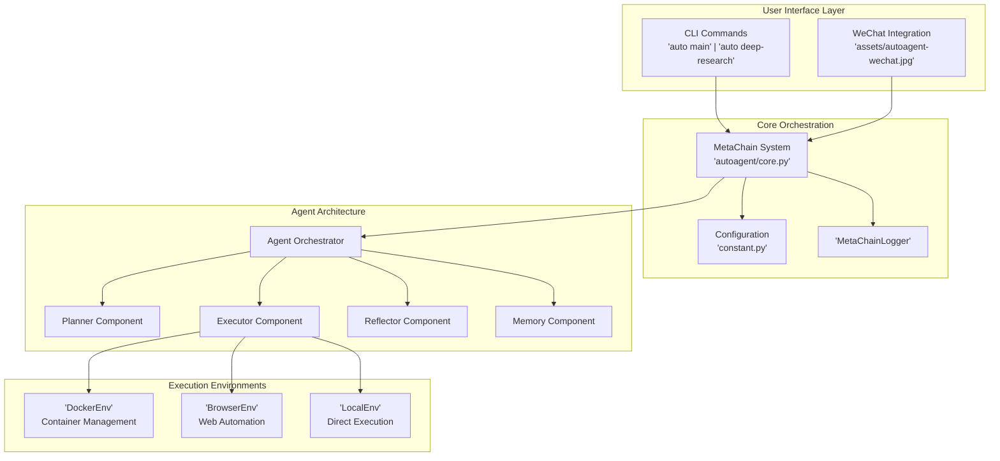
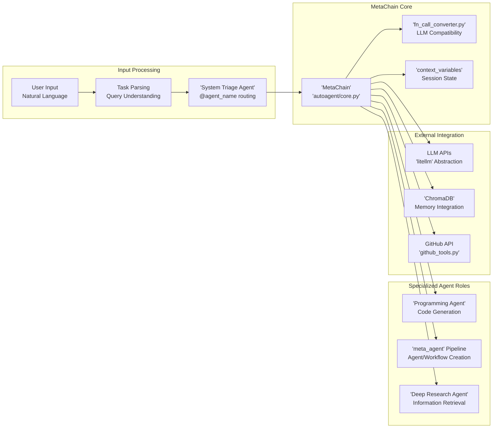
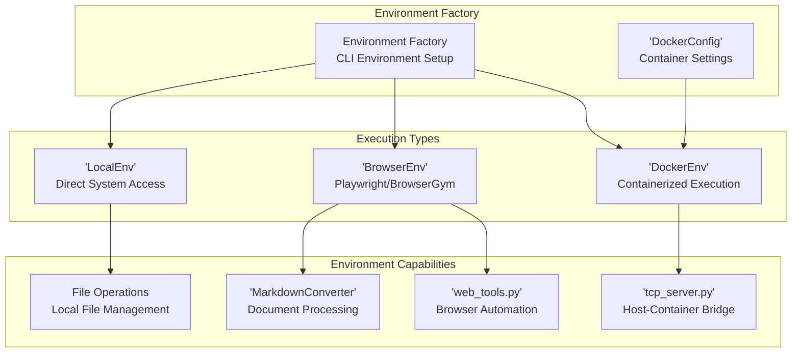

<!-- source: DeepWiki mcp.deepwiki.com · repo HKUDS/AutoAgent · page 1 Introduction to AutoAgent · fetched 2026-10-29 -->

# Introduction to AutoAgent

Relevant source files

The following files were used as context for generating this wiki page:

- [README.md](README.md)
- [assets/AutoAgent_Arxiv_2025.pdf](assets/AutoAgent_Arxiv_2025.pdf)
- [assets/autoagent-intro-final.pdf](assets/autoagent-intro-final.pdf)
- [assets/autoagent-intro.pdf](assets/autoagent-intro.pdf)
- [assets/autoagent-intro.png](assets/autoagent-intro.png)
- [assets/autoagent-intro.svg](assets/autoagent-intro.svg)
- [assets/autoagent.png](assets/autoagent.png)
- [assets/video_v1_compressed.mp4](assets/video_v1_compressed.mp4)

## Purpose and Scope

This document provides a comprehensive introduction to AutoAgent, a fully-automated, zero-code LLM agent framework that enables users to create and deploy sophisticated AI agents through natural language alone. This page covers the system's core purpose, key capabilities, and high-level architecture.

For detailed installation and setup instructions, see [Installation and Setup](#2). For information about using the command-line interface, see [Command Line Interface](#3). For in-depth technical details about core components, see [Core Components](#4).

## What is AutoAgent

AutoAgent is a self-developing framework that eliminates the need for traditional programming when creating LLM-powered agents. Users can create tools, agents, and workflows using natural language descriptions, while the system handles the underlying complexity of agent orchestration, execution environments, and LLM integration [README.md:30-48]().

The framework delivers performance comparable to industry-leading solutions like OpenAI's Deep Research while providing greater flexibility in model selection and cost-effectiveness through its open-source nature [README.md:96-105]().

## Key Features and Capabilities

| Feature | Description |
|---------|-------------|
| **Zero-Code Agent Creation** | Create agents and workflows using natural language descriptions only [README.md:37-39]() |
| **Universal LLM Support** | Compatible with OpenAI, Anthropic, DeepSeek, Gemini, Grok, and other providers [README.md:101-102]() |
| **Natural Language Orchestration** | Dynamically creates and optimizes workflows based on high-level task descriptions [README.md:40-42]() |
| **Self-Play Customization** | Enables iterative self-improvement of tools and agents through controlled code generation [README.md:46-48]() |
| **Multiple Environments** | Docker containerization, browser automation, and local execution [README.md:65-66]() |
| **GAIA Benchmark Performance** | Top-tier performance on industry-standard benchmarks [README.md:22-23]() |

## System Architecture Overview

AutoAgent operates through a layered architecture centered around the MetaChain orchestrator, which coordinates between user interfaces, execution environments, and external services.

### Core System Components

**Sources:** [README.md:1-50](), [README.md:65-66](), [assets/autoagent-intro.svg:1-4]()

### MetaChain Orchestration Flow

The MetaChain system manages the lifecycle of a task, from initial parsing to final execution and reflection.

**Sources:** [README.md:92-120](), [README.md:150-201]()

## Operational Modes

AutoAgent provides three primary operational modes accessible through the command-line interface:

### User Mode (Deep Research)
Activated via the `auto deep-research` command, this mode provides an out-of-the-box multi-agent system designed for comprehensive information retrieval and analytical report generation [README.md:96-105]().

### Agent Editor Mode
Accessed through `auto main` and selecting the agent editor, this mode allows users to create individual agents (profiling, tool creation, and assembly) through natural language descriptions [README.md:117-135]().

### Workflow Editor Mode  
Also accessed through `auto main`, this mode enables the creation of multi-agent workflows where agents collaborate according to user-defined processes, implemented via `WorkflowForm` XML schemas [README.md:137-148]().

## Environment System

AutoAgent's execution environments provide isolated, secure contexts for different types of agent tasks, particularly for code execution and web browsing [README.md:65-66]().

**Sources:** [README.md:208-225](), [README.md:65-66]()

## Getting Started

To begin using AutoAgent, users install the framework and configure API keys for their preferred LLM providers. The system supports multiple providers through a unified interface [README.md:208-242]().

Basic usage follows this pattern:
1. Install AutoAgent via `pip install -e .` [README.md:208-210]()
2. Configure environment variables for LLM API keys in `.env` [README.md:218-221]()
3. Run `auto main` for full functionality or `auto deep-research` for research tasks [README.md:244-250]()
4. Interact with the system through natural language commands.

For detailed setup instructions and configuration options, see [Installation and Setup](#2).

**Sources:** [README.md:208-396]()

---

