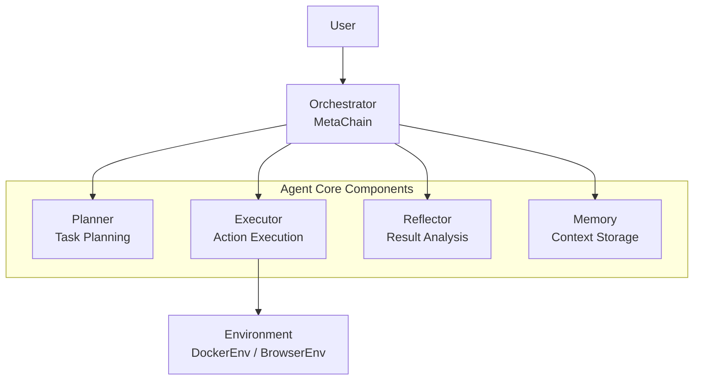
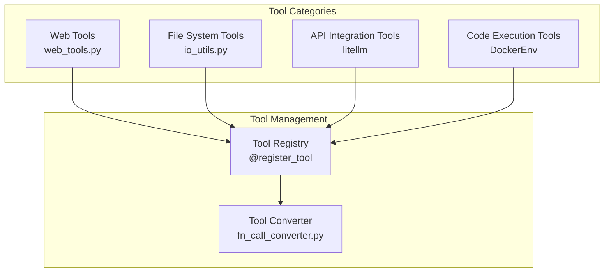
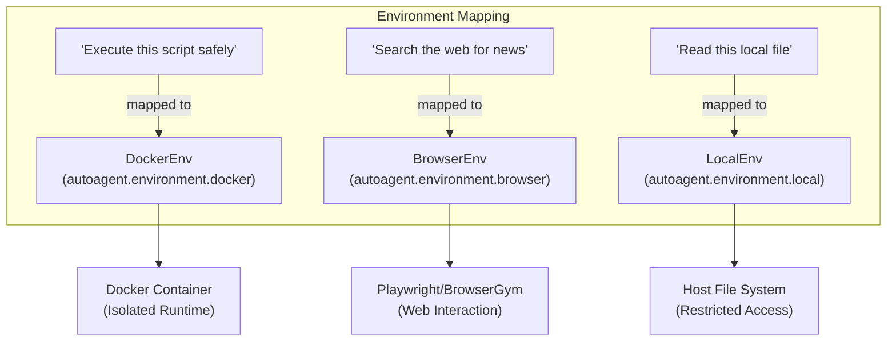
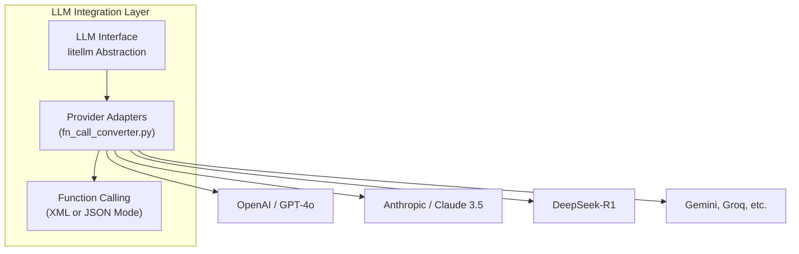

<!-- source: DeepWiki mcp.deepwiki.com · repo HKUDS/AutoAgent · page 1.1 Core Concepts · fetched 2026-10-29 -->

# Core Concepts

Relevant source files

The following files were used as context for generating this wiki page:

- [README.md](README.md)
- [assets/AutoAgent_Arxiv_2025.pdf](assets/AutoAgent_Arxiv_2025.pdf)
- [assets/autoagent-intro-final.pdf](assets/autoagent-intro-final.pdf)
- [assets/autoagent-intro.pdf](assets/autoagent-intro.pdf)
- [assets/autoagent-intro.png](assets/autoagent-intro.png)
- [assets/autoagent-intro.svg](assets/autoagent-intro.svg)
- [assets/autoagent.png](assets/autoagent.png)
- [assets/paper/metachain_arxiv.pdf](assets/paper/metachain_arxiv.pdf)
- [assets/video_v1_compressed.mp4](assets/video_v1_compressed.mp4)

This document introduces the fundamental concepts that underpin AutoAgent's architecture and functionality. It covers the core abstractions, system components, and design principles that enable AutoAgent to function as a fully-automated, zero-code LLM agent framework.

For system architecture details, see [System Architecture](#1.2). For implementation specifics of the MetaChain orchestration system, see [MetaChain System](#4.1). For execution environment details, see [Environment System](#4.3).

## Overview

AutoAgent is a **Fully-Automated** and highly **Self-Developing** framework that enables users to create and deploy LLM agents through **Natural Language Alone**. It eliminates the need for manual coding by automating the construction and orchestration of collaborative agent systems.

Sources: [README.md:30-35](), [README.md:37-48]()

## Operating Agent System Metaphor

AutoAgent is designed as an "Operating Agent System," drawing parallels between traditional operating systems and agentic workflows. This architecture is divided into three primary layers:

| Layer | OS Equivalent | Code Space / Responsibility |
| :--- | :--- | :--- |
| **User Mode** | User Space / Apps | High-level research tasks, multi-agent research assistants, and final task execution. |
| **Developer Mode** | Development Tools | Natural language editors for creating new Agents (`agent editor`) and Workflows (`workflow editor`). |
| **OS Kernel** | Kernel / Runtime | The `MetaChain` engine, environment management (`DockerEnv`, `BrowserEnv`), and tool execution. |

Sources: [README.md:92-200](), [README.md:218-221]()

## Core Architectural Concepts

### Agent-Based Computing Model

AutoAgent implements a multi-agent architecture where individual agents are autonomous computational units. The system maps natural language requirements to specific code entities that reason, plan, execute actions, and reflect on outcomes.

Sources: [assets/autoagent-intro.svg:1-4](), [README.md:34-48]()

### MetaChain Orchestration System

The `MetaChain` (formerly known as the project name) serves as the central orchestration engine. It manages the message flow between agents, handles tool calling, and provides the runtime environment for agent interactions.

Sources: [README.md:65-66](), [README.md:414-421]()

## Agent System Concepts

### Agent Lifecycle

Agents in AutoAgent are defined through natural language descriptions and automatically converted into executable code entities.

1.  **Requirement Gathering**: User provides a natural language description of the desired agent.
2.  **Agent Profiling**: The system uses a "Meta-Agent" to generate an `AgentForm` (XML-based schema).
3.  **Tool Development**: The system automatically writes the necessary Python tools for the agent.
4.  **Assembly**: The agent is registered in the system and becomes available for tasks.

Sources: [README.md:115-145](), [README.md:164-200]()

### Tool Integration

Tools are external capabilities that agents invoke. AutoAgent supports a wide range of tools, from web browsing to isolated code execution.

Sources: [README.md:414-421](), [README.md:65-68]()

## Zero-Code Philosophy

The **Zero-Code** framework democratizes AI development by allowing anyone to create agents, tools, and workflows using natural language alone. This is achieved through:

*   **Self-Managing Workflow Generation**: Dynamically creates and optimizes workflows based on high-level descriptions.
*   **Intelligent Resource Orchestration**: Controlled code generation for creating new components through iterative self-improvement.
*   **Natural Language-Driven Building**: Eliminates manual technical configuration.

Sources: [README.md:37-48]()

## Agentic RAG

### Intelligent Retrieval System

**Agentic RAG** represents an advanced approach to Retrieval-Augmented Generation where agents make intelligent decisions about when and how to retrieve information, rather than following fixed retrieval patterns.

*   **Dynamic Retrieval Decisions**: Agents determine optimal retrieval strategies based on the complexity of the query.
*   **Context-Aware Processing**: Retrieval is adapted to the current task context rather than a simple similarity search.

Sources: [README.md:34-35](), [README.md:457-470]()

## Execution Environments

AutoAgent provides robust isolation for agent actions through specialized environments.

| Environment | Code Entity | Purpose |
| :--- | :--- | :--- |
| **Docker** | `DockerEnv` | Isolated code execution, preventing agents from damaging the host system. |
| **Browser** | `BrowserEnv` | Web automation, site interaction, and data scraping using tools like Playwright. |
| **Local** | `LocalEnv` | Direct system access for non-destructive file operations. |

Sources: [README.md:218-221](), [README.md:423-455]()

## Key Abstractions

### LLM Integration Layer

AutoAgent provides universal LLM support through a standardized interface that abstracts provider-specific differences (e.g., OpenAI, Anthropic, DeepSeek, Gemini).

Sources: [README.md:40-41](), [README.md:65-68](), [README.md:269-396]()

---

