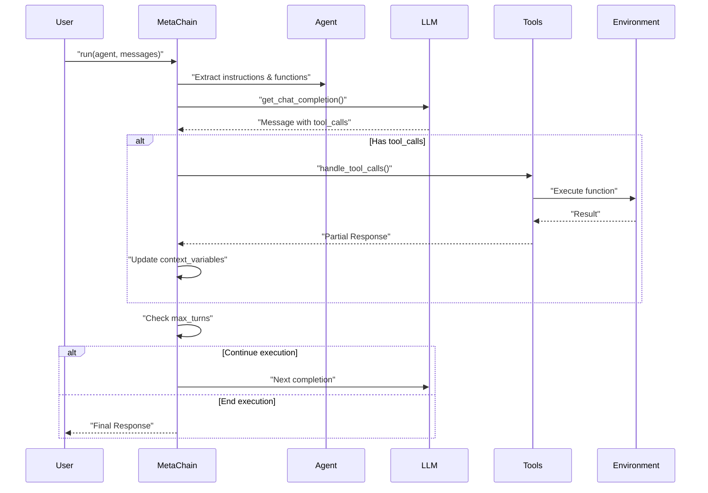

<!-- source: DeepWiki mcp.deepwiki.com · repo HKUDS/AutoAgent · page 1.2 System Architecture · fetched 2026-10-29 -->

# System Architecture

<details>
<summary>Relevant source files</summary>

The following files were used as context for generating this wiki page:

- [assets/AutoAgent_Arxiv_2025.pdf](assets/AutoAgent_Arxiv_2025.pdf)
- [assets/autoagent-intro-final.pdf](assets/autoagent-intro-final.pdf)
- [assets/autoagent-intro.pdf](assets/autoagent-intro.pdf)
- [assets/autoagent-intro.svg](assets/autoagent-intro.svg)
- [autoagent/cli.py](autoagent/cli.py)
- [autoagent/core.py](autoagent/core.py)
- [autoagent/fn_call_converter.py](autoagent/fn_call_converter.py)

</details>


This document provides a comprehensive technical overview of AutoAgent's system architecture, focusing on the core orchestration mechanisms, agent execution flows, and key component interactions. The architecture is designed around a centralized orchestration system that coordinates multiple execution environments and manages LLM interactions through a sophisticated function calling framework.

## Core Architecture Overview

AutoAgent implements a multi-layered architecture centered around the `MetaChain` orchestration system, which coordinates between user inputs, agent execution, and various execution environments.

### High-Level System Components

```mermaid
graph TB
    subgraph "User Interface Layer"
        CLI["`CLI Interface`<br/>`autoagent/cli.py`"]
        WeChat["`WeChat Integration`<br/>`QR Code Entry`"]
    end
    
    subgraph "Core Orchestration"
        MetaChain["`MetaChain`<br/>`autoagent/core.py`"]
        FnConverter["`FunctionCallConverter`<br/>`autoagent/fn_call_converter.py`"]
        Logger["`MetaChainLogger`<br/>`autoagent/logger.py`"]
    end
    
    subgraph "Agent Execution"
        Agent["`Agent`<br/>`autoagent/types.py`"]
        AgentFunctions["`AgentFunction`<br/>`function_to_json()`"]
        Response["`Response`<br/>`Result`"]
    end
    
    subgraph "Execution Environments"
        Docker["`DockerEnv`<br/>`autoagent/environment/docker_env.py`"]
        Browser["`BrowserEnv`<br/>`autoagent/environment/browser_env.py`"]
        Local["`LocalEnv`<br/>`autoagent/environment/local_env.py`"]
    end
    
    subgraph "External Services"
        LLM["`LLM Providers`<br/>`litellm.completion()`"]
        APIs["`External APIs`<br/>`OpenAI, Anthropic, Gemini`"]
    end
    
    CLI --> MetaChain
    WeChat --> MetaChain
    MetaChain --> FnConverter
    MetaChain --> Logger
    MetaChain --> Agent
    Agent --> AgentFunctions
    AgentFunctions --> Response
    MetaChain --> Docker
    MetaChain --> Browser
    MetaChain --> Local
    MetaChain --> LLM
    LLM --> APIs
```

**Sources:** [autoagent/core.py:96-106](), [autoagent/cli.py:46-49](), [autoagent/environment/docker_env.py:25-25](), [autoagent/environment/browser_env.py:27-27](), [autoagent/environment/local_env.py:26-26]()

## MetaChain Orchestration System

The `MetaChain` class serves as the central orchestrator, managing the complete agent execution lifecycle from message processing to tool calling and response generation.

### MetaChain Core Components

```mermaid
graph LR
    subgraph "MetaChain Core"
        MC["`MetaChain`<br/>`autoagent/core.py`"]
        GCC["`get_chat_completion()`<br/>`line 115-210`"]
        HTC["`handle_tool_calls()`<br/>`line 230-302`"]
        RUN["`run()`<br/>`line 396-493`"]
    end
    
    subgraph "Message Processing"
        Messages["`List[Message]`<br/>`history`"]
        Instructions["`agent.instructions`<br/>`callable or str`"]
        Tools["`function_to_json(f)`<br/>`autoagent/util.py`"]
    end
    
    subgraph "LLM Integration"
        Completion["`litellm.completion()`<br/>`line 173, 201`"]
        Models["`model_override`<br/>`agent.model`"]
        Gemini["`adapt_tools_for_gemini()`<br/>`line 58-94`"]
    end
    
    subgraph "Tool Execution"
        FunctionMap["`function_map`<br/>`line 238`"]
        ToolCalls["`ChatCompletionMessageToolCall`<br/>`line 242`"]
        Results["`Result`<br/>`handle_function_result()`"]
    end
    
    MC --> GCC
    MC --> HTC
    MC --> RUN
    GCC --> Messages
    GCC --> Instructions
    GCC --> Tools
    GCC --> Completion
    Completion --> Models
    Completion --> Gemini
    HTC --> FunctionMap
    HTC --> ToolCalls
    HTC --> Results
```

**Sources:** [autoagent/core.py:96-106](), [autoagent/core.py:115-210](), [autoagent/core.py:230-302](), [autoagent/core.py:396-493](), [autoagent/core.py:58-94]()

### Agent Execution Flow

The execution flow follows a structured pattern where the `MetaChain` processes messages, handles tool calls, and manages context variables throughout the conversation.



**Sources:** [autoagent/core.py:396-493](), [autoagent/core.py:115-210](), [autoagent/core.py:230-302]()

## Function Calling System

AutoAgent implements a sophisticated function calling system that supports both native function calling LLMs and models that require prompt-based function calling through the `FunctionCallConverter`.

### Function Call Conversion Architecture

```mermaid
graph TB
    subgraph "Function Call Modes"
        FnCall["`FN_CALL=True`<br/>`Native Support`"]
        NonFnCall["`FN_CALL=False`<br/>`Prompt-based`"]
    end
    
    subgraph "Conversion Layer"
        Converter["`FunctionCallConverter`<br/>`fn_call_converter.py`"]
        ToDesc["`convert_tools_to_description()`<br/>`line 281-317`"]
        ToFnCall["`convert_non_fncall_messages_to_fncall_messages()`<br/>`line 575-700`"]
        FromFnCall["`convert_fn_messages_to_non_fn_messages()`<br/>`line 320-486`"]
    end
    
    subgraph "Message Processing"
        SystemPrompt["`SYSTEM_PROMPT_SUFFIX_TEMPLATE`<br/>`line 35-58`"]
        FnRegex["`FN_REGEX_PATTERN`<br/>`line 243`"]
        ParamRegex["`FN_PARAM_REGEX_PATTERN`<br/>`line 244`"]
    end
    
    subgraph "Tool Execution"
        ToolCall["`convert_tool_call_to_string()`<br/>`line 250-278`"]
        Validation["`_extract_and_validate_params()`<br/>`line 489-562`"]
        StopWords["`STOP_WORDS`<br/>`line 60`"]
    end
    
    FnCall --> Converter
    NonFnCall --> Converter
    Converter --> ToDesc
    Converter --> ToFnCall
    Converter --> FromFnCall
    ToDesc --> SystemPrompt
    ToFnCall --> FnRegex
    ToFnCall --> ParamRegex
    FromFnCall --> ToolCall
    ToolCall --> Validation
    Validation --> StopWords
```

**Sources:** [autoagent/fn_call_converter.py:35-58](), [autoagent/fn_call_converter.py:281-317](), [autoagent/fn_call_converter.py:320-486](), [autoagent/fn_call_converter.py:575-700](), [autoagent/core.py:148-151]()

### Tool Definition and Validation

The system uses a comprehensive tool definition format that supports parameter validation, type checking, and enum constraints.

| Component | Code Entity | Purpose |
| :--- | :--- | :--- |
| **Tool Definition** | `ChatCompletionToolParam` | Defines the schema for functions exposed to the LLM. |
| **Parameter Parsing** | `_extract_and_validate_params` | Uses regex to parse XML-style parameters from non-native LLM outputs. |
| **Type Mapping** | `param_name_to_type` | Maps parameter names to Python types for runtime conversion. |
| **Gemini Adapter** | `adapt_tools_for_gemini` | Ensures Gemini compatibility by adding dummy properties to empty objects. |

**Sources:** [autoagent/fn_call_converter.py:489-562](), [autoagent/core.py:58-94](), [autoagent/core.py:238-302]()

## Environment Integration

AutoAgent supports multiple execution environments, each providing isolated execution contexts for code execution and web interaction.

### Environment Mapping

| Environment | Class | Key File | Description |
| :--- | :--- | :--- | :--- |
| **Docker** | `DockerEnv` | `autoagent/environment/docker_env.py` | Isolated container for running code safely. |
| **Browser** | `BrowserEnv` | `autoagent/environment/browser_env.py` | Web automation using Playwright/BrowserGym. |
| **Local** | `LocalEnv` | `autoagent/environment/local_env.py` | Direct execution on the host system. |
| **Markdown** | `RequestsMarkdownBrowser` | `autoagent/environment/markdown_browser.py` | Simplified text-based web/file browsing. |

**Sources:** [autoagent/cli.py:149-153](), [autoagent/cli.py:163-167]()

## Key System Interactions

The complete system operates through a series of coordinated interactions between the core components, maintaining state through `context_variables` and managing execution flow through the `MetaChain` orchestrator.

### Data Flow: User Query to Tool Execution

```mermaid
graph TB
    subgraph "Input Layer"
        UserInput["`User Input`<br/>`autoagent/cli.py`"]
        FileUpload["`File Upload`<br/>`select_and_copy_files`"]
    end
    
    subgraph "Processing Layer"
        MetaChain["`MetaChain.run()`<br/>`autoagent/core.py`"]
        Agent["`Agent Configuration`<br/>`types.Agent`"]
        Messages["`Message History`<br/>`List[Message]`"]
    end
    
    subgraph "Execution Layer"
        LLMCall["`get_chat_completion()`<br/>`litellm.completion()`"]
        ToolExecution["`handle_tool_calls()`<br/>`function_map[name](**args)`"]
        ContextUpdate["`context_variables.update()`<br/>`Result.context_variables`"]
    end
    
    subgraph "Output Layer"
        Response["`Response`<br/>`types.Response`"]
        AgentSwitch["`Agent Handoff`<br/>`Result.agent`"]
        ResultValue["`Result.value`<br/>`Tool Output`"]
    end
    
    UserInput --> MetaChain
    FileUpload --> MetaChain
    MetaChain --> Agent
    Agent --> Messages
    Messages --> LLMCall
    LLMCall --> ToolExecution
    ToolExecution --> ContextUpdate
    ContextUpdate --> Response
    Response --> AgentSwitch
    Response --> ResultValue
```

**Sources:** [autoagent/core.py:396-493](), [autoagent/core.py:115-210](), [autoagent/core.py:230-302](), [autoagent/core.py:212-228](), [autoagent/cli.py:78-84]()

---

