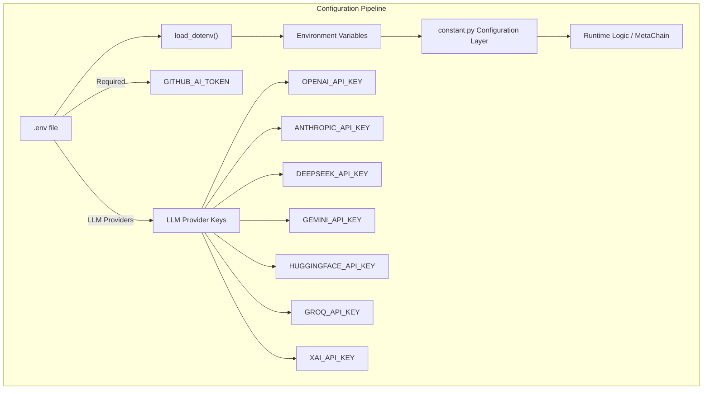
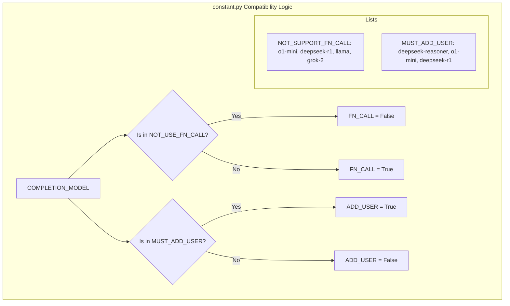

<!-- source: DeepWiki mcp.deepwiki.com · repo HKUDS/AutoAgent · page 2.1 API Keys and Configuration · fetched 2026-10-29 -->

# API Keys and Configuration

Relevant source files

The following files were used as context for generating this wiki page:

- [.env.template](.env.template)
- [.gitignore](.gitignore)
- [assets/cookies/export.png](assets/cookies/export.png)
- [assets/cookies/extension.png](assets/cookies/extension.png)
- [constant.py](constant.py)
- [docs/docs/Get-Started/get-started-installation.md](docs/docs/Get-Started/get-started-installation.md)

This page explains how to set up and configure the AutoAgent framework with various Language Model (LLM) provider API keys and system settings. The configuration process involves setting environment variables that control which LLMs are used, their endpoints, and how they operate within the system.

## API Keys Overview

AutoAgent supports multiple LLM providers through a unified interface. You'll need to configure API keys for the LLM providers you wish to use. The system uses `dotenv` to load these variables from a `.env` file into the environment.

### Environment Loading Flow
The diagram below shows how configuration values move from static files to the runtime system.

Sources: [constant.py:1-5](), [.env.template:1-11]()

## Setting Up Your API Keys

To configure AutoAgent, create a `.env` file in the root directory. Use `.env.template` as a reference.

| Variable | Importance | Purpose |
| :--- | :--- | :--- |
| `GITHUB_AI_TOKEN` | **Required** | Used for core functionality and repository interactions. |
| `ANTHROPIC_API_KEY` | Optional | Used for the default `claude-3-5-sonnet-20241022` model. |
| `OPENAI_API_KEY` | Optional | Required for GPT-4o or embedding models. |
| `DEEPSEEK_API_KEY` | Optional | Required for DeepSeek-V3 or DeepSeek-R1 models. |

Sources: [.env.template:1-11](), [constant.py:26-26](), [constant.py:48-49]()

## System Constants and Model Logic

The `constant.py` file acts as the central configuration layer. It not only reads environment variables but also contains logic to handle model-specific quirks, such as whether a model supports function calling or requires a specific message structure.

### Key Configuration Constants

| Variable | Code Entity | Default / Logic |
| :--- | :--- | :--- |
| **Model** | `COMPLETION_MODEL` | `claude-3-5-sonnet-20241022` |
| **Embeddings** | `EMBEDDING_MODEL` | `text-embedding-3-small` |
| **Workspace** | `DOCKER_WORKPLACE_NAME` | `workplace` |
| **Debug Mode** | `DEBUG` | `False` (Parsed via `str_to_bool`) |
| **Function Call** | `FN_CALL` | Boolean; auto-toggled based on `NOT_USE_FN_CALL` list. |
| **Architecture** | `BASE_IMAGES` | Auto-detected (AMD64 vs ARM) via `get_architecture()`. |

Sources: [constant.py:25-57](), [constant.py:6-22]()

### Model Compatibility Logic
AutoAgent handles model limitations by maintaining blacklists and requirement lists.

Sources: [constant.py:61-85]()

## Model Compatibility Tables

The following tables define how AutoAgent treats specific LLM providers.

### Function Calling Support
The `FN_CALL` flag determines if the agent uses native LLM tool-use features or falls back to XML/text-based parsing.

| Category | Code Constant | Models |
| :--- | :--- | :--- |
| **No Native Support** | `NOT_SUPPORT_FN_CALL` | `o1-mini`, `deepseek-reasoner`, `deepseek-r1`, `llama`, `grok-2` |
| **Force Disable** | `NOT_USE_FN_CALL` | `deepseek-chat` + all models in `NOT_SUPPORT_FN_CALL` |

Sources: [constant.py:64-65]()

### Message Formatting
Some models have strict requirements for message roles or sender fields.

| Category | Code Constant | Models |
| :--- | :--- | :--- |
| **Role Restriction** | `MUST_ADD_USER` | `deepseek-reasoner`, `o1-mini`, `deepseek-r1` |
| **Sender Restriction**| `NOT_SUPPORT_SENDER` | `mistral`, `groq` |

Sources: [constant.py:61-62]()

## Environment Persistence

AutoAgent generates temporary files and logs during execution. These are typically excluded from version control to prevent sensitive data leakage.

| Path Pattern | Purpose |
| :--- | :--- |
| `workplace_*/` | Temporary Docker/Local execution environments. |
| `*.log` | System and MetaChain logs. |
| `code_db/*` | RAG vector database files. |
| `.env` | Local secret storage (ignored by git). |

Sources: [.gitignore:1-25]()

## Docker Architecture Selection

The system automatically selects the correct Docker image based on the host machine's architecture using the `get_architecture()` function.

*   **x86/amd64**: Uses `tjbtech1/metachain:amd64_latest`
*   **ARM (e.g., Apple Silicon)**: Uses `tjbtech1/metachain:latest`

Sources: [constant.py:37-46]()

---

