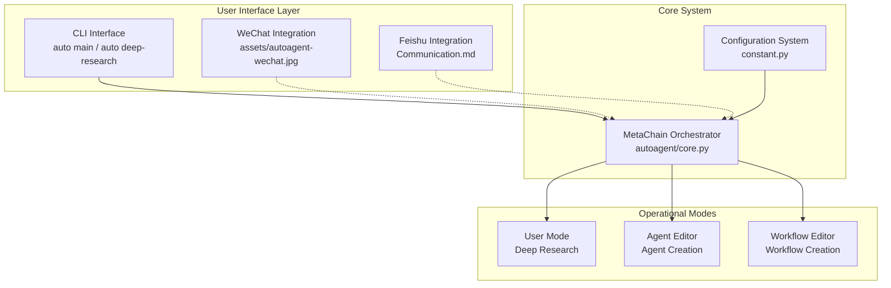
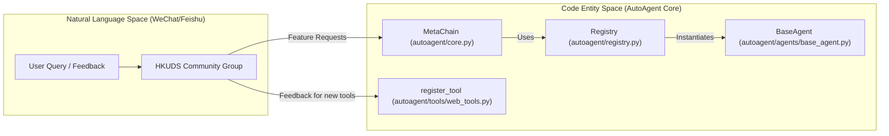
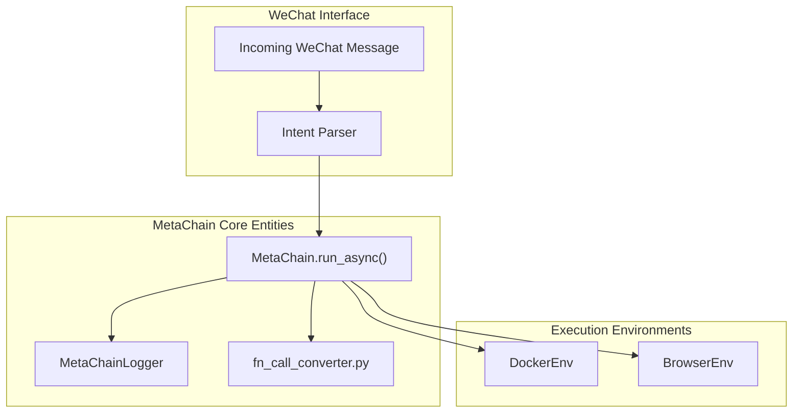

<!-- source: DeepWiki mcp.deepwiki.com · repo HKUDS/AutoAgent · page 2.2 WeChat Integration Setup · fetched 2026-10-29 -->

# WeChat Integration Setup

<details>
<summary>Relevant source files</summary>

The following files were used as context for generating this wiki page:

- [Communication.md](Communication.md)
- [assets/QR.png](assets/QR.png)
- [assets/autoagent-wechat.jpg](assets/autoagent-wechat.jpg)

</details>


This document covers the setup and configuration of WeChat integration within the AutoAgent framework. WeChat integration provides an alternative user interface for interacting with AutoAgent's core functionality, primarily serving user onboarding and community interaction.

For general installation and setup information, see [Installation and Setup](#2). For API key configuration, see [API Keys and Configuration](#2.1).

## Overview

WeChat integration in AutoAgent serves as a gateway for users to join the ecosystem and eventually interact with the MetaChain orchestration system. It provides a community-focused interface that bridges the gap between the GitHub repository and active user discussion.

### System Entry Points



**WeChat Integration Architecture**

Sources: [README.md:11-21](), [Communication.md:1-5]()

## Community Access and Onboarding

The primary mechanism for WeChat integration is through the community onboarding assets. These allow users to connect with the HKUDS (University of Hong Kong Data Science) team and other AutoAgent developers.

### Integration Assets

AutoAgent maintains specific assets to facilitate WeChat connectivity:

| Asset | Path | Purpose |
|-------|------|---------|
| WeChat QR Image | `assets/autoagent-wechat.jpg` | Direct scan to join the WeChat community. |
| General QR Image | `assets/QR.png` | Unified QR code for HKUDS group access. |
| Communication Guide | `Communication.md` | Centralized document for Feishu and WeChat access. |

### GitHub Badge Integration

The integration is exposed on the project's main landing page via a dynamic badge. This badge links the natural language space of the README to the technical asset space:

```markdown
<a href="https://github.com/HKUDS/AutoAgent/blob/main/assets/autoagent-wechat.jpg">
  
</a>
```

Sources: [README.md:15](), [Communication.md:1-6](), [assets/autoagent-wechat.jpg:1-10]()

## Technical Flow: From Social to Code

When a user interacts with the WeChat community, the feedback loop eventually flows back into the development of the MetaChain system. The following diagram maps the conceptual "Natural Language Space" of community interaction to the "Code Entity Space" where agents are defined and executed.



**Social-to-Code Interaction Mapping**

Sources: [README.md:27-49](), [Communication.md:1-5]()

## Integration with MetaChain System

While the current implementation focuses on community onboarding, the architecture is designed to eventually route WeChat messages into the `MetaChain` orchestrator.

### Planned Message Pipeline



**Conceptual WeChat Message Processing**

Sources: [README.md:92-104](), [README.md:226-240]()

## Development Status

The WeChat integration is currently in the **Community Onboarding Phase**.

1.  **Phase 1: Community (Current)**: Focus on `assets/autoagent-wechat.jpg` and `Communication.md` to build the user base.
2.  **Phase 2: Notification (Planned)**: Integrating MetaChain logs (`MetaChainLogger`) to send execution status updates to WeChat groups.
3.  **Phase 3: Interactive (Future)**: Full deployment of a WeChat bot that calls `MetaChain.run()` directly from mobile inputs.

Sources: [README.md:422](), [Communication.md:1-5]()

---

