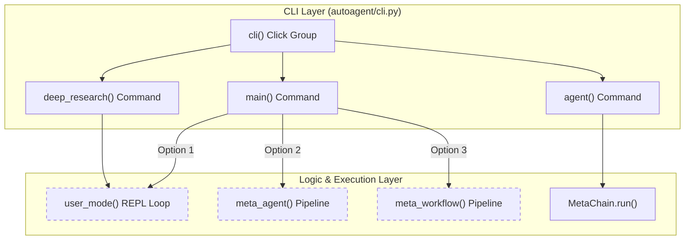
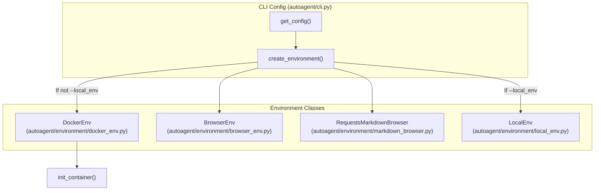

<!-- source: DeepWiki mcp.deepwiki.com · repo HKUDS/AutoAgent · page 3 Command Line Interface · fetched 2026-10-29 -->

# Command Line Interface

Relevant source files

The following files were used as context for generating this wiki page:

- [autoagent/cli.py](autoagent/cli.py)
- [autoagent/cli_utils/metachain_meta_agent.py](autoagent/cli_utils/metachain_meta_agent.py)
- [autoagent/cli_utils/metachain_meta_workflow.py](autoagent/cli_utils/metachain_meta_workflow.py)
- [autoagent/logger.py](autoagent/logger.py)
- [loop_utils/font_page.py](loop_utils/font_page.py)

This document covers AutoAgent's command line interface (CLI), which serves as the primary entry point for interacting with the framework. The CLI provides commands for running deep research tasks, creating agents and workflows, and managing the underlying execution environments.

For information about the underlying system architecture, see [System Architecture](#1.2). For detailed guides on using specific operational modes, see [User Mode (Deep Research)](#3.1), [Agent Editor](#3.2), and [Workflow Editor](#3.3).

## Overview

The AutoAgent CLI is implemented using the `click` framework [autoagent/cli.py:46-49]() and provides a unified interface for accessing all framework capabilities. It handles environment setup, model configuration, and orchestrates the interaction between users and the underlying `MetaChain` system [autoagent/cli.py:78-82]().

### CLI Entry and Mode Mapping
The following diagram bridges the CLI command space to the underlying code entities that handle specific execution modes.

Sources: [autoagent/cli.py:46-49](), [autoagent/cli.py:185-236](), [autoagent/cli.py:321-426](), [autoagent/cli.py:51-84]()

## Command Structure

The CLI follows a modular command structure where each major functionality is accessible through specific commands:

| Command | Function | Description |
|---------|----------|-------------|
| `auto main` | `main()` [autoagent/cli.py:185]() | Full AutoAgent interface with all modes |
| `auto deep-research` | `deep_research()` [autoagent/cli.py:321]() | Lightweight user mode for deep research |
| `auto agent` | `agent()` [autoagent/cli.py:56]() | Direct agent execution for debugging |
| `auto workflow` | `workflow()` [autoagent/cli.py:89]() | Direct workflow execution via async wrapper |

Sources: [autoagent/cli.py:51-103](), [autoagent/cli.py:179-236](), [autoagent/cli.py:317-426]()

## Main Modes

### User Mode (Deep Research)
Accessed via `auto main` (Option 1) or `auto deep-research`. This mode initializes a `PromptSession` with a `UserCompleter` to facilitate agent selection via `@` mentions [autoagent/cli.py:254-263](). It typically employs the `System_Triage_Agent` to route user queries to specialized agents like the `Programming_Agent` or `Web_Agent` [autoagent/cli.py:246-252]().

For details, see [User Mode (Deep Research)](#3.1).

### Agent Editor
Accessed via `auto main` (Option 2). This mode invokes `meta_agent()` [autoagent/cli_utils/metachain_meta_agent.py:116](), which manages a three-stage pipeline:
1. **Agent Profiling**: Uses `agent_former` to generate an XML agent specification [autoagent/cli_utils/metachain_meta_agent.py:24-47]().
2. **Tool Editing**: Uses `tool_editor` to create required Python tools [autoagent/cli_utils/metachain_meta_agent.py:49-108]().
3. **Agent Assembly**: Uses `agent_creator` to implement the final agent class [autoagent/cli_utils/metachain_meta_agent.py:110-155]().

For details, see [Agent Editor](#3.2).

### Workflow Editor
Accessed via `auto main` (Option 3). This mode invokes `meta_workflow()` [autoagent/cli_utils/metachain_meta_workflow.py:116](). It follows a similar pipeline to the Agent Editor but focuses on multi-agent orchestration, utilizing `workflow_former` and `workflow_creator` agents [autoagent/cli_utils/metachain_meta_workflow.py:119-120]().

For details, see [Workflow Editor](#3.3).

## Environment and Execution Setup

Before launching any mode, the CLI performs environment initialization to provide agents with necessary capabilities (code execution, browsing, file access).

### Environment Initialization Flow
This diagram maps the CLI configuration process to the environment classes defined in the codebase.

Sources: [autoagent/cli.py:109-142](), [autoagent/cli.py:143-168](), [autoagent/environment/docker_env.py:11-14](), [autoagent/environment/local_env.py:5-7]()

### Key Environment Components
- **Code Environment**: `DockerEnv` or `LocalEnv` for isolated code execution [autoagent/cli.py:149,163]().
- **Web Environment**: `BrowserEnv` for web automation and searching [autoagent/cli.py:152]().
- **File Environment**: `RequestsMarkdownBrowser` for document parsing and viewing [autoagent/cli.py:153]().

## Direct Execution Commands

### auto agent
Allows direct execution of a single agent function from `autoagent.agents`.
- **Usage**: `mc agent --model=gpt-4o --agent_func=get_weather_agent --query="Weather in London"` [autoagent/cli.py:65]().
- **Context**: Accepts `context_variables` in `key=value` format [autoagent/cli.py:68-71]().

### auto workflow
Allows direct execution of a workflow from `autoagent.workflows`.
- **Usage**: `mc workflow --workflow_name=research_workflow --system_input="Analyze AI trends"` [autoagent/cli.py:87-89]().
- **Implementation**: Wraps the asynchronous workflow function using `asyncio.run()` [autoagent/cli.py:91]().

Sources: [autoagent/cli.py:51-103]()

## UI and Logging
The CLI utilizes `rich` for UI elements and a custom `MetaChainLogger` for execution tracking.
- **Visuals**: Displays `MC_LOGO` and a `version_table` on startup [autoagent/cli.py:186-187]().
- **Logging**: `LoggerManager` provides a singleton `MetaChainLogger` that handles `pretty_print_messages` for assistant responses, tool calls, and tool results [autoagent/logger.py:114-137]().

Sources: [autoagent/cli.py:186-187](), [autoagent/logger.py:9-137](), [loop_utils/font_page.py:11-28]()

---

