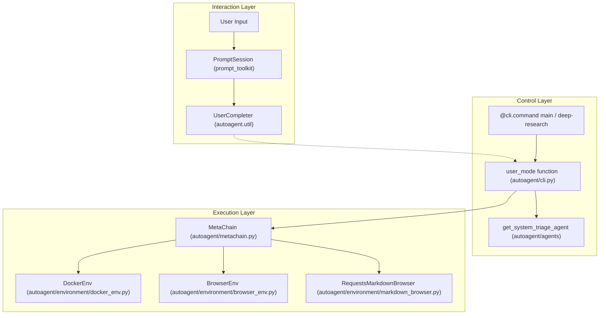
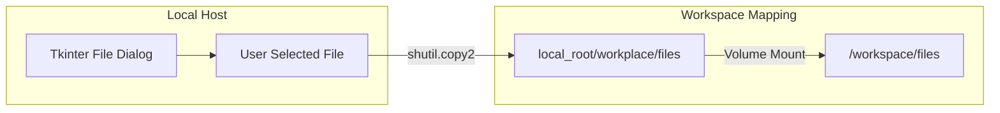

<!-- source: DeepWiki mcp.deepwiki.com · repo HKUDS/AutoAgent · page 3.1 User Mode (Deep Research) · fetched 2026-10-29 -->

# User Mode (Deep Research)

Relevant source files

The following files were used as context for generating this wiki page:

- [LICENSE](LICENSE)
- [assets/user_mode/4-upload.png](assets/user_mode/4-upload.png)
- [assets/user_mode/5-select.png](assets/user_mode/5-select.png)
- [assets/user_mode/6-success.png](assets/user_mode/6-success.png)
- [assets/user_mode/input.png](assets/user_mode/input.png)
- [assets/user_mode/output.png](assets/user_mode/output.png)
- [assets/user_mode/select_agent.png](assets/user_mode/select_agent.png)
- [autoagent/cli.py](autoagent/cli.py)
- [autoagent/cli_utils/file_select.py](autoagent/cli_utils/file_select.py)
- [autoagent/util.py](autoagent/util.py)
- [docs/docs/Starter-Projects/starter-projects-auto-deep-research.md](docs/docs/Starter-Projects/starter-projects-auto-deep-research.md)

User Mode in AutoAgent provides an interactive, multi-agent deep research system. It allows users to engage with specialized agents through a conversational interface to perform complex research, code execution, and web-based tasks.

## Overview

The User Mode implements a REPL (Read-Eval-Print Loop) powered by `prompt_toolkit`. It coordinates specialized agent teams via a central triage mechanism, supporting file uploads and persistent conversation context across multiple execution environments.

Key features include:
- **Multi-Agent Triage**: Automatic routing of tasks to specialized agents.
- **Interactive REPL**: Rich text input with agent auto-completion.
- **File Integration**: Direct file upload into the agent's workspace.
- **Isolated Execution**: Integration with Docker, Browser, and Markdown Surfer environments.

Sources: [autoagent/cli.py:238-316](), [README.md:96-104]()

## Architecture and Data Flow

The following diagram bridges the natural language interaction space to the underlying code entities that manage the session.

### User Mode Logic to Code Entity Mapping

Sources: [autoagent/cli.py:238-316](), [autoagent/util.py:14-17](), [autoagent/cli.py:32-33]()

## Command Entry Points

User Mode is primarily accessed through the `main` and `deep-research` commands defined in the Click CLI.

| Command | Function | Default Container | Purpose |
| :--- | :--- | :--- | :--- |
| `auto main` | `main` | `auto_agent` | Full interface including Agent/Workflow editors. |
| `auto deep-research` | `deep_research` | `deepresearch` | Dedicated standalone research interface. |

### Configuration Workflow
Both entry points utilize `get_config` [autoagent/cli.py:109-142]() to prepare the `DockerConfig` object, which handles:
1. **Port Allocation**: Checks availability via `check_port_available` and `check_container_ports` [autoagent/cli.py:112-127]().
2. **Workspace Setup**: Creates a local root directory under `workspace_meta_showcase/showcase_{container_name}` [autoagent/cli.py:131-132]().
3. **Environment Selection**: Initializes `DockerEnv`, `BrowserEnv`, and `RequestsMarkdownBrowser` [autoagent/cli.py:143-155]().

Sources: [autoagent/cli.py:109-155](), [autoagent/cli.py:179-236](), [autoagent/cli.py:317-336]()

## The Interactive REPL Loop

The `user_mode` function runs a `while True` loop that manages the user interaction session.

### UserCompleter and @-Mentions
The system uses a custom `UserCompleter` [autoagent/util.py:15-17]() to provide auto-completion for agent names. When a user types `@`, the completer suggests agents registered in the `agents` dictionary [autoagent/cli.py:252-258]().

### Agent Triage Logic
1. **Input Parsing**: The system checks if the input starts with an `@agent_name` [autoagent/cli.py:275-277]().
2. **Agent Selection**: If a mention is found, that specific agent is used; otherwise, it defaults to the `System_Triage_Agent` [autoagent/cli.py:278-282]().
3. **MetaChain Execution**: The selected agent is executed via `client.run` with the current `messages` history and `context_variables` [autoagent/cli.py:284-304]().

Sources: [autoagent/cli.py:249-304](), [autoagent/util.py:14-17]()

## File Upload Workflow

AutoAgent supports uploading local files into the agent's execution environment via a GUI-based file picker.

### Implementation Detail
When the user selects the `Upload_files` option (aliased to the string `"select"`), the system invokes `select_and_copy_files` [autoagent/cli_utils/file_select.py:7-54]().

1. **GUI Selection**: Uses `tkinter.filedialog.askopenfilenames` to allow multi-file selection [autoagent/cli_utils/file_select.py:13-24]().
2. **Physical Copy**: Files are copied to the `local_root` workplace directory [autoagent/cli_utils/file_select.py:43-46]().
3. **Context Injection**: The names and paths of uploaded files are appended to the user's next query so the agent is aware of the new data [autoagent/cli.py:305-313]().

Sources: [autoagent/cli_utils/file_select.py:7-54](), [autoagent/cli.py:305-313]()

## Environment Context

During the `client.run` call in `user_mode`, the following `context_variables` are provided to the agents to allow them to interact with the system:

| Variable | Source Entity | Description |
| :--- | :--- | :--- |
| `working_dir` | `docker_config.workplace_name` | The root directory for agent operations. |
| `code_env` | `DockerEnv` | Provides `execute_command` and `read_file` capabilities. |
| `web_env` | `BrowserEnv` | Provides `visit_url`, `click`, and `type` actions. |
| `file_env` | `RequestsMarkdownBrowser` | Specialized for surfing and converting documents to markdown. |

Sources: [autoagent/cli.py:215-216](), [autoagent/cli.py:143-155]()

---

