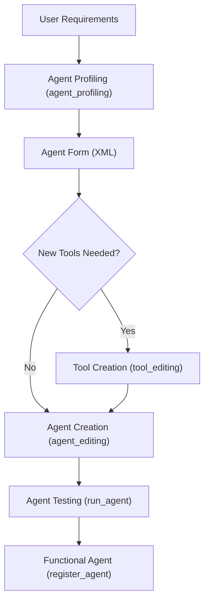
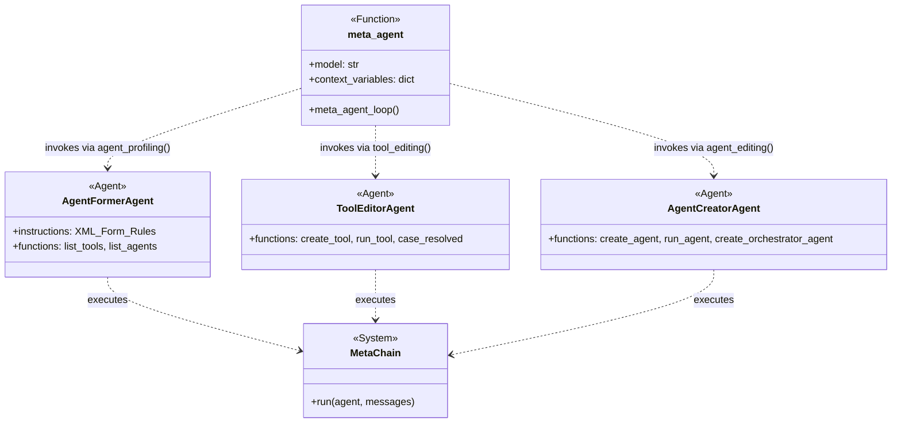
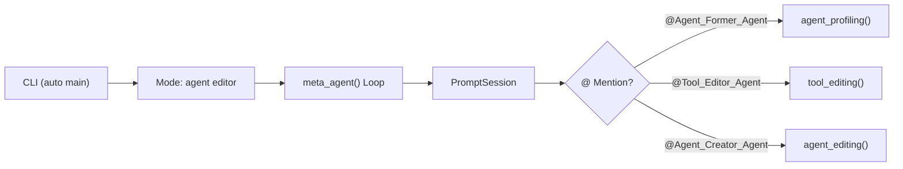

<!-- source: DeepWiki mcp.deepwiki.com · repo HKUDS/AutoAgent · page 3.2 Agent Editor · fetched 2026-10-29 -->

# Agent Editor

Relevant source files

The following files were used as context for generating this wiki page:

- [assets/agent_editor/1-requirement.png](assets/agent_editor/1-requirement.png)
- [assets/agent_editor/2-profiling.png](assets/agent_editor/2-profiling.png)
- [autoagent/agents/meta_agent/agent_creator.py](autoagent/agents/meta_agent/agent_creator.py)
- [autoagent/agents/meta_agent/agent_editor.py](autoagent/agents/meta_agent/agent_editor.py)
- [autoagent/agents/meta_agent/agent_former.py](autoagent/agents/meta_agent/agent_former.py)
- [autoagent/cli_utils/metachain_meta_agent.py](autoagent/cli_utils/metachain_meta_agent.py)
- [autoagent/cli_utils/metachain_meta_workflow.py](autoagent/cli_utils/metachain_meta_workflow.py)
- [autoagent/logger.py](autoagent/logger.py)
- [docs/docs/Starter-Projects/starter-projects-nl-to-agent.md](docs/docs/Starter-Projects/starter-projects-nl-to-agent.md)
- [loop_utils/font_page.py](loop_utils/font_page.py)

The Agent Editor is a core component of the AutoAgent framework that enables users to create custom AI agents using only natural language instructions. Unlike the [User Mode (Deep Research)](#3.1) which provides pre-built agents, or the [Workflow Editor](#3.3) which creates multi-agent orchestrations, the Agent Editor allows users to create standalone agents with specialized capabilities without writing any code.

## Agent Editor Process Overview

The Agent Editor follows a conversational, step-by-step pipeline to transform natural language requirements into fully functional AI agents. This pipeline is orchestrated by the `meta_agent` function [autoagent/cli_utils/metachain_meta_agent.py:163-163]().

Sources: [autoagent/cli_utils/metachain_meta_agent.py:24-178]()

## Architecture Components

The Agent Editor integrates several specialized agents and utility functions to transform user requirements into functional code entities.

Sources: [autoagent/cli_utils/metachain_meta_agent.py:163-256](), [autoagent/agents/meta_agent/agent_former.py:11-15](), [autoagent/agents/meta_agent/tool_editor.py:10-10](), [autoagent/agents/meta_agent/agent_creator.py:9-13]()

## Detailed Process Stages

### 1. Requirements Specification
The process begins with the user describing the agent they want to create in natural language. The `meta_agent` loop uses a `PromptSession` [autoagent/cli_utils/metachain_meta_agent.py:176-180]() to gather these requirements.

### 2. Agent Profiling (Agent Former)
The `agent_profiling` function [autoagent/cli_utils/metachain_meta_agent.py:24-47]() uses the `Agent Former Agent` to analyze requirements and generate a structured XML profile.

*   **Key Function**: `agent_profiling(agent_former, client, messages, context_variables, requirements, debug)`
*   **XML Extraction**: Uses `extract_agents_content` [autoagent/cli_utils/metachain_meta_agent.py:16-22]() with regex `r'(<agents>.*?</agents>)'`.
*   **Parsing**: The XML is converted into an `AgentForm` object via `parse_agent_form` [autoagent/cli_utils/metachain_meta_agent.py:13-13]().
*   **Retry Logic**: Implements a 3-attempt retry loop [autoagent/cli_utils/metachain_meta_agent.py:35-46]() if the XML is malformed.

### 3. Tool Creation (Tool Editor)
If the generated `AgentForm` specifies new tools, the `tool_editing` function [autoagent/cli_utils/metachain_meta_agent.py:49-108]() is invoked. It uses the `Tool Editor Agent` to write and test Python tool code.

*   **Testing Requirement**: The system enforces that "ALL tools MUST be tested successfully by running the tools using `run_tool` before you stop" [autoagent/cli_utils/metachain_meta_agent.py:91-91]().
*   **Feedback Mechanism**: Uses `case_resolved` [autoagent/cli_utils/metachain_meta_agent.py:50-57]() and `case_not_resolved` [autoagent/cli_utils/metachain_meta_agent.py:58-65]() to signal task completion to the orchestrator.

### 4. Agent Creation and Assembly (Agent Creator)
The `agent_editing` function [autoagent/cli_utils/metachain_meta_agent.py:110-178]() uses the `Agent Creator Agent` to implement the agent's logic.

*   **Agent Management**: Uses `create_agent` to generate Python files and `read_agent` to verify definitions [autoagent/agents/meta_agent/agent_creator.py:26-27]().
*   **Multi-Agent Support**: If multiple agents are defined, it uses `create_orchestrator_agent` [autoagent/agents/meta_agent/agent_creator.py:30-30]() to manage handoffs.
*   **Validation**: The agent is tested against a real task using the `run_agent` tool [autoagent/cli_utils/metachain_meta_agent.py:118-118]().

## XML Agent Form Schema
The `Agent Former Agent` is instructed to produce a specific XML structure [autoagent/agents/meta_agent/agent_former.py:22-68]():

| Element | Description |
| :--- | :--- |
| `<agents>` | Root element for the system definition. |
| `<system_input>` | Global input description for the agent system. |
| `<system_output>` | Unified response format (Key-Description pair). |
| `<agent>` | Individual agent definition (name, description, instructions). |
| `<tools>` | Categorized as `existing` or `new`. |
| `<global_variables>` | Shared constants accessible via `{key}` syntax in instructions. |

Sources: [autoagent/agents/meta_agent/agent_former.py:22-68]()

## Feedback and Resolution Mechanism
Both tool and agent creation utilize a standardized feedback loop to ensure quality.

| Tool | Implementation | Purpose |
| :--- | :--- | :--- |
| `case_resolved` | [autoagent/cli_utils/metachain_meta_agent.py:114-118]() | Terminates the loop successfully when tests pass. |
| `case_not_resolved` | [autoagent/cli_utils/metachain_meta_agent.py:119-123]() | Terminates with error details after exhausted retries. |
| `MAX_RETRY` | [autoagent/cli_utils/metachain_meta_agent.py:111-111]() | Set to 3 attempts for complex implementation tasks. |

## CLI Integration
The Agent Editor is accessed via the main CLI entry point. When a user selects `agent editor` from the `NOTES` menu [loop_utils/font_page.py:29-34](), the system starts the `meta_agent` loop.

Sources: [autoagent/cli_utils/metachain_meta_agent.py:163-256](), [loop_utils/font_page.py:29-34]()

---

