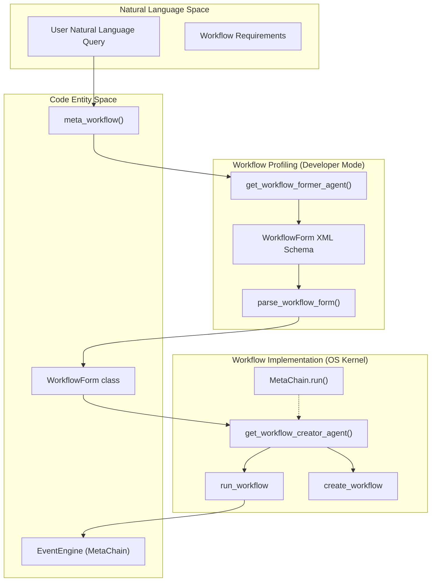
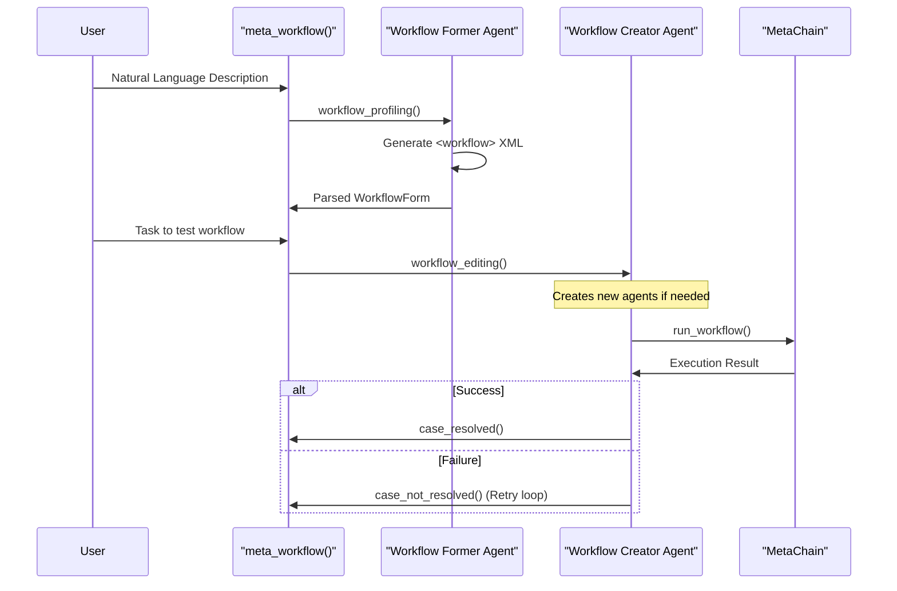
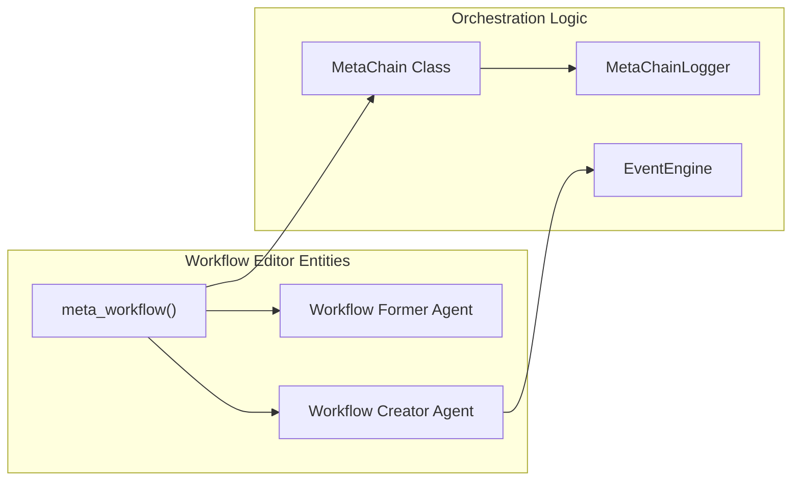

<!-- source: DeepWiki mcp.deepwiki.com · repo HKUDS/AutoAgent · page 3.3 Workflow Editor · fetched 2026-10-29 -->

# Workflow Editor

Relevant source files

The following files were used as context for generating this wiki page:

- [assets/workflow_editor/1-requirement.png](assets/workflow_editor/1-requirement.png)
- [assets/workflow_editor/2-profiling.png](assets/workflow_editor/2-profiling.png)
- [autoagent/agents/meta_agent/workflow_creator.py](autoagent/agents/meta_agent/workflow_creator.py)
- [autoagent/agents/meta_agent/workflow_former.py](autoagent/agents/meta_agent/workflow_former.py)
- [autoagent/cli_utils/metachain_meta_agent.py](autoagent/cli_utils/metachain_meta_agent.py)
- [autoagent/cli_utils/metachain_meta_workflow.py](autoagent/cli_utils/metachain_meta_workflow.py)
- [autoagent/logger.py](autoagent/logger.py)
- [docs/docs/User-Guideline/user-guide-how-to-create-agent.md](docs/docs/User-Guideline/user-guide-how-to-create-agent.md)
- [loop_utils/font_page.py](loop_utils/font_page.py)

The Workflow Editor is a natural language-driven system for creating and managing multi-agent workflows in AutoAgent. It enables users to describe complex multi-agent orchestrations using natural language, which are then automatically transformed into executable event-driven pipelines. This system handles the entire lifecycle from workflow specification through implementation and testing.

For information about creating individual agents without workflows, see [Agent Editor](#3.2). For details about the underlying orchestration system, see [MetaChain System](#4.1).

## System Overview

The Workflow Editor operates as a conversational interface that guides users through workflow creation using specialized meta-agents. The system transforms natural language descriptions into structured **WorkflowForm** XML schemas, then generates the corresponding agent implementations and orchestration logic.

### Workflow Editor Architecture

*Sources: [autoagent/cli_utils/metachain_meta_workflow.py:1-194](), [autoagent/agents/meta_agent/workflow_former.py:13-24](), [autoagent/agents/meta_agent/workflow_creator.py:9-16]()*

## Workflow Creation Pipeline

The workflow creation process follows a structured two-phase approach: **Profiling** (designing the architecture) and **Implementation** (creating agents and testing).

### Process Flow Diagram

*Sources: [autoagent/cli_utils/metachain_meta_workflow.py:14-35](), [autoagent/cli_utils/metachain_meta_workflow.py:37-111]()*

### Phase 1: Workflow Profiling (Workflow Former)

The `workflow_profiling` function utilizes the `Workflow Former Agent` to translate requirements into a structured XML format.

*   **Implementation**: `get_workflow_former_agent(model)` creates an agent specialized in analyzing user requests to generate `WorkflowForm` schemas [autoagent/agents/meta_agent/workflow_former.py:13-24]().
*   **Validation**: The output is parsed using `parse_workflow_form(output_xml_form)`. If parsing fails, the system retries up to 3 times, passing the error back to the LLM for correction [autoagent/cli_utils/metachain_meta_workflow.py:22-35]().

### Phase 2: Workflow Implementation (Workflow Creator)

The `workflow_editing` function uses the `Workflow Creator Agent` to materialize the profiled design.

*   **Agent Creation**: If the form specifies `category="new"` for any agent, the creator uses `create_agent` to build them first [autoagent/cli_utils/metachain_meta_workflow.py:42-53](), [autoagent/agents/meta_agent/workflow_creator.py:46-51]().
*   **Workflow Assembly**: The agent calls `create_workflow` to register the multi-agent orchestration [autoagent/agents/meta_agent/workflow_creator.py:52-56]().
*   **Verification**: The creator MUST run the workflow using the `run_workflow` tool to ensure it completes the user's task successfully before finishing [autoagent/cli_utils/metachain_meta_workflow.py:72-80]().

## WorkflowForm XML Schema

The `Workflow Former Agent` is instructed to produce a specific XML structure that defines the multi-agent logic [autoagent/agents/meta_agent/workflow_former.py:23-127]().

| Element | Description |
| :--- | :--- |
| `<name>` | Unique identifier for the workflow. |
| `<system_input>` | Defines the keys and descriptions for data entering the workflow. |
| `<agents>` | List of agents involved, specifying if they are `existing` or `new`. |
| `<global_variables>` | (Optional) Shared constants accessible by all agents in the flow. |
| `<events>` | The core execution logic, defining how agents pass data. |

### Event Actions
Within the `<events>` block, each `<output>` must specify an `<action>` type [autoagent/agents/meta_agent/workflow_former.py:74-77]():
*   **RESULT**: Success; the workflow continues to the next listener.
*   **ABORT**: Failure; the workflow stops.
*   **GOTO**: Conditional loop; jumps to a specific event name.

*Sources: [autoagent/agents/meta_agent/workflow_former.py:23-156]()*

## Implementation Details

### Case Resolution System
The implementation phase uses a feedback loop governed by two specialized tools injected into the `Workflow Creator Agent` [autoagent/cli_utils/metachain_meta_workflow.py:55-65]():
*   `case_resolved(task_response, context_variables)`: Used only after the workflow is created and successfully tested.
*   `case_not_resolved(task_response, context_variables)`: Used if the agent encounters irresistible errors after multiple attempts.

### Multi-Agent Orchestration Creation
The `Workflow Creator Agent` has access to a suite of meta-tools to manipulate the system [autoagent/agents/meta_agent/workflow_creator.py:71-79]():
*   `create_agent`, `read_agent`, `list_agents`
*   `create_workflow`, `run_workflow`, `list_workflows`
*   `execute_command` (for system dependencies)

### Error Handling and Retry Logic
Both profiling and implementation phases implement a `MAX_RETRY = 3` loop. In the implementation phase, if the LLM output does not start with "Case resolved", the system appends the failure content as `FEEDBACK` and triggers another iteration [autoagent/cli_utils/metachain_meta_workflow.py:85-111]().

*Sources: [autoagent/cli_utils/metachain_meta_workflow.py:1-111](), [autoagent/agents/meta_agent/workflow_creator.py:1-80]()*

## Integration with MetaChain

The Workflow Editor is built on top of the `MetaChain` class, which handles the message orchestration and logging [autoagent/cli_utils/metachain_meta_workflow.py:134-136]().

*Sources: [autoagent/cli_utils/metachain_meta_workflow.py:116-136](), [autoagent/logger.py:9-138]()*

---

