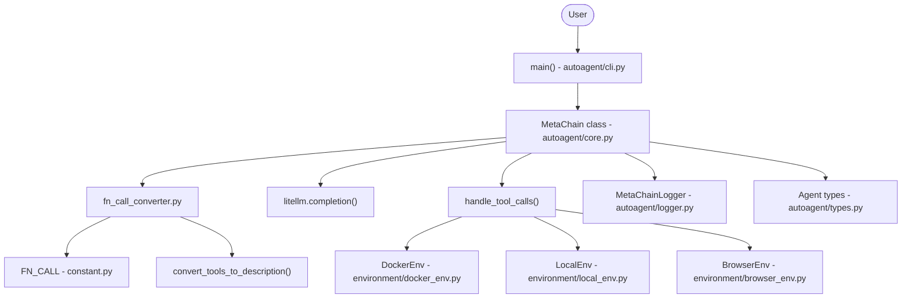
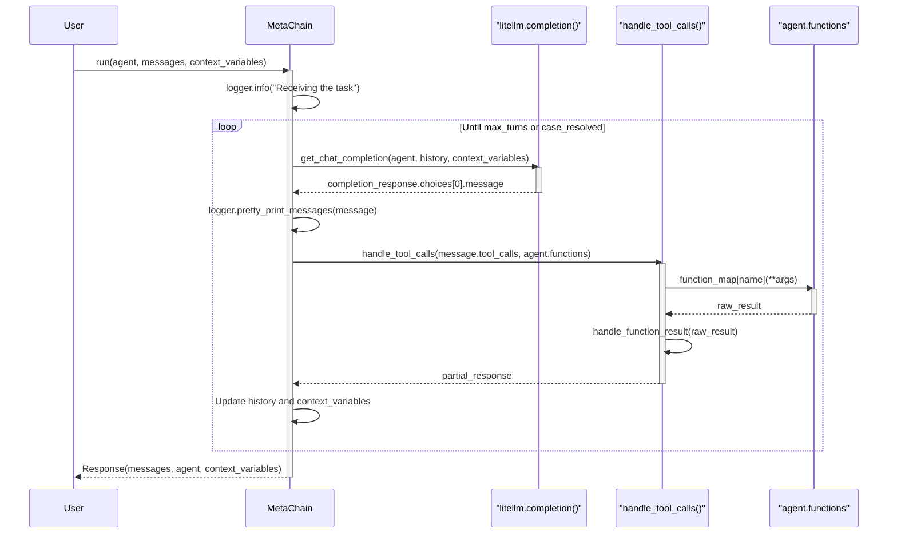
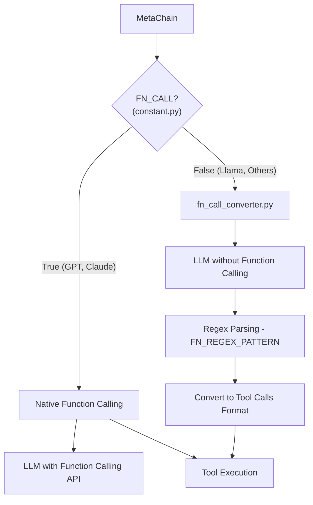
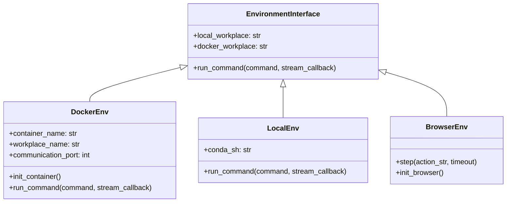

<!-- source: DeepWiki mcp.deepwiki.com · repo HKUDS/AutoAgent · page 4 Core Components · fetched 2026-10-29 -->

# Core Components

Relevant source files

The following files were used as context for generating this wiki page:

- [autoagent/__init__.py](autoagent/__init__.py)
- [autoagent/core.py](autoagent/core.py)
- [autoagent/fn_call_converter.py](autoagent/fn_call_converter.py)

This page provides a technical overview of the core components that power the AutoAgent framework. These components form the backbone of the system, enabling LLM-powered agents to operate across different environments without requiring users to write code.

For information about using the framework's interfaces, see [Command Line Interface](#3). For details about extending the system, see [Extending AutoAgent](#6.3).

## System Architecture

The AutoAgent system is built around several interconnected components that work together to enable agent execution:

Sources: [autoagent/core.py:96-106](), [autoagent/fn_call_converter.py:34-58](), [autoagent/logger.py:21-56]()

## MetaChain Orchestration System

The `MetaChain` class [autoagent/core.py:96-673]() is the central orchestration component that manages agent execution flow. It handles interactions between language models, function calls, and tool execution.

### Architecture and Execution Flow

For details, see [MetaChain System](#4.1).

Sources: [autoagent/core.py:396-493](), [autoagent/core.py:230-302]()

### Key Methods

The `MetaChain` class [autoagent/core.py:96-673]() implements several critical methods:

- **`get_chat_completion`** [autoagent/core.py:115-210](): Gets completions from language models with function call support.
- **`handle_tool_calls`** [autoagent/core.py:230-302](): Executes tool calls and processes results.
- **`handle_function_result`** [autoagent/core.py:212-228](): Processes raw function results into `Result` objects.
- **`run`** [autoagent/core.py:396-493](): Main synchronous execution method.
- **`run_async`** [autoagent/core.py:589-673](): Asynchronous execution method.

## Function Call System

The Function Call System enables AutoAgent to work with various language models through a conversion mechanism that normalizes function calling capabilities. It allows models that do not natively support function calling (e.g., Llama 3) to be used by injecting specialized XML-based instructions into the system prompt.

### Architecture

For details, see [Function Call System](#4.2).

Sources: [autoagent/core.py:148-208](), [autoagent/fn_call_converter.py:35-58](), [autoagent/fn_call_converter.py:575-585]()

### Function Call Converter

The converter [autoagent/fn_call_converter.py]() handles:

1. **Tool Description Generation** [autoagent/fn_call_converter.py:281-317](): Converts tool JSON schemas to text descriptions.
2. **Message Format Conversion** [autoagent/fn_call_converter.py:320-486](): Adds tool descriptions and `SYSTEM_PROMPT_SUFFIX_TEMPLATE` to prompts.
3. **Response Parsing** [autoagent/fn_call_converter.py:575-765](): Extracts function calls from text responses using regex patterns like `FN_REGEX_PATTERN` and `FN_PARAM_REGEX_PATTERN`.

## Environment System

The Environment System provides interfaces for executing code and interacting with external systems, enabling agents to operate in different contexts.

### Environment Hierarchy

For details, see [Environment System](#4.3).

Sources: [autoagent/environment/docker_env.py:15-26](), [autoagent/environment/local_env.py:10-20](), [autoagent/environment/browser_env.py:387-419]()

## Tool System

The Tool System defines the capabilities available to agents, allowing them to perform actions in their environments. Tools are registered using a decorator pattern and passed to agents via the `functions` list in the `Agent` definition [autoagent/types.py:41]().

### Tool Result Handling

The `handle_function_result` method [autoagent/core.py:212-228]() processes raw results from tools:

- Passes through results that are already `Result` objects [autoagent/types.py:41]().
- Handles agent switching if the result is an `Agent`.
- Converts other results to strings.

For details, see [Tool System](#4.4).

Sources: [autoagent/core.py:212-228](), [autoagent/types.py:41]()

## Configuration and Utilities

The framework includes a centralized configuration layer and a suite of utility functions for logging, UI rendering, and message formatting.

- **Logging**: `MetaChainLogger` [autoagent/logger.py:21-56]() provides centralized logging via `LoggerManager`.
- **Formatting**: `pretty_print_messages` [autoagent/util.py:214-260]() handles the terminal display of agent/user interactions.
- **Tool Conversion**: `function_to_json` [autoagent/util.py:146-193]() converts Python functions into OpenAI-compatible tool schemas.

For details, see [Configuration and Utilities](#4.5).

Sources: [autoagent/logger.py:21-56](), [autoagent/util.py:146-193](), [autoagent/util.py:214-260]()

---

