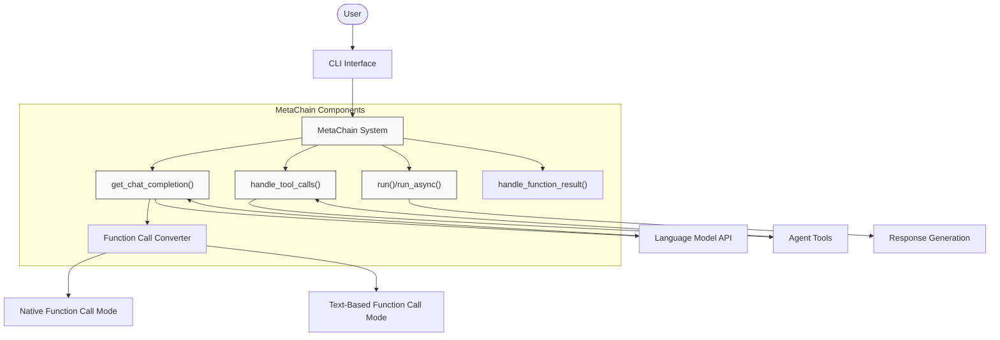
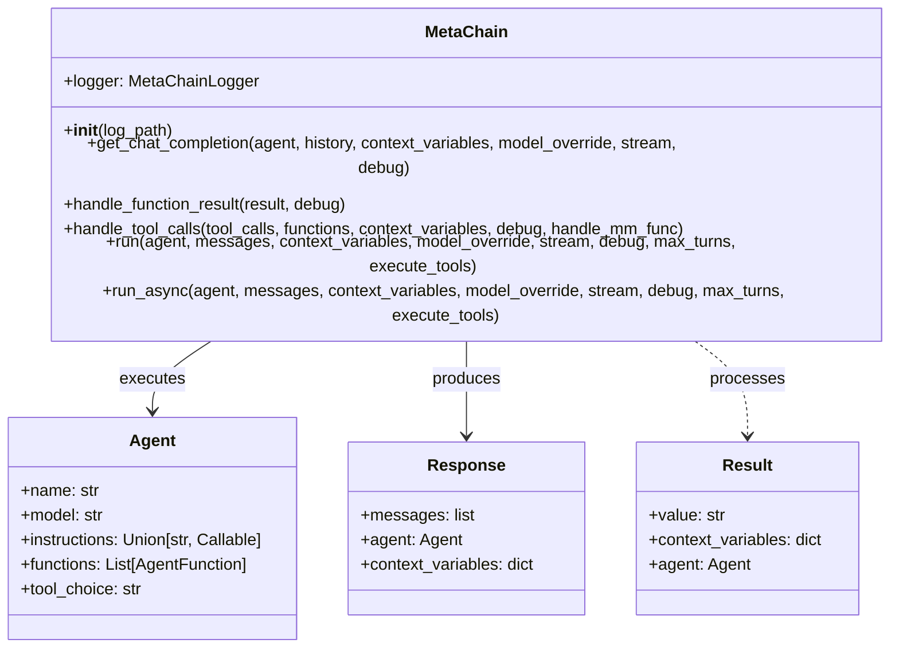
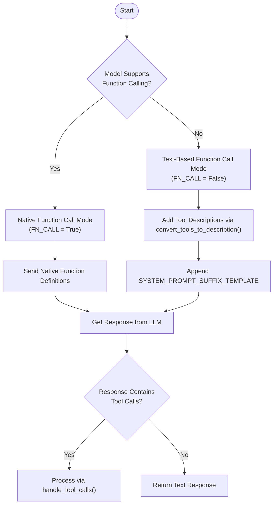
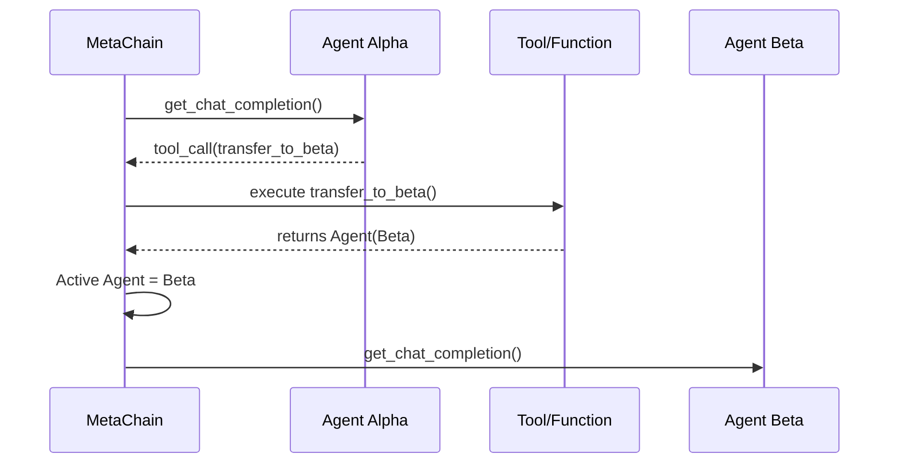
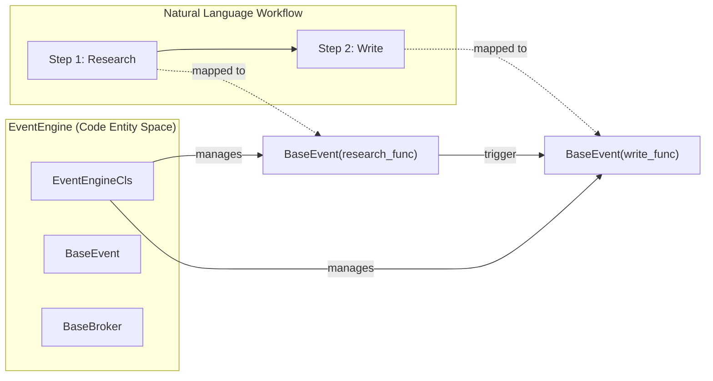

<!-- source: DeepWiki mcp.deepwiki.com · repo HKUDS/AutoAgent · page 4.1 MetaChain System · fetched 2026-10-29 -->

# MetaChain System

Relevant source files

The following files were used as context for generating this wiki page:

- [autoagent/core.py](autoagent/core.py)
- [autoagent/flow/broker.py](autoagent/flow/broker.py)
- [autoagent/flow/core.py](autoagent/flow/core.py)
- [autoagent/flow/dynamic.py](autoagent/flow/dynamic.py)
- [autoagent/flow/types.py](autoagent/flow/types.py)
- [autoagent/fn_call_converter.py](autoagent/fn_call_converter.py)

MetaChain is the central orchestration layer in the AutoAgent framework that manages interactions between agents and language models (LLMs). It handles function calls, maintains conversation state, and provides a unified interface for agent execution regardless of the underlying LLM's capabilities. This page documents the MetaChain system's architecture, components, and execution flow.

For information about the Function Call System that works closely with MetaChain, see [Function Call System](#4.2).

## Overview

The MetaChain system serves as the execution engine for all agents in AutoAgent. It processes user queries, sends them to LLMs, handles tool calls, and manages the conversation loop until the agent completes its task or reaches a maximum number of turns.

Key responsibilities include:
- Orchestrating the conversation between users and agents.
- Managing function/tool calls and their results via `handle_tool_calls` [autoagent/core.py:230-302]().
- Supporting different LLM providers with varying capabilities via `litellm` [autoagent/core.py:19]().
- Handling streaming responses through `run_and_stream` [autoagent/core.py:304-394]().
- Managing `context_variables` throughout agent execution [autoagent/core.py:124-129]().
- Supporting both synchronous and asynchronous execution modes [autoagent/core.py:396-673]().

Sources: [autoagent/core.py:96-107](), [autoagent/core.py:396-493]()

## Architecture

The `MetaChain` class is the main component of the system. It works closely with the `fn_call_converter.py` logic to support models with and without native function calling capabilities.

Sources: [autoagent/core.py:96-673](), [autoagent/types.py:41]()

## Core Components

### MetaChain Class

The `MetaChain` class is the primary interface for agent execution.

Key methods:
- **`run()`**: Main method to execute an agent synchronously [autoagent/core.py:396-493]().
- **`run_async()`**: Asynchronous version of `run()` [autoagent/core.py:589-673]().
- **`get_chat_completion()`**: Gets completion from LLM with appropriate formatting [autoagent/core.py:115-210]().
- **`handle_tool_calls()`**: Processes tool calls returned by the LLM, handling agent handoffs if a tool returns an `Agent` object [autoagent/core.py:230-302]().
- **`handle_function_result()`**: Handles the result of a function execution, specifically checking for `Result` objects or `Agent` handoffs [autoagent/core.py:212-228]().

Sources: [autoagent/core.py:96-673]()

### Function Call Handling

MetaChain supports two modes of function calling:
1. **Native Function Call Mode (`FN_CALL=True`)**: Uses `litellm.supports_function_calling` to verify compatibility [autoagent/core.py:148-150]().
2. **Non-Native Function Call Mode (`FN_CALL=False`)**: Injects tool descriptions into the system prompt and parses XML-like tags from the response [autoagent/core.py:174-208]().

Sources: [autoagent/core.py:148-208](), [autoagent/fn_call_converter.py:35-58](), [autoagent/fn_call_converter.py:281-317]()

### Execution Loop and Agent Handoffs

The execution loop continues until `max_turns` is reached or the agent has no further tool calls. A unique feature is the **Agent Handoff**: if a tool returns an `Agent` object, MetaChain switches the active agent for the subsequent turns [autoagent/core.py:261-266]().

Sources: [autoagent/core.py:212-228](), [autoagent/core.py:444-471]()

## EventEngine Flow System

Beyond the linear MetaChain loop, AutoAgent includes an `EventEngine` for complex, event-driven workflows. This system uses a broker to manage event tasks and transitions.

- **`EventEngineCls`**: Manages the registry of events and their execution [autoagent/flow/core.py:17-152]().
- **`BaseEvent`**: Represents a single node in a workflow, wrapping a coroutine [autoagent/flow/types.py:84-113]().
- **`listen_group`**: A decorator used to define dependencies between events [autoagent/flow/core.py:41-78]().
- **`goto_events`**: Allows dynamic branching in the flow [autoagent/flow/dynamic.py:9-14]().

Sources: [autoagent/flow/core.py:17-152](), [autoagent/flow/types.py:84-113](), [autoagent/flow/broker.py:6-11]()

## Error Handling and Retry Logic

MetaChain utilizes the `tenacity` library for robust error recovery.

- **`should_retry_error`**: A predicate function that identifies retriable exceptions such as `APIError`, `RemoteProtocolError`, and timeouts [autoagent/core.py:38-54]().
- **Retry Strategy**: Implements exponential backoff with a multiplier of 1, ranging from 4 to 60 seconds [autoagent/core.py:25-28]().

Sources: [autoagent/core.py:24-54]()

## Context Variables and Results

- **`context_variables`**: A dictionary passed to both instructions and functions, allowing agents to maintain state [autoagent/core.py:124-129]().
- **`Result`**: A specialized return type for functions that allows updating `context_variables` or providing multi-modal output (images) alongside the return value [autoagent/types.py:41]().

Sources: [autoagent/core.py:212-228](), [autoagent/types.py:41]()

---

