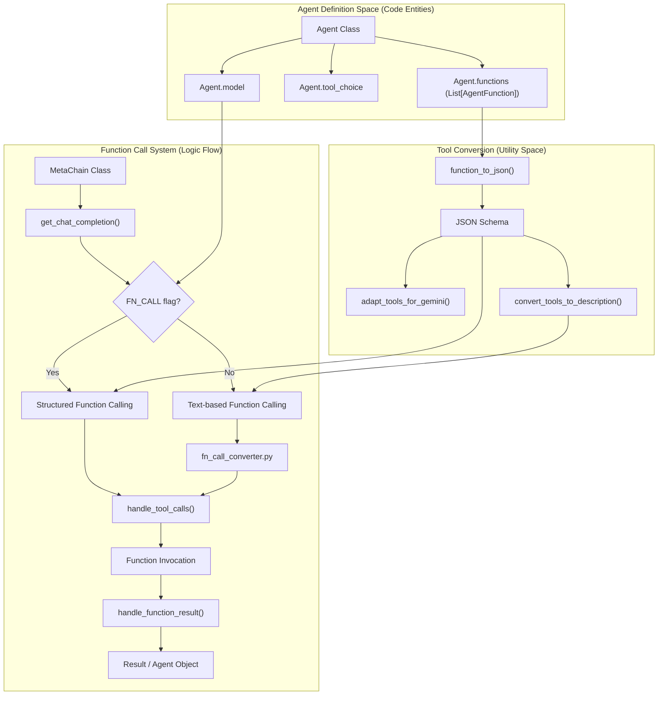
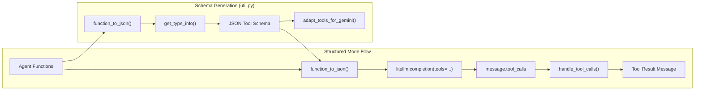
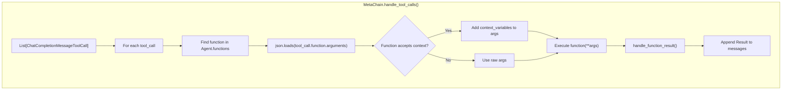

<!-- source: DeepWiki mcp.deepwiki.com · repo HKUDS/AutoAgent · page 4.2 Function Call System · fetched 2026-10-29 -->

# Function Call System

Relevant source files

The following files were used as context for generating this wiki page:

- [autoagent/cli_utils/file_select.py](autoagent/cli_utils/file_select.py)
- [autoagent/core.py](autoagent/core.py)
- [autoagent/fn_call_converter.py](autoagent/fn_call_converter.py)
- [autoagent/util.py](autoagent/util.py)
- [constant.py](constant.py)

The Function Call System enables agents to execute tools and functions through structured interactions with Language Models (LLMs). This system provides a unified interface for both function calling-capable models and models that require text-based function invocation, automatically handling conversion between these formats based on model capabilities.

For information about the broader agent execution framework, see [MetaChain System](#4.1). For details on specific execution environments, see [Environment System](#4.3).

## System Architecture

The Function Call System operates through several key components that work together to provide seamless tool execution across different LLM providers and capabilities.

**Function Call Architecture**

Sources: [autoagent/core.py:96-211](), [autoagent/core.py:230-302](), [autoagent/util.py:281-370]()

## Function Calling Modes

The system supports two distinct modes of function calling, automatically selected based on model capabilities and configuration defined in `constant.py`.

### Structured Function Calling Mode

When `FN_CALL=True` and the model supports function calling (verified via `litellm.supports_function_calling`), the system uses structured tool calls with JSON schemas.

**Structured Function Calling Flow**

Sources: [autoagent/core.py:148-173](), [autoagent/util.py:281-370](), [autoagent/core.py:58-94]()

### Text-based Function Calling Mode (XML-based)

When `FN_CALL=False` or for models in `NOT_SUPPORT_FN_CALL`, the system uses an XML-like syntax for function invocation. This is managed by `fn_call_converter.py`.

*   **Syntax**: Functions are wrapped in `<function=name>` tags, and parameters use `<parameter=name>value</parameter>` tags.
*   **Prompting**: The `SYSTEM_PROMPT_SUFFIX_TEMPLATE` is appended to the system instructions to teach the model this syntax.
*   **Parsing**: Uses regex patterns like `FN_REGEX_PATTERN` and `FN_PARAM_REGEX_PATTERN` to extract calls from raw text.

Sources: [autoagent/core.py:174-209](), [autoagent/fn_call_converter.py:35-58](), [autoagent/fn_call_converter.py:575-765]()

## Tool Definition and Conversion

The system converts Python functions into standardized tool definitions that can be used by both function calling modes.

### Function to JSON Schema Generation

The `function_to_json` utility in `autoagent/util.py` inspects Python functions to generate OpenAI-compatible schemas. It uses `get_type_info` to recursively map Python types to JSON types.

| Python Type | JSON Schema Type | Source Logic |
|-------------|------------------|--------------|
| `str` | `"string"` | [autoagent/util.py:178-179]() |
| `int` | `"integer"` | [autoagent/util.py:178-179]() |
| `List[T]` | `"array"` | [autoagent/util.py:187-192]() |
| `Dict[str, T]` | `"object"` | [autoagent/util.py:194-209]() |
| `BaseModel` (Pydantic) | `"object"` | [autoagent/util.py:221-229]() |
| `dataclass` | `"object"` | [autoagent/util.py:231-240]() |

Sources: [autoagent/util.py:176-278](), [autoagent/util.py:281-370]()

### Model-Specific Adaptations

Different LLM providers have varying requirements for tool definitions:
*   **Gemini**: `adapt_tools_for_gemini` adds "dummy" properties to empty object parameters to satisfy Gemini's schema requirements [autoagent/core.py:58-94]().
*   **OpenAI**: Supports `parallel_tool_calls` which is enabled if the model name starts with "gpt" [autoagent/core.py:171-172]().
*   **Sender Field**: Models in `NOT_SUPPORT_SENDER` (e.g., Mistral, Groq) have the `sender` field stripped from messages [autoagent/core.py:159-169]().

Sources: [autoagent/core.py:58-94](), [autoagent/core.py:158-172](), [constant.py:61-65]()

## Function Execution and Result Handling

The system executes functions through a standardized pipeline that supports context variables and agent switching.

### Tool Call Execution Pipeline

The `handle_tool_calls` method in `MetaChain` orchestrates the execution of one or more tool calls returned by the LLM.

Sources: [autoagent/core.py:230-302](), [autoagent/core.py:212-228]()

### Context Variables and Agent Switching

Functions can access and modify `context_variables` and trigger agent switches by returning a `Result` object.
*   **Context Injection**: If a function signature includes `context_variables`, `MetaChain` automatically injects the current context [autoagent/core.py:264-265]().
*   **Result Processing**: `handle_function_result` extracts the `value`, updated `context_variables`, and any new `agent` for handoff [autoagent/core.py:212-228]().

Sources: [autoagent/core.py:212-228](), [autoagent/core.py:264-265]()

## LLM Compatibility and Conversion

The `fn_call_converter.py` provides the logic to bridge "Natural Language Space" (where LLMs operate) and "Code Entity Space" (where functions are defined).

### In-Context Learning (ICL)
For non-function calling models, the system injects `IN_CONTEXT_LEARNING_EXAMPLE_PREFIX`. This provides a multi-turn example of a `USER` requesting a task and an `ASSISTANT` using `<function>` and `<parameter>` tags to solve it, including error handling and bash execution examples.

Sources: [autoagent/fn_call_converter.py:63-240]()

### Format Conversion Functions
*   **`convert_tools_to_description`**: Generates a text-based documentation string of all available tools for the system prompt [autoagent/fn_call_converter.py:242-317]().
*   **`convert_non_fncall_messages_to_fncall_messages`**: Uses regex to transform LLM text output containing XML tags into structured `ChatCompletionMessageToolCall` objects [autoagent/fn_call_converter.py:575-765]().
*   **`interleave_user_into_messages`**: For models like `o1-mini` that require a user message between assistant turns, this function injects placeholder user messages [autoagent/fn_call_converter.py:530-572]().

Sources: [autoagent/fn_call_converter.py:242-317](), [autoagent/fn_call_converter.py:575-765](), [autoagent/fn_call_converter.py:530-572]()

## Configuration and Model Support

The system behavior is governed by flags in `constant.py` which are derived from the `COMPLETION_MODEL` environment variable.

| Model Category | `FN_CALL` | `NON_FN_CALL` | `ADD_USER` | Source |
| :--- | :--- | :--- | :--- | :--- |
| **Standard (GPT-4, Claude 3.5)** | `True` | `False` | `False` | [constant.py:74-85]() |
| **DeepSeek Chat** | `False` | `False` | `False` | [constant.py:65, 74-79]() |
| **Reasoning (o1-mini, DeepSeek R1)** | `False` | `True` | `True` | [constant.py:62-64, 81-85]() |

Sources: [constant.py:61-91]()

---

