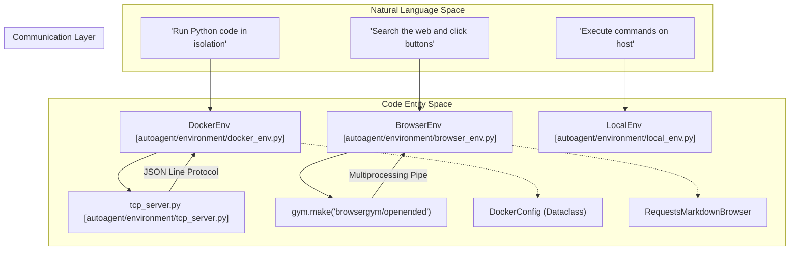
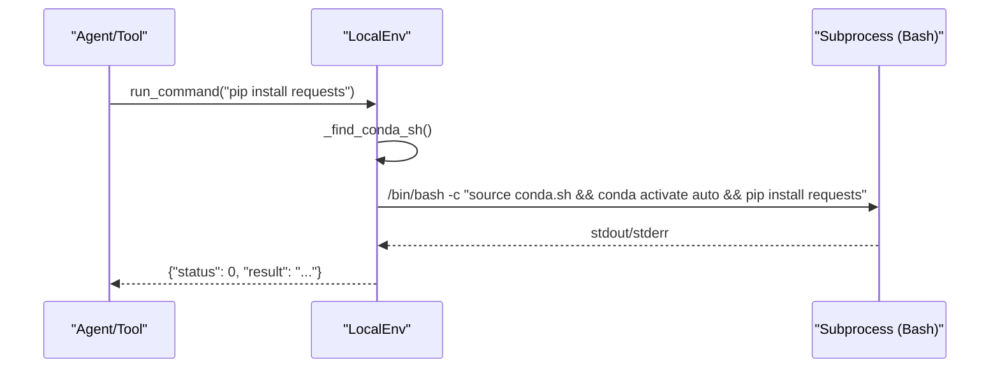

<!-- source: DeepWiki mcp.deepwiki.com · repo HKUDS/AutoAgent · page 4.3 Environment System · fetched 2026-10-29 -->

# Environment System

Relevant source files

The following files were used as context for generating this wiki page:

- [assets/AutoAgent_logo.svg](assets/AutoAgent_logo.svg)
- [assets/cover.png](assets/cover.png)
- [autoagent/environment/__init__.py](autoagent/environment/__init__.py)
- [autoagent/environment/docker_env.py](autoagent/environment/docker_env.py)
- [autoagent/environment/shutdown_listener.py](autoagent/environment/shutdown_listener.py)
- [autoagent/environment/tcp_server.py](autoagent/environment/tcp_server.py)
- [autoagent/environment/tenacity_stop.py](autoagent/environment/tenacity_stop.py)
- [autoagent/environment/utils.py](autoagent/environment/utils.py)

The Environment System in AutoAgent provides the execution contexts where agents operate. It enables agents to interact with different computing environments such as Docker containers, local machines, and web browsers. This system is a foundational component that allows agents to execute code, browse the web, and interact with files in a controlled and isolated manner.

## Overview

The Environment System defines interfaces for three main types of environments:

1.  **Docker Environment** - Provides isolated containerized execution for running code securely.
2.  **Local Environment** - Enables execution directly on the local machine for simpler setup.
3.  **Browser Environment** - Facilitates web browsing and interaction with web pages via `browsergym`.

These environments provide a consistent interface for agents to interact with their execution context, regardless of the underlying implementation.

### System Mapping: Natural Language to Code Entities

The following diagram maps the conceptual environment components to their respective code implementations and communication protocols.

**Sources:** [autoagent/environment/docker_env.py:28-42](), [autoagent/environment/browser_env.py:337-345](), [autoagent/environment/tcp_server.py:16-20](), [autoagent/environment/markdown_browser.py:4-4]()

## Environment Interface

While the environment classes don't share a formal base class, they implement a common interface through duck typing. This enables agents to work with any environment type interchangeably.

| Method | DockerEnv | LocalEnv | BrowserEnv |
| :--- | :--- | :--- | :--- |
| **Command execution** | `run_command()` | `run_command()` | `step()` |
| **Initialization** | `init_container()` | `__init__()` | `init_browser()` |
| **Cleanup** | `stop_container()` | N/A | `close()` |
| **Path translation** | `_convert_local_to_docker()` | `_convert_local_to_docker()` | `_local_to_docker()` |
| **Health check** | `wait_for_container_ready()` | N/A | `check_alive()` |

**Sources:** [autoagent/environment/docker_env.py:144-150](), [autoagent/environment/local_env.py:74-80](), [autoagent/environment/browser_env.py:545-550]()

## Docker Environment

The Docker Environment provides an isolated and reproducible execution context. It uses a `DockerConfig` object to manage container settings like `communication_port`, `conda_path`, and `workplace_name`. 

A unique feature is the `tcp_server.py`, which is copied into the container to act as a bridge, receiving commands via sockets and returning JSON-formatted output.

For details, see [Docker Environment](#4.3.1).

**Sources:** [autoagent/environment/docker_env.py:16-26](), [autoagent/environment/docker_env.py:48-50](), [autoagent/environment/tcp_server.py:41-55]()

## Browser Environment

The Browser Environment enables agents to interact with web browsers using the `browsergym` library. It employs a multi-process architecture where the browser runs in a separate process to maintain stability. It includes specialized tools for handling Cloudflare challenges (`_checkMeetChallenge`) and converting web pages to readable formats using a markdown browser.

For details, see [Browser Environment](#4.3.2).

**Sources:** [autoagent/environment/browser_env.py:392-410](), [autoagent/environment/browser_env.py:266-270](), [autoagent/environment/__init__.py:3-4]()

## Local Environment

The Local Environment (`LocalEnv`) provides a simpler execution context that runs commands directly on the host machine. It is primarily used when Docker isolation is not required or available. It handles `conda` environment activation by locating `conda.sh` and prepending activation commands to the agent's requests.

**Sources:** [autoagent/environment/local_env.py:8-20](), [autoagent/environment/local_env.py:74-91]()

## Environment Utilities

The system includes shared utilities to manage lifecycle and setup:
*   **`setup_metachain`**: A utility to ensure the `autoagent` package is installed within a `DockerEnv` by running `pip install -e .` inside the container.
*   **`shutdown_listener`**: Monitors for system exit signals (e.g., SIGINT) to ensure environments are cleaned up gracefully.
*   **`with_env`**: A decorator used to inject the active environment instance into tool functions at runtime.

**Sources:** [autoagent/environment/utils.py:4-16](), [autoagent/environment/shutdown_listener.py:16-28](), [autoagent/environment/docker_env.py:201-210]()

---

