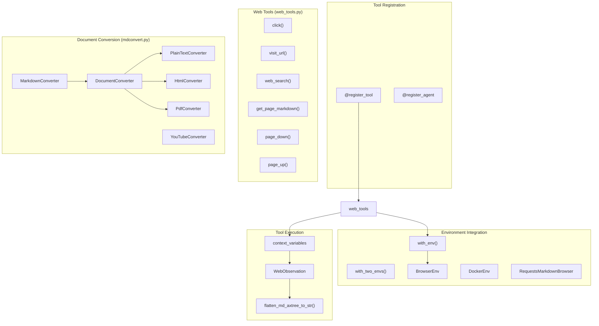
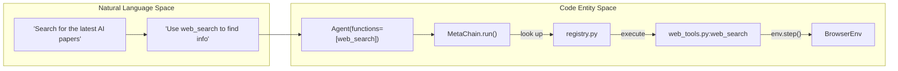
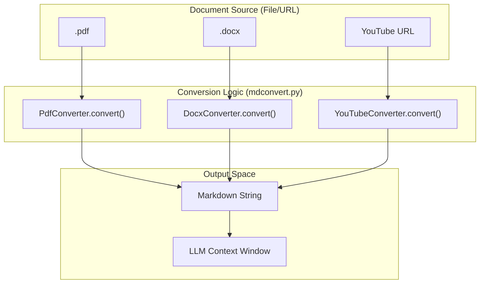

<!-- source: DeepWiki mcp.deepwiki.com · repo HKUDS/AutoAgent · page 4.4 Tool System · fetched 2026-10-29 -->

# Tool System

Relevant source files

The following files were used as context for generating this wiki page:

- [autoagent/agents/system_agent/filesurfer_agent.py](autoagent/agents/system_agent/filesurfer_agent.py)
- [autoagent/agents/system_agent/websurfer_agent.py](autoagent/agents/system_agent/websurfer_agent.py)
- [autoagent/environment/markdown_browser/markdown_search.py](autoagent/environment/markdown_browser/markdown_search.py)
- [autoagent/environment/markdown_browser/requests_markdown_browser.py](autoagent/environment/markdown_browser/requests_markdown_browser.py)
- [autoagent/environment/mdconvert.py](autoagent/environment/mdconvert.py)
- [autoagent/tools/md_obs.py](autoagent/tools/md_obs.py)
- [autoagent/tools/web_tools.py](autoagent/tools/web_tools.py)

The Tool System provides a comprehensive framework for integrating external capabilities into AutoAgent's execution environments. It encompasses web automation tools, document conversion utilities, and the infrastructure for registering and deploying tools across different execution contexts.

For information about the execution environments that host these tools, see [Environment System](#4.3). For details on function calling and tool invocation mechanisms, see [Function Call System](#4.2).

## Architecture Overview

The Tool System operates as a modular framework where tools are registered through decorators and deployed into execution environments with appropriate context injection.

### Tool System Component Architecture

Sources: [autoagent/tools/web_tools.py:1-42](), [autoagent/environment/mdconvert.py:58-146](), [autoagent/tools/md_obs.py:3-22]()

### Tool Lifecycle and Context Flow

Sources: [autoagent/tools/web_tools.py:29-57](), [autoagent/agents/system_agent/websurfer_agent.py:24-33](), [autoagent/registry.py]()

## Web Tools

Web tools provide browser automation capabilities through the `BrowserEnv` environment, enabling navigation, interaction, and content extraction from web pages.

### Core Web Tool Functions

The web tools are implemented in [autoagent/tools/web_tools.py]() and follow a consistent pattern of environment injection and result wrapping:

| Tool | Function | Purpose |
|------|----------|---------|
| `click` | `click(env, bid, button, ...)` | Click on elements by browser ID [autoagent/tools/web_tools.py:157-170]() |
| `visit_url` | `visit_url(env, url)` | Navigate to URLs [autoagent/tools/web_tools.py:239-254]() |
| `web_search` | `web_search(env, query)` | Perform Bing searches [autoagent/tools/web_tools.py:382-398]() |
| `input_text` | `input_text(env, bid, text, ...)` | Input text into form fields [autoagent/tools/web_tools.py:211-230]() |
| `page_down` | `page_down(env)` | Scroll viewport down [autoagent/tools/web_tools.py:256-271]() |
| `get_page_markdown` | `get_page_markdown(env)` | Convert current page to markdown [autoagent/tools/web_tools.py:423-437]() |

Sources: [autoagent/tools/web_tools.py:156-462]()

### Web Observation and AXTree Flattening

Web tools follow a standardized execution pattern implemented through the `WebObservation` dataclass. A key component is `flatten_md_axtree_to_str`, which converts the browser's accessibility tree into a compact string representation for LLM consumption.

- **`WebObservation`**: Captures URL, content, screenshot (optional), and accessibility tree [autoagent/tools/web_tools.py:58-72]().
- **`flatten_md_axtree_to_str`**: Recursively traverses the AXTree, filtering out redundant roles (e.g., "generic") and properties to save tokens while retaining clickable `browsergym_id` (bid) markers [autoagent/tools/md_obs.py:3-150]().

Sources: [autoagent/tools/web_tools.py:73-95](), [autoagent/tools/md_obs.py:29-147]()

## Document Conversion Tools

The document conversion system provides comprehensive capabilities for converting various document formats to markdown, enabling LLM-friendly content processing.

### MarkdownConverter Architecture

The `MarkdownConverter` class in [autoagent/environment/mdconvert.py:810-1039]() serves as the primary pipeline. It uses a registry of `DocumentConverter` subclasses to handle different file types.

| Converter | Implementation Detail |
|-----------|-----------------------|
| `PlainTextConverter` | Reads raw text files with UTF-8 encoding [autoagent/environment/mdconvert.py:148-167](). |
| `HtmlConverter` | Uses `BeautifulSoup` to strip scripts/styles and `markdownify` for conversion [autoagent/environment/mdconvert.py:170-207](). |
| `PdfConverter` | Leverages `pdfminer.high_level.extract_text` [autoagent/environment/mdconvert.py:443-457](). |
| `YouTubeConverter` | Uses `YouTubeTranscriptApi` to fetch subtitles [autoagent/environment/mdconvert.py:343-405](). |
| `DocxConverter` | Converts Word documents using `mammoth` [autoagent/environment/mdconvert.py:460-482](). |

Sources: [autoagent/environment/mdconvert.py:141-550]()

### Markdown Pipeline to Natural Language

Sources: [autoagent/environment/mdconvert.py:810-1039](), [autoagent/environment/mdconvert.py:133-139]()

## Specialized Toolsets

### File Surfer Tools
The `File Surfer Agent` uses a specialized set of tools for local file interaction, including `open_local_file`, `page_up_markdown`, and `visual_question_answering` [autoagent/agents/system_agent/filesurfer_agent.py:33-42](). These tools are bound to a `RequestsMarkdownBrowser` which provides a lightweight, non-JS browser for local HTML and document previewing [autoagent/environment/markdown_browser/requests_markdown_browser.py:25-91]().

### Web Search Integration
The `BingMarkdownSearch` class provides the backend for `web_search`. It attempts to use a `BING_API_KEY` if available, otherwise it falls back to scraping the Bing results page directly [autoagent/environment/markdown_browser/markdown_search.py:31-70]().

## Tool Registration and Integration

### Registration Decorators
Tools are registered using the `@register_tool` decorator, which adds them to a central registry for the Orchestrator to discover [autoagent/tools/web_tools.py:183]().

### Environment Binding Decorators
To simplify tool implementation, decorators are used to inject environment instances (`BrowserEnv`, `DockerEnv`) into functions:
- **`with_env(env)`**: Wraps a function to automatically provide the `env` parameter [autoagent/tools/web_tools.py:29-42]().
- **`with_two_envs(env, code_env)`**: Injects both a browser and a code execution environment [autoagent/tools/web_tools.py:44-57]().

Sources: [autoagent/tools/web_tools.py:29-57]()

---

