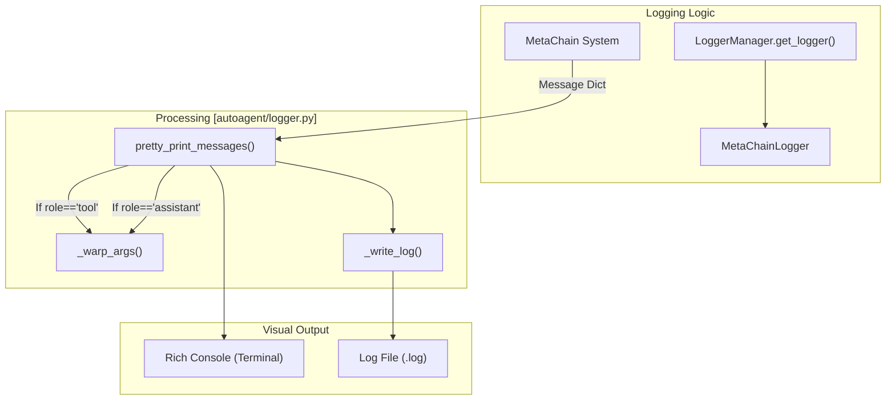
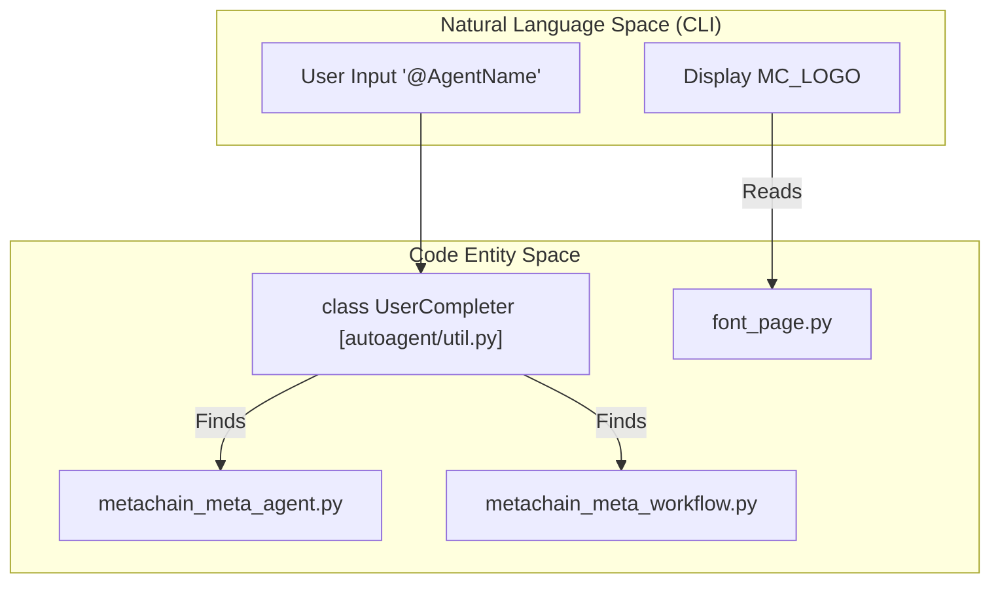

<!-- source: DeepWiki mcp.deepwiki.com · repo HKUDS/AutoAgent · page 4.5 Configuration and Utilities · fetched 2026-10-29 -->

# Configuration and Utilities

<details>
<summary>Relevant source files</summary>

The following files were used as context for generating this wiki page:

- [autoagent/cli_utils/file_select.py](autoagent/cli_utils/file_select.py)
- [autoagent/cli_utils/metachain_meta_agent.py](autoagent/cli_utils/metachain_meta_agent.py)
- [autoagent/cli_utils/metachain_meta_workflow.py](autoagent/cli_utils/metachain_meta_workflow.py)
- [autoagent/io_utils.py](autoagent/io_utils.py)
- [autoagent/logger.py](autoagent/logger.py)
- [autoagent/util.py](autoagent/util.py)
- [constant.py](constant.py)
- [loop_utils/font_page.py](loop_utils/font_page.py)

</details>


This page covers the configuration management system, logging infrastructure, and utility functions that support AutoAgent's core functionality. These components provide essential services for system configuration, debugging, user interaction, and operational support across all AutoAgent modules.

## Configuration Management

The configuration system centralizes all environment variables, model settings, and system constants through a single configuration layer that manages runtime behavior.

### Environment Configuration

The primary configuration is handled in [`constant.py`](constant.py:1-91)(), which loads environment variables via `dotenv` and provides system-wide constants:

```python
# Key configuration variables
DOCKER_WORKPLACE_NAME = os.getenv('DOCKER_WORKPLACE_NAME', 'workplace') # [constant.py:25]()
COMPLETION_MODEL = os.getenv('COMPLETION_MODEL', "claude-3-5-sonnet-20241022") # [constant.py:48]()
EMBEDDING_MODEL = os.getenv('EMBEDDING_MODEL', "text-embedding-3-small") # [constant.py:49]()
DEBUG = str_to_bool(os.getenv('DEBUG', False)) # [constant.py:30]()
DEFAULT_LOG = str_to_bool(os.getenv('DEFAULT_LOG', False)) # [constant.py:32]()
```

### Model Compatibility Logic

The system includes automated logic to configure model interaction styles based on the `COMPLETION_MODEL` string. This determines if the system uses native function calling or XML-based prompting:

*   **Function Call Matrix**: Logic in [`constant.py`](constant.py:74-80)() sets the `FN_CALL` flag to `False` if the model is found in `NOT_USE_FN_CALL` (e.g., `deepseek-chat`, `o1-mini`).
*   **User Message Requirement**: Certain models (e.g., `o1-mini`, `deepseek-r1`) require the first message to be from a "user" role. The `ADD_USER` flag is automatically toggled in [`constant.py`](constant.py:67-72)().
*   **Architecture Detection**: The [`get_architecture()`](constant.py:37-44)() function detects `x86` vs `arm` to select the correct Docker image tag (`amd64_latest` vs `latest`).

**Sources:** [constant.py:1-91]()

## Logging System

The logging system provides structured debug output, message formatting, and persistent log management.

### MetaChainLogger Architecture

The [`MetaChainLogger`](autoagent/logger.py:9-137)() class handles all logging operations, utilizing the `rich` library for terminal formatting and standard file I/O for persistence.

| Component | Responsibility | Source |
| :--- | :--- | :--- |
| `LoggerManager` | Singleton manager for providing the global logger instance. | [autoagent/logger.py:138-151]() |
| `pretty_print_messages` | Formats and prints `assistant` and `tool` role messages. | [autoagent/logger.py:114-137]() |
| `_print_tool_execution` | Displays tool results within color-coded blocks. | [autoagent/logger.py:63-72]() |
| `_print_tool_call` | Parses and displays tool arguments using `_warp_args`. | [autoagent/logger.py:93-104]() |

### Logic and Output Flow


**Sources:** [autoagent/logger.py:9-173]()

## Utility Functions

The utility system provides essential functions for data transformation, user interaction, and streaming.

### Function to JSON Schema

A critical utility for the [Function Call System](4.2) is [`function_to_json()`](autoagent/util.py:281-370)(), which uses `inspect` to generate OpenAI-compatible schemas. It relies on [`get_type_info()`](autoagent/util.py:176-278)() to map Python types (including `Pydantic` models and `List`/`Dict` generics) to JSON types.

### Streaming and Merging

For LLM streaming responses, AutoAgent uses chunk merging utilities:
*   [`merge_chunk()`](autoagent/util.py:108-116)(): Entry point for updating a final response dictionary with new delta chunks.
*   [`merge_fields()`](autoagent/util.py:100-106)(): Recursively merges strings and dictionaries within the message structure.

### IO and File Utilities

*   **File Selection**: [`select_and_copy_files()`](autoagent/cli_utils/file_select.py:7-54)() uses `tkinter` to provide a GUI for users to upload files into the agent's workspace.
*   **IO Utils**: [`autoagent/io_utils.py`](autoagent/io_utils.py:1-51)() provides wrappers for reading YAML, JSON, and calculating MD5 hashes for file integrity checks.

**Sources:** [autoagent/util.py:100-370](), [autoagent/cli_utils/file_select.py:7-54](), [autoagent/io_utils.py:1-51]()

## UI and Registry Assets

AutoAgent uses specific assets to define its visual identity and command-line interface.

### UI Assets (`loop_utils/font_page.py`)
This file contains the visual building blocks for the CLI:
*   `MC_LOGO`: The ASCII art logo displayed at startup [loop_utils/font_page.py:11-19]().
*   `version_table`: A `rich.table.Table` showing the current version (0.2.0) and author info [loop_utils/font_page.py:21-28]().
*   `GOODBYE_LOGO`: ASCII art displayed when the user exits the program [loop_utils/font_page.py:37-45]().

### Registry Pattern
The system uses a registry pattern for agents and tools to allow dynamic discovery:
*   **UserCompleter**: The [`UserCompleter`](autoagent/util.py:484-500)() class enables `@` mentions in the CLI by filtering available agent names.
*   **Agent Initialization**: Functions like `get_workflow_former_agent` [autoagent/cli_utils/metachain_meta_workflow.py:9]() and `get_tool_editor_agent` [autoagent/cli_utils/metachain_meta_agent.py:10]() are used to retrieve specialized agents from the registry for meta-programming tasks.

### CLI to Entity Mapping



**Sources:** [loop_utils/font_page.py:1-47](), [autoagent/util.py:484-500](), [autoagent/cli_utils/metachain_meta_agent.py:1-13](), [autoagent/cli_utils/metachain_meta_workflow.py:1-13]()

---

