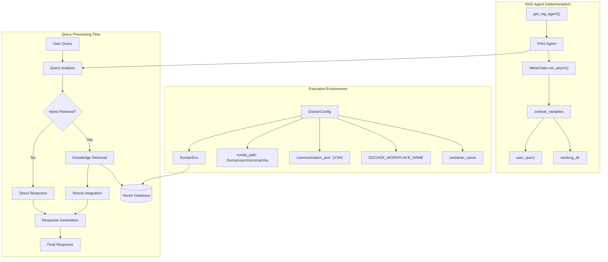
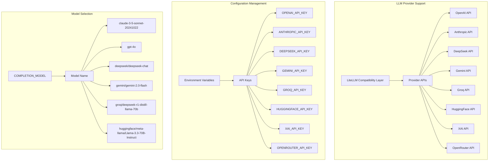

<!-- source: DeepWiki mcp.deepwiki.com · repo HKUDS/AutoAgent · page 5 Advanced Topics · fetched 2026-10-29 -->

# Advanced Topics

Relevant source files

The following files were used as context for generating this wiki page:

- [docs/docs/Starter-Projects/starter-projects-agentic-rag.md](docs/docs/Starter-Projects/starter-projects-agentic-rag.md)
- [evaluation/multihoprag/result.json](evaluation/multihoprag/result.json)
- [evaluation/multihoprag/run_rag.py](evaluation/multihoprag/run_rag.py)

This document covers advanced features and specialized integrations within the AutoAgent system. It focuses on three key areas: Agentic RAG implementation for intelligent retrieval, evaluation frameworks for measuring agent performance, and LLM provider integration strategies.

## Agentic RAG

Agentic RAG (Retrieval-Augmented Generation) is an intelligent retrieval system that dynamically decides whether and how to retrieve information from knowledge bases. Unlike traditional RAG methods that use fixed retrieval patterns, Agentic RAG adds decision-making intelligence to the retrieval process through agent-based reasoning. For a deep dive into implementation details, see [Agentic RAG](#5.1).

### System Architecture

Sources: [evaluation/multihoprag/run_rag.py:24-28](), [evaluation/multihoprag/run_rag.py:73-78](), [docs/docs/Starter-Projects/starter-projects-agentic-rag.md:31-43]()

### Implementation Components

The system utilizes `get_rag_agent` [evaluation/multihoprag/run_rag.py:73]() to initialize a `codeact_agent` capable of complex retrieval tasks. The environment is containerized using `DockerEnv` [evaluation/multihoprag/run_rag.py:27](), ensuring consistent execution of retrieval tools.

| Component | Code Entity | Purpose |
|-----------|-------------|---------|
| Agent Factory | `get_rag_agent` | Instantiates RAG-capable agents |
| Orchestrator | `MetaChain` | Manages the `run_async` loop |
| Environment | `DockerEnv` | Provides isolated runtime |
| Configuration | `DockerConfig` | Defines container parameters |

Sources: [evaluation/multihoprag/run_rag.py:24-28](), [evaluation/multihoprag/run_rag.py:73-74](), [docs/docs/Starter-Projects/starter-projects-agentic-rag.md:31-43]()

## Evaluation Framework

AutoAgent provides a comprehensive evaluation framework for measuring agent performance, particularly focused on RAG (Retrieval-Augmented Generation) capabilities and benchmark testing. For details on specific benchmarks and result persistence, see [Evaluation Framework](#5.2).

### Evaluation Architecture

```mermaid
graph TD
    subgraph "Evaluation Pipeline"
        CSVInput["MultiHopRAG.csv"] --> QuestionLoader["Question Loader"]
        QuestionLoader --> question_list["question_list"]
        QuestionLoader --> GA_LIST["GA_LIST (Gold Answers)"]
        
        question_list --> RAGAgent["RAG Agent"]
        RAGAgent --> MetaChain["MetaChain.run_async()"]
        MetaChain --> AgentResponse["Agent Response"]
        
        GA_LIST --> ResultComparison["Result Comparison"]
        AgentResponse --> ResultComparison
        ResultComparison --> JSONOutput["result.json"]
    end

    subgraph "Benchmark Support"
        GAIABenchmark["GAIA Benchmark"] --> GAIAScripts["evaluation/gaia/scripts/"]
        GAIAScripts --> run_infer["run_infer.sh"]
        GAIAScripts --> get_score["get_score.py"]
        
        MultiHopRAG["MultiHopRAG Dataset"] --> MultiHopScripts["evaluation/multihoprag/scripts/"]
        MultiHopScripts --> run_rag["run_rag.sh"]
        MultiHopScripts --> run_rag_py["run_rag.py"]
    end

    subgraph "Environment Configuration"
        DOCKER_WORKPLACE_NAME["DOCKER_WORKPLACE_NAME"] --> workplace_rag["workplace_rag"]
        EVAL_MODE["EVAL_MODE=True"] --> EvalConfig["Evaluation Configuration"]
        BASE_IMAGES["BASE_IMAGES=tjbtech1/gaia-bookworm:v2"] --> DockerImage["Docker Image"]
        COMPLETION_MODEL["COMPLETION_MODEL"] --> ModelConfig["Model Configuration"]
    end
```

Sources: [evaluation/multihoprag/run_rag.py:45-88](), [docs/docs/Starter-Projects/starter-projects-agentic-rag.md:99-112]()

### Multi-Hop RAG Evaluation

The evaluation framework supports multi-hop reasoning evaluation through the MultiHopRAG dataset. The `main` function in `run_rag.py` [evaluation/multihoprag/run_rag.py:45-88]() iterates through queries, executes the agent, and persists results to `result.json` using `append_to_json` [evaluation/multihoprag/run_rag.py:31-41]().

### Evaluation Configuration

The evaluation system uses environment variables for configuration, such as `EVAL_MODE` and `DOCKER_WORKPLACE_NAME` [docs/docs/Starter-Projects/starter-projects-agentic-rag.md:105-106]().

## LLM Provider Integration

AutoAgent supports multiple LLM providers through a unified interface, enabling flexible model selection and provider-specific optimizations. For details on model-specific compatibility flags and retry logic, see [LLM Provider Integration](#5.3).

### Provider Integration Architecture

Sources: [docs/docs/Starter-Projects/starter-projects-agentic-rag.md:109-111](), [evaluation/multihoprag/run_rag.py:17-21]()

### Model Configuration

The framework allows switching models via the `--model` CLI argument or the `COMPLETION_MODEL` environment variable [evaluation/multihoprag/run_rag.py:17](). It abstracts differences between providers like OpenAI, Anthropic, and DeepSeek, providing a consistent `messages` and `response` format for the `MetaChain` [evaluation/multihoprag/run_rag.py:74-78]().

Sources: [evaluation/multihoprag/run_rag.py:17-21](), [evaluation/multihoprag/run_rag.py:74-78]()

---

