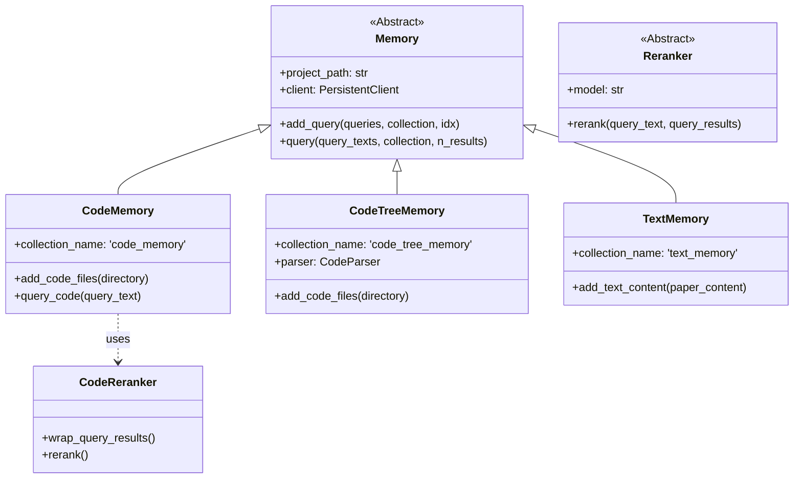
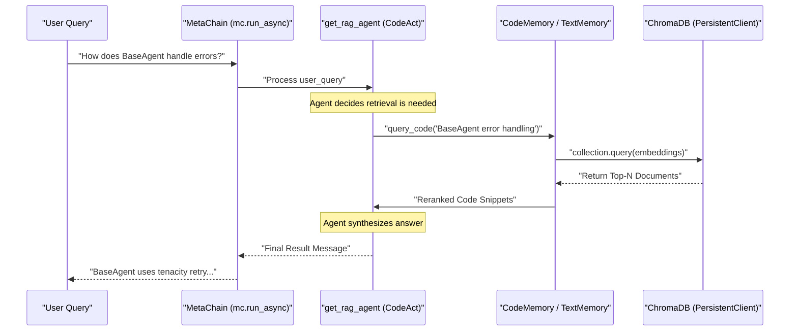

<!-- source: DeepWiki mcp.deepwiki.com · repo HKUDS/AutoAgent · page 5.1 Agentic RAG · fetched 2026-10-29 -->

# Agentic RAG

<details>
<summary>Relevant source files</summary>

The following files were used as context for generating this wiki page:

- [autoagent/memory/__init__.py](autoagent/memory/__init__.py)
- [autoagent/memory/code_memory.py](autoagent/memory/code_memory.py)
- [autoagent/memory/codetree_memory.py](autoagent/memory/codetree_memory.py)
- [autoagent/memory/paper_memory.py](autoagent/memory/paper_memory.py)
- [docs/docs/Starter-Projects/starter-projects-agentic-rag.md](docs/docs/Starter-Projects/starter-projects-agentic-rag.md)
- [evaluation/multihoprag/result.json](evaluation/multihoprag/result.json)
- [evaluation/multihoprag/run_rag.py](evaluation/multihoprag/run_rag.py)
- [evaluation/multihoprag/scripts/run_rag.sh](evaluation/multihoprag/scripts/run_rag.sh)

</details>


## Purpose and Scope

Agentic RAG (Retrieval-Augmented Generation) in AutoAgent implements an intelligent retrieval system that makes autonomous decisions about whether and how to retrieve information from knowledge bases. Unlike traditional RAG methods that rely on predefined workflows, Agentic RAG uses LLM-driven agents to determine if they have acquired sufficient knowledge to answer questions [docs/docs/Starter-Projects/starter-projects-agentic-rag.md:8-8](). 

This system employs a multi-tiered memory architecture including `CodeMemory`, `CodeTreeMemory`, and `TextMemory`, integrated with a native self-managing vector database (ChromaDB) and specialized Rerankers to ensure high-precision information retrieval.

Sources: [README.md:34-35](), [docs/docs/Starter-Projects/starter-projects-agentic-rag.md:6-8](), [autoagent/memory/rag_memory.py:1-10]()

## RAG Memory System Architecture

The memory system is built on a base `Memory` class and specialized implementations for different data types.

### Memory Class Hierarchy



Sources: [autoagent/memory/code_memory.py:7-9](), [autoagent/memory/codetree_memory.py:11-14](), [autoagent/memory/paper_memory.py:10-26]()

### Specialized Memory Implementations

#### 1. CodeMemory & CodeReranker
Designed for raw source code indexing. It crawls directories, filters by file extension (e.g., `.py`, `.js`, `.cpp`), and stores file paths alongside content [autoagent/memory/code_memory.py:12-34](). The `CodeReranker` uses an LLM to select the top 5 most relevant files from initial retrieval results based on a specialized system prompt [autoagent/memory/code_memory.py:90-154]().

#### 2. CodeTreeMemory
Uses `tree-sitter` to parse code into abstract syntax trees (AST). It specifically extracts `class_definition` and `function_definition` nodes, allowing the agent to retrieve specific code entities rather than whole files [autoagent/memory/codetree_memory.py:33-41](). It utilizes `text-embedding-3-small` for high-dimensional vector representation [autoagent/memory/codetree_memory.py:43-43]().

#### 3. TextMemory (PaperMemory)
Handles unstructured text (e.g., research papers). It implements `chunking_by_token_size` to split content into manageable 4096-token chunks before ingestion into ChromaDB [autoagent/memory/paper_memory.py:28-31]().

Sources: [autoagent/memory/code_memory.py:12-34](), [autoagent/memory/codetree_memory.py:33-43](), [autoagent/memory/paper_memory.py:28-31]()

## Agentic Retrieval Flow

The `CodeAct` agent dynamically decides when to invoke retrieval tools. The following diagram bridges the **Natural Language Space** (User Queries) to the **Code Entity Space** (Memory Classes and MetaChain).



Sources: [evaluation/multihoprag/run_rag.py:73-78](), [autoagent/memory/code_memory.py:36-47](), [autoagent/memory/codetree_memory.py:80-88]()

## Evaluation Framework

### MultiHopRAG Pipeline
The Agentic RAG system is evaluated using the `MultiHopRAG` dataset to measure its ability to reason across multiple retrieved segments. The pipeline is driven by `evaluation/multihoprag/run_rag.py`.

**Key Evaluation Components:**
*   **Data Ingestion**: Reads `MultiHopRAG.csv` containing queries and gold-standard answers [evaluation/multihoprag/run_rag.py:55-59]().
*   **Resumable Execution**: Checks `result.json` to skip already processed queries, enabling long-running evaluations [evaluation/multihoprag/run_rag.py:63-68]().
*   **Environment Isolation**: Optionally uses `DockerEnv` to ensure retrieval and execution happen in a clean, reproducible workspace [evaluation/multihoprag/run_rag.py:24-28]().

### Running the Evaluation
The evaluation can be triggered via a shell script that sets environment variables for the target model and workspace:

```bash
export DOCKER_WORKPLACE_NAME=workplace_rag
export COMPLETION_MODEL=claude-3-5-sonnet-20241022
python run_rag.py --model gpt-4o-mini-2024-07-18 --container_name gaia_test
```

Sources: [evaluation/multihoprag/run_rag.py:14-22](), [evaluation/multihoprag/scripts/run_rag.sh:5-9](), [docs/docs/Starter-Projects/starter-projects-agentic-rag.md:100-112]()

## Implementation Details

### Query Processing
Queries are processed through the `MetaChain` system with specific context variables:

```python
context_variables = {
    "working_dir": DOCKER_WORKPLACE_NAME, 
    "user_query": task_instructions
}
response = await mc.run_async(
    agent=codeact_agent, 
    messages=messages,
    max_turns=10, 
    context_variables=context_variables
)
```

The agent is limited to 10 turns (`max_turns=10`) to prevent infinite retrieval loops while allowing for multi-step reasoning [evaluation/multihoprag/run_rag.py:78]().

### Results Persistence
Results are appended to a JSON file using a thread-safe pattern to prevent data loss during crashes:

```python
def append_to_json(file_path, entry):
    if os.path.exists(file_path):
        with open(file_path, 'r', encoding='utf-8') as json_file:
            data = json.load(json_file)
    else:
        data = []
    data.append(entry)
    with open(file_path, 'w', encoding='utf-8') as json_file:
        json.dump(data, json_file, ensure_ascii=False, indent=4)
```

Sources: [evaluation/multihoprag/run_rag.py:31-41](), [evaluation/multihoprag/run_rag.py:76-78]()

---

