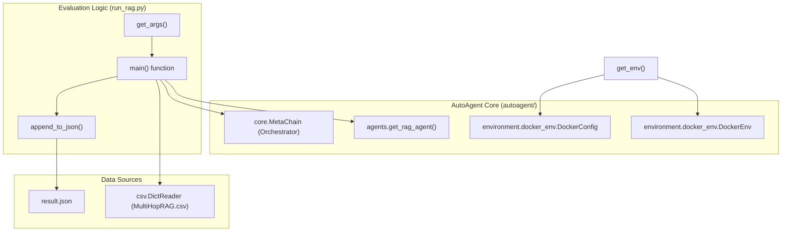
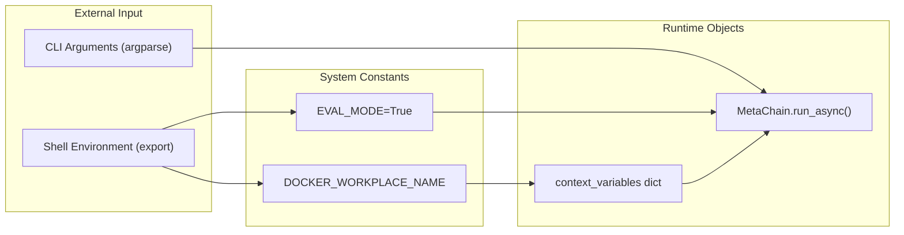

<!-- source: DeepWiki mcp.deepwiki.com · repo HKUDS/AutoAgent · page 5.2 Evaluation Framework · fetched 2026-10-29 -->

# Evaluation Framework

<details>
<summary>Relevant source files</summary>

The following files were used as context for generating this wiki page:

- [docs/docs/Starter-Projects/starter-projects-agentic-rag.md](docs/docs/Starter-Projects/starter-projects-agentic-rag.md)
- [evaluation/multihoprag/result.json](evaluation/multihoprag/result.json)
- [evaluation/multihoprag/run_rag.py](evaluation/multihoprag/run_rag.py)
- [evaluation/multihoprag/scripts/run_rag.sh](evaluation/multihoprag/scripts/run_rag.sh)

</details>


The evaluation framework provides systematic testing and performance measurement capabilities for AutoAgent's RAG (Retrieval-Augmented Generation) implementation. This framework enables automated evaluation of agent responses against gold standard answers, with support for batch processing, resumable execution, and comprehensive result tracking.

While the framework is adaptable, the current implementation focuses on the **MultiHopRAG** benchmark, which requires agents to perform complex, multi-step reasoning across retrieved documents.

## Core Components

The evaluation framework consists of several key components that work together to provide comprehensive testing capabilities:

### Evaluation Engine

The main evaluation engine is implemented in `run_rag.py` and provides the core functionality for executing evaluation runs:

| Component | File Location | Purpose |
|-----------|---------------|---------|
| `main()` | [evaluation/multihoprag/run_rag.py:45-88]() | Primary evaluation orchestrator and loop manager. |
| `get_env()` | [evaluation/multihoprag/run_rag.py:24-28]() | Docker environment configuration and `DockerEnv` instantiation. |
| `append_to_json()` | [evaluation/multihoprag/run_rag.py:31-41]() | Incremental result storage management to prevent data loss. |
| `get_args()` | [evaluation/multihoprag/run_rag.py:14-22]() | Command-line argument parsing for model and container settings. |

### Agent and Environment Integration

The framework bridges the high-level evaluation logic with the AutoAgent core execution system.

**System Entity Mapping**
The following diagram associates natural language evaluation concepts with specific code entities:



Sources: [evaluation/multihoprag/run_rag.py:1-9]()

## Configuration System

The evaluation framework supports extensive configuration through command-line arguments and environment variables, specifically the `EVAL_MODE` flag which triggers evaluation-specific logic within the agents.

### Configuration Flow



Sources: [evaluation/multihoprag/run_rag.py:14-22](), [evaluation/multihoprag/scripts/run_rag.sh:5-9]()

## Evaluation Workflow

The evaluation process follows a structured workflow that processes test cases and collects results.

### Data Loading and Resumption Logic

The framework loads test data from `MultiHopRAG.csv` and checks `result.json` to determine the starting point, allowing for resumable runs if a process is interrupted.

1.  **Input Processing**: Loads `query` and `answer` columns from the CSV into `question_list` and `GA_LIST` [evaluation/multihoprag/run_rag.py:53-59]().
2.  **Checkpointing**: Reads existing `result.json` to set `row_count`, which determines the starting index for the `trange` loop [evaluation/multihoprag/run_rag.py:63-68]().
3.  **Execution**: For each question, it initializes a `get_rag_agent` and executes via `MetaChain.run_async` [evaluation/multihoprag/run_rag.py:73-78]().
4.  **Persistence**: The `append_to_json` function opens, loads, appends, and saves the result for every iteration [evaluation/multihoprag/run_rag.py:31-41]().

### Execution Parameters

Each evaluation case is processed through the AutoAgent system with the following specific configuration:

| Parameter | Value | Source |
|-----------|-------|---------|
| `working_dir` | `DOCKER_WORKPLACE_NAME` | [evaluation/multihoprag/run_rag.py:76]() |
| `user_query` | `task_instructions` | [evaluation/multihoprag/run_rag.py:76]() |
| `max_turns` | `10` | [evaluation/multihoprag/run_rag.py:78]() |
| `messages` | `[{"role": "user", "content": task_instructions}]` | [evaluation/multihoprag/run_rag.py:77]() |

### Result Persistence Pattern

The framework collects comprehensive results for each evaluation case into a structured JSON entry:

```python
data_new = {
    "query": task_instructions,
    "gold_answer": GA_LIST[QUESTIONid],
    "answer": response.messages[-1]['content']
}
```

Sources: [evaluation/multihoprag/run_rag.py:81-85]()

## Benchmark Implementations

### MultiHopRAG Evaluation

MultiHopRAG focuses on the agent's ability to use retrieval tools across multiple steps. The framework sets `EVAL_MODE=True` to ensure the agent operates in a deterministic evaluation state [evaluation/multihoprag/scripts/run_rag.sh:6]().

**Docker Environment Setup**
The framework uses Docker containers for isolated execution to ensure reproducibility:
*   **Base Image**: `tjbtech1/gaia-bookworm:v2` [evaluation/multihoprag/scripts/run_rag.sh:8]()
*   **Port**: `12345` for communication bridge [evaluation/multihoprag/run_rag.py:26]()
*   **Workspace**: Custom path defined by `DOCKER_WORKPLACE_NAME` [evaluation/multihoprag/run_rag.py:25]()

### GAIA and Math500
While the provided files focus on MultiHopRAG, the framework's structure (using `run_infer.py`, `scorer.py`, and `get_score.py` patterns mentioned in the purpose) is designed to handle benchmarks like GAIA (General AI Assistants) and Math500 by swapping the input CSV and the scoring logic.

## Usage Guide

### Command-Line Interface

The framework provides a CLI for managing evaluation parameters:

| Argument | Type | Default | Purpose |
|----------|------|---------|---------|
| `--container_name` | `str` | `'gaia_test'` | Identifier for the Docker container instance. |
| `--model` | `str` | `'gpt-4o-mini-2024-07-18'` | The LLM to be evaluated. |
| `--git_clone` | `bool` | `False` | Whether to clone a fresh repo inside the container. |
| `--setup_package` | `str` | `'lite_pkgs'` | Package set to install in the environment. |
| `--debug` | `bool` | `False` | Enables verbose logging and `MetaChain` debug output. |

Sources: [evaluation/multihoprag/run_rag.py:14-22]()

### Running an Evaluation

To start an evaluation run, use the provided shell script or execute the python script directly:

```bash
# Using the script
bash evaluation/multihoprag/scripts/run_rag.sh

# Direct execution
python evaluation/multihoprag/run_rag.py --model gpt-4o-mini-2024-07-18 --container_name gaia_test
```

Sources: [evaluation/multihoprag/scripts/run_rag.sh:24](), [evaluation/multihoprag/run_rag.py:90-92]()

---

