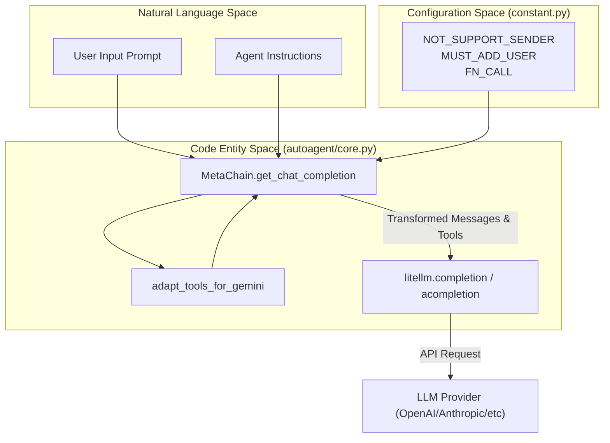
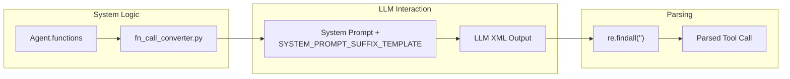

<!-- source: DeepWiki mcp.deepwiki.com · repo HKUDS/AutoAgent · page 5.3 LLM Provider Integration · fetched 2026-10-29 -->

# LLM Provider Integration

Relevant source files

The following files were used as context for generating this wiki page:

- [autoagent/core.py](autoagent/core.py)
- [autoagent/fn_call_converter.py](autoagent/fn_call_converter.py)
- [constant.py](constant.py)

This document covers AutoAgent's integration with multiple Large Language Model (LLM) providers and the configuration system that enables seamless switching between different models. It details the use of `litellm` for abstraction, provider-specific adapters, and the compatibility flags that manage model-specific constraints.

## LLM Abstraction Layer

AutoAgent utilizes `litellm` to provide a unified interface for various LLM providers. This allows the framework to interact with OpenAI, Anthropic, Google Gemini, and others using a standardized completion call [autoagent/core.py:19-31]().

### Async Retry and Error Handling
The system implements a robust retry mechanism using `tenacity` to handle transient API failures and network issues.

*   **Retry Strategy**: Uses exponential backoff with a multiplier of 1, minimum wait of 4 seconds, and maximum of 60 seconds [autoagent/core.py:24-29]().
*   **Error Detection**: The `should_retry_error` function filters for specific exceptions including `APIError`, `RemoteProtocolError`, and `ConnectError`, as well as string-based matches for "timeout", "connection error", and "event loop is closed" [autoagent/core.py:38-54]().

## Configuration and Compatibility Flags

The system behavior is governed by environment variables and model-specific flags defined in `constant.py`.

### Core Configuration Variables
*   **`COMPLETION_MODEL`**: The primary model used for reasoning and tool use. Defaults to `claude-3-5-sonnet-20241022` [constant.py:48]().
*   **`EMBEDDING_MODEL`**: The model used for vector embeddings in RAG. Defaults to `text-embedding-3-small` [constant.py:49]().
*   **`API_BASE_URL`**: Allows overriding the default API endpoint for custom proxies or local LLM servers [constant.py:56]().

### Model Compatibility Mapping
The framework maintains several lists to handle the idiosyncratic requirements of different LLM providers:

| Flag | Description | Affected Models |
| :--- | :--- | :--- |
| `NOT_SUPPORT_SENDER` | Models that crash if a `sender` field is present in the message dict [constant.py:61](). | `mistral`, `groq` |
| `MUST_ADD_USER` | Reasoning models that require a user message to follow a system message or start the conversation [constant.py:62](). | `deepseek-reasoner`, `o1-mini`, `deepseek-r1` |
| `NOT_SUPPORT_FN_CALL` | Models that do not support native tool-calling schemas [constant.py:64](). | `o1-mini`, `deepseek-reasoner`, `deepseek-r1`, `llama`, `grok-2` |

Sources: [constant.py:48-86]()

## Data Flow: LLM Request Processing

The `MetaChain.get_chat_completion` method acts as the central gateway for all LLM interactions, applying necessary adaptations before sending the payload.

### Request Transformation Logic
1.  **Instruction Prep**: Merges agent instructions and examples into the message history [autoagent/core.py:125-134]().
2.  **Tool Adaptation**: Converts Python functions to JSON schemas and removes the internal `context_variables` parameter so the model does not attempt to pass it [autoagent/core.py:137-143]().
3.  **Gemini Adapter**: Specifically for Google Gemini, the `adapt_tools_for_gemini` function injects a "dummy" property into empty object parameters to satisfy Gemini's schema validation requirements [autoagent/core.py:58-94]().
4.  **Sender Removal**: If the model is in `NOT_SUPPORT_SENDER`, the `sender` key is stripped from all messages [autoagent/core.py:159-169]().
5.  **User Message Injection**: If `ADD_USER` is enabled, the `interleave_user_into_messages` utility ensures the message sequence complies with provider requirements [autoagent/core.py:186-187]().

### Code Entity Interaction Diagram

Title: "LLM Request Transformation Flow"

Sources: [autoagent/core.py:115-190](), [constant.py:61-86]()

## Function Calling vs. Prompt-Based Tools

AutoAgent supports both native LLM function calling and a fallback XML-based prompting mechanism for models that lack native support.

*   **Native Mode (`FN_CALL=True`)**: Uses the provider's native tool-calling API. It checks `litellm.supports_function_calling(model)` to ensure compatibility [autoagent/core.py:148-157]().
*   **Fallback Mode (`FN_CALL=False`)**: Uses `SYSTEM_PROMPT_SUFFIX_TEMPLATE` from `fn_call_converter.py` to inject tool descriptions and few-shot examples into the system prompt [autoagent/fn_call_converter.py:35-58](). The model is then expected to output XML tags like `<function=...> <parameter=...>`.

### Non-Function Calling Bridge

Title: "Prompt-Based Tool Execution Bridge"

Sources: [autoagent/fn_call_converter.py:35-60](), [autoagent/core.py:174-188]()

## Provider Setup Examples

The system relies on standard environment variables for API authentication.

| Provider | Key Variable | Model Prefix Example |
| :--- | :--- | :--- |
| **OpenAI** | `OPENAI_API_KEY` | `gpt-4o` |
| **Anthropic** | `ANTHROPIC_API_KEY` | `claude-3-5-sonnet-20241022` |
| **DeepSeek** | `DEEPSEEK_API_KEY` | `deepseek/deepseek-chat` |
| **Gemini** | `GEMINI_API_KEY` | `gemini/gemini-1.5-pro` |
| **OpenRouter** | `OPENROUTER_API_KEY` | `openrouter/anthropic/claude-3.5-sonnet` |

Sources: [constant.py:48-56](), [autoagent/core.py:146-152]()

---

