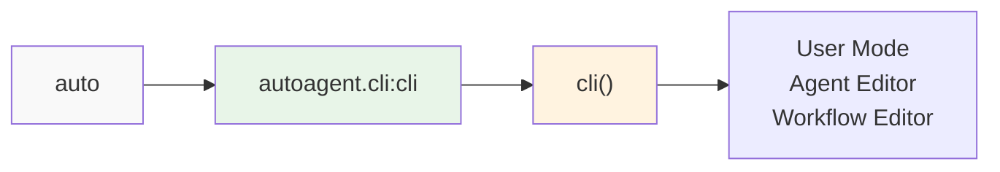
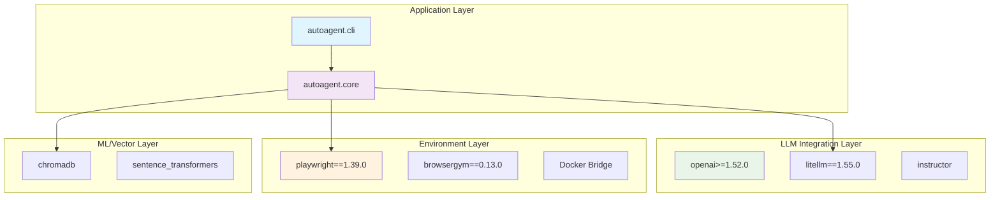
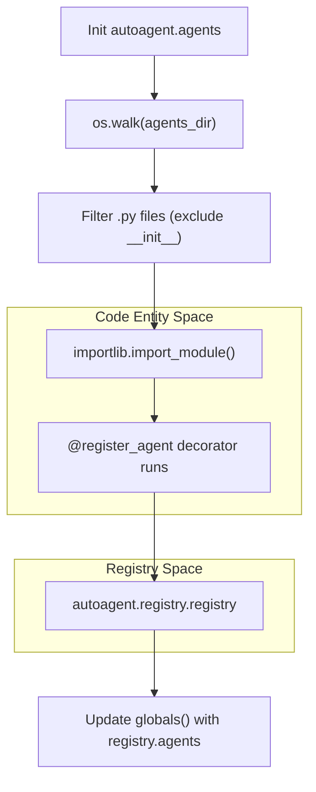

<!-- source: DeepWiki mcp.deepwiki.com · repo HKUDS/AutoAgent · page 6.1 Project Structure · fetched 2026-10-29 -->

# Project Structure

<details>
<summary>Relevant source files</summary>

The following files were used as context for generating this wiki page:

- [autoagent/__init__.py](autoagent/__init__.py)
- [autoagent/agents/__init__.py](autoagent/agents/__init__.py)
- [docs/docs/Dev-Guideline/dev-guide-build-your-project.md](docs/docs/Dev-Guideline/dev-guide-build-your-project.md)
- [docs/docs/Dev-Guideline/dev-guide-create-agent.md](docs/docs/Dev-Guideline/dev-guide-create-agent.md)
- [docs/docs/Dev-Guideline/dev-guide-create-tools.md](docs/docs/Dev-Guideline/dev-guide-create-tools.md)
- [setup.cfg](setup.cfg)

</details>


This document explains the organization of the AutoAgent codebase, including package structure, dependencies, and entry points. It provides a technical overview of how the code is organized and configured for development and deployment, focusing on the registry pattern and recursive module loading.

## Package Configuration

AutoAgent is configured as a Python package through the `setup.cfg` file, which defines the package metadata, dependencies, and entry points.

### Package Metadata

The package is defined with the following core attributes:

| Attribute | Value |
|-----------|-------|
| Package Name | `autoagent` |
| Version | `0.1.0` |
| License | MIT |
| Python Requirement | `>=3.10` |
| Package Discovery | `find_namespace:` |

The package uses namespace discovery to automatically find all modules under the `autoagent` prefix [setup.cfg:67-70]().

### CLI Entry Point

The main entry point for the AutoAgent system is configured as a console script:

```ini
[options.entry_points]
console_scripts =
    auto = autoagent.cli:cli
```

This maps the `auto` command to the `cli` function in the `autoagent.cli` module [setup.cfg:74-75]().

**Package Entry Point Mapping**


Sources: [setup.cfg:74-75]()

## Dependency Architecture

The project dependencies are organized into functional categories that support different aspects of the AutoAgent system.

### Core LLM and Logic Dependencies

| Library | Version | Purpose |
|---------|---------|---------|
| `openai` | `>=1.52.0` | Primary OpenAI API integration [setup.cfg:18]() |
| `litellm` | `==1.55.0` | Multi-provider LLM interface abstraction [setup.cfg:24]() |
| `instructor` | Latest | Structured LLM outputs and validation [setup.cfg:23]() |
| `tenacity` | Latest | Retry logic for API calls [setup.cfg:57]() |
| `pydantic` | Latest | Data validation and settings management [setup.cfg:51]() |

### Web and Browser Automation

| Library | Version | Purpose |
|---------|---------|---------|
| `playwright` | `==1.39.0` | Low-level browser automation [setup.cfg:47]() |
| `browsergym` | `==0.13.0` | Agent-centric web environment framework [setup.cfg:26]() |
| `beautifulsoup4`| Latest | HTML parsing and cleaning [setup.cfg:25]() |

### Data and Document Processing

| Library | Purpose |
|---------|---------|
| `docling` | Advanced document conversion pipeline [setup.cfg:30]() |
| `chromadb` | Vector database for agentic RAG [setup.cfg:27]() |
| `sentence_transformers` | Text embeddings generation [setup.cfg:65]() |
| `pdfminer.six` | PDF text extraction [setup.cfg:45]() |
| `python_pptx` | PowerPoint file manipulation [setup.cfg:53]() |

**Dependency Layer Architecture**


Sources: [setup.cfg:16-65]()

## Package Layout and Module Discovery

AutoAgent uses a structured layout where core components are initialized in the top-level `__init__.py` and sub-packages utilize a registry pattern for dynamic discovery.

### Top-Level Initialization
The root `autoagent/__init__.py` exposes the primary interfaces of the framework, including the `MetaChain` orchestrator and the `default_drive` flow engine [autoagent/__init__.py:1-9]().

### The Registry Pattern
The framework relies on a `registry` object to manage available agents and tools. To ensure all agents are available, the `autoagent.agents` package performs a recursive import of all `.py` files within its directory tree [autoagent/agents/__init__.py:29-58]().

1. **`import_agents_recursively`**: Walks the `autoagent/agents` directory and imports every module [autoagent/agents/__init__.py:29-55]().
2. **Registry Update**: Once imported, the agents (which use decorators to register themselves) are added to the global namespace of the `agents` package [autoagent/agents/__init__.py:61-64]().

**Module Discovery Flow**


Sources: [autoagent/agents/__init__.py:25-64](), [autoagent/__init__.py:1-9]()

## Package Structure

The package structure follows this organization:

| Directory/Module | Responsibility |
|------------------|----------------|
| `autoagent/core` | Contains `MetaChain`, the core orchestration logic [autoagent/__init__.py:1]() |
| `autoagent/agents` | Definitions of specialized agents (e.g., Programming, Triage) [autoagent/agents/__init__.py:58]() |
| `autoagent/tools` | Tool implementations and registration [autoagent/__init__.py:7]() |
| `autoagent/flow` | Execution flow and driving logic (`default_drive`) [autoagent/__init__.py:4]() |
| `autoagent/environments` | Execution contexts (Docker, Browser, Local) |
| `autoagent/cli` | Command-line interface definitions [setup.cfg:75]() |

## Development Configuration

### Code Formatting
The project uses `autopep8` for code formatting with a maximum line length of 120 characters and aggressive formatting enabled [setup.cfg:76-81]().

### Asset Management
The project uses Git Large File Storage (LFS) for managing large binary files, specifically `.mp4` files used in documentation and demonstrations.

### Testing Framework
The package includes `pytest` as a dependency for unit testing and test automation [setup.cfg:19]().

Sources: [setup.cfg:76-81](), [setup.cfg:19]()

---

