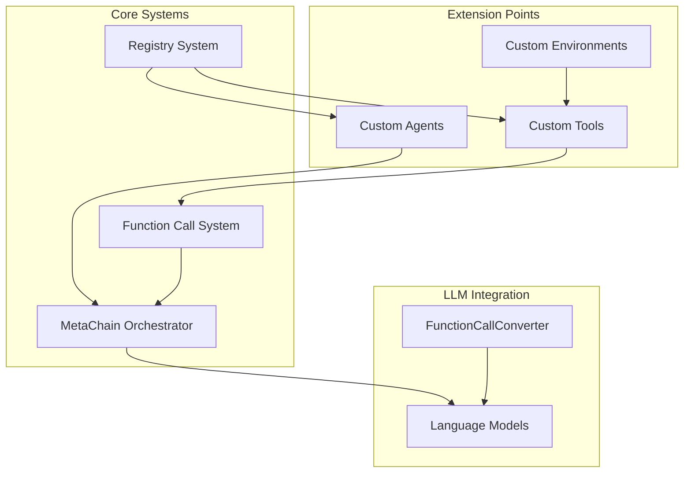
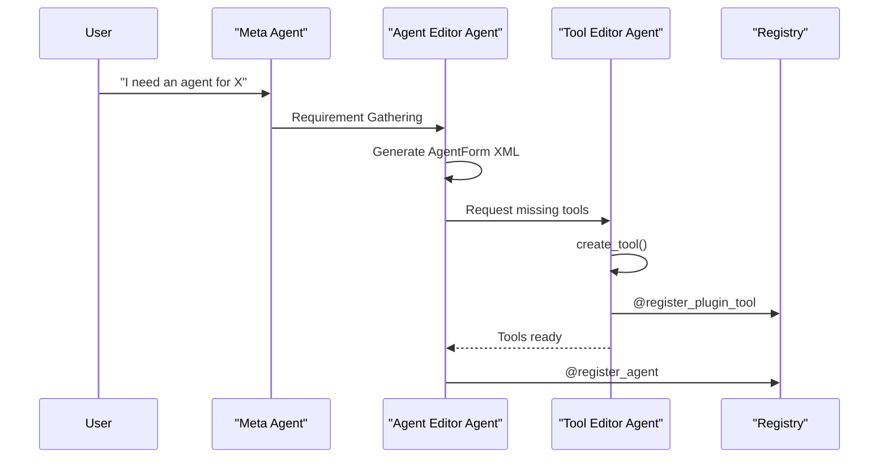
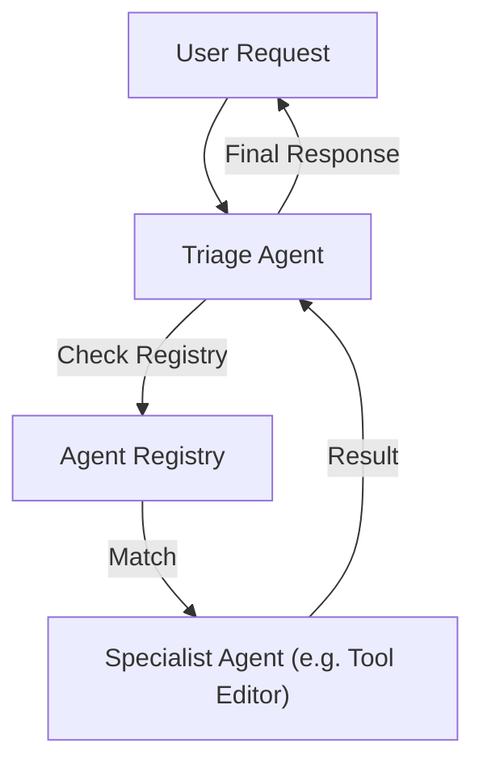

<!-- source: DeepWiki mcp.deepwiki.com · repo HKUDS/AutoAgent · page 6.3 Extending AutoAgent · fetched 2026-10-29 -->

# Extending AutoAgent

<details>
<summary>Relevant source files</summary>

The following files were used as context for generating this wiki page:

- [autoagent/agents/meta_agent/form_complie.py](autoagent/agents/meta_agent/form_complie.py)
- [autoagent/agents/meta_agent/tool_editor.py](autoagent/agents/meta_agent/tool_editor.py)
- [docs/docs/Dev-Guideline/dev-guide-create-agent.md](docs/docs/Dev-Guideline/dev-guide-create-agent.md)
- [docs/docs/Dev-Guideline/dev-guide-create-tools.md](docs/docs/Dev-Guideline/dev-guide-create-tools.md)
- [docs/docs/Dev-Guideline/dev-guide-edit-mem.md](docs/docs/Dev-Guideline/dev-guide-edit-mem.md)

</details>


## Purpose and Scope

This document provides technical guidelines for extending the AutoAgent framework. It covers the registration of custom agents and tools, the implementation of the `meta_agent` pipeline for automated agent creation, and methods for manual memory editing. AutoAgent is designed as a zero-code-first framework, allowing extensions via both natural language (Meta-Agents) and traditional Python development.

## Extension Architecture

AutoAgent is designed with extensibility in mind. The system allows for several extension points:



Sources: [autoagent/core.py:96-673](), [autoagent/fn_call_converter.py:1-848](), [autoagent/registry.py:1-50]()

## Automated Agent Extension (Meta-Agent Pipeline)

The `Meta Agent` is a specialized agent designed to extend the system's capabilities by creating new agents and tools based on user requirements. This process involves requirement gathering, profiling, and code generation.

### The Agent Editor Flow

The pipeline uses XML-based forms to define agent structures before code generation.



Sources: [autoagent/agents/meta_agent/tool_editor.py:16-107](), [autoagent/agents/meta_agent/form_complie.py:22-35]()

### AgentForm XML Schema
The `AgentForm` (defined in `form_complie.py`) acts as the intermediate representation for new agents. It includes system inputs, global variables, and specific agent instructions.

| Component | Code Entity | Description |
|-----------|-------------|-------------|
| `AgentForm` | `AgentForm` class | The root container for the new agent system [autoagent/agents/meta_agent/form_complie.py:30-35]() |
| `ToolSet` | `ToolSet` class | Distinguishes between `existing` and `new` tools [autoagent/agents/meta_agent/form_complie.py:13-15]() |
| `GlobalVariable` | `GlobalVariable` class | Context variables shared across the agent lifecycle [autoagent/agents/meta_agent/form_complie.py:17-20]() |

Sources: [autoagent/agents/meta_agent/form_complie.py:5-35]()

## Adding New Tools Manually

Tools are Python functions exposed to agents via the `register_tool` or `register_plugin_tool` decorators.

### Tool Creation via Tool Editor
The `Tool Editor Agent` uses a specific set of management tools to extend the system:
*   `list_tools()`: Checks existing tools to avoid duplication [autoagent/agents/meta_agent/tool_editor.py:21]().
*   `create_tool(tool_name, tool_code)`: Persists new Python tool files [autoagent/agents/meta_agent/tool_editor.py:74]().
*   `run_tool(tool_name, run_code)`: Executes a tool in a sandbox for testing before final registration [autoagent/agents/meta_agent/tool_editor.py:75]().

### Manual Tool Implementation
To manually add a tool, create a new `.py` file in `autoagent/tools/` and use the registry:

```python
from autoagent.registry import register_plugin_tool

@register_plugin_tool
def my_custom_tool(param: str) -> str:
    """
    Detailed docstring for the LLM.
    Args:
        param: Description of the parameter.
    """
    return f"Processed {param}"
```

Sources: [autoagent/agents/meta_agent/tool_editor.py:45-54](), [autoagent/registry.py:1-50]()

## Registering Custom Agents

Agents are registered using the `@register_agent` decorator. This allows the `Triage Agent` (system router) to discover and hand off tasks to them.

```python
from autoagent.registry import register_agent
from autoagent.types import Agent

@register_agent(name="Custom Researcher", func_name="get_researcher")
def get_researcher(model: str) -> Agent:
    return Agent(
        name="Custom Researcher",
        model=model,
        instructions="You research specialized topics...",
        functions=[search_tool, analyze_tool]
    )
```

Sources: [autoagent/agents/meta_agent/tool_editor.py:9-10](), [autoagent/registry.py:1-50]()

## Memory Editing and Management

AutoAgent allows for manual and automated memory editing. This is critical for updating an agent's "knowledge" or "long-term instructions" without changing the code.

### Dev Guidelines for Memory
*   **Location**: Memory is typically stored in the `memory/` directory or managed via the `RAG` system.
*   **Editing**: Developers can modify `dev-guide-edit-mem.md` to define how the agent should prioritize different memory fragments (ToolMemory, CodeMemory, PaperMemory).
*   **Workflow**: 
    1.  Identify the target memory type (e.g., `PaperMemory`).
    2.  Use the `Agentic RAG` tools to query or update the vector store.
    3.  For static instructions, update the `Agent` object's `instructions` field.

Sources: [docs/docs/Dev-Guideline/dev-guide-edit-mem.md:1-4](), [autoagent/agents/meta_agent/tool_editor.py:80-82]()

## System Triage and Routing

When a new agent is registered, it must be integrated into the system's routing logic. The `MetaChain` orchestrator uses the `Triage Agent` to determine which specialist agent should handle a user request.



Sources: [autoagent/core.py:212-302](), [autoagent/registry.py:1-50]()

## Best Practices for Extensions

1.  **Tool Priority**: Always check `list_tools()` before creating a new one [autoagent/agents/meta_agent/tool_editor.py:86]().
2.  **API Safety**: Never expose API keys as parameters; embed them in the function body using `get_api_plugin_tools_doc` [autoagent/agents/meta_agent/tool_editor.py:91-94]().
3.  **Modularity**: Design tools to be abstract and reusable (e.g., `download_media` instead of `download_youtube`) [autoagent/agents/meta_agent/tool_editor.py:97-98]().
4.  **Verification**: Use `run_tool` to test new implementations before marking a case as resolved [autoagent/agents/meta_agent/tool_editor.py:105-106]().

---

