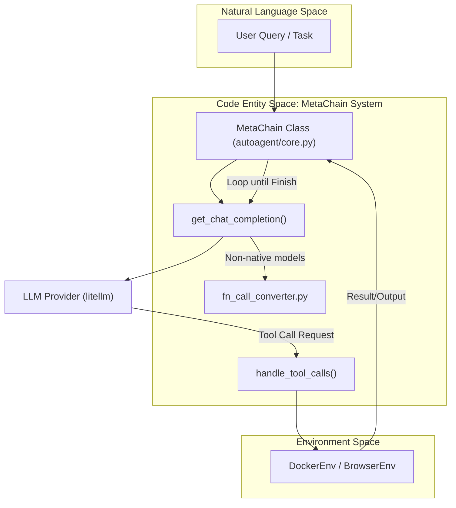
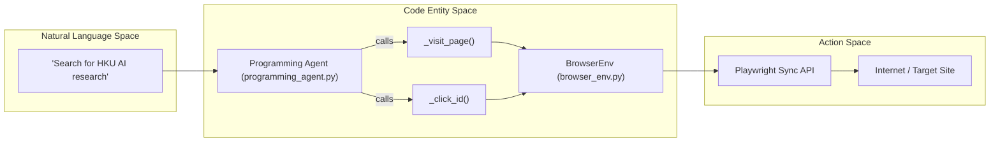

<!-- source: DeepWiki mcp.deepwiki.com · repo HKUDS/AutoAgent · page 7 Glossary · fetched 2026-10-29 -->

# Glossary

Relevant source files

The following files were used as context for generating this wiki page:

- [README.md](README.md)
- [assets/AutoAgent_logo.svg](assets/AutoAgent_logo.svg)
- [assets/autoagent-intro.png](assets/autoagent-intro.png)
- [assets/autoagent.png](assets/autoagent.png)
- [assets/cover.png](assets/cover.png)
- [assets/video_v1_compressed.mp4](assets/video_v1_compressed.mp4)
- [autoagent/agents/system_agent/programming_agent.py](autoagent/agents/system_agent/programming_agent.py)
- [autoagent/cli.py](autoagent/cli.py)
- [autoagent/core.py](autoagent/core.py)
- [autoagent/environment/browser_env.py](autoagent/environment/browser_env.py)
- [autoagent/environment/docker_env.py](autoagent/environment/docker_env.py)
- [autoagent/environment/local_env.py](autoagent/environment/local_env.py)
- [autoagent/fn_call_converter.py](autoagent/fn_call_converter.py)
- [constant.py](constant.py)
- [docs/docs/Starter-Projects/starter-projects-agentic-rag.md](docs/docs/Starter-Projects/starter-projects-agentic-rag.md)
- [evaluation/multihoprag/result.json](evaluation/multihoprag/result.json)
- [evaluation/multihoprag/run_rag.py](evaluation/multihoprag/run_rag.py)

This page provides definitions for codebase-specific terms, jargon, and architectural metaphors used within the AutoAgent framework. It is intended to help onboarding engineers navigate the relationships between natural language descriptions and their underlying code implementations.

## 1. MetaChain
The core orchestration engine of the AutoAgent framework. It manages the execution loop, handles tool calls, and maintains state between agent interactions.

*   **Implementation**: Defined in `MetaChain` class [autoagent/core.py:96-97]().
*   **Key Functions**:
    *   `run()`: The synchronous entry point for starting a conversation with an agent [autoagent/core.py:270-271]().
    *   `run_async()`: The asynchronous version used for concurrent operations and streaming [autoagent/core.py:228-229]().
    *   `handle_tool_calls()`: Internal logic that executes functions requested by the LLM and returns results to the context [autoagent/core.py:348-349]().

### Data Flow: MetaChain Execution Loop
The following diagram illustrates how the `MetaChain` orchestrates the flow between the LLM and the execution environment.

**Sources**: [autoagent/core.py:96-360](), [autoagent/fn_call_converter.py:1-60]().

---

## 2. Operating Agent System (OAS) Metaphor
AutoAgent uses an Operating System metaphor to categorize different interaction layers.

| Metaphor | Code Equivalent | Description |
| :--- | :--- | :--- |
| **User Mode** | `cli.py` (Deep Research) | High-level interface for end-users to perform complex tasks like research [autoagent/cli.py:96-104](). |
| **Developer Mode** | `meta_agent.py` / `meta_workflow.py` | The "Self-Developing" layer where agents create other agents or tools [autoagent/cli.py:41-42](). |
| **OS Kernel** | `autoagent/environment/` | The low-level execution environments (Docker, Browser, Local) that provide "hardware" access [autoagent/cli.py:143-155](). |

**Sources**: [README.md:30-48](), [autoagent/cli.py:41-43]().

---

## 3. Meta Agent & Meta Workflow
Specialized agents designed to build other agents or multi-agent systems using natural language.

*   **Agent Editor**: The pipeline that takes a natural language requirement and generates an `Agent` object, including its instructions and necessary tools [autoagent/cli.py:20-20]().
*   **Workflow Editor**: The pipeline that orchestrates multiple agents into a structured sequence to solve complex problems [autoagent/cli.py:42-42]().
*   **Profiling**: The process where `Agent Former` or `Workflow Former` defines the personality and capabilities of the new entity.

**Sources**: [README.md:117-122](), [autoagent/cli.py:20-42]().

---

## 4. Environment System (Kernel)
The execution layer where code is run and web pages are browsed.

*   **DockerEnv**: Provides isolated execution. It uses a `DockerConfig` to manage container lifecycles [autoagent/environment/docker_env.py]().
*   **BrowserEnv**: A web automation environment based on `playwright` and `browsergym`. It allows agents to interact with websites using "BID" (Boundary ID) targeting [autoagent/environment/browser_env.py:161-168]().
*   **LocalEnv**: A fallback environment that runs commands directly on the host machine, typically within a specific Conda environment [autoagent/environment/local_env.py:8-19]().

### Bridging Space: Environment Execution

**Sources**: [autoagent/environment/browser_env.py:59-161](), [autoagent/agents/system_agent/programming_agent.py:59-98]().

---

## 5. Context Variables
A dictionary passed through the `MetaChain` that acts as the "shared memory" or "state" for agents and tools.

*   **Usage**: It often contains keys like `working_dir`, `code_env`, or `user_query` [autoagent/agents/system_agent/programming_agent.py:12-16]().
*   **Implementation**: Defined as `context_variables` in `MetaChain.run` and passed to agent instructions if they are callable [autoagent/core.py:119-129]().
*   **Reserved Name**: `__CTX_VARS_NAME__ = "context_variables"` is filtered out from the LLM's tool definition to prevent the model from trying to manipulate the state object directly [autoagent/core.py:55-55](), [autoagent/core.py:141-143]().

**Sources**: [autoagent/core.py:55-143](), [autoagent/agents/system_agent/programming_agent.py:62-64]().

---

## 6. Function Call Converter
A compatibility layer that enables models not supporting native function calling (e.g., DeepSeek-R1, O1-mini) to use AutoAgent tools.

*   **Non-Function Calling Mode**: Triggered when `FN_CALL` is `False` in `constant.py` [constant.py:74-79]().
*   **XML Tagging**: The system uses `<function=...>` and `<parameter=...>` tags to wrap tool calls in plain text [autoagent/fn_call_converter.py:35-58]().
*   **Logic**: `convert_tools_to_description` transforms JSON schemas into readable prompts, and regex is used to parse the LLM's text responses back into structured `ToolCall` objects [autoagent/fn_call_converter.py:34-60]().

**Sources**: [autoagent/fn_call_converter.py:1-60](), [constant.py:61-85]().

---

## 7. Agentic RAG
A specialized implementation of Retrieval-Augmented Generation where the agent dynamically decides when to query the knowledge base.

*   **RAG Agent**: Created via `get_rag_agent(model)` [evaluation/multihoprag/run_rag.py:4-5]().
*   **Tooling**: Unlike standard RAG, the agent has tools to search and retrieve, allowing it to perform multi-hop reasoning before providing a final answer [docs/docs/Starter-Projects/starter-projects-agentic-rag.md:6-10]().

**Sources**: [evaluation/multihoprag/run_rag.py:1-92](), [docs/docs/Starter-Projects/starter-projects-agentic-rag.md:1-135]().