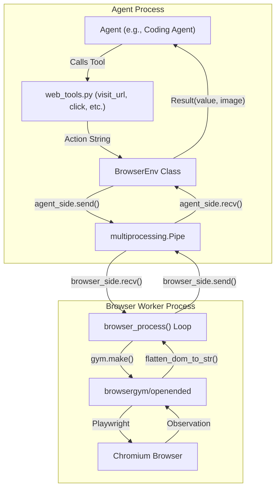
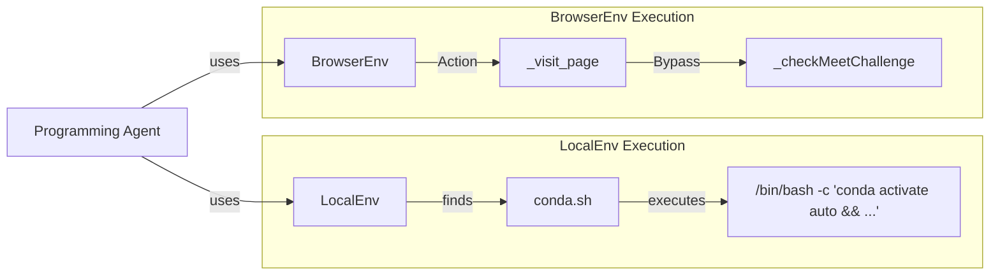

<!-- source: DeepWiki mcp.deepwiki.com · repo HKUDS/AutoAgent · extra page Browser Environment · fetched 2026-10-29 -->

# Browser Environment

Relevant source files

The following files were used as context for generating this wiki page:

- [autoagent/agents/system_agent/programming_agent.py](autoagent/agents/system_agent/programming_agent.py)
- [autoagent/environment/browser_cookies.py](autoagent/environment/browser_cookies.py)
- [autoagent/environment/browser_env.py](autoagent/environment/browser_env.py)
- [autoagent/environment/cookie_json/README.md](autoagent/environment/cookie_json/README.md)
- [autoagent/environment/cookies_data.py](autoagent/environment/cookies_data.py)
- [autoagent/environment/local_env.py](autoagent/environment/local_env.py)

The Browser Environment provides AutoAgent with web automation and browser interaction capabilities. It leverages a multiprocessing architecture to isolate browser operations and uses **BrowserGym** (a wrapper around Playwright) to provide standardized element targeting and observation processing.

## 1. Architecture and Multiprocessing

The Browser Environment uses a client-server architecture via `multiprocessing.Pipe` to separate the heavy browser process from the agent's logic. This ensures that browser crashes or resource leaks do not impact the main agent execution.

Sources: [autoagent/environment/browser_env.py:337-370](), [autoagent/environment/browser_env.py:403-543](), [autoagent/tools/web_tools.py:183-200]()

## 2. Element Targeting and Interaction

AutoAgent uses **BID (Browser ID)** based targeting. BrowserGym injects unique IDs into the DOM, allowing the agent to refer to elements by simple strings (e.g., "12") rather than complex XPath or CSS selectors.

### 2.1 Core Interaction Functions
- **`_visit_page(url)`**: Navigates to a URL. It includes a custom retry mechanism and specific logic for handling `net::ERR_ABORTED` by falling back to a `requests`-based download if the browser attempts to download a file [autoagent/environment/browser_env.py:59-136]().
- **`_click_id(bid, button)`**: Uses `get_elem_by_bid` to find the coordinates of an element and performs a mouse click at the center of its bounding box [autoagent/environment/browser_env.py:161-265]().
- **`_checkMeetChallenge()`**: A specialized function to detect and bypass Cloudflare "Verify you are human" challenges by identifying the challenge frame and clicking the checkbox [autoagent/environment/browser_env.py:266-336]().

### 2.2 Cookie Management
To maintain sessions across authenticated websites, AutoAgent can load pre-exported cookies.
- **`convert_cookies_to_python()`**: Scans the `cookie_json` directory and aggregates JSON cookies into a Python list in `cookies_data.py` [autoagent/environment/browser_cookies.py:12-39]().
- **`COOKIES_LIST`**: The browser process adds these cookies to the context before navigation to simulate logged-in states [autoagent/environment/browser_env.py:76-82]().

Sources: [autoagent/environment/browser_env.py:161-265](), [autoagent/environment/browser_cookies.py:12-39](), [autoagent/environment/cookies_data.py:1-2]()

## 3. Environment Integration

AutoAgent supports multiple execution environments. The `Programming Agent` and others interact with these environments via `context_variables`.

### 3.1 Local vs. Docker Environments
While `BrowserEnv` handles web interaction, code execution happens in either `DockerEnv` or `LocalEnv`.
- **LocalEnv**: Used when Docker is not available. It finds the system's `conda.sh` to activate the `auto` environment before running commands [autoagent/environment/local_env.py:19-73]().
- **Path Mapping**: The `_local_to_docker` utility converts absolute local paths to the workspace paths used inside the container or agent sandbox [autoagent/environment/browser_env.py:46-58]().

### 3.2 Programming Agent Toolset
The `Coding Agent` is configured to use both code execution tools and browser tools to fulfill tasks.

| Tool Category | Functions |
| :--- | :--- |
| **Code Execution** | `run_python`, `execute_command` |
| **File System** | `create_file`, `write_file`, `read_file`, `list_files`, `gen_code_tree_structure` |
| **Terminal Navigation** | `terminal_page_up`, `terminal_page_down`, `terminal_page_to` |

Sources: [autoagent/agents/system_agent/programming_agent.py:59-97](), [autoagent/environment/local_env.py:74-91](), [autoagent/environment/browser_env.py:266-275]()

## 4. Data Flow: Observation to Markdown

When an agent visits a page, the raw HTML is often too noisy. AutoAgent uses `MarkdownConverter` to clean the content.

1. **Browser Observation**: The `browser_process` captures the DOM and AXTree [autoagent/environment/browser_env.py:510-530]().
2. **Markdown Conversion**: The tool `get_page_markdown` calls `_get_page_markdown()`, which utilizes a complex pipeline to handle various document types (PDFs, YouTube transcripts, HTML) [autoagent/environment/mdconvert.py:810-850]().
3. **Result Wrapper**: The `Result` object encapsulates the markdown text and a base64-encoded screenshot for the agent's multimodal capabilities [autoagent/tools/web_tools.py:330-340]().

Sources: [autoagent/environment/mdconvert.py:4-20](), [autoagent/tools/web_tools.py:402-431](), [autoagent/environment/browser_env.py:30-32]()

---

