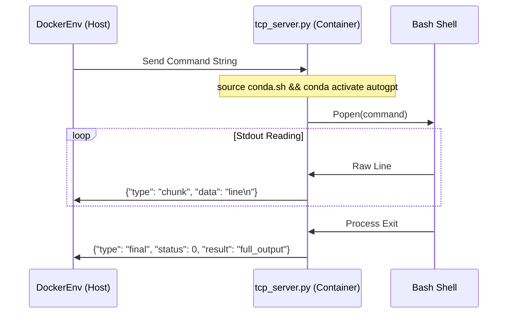

<!-- source: DeepWiki mcp.deepwiki.com · repo HKUDS/AutoAgent · extra page Docker Environment · fetched 2026-10-29 -->

# Docker Environment

<details>
<summary>Relevant source files</summary>

The following files were used as context for generating this wiki page:

- [assets/AutoAgent_logo.svg](assets/AutoAgent_logo.svg)
- [assets/cover.png](assets/cover.png)
- [autoagent/environment/docker_env.py](autoagent/environment/docker_env.py)
- [autoagent/environment/tcp_server.py](autoagent/environment/tcp_server.py)

</details>


The Docker Environment provides containerized execution capabilities for AutoAgent, enabling isolated code execution in controlled environments. This system manages Docker containers, facilitates communication between the host and container via a custom TCP bridge, and provides a consistent runtime environment for agent tasks.

## Architecture Overview

The Docker Environment system consists of host-side controllers and container-side servers that work together to provide isolated execution.

```mermaid
graph TB
    subgraph "Host System (Code Entity Space)"
        DockerConfig["DockerConfig<br/>(autoagent/environment/docker_env.py)"]
        DockerEnv["DockerEnv<br/>(autoagent/environment/docker_env.py)"]
        LocalWorkplace["Local Workspace Path<br/>(local_workplace)"]
    end
    
    subgraph "Docker Container (Code Entity Space)"
        TCPServer["tcp_server.py<br/>(autoagent/environment/tcp_server.py)"]
        CondaEnv["Conda Env: autogpt"]
        DockerWorkplace["Docker Workspace Path<br/>(docker_workplace)"]
    end
    
    subgraph "External Resources"
        GitRepo["GitHub: HKUDS/AutoAgent"]
        BaseImage["BASE_IMAGES<br/>(constant.py)"]
    end
    
    DockerConfig --> DockerEnv
    DockerEnv -- "Subprocess: docker run" --> TCPServer
    DockerEnv -- "Volume Mount" --> LocalWorkplace
    LocalWorkplace -- "Mounts to" --> DockerWorkplace
    TCPServer -- "Conda Activate" --> CondaEnv
    GitRepo -- "git clone" --> DockerWorkplace
    BaseImage -- "Image Selection" --> DockerEnv
    
    DockerEnv -.-> "TCP JSON Stream<br/>Port 12345" -.-> TCPServer
```

**Sources:** [autoagent/environment/docker_env.py:28-42](), [autoagent/environment/tcp_server.py:12-20]()

## Configuration and Image Selection

The Docker Environment is configured through the `DockerConfig` dataclass [autoagent/environment/docker_env.py:15-26](). A key feature is the architecture-based image selection; the system uses the `BASE_IMAGES` constant defined in `constant.py` to ensure the container matches the host environment [autoagent/environment/docker_env.py:4]().

### DockerConfig Fields
| Field | Type | Description |
|-------|------|-------------|
| `container_name` | `str` | Unique identifier for the Docker container [autoagent/environment/docker_env.py:17](). |
| `workplace_name` | `str` | Directory name for the agent's workspace [autoagent/environment/docker_env.py:18](). |
| `communication_port`| `int` | TCP port for the bridge (default 12345) [autoagent/environment/docker_env.py:19](). |
| `conda_path` | `str` | Path to Conda inside the container (e.g., `/root/miniconda3`) [autoagent/environment/docker_env.py:20](). |
| `git_clone` | `bool` | Whether to clone the AutoAgent repo into the container [autoagent/environment/docker_env.py:23](). |

**Sources:** [autoagent/environment/docker_env.py:15-26](), [constant.py:1-10]()

## Container Lifecycle & Git Strategy

The `init_container()` method handles the idempotent setup of the execution environment [autoagent/environment/docker_env.py:43-110]().

1.  **Existence Check**: Checks if a container with `container_name` already exists using `docker ps -a` [autoagent/environment/docker_env.py:44-45]().
2.  **Workspace Mapping**: Maps `local_workplace` (host) to `docker_workplace` (container) using Docker volumes [autoagent/environment/docker_env.py:99-100]().
3.  **TCP Bridge Setup**: Copies `tcp_server.py` to the workspace and starts it as the container entrypoint [autoagent/environment/docker_env.py:48-50](), [autoagent/environment/docker_env.py:102-103]().
4.  **Git Branching**: If `git_clone` is enabled, it clones the repository and creates a task-specific branch using the strategy `{test_pull_name}_{task_name}` to isolate changes [autoagent/environment/docker_env.py:54-80]().

**Sources:** [autoagent/environment/docker_env.py:43-110]()

## TCP Bridge Protocol (tcp_server.py)

Communication between the host `DockerEnv` and the containerized shell occurs via a JSON line-delimited protocol over TCP.



### Communication Details
- **Server Binding**: The server listens on `0.0.0.0` at the configured `communication_port` [autoagent/environment/tcp_server.py:16-18]().
- **Command Execution**: Commands are wrapped in a bash login shell that activates the `autogpt` conda environment before execution [autoagent/environment/tcp_server.py:42-43]().
- **Data Flow**: `DockerEnv.run_command` sends the command and processes the returned JSON stream, supporting optional `stream_callback` for real-time logging [autoagent/environment/docker_env.py:144-199]().

**Sources:** [autoagent/environment/tcp_server.py:12-80](), [autoagent/environment/docker_env.py:144-199]()

## Environment Decorator

The system utilizes a `with_env` decorator pattern to inject environment context into tool functions dynamically.

```python
def with_env(func):
    """
    Decorator to inject DockerEnv into functions.
    Extracts 'env' from func signature and provides the instance.
    """
    # implementation in autoagent/environment/docker_env.py:201-227
```

This allows agents to call tools without manually managing the container state, as the decorator ensures the environment is ready before function execution [autoagent/environment/docker_env.py:201-227]().

**Sources:** [autoagent/environment/docker_env.py:201-227]()

## Utility Functions

`DockerEnv` provides several helper methods for container introspection:
- `check_container_ports(container_name)`: Parses `docker port` output to find host-to-container mappings [autoagent/environment/docker_env.py:229-251]().
- `check_container_running(container_name)`: Verifies the `State.Running` attribute via `docker inspect` [autoagent/environment/docker_env.py:268-276]().
- `wait_for_container_ready(timeout)`: Polls the container until the `tcp_server.py` is detectable in the process list (`ps aux`) [autoagent/environment/docker_env.py:111-137]().

**Sources:** [autoagent/environment/docker_env.py:229-276](), [autoagent/environment/docker_env.py:111-137]()

---

