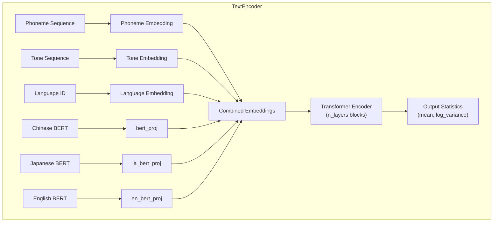
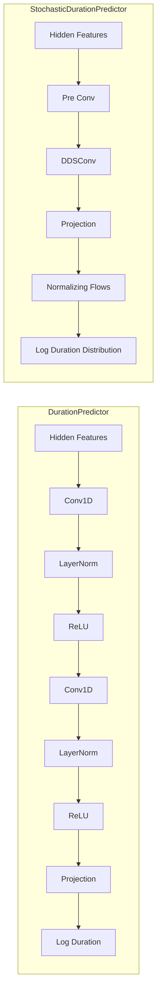
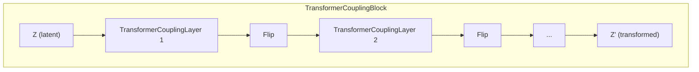
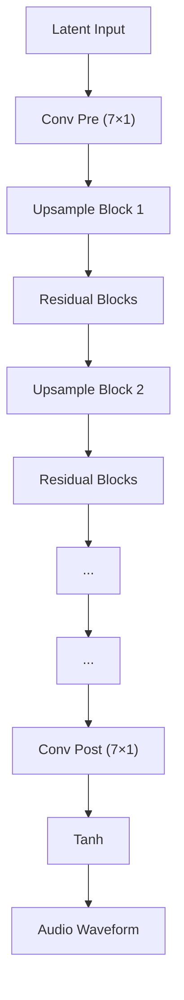
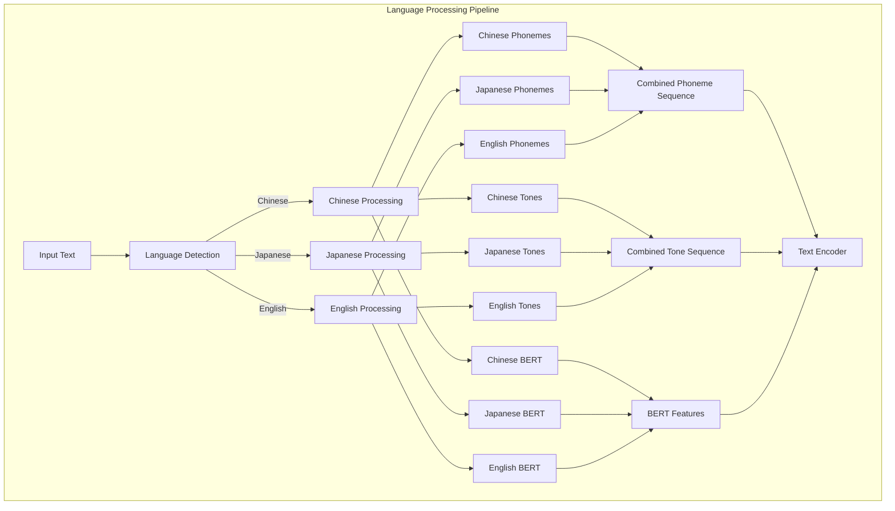
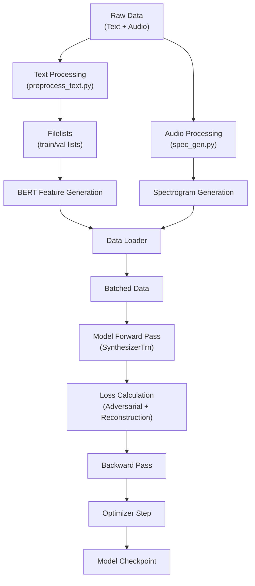
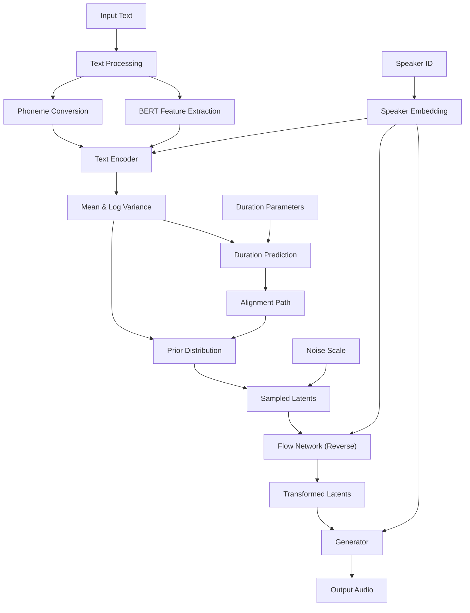
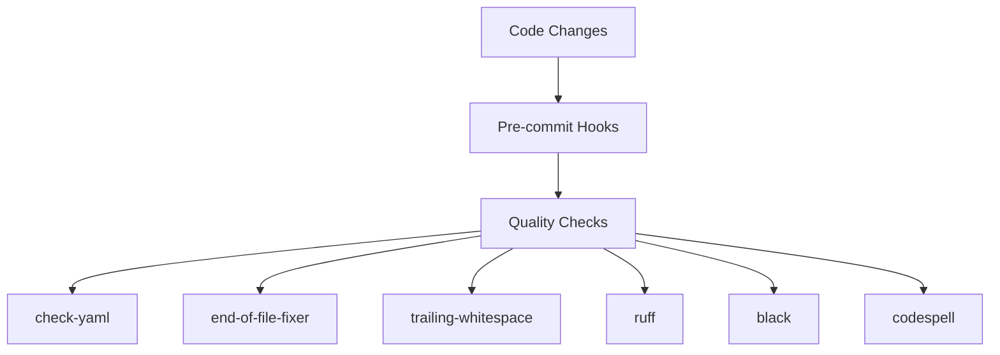

<!-- source: DeepWiki mcp.deepwiki.com · repo fishaudio/Bert-VITS2 · page 1 Overview · fetched 2026-10-29 -->

# Overview

<details>
<summary>Relevant source files</summary>

The following files were used as context for generating this wiki page:

- [.pre-commit-config.yaml](.pre-commit-config.yaml)
- [README.md](README.md)
- [configs/config.json](configs/config.json)
- [models.py](models.py)
- [preprocess_text.py](preprocess_text.py)
- [spec_gen.py](spec_gen.py)

</details>


Bert-VITS2 is a text-to-speech (TTS) synthesis system that combines BERT (Bidirectional Encoder Representations from Transformers) embeddings with a modified VITS2 architecture to produce high-quality, natural-sounding speech across multiple languages. The system leverages pre-trained BERT models to enhance text understanding, resulting in improved pronunciation, prosody, and multilingual capabilities.

This page provides a technical overview of the Bert-VITS2 system architecture, explaining its core components and how they interact. For detailed information about installation and setup, see [Installation and Setup](#1.1).

## System Architecture

Bert-VITS2 integrates several sophisticated components into a unified text-to-speech pipeline:

```mermaid
graph TD
    subgraph "Preprocessing"
        TextData["Raw Text Data"] --> PreprocessText["Text Preprocessing"]
        AudioData["Raw Audio Data"] --> Resample["Audio Resampling"]
        PreprocessText --> Filelists["Filelists\n(train.list, val.list)"]
        Resample --> ProcessedAudio["Processed Audio"]
        Filelists --> BertGen["BERT Feature Generation"]
        ProcessedAudio --> SpecGen["Spectrogram Generation"]
        ProcessedAudio --> EmoGen["Emotion Feature Generation"]
    end
    
    subgraph "Model Components"
        subgraph "SynthesizerTrn"
            TextEnc["Text Encoder"]
            DurPred["Duration Predictor"]
            StochDurPred["Stochastic Duration Predictor"]
            Flow["Flow Network"]
            Generator["Generator"]
            
            TextEnc --> DurPred
            TextEnc --> StochDurPred
            TextEnc --> Flow
            Flow --> Generator
        end
        
        subgraph "Discriminators"
            MPDisc["Multi-Period Discriminator"]
            DurDisc["Duration Discriminator"]
            WavLMDisc["WavLM Discriminator"]
        end
    end
    
    subgraph "Training"
        BertGen --> Training["Model Training"]
        SpecGen --> Training
        EmoGen --> Training
        Filelists --> Training
        Training --> TrainedModel["Trained Model\n(checkpoint files)"]
        Training --> Discriminators
    end
    
    subgraph "Inference"
        Text["Input Text"] --> InferTextProc["Text Processing"]
        InferTextProc --> InferBert["BERT Features"]
        InferBert --> TextEnc
        SpkID["Speaker ID"] --> SpeakerEmb["Speaker Embedding"]
        SpeakerEmb --> TextEnc
        SpeakerEmb --> Flow
        SpeakerEmb --> Generator
        DurPred & StochDurPred --> Alignment["Duration Alignment"]
        TextEnc & Alignment --> Flow
        Generator --> OutputAudio["Generated Audio"]
        TrainedModel -.-> SynthesizerTrn
    end
```

Sources: [models.py:811-1074](), [models.py:333-400](), [models.py:490-566]()

## Key Components

### Text Encoder

The `TextEncoder` processes text inputs, integrating phoneme embeddings, tone information, language IDs, and BERT features into a unified representation:



The `TextEncoder` processes sequences of phonemes, tones, and language IDs, then combines them with BERT features for each supported language. The encoder uses transformer architecture with self-attention mechanisms to create context-aware text representations.

Sources: [models.py:333-400]()

### Duration Predictors

Bert-VITS2 uses two duration prediction mechanisms:

1. **DurationPredictor**: A deterministic CNN-based predictor
2. **StochasticDurationPredictor**: A probabilistic flow-based predictor for more natural duration variation



Sources: [models.py:148-299]()

### Flow Network

The Flow Network transforms between posterior and prior distributions using coupling layers:



Each coupling layer uses transformer-based networks to transform half of the features conditioned on the other half, enabling complex distribution transformations while maintaining invertibility.

Sources: [models.py:82-146]()

### Generator

The Generator converts latent representations into audio waveforms through a series of upsampling and residual blocks:



Sources: [models.py:490-566]()

## Multi-Language Support

Bert-VITS2 provides robust support for multiple languages through language-specific BERT models and processing:



Bert-VITS2 processes text for each language differently, extracting language-appropriate phonemes, tones, and BERT features. The system can handle mixed-language text by processing each language segment separately and then combining the results.

Sources: [models.py:362-364](), [models.py:378-387](), [preprocess_text.py:57-69]()

## Training Pipeline

The training process integrates multiple components to transform raw data into a trained TTS model:



The training pipeline processes raw text and audio data, extracts features, and trains the model using a combination of reconstruction and adversarial losses. Speaker embeddings enable the model to learn multiple voices from a single model.

Sources: [preprocess_text.py:34-137](), [spec_gen.py:31-64]()

## Inference Pipeline

During inference, Bert-VITS2 processes input text to generate speech following these steps:



The inference pipeline allows control over various generation parameters:
- `noise_scale`: Controls variation in voice characteristics
- `length_scale`: Controls speech speed
- `noise_scale_w`: Controls duration variation
- `sdp_ratio`: Balances between deterministic and stochastic duration prediction

Sources: [models.py:1026-1074]()

## Configuration System

Bert-VITS2 uses a JSON configuration file to specify model and training parameters:

| Configuration Section | Description | Key Parameters |
|----------------------|-------------|----------------|
| `train` | Training parameters | Learning rate, batch size, loss weights |
| `data` | Data processing settings | Sampling rate, mel channels, speaker IDs |
| `model` | Model architecture | Hidden dimensions, layers, kernel sizes |

The configuration file also defines speaker mappings through the `spk2id` dictionary, which associates speaker names with numeric IDs. During training, the system uses these IDs to learn speaker-specific embeddings.

Sources: [configs/config.json:1-957]()

## Development Tools

Bert-VITS2 includes several development tools to ensure code quality:



These tools help maintain consistent code style and quality across the codebase.

Sources: [.pre-commit-config.yaml:1-26]()

## Summary

Bert-VITS2 combines the power of BERT embeddings with the VITS2 architecture to create a state-of-the-art multilingual text-to-speech system. Its key innovations include:

1. Integration of language-specific BERT models for improved text understanding
2. Robust multi-language support for Chinese, Japanese, and English
3. Flow-based models for natural speech variation
4. Speaker conditioning for multi-speaker synthesis

The system architecture enables high-quality, natural-sounding speech synthesis with control over voice characteristics, speaking rate, and expressiveness.

---

