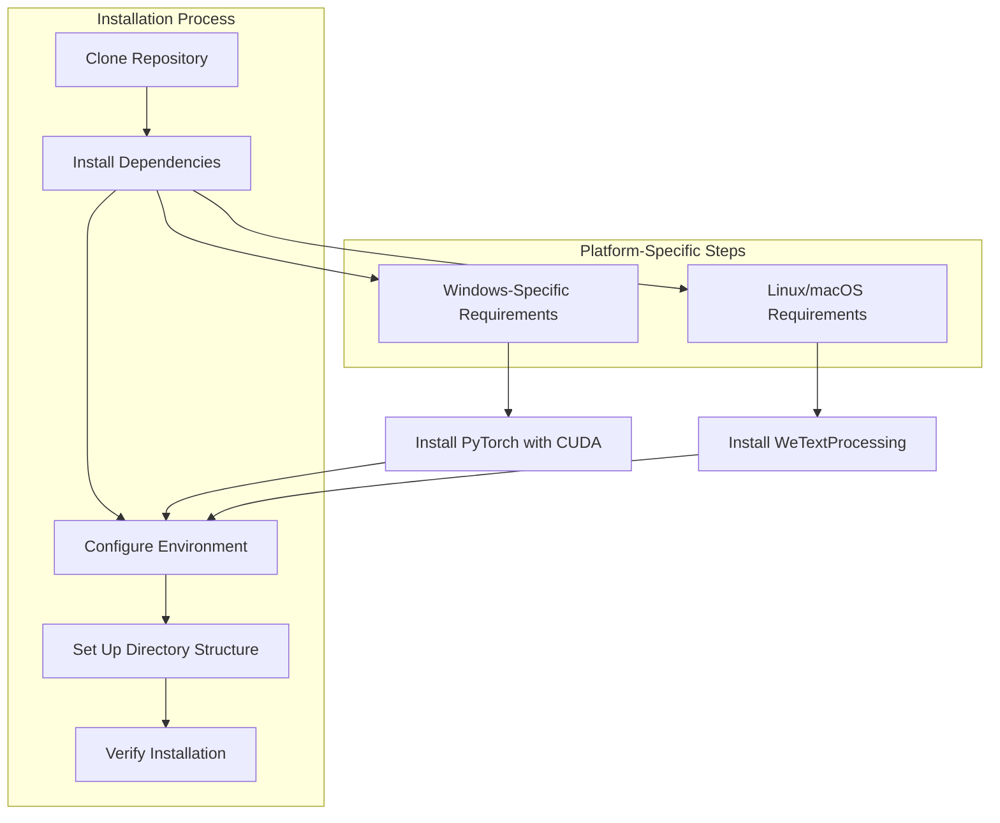
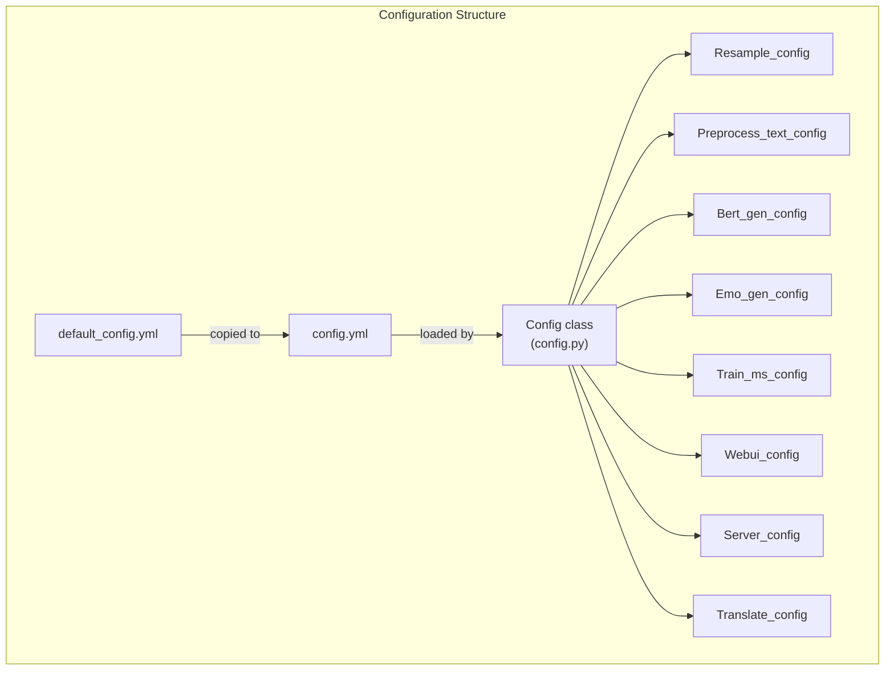
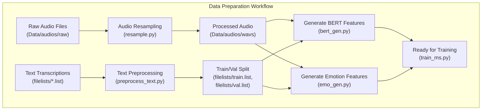
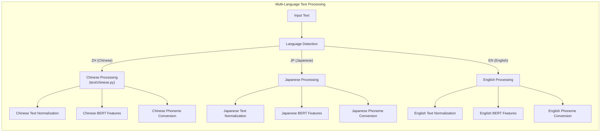

<!-- source: DeepWiki mcp.deepwiki.com · repo fishaudio/Bert-VITS2 · page 1.1 Installation and Setup · fetched 2026-10-29 -->

# Installation and Setup

<details>
<summary>Relevant source files</summary>

The following files were used as context for generating this wiki page:

- [.gitignore](.gitignore)
- [LICENSE](LICENSE)
- [config.py](config.py)
- [default_config.yml](default_config.yml)
- [requirements.txt](requirements.txt)
- [run_MnodesAndMgpus.sh](run_MnodesAndMgpus.sh)
- [text/chinese.py](text/chinese.py)

</details>


This document provides detailed instructions for installing and setting up the Bert-VITS2 environment. Bert-VITS2 is a text-to-speech synthesis system that combines BERT embeddings with a VITS2 architecture to generate high-quality, multi-language speech synthesis. This guide covers environment setup, dependency installation, and initial configuration steps needed before training or using the system.

For information about the underlying model architecture, see [Core Model Architecture](#2), and for the training process, see [Training Pipeline](#3).

## System Requirements

Before installing Bert-VITS2, ensure your system meets these requirements:

- **Operating System**: Windows, Linux, or macOS
- **Python**: Version 3.8 or newer recommended
- **GPU**: NVIDIA GPU with CUDA support strongly recommended for training and faster inference
- **RAM**: Minimum 8GB, 16GB+ recommended for training
- **Storage**: At least 10GB for code, dependencies, and pre-trained models (additional space needed for datasets)

Sources: [requirements.txt](), [default_config.yml]()

## Installation Process

The installation process for Bert-VITS2 involves several steps, as illustrated in the diagram below:



### 1. Clone the Repository

First, clone the Bert-VITS2 repository from GitHub:

```bash
git clone https://github.com/fishaudio/Bert-VITS2.git
cd Bert-VITS2
```

### 2. Install Dependencies

Install the required Python packages using pip:

```bash
pip install -r requirements.txt
```

Note that some packages have platform-specific requirements:
- WeTextProcessing is required for Linux/macOS but not for Windows
- Some packages may require additional system libraries depending on your platform

Sources: [requirements.txt:1-34]()

### 3. Special Platform Considerations

#### Windows

On Windows, ensure you have the correct Visual C++ redistributable installed for some of the audio processing libraries. Additionally, some packages like pyopenjtalk-prebuilt may require specific setup.

#### Linux

Linux users might need to install additional libraries for audio processing:

```bash
# Ubuntu/Debian
sudo apt-get install -y libsndfile1 ffmpeg
```

#### macOS

macOS users might need to install portaudio and ffmpeg:

```bash
# Using Homebrew
brew install portaudio ffmpeg
```

## Configuration Setup

Bert-VITS2 uses YAML configuration files to manage various aspects of the system. The first time you run any script, it will create a `config.yml` file based on the default configuration.



When you first run any component of Bert-VITS2, the system checks for a `config.yml` file, and if it doesn't exist, it copies the default configuration:

```python
if not os.path.isfile(config_path) and os.path.isfile("default_config.yml"):
    shutil.copy(src="default_config.yml", dst=config_path)
    print(f"已根据默认配置文件default_config.yml生成配置文件{config_path}。请按该配置文件的说明进行配置后重新运行。")
    print("如无特殊需求，请勿修改default_config.yml或备份该文件。")
    sys.exit(0)
```

Sources: [config.py:215-221]()

### Key Configuration Settings

Modify your `config.yml` file with these essential settings:

1. **Dataset Path**: Set the base directory for your data
   ```yaml
   dataset_path: "Data/"
   ```

2. **Model Mirror**: Choose a model source (default is HuggingFace)
   ```yaml
   mirror: ""  # Leave empty for HuggingFace, use "openi" for OpenI
   openi_token: ""  # Only needed if using OpenI
   ```

3. **Audio Resampling**: Configure input/output directories and sample rate
   ```yaml
   resample:
     sampling_rate: 44100
     in_dir: "audios/raw"
     out_dir: "audios/wavs"
   ```

4. **Text Processing**: Define input text and output files
   ```yaml
   preprocess_text:
     transcription_path: "filelists/your_dataset.list"
     train_path: "filelists/train.list"
     val_path: "filelists/val.list"
     config_path: "config.json"
   ```

Sources: [default_config.yml:1-44]()

## Directory Structure Setup

Bert-VITS2 expects a specific directory structure for data organization. The main directories are:

| Directory | Purpose | Created Automatically? |
|-----------|---------|------------------------|
| `Data/` | Root directory for datasets | No |
| `Data/audios/raw` | Raw audio files for processing | No |
| `Data/audios/wavs` | Processed audio files | Yes |
| `Data/filelists` | Dataset file lists | No |
| `Data/models` | Trained model checkpoints | Yes |
| `Data/configs` | Model configuration files | No |
| `bert/` | BERT model files | Yes |
| `emotional/` | Emotional embedding files | Yes |

You'll need to manually create the following minimum structure:

```
Bert-VITS2/
├── Data/
│   ├── audios/
│   │   └── raw/          # Place raw audio files here
│   ├── filelists/        # Create your dataset file lists here
│   └── configs/          # Model configuration will be saved here
└── config.yml            # Your configuration file
```

Sources: [.gitignore:162-188](), [default_config.yml:4-7]()

## Data Preparation Workflow

Before training or using Bert-VITS2, you need to prepare your data following this workflow:



Each step corresponds to a script in the repository:

1. **Audio Resampling**: Process raw audio files to the required format
   ```bash
   python resample.py
   ```

2. **Text Preprocessing**: Clean text and split into training/validation sets
   ```bash
   python preprocess_text.py
   ```

3. **BERT Feature Generation**: Generate BERT embeddings for text
   ```bash
   python bert_gen.py
   ```

4. **Emotion Feature Generation**: Generate emotion embeddings
   ```bash
   python emo_gen.py
   ```

Sources: [default_config.yml:13-119]()

## Multi-Language Support

Bert-VITS2 supports multiple languages including Chinese, Japanese, and English. The system handles language-specific processing in different ways:



For each language, different processing steps are applied:

- **Chinese**: Uses pypinyin for phoneme conversion and tone handling
- **Japanese**: Uses OpenJTalk for phoneme conversion
- **English**: Uses g2p_en for grapheme-to-phoneme conversion

The text processing modules automatically handle special characters, punctuation, and language-specific rules.

Sources: [text/chinese.py:1-206]()

## Verification and Troubleshooting

To verify your installation is working correctly, run:

```bash
python3 webui.py
```

This should start the Gradio web interface on port 7860 (by default). If everything is set up correctly, you'll be able to access the interface through your browser at `http://localhost:7860`.

### Common Issues and Solutions

1. **CUDA/GPU Problems**:
   - Check that your NVIDIA drivers and CUDA toolkit are properly installed
   - Ensure PyTorch was installed with CUDA support
   - Set `device: "cpu"` in config.yml if no GPU is available

2. **Missing Directories**:
   - Ensure you've created the necessary directory structure
   - Check file permissions if on Linux/macOS

3. **Configuration Errors**:
   - If you encounter errors related to configuration, check that your config.yml has all required fields
   - Compare with default_config.yml to spot any missing settings

4. **Language-Specific Issues**:
   - For Chinese text processing issues, check that pypinyin and jieba are properly installed
   - For Japanese, verify that pyopenjtalk-prebuilt is installed correctly

Sources: [default_config.yml:98-114]()

## Multi-GPU Training Setup

If you have multiple GPUs, you can configure distributed training with the following steps:

```bash
# For multi-GPU on a single machine
torchrun --nnodes=1 --nproc_per_node=NUM_GPUS train_ms.py

# For multi-node training (across multiple machines)
torchrun --nnodes=1:3 --nproc_per_node=NUM_GPUS --rdzv_id=1 --rdzv_backend=c10d --rdzv_endpoint="MASTER_IP:PORT" train_ms.py
```

Where:
- `NUM_GPUS` is the number of GPUs per machine
- `MASTER_IP:PORT` is the IP address and port of the main node

You can also adjust the environment variables in your config.yml:

```yaml
train_ms:
  env:
    MASTER_ADDR: "localhost"
    MASTER_PORT: 10086
    WORLD_SIZE: 1
    LOCAL_RANK: 0
    RANK: 0
```

Sources: [run_MnodesAndMgpus.sh:1-31](), [default_config.yml:71-81]()

## Next Steps

After completing installation and setup, you can:

1. Prepare your dataset following the [Training Pipeline](#3) documentation
2. Train a model using your prepared data
3. Run inference using the web interface or API server
4. Export your trained model to ONNX format for faster inference

This completes the installation and setup guide for Bert-VITS2. For more detailed information about specific components, refer to the appropriate sections in the documentation.

---

