<!-- source: DeepWiki mcp.deepwiki.com · repo fishaudio/Bert-VITS2 · page 2 Core Model Architecture · fetched 2026-10-29 -->

# Core Model Architecture

Relevant source files

The following files were used as context for generating this wiki page:

- [configs/config.json](configs/config.json)
- [hiyoriUI.py](hiyoriUI.py)
- [models.py](models.py)
- [modules.py](modules.py)
- [preprocess_text.py](preprocess_text.py)
- [spec_gen.py](spec_gen.py)

This page documents the core model architecture of Bert-VITS2, focusing on the main model components, their interactions, and the overall design of the system. For information about training the model, see [Training Pipeline](#3), and for text processing details, see [Multi-Language Text Processing](#4).

## Overview

Bert-VITS2 extends the VITS2 text-to-speech architecture by incorporating BERT embeddings for improved text understanding. The system integrates several key components: a text encoder enhanced with BERT embeddings, flow-based modules for transforming between latent representations, duration predictors for controlling speech timing, and a generator for synthesizing high-quality audio waveforms.

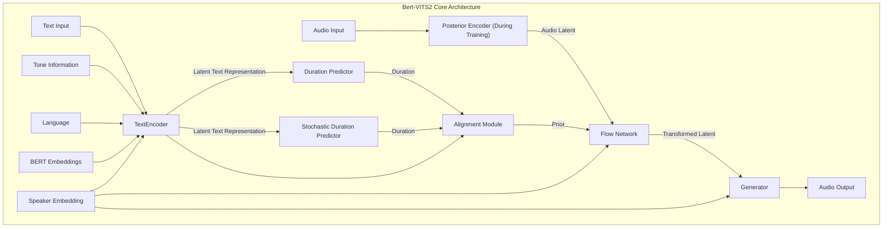

Sources: [models.py:811-936]()

## SynthesizerTrn: The Main Model Class

The `SynthesizerTrn` class serves as the central component that integrates all parts of the model. It initializes the encoders, flow networks, duration predictors, and the generator to form a complete TTS system.

### Initialization

The `SynthesizerTrn` constructor initializes the model with configuration parameters including dimension sizes, network architecture choices, and speaker representation options.

Key parameters include:
- Text representation dimensions
- Hidden channel dimensions
- Filter settings
- Speaker embedding setup
- Flow network configuration

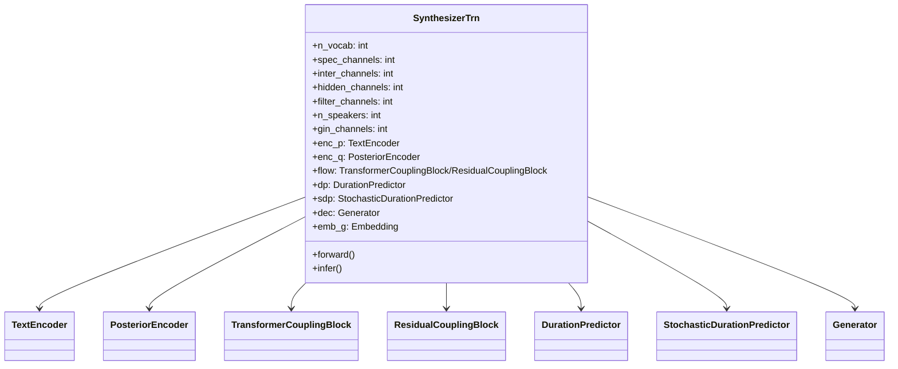

Sources: [models.py:811-936](), [configs/config.json:895-954]()

### Forward and Inference Processes

The `SynthesizerTrn` implements two main methods:

1. **`forward()`**: Used during training to process text and audio inputs, calculate losses, and return intermediate values. The process includes:
   - Text encoding with BERT features
   - Posterior encoding of reference audio
   - Flow-based transformation
   - Duration prediction and alignment
   - Audio generation

2. **`infer()`**: Used during inference to generate audio from text inputs. The process includes:
   - Text encoding
   - Duration prediction
   - Flow transformation (in reverse)
   - Audio generation

Sources: [models.py:937-1074]()

## Text Encoding Pipeline

The `TextEncoder` processes text inputs along with additional contextual information to create a rich latent representation.

### Inputs and Processing Flow

The text encoder takes several inputs:
- Text tokens
- Tone information
- Language identifiers
- BERT embeddings for different languages (Chinese, Japanese, English)
- Speaker conditioning (optional)

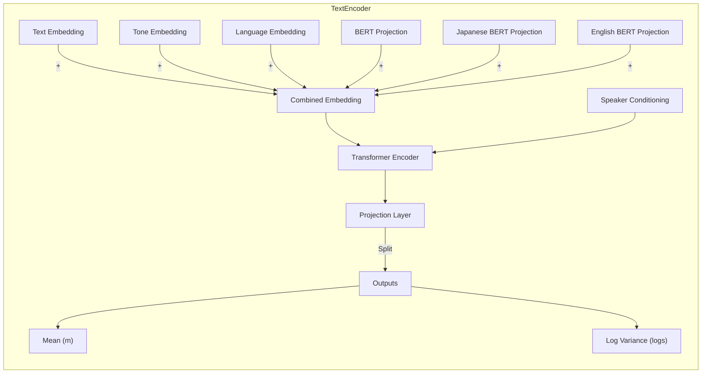

The encoder uses a transformer-based architecture to process the combined embeddings and produce a latent representation with mean and log variance parameters for each position in the sequence.

Sources: [models.py:333-400]()

## Flow-based Modules

Bert-VITS2 employs flow-based models to transform between latent representations. These modules use invertible normalizing flows to map between different probability distributions.

### TransformerCouplingBlock

The `TransformerCouplingBlock` is the primary flow module, using a series of transformer-based coupling layers to transform latent representations.

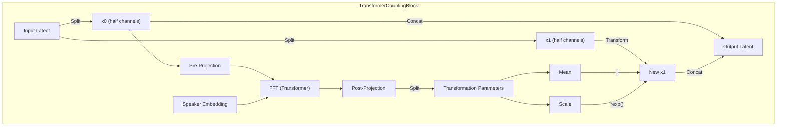

The implementation supports sharing parameters between coupling layers for more efficient computation.

Sources: [models.py:82-145](), [modules.py:519-581]()

### ResidualCouplingBlock

Alternatively, a `ResidualCouplingBlock` can be used, which employs dilated convolutions in its coupling layers instead of transformers.

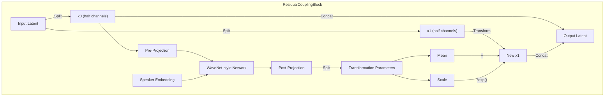

Sources: [models.py:403-446](), [modules.py:403-457]()

## Duration Prediction

Bert-VITS2 implements two duration prediction approaches: a deterministic predictor and a stochastic predictor.

### DurationPredictor

The `DurationPredictor` is a conventional feed-forward network that predicts log durations deterministically.

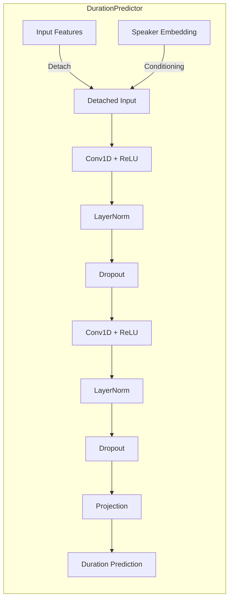

Sources: [models.py:259-299]()

### StochasticDurationPredictor

The `StochasticDurationPredictor` employs a flow-based approach to model the distribution of durations, allowing for sampling diverse duration patterns.

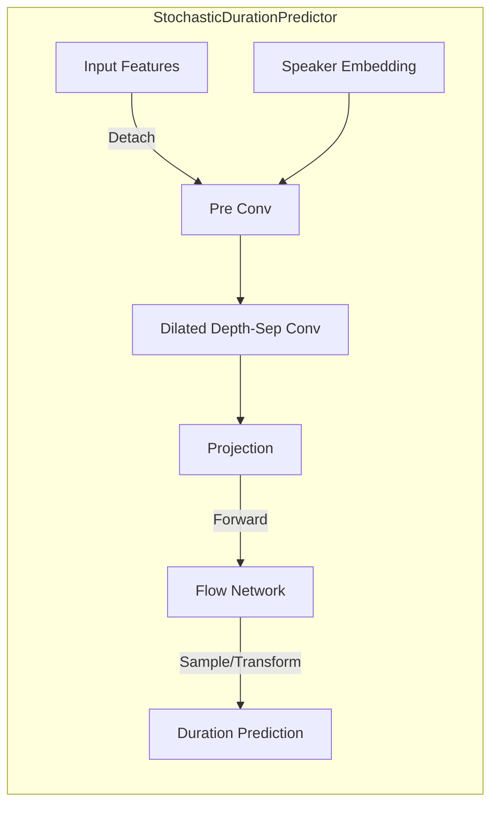

During inference, the stochastic predictor can generate varied durations, which contributes to more natural-sounding speech synthesis.

Sources: [models.py:148-256](), [modules.py:84-130]()

## Generator and Audio Synthesis

The `Generator` converts the transformed latent representations into waveforms through a series of upsampling and residual blocks.

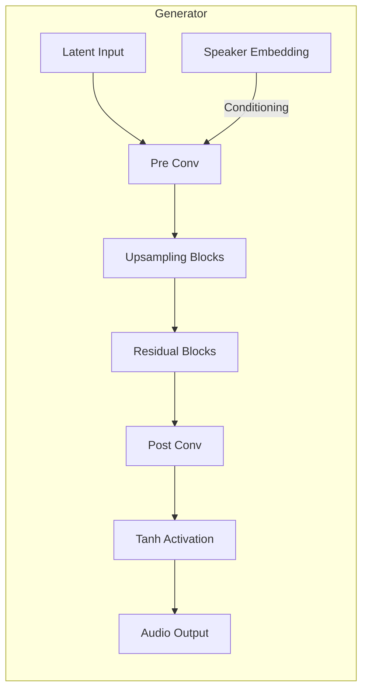

The generator uses a hierarchical structure with multiple upsampling stages, each followed by residual blocks with different dilation rates. This architecture enables the model to capture patterns at various temporal resolutions.

Sources: [models.py:490-565]()

## Discriminator Components

During training, multiple discriminators provide feedback to improve the quality of generated audio.

### MultiPeriodDiscriminator

The `MultiPeriodDiscriminator` combines several sub-discriminators operating at different temporal periods, helping the model generate coherent structure at multiple timescales.

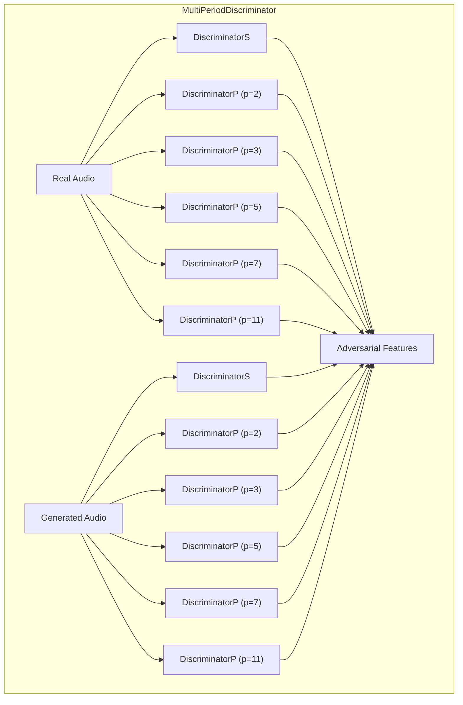

Sources: [models.py:676-700]()

### DurationDiscriminator

The `DurationDiscriminator` specifically evaluates the quality of predicted durations, helping the model generate more natural rhythm and timing.

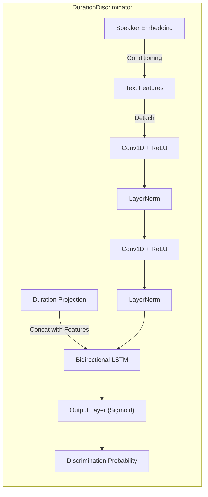

Sources: [models.py:18-79]()

### WavLMDiscriminator

The `WavLMDiscriminator` incorporates a pre-trained WavLM model to provide perceptual feedback on the naturalness of generated speech.

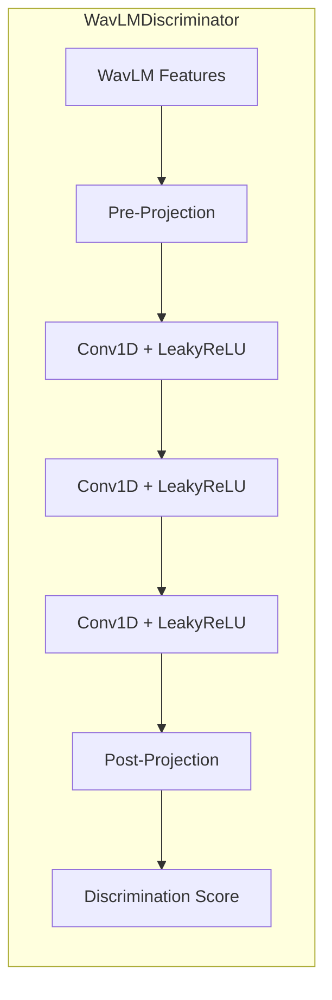

Sources: [models.py:703-749](), [configs/config.json:948-954]()

## Inference Process

During inference, the `SynthesizerTrn.infer()` method is used to generate speech from text inputs. The process follows these steps:

1. Text encoding with BERT embeddings
2. Duration prediction (using a mixture of deterministic and stochastic predictions)
3. Alignment of text and audio representations
4. Flow-based transformation (in reverse direction)
5. Waveform generation

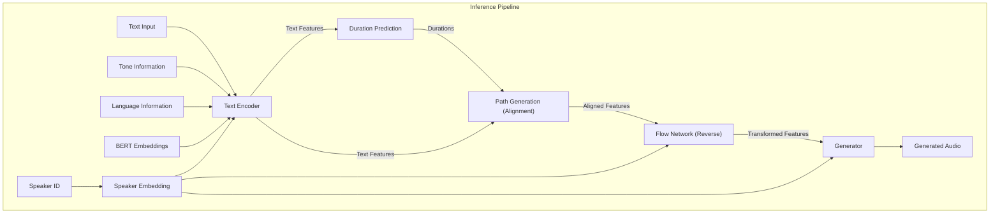

The noise scales and duration scaling parameters can be adjusted during inference to control the variability and speed of the generated speech.

Sources: [models.py:1026-1074](), [hiyoriUI.py:197-348]()

## Model Configuration

The model configuration specifies the architecture parameters, including dimensions, layer counts, and module choices.

Key configuration parameters:

| Parameter | Description | Default Value |
|-----------|-------------|---------------|
| inter_channels | Intermediate channel dimensions | 192 |
| hidden_channels | Hidden representation dimensions | 192 |
| filter_channels | Filter dimensions for attention | 768 |
| n_heads | Number of attention heads | 2 |
| n_layers | Number of transformer layers | 6 |
| kernel_size | Convolution kernel size | 3 |
| p_dropout | Dropout probability | 0.1 |
| gin_channels | Speaker embedding dimensions | 512 |
| n_speakers | Number of speakers supported | 850+ |
| use_spk_conditioned_encoder | Whether to condition encoder on speaker | true |
| use_noise_scaled_mas | Whether to use noise-scaled MAS | true |

Sources: [configs/config.json:895-954]()

## Integration with BERT Models

A key feature of Bert-VITS2 is the integration of BERT embeddings to improve text understanding. The `TextEncoder` incorporates these embeddings through projection layers:

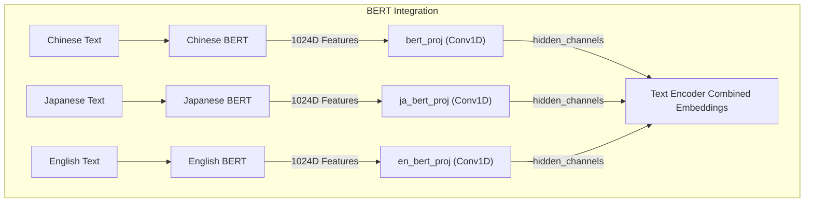

During preprocessing, BERT features are extracted for each text sample and stored for training and inference.

Sources: [models.py:356-364](), [models.py:377-390](), [preprocess_text.py:1-141]()

## End-to-End Architecture

The complete Bert-VITS2 architecture connects all components in an end-to-end pipeline, from text input to audio output.

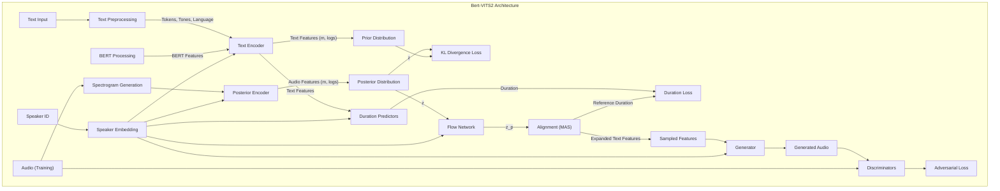

This integrated system combines the power of pre-trained language models (BERT) with advanced speech synthesis techniques to produce high-quality, expressive speech in multiple languages.

Sources: [models.py:811-1074](), [spec_gen.py:1-88]()

---

