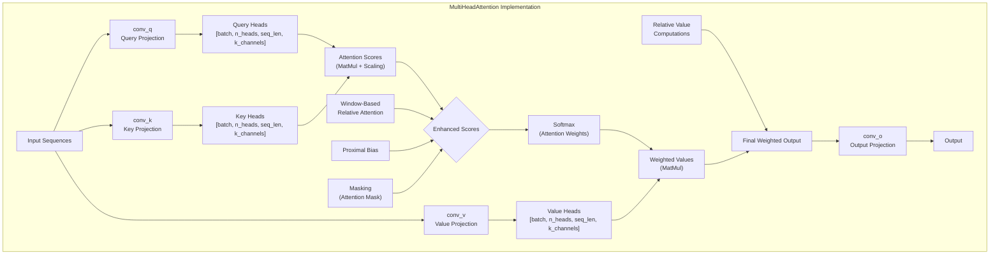
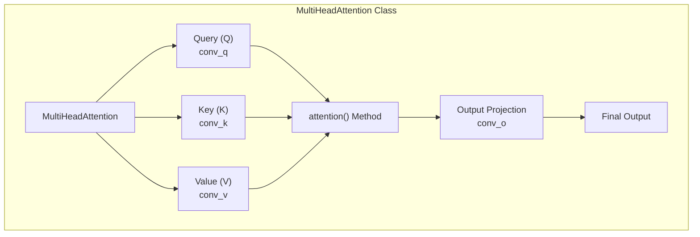
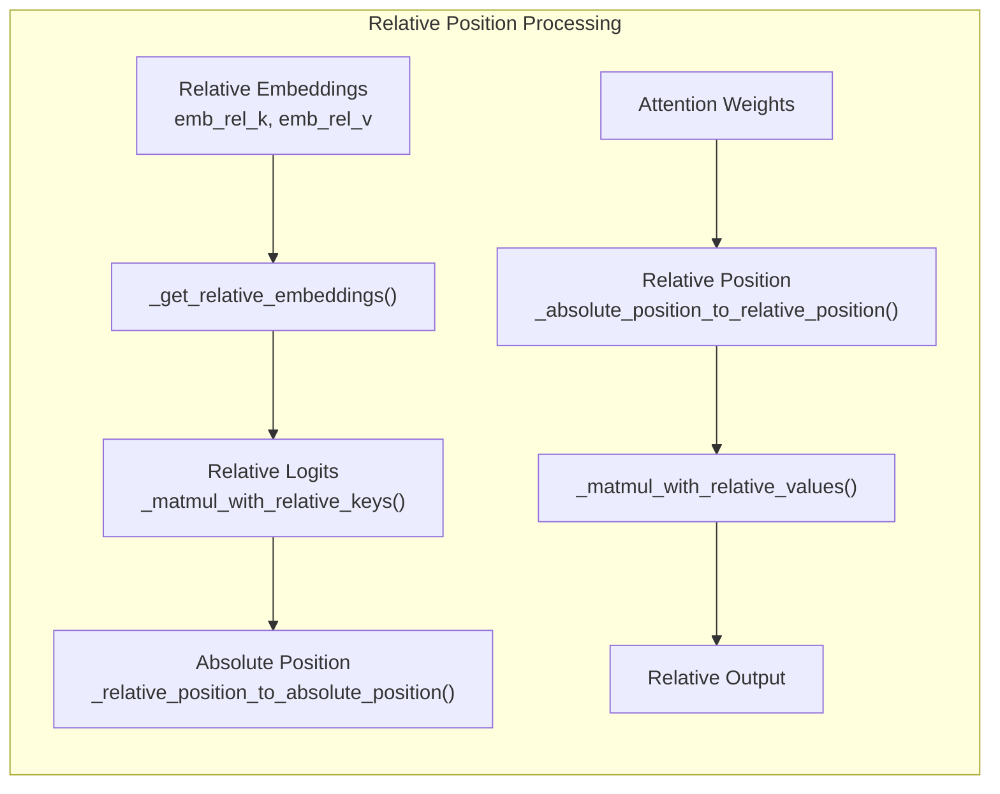
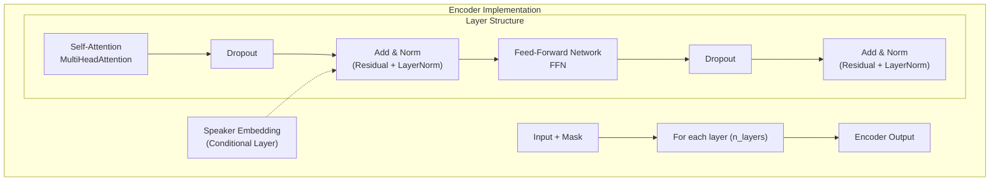
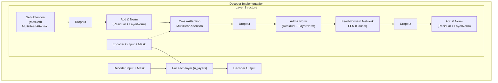

<!-- source: DeepWiki mcp.deepwiki.com · repo fishaudio/Bert-VITS2 · page 2.1 Attention Mechanisms · fetched 2026-10-29 -->

# Attention Mechanisms

<details>
<summary>Relevant source files</summary>

The following files were used as context for generating this wiki page:

- [attentions.py](attentions.py)
- [commons.py](commons.py)
- [mel_processing.py](mel_processing.py)
- [resample.py](resample.py)

</details>


This document provides a detailed explanation of the attention mechanisms implemented in Bert-VITS2. Attention mechanisms are fundamental components that enable the model to focus on relevant parts of input sequences when generating output features. For information about the overall model architecture, see [Core Model Architecture](#2).

## Overview of Attention in Bert-VITS2

Bert-VITS2 employs various attention mechanisms to effectively process sequential data in both text encoding and audio generation phases. These mechanisms allow the model to dynamically focus on different parts of the input sequence based on context, significantly improving the quality and naturalness of synthesized speech.

Sources: [attentions.py:209-407]()

## Attention Mechanism Architecture



Sources: [attentions.py:209-271](), [attentions.py:273-322]()

## Key Attention Components

Bert-VITS2 implements several specialized attention mechanisms, each serving a specific purpose in the TTS pipeline:

### 1. Multi-Head Attention

The `MultiHeadAttention` class implements the core attention mechanism, dividing the attention computation into multiple heads to capture different aspects of the input sequence relationships.



Key properties:
- **Channels**: Input dimensionality 
- **Out Channels**: Output dimensionality
- **N Heads**: Number of attention heads
- **K Channels**: Dimensionality per head (channels / n_heads)

Sources: [attentions.py:209-271]()

### 2. Attention Computation

The core attention computation follows the standard scaled dot-product attention formula but adds several enhancements:

1. **Query, Key, Value Projections**: Linear projections implemented as 1D convolutions
2. **Scaled Dot-Product**: `scores = (Q * K^T) / sqrt(k_channels)`
3. **Optional Enhancements**:
   - Window-based relative attention
   - Proximal bias
   - Masking for causal attention

Sources: [attentions.py:273-322]()

### 3. Window-Based Relative Attention

A significant enhancement in Bert-VITS2 is the window-based relative attention, which provides the model with awareness of relative positions within a limited window.



Key features:
- Maintains relative position embeddings for both keys and values
- Uses a window size to limit the context of relative positions
- Transforms between relative and absolute position representations

Sources: [attentions.py:324-395]()

### 4. Proximal Bias

For self-attention operations, Bert-VITS2 can apply a proximal bias that encourages attention to nearby positions:

```
Bias(i, j) = -log(1 + |i - j|)
```

This bias decreases as the distance between positions increases, giving preference to local connections.

Sources: [attentions.py:397-406]()

## Integration within Encoder and Decoder

The attention mechanisms are integrated into both the `Encoder` and `Decoder` classes:

### Encoder Architecture

The `Encoder` consists of multiple layers, each containing:
1. Self-attention (`MultiHeadAttention`)
2. Layer normalization
3. Feed-forward network (`FFN`)
4. Another layer normalization



Sources: [attentions.py:37-120]()

### Decoder Architecture

The `Decoder` has a more complex structure with three components per layer:
1. Masked self-attention (for causal prediction)
2. Cross-attention between decoder and encoder states
3. Feed-forward network



Sources: [attentions.py:123-206]()

## Supporting Components

### 1. LayerNorm

A simple layer normalization implementation that operates on the channel dimension:

```
x = F.layer_norm(x, (channels,), gamma, beta, eps)
```

Sources: [attentions.py:12-24]()

### 2. Feed-Forward Network (FFN)

A position-wise feed-forward network consisting of two 1D convolutions with activation in between:

```
x = conv_1(padding(x * mask))
x = activation(x)
x = dropout(x)
x = conv_2(padding(x * mask))
```

The `FFN` supports both causal and non-causal padding modes.

Sources: [attentions.py:409-464]()

## Attention Mechanics in Practice

When processing text and generating speech, the attention mechanisms perform these key functions:

1. **Text Encoding**: Self-attention in the encoder captures relationships between different phonemes/tokens in the input text
2. **Duration Modeling**: Attention helps in predicting how long each phoneme should be in the output speech
3. **Alignment**: Cross-attention in the decoder aligns text representations with acoustic features
4. **Speaker Conditioning**: At a specific layer (default is the 3rd layer), speaker embeddings are injected into the encoder, allowing the attention to adapt to speaker characteristics

The relative positional attention is particularly important for capturing local phonetic context, while the proximal bias helps maintain coherent pronunciation by focusing on nearby phonetic units.

Sources: [attentions.py:37-120](), [attentions.py:123-206]()

## Technical Parameters

| Parameter | Description | Default/Typical Value |
|-----------|-------------|------------------------|
| `hidden_channels` | Dimensionality of the model | 192 |
| `filter_channels` | Dimensionality of FFN inner layer | 768 |
| `n_heads` | Number of attention heads | 2 |
| `n_layers` | Number of encoder/decoder layers | 6 |
| `kernel_size` | Size of convolutional kernels in FFN | 3 |
| `p_dropout` | Dropout probability | 0.1 |
| `window_size` | Window size for relative attention | 4 |
| `proximal_bias` | Whether to use proximal bias | `True` for decoder |
| `proximal_init` | Initialize K weights with Q weights | `True` for decoder |

Sources: [attentions.py:37-56](), [attentions.py:123-144](), [attentions.py:209-233]()

## Relationship to BERT Integration

While the attention mechanisms discussed here form the backbone of sequence processing in Bert-VITS2, they work in conjunction with BERT embeddings. The text encoder processes both phoneme representations and BERT embeddings, allowing the attention layers to leverage semantic information from BERT when generating speech features. For more details on how BERT features are generated and used, see [BERT Feature Generation](#3.2).

Sources: [attentions.py:37-120]()

---

