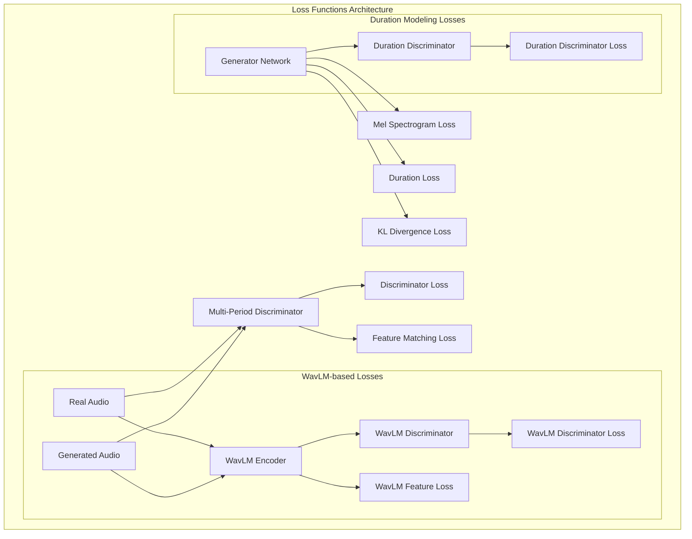
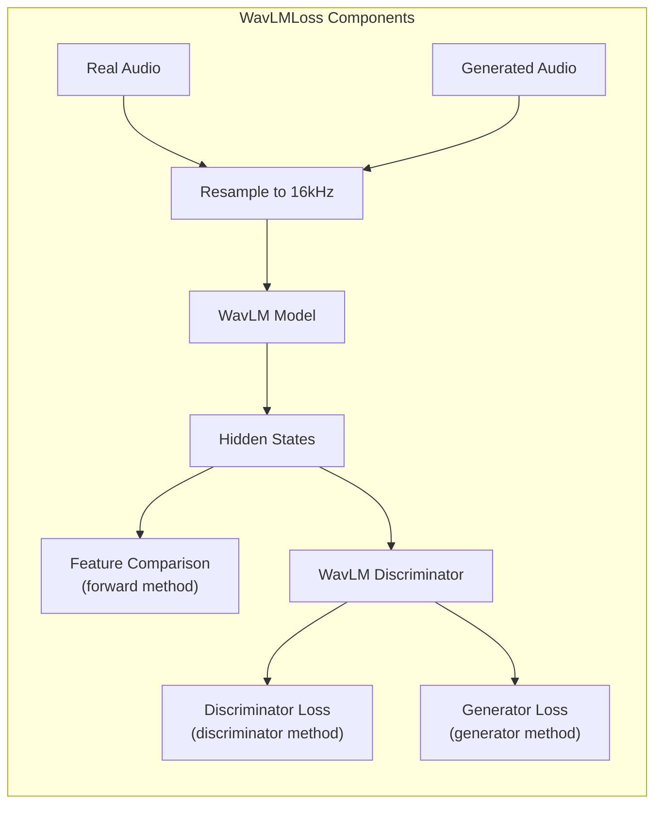
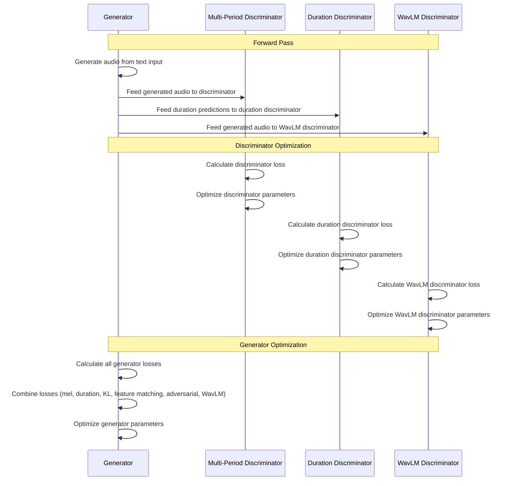

<!-- source: DeepWiki mcp.deepwiki.com · repo fishaudio/Bert-VITS2 · page 2.2 Loss Functions · fetched 2026-10-29 -->

# Loss Functions

<details>
<summary>Relevant source files</summary>

The following files were used as context for generating this wiki page:

- [losses.py](losses.py)
- [text/tone_sandhi.py](text/tone_sandhi.py)
- [train_ms.py](train_ms.py)
- [utils.py](utils.py)

</details>


This page documents the loss functions used in Bert-VITS2 for training the text-to-speech synthesis model. Loss functions play a critical role in optimizing the model to generate high-quality speech that closely matches the target audio while maintaining natural pronunciation and prosody.

## Overview of Loss Functions

Bert-VITS2 uses a combination of multiple loss functions to train different components of the model. These loss functions can be categorized into several types:

1. **Generator Losses** - Train the speech synthesis network
2. **Discriminator Losses** - Train adversarial networks to distinguish real from generated audio
3. **Feature Matching Losses** - Ensure generated audio shares similar features with real audio
4. **Regularization Losses** - Constrain the model's behavior and prevent overfitting



Sources: [losses.py:1-154](), [train_ms.py:577-600]()

## Core Loss Functions

### Feature Matching Loss

Feature matching loss ensures that the intermediate representations from the discriminator for real and generated samples are similar, which helps stabilize training and produce higher quality results.

```python
def feature_loss(fmap_r, fmap_g):
    loss = 0
    for dr, dg in zip(fmap_r, fmap_g):
        for rl, gl in zip(dr, dg):
            rl = rl.float().detach()
            gl = gl.float()
            loss += torch.mean(torch.abs(rl - gl))
    return loss * 2
```

The feature loss is calculated as the L1 distance between feature maps of real and generated audio, summed across all layers and multiplied by 2.

Sources: [losses.py:6-14]()

### Discriminator Loss

The discriminator loss trains the discriminator network to correctly classify real audio samples as real (target=1) and generated samples as fake (target=0). It uses a mean squared error (MSE) loss.

```python
def discriminator_loss(disc_real_outputs, disc_generated_outputs):
    loss = 0
    r_losses = []
    g_losses = []
    for dr, dg in zip(disc_real_outputs, disc_generated_outputs):
        dr = dr.float()
        dg = dg.float()
        r_loss = torch.mean((1 - dr) ** 2)
        g_loss = torch.mean(dg**2)
        loss += r_loss + g_loss
        r_losses.append(r_loss.item())
        g_losses.append(g_loss.item())
    return loss, r_losses, g_losses
```

Sources: [losses.py:17-30]()

### Generator Loss

The generator loss trains the generator to produce audio that the discriminator will classify as real. It uses an adversarial loss where the generator tries to maximize the discriminator's prediction for generated samples.

```python
def generator_loss(disc_outputs):
    loss = 0
    gen_losses = []
    for dg in disc_outputs:
        dg = dg.float()
        l = torch.mean((1 - dg) ** 2)
        gen_losses.append(l)
        loss += l
    return loss, gen_losses
```

Sources: [losses.py:33-42]()

### KL Divergence Loss

KL (Kullback-Leibler) divergence loss is used for the probabilistic modeling aspects of Bert-VITS2. It regularizes the latent space distribution to be close to a prior distribution, which is important for the flow-based decoder.

```python
def kl_loss(z_p, logs_q, m_p, logs_p, z_mask):
    """
    z_p, logs_q: [b, h, t_t]
    m_p, logs_p: [b, h, t_t]
    """
    z_p = z_p.float()
    logs_q = logs_q.float()
    m_p = m_p.float()
    logs_p = logs_p.float()
    z_mask = z_mask.float()

    kl = logs_p - logs_q - 0.5
    kl += 0.5 * ((z_p - m_p) ** 2) * torch.exp(-2.0 * logs_p)
    kl = torch.sum(kl * z_mask)
    l = kl / torch.sum(z_mask)
    return l
```

Sources: [losses.py:45-60]()

## WavLM-based Losses

Bert-VITS2 incorporates WavLM, a self-supervised learning model for speech, to improve speech quality. The `WavLMLoss` class implements several loss functions based on WavLM features.



The `WavLMLoss` class has three main components:

1. **Feature Matching (forward method)** - Computes L1 loss between WavLM embeddings of real and generated audio
2. **Discriminator Loss** - Trains the WavLM discriminator to distinguish real from generated embeddings
3. **Generator Loss** - Trains the generator to produce audio with embeddings that fool the WavLM discriminator

Sources: [losses.py:63-153](), [train_ms.py:351-356](), [train_ms.py:577-600]()

## Training Process and Loss Combination

During training, all losses are carefully combined to train different components of the model. The training loop in `train_ms.py` orchestrates this process:

1. **Discriminator Training**:
   - Calculate discriminator losses for the Multi-Period Discriminator
   - If using Duration Discriminator, calculate its losses
   - Optimize discriminator parameters

2. **WavLM Discriminator Training**:
   - Calculate WavLM discriminator loss
   - Optimize WavLM discriminator parameters

3. **Generator Training**:
   - Calculate all generator losses: mel loss, duration loss, KL loss, feature matching loss, adversarial loss, and WavLM losses
   - Combine losses into a single generator loss
   - Optimize generator parameters



Sources: [train_ms.py:394-734]()

## Loss Combination in the Code

The total generator loss is a combination of multiple components:

```python
loss_gen_all = (
    loss_gen     # Adversarial loss
    + loss_fm    # Feature matching loss
    + loss_mel   # Mel spectrogram L1 loss
    + loss_dur   # Duration prediction loss
    + loss_kl    # KL divergence loss
    + loss_lm    # WavLM feature matching loss
    + loss_lm_gen # WavLM generator loss
)

# Add duration discriminator loss if used
if net_dur_disc is not None:
    loss_gen_all += loss_dur_gen
```

This combined loss is then used to update the generator parameters through backpropagation.

Sources: [train_ms.py:587-599]()

## Visualization and Monitoring

During training, loss values are logged and visualized using TensorBoard. The scalar values for different loss components are logged separately to monitor their individual behavior.

```python
scalar_dict = {
    "loss/g/total": loss_gen_all,
    "loss/d/total": loss_disc_all,
    "loss/wd/total": loss_slm,
    "learning_rate": lr,
    "grad_norm_d": grad_norm_d,
    "grad_norm_g": grad_norm_g,
    "grad_norm_dur": grad_norm_dur,
    "grad_norm_wd": grad_norm_wd,
}
scalar_dict.update(
    {
        "loss/g/fm": loss_fm,
        "loss/g/mel": loss_mel,
        "loss/g/dur": loss_dur,
        "loss/g/kl": loss_kl,
        "loss/g/lm": loss_lm,
        "loss/g/lm_gen": loss_lm_gen,
    }
)
```

Monitoring these losses helps diagnose training issues and identify when the model has converged.

Sources: [train_ms.py:620-648](), [utils.py:144-160]()

## Conclusion

The loss functions in Bert-VITS2 form a complex but effective system for training the text-to-speech model. By combining multiple loss components, the model can learn to generate high-quality, natural-sounding speech that accurately reflects the input text. The adversarial training approach with multiple discriminators helps improve the naturalness of the synthesized speech, while the feature matching and regularization losses ensure stability and consistency during training.

---

