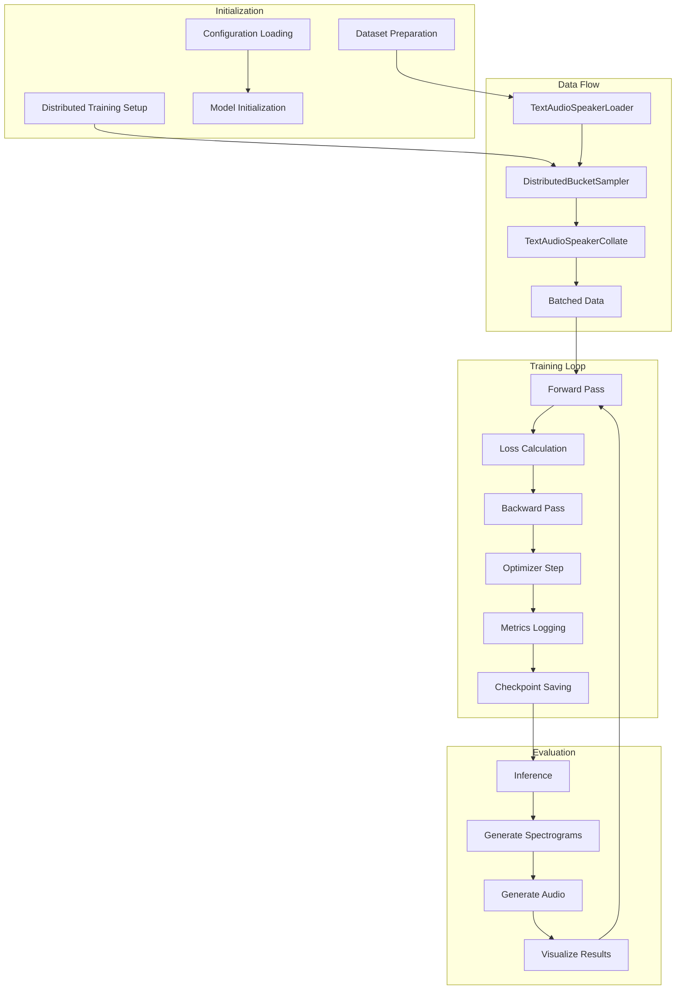
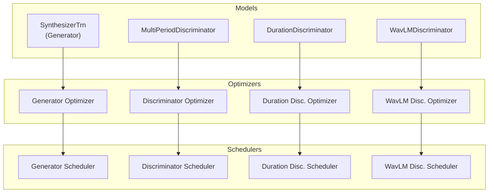
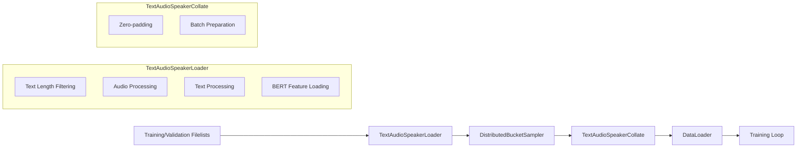
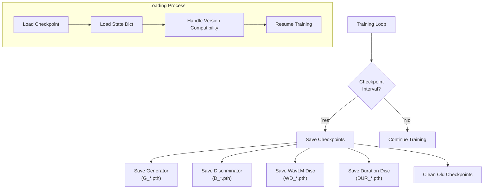
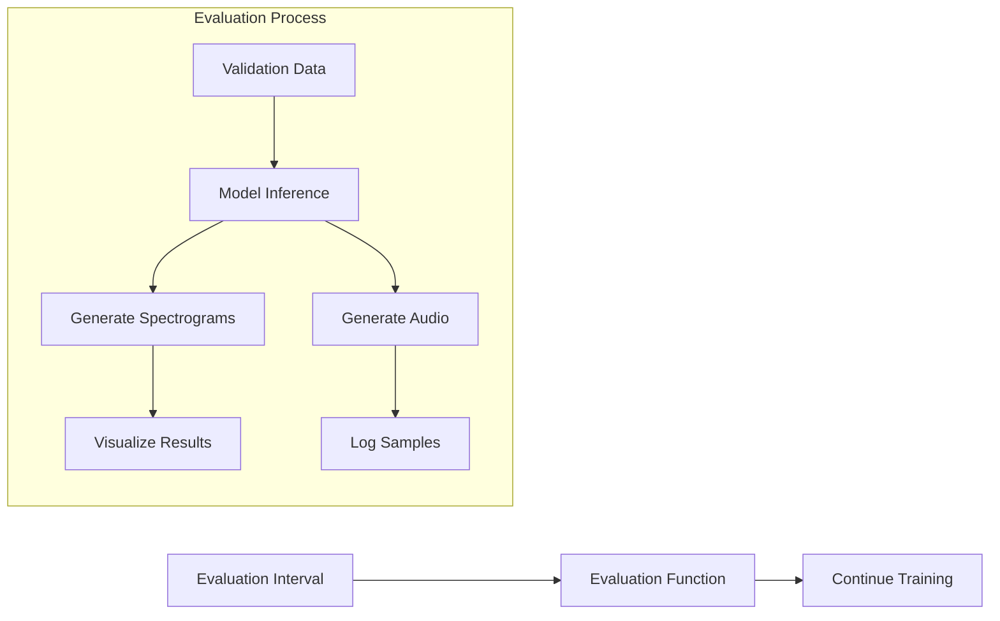
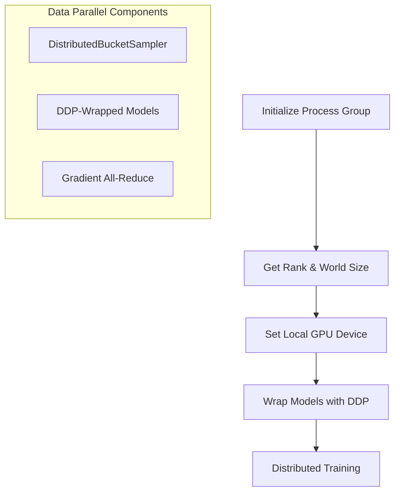
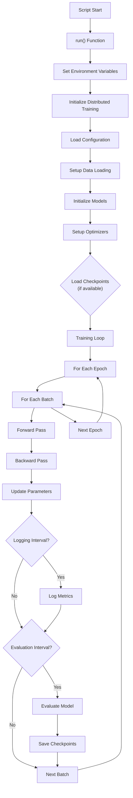

<!-- source: DeepWiki mcp.deepwiki.com · repo fishaudio/Bert-VITS2 · page 3 Training Pipeline · fetched 2026-10-29 -->

# Training Pipeline

<details>
<summary>Relevant source files</summary>

The following files were used as context for generating this wiki page:

- [data_utils.py](data_utils.py)
- [text/__init__.py](text/__init__.py)
- [train_ms.py](train_ms.py)
- [utils.py](utils.py)

</details>


The Training Pipeline in Bert-VITS2 orchestrates the complete process of training the multi-lingual text-to-speech synthesis model. This document provides a comprehensive guide to the training workflow, from data loading to model optimization. For information about data processing specifics, see [Data Processing](#3.1), and for BERT feature generation, see [BERT Feature Generation](#3.2).

## Overview of the Training Pipeline

The Bert-VITS2 training pipeline combines distributed training capabilities with a sophisticated data handling system to efficiently train the TTS model across multiple languages. The pipeline manages the complexities of processing paired text-audio data, handling BERT embeddings, and optimizing multiple neural network components simultaneously.



Sources: [train_ms.py:54-392](), [data_utils.py:16-49]()

## Model Components in Training

The training pipeline manages multiple model components that work together during the training process.



Sources: [train_ms.py:194-242](), [train_ms.py:334-348]()

## Data Loading Pipeline

The data loading pipeline is responsible for preparing training data for the model, handling various preprocessing steps and ensuring efficient batch processing.



Sources: [data_utils.py:16-182](), [train_ms.py:127-146]()

### Data Structure and Processing

The Bert-VITS2 training pipeline processes text-audio pairs with speaker identities and language information. The table below shows the key components in the data processing flow:

| Component | Description | Implementation |
|-----------|-------------|----------------|
| Text Processing | Converts text to phoneme sequences and language IDs | `cleaned_text_to_sequence` in `text/__init__.py` |
| Audio Processing | Loads audio and computes spectrograms | `get_audio` in `TextAudioSpeakerLoader` |
| BERT Features | Loads pre-computed BERT embeddings for text | `get_text` in `TextAudioSpeakerLoader` |
| Padding | Zero-pads inputs to consistent lengths | `TextAudioSpeakerCollate` class |
| Bucketing | Groups samples by length for efficient batching | `DistributedBucketSampler` class |

Sources: [data_utils.py:84-172](), [text/__init__.py:6-18]()

## Training Process

The training process in Bert-VITS2 follows a GAN-like approach with multiple models being trained simultaneously.

```mermaid
sequenceDiagram
    participant Data as Data Loader
    participant G as Generator (SynthesizerTrn)
    participant D as Discriminators
    participant Opt as Optimizers
    participant Log as Logger

    Data->>G: Batch (text, audio, speaker, etc.)
    G->>G: Forward pass
    G->>D: Generated audio
    D->>D: Discriminate real/fake
    D->>Opt: Update discriminators
    G->>Opt: Update generator
    G->>Log: Log metrics & save checkpoint
    
    Note over G,D: Every eval_interval steps
    G->>G: Evaluation
    G->>Log: Save generated samples
```

Sources: [train_ms.py:394-737]()

### Forward Pass

During the forward pass, the generator takes text, spectrograms, speaker IDs, tone, language, and BERT embeddings as input and produces:

1. Synthesized audio (`y_hat`)
2. Duration predictions (`l_length`)
3. Attention weights (`attn`)
4. Latent variables (`z`, `z_p`, etc.)
5. Hidden representations (`hidden_x`, `logw`, etc.)

Sources: [train_ms.py:459-506]()

### Loss Calculation

The training objectives include multiple loss components:

| Loss Component | Description | Applied To |
|----------------|-------------|------------|
| Discriminator Loss | Adversarial loss for discriminators | Discriminators |
| Duration Discriminator Loss | Loss for duration prediction | Duration Discriminator |
| Generator Loss | Adversarial loss for generator | Generator |
| Feature Matching Loss | Loss for feature matching | Generator |
| Mel Spectrogram Loss | L1 loss between real and generated mel spectrograms | Generator |
| Duration Loss | Loss for duration prediction | Generator |
| KL Loss | KL divergence for prior matching | Generator |
| WavLM Loss | Loss based on WavLM embeddings | WavLM Discriminator |

Sources: [train_ms.py:507-599]()

### Optimization

The optimization process involves updating each model component separately:

1. Duration Discriminator update (if used)
2. Discriminator update
3. WavLM Discriminator update
4. Generator update

The pipeline uses gradient scaling with automatic mixed precision to improve training efficiency.

Sources: [train_ms.py:539-607]()

## Checkpoint Management

The training pipeline includes a comprehensive checkpoint system for saving and loading models:



Sources: [train_ms.py:695-732](), [utils.py:65-120](), [utils.py:123-141]()

### Checkpoint File Structure

Each checkpoint contains:
- Model state dictionary
- Optimizer state dictionary
- Current learning rate
- Current iteration number

The checkpoint files follow a naming convention with the global step number (e.g., `G_10000.pth` for the generator checkpoint at step 10,000).

Sources: [utils.py:123-141](), [utils.py:271-317]()

## Evaluation During Training

The training pipeline periodically evaluates the model on validation data to monitor training progress.



During evaluation:
1. The generator is set to evaluation mode
2. A forward pass is performed on validation data
3. Audio samples are generated with and without stochastic duration prediction
4. Mel spectrograms are visualized
5. Audio samples are saved for auditory evaluation

Sources: [train_ms.py:742-835]()

## Distributed Training

Bert-VITS2 supports distributed training across multiple GPUs using PyTorch's DistributedDataParallel (DDP).



Key aspects of the distributed training implementation:
- Uses environment variables for configuration
- Automatically selects the appropriate backend (NCCL for Linux, Gloo for Windows)
- Creates a DistributedBucketSampler to handle data distribution across GPUs
- Wraps all models with DistributedDataParallel for efficient gradient synchronization

Sources: [train_ms.py:54-82](), [train_ms.py:250-258](), [data_utils.py:277-404]()

## Configuration and Hyperparameters

The training pipeline is controlled by a configuration system that loads parameters from a JSON file. Key configuration sections include:

| Section | Description | Examples |
|---------|-------------|----------|
| train | Training parameters | learning rate, batch size, segment size |
| data | Data parameters | sampling rate, hop length, filter length |
| model | Model architecture | hidden channels, kernel size, number of layers |
| env | Environment variables | MASTER_ADDR, MASTER_PORT, WORLD_SIZE |

Sources: [train_ms.py:83-116](), [utils.py:331-339]()

## Logging and Visualization

The training pipeline includes comprehensive logging and visualization features for monitoring training progress:

- Textual logging to a file using Python's logging module
- TensorBoard integration for tracking metrics over time
- Visualization of spectrograms and attention matrices
- Audio sample logging for auditory evaluation

Sources: [train_ms.py:609-693](), [utils.py:144-161](), [utils.py:170-224]()

## Training Script Execution Flow

The complete training pipeline execution follows this general flow:



Sources: [train_ms.py:54-392](), [train_ms.py:394-740]()

## Conclusion

The Bert-VITS2 training pipeline is a sophisticated system that manages the complexities of training a multi-lingual text-to-speech synthesis model. It handles data loading, model optimization, checkpoint management, evaluation, and distributed training in an integrated manner, allowing for efficient training across multiple languages.

The pipeline's modular design, with separate classes for data loading, batching, and model components, makes it flexible and extensible. The use of distributed training, automatic mixed precision, and bucketed sampling improves training efficiency, while the comprehensive logging and visualization features aid in monitoring training progress.

---

