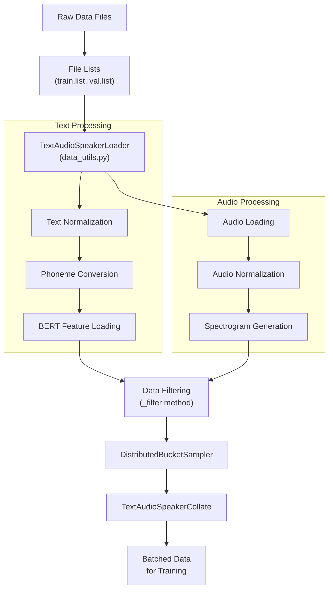
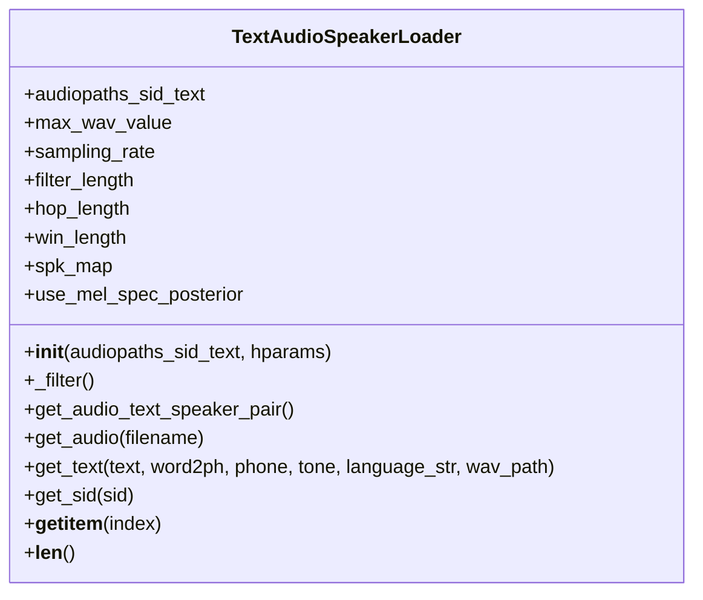
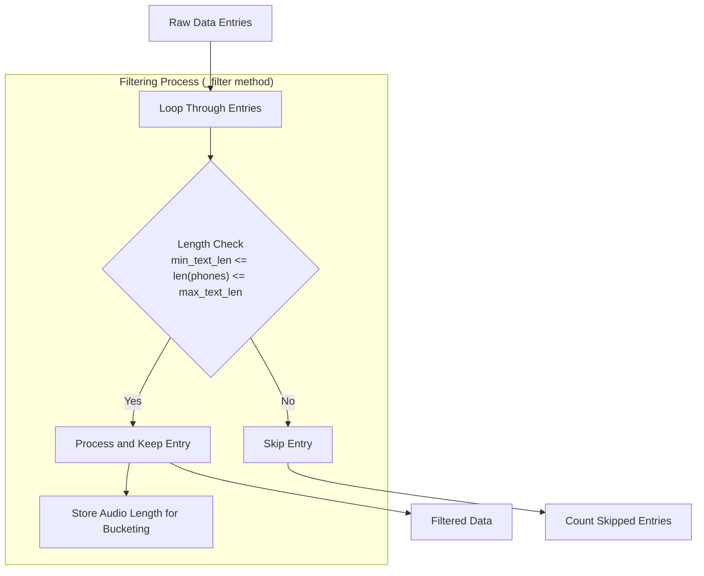
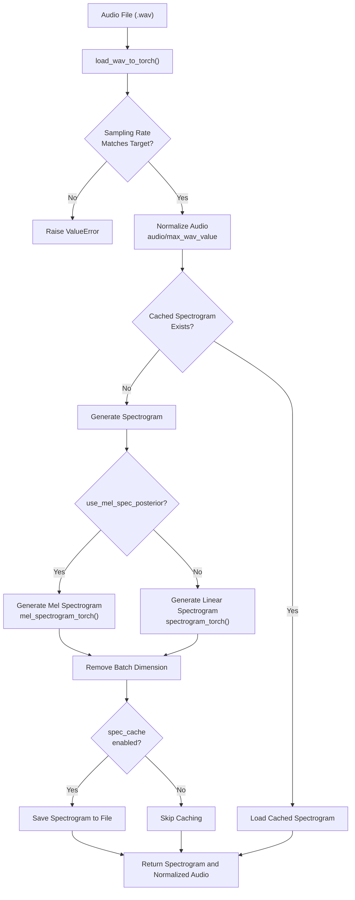
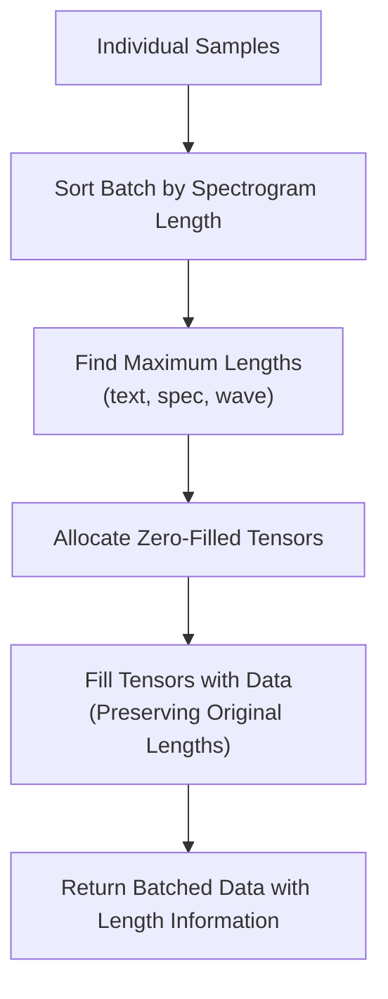
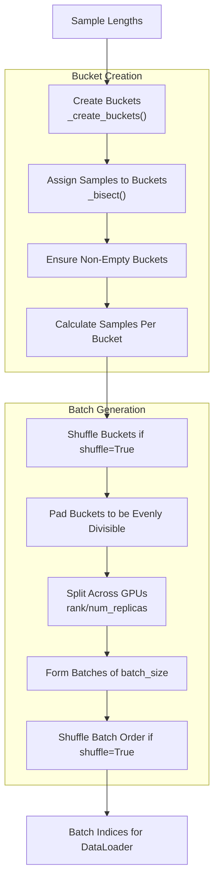
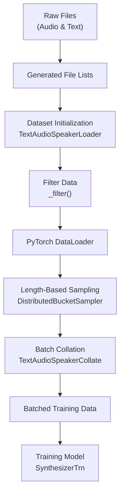

<!-- source: DeepWiki mcp.deepwiki.com · repo fishaudio/Bert-VITS2 · page 3.1 Data Processing · fetched 2026-10-29 -->

# Data Processing

<details>
<summary>Relevant source files</summary>

The following files were used as context for generating this wiki page:

- [compress_model.py](compress_model.py)
- [css/custom.css](css/custom.css)
- [data_utils.py](data_utils.py)
- [text/__init__.py](text/__init__.py)

</details>


This page documents how Bert-VITS2 processes and loads audio and text data for training the text-to-speech (TTS) synthesis model. It covers the entire data processing pipeline from raw text and audio files to batched training data.

For information about generating BERT features specifically, see [BERT Feature Generation](#3.2).

## Data Processing Pipeline Overview

The data processing pipeline in Bert-VITS2 transforms raw text and audio data into tensor representations suitable for model training. The pipeline handles three main types of data:

1. **Text data**: Processed into phoneme sequences with language and tone information
2. **Audio data**: Converted to spectrograms
3. **Speaker information**: Mapped to numeric IDs



Sources: [data_utils.py:16-182]()

## Dataset Loading and Initialization

The `TextAudioSpeakerLoader` class is the primary data loading class that implements PyTorch's `Dataset` interface. It's responsible for loading and processing audio, speaker ID, and text data.



The initialization process loads data file paths, sets up audio processing parameters, and applies filtering based on text length:

```python
# Simplified initialization flow
1. Load file lists using load_filepaths_and_text()
2. Set up audio processing parameters from hparams
3. Randomize data order with a fixed seed
4. Filter data using _filter() method
```

Sources: [data_utils.py:16-48]()

## Data Format and Filtering

Bert-VITS2 expects data in a specific format. Each entry in the file list contains:

| Field | Description |
| ----- | ----------- |
| `_id` | Path to audio file |
| `spk` | Speaker identifier |
| `language` | Language code (ZH/JP/EN) |
| `text` | Raw text content |
| `phones` | Space-separated phoneme sequences |
| `tone` | Space-separated tone information |
| `word2ph` | Word-to-phoneme alignment information |

During initialization, the `_filter` method filters data based on text length constraints and prepares data for processing:



Sources: [data_utils.py:50-83]()

## Audio Processing

The `get_audio` method handles audio file processing, which includes:

1. Loading audio using `load_wav_to_torch`
2. Verifying sampling rate matches the target
3. Normalizing audio values
4. Generating or loading spectrograms



Sources: [data_utils.py:98-138]()

## Text Processing and BERT Feature Loading

The `get_text` method processes text data and loads BERT features:

1. Converts phonemes, tones, and language information to tensor representations
2. Adds blank tokens if configured
3. Loads pre-computed BERT embeddings from disk

```python
# Key processing steps:
1. Convert phonemes, tones, and language codes to integer sequences
2. Add blank tokens if add_blank is True
3. Load BERT embeddings from .bert.pt files
4. Handle language-specific BERT features
```

The BERT feature loading uses a language-specific approach:
- For Chinese (ZH): Uses ZH BERT, with random placeholders for JP and EN
- For Japanese (JP): Uses JP BERT, with random placeholders for ZH and EN
- For English (EN): Uses EN BERT, with random placeholders for ZH and JP

Sources: [data_utils.py:140-172](), [text/__init__.py:6-30]()

## Batch Processing and Collation

The `TextAudioSpeakerCollate` class handles batch preparation:

1. Groups individual samples into batches
2. Zero-pads variable-length sequences to match the longest in the batch
3. Preserves length information for proper masking during training



The collation process handles:
- Text sequences (phonemes)
- Tone information
- Language IDs
- Spectrograms
- Waveforms
- Speaker IDs
- BERT embeddings for various languages

Sources: [data_utils.py:185-274]()

## Length-Based Bucketing for Efficient Training

The `DistributedBucketSampler` class implements a sophisticated batching strategy by:

1. Grouping samples into "buckets" based on similar lengths
2. Creating balanced batches within each bucket
3. Supporting distributed training across multiple GPUs



Key benefits of bucketing:
- Minimizes padding within batches
- Improves memory efficiency
- Increases training throughput
- Supports distributed training

Sources: [data_utils.py:277-404]()

## Complete Data Flow

The complete data flow from raw files to training batches can be summarized as:



This pipeline efficiently prepares data for the Bert-VITS2 training process, handling the complexities of variable-length sequences and multi-language processing.

Sources: [data_utils.py](), [text/__init__.py]()

---

