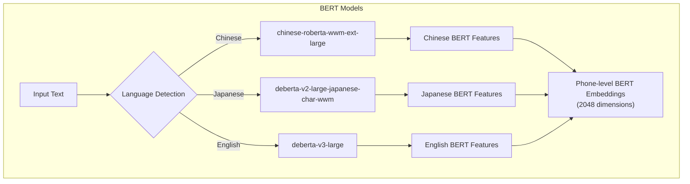
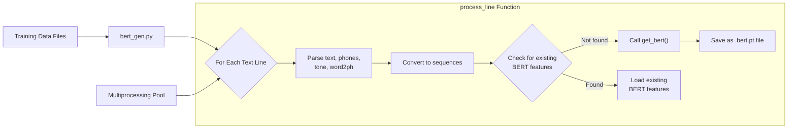
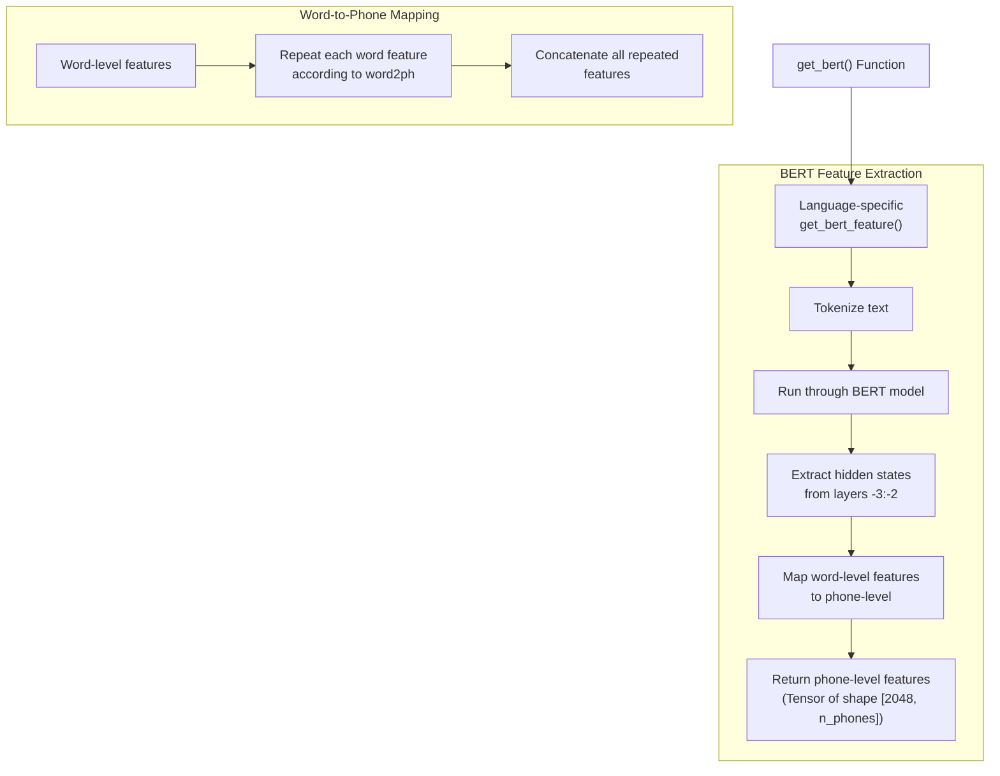
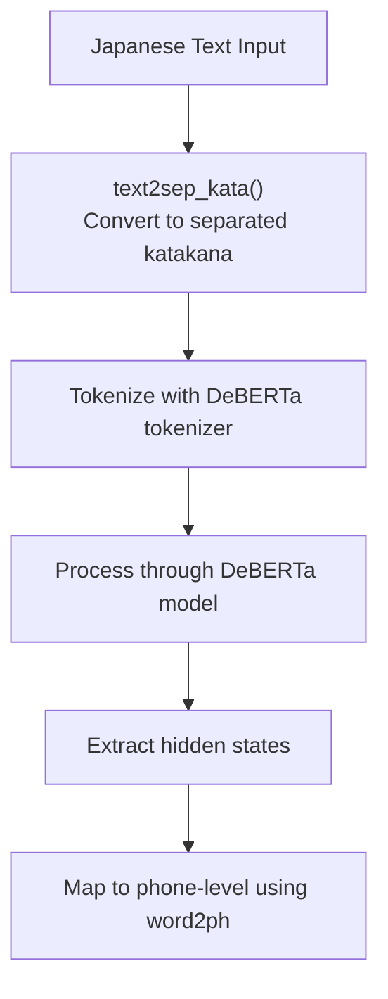
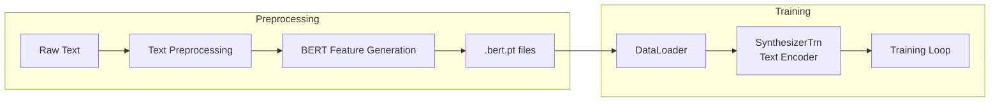

<!-- source: DeepWiki mcp.deepwiki.com · repo fishaudio/Bert-VITS2 · page 3.2 BERT Feature Generation · fetched 2026-10-29 -->

# BERT Feature Generation

<details>
<summary>Relevant source files</summary>

The following files were used as context for generating this wiki page:

- [bert/bert_models.json](bert/bert_models.json)
- [bert_gen.py](bert_gen.py)
- [text/chinese_bert.py](text/chinese_bert.py)
- [text/japanese_bert.py](text/japanese_bert.py)

</details>


## Introduction

BERT Feature Generation is a critical preprocessing step in the Bert-VITS2 pipeline that creates BERT (Bidirectional Encoder Representations from Transformers) embeddings for input text. These embeddings provide rich contextual representations of text data that significantly enhance the language understanding capabilities of the TTS system. This page documents the BERT feature generation process across multiple languages and how these features integrate into the training pipeline.

For information about the overall training pipeline, see [Training Pipeline](#3), and for text processing details, see [Multi-Language Text Processing](#4).

Sources: [bert_gen.py:1-81]()

## BERT Models Architecture

Bert-VITS2 uses different pre-trained BERT models for each supported language to generate contextually rich embeddings:



The models are loaded from the `./bert/` directory, with configuration specified in the `bert_models.json` file.

Sources: [bert/bert_models.json:1-14](), [text/chinese_bert.py:7-10](), [text/japanese_bert.py:8-11]()

## BERT Feature Generation Process

The feature generation process converts text input into phone-level BERT embeddings that align with the phonetic representation used by the TTS model.



The BERT feature generation supports multiprocessing to speed up preprocessing of large datasets, with configurable number of processes and device selection.

Sources: [bert_gen.py:12-47](), [bert_gen.py:49-81]()

## BERT Feature Extraction

The core feature extraction process follows these steps:

1. Text is passed to the appropriate language-specific BERT model
2. Hidden states from the model's deeper layers are extracted
3. Word-level features are mapped to phone-level features using word-to-phone alignment information



The `word2ph` array specifies how many phones each word corresponds to, allowing the system to align word-level BERT features with phone-level representations needed by the model.

Sources: [text/chinese_bert.py:15-60](), [text/japanese_bert.py:16-65]()

## Language-Specific Processing

### Chinese BERT Processing

For Chinese text, the system uses the `chinese-roberta-wwm-ext-large` model, which is a RoBERTa model pre-trained on Chinese text with whole word masking.

Key aspects of Chinese BERT processing:
- Uses a character-level tokenizer appropriate for Chinese text
- Extracts features from the third-to-last layer of the model
- Maps word-level features to phone-level using the `word2ph` alignment information

Sources: [text/chinese_bert.py:1-61]()

### Japanese BERT Processing

Japanese text processing uses the `deberta-v2-large-japanese-char-wwm` model and includes an additional step to convert text to separated katakana.



The Japanese processing pipeline ensures proper handling of Japanese-specific characters and phonetic structure.

Sources: [text/japanese_bert.py:1-65]()

## Style Transfer Feature

Both Chinese and Japanese BERT processing modules include a style transfer capability that allows blending features from a style reference text with the content text.

Key components of style transfer:
- Optional `style_text` parameter allows specifying a reference style text
- `style_weight` (default 0.7) controls the blend ratio between content and style
- Style features are extracted using the same BERT model
- The mean of style features is computed and mixed with content features

This enables controlling the speaking style by injecting characteristics from a reference text.

Sources: [text/chinese_bert.py:15-53](), [text/japanese_bert.py:16-58]()

## Device Management and Optimization

The BERT feature generation system includes smart device management for optimal performance:

| Feature | Description |
|---------|-------------|
| Device Configuration | Configurable via `config.bert_gen_config.device` |
| Multi-Device Support | Option to distribute processing across available GPUs |
| MPS Support | Automatic detection of Apple Silicon MPS availability |
| Model Caching | BERT models are loaded once per device and cached in a dictionary |
| Parallel Processing | Multiprocessing pool for batch generation of features |

The implementation automatically handles the appropriate device selection based on available hardware and configuration.

Sources: [bert_gen.py:14-22](), [text/chinese_bert.py:22-31](), [text/japanese_bert.py:26-35]()

## Integration with Training Pipeline

BERT features are generated during preprocessing and then seamlessly integrated into the training pipeline:



During training, the pre-computed BERT features are loaded directly from the `.bert.pt` files, which improves training efficiency by avoiding redundant computation of the same features in each epoch.

Sources: [bert_gen.py:38-46]()

## Command-Line Usage

The BERT feature generation can be run as a standalone preprocessing step using the `bert_gen.py` script:

```bash
python bert_gen.py -c path/to/config.json --num_processes 4
```

Configuration options:
- `-c, --config`: Path to the model configuration file
- `--num_processes`: Number of parallel processes to use (default from config)

The script processes all text in both training and validation files, generating and saving BERT features for each line.

Sources: [bert_gen.py:51-81]()

---

