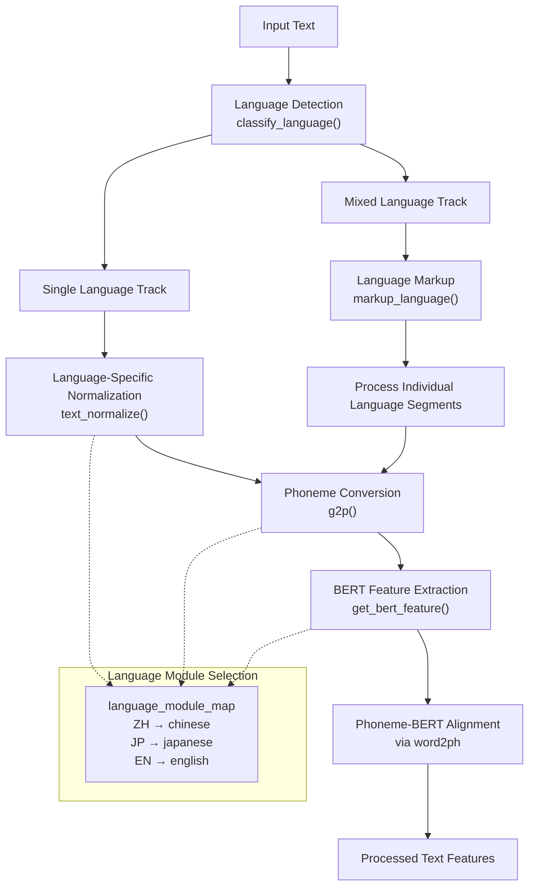
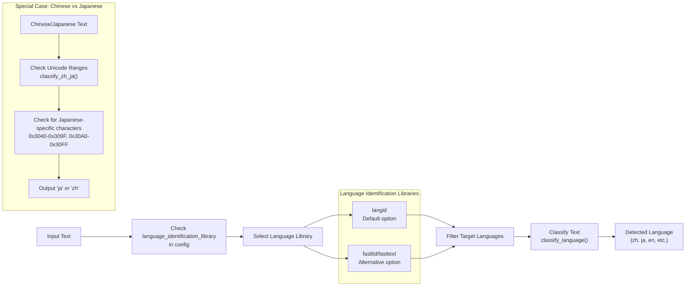
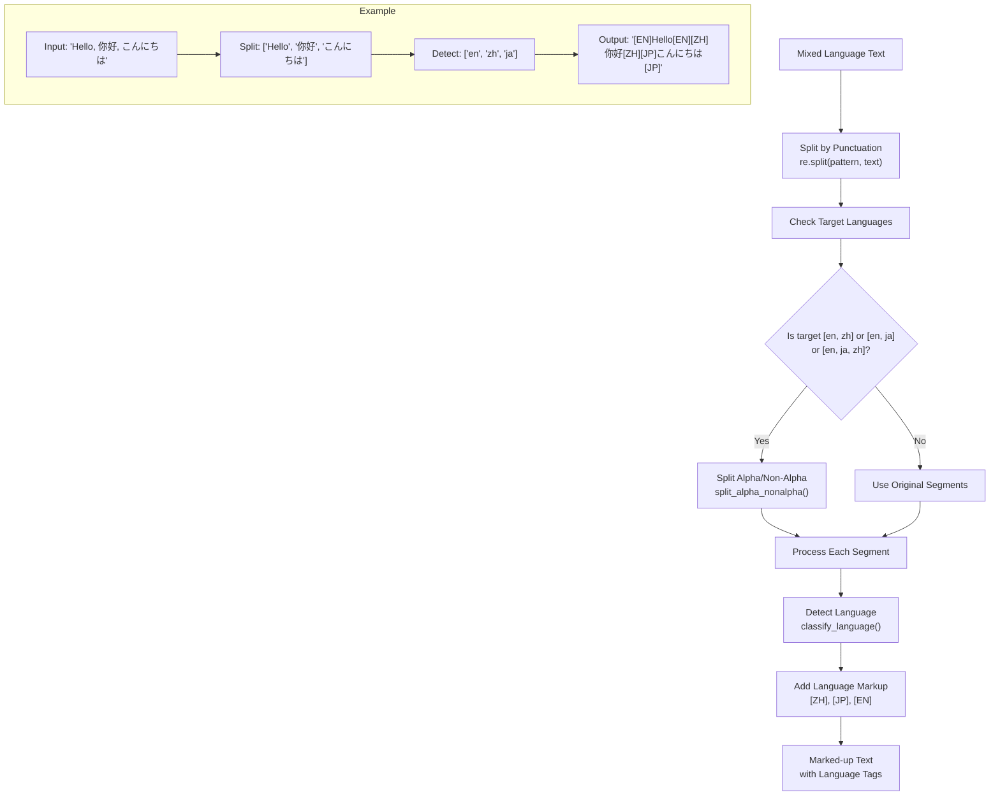
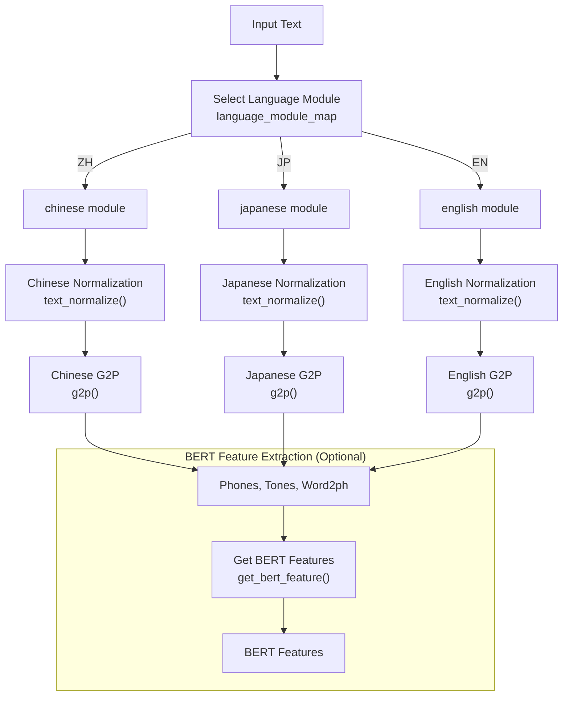
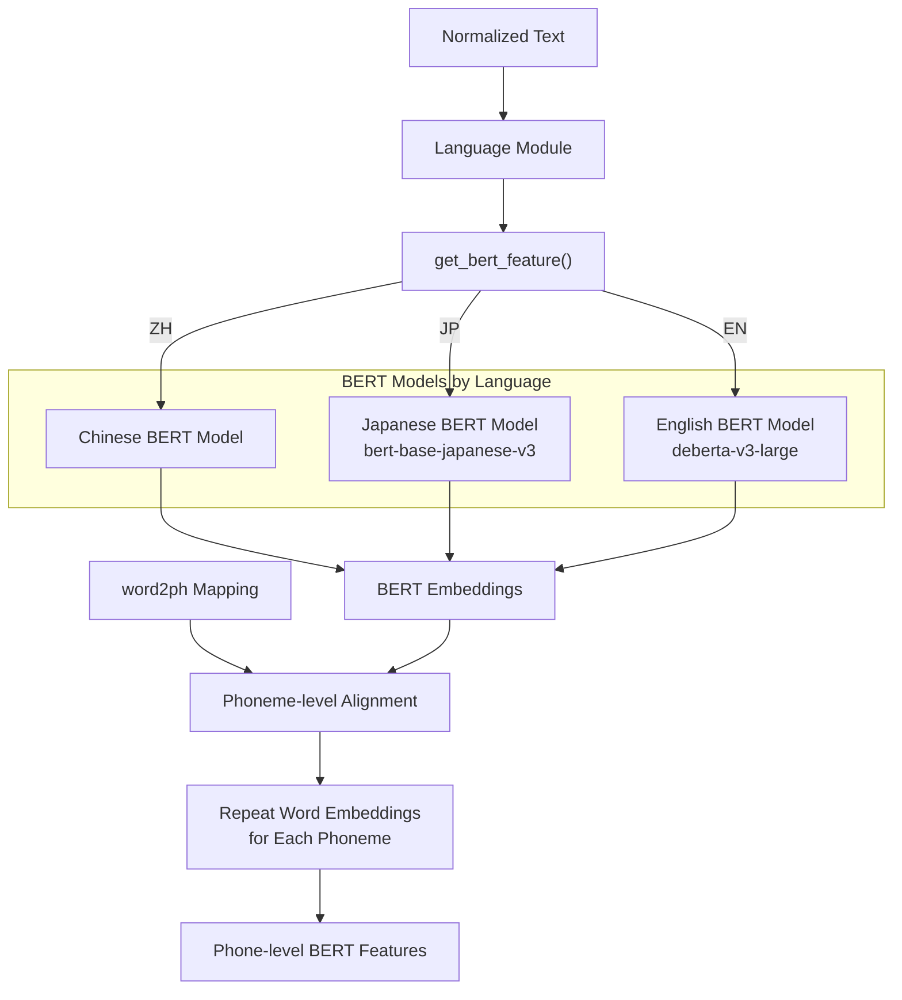
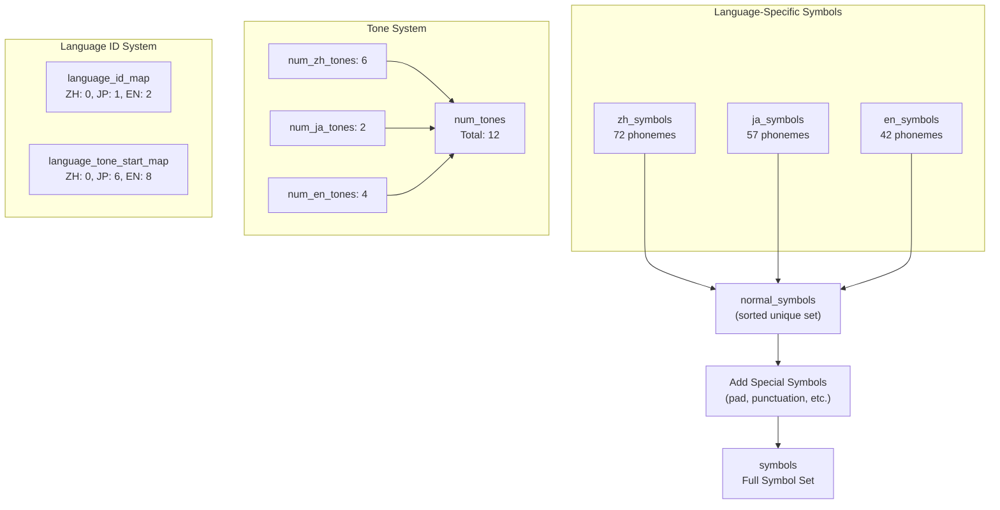
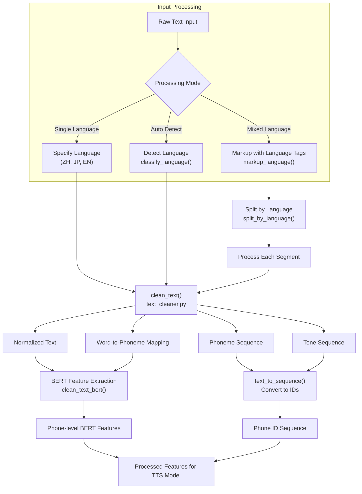

<!-- source: DeepWiki mcp.deepwiki.com · repo fishaudio/Bert-VITS2 · page 4 Multi-Language Text Processing · fetched 2026-10-29 -->

# Multi-Language Text Processing

Relevant source files

The following files were used as context for generating this wiki page:

- [bert/bert-base-japanese-v3/README.md](bert/bert-base-japanese-v3/README.md)
- [bert/bert-base-japanese-v3/config.json](bert/bert-base-japanese-v3/config.json)
- [bert/bert-base-japanese-v3/vocab.txt](bert/bert-base-japanese-v3/vocab.txt)
- [bert/bert-large-japanese-v2/tokenizer_config.json](bert/bert-large-japanese-v2/tokenizer_config.json)
- [text/bert_utils.py](text/bert_utils.py)
- [text/cleaner.py](text/cleaner.py)
- [text/english_bert_mock.py](text/english_bert_mock.py)
- [text/symbols.py](text/symbols.py)
- [tools/classify_language.py](tools/classify_language.py)
- [tools/sentence.py](tools/sentence.py)

## Purpose and Scope

This document explains the multi-language text processing pipeline within Bert-VITS2, a text-to-speech synthesis system that supports multiple languages. It covers the language detection, text normalization, phoneme conversion, and BERT feature extraction processes that occur before audio synthesis.

For details on BERT feature generation, see [BERT Feature Generation](#3.2). For language-specific text processing implementations, see the related pages for [Chinese Text Processing](#4.1), [Japanese Text Processing](#4.2), and [English Text Processing](#4.3).

## Overview of Multi-Language Support

Bert-VITS2 supports multiple languages through a modular architecture that handles language detection, text normalization, phoneme conversion, and BERT feature extraction in a language-specific manner. The system currently supports Chinese (ZH), Japanese (JP), and English (EN) as the primary languages.

### Multi-Language Processing Architecture

Sources: [text/cleaner.py](), [tools/sentence.py](), [tools/classify_language.py]()

## Language Detection and Classification

The system uses language detection libraries to determine the language of input text. This detection enables proper text processing and feature extraction for each language.

### Language Detection System

Sources: [tools/classify_language.py]()

### Language Support Table

The system defines language-specific symbols and mappings:

| Language | Code | ID | Symbols Count | Tones | Example Symbols |
|----------|------|----|--------------|----|-----------------|
| Chinese  | ZH   | 0  | 72           | 6  | a, ai, an, ang, ao, b, c, ch... |
| Japanese | JP   | 1  | 57           | 2  | N, a, a:, b, by, ch, d, dy... |
| English  | EN   | 2  | 42           | 4  | aa, ae, ah, ao, aw, ay, b, ch... |

Sources: [text/symbols.py]()

## Text Segmentation and Mixed Language Processing

For mixed-language text, the system segments the input into language-specific chunks and processes each separately.

### Mixed Language Processing Workflow

Sources: [tools/sentence.py](), [tools/classify_language.py]()

## Text Cleaning and Normalization Process

The system uses a modular approach for text cleaning, with separate modules for each supported language.

### Text Cleaning Pipeline

Sources: [text/cleaner.py]()

## BERT Feature Integration

The system extracts BERT features for each language using language-specific BERT models. These features enhance the prosody and naturalness of generated speech.

### BERT Feature Extraction System

Sources: [text/cleaner.py](), [text/english_bert_mock.py](), [bert/bert-base-japanese-v3/README.md]()

## Symbol System and Phoneme Representation

The system uses a unified set of phoneme symbols across all supported languages, while maintaining language-specific subsets.

### Symbol System Architecture

Sources: [text/symbols.py]()

## Language Processing Workflow

The following diagram illustrates the complete workflow from raw text input to processed features ready for the TTS model:

Sources: [text/cleaner.py](), [tools/sentence.py](), [tools/classify_language.py]()

## Conclusion

The multi-language text processing system in Bert-VITS2 provides a flexible framework for handling text in different languages. By using language-specific processing modules and BERT models, it accurately converts text into phonetic and linguistic features that can be used by the TTS model to generate natural-sounding speech in multiple languages. The system handles both single-language input and mixed-language text, making it versatile for various use cases.

---

