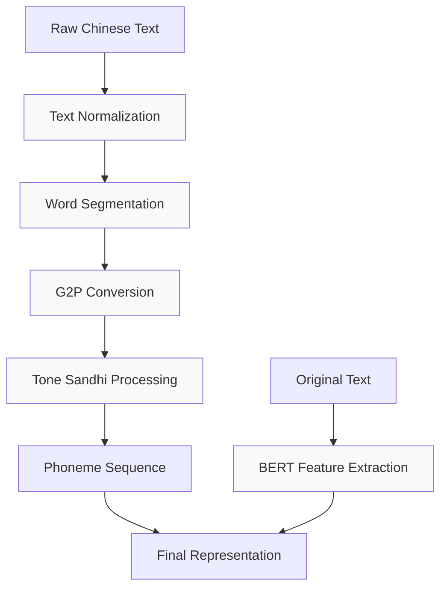
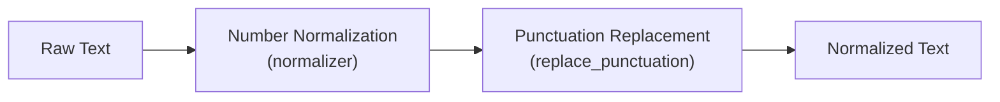
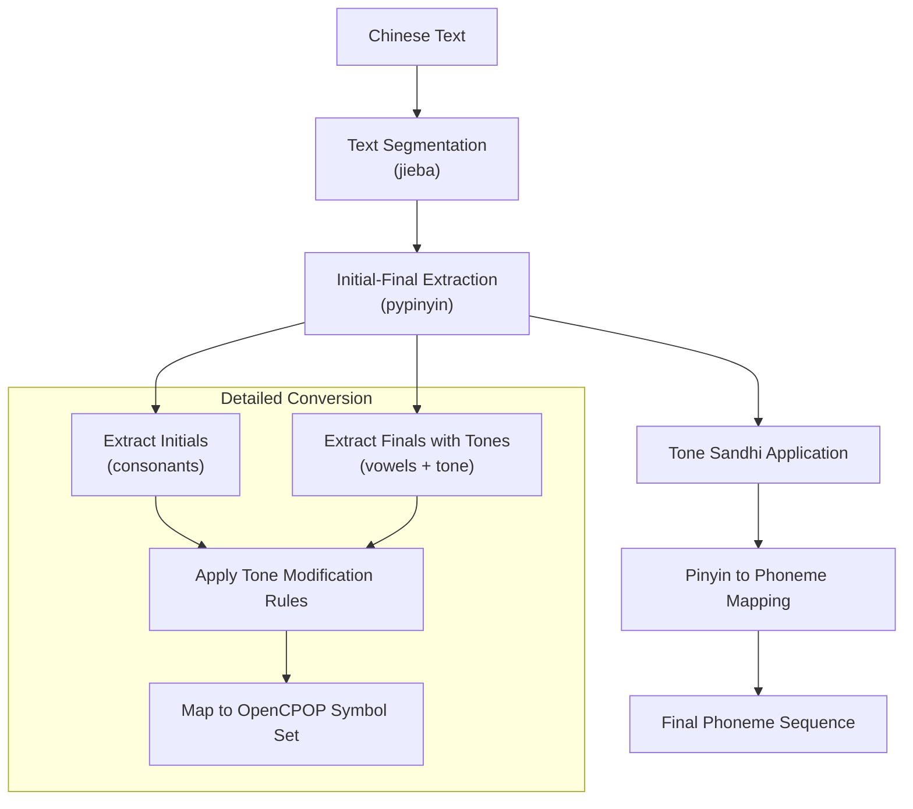
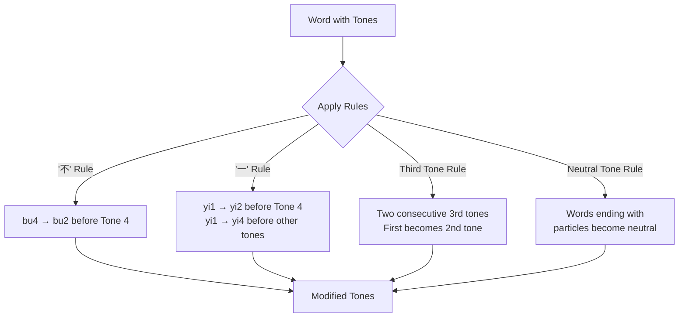
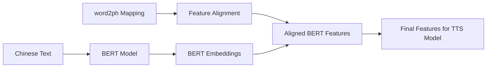
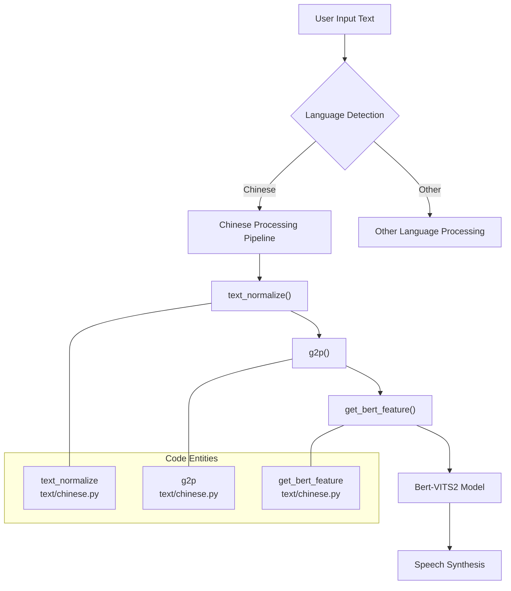

<!-- source: DeepWiki mcp.deepwiki.com · repo fishaudio/Bert-VITS2 · page 4.1 Chinese Text Processing · fetched 2026-10-29 -->

# Chinese Text Processing

<details>
<summary>Relevant source files</summary>

The following files were used as context for generating this wiki page:

- [.gitignore](.gitignore)
- [LICENSE](LICENSE)
- [losses.py](losses.py)
- [requirements.txt](requirements.txt)
- [text/chinese.py](text/chinese.py)
- [text/tone_sandhi.py](text/tone_sandhi.py)

</details>


## Purpose and Scope

This document details the Chinese text processing component within Bert-VITS2, explaining how Chinese text is normalized, segmented, converted to phonemes, and prepared for synthesis. This processing is critical for generating natural-sounding Chinese speech with correct pronunciation and intonation. For information about text processing for other languages, see [Japanese Text Processing](#4.2) or [English Text Processing](#4.3).

## Overview

Chinese text processing in Bert-VITS2 involves several key steps: text normalization, word segmentation, grapheme-to-phoneme (G2P) conversion, tone sandhi application, and BERT feature extraction. The system handles nuances specific to Chinese phonology such as tone changes in connected speech and proper phonetic representation.



Sources: [text/chinese.py:1-82](), [text/chinese.py:180-192]()

## Text Normalization

Text normalization converts raw Chinese text into a standardized format suitable for further processing. This includes:

1. Converting Chinese numbers to their spoken form
2. Standardizing punctuation marks
3. Removing unwanted characters

The system uses either:
- `WeTextProcessing` library's normalizer (preferred method when available)
- `cn2an` as a fallback option for number conversion

```python
# Punctuation standardization mapping
rep_map = {
    "：": ",",
    "；": ",",
    "，": ",",
    "。": ".",
    # More mappings...
}
```

The `text_normalize` function applies these transformations sequentially:



Sources: [text/chinese.py:9-62](), [text/chinese.py:67-77](), [text/chinese.py:182-185]()

## Grapheme-to-Phoneme Conversion

The G2P conversion transforms Chinese characters into phonetic representations using pinyin (the romanization system for Mandarin Chinese) and further maps these to phoneme symbols that the TTS model can process.

### Process Flow



Sources: [text/chinese.py:80-89](), [text/chinese.py:92-179]()

### Key Components

1. **Sentence Splitting**: Divides text into sentences at punctuation marks
2. **Word Segmentation**: Uses `jieba` for word segmentation with POS tagging
3. **Initial-Final Extraction**: 
   - Extracts initials (consonants) and finals (vowels with tones) using `pypinyin`
   - Handles special cases like neutral tones
4. **Phoneme Mapping**: Maps pinyin to phoneme symbols using the `opencpop-strict.txt` mapping file

Phoneme conversion results in three key outputs:
- `phones`: The sequence of phoneme symbols
- `tones`: The tone for each phoneme (0-5)
- `word2ph`: Mapping from words to phoneme counts (for alignment)

Sources: [text/chinese.py:92-179]()

## Tone Sandhi Processing

Tone sandhi refers to the phenomenon where tones change based on adjacent tones. This is particularly important in Chinese, where the meaning of words can change depending on tone.

### ToneSandhi Class

The `ToneSandhi` class in `tone_sandhi.py` handles tone modifications according to linguistic rules. The system implements several key sandhi rules:



The system addresses several complex cases:
- **Third Tone Sandhi**: When two third-tone syllables occur in sequence, the first changes to a second tone
- **"不" (bu) Sandhi**: "不" changes from fourth tone to second tone when followed by another fourth tone
- **"一" (yi) Sandhi**: "一" changes tone based on the following syllable
- **Neutral Tone Words**: Certain grammatical particles and word endings become neutral tone (tone 5)

Sources: [text/tone_sandhi.py:22-776]()

### Tone Sandhi Application

The tone sandhi rules are applied during the G2P conversion process:

1. Word segmentation results are pre-merged to handle special cases
2. Tones are modified according to the rules
3. The modified tones are integrated into the final phoneme sequence

Sources: [text/chinese.py:63-65](), [text/chinese.py:100-122](), [text/tone_sandhi.py:759-776]()

## BERT Feature Extraction

Chinese BERT features are extracted to provide additional contextual information to the synthesis model, which helps in generating more natural prosody and intonation.



The `get_bert_feature` function handles this process, taking the normalized text and the word-to-phoneme mapping as input, and returning BERT features aligned with the phoneme sequence.

Sources: [text/chinese.py:188-191]()

## Integration with Bert-VITS2

The Chinese text processing pipeline integrates with the rest of the Bert-VITS2 system as follows:



The complete pipeline for Chinese text processing is encapsulated in `text/chinese.py` and can be divided into these main functions:

1. `text_normalize`: Normalizes the raw Chinese text
2. `g2p`: Converts Chinese characters to phonemes with tone information
3. `get_bert_feature`: Extracts BERT features for the text

During inference or training, these functions are called in sequence to process Chinese text for the Bert-VITS2 model.

Sources: [text/chinese.py:1-204]()

## Chinese-Specific Challenges and Solutions

### Word Segmentation and Ambiguity

Chinese lacks explicit word boundaries, making word segmentation crucial. The system uses `jieba` for word segmentation, with special handling for cases that might affect pronunciation:

| Challenge | Example | Solution |
|-----------|---------|----------|
| Merging "不" with following word | "不要" → ("不","要") → "不要" | `_merge_bu` function |
| Merging "一" in reduplication patterns | "看一看" → ("看","一","看") → "看一看" | `_merge_yi` function |
| Handling continuous third tones | "很好听" → ("很好", "听") | `_merge_continuous_three_tones` functions |

Sources: [text/tone_sandhi.py:619-739]()

### Special Word Lists

The system maintains two special word lists for tone sandhi processing:

1. **Words that must have neutral endings**: Words where the final syllable should always be neutral tone
2. **Words that must not have neutral endings**: Words where the final syllable should never be neutral tone 

These lists cover hundreds of common words in Chinese to ensure correct pronunciation.

Sources: [text/tone_sandhi.py:24-445]()

## Performance and Limitations

### Performance Considerations

- Chinese processing is more computationally intensive than other languages due to tone sandhi rules
- BERT feature extraction adds significant processing time
- The system includes fallback mechanisms for when certain libraries are unavailable

### Known Limitations

- Rare or specialized terms may have incorrect segmentation or pronunciation
- The system focuses on Mandarin Chinese and may not handle other Chinese dialects correctly
- Some tone sandhi rules are simplified approximations of complex linguistic phenomena

## Conclusion

The Chinese text processing pipeline in Bert-VITS2 handles the unique challenges of Chinese text-to-speech synthesis through a comprehensive approach to normalization, phoneme conversion, and tone processing. By incorporating linguistic knowledge about tone sandhi and leveraging BERT for contextual understanding, the system produces natural-sounding Chinese speech with correct pronunciation and intonation.

Sources: [text/chinese.py:1-204](), [text/tone_sandhi.py:1-776]()

---

