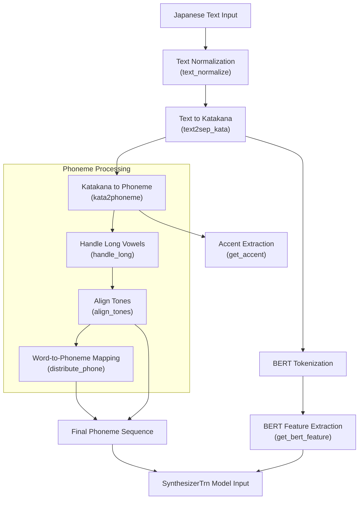
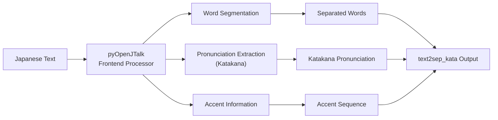
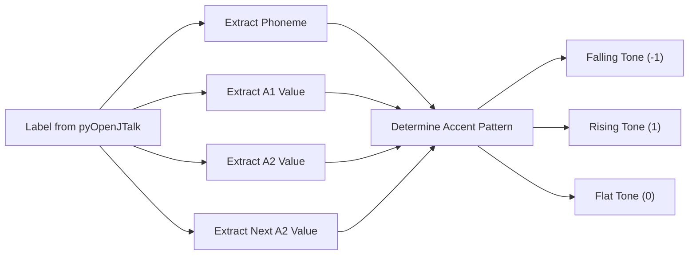
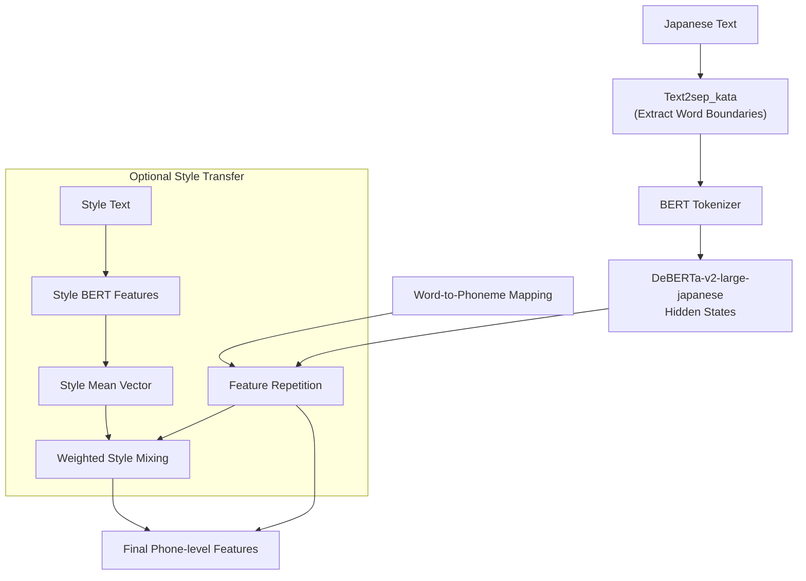
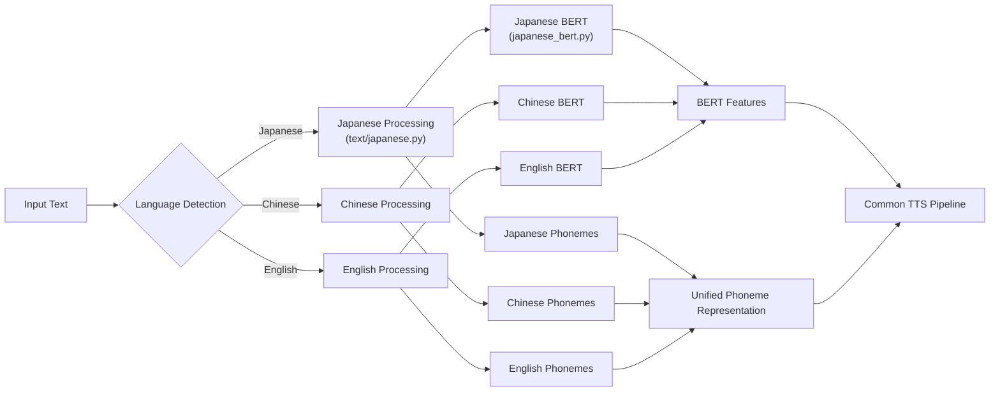

<!-- source: DeepWiki mcp.deepwiki.com · repo fishaudio/Bert-VITS2 · page 4.2 Japanese Text Processing · fetched 2026-10-29 -->

# Japanese Text Processing

<details>
<summary>Relevant source files</summary>

The following files were used as context for generating this wiki page:

- [text/chinese_bert.py](text/chinese_bert.py)
- [text/japanese.py](text/japanese.py)
- [text/japanese_bert.py](text/japanese_bert.py)

</details>


## Purpose and Scope

This document details the Japanese text processing components within Bert-VITS2, focusing on the conversion of Japanese text into phonetic representations suitable for the text-to-speech synthesis pipeline. This includes text normalization, grapheme-to-phoneme (G2P) conversion, accent handling, and BERT feature extraction specific to Japanese. For information about text processing in other languages, see [Chinese Text Processing](#4.1) or [English Text Processing](#4.3).

## Overview

The Japanese text processing pipeline transforms raw Japanese text input into phoneme sequences with appropriate accent information, which are then converted to BERT embeddings for use in the speech synthesis model.



Sources: [text/japanese.py:679-706](), [text/japanese_bert.py:16-65]()

## Text Normalization

Japanese text normalization includes several key steps before phonetic conversion:

1. **Unicode Normalization**: Converts all characters to NFKC form, ensuring consistent character representation
2. **Number to Word Conversion**: Transforms numeric expressions into their Japanese word equivalents
3. **Punctuation Replacement**: Maps various punctuation marks to a standardized form
4. **Character Filtering**: Removes unsupported characters

```python
# Example normalized text transformation:
# Input: "hello,こんにちは、世界ー！……"
# Output after normalization: "こんにちは,世界ー!"
```

The text normalization process uses regular expressions to identify and convert patterns like numbers with separators, currency symbols, and alphabetic characters to their Japanese equivalents.

Sources: [text/japanese.py:604-610](), [text/japanese.py:515-523](), [text/japanese.py:588-601]()

## Grapheme-to-Phoneme Conversion

### Text to Katakana

The first step in phoneme conversion uses pyOpenJTalk to parse Japanese text and extract the pronunciation information (in katakana) and word boundaries:



Sources: [text/japanese.py:383-413]()

### Katakana to Phoneme

The system uses a comprehensive mapping system to convert katakana characters to their phonetic representation:

1. The `hiragana_map` dictionary contains mappings for various hiragana character combinations
2. Katakana is first converted to hiragana using `jaconv.kata2hira`
3. The hiragana is then converted to phonemes using the mapping

Special cases include:
- Long vowel marks ("ー")
- Geminate consonants ("っ"/"ッ")
- Special symbol tokens

Sources: [text/japanese.py:17-311](), [text/japanese.py:314-348](), [text/japanese.py:351-373]()

### Long Vowel Handling

The system handles Japanese long vowels (marked with "ー") by extending the previous vowel:

```python
# Example transformations:
# "カー" → "k a a"
# "トーキョー" → "t o o ky o o"
```

Sources: [text/japanese.py:622-630]()

## Accent and Tone Processing

### Accent Extraction

Accent information is extracted from the pyOpenJTalk output using the label format:



The system detects three accent patterns:
- Falling tone: When A1=0 and the next A2 = current A2 + 1
- Rising tone: When A2=1 and the next A2=2
- Flat tone: Otherwise

Sources: [text/japanese.py:416-441]()

### Tone Alignment

The tone information is aligned with the phoneme sequence to create the final tone pattern for each phoneme in the utterance:

1. For each phoneme group, match phonemes with their corresponding accent values
2. Convert relative accent positions to absolute pitch patterns
3. Ensure all tones are within the valid range (0-1)

Sources: [text/japanese.py:636-655]()

## BERT Feature Extraction

The Japanese BERT feature extraction uses a DeBERTa-v2-large model specifically pre-trained for Japanese:



Key features:
- Uses pre-trained DeBERTa-v2-large-japanese-char-wwm model
- Extracts hidden states from the third-from-last layer
- Maps word-level features to phone-level by repeating features according to word-to-phoneme alignment
- Supports optional style transfer by mixing with style text embeddings

Sources: [text/japanese_bert.py:1-65]()

## Main Processing Function (g2p)

The primary function that orchestrates Japanese text processing is `g2p`, which:

1. Normalizes input text
2. Converts text to separated words and katakana
3. Tokenizes words for BERT processing
4. Converts katakana to phonemes
5. Handles long vowels
6. Aligns tones with phonemes
7. Creates word-to-phoneme mapping

The function returns:
- Phoneme sequence (including boundary tokens)
- Tone sequence
- Word-to-phoneme mapping (for BERT feature alignment)

```python
# Example output:
# phones: ["_", "k", "o", "N", "n", "i", "ch", "i", "w", "a", "_"]
# tones: [0, 0, 0, 0, 1, 1, 1, 0, 0, 0, 0]
# word2ph: [1, 5, 5, 1]
```

Sources: [text/japanese.py:678-706]()

## Integration with Multi-Language System

The Japanese text processing module integrates with the broader multi-language architecture of Bert-VITS2:



When processing Japanese text:
1. The language detection system routes Japanese text to the appropriate processing module
2. The Japanese-specific `g2p` function handles the text-to-phoneme conversion
3. `japanese_bert.py` extracts BERT features using the Japanese pre-trained model
4. The resulting phonemes and BERT features are passed to the common TTS pipeline

Sources: [text/japanese.py:678-706](), [text/japanese_bert.py:16-65]()

## Special Character Handling

### Alphanumeric and Symbol Conversion

Japanese text often contains alphanumeric characters and symbols. The system converts these to their Japanese pronunciation using a predefined mapping:

| Character | Japanese Pronunciation |
|-----------|------------------------|
| a-z       | エー, ビー, シー, etc.   |
| #         | シャープ                |
| %         | パーセント              |
| Greek letters | アルファ, ベータ, etc. |

Sources: [text/japanese.py:444-506]()

### Punctuation Normalization

The system normalizes various Japanese and standard punctuation marks to a common set:

| Original | Normalized |
|----------|------------|
| 。       | .          |
| 、       | ,          |
| ！       | !          |
| ？       | ?          |
| …        | ...        |
| "        | '          |

This normalization ensures consistent handling of punctuation across different text inputs.

Sources: [text/japanese.py:548-585]()

## Performance Considerations

When working with Japanese text processing:

1. **Memory Usage**: The DeBERTa-v2 model requires significant memory (>1GB)
2. **Initialization Time**: First-time loading of the BERT model can take several seconds
3. **Processing Speed**: Complex sentences with mixed scripts may require additional processing time

The system employs several optimizations:
- Caching BERT models per device
- Efficient phoneme distribution algorithms
- Vectorized tone alignment

Sources: [text/japanese_bert.py:14-35](), [text/japanese.py:613-619]()

---

