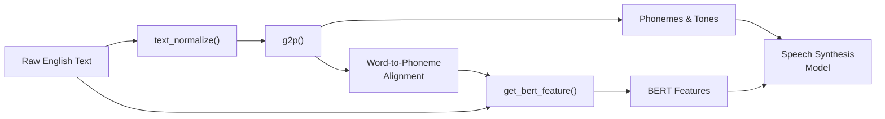
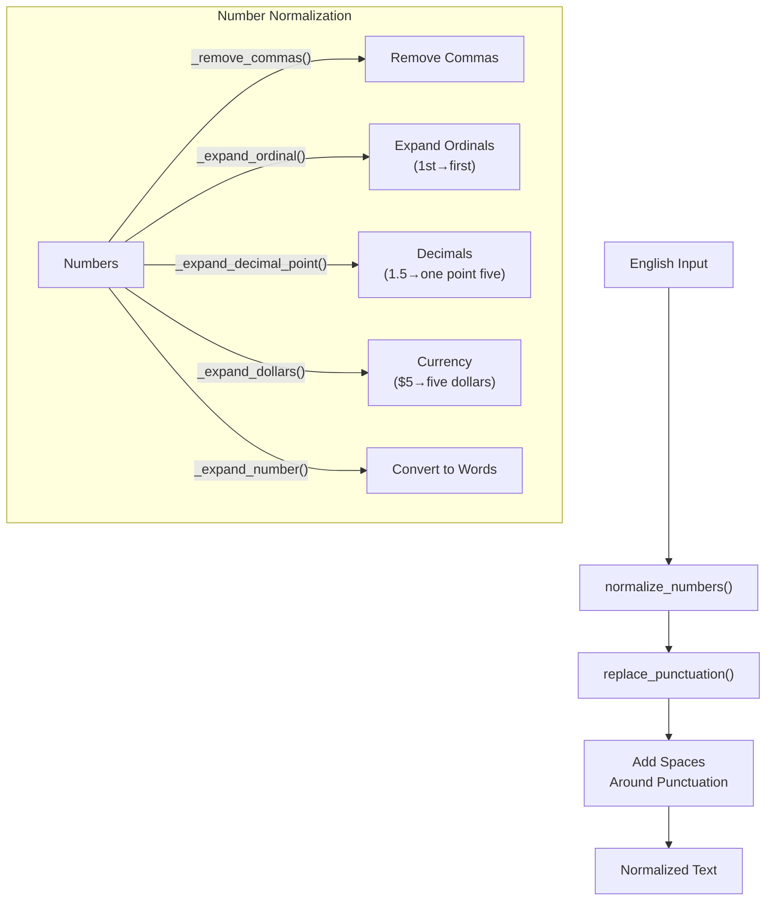
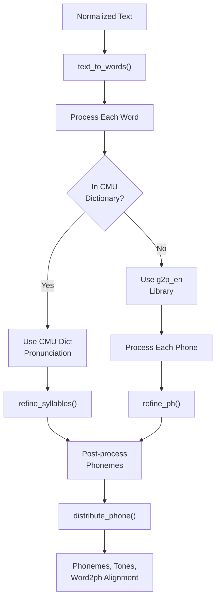
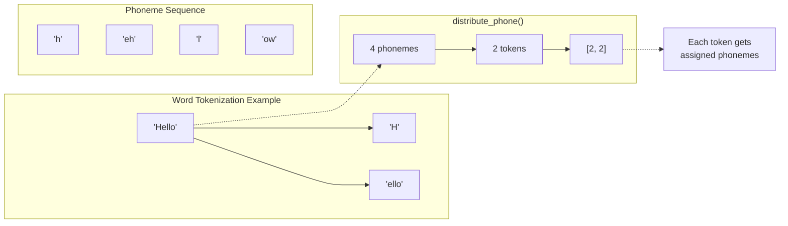
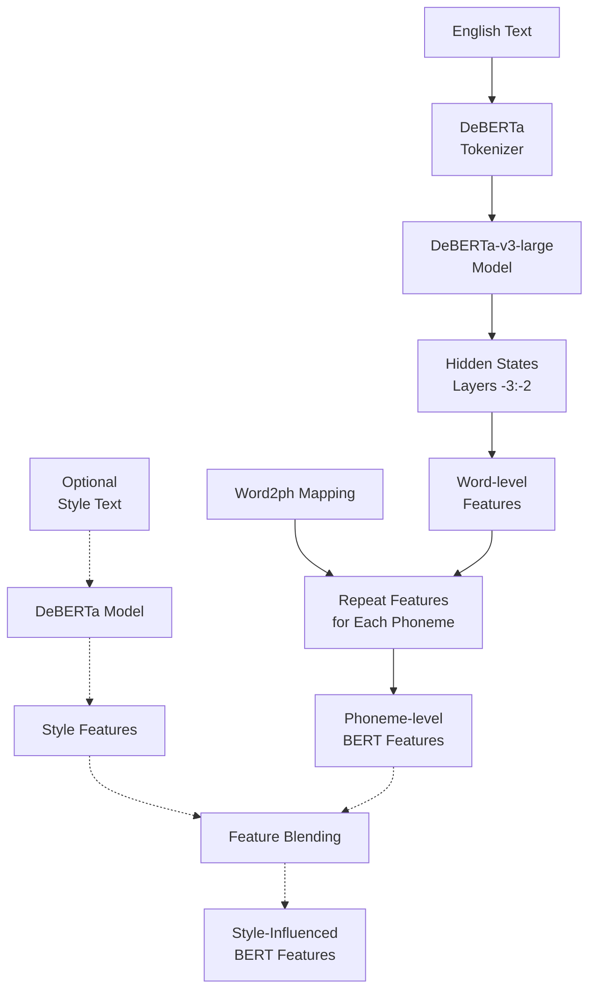
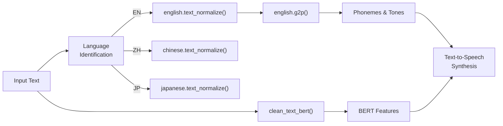

<!-- source: DeepWiki mcp.deepwiki.com · repo fishaudio/Bert-VITS2 · page 4.3 English Text Processing · fetched 2026-10-29 -->

# English Text Processing

<details>
<summary>Relevant source files</summary>

The following files were used as context for generating this wiki page:

- [oldVersion/V200/text/english.py](oldVersion/V200/text/english.py)
- [oldVersion/V210/emo_gen.py](oldVersion/V210/emo_gen.py)
- [oldVersion/V210/text/english.py](oldVersion/V210/text/english.py)
- [oldVersion/V220/text/english.py](oldVersion/V220/text/english.py)
- [onnx_modules/V200/text/english.py](onnx_modules/V200/text/english.py)
- [text/bert_utils.py](text/bert_utils.py)
- [text/cleaner.py](text/cleaner.py)
- [text/english.py](text/english.py)
- [text/english_bert_mock.py](text/english_bert_mock.py)

</details>


This document describes the English text processing system in Bert-VITS2, which transforms raw English text into phonemes and extracts BERT features for high-quality speech synthesis. For information on other language processing systems, see [Chinese Text Processing](#4.1) and [Japanese Text Processing](#4.2).

## Overview

The English text processing pipeline transforms raw English text input into phoneme sequences with associated tone information and generates corresponding BERT embeddings. This process forms a critical foundation for natural-sounding English speech synthesis.



Sources: [text/english.py:421-476](), [text/english.py:479-482](), [text/cleaner.py:7-19]()

## Components and Flow

### 1. Text Normalization

Raw English text undergoes normalization through the `text_normalize()` function which:

- Converts numbers to their written form (e.g., "123" → "one hundred twenty three")
- Expands abbreviations 
- Standardizes punctuation
- Ensures proper spacing around punctuation



Sources: [text/english.py:234-376]()

### 2. Grapheme-to-Phoneme (G2P) Conversion

The `g2p()` function converts normalized text to phoneme sequences:

1. Splits text into words and punctuation
2. For each word:
   - Looks up in CMU Dictionary if available
   - Falls back to G2P-en library for words not in dictionary
3. Processes phonemes and assigns appropriate tone values
4. Creates alignment between words and phonemes



Sources: [text/english.py:214-232](), [text/english.py:376-476]()

#### CMU Dictionary Integration

Bert-VITS2 integrates the CMU Pronouncing Dictionary for English words, caching it for quick lookup:

| Component | Description |
|-----------|-------------|
| Dictionary Path | `./text/cmudict.rep` |
| Cache Path | `./text/cmudict_cache.pickle` |
| Dictionary Format | Word → Syllable groups → Phonemes |
| Phoneme Format | ARPA format with tone numbers |

Sources: [text/english.py:111-213]()

### 3. Phoneme and Tone Processing

Each phoneme undergoes processing to:

1. Normalize phoneme representation to lowercase
2. Extract tone information (stress patterns from ARPA format)
3. Map to symbols that the model recognizes
4. Add boundary tokens (`_`) at beginning and end of sequence

Example of tone extraction:
```
"AH0" → phoneme: "ah", tone: 1
"IY1" → phoneme: "iy", tone: 2
```

Sources: [text/english.py:214-232]()

### 4. Word-to-Phoneme Alignment

The `distribute_phone()` function aligns phonemes with words, creating a mapping needed for BERT feature extraction:



Sources: [text/english.py:376-386]()

### 5. BERT Feature Extraction

The `get_bert_feature()` function extracts contextualized embeddings using DeBERTa-v3-large:

1. Tokenizes text with DeBERTa tokenizer
2. Processes through the DeBERTa model to obtain hidden states
3. Uses the word-to-phoneme mapping to expand BERT features to phoneme level
4. Optionally blends with style embeddings from a reference text



Sources: [text/english_bert_mock.py:9-61]()

## Special Text Handling

### Number Normalization

The English processing module includes specialized functions for converting various number formats:

| Function | Purpose | Example |
|----------|---------|---------|
| `_expand_ordinal()` | Convert ordinal numbers | "1st" → "first" |
| `_expand_number()` | Convert cardinal numbers | "42" → "forty two" |
| `_expand_decimal_point()` | Convert decimal numbers | "3.14" → "three point one four" |
| `_expand_dollars()` | Convert currency | "$5.25" → "five dollars, twenty five cents" |

Sources: [text/english.py:308-367]()

### Punctuation Handling

Punctuation is standardized using a replacement map, which ensures consistency in the phoneme sequence:

```python
# Example punctuation replacements
"：" → ","
"。" → "."
"！" → "!"
"？" → "?"
```

Sources: [text/english.py:116-154]()

## Integration with Text Processing Pipeline

The English text processing module is integrated into Bert-VITS2's multi-language system through the `cleaner.py` interface:



Sources: [text/cleaner.py:1-26]()

## BERT Model Integration

The English text processing module uses DeBERTa-v3-large for feature extraction:

| Component | Description |
|-----------|-------------|
| Model Path | `./bert/deberta-v3-large` |
| Tokenizer | `DebertaV2Tokenizer` |
| Feature Extraction | Hidden states from layers -3:-2 |
| Device Handling | Supports CPU, CUDA, and MPS (for Mac) |

Sources: [text/english_bert_mock.py:9-61](), [text/english.py:13-15]()

## Conclusion

The English text processing system in Bert-VITS2 provides a comprehensive pipeline for converting English text to phoneme sequences with appropriate tone information and contextualized BERT features. This foundation enables high-quality and expressive English speech synthesis.

---

