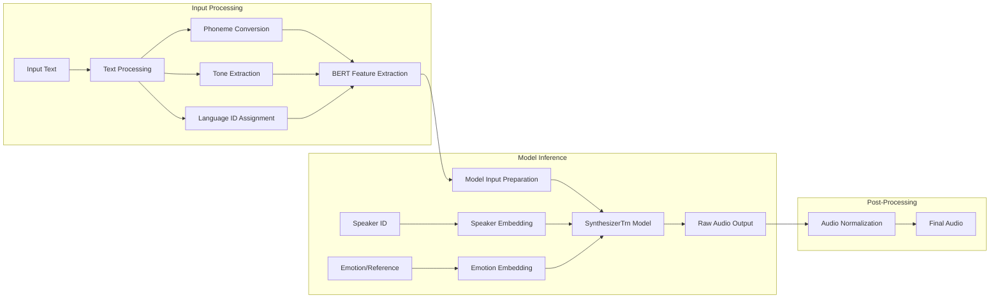
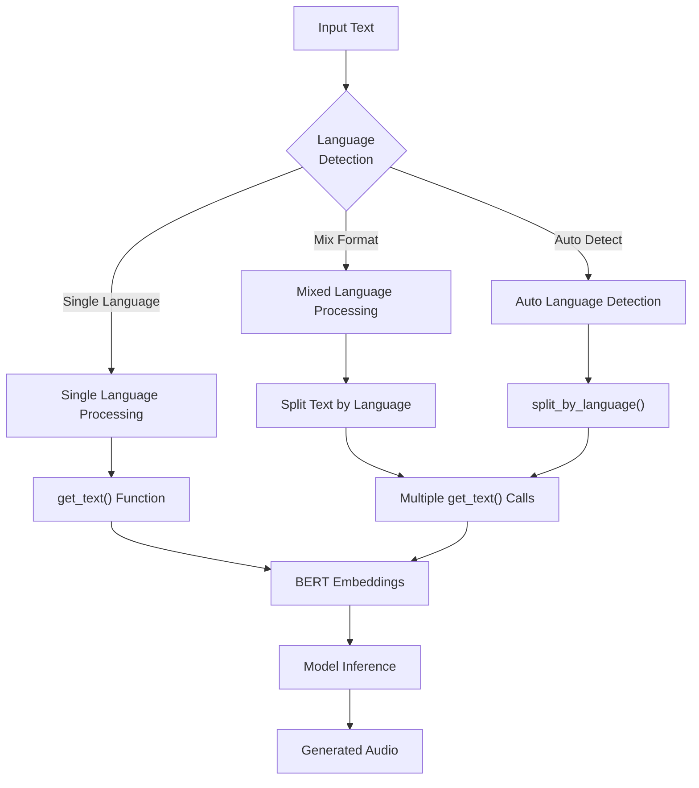
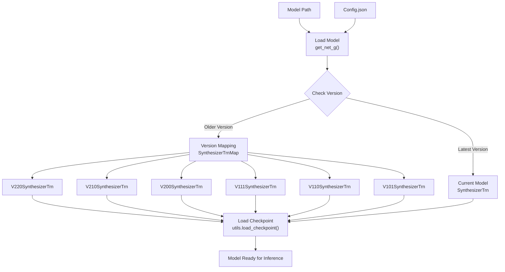
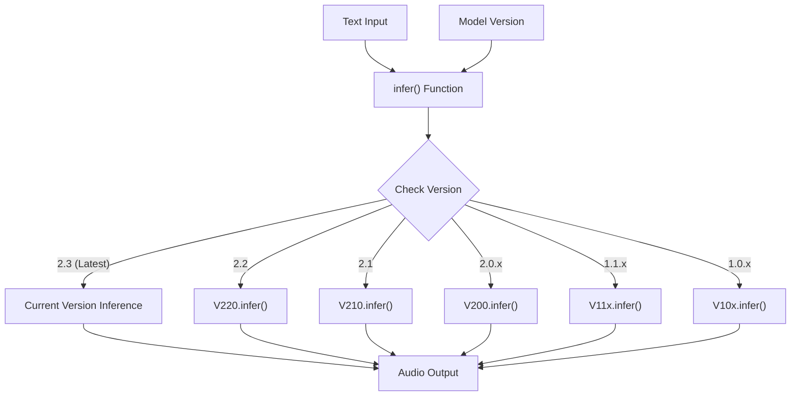
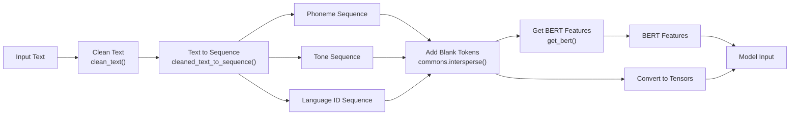
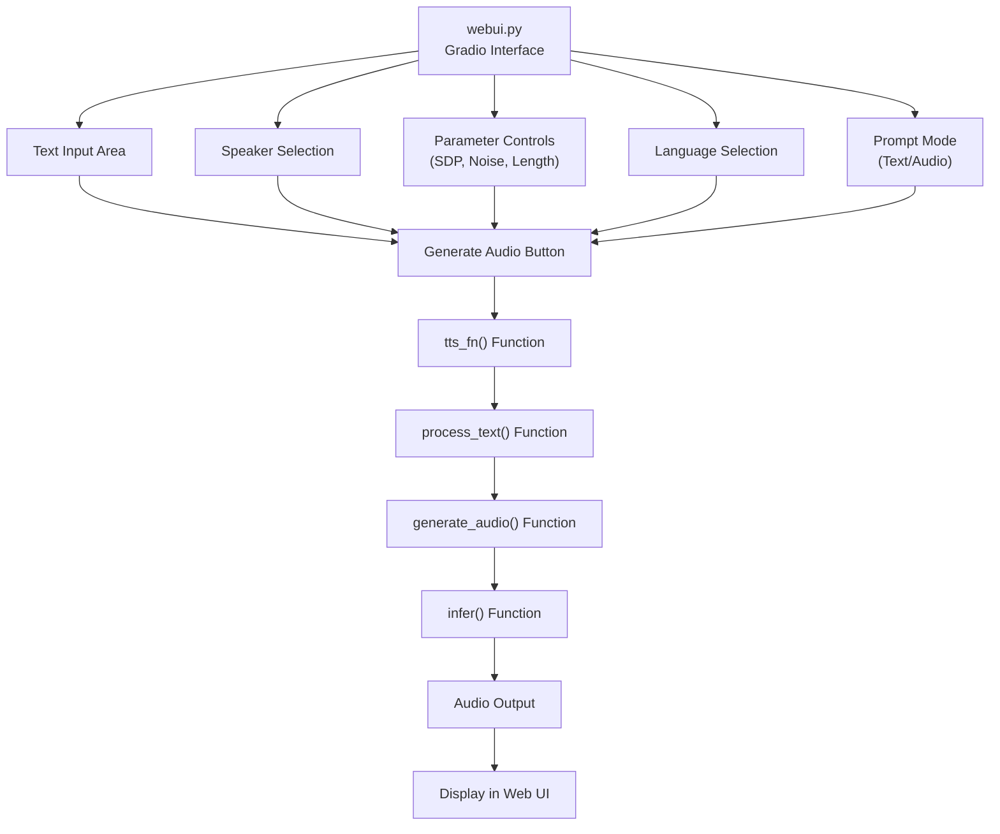
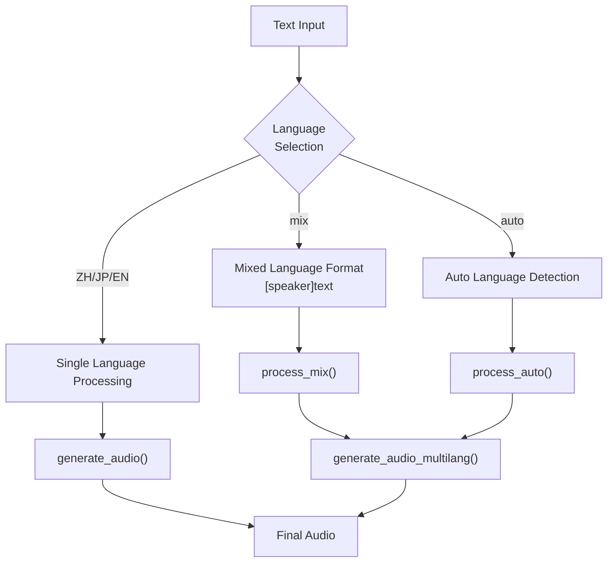
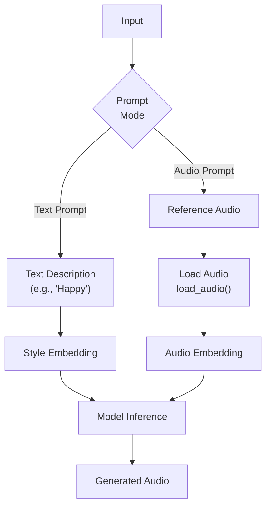

<!-- source: DeepWiki mcp.deepwiki.com · repo fishaudio/Bert-VITS2 · page 5 Inference and Deployment · fetched 2026-10-29 -->

# Inference and Deployment

Relevant source files

The following files were used as context for generating this wiki page:

- [for_deploy/infer.py](for_deploy/infer.py)
- [infer.py](infer.py)
- [oldVersion/V210/__init__.py](oldVersion/V210/__init__.py)
- [oldVersion/V210/text/tone_sandhi.py](oldVersion/V210/text/tone_sandhi.py)
- [oldVersion/V220/__init__.py](oldVersion/V220/__init__.py)
- [oldVersion/V220/text/tone_sandhi.py](oldVersion/V220/text/tone_sandhi.py)
- [slm/wavlm-base-plus/.gitattributes](slm/wavlm-base-plus/.gitattributes)
- [slm/wavlm-base-plus/README.md](slm/wavlm-base-plus/README.md)
- [webui.py](webui.py)

This document provides a detailed guide on how to perform inference with trained Bert-VITS2 models and deploy them for production use. It covers the inference pipeline architecture, model loading process, version compatibility, and various deployment options. For information about training the models, see [Training Pipeline](#3).

## 1. Inference Architecture

The inference pipeline in Bert-VITS2 transforms input text into synthesized speech through several processing stages. The core pipeline handles multi-language support, speaker management, and various customization parameters.

### Inference Pipeline Overview

Sources: [infer.py:151-332](), [webui.py:44-88]()

### Multi-Language Inference Process

The system supports inferring text that contains multiple languages, automatically handling the appropriate processing for each language segment.

Sources: [infer.py:335-437](), [webui.py:225-316]()

## 2. Model Loading and Version Compatibility

Bert-VITS2 includes a sophisticated version compatibility system that enables models trained with different versions to be used with the current codebase.

Sources: [infer.py:84-104](), [infer.py:39-55]()

During inference, the system selects the appropriate inference function based on the model version:

Sources: [infer.py:151-259](), [infer.py:170-193]()

## 3. Text Processing for Inference

When converting text to speech, Bert-VITS2 processes the input through multiple stages to prepare it for the model:

Sources: [infer.py:107-148]()

## 4. Deployment Options

Bert-VITS2 provides multiple deployment options to suit different use cases.

### Web UI

The Web UI offers an interactive interface for text-to-speech synthesis with various customization options:

Sources: [webui.py:403-569](), [webui.py:319-356]()

### Language Handling in Web UI

The Web UI supports several language modes:

1. **Single Language Mode**: Process text in a single language (ZH, JP, EN)
2. **Mix Mode**: Process text with explicit language tags
3. **Auto Mode**: Automatically detect languages in text

Sources: [webui.py:206-242](), [webui.py:245-316]()

### API Server

For programmatic access, Bert-VITS2 includes a FastAPI server for integration with other applications.

## 5. Inference Parameters

Bert-VITS2 provides several parameters to customize the generated speech:

| Parameter | Description | Default Value | Range |
|-----------|-------------|---------------|-------|
| SDP Ratio | Controls stochastic duration predictor influence | 0.5 | 0.0-1.0 |
| Noise Scale | Controls variation in the output | 0.6 | 0.1-2.0 |
| Noise Scale W | Controls variation in the phoneme duration | 0.9 | 0.1-2.0 |
| Length Scale | Controls the speed of speech | 1.0 | 0.1-2.0 |

Sources: [webui.py:443-454](), [infer.py:151-173]()

### Text Style and Emotion Control

Bert-VITS2 supports two methods for controlling the speaking style and emotion:

1. **Text Prompt**: Using text descriptions to guide the speaking style
2. **Audio Prompt**: Using a reference audio to guide the speaking style

Sources: [webui.py:428-442](), [webui.py:332-339]()

## 6. Version Compatibility Details

Bert-VITS2 supports multiple versions with different features. The current architecture allows seamless use of models trained with previous versions.

| Version | Features | Added Components |
|---------|----------|------------------|
| 2.3 | Latest version | Current inference pipeline |
| 2.2 | CLAP-Enhanced audio generation | Audio and text prompt feature |
| 2.1 | Emotion and multi-language optimization | Emotion embedding support |
| 2.0.x | Multi-language support | Chinese, Japanese, English support |
| 1.1.x | Improved Chinese support | Japanese fixes in 1.1.1-fix |
| 1.0.x | Basic Chinese TTS | Initial VITS implementation |

Sources: [infer.py:1-9](), [infer.py:39-55](), [infer.py:170-193]()

## 7. ONNX Export and Inference

For production deployments requiring faster inference, models can be exported to ONNX format. For detailed information on ONNX export, see [ONNX Export and Inference](#6).

## 8. Performance Considerations

When deploying Bert-VITS2 for inference, consider the following:

1. **Memory Usage**: The model requires significant GPU memory, especially for larger models
2. **Batch Processing**: For processing long texts, use the splitting functionality in the Web UI
3. **GPU vs. CPU**: GPU provides significantly faster inference; CPU mode is available but much slower
4. **Version Compatibility**: Newer versions may include optimizations for faster inference

Sources: [webui.py:36-42](), [infer.py:290-332]()

---

