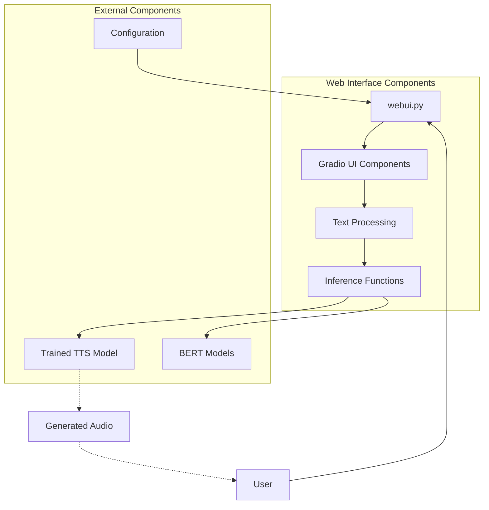
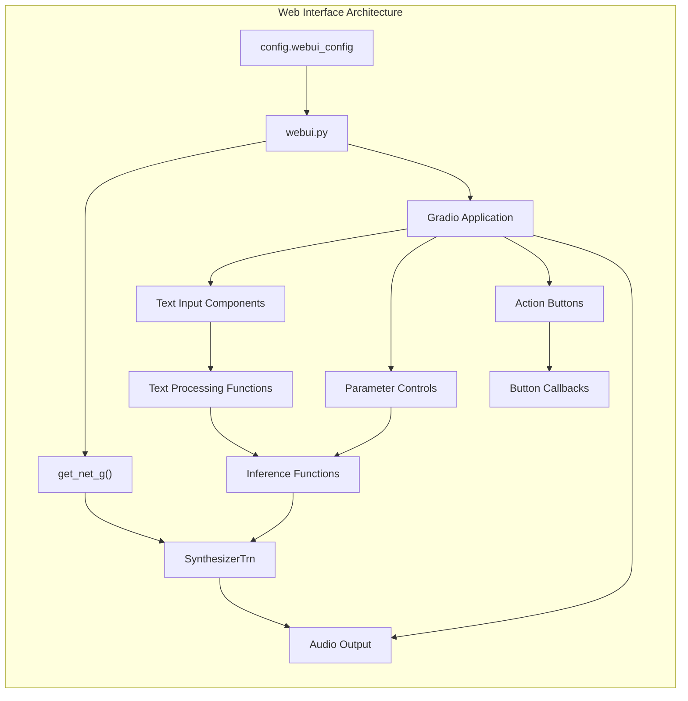
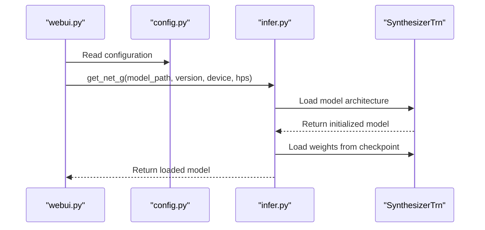
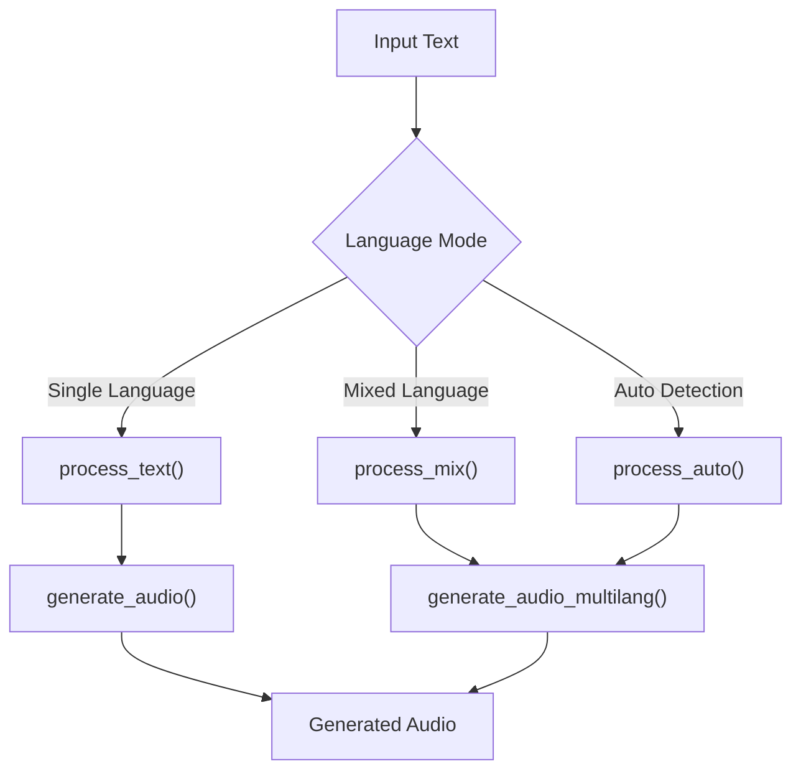
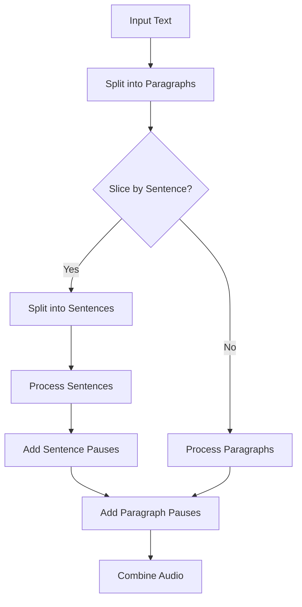
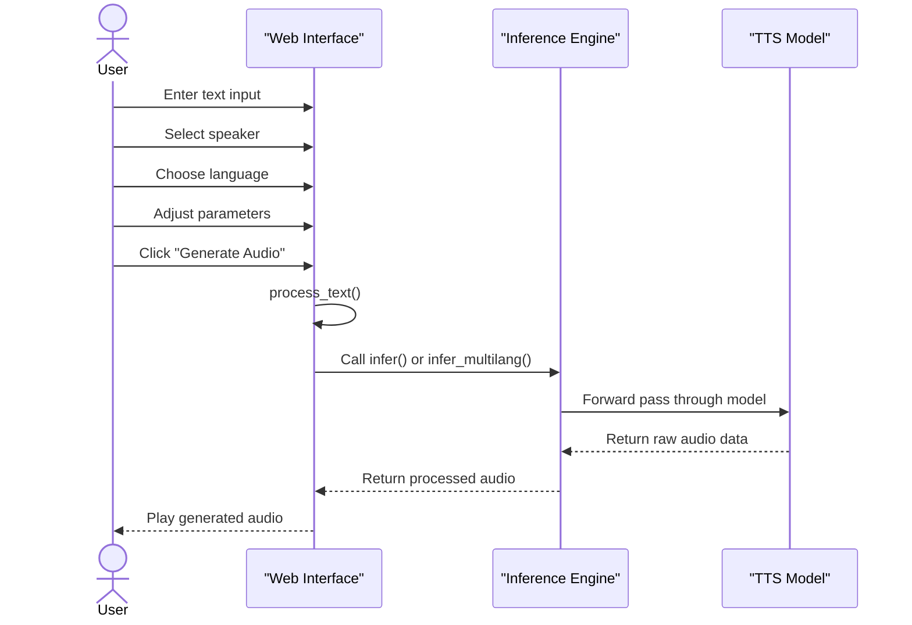

<!-- source: DeepWiki mcp.deepwiki.com · repo fishaudio/Bert-VITS2 · page 5.1 Web Interface · fetched 2026-10-29 -->

# Web Interface

<details>
<summary>Relevant source files</summary>

The following files were used as context for generating this wiki page:

- [infer.py](infer.py)
- [webui.py](webui.py)

</details>


The Web Interface provides an interactive front-end for Bert-VITS2, enabling users to generate speech from text without requiring programming knowledge. This document explains the architecture, components, and usage of the Gradio-based web UI implementation for text-to-speech synthesis. For information about programmatic access through the API Server, see [API Server](#5.2).

## Overview

The Bert-VITS2 web interface provides a user-friendly way to interact with the text-to-speech engine. It offers various controls for adjusting speech generation parameters, supports multiple languages, and provides features like text translation, style customization, and batch processing.



Sources: [webui.py:1-570]()

## Interface Architecture

The web interface is built using Gradio, a Python library for creating web-based interfaces for machine learning models. The interface loads pre-trained Bert-VITS2 models and provides a UI for text input, parameter adjustment, and audio output.



Sources: [webui.py:19-22](), [webui.py:389-399](), [webui.py:403-504]()

## Core Components

The web interface consists of several key components that work together to provide text-to-speech functionality:

### Model Loading

When the web UI starts, it loads the trained model specified in the configuration:



Sources: [webui.py:395-398](), [infer.py:84-104]()

### UI Components

The Gradio interface is organized into two main columns:

1. **Input Column**:
   - Text input area for entering content to synthesize
   - Speaker selection dropdown
   - Prompt mode selection (Text/Audio)
   - Parameter sliders (SDP Ratio, Noise, Noise_W, Length)
   - Language selection
   - Generation buttons

2. **Output Column**:
   - Style text customization
   - Text slicing controls
   - Status information display
   - Audio playback widget

Sources: [webui.py:404-503]()

### Text Processing Functions

The interface includes several functions for processing text before synthesis:

| Function | Purpose |
|----------|---------|
| `process_text()` | Main text processing function that handles different language modes |
| `process_mix()` | Processes text in mixed language mode |
| `process_auto()` | Automatically detects language in text segments |
| `format_utils()` | Reformats text to match mixed language format |
| `translate()` | Translates Chinese text to Japanese |

Sources: [webui.py:134-245](), [webui.py:361-368]()

### Audio Generation Functions

These functions handle the actual audio synthesis process:

| Function | Purpose |
|----------|---------|
| `generate_audio()` | Generates audio for single language input |
| `generate_audio_multilang()` | Generates audio for mixed language input |
| `tts_fn()` | Main function called when the generate button is clicked |
| `tts_split()` | Handles splitting text into paragraphs and sentences |

Sources: [webui.py:44-131](), [webui.py:319-358]()

## Text Processing Capabilities

The web interface supports multiple text processing modes to handle different language inputs:

### Single Language Mode

For single language input (ZH, JP, or EN), the text is directly processed and sent to the model for synthesis.

### Mixed Language Mode

The mixed language mode allows users to specify different languages within the input text using a specific format:
```
[speaker]<language_code>text content <another_language>more text
```

Example:
```
[speaker1]<zh>你好，こんにちは！ <jp>こんにちは，世界。
```

Sources: [webui.py:408-416](), [webui.py:245-283]()

### Auto Language Detection

The auto language detection mode automatically identifies language segments within the input text and processes them accordingly without requiring manual language tags.



Sources: [webui.py:227-242](), [webui.py:284-298]()

## Parameter Controls

The web interface provides several parameters to control the speech synthesis quality and style:

| Parameter | Description | Range | Default |
|-----------|-------------|-------|---------|
| SDP Ratio | Controls the stochastic duration predictor ratio | 0.0 - 1.0 | 0.5 |
| Noise | Controls the noise level (affects voice variation) | 0.1 - 2.0 | 0.6 |
| Noise_W | Controls the noise width (affects pronunciation clarity) | 0.1 - 2.0 | 0.9 |
| Length | Controls the speech speed (higher values = slower speech) | 0.1 - 2.0 | 1.0 |
| Style Weight | Controls the influence of the style text on the output | 0.0 - 1.0 | 0.7 |

Sources: [webui.py:443-457](), [webui.py:467-474]()

## Special Features

### Text Slicing

The interface supports two text slicing modes:

1. **Paragraph Slicing**: Splits text into paragraphs for processing
2. **Sentence Slicing**: Further splits paragraphs into sentences

These options help in processing long texts and adding appropriate pauses between sentences and paragraphs.



Sources: [webui.py:134-203](), [webui.py:477-494]()

### Style Text Blending

The interface allows blending the semantic features of an auxiliary "style text" with the main text, which can help achieve specific emotional tones or speaking styles.

Sources: [webui.py:460-474](), [infer.py:107-122]()

### Audio Prompting

Instead of using text to describe the desired style, users can upload an audio sample as a reference for the voice style to emulate.

Sources: [webui.py:428-442](), [webui.py:332-341]()

## Usage Flow

The typical usage flow of the web interface involves:

1. Entering text in the input field
2. Selecting a speaker from the dropdown
3. Choosing a language mode (ZH, JP, EN, mix, or auto)
4. Adjusting synthesis parameters as needed
5. Clicking "Generate Audio" to create the speech
6. Listening to the result and making further adjustments if necessary



Sources: [webui.py:504-520](), [webui.py:319-358](), [infer.py:151-332]()

## Running the Web Interface

The web interface can be launched by running the `webui.py` script, which will start a local server and automatically open the interface in the default web browser.

```
python webui.py
```

The interface will be accessible at `http://127.0.0.1:<port>`, where the port is specified in the configuration (default is typically 7860).

Sources: [webui.py:567-569]()

## Configuration Options

The web interface behavior can be customized through the `config.webui_config` settings:

| Setting | Description |
|---------|-------------|
| `device` | Device to use for inference (cuda, cpu, mps) |
| `model` | Path to the model checkpoint |
| `config_path` | Path to the model configuration file |
| `port` | Port to run the web server on |
| `share` | Whether to create a public URL using Gradio's sharing feature |
| `debug` | Enable debug-level logging |

Sources: [webui.py:31-33](), [webui.py:391-393](), [webui.py:569]()

---

