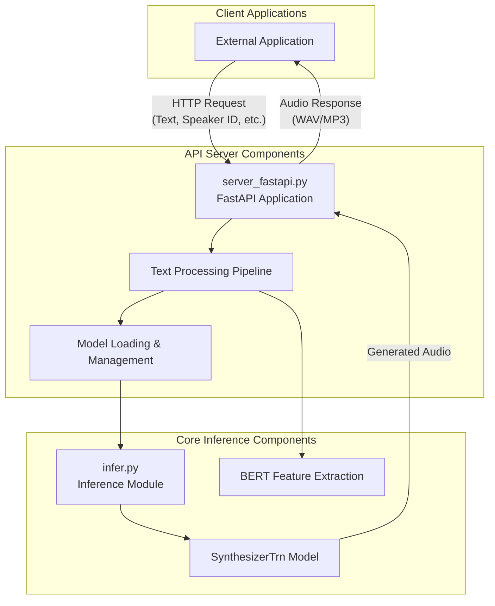
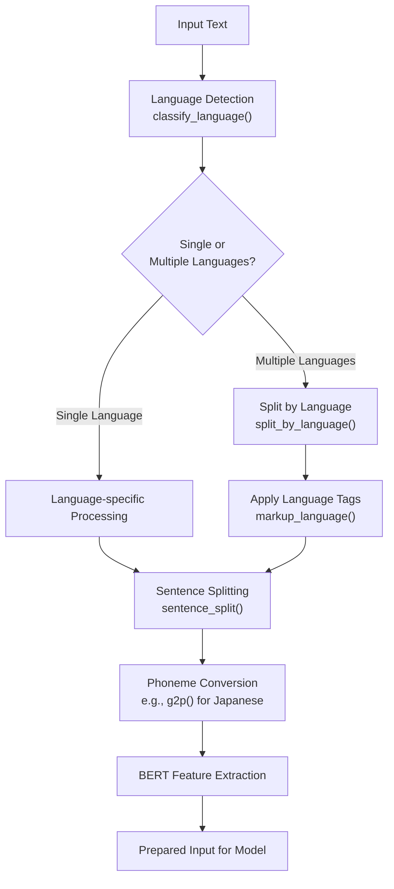
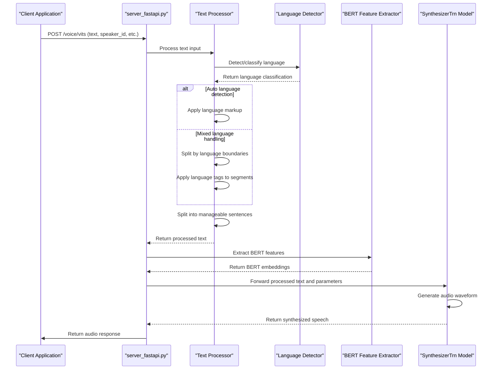
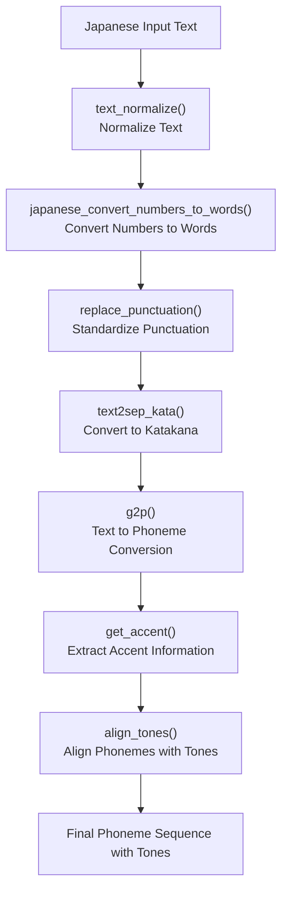

<!-- source: DeepWiki mcp.deepwiki.com · repo fishaudio/Bert-VITS2 · page 5.2 API Server · fetched 2026-10-29 -->

# API Server

<details>
<summary>Relevant source files</summary>

The following files were used as context for generating this wiki page:

- [text/japanese.py](text/japanese.py)
- [tools/classify_language.py](tools/classify_language.py)
- [tools/sentence.py](tools/sentence.py)

</details>


The API Server in Bert-VITS2 provides programmatic access to the text-to-speech synthesis capabilities through a FastAPI-based HTTP server. It enables developers to integrate Bert-VITS2's voice synthesis into external applications without needing to use the Web Interface. For information about the Web Interface, see [Web Interface](#5.1).

## System Architecture

The API Server is positioned as a key deployment option within the Bert-VITS2 ecosystem, serving as an alternative to the Gradio-based Web Interface.

### Relationship with Other Components



Sources: Inference/Deployment section from system architecture diagrams

## Text Processing Pipeline

Before synthesis, input text undergoes several processing steps to prepare it for the TTS model.



Sources: [tools/sentence.py:17-56](), [tools/sentence.py:59-94](), [tools/sentence.py:97-116](), [tools/classify_language.py:115-139]()

## Language Detection and Processing

The API Server implements sophisticated language detection and handling mechanisms to support multilingual text-to-speech synthesis.

### Language Detection Flow

```mermaid
flowchart TD
    Text["Input Text"] --> DetectionMethod{"Language Detection\nMethod"}
    
    DetectionMethod -- "Auto (Default)" --> AutoDetect["classify_language()\nUses langid or fastlid"]
    DetectionMethod -- "Manual Selection" --> ManualLang["Use Specified Language"]
    DetectionMethod -- "Mix Mode" --> MixedLang["Process as Mixed Language"]
    
    AutoDetect --> TargetCheck{"Target Languages\nSpecified?"}
    TargetCheck -- "Yes" --> FilterLangs["Filter to Supported Languages"]
    TargetCheck -- "No" --> AllLangs["Use All Supported Languages"]
    
    FilterLangs --> SplitCheck{"Mixed Text?"}
    AllLangs --> SplitCheck
    
    SplitCheck -- "Yes" --> SplitText["split_alpha_nonalpha()\nSeparate Asian/Latin Text"]
    SplitCheck -- "No" --> ProcessWhole["Process as Single Language"]
    
    SplitText --> ApplyTags["Apply Language Tags\n[ZH], [JA], [EN], etc."]
    ProcessWhole --> LanguageSpecific["Language-Specific Processing"]
    
    ManualLang --> LanguageSpecific
    MixedLang --> ApplyTags
    
    ApplyTags --> FinalText["Marked Text for Synthesis"]
    LanguageSpecific --> FinalText
```



Sources: [tools/classify_language.py:115-139](), [tools/classify_language.py:142-160](), [tools/classify_language.py:163-171](), [tools/sentence.py:119-151]()

## API Endpoints and Usage

The API server provides several endpoints for text-to-speech synthesis with different configuration options.

### Endpoint Structure

| Endpoint | Method | Purpose |
|----------|--------|---------|
| `/voice/vits` | POST | Basic TTS synthesis |
| `/voice/multi-speaker` | POST | TTS synthesis with speaker selection |
| `/version` | GET | Get API version information |
| `/models` | GET | List available models |
| `/speakers` | GET | List available speakers |

### Request Parameters

| Parameter | Type | Description |
|-----------|------|-------------|
| `text` | string | Input text for synthesis |
| `speaker` | integer | Speaker ID |
| `language` | string | Language code (zh, ja, en) or "auto", "mix" |
| `length` | float | Speech length/speed factor |
| `noise` | float | Noise scale parameter |
| `noisew` | float | Noise width parameter |
| `max_len` | integer | Maximum sentence length for splitting |

## Sample Workflow

The typical request flow through the API server illustrates how the various components interact to produce synthesized speech.



Sources: Inference Pipeline section from system architecture diagrams

## Language-Specific Processing Example (Japanese)

The API server includes specialized processing for different languages. For instance, Japanese text undergoes a complex conversion process before synthesis.



Sources: [text/japanese.py:313-348](), [text/japanese.py:351-373](), [text/japanese.py:383-413](), [text/japanese.py:678-706]()

## Client Integration Example

Below is a simple example showing how a client application might interact with the API server:

```python
import requests
import io
from scipy.io.wavfile import write

# API server endpoint
url = "http://localhost:8000/voice/vits"

# Request parameters
payload = {
    "text": "こんにちは、世界！Hello, world!",
    "speaker": 0,
    "language": "auto",
    "length": 1.0,
    "noise": 0.6,
    "noisew": 0.8,
    "max_len": 50
}

# Send request to API
response = requests.post(url, json=payload)

# Handle audio response
if response.status_code == 200:
    # Convert response to audio file
    audio_data = io.BytesIO(response.content)
    write("output.wav", 22050, audio_data)
    print("Audio generated successfully")
else:
    print(f"Error: {response.status_code}, {response.text}")
```

## Error Handling and Limitations

The API server implements several error handling mechanisms to address common issues:

1. **Text length limitations**: Very long texts are automatically split into manageable segments
2. **Language compatibility**: Speaker and language compatibility checks prevent mismatched synthesis attempts
3. **Parameter validation**: Inference parameters are validated before processing to prevent errors
4. **Model loading errors**: Graceful handling of model loading failures with appropriate error messages
5. **BERT feature extraction failures**: Fallback mechanisms for when BERT feature extraction fails

## Conclusion

The API Server provides a robust and flexible interface for integrating Bert-VITS2's text-to-speech capabilities into external applications. By exposing the model's functionality through standardized HTTP endpoints, it enables developers to create advanced voice synthesis applications without needing to directly interact with the underlying model architecture.

For more information about the compatibility between different versions of the API server and models, see [Version Compatibility](#5.3).

---

