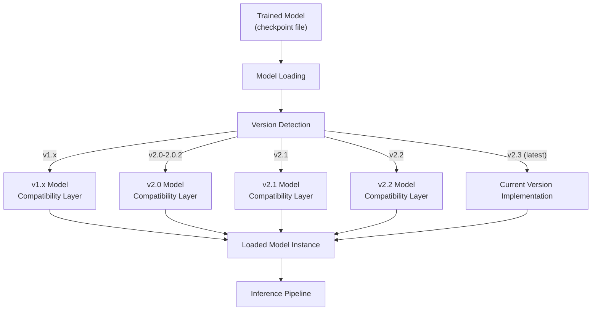
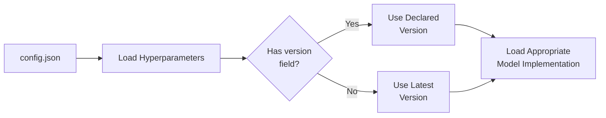
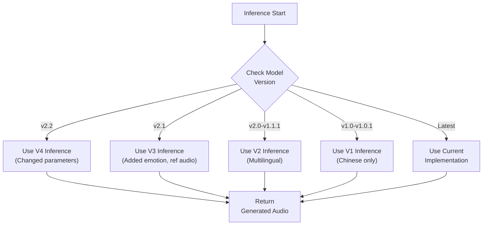
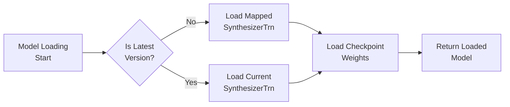
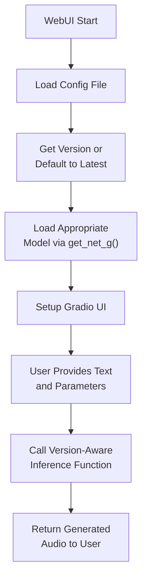
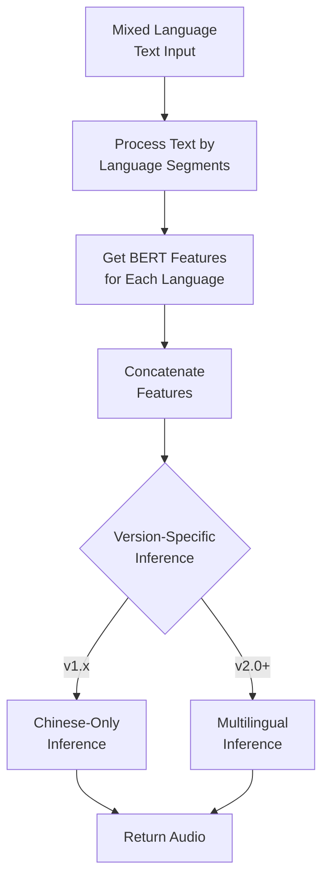

<!-- source: DeepWiki mcp.deepwiki.com · repo fishaudio/Bert-VITS2 · page 5.3 Version Compatibility · fetched 2026-10-29 -->

# Version Compatibility

<details>
<summary>Relevant source files</summary>

The following files were used as context for generating this wiki page:

- [for_deploy/infer.py](for_deploy/infer.py)
- [infer.py](infer.py)
- [oldVersion/V210/__init__.py](oldVersion/V210/__init__.py)
- [oldVersion/V210/text/tone_sandhi.py](oldVersion/V210/text/tone_sandhi.py)
- [oldVersion/V220/__init__.py](oldVersion/V220/__init__.py)
- [oldVersion/V220/text/tone_sandhi.py](oldVersion/V220/text/tone_sandhi.py)
- [slm/wavlm-base-plus/.gitattributes](slm/wavlm-base-plus/.gitattributes)
- [slm/wavlm-base-plus/README.md](slm/wavlm-base-plus/README.md)
- [webui.py](webui.py)

</details>


This document explains how Bert-VITS2 manages compatibility between different model versions, ensuring that models trained with older versions can still be used with the latest codebase. It covers the version detection system, model loading mechanisms, inference compatibility, and version-specific features. For information about inference and deployment in general, see [Inference and Deployment](#5).

## Version Management System Overview

Bert-VITS2 uses a version management system that aligns with GitHub release versions. Each trained model is associated with a specific version number corresponding to the Bert-VITS2 release it was trained with. The system loads appropriate model architectures, symbols, and inference methods based on the model's declared version.



Sources: [infer.py:1-55](). [webui.py:396-399]()

## Version Declaration and Detection

### Version Declaration in Models

Each model must declare its version in its `config.json` file:

```json
{
  "version": "2.3",
  "other_parameters": "..."
}
```

If no version is specified, the system assumes the model was trained with the latest version.

### Version Detection Process

During model loading, the system checks for a version field in the hyperparameters loaded from the model's config file. If not found, it defaults to the latest version.



Sources: [infer.py:84-104](). [webui.py:394-397]()

## Version Mapping System

The system maintains mappings between version numbers and their corresponding implementations for:

1. Model architectures (SynthesizerTrn)
2. Symbol sets
3. Inference methods

These mappings ensure that each model is loaded and used with the correct implementation.

### SynthesizerTrn Model Mapping

Each version is mapped to the appropriate model implementation:

| Version | Implementation |
|---------|---------------|
| 2.2 | V220SynthesizerTrn |
| 2.1 | V210SynthesizerTrn |
| 2.0-2.0.2 | V200SynthesizerTrn |
| 1.1.1 | V111SynthesizerTrn |
| 1.1, 1.1.0 | V110SynthesizerTrn |
| 1.0, 1.0.0, 1.0.1 | V101SynthesizerTrn |

### Symbol Set Mapping

Each version uses a specific set of symbols for text processing:

| Version | Symbol Set |
|---------|------------|
| 2.2 | V220symbols |
| 2.1 | V210symbols |
| 2.0-2.0.2 | V200symbols |
| 1.1.1 | V111symbols |
| 1.1, 1.1.0 | V110symbols |
| 1.0, 1.0.0, 1.0.1 | V101symbols |

### Inference Method Mapping

Different inference strategies are used based on the model version:

| Version Group | Description | Implementation Map |
|---------------|-------------|-------------------|
| v2.2 | Parameter position changes | inferMap_V4 |
| v2.1 | Added emotion, reference audio, skip options | inferMap_V3 |
| v2.0-v1.1.1 | Multilingual support (ZH, JP, EN) | inferMap_V2 |
| v1.0-v1.0.1 | Chinese-only support | inferMap_V1 |

Sources: [infer.py:42-70](). [infer.py:170-193]()

## Version-Specific Inference

The inference process adapts to different versions by:

1. Selecting the appropriate inference function for the version
2. Handling version-specific parameters
3. Managing differences in parameter ordering and requirements



### Key Differences Between Versions

| Version | Key Changes |
|---------|------------|
| 2.3 (latest) | Current implementation |
| 2.2 | CLAP-enhanced prompt audio generation, parameter position changes |
| 2.1 | Added emotion and multi-language optimization features |
| 2.0-2.0.2 | Added multilingual support (ZH, JP, EN) |
| 1.1.1-fix | 1.1.1 with Japanese language fixes |
| 1.1.1, 1.1, 1.1.0 | Enhanced Chinese support |
| 1.0, 1.0.0, 1.0.1 | Initial Chinese-only version |

Sources: [infer.py:151-259](). [oldVersion/V210/__init__.py:1-3](), [oldVersion/V220/__init__.py:1-3]()

## Model Loading Mechanism

The `get_net_g` function is central to version compatibility, handling model loading for all versions:



The function:
1. Determines the appropriate model architecture based on version
2. Initializes the model with version-specific parameters
3. Loads the checkpoint weights into the model
4. Returns the ready-to-use model

Sources: [infer.py:84-104]()

## Version Compatibility in the Web UI

The web UI also incorporates version compatibility handling:

1. Loads the hyperparameters from the config file
2. Detects the model version or defaults to latest
3. Loads the appropriate model using `get_net_g`
4. Uses compatibility-aware inference functions



Sources: [webui.py:391-399](). [webui.py:67-85]()

## Multilingual Compatibility

The version system also handles differences in language support across versions:

- v1.0-v1.0.1: Chinese only
- v1.1-v2.2: Chinese, Japanese, English
- Latest: Enhanced multilingual features with improved mixing

The `infer_multilang` function provides version-compatible multilingual text synthesis.



Sources: [infer.py:335-437](). [webui.py:91-131]()

## Best Practices for Version Compatibility

### When Training Models

1. Always specify the version in your config.json file
2. Train models with the same version you intend to use for inference
3. Document which version was used for training

### When Using Pre-trained Models

1. Check the model's version in its config.json
2. Use the appropriate version-compatible inference method
3. Be aware of version-specific features or limitations

### When Updating Your Codebase

1. The version compatibility layer allows using older models with newer code
2. If experiencing issues, ensure you're using the correct version declarations
3. Some new features may not be available with older model versions

Sources: [infer.py:1-9]()

## Known Limitations

- Version 1.x models support only Chinese language
- Special versions like "1.1.1-fix" have specific compatibility adjustments
- Emotion features are only available in v2.1 and later
- CLAP-enhanced audio prompts are only available in v2.2 and later
- Parameter order and names may change between versions

This version compatibility system ensures that models trained with any released version of Bert-VITS2 can be used for inference with the current codebase, preserving investment in model training across version updates.

Sources: [infer.py:1-9](). [infer.py:165-193]()

---

